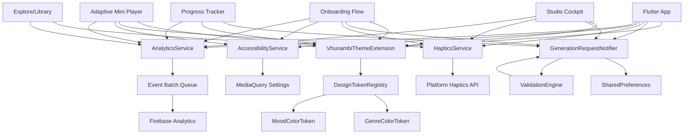

# Design Document: Cross-Cutting Design System

## Overview

The Cross-Cutting Design System provides foundational infrastructure that ensures consistency, accessibility, and maintainability across the Vhunambi application. This system serves as the bedrock for Studio Cockpit Fixes (VH-001 to VH-006), Onboarding Modernization (VH-007 to VH-013), and Adaptive Mini Player (VH-014 to VH-017), eliminating duplicated color definitions, scattered haptic calls, and fragmented analytics instrumentation.

### Design Goals

1. **Single Source of Truth**: Centralize genre/mood color definitions, generation parameters, and haptic patterns
2. **Consistency**: Ensure visual identity and interaction patterns remain uniform across all features
3. **Accessibility**: Enforce WCAG AA standards at the design system level, not per-feature
4. **Maintainability**: Enable updates to colors, haptics, or analytics without touching feature code
5. **Performance**: Optimize token lookups and state updates to maintain 60fps on mid-range devices
6. **Testability**: Provide mock implementations for all services to enable fast unit testing

### Design Principles

- **Declarative Tokens**: Define design decisions as data, not scattered constants
- **Platform Abstraction**: Hide iOS/Android differences behind unified interfaces
- **Type Safety**: Use enums and sealed classes, never string literals
- **Fail Fast**: Validate tokens at registration time, not access time
- **Privacy First**: Never log sensitive user data in analytics events
- **Progressive Enhancement**: Gracefully degrade when platform APIs are unavailable

## Architecture

### High-Level System Architecture



### Component Dependency Graph

```
DesignTokenRegistry (no dependencies)
  ↓
VhunambiThemeExtension → DesignTokenRegistry
  ↓
HapticsService → Platform APIs
  ↓
AccessibilityService → MediaQuery
  ↓
GenerationRequestNotifier → SharedPreferences, ValidationEngine
  ↓
AnalyticsService → Firebase Analytics

Features depend on all services, but services are independent of features.
```

### Integration Points

1. **Studio Cockpit** (VH-001 to VH-006):
   - Uses genre/mood tokens for card colors
   - Uses GenerationRequestModel for visibility toggle, DNA slider, progress tracker
   - Uses HapticsService for DNA slider haptics
   - Uses AnalyticsService for generation start events

2. **Onboarding Modernization** (VH-007 to VH-013):
   - Uses genre/mood tokens for carousel chips
   - Uses HapticsService for role selection, chip selection
   - Uses AnalyticsService for onboarding funnel tracking
   - Uses AccessibilityService for reduce-motion detection

3. **Adaptive Mini Player** (VH-014 to VH-017):
   - Uses HapticsService for morph gestures
   - Uses AccessibilityService for touch target validation
   - Uses AnalyticsService for form usage tracking

### State Flow

```
User Interaction → Service Method → State Update → Riverpod Notification → Widget Rebuild

Example (Genre Selection):
1. User taps Amapiano chip
2. Chip onTap → generationRequestNotifier.setGenre(Genre.amapiano)
3. GenerationRequestNotifier updates _state.genre
4. StateNotifier notifies listeners
5. Widgets rebuild with new genre token from theme extension
6. Persistence writes to SharedPreferences (async, non-blocking)
7. Analytics event queued for next batch send
```

---

## Components and Interfaces

### 1. DesignTokenRegistry

The DesignTokenRegistry is the compile-time registry for all genre and mood color tokens. It performs validation at registration to enforce accessibility standards.

#### Class Structure

```dart
/// Central registry for design tokens
/// Validates contrast ratios and prevents duplicate registrations
class DesignTokenRegistry {
  static final Map<Genre, ColorToken> _genreTokens = {};
  static final Map<Mood, ColorToken> _moodTokens = {};
  
  static bool _isSealed = false;
  
  /// Register a genre color token
  /// Throws [DuplicateTokenException] if genre already registered
  /// Throws [ContrastViolationException] if contrast ratio < 4.5:1
  static void registerGenre(Genre genre, ColorToken token) {
    if (_isSealed) throw StateError('Registry is sealed after first access');
    if (_genreTokens.containsKey(genre)) {
      throw DuplicateTokenException('Genre $genre already registered');
    }
    _validateToken(token, genre.toString());
    _genreTokens[genre] = token;
  }
  
  /// Register a mood color token
  static void registerMood(Mood mood, ColorToken token) {
    if (_isSealed) throw StateError('Registry is sealed after first access');
    if (_moodTokens.containsKey(mood)) {
      throw DuplicateTokenException('Mood $mood already registered');
    }
    _validateToken(token, mood.toString());
    _moodTokens[mood] = token;
  }
  
  /// Get genre color token
  /// Seals registry on first access to prevent late registration
  static ColorToken getGenreToken(Genre genre) {
    _isSealed = true;
    final token = _genreTokens[genre];
    if (token == null) {
      throw TokenNotFoundException(
        'Genre $genre not found. Available: ${_genreTokens.keys.join(", ")}'
      );
    }
    return token;
  }
  
  /// Get mood color token
  static ColorToken getMoodToken(Mood mood) {
    _isSealed = true;
    final token = _moodTokens[mood];
    if (token == null) {
      throw TokenNotFoundException(
        'Mood $mood not found. Available: ${_moodTokens.keys.join(", ")}'
      );
    }
    return token;
  }
  
  /// Generate validation report for design review
  /// Returns map of token name to contrast ratio
  static Map<String, double> generateValidationReport() {
    final report = <String, double>{};
    for (final entry in _genreTokens.entries) {
      report['Genre.${entry.key}'] = _calculateContrastRatio(
        entry.value.textColor,
        entry.value.surfaceTint,
      );
    }
    for (final entry in _moodTokens.entries) {
      report['Mood.${entry.key}'] = _calculateContrastRatio(
        entry.value.textColor,
        entry.value.surfaceTint,
      );
    }
    return report;
  }
  
  /// Validate token meets accessibility standards
  static void _validateToken(ColorToken token, String name) {
    final ratio = _calculateContrastRatio(token.textColor, token.surfaceTint);
    if (ratio < 4.5) {
      throw ContrastViolationException(
        'Token $name has contrast ratio $ratio, minimum is 4.5:1. '
        'Text: ${token.textColor}, Surface: ${token.surfaceTint}'
      );
    }
  }
  
  /// Calculate contrast ratio between two colors
  /// Returns ratio as double (e.g., 4.5 for 4.5:1)
  static double _calculateContrastRatio(Color foreground, Color background) {
    final fgLuminance = _relativeLuminance(foreground);
    final bgLuminance = _relativeLuminance(background);
    final lighter = max(fgLuminance, bgLuminance);
    final darker = min(fgLuminance, bgLuminance);
    return (lighter + 0.05) / (darker + 0.05);
  }
  
  /// Calculate relative luminance per WCAG formula
  static double _relativeLuminance(Color color) {
    final r = _linearize(color.red / 255.0);
    final g = _linearize(color.green / 255.0);
    final b = _linearize(color.blue / 255.0);
    return 0.2126 * r + 0.7152 * g + 0.0722 * b;
  }
  
  static double _linearize(double channel) {
    return channel <= 0.03928
        ? channel / 12.92
        : pow((channel + 0.055) / 1.055, 2.4).toDouble();
  }
  
  /// Test-only: Reset registry for test isolation
  @visibleForTesting
  static void reset() {
    _genreTokens.clear();
    _moodTokens.clear();
    _isSealed = false;
  }
}
```

#### Genre and Mood Enums

```dart
/// Musical genre categories
enum Genre {
  amapiano,
  afroHouse,
  gqom,
  kwaito,
  afroPop,
  maskandi,
  hipHop,
  gospel;
  
  String get displayName {
    switch (this) {
      case Genre.amapiano: return 'Amapiano';
      case Genre.afroHouse: return 'Afro House';
      case Genre.gqom: return 'Gqom';
      case Genre.kwaito: return 'Kwaito';
      case Genre.afroPop: return 'Afro Pop';
      case Genre.maskandi: return 'Maskandi';
      case Genre.hipHop: return 'Hip-Hop';
      case Genre.gospel: return 'Gospel';
    }
  }
}

/// Emotional mood categories
enum Mood {
  joyful,
  melancholic,
  energetic,
  calm,
  romantic;
  
  String get displayName {
    switch (this) {
      case Mood.joyful: return 'Joyful';
      case Mood.melancholic: return 'Melancholic';
      case Mood.energetic: return 'Energetic';
      case Mood.calm: return 'Calm';
      case Mood.romantic: return 'Romantic';
    }
  }
}
```

#### ColorToken Data Class

```dart
/// Immutable color token with accessibility validation
@immutable
class ColorToken {
  /// Accent color for selected states and emphasis
  final Color accent;
  
  /// Surface tint color for background (alpha 0.15 typical)
  final Color surfaceTint;
  
  /// Glow color for shadows and highlights
  final Color glow;
  
  /// Contrast-safe text color for use on tinted surfaces
  final Color textColor;
  
  const ColorToken({
    required this.accent,
    required this.surfaceTint,
    required this.glow,
    required this.textColor,
  });
  
  /// Create token with automatic text color calculation
  /// Chooses white or black based on contrast ratio
  factory ColorToken.auto({
    required Color accent,
    required Color surfaceTint,
    required Color glow,
  }) {
    final whiteContrast = DesignTokenRegistry._calculateContrastRatio(
      Colors.white,
      surfaceTint,
    );
    final blackContrast = DesignTokenRegistry._calculateContrastRatio(
      Colors.black,
      surfaceTint,
    );
    final textColor = whiteContrast > blackContrast ? Colors.white : Colors.black;
    
    return ColorToken(
      accent: accent,
      surfaceTint: surfaceTint,
      glow: glow,
      textColor: textColor,
    );
  }
  
  @override
  bool operator ==(Object other) =>
      identical(this, other) ||
      other is ColorToken &&
          accent == other.accent &&
          surfaceTint == other.surfaceTint &&
          glow == other.glow &&
          textColor == other.textColor;
  
  @override
  int get hashCode =>
      accent.hashCode ^
      surfaceTint.hashCode ^
      glow.hashCode ^
      textColor.hashCode;
}
```

#### Token Registration (Initialization)

```dart
/// Initialize design tokens
/// Called once at app startup before MaterialApp
void initializeDesignTokens() {
  // Register Genre Tokens
  DesignTokenRegistry.registerGenre(
    Genre.amapiano,
    ColorToken.auto(
      accent: const Color(0xFF06B6D4),      // Cyan 500
      surfaceTint: const Color(0x2606B6D4), // Cyan 500 @ 15%
      glow: const Color(0x4006B6D4),        // Cyan 500 @ 25%
    ),
  );
  
  DesignTokenRegistry.registerGenre(
    Genre.afroHouse,
    ColorToken.auto(
      accent: const Color(0xFFF59E0B),      // Amber 500
      surfaceTint: const Color(0x26F59E0B), // Amber 500 @ 15%
      glow: const Color(0x40F59E0B),        // Amber 500 @ 25%
    ),
  );
  
  DesignTokenRegistry.registerGenre(
    Genre.gqom,
    ColorToken.auto(
      accent: const Color(0xFFEF4444),      // Red 500
      surfaceTint: const Color(0x26EF4444), // Red 500 @ 15%
      glow: const Color(0x40EF4444),        // Red 500 @ 25%
    ),
  );
  
  DesignTokenRegistry.registerGenre(
    Genre.kwaito,
    ColorToken.auto(
      accent: const Color(0xFFF97316),      // Orange 500 (Brand Primary)
      surfaceTint: const Color(0x26F97316), // Orange 500 @ 15%
      glow: const Color(0x40F97316),        // Orange 500 @ 25%
    ),
  );
  
  DesignTokenRegistry.registerGenre(
    Genre.afroPop,
    ColorToken.auto(
      accent: const Color(0xFFEC4899),      // Pink 500
      surfaceTint: const Color(0x26EC4899), // Pink 500 @ 15%
      glow: const Color(0x40EC4899),        // Pink 500 @ 25%
    ),
  );
  
  DesignTokenRegistry.registerGenre(
    Genre.maskandi,
    ColorToken.auto(
      accent: const Color(0xFF8B5CF6),      // Violet 500
      surfaceTint: const Color(0x268B5CF6), // Violet 500 @ 15%
      glow: const Color(0x408B5CF6),        // Violet 500 @ 25%
    ),
  );
  
  DesignTokenRegistry.registerGenre(
    Genre.hipHop,
    ColorToken.auto(
      accent: const Color(0xFF10B981),      // Emerald 500
      surfaceTint: const Color(0x2610B981), // Emerald 500 @ 15%
      glow: const Color(0x4010B981),        // Emerald 500 @ 25%
    ),
  );
  
  DesignTokenRegistry.registerGenre(
    Genre.gospel,
    ColorToken.auto(
      accent: const Color(0xFF3B82F6),      // Blue 500
      surfaceTint: const Color(0x263B82F6), // Blue 500 @ 15%
      glow: const Color(0x403B82F6),        // Blue 500 @ 25%
    ),
  );
  
  // Register Mood Tokens
  DesignTokenRegistry.registerMood(
    Mood.joyful,
    ColorToken.auto(
      accent: const Color(0xFFFBBF24),      // Amber 400 (lighter than genre)
      surfaceTint: const Color(0x26FBBF24), // Amber 400 @ 15%
      glow: const Color(0x40FBBF24),        // Amber 400 @ 25%
    ),
  );
  
  DesignTokenRegistry.registerMood(
    Mood.melancholic,
    ColorToken.auto(
      accent: const Color(0xFF6366F1),      // Indigo 500
      surfaceTint: const Color(0x266366F1), // Indigo 500 @ 15%
      glow: const Color(0x406366F1),        // Indigo 500 @ 25%
    ),
  );
  
  DesignTokenRegistry.registerMood(
    Mood.energetic,
    ColorToken.auto(
      accent: const Color(0xFFDC2626),      // Red 600 (darker than genre)
      surfaceTint: const Color(0x26DC2626), // Red 600 @ 15%
      glow: const Color(0x40DC2626),        // Red 600 @ 25%
    ),
  );
  
  DesignTokenRegistry.registerMood(
    Mood.calm,
    ColorToken.auto(
      accent: const Color(0xFF14B8A6),      // Teal 500
      surfaceTint: const Color(0x2614B8A6), // Teal 500 @ 15%
      glow: const Color(0x4014B8A6),        // Teal 500 @ 25%
    ),
  );
  
  DesignTokenRegistry.registerMood(
    Mood.romantic,
    ColorToken.auto(
      accent: const Color(0xFFF472B6),      // Pink 400 (lighter than genre)
      surfaceTint: const Color(0x26F472B6), // Pink 400 @ 15%
      glow: const Color(0x40F472B6),        // Pink 400 @ 25%
    ),
  );
}
```

---

### 2. VhunambiThemeExtension

The VhunambiThemeExtension integrates design tokens into Flutter's theme system, allowing access via `Theme.of(context)`.

#### Class Structure

```dart
/// Theme extension for Vhunambi design tokens
/// Provides access to genre/mood colors via Theme.of(context)
@immutable
class VhunambiThemeExtension extends ThemeExtension<VhunambiThemeExtension> {
  final Genre? currentGenre;
  final Mood? currentMood;
  
  const VhunambiThemeExtension({
    this.currentGenre,
    this.currentMood,
  });
  
  /// Get current genre color token
  /// Returns null if no genre selected
  ColorToken? get genreToken {
    if (currentGenre == null) return null;
    return DesignTokenRegistry.getGenreToken(currentGenre!);
  }
  
  /// Get current mood color token
  /// Returns null if no mood selected
  ColorToken? get moodToken {
    if (currentMood == null) return null;
    return DesignTokenRegistry.getMoodToken(currentMood!);
  }
  
  /// Get color token for specific genre
  ColorToken getGenreTokenFor(Genre genre) {
    return DesignTokenRegistry.getGenreToken(genre);
  }
  
  /// Get color token for specific mood
  ColorToken getMoodTokenFor(Mood mood) {
    return DesignTokenRegistry.getMoodToken(mood);
  }
  
  @override
  VhunambiThemeExtension copyWith({
    Genre? currentGenre,
    Mood? currentMood,
  }) {
    return VhunambiThemeExtension(
      currentGenre: currentGenre ?? this.currentGenre,
      currentMood: currentMood ?? this.currentMood,
    );
  }
  
  @override
  VhunambiThemeExtension lerp(
    ThemeExtension<VhunambiThemeExtension>? other,
    double t,
  ) {
    if (other is! VhunambiThemeExtension) return this;
    // Discrete values, no interpolation
    return t < 0.5 ? this : other;
  }
  
  /// Default extension with no genre/mood selected
  static const VhunambiThemeExtension empty = VhunambiThemeExtension();
}
```

#### Integration with AppTheme

```dart
// In app_theme.dart
abstract final class AppTheme {
  static ThemeData get darkTheme {
    // ... existing theme setup ...
    
    return ThemeData(
      // ... existing properties ...
      extensions: const [
        VhunambiThemeExtension.empty,
      ],
    );
  }
  
  /// Create theme with specific genre/mood context
  static ThemeData darkThemeWith({Genre? genre, Mood? mood}) {
    final base = darkTheme;
    return base.copyWith(
      extensions: [
        VhunambiThemeExtension(
          currentGenre: genre,
          currentMood: mood,
        ),
      ],
    );
  }
}
```

#### Usage in Widgets

```dart
// Access current genre token
final vhunambiTheme = Theme.of(context).extension<VhunambiThemeExtension>()!;
final genreToken = vhunambiTheme.genreToken;

// Access specific genre token (for track cards with different genres)
final amapianoToken = vhunambiTheme.getGenreTokenFor(Genre.amapiano);

// Apply genre colors
Container(
  decoration: BoxDecoration(
    color: genreToken?.surfaceTint,
    border: Border.all(
      color: genreToken?.accent ?? AppColors.borderSubtle,
      width: 2,
    ),
    boxShadow: [
      BoxShadow(
        color: genreToken?.glow ?? Colors.transparent,
        blurRadius: 12,
        spreadRadius: 0,
      ),
    ],
  ),
  child: Text(
    'Amapiano',
    style: TextStyle(
      color: genreToken?.textColor ?? AppColors.textPrimary,
    ),
  ),
)
```

---

### 3. HapticsService

The HapticsService provides a centralized interface for haptic feedback with automatic system setting respect and platform abstraction.

#### Class Structure

```dart
/// Centralized haptic feedback service
/// Respects system haptics settings and handles platform differences
class HapticsService {
  bool _isEnabled = true;
  
  HapticsService() {
    _checkSystemSettings();
  }
  
  /// Check system haptics setting on startup
  Future<void> _checkSystemSettings() async {
    // iOS: Check haptic feedback setting via UIAccessibility
    // Android: Haptics always enabled (no system setting)
    if (Platform.isIOS) {
      // Note: No direct API for haptics setting, use accessibility APIs
      // For now, assume enabled. Will implement platform channel if needed.
      _isEnabled = true;
    } else {
      _isEnabled = true;
    }
  }
  
  /// Light impact haptic (selection, chip tap)
  Future<void> lightImpact() async {
    if (!_isEnabled) return;
    await HapticFeedback.lightImpact();
  }
  
  /// Medium impact haptic (button press, card select)
  Future<void> mediumImpact() async {
    if (!_isEnabled) return;
    await HapticFeedback.mediumImpact();
  }
  
  /// Heavy impact haptic (gesture completion, major state change)
  Future<void> heavyImpact() async {
    if (!_isEnabled) return;
    await HapticFeedback.heavyImpact();
  }
  
  /// Selection tick haptic (carousel snap, slider discrete step)
  Future<void> selectionTick() async {
    if (!_isEnabled) return;
    await HapticFeedback.selectionClick();
  }
  
  /// Vibrate pattern (Android only, no-op on iOS)
  Future<void> vibrate({Duration duration = const Duration(milliseconds: 50)}) async {
    if (!_isEnabled) return;
    await HapticFeedback.vibrate();
  }
  
  /// Enable/disable haptics (for testing or user preference)
  void setEnabled(bool enabled) {
    _isEnabled = enabled;
  }
  
  /// Get current enabled state
  bool get isEnabled => _isEnabled;
}

/// Riverpod provider for HapticsService
final hapticsServiceProvider = Provider<HapticsService>((ref) {
  return HapticsService();
});

/// Mock implementation for testing
class MockHapticsService extends HapticsService {
  final List<String> calls = [];
  
  @override
  Future<void> lightImpact() async {
    calls.add('lightImpact');
  }
  
  @override
  Future<void> mediumImpact() async {
    calls.add('mediumImpact');
  }
  
  @override
  Future<void> heavyImpact() async {
    calls.add('heavyImpact');
  }
  
  @override
  Future<void> selectionTick() async {
    calls.add('selectionTick');
  }
  
  @override
  Future<void> vibrate({Duration duration = const Duration(milliseconds: 50)}) async {
    calls.add('vibrate:${duration.inMilliseconds}ms');
  }
  
  void reset() {
    calls.clear();
  }
}
```

#### Usage in Widgets

```dart
class GenreChip extends ConsumerWidget {
  final Genre genre;
  final bool isSelected;
  
  const GenreChip({
    super.key,
    required this.genre,
    required this.isSelected,
  });
  
  @override
  Widget build(BuildContext context, WidgetRef ref) {
    final haptics = ref.read(hapticsServiceProvider);
    
    return GestureDetector(
      onTap: () {
        haptics.lightImpact();
        // ... handle selection ...
      },
      child: Container(
        // ... chip UI ...
      ),
    );
  }
}
```

---

### 4. GenerationRequestModel

The GenerationRequestModel is the single source of truth for all generation parameters, eliminating state duplication across cockpit, progress tracker, and visibility controls.

#### State Class

```dart
/// Immutable state for generation request
@immutable
class GenerationRequestState {
  final String promptText;
  final Genre? genre;
  final Mood? mood;
  final TempoFeel? tempoFeel;
  final VocalEnergy? vocalEnergy;
  final Language language;
  final String? lyricsText;
  final int dnaPercentage;
  final TrackVisibility visibility;
  
  const GenerationRequestState({
    this.promptText = '',
    this.genre,
    this.mood,
    this.tempoFeel,
    this.vocalEnergy,
    this.language = Language.english,
    this.lyricsText,
    this.dnaPercentage = 0,
    this.visibility = TrackVisibility.public,
  });
  
  GenerationRequestState copyWith({
    String? promptText,
    Genre? genre,
    Mood? mood,
    TempoFeel? tempoFeel,
    VocalEnergy? vocalEnergy,
    Language? language,
    String? lyricsText,
    int? dnaPercentage,
    TrackVisibility? visibility,
  }) {
    return GenerationRequestState(
      promptText: promptText ?? this.promptText,
      genre: genre ?? this.genre,
      mood: mood ?? this.mood,
      tempoFeel: tempoFeel ?? this.tempoFeel,
      vocalEnergy: vocalEnergy ?? this.vocalEnergy,
      language: language ?? this.language,
      lyricsText: lyricsText ?? this.lyricsText,
      dnaPercentage: dnaPercentage ?? this.dnaPercentage,
      visibility: visibility ?? this.visibility,
    );
  }
  
  /// Serialize to JSON for persistence
  Map<String, dynamic> toJson() {
    return {
      'promptText': promptText,
      'genre': genre?.name,
      'mood': mood?.name,
      'tempoFeel': tempoFeel?.name,
      'vocalEnergy': vocalEnergy?.name,
      'language': language.name,
      'lyricsText': lyricsText,
      'dnaPercentage': dnaPercentage,
      'visibility': visibility.name,
    };
  }
  
  /// Deserialize from JSON with schema evolution support
  factory GenerationRequestState.fromJson(Map<String, dynamic> json) {
    return GenerationRequestState(
      promptText: json['promptText'] as String? ?? '',
      genre: _parseEnum(Genre.values, json['genre'] as String?),
      mood: _parseEnum(Mood.values, json['mood'] as String?),
      tempoFeel: _parseEnum(TempoFeel.values, json['tempoFeel'] as String?),
      vocalEnergy: _parseEnum(VocalEnergy.values, json['vocalEnergy'] as String?),
      language: _parseEnum(Language.values, json['language'] as String?) ?? Language.english,
      lyricsText: json['lyricsText'] as String?,
      dnaPercentage: json['dnaPercentage'] as int? ?? 0,
      visibility: _parseEnum(TrackVisibility.values, json['visibility'] as String?) ?? TrackVisibility.public,
    );
  }
  
  static T? _parseEnum<T extends Enum>(List<T> values, String? name) {
    if (name == null) return null;
    try {
      return values.firstWhere((e) => e.name == name);
    } catch (_) {
      return null;
    }
  }
}

/// Supporting enums
enum TempoFeel {
  laidBack,
  moderate,
  upbeat,
  frenetic;
  
  String get displayName {
    switch (this) {
      case TempoFeel.laidBack: return 'Laid back';
      case TempoFeel.moderate: return 'Moderate';
      case TempoFeel.upbeat: return 'Upbeat';
      case TempoFeel.frenetic: return 'Frenetic';
    }
  }
}

enum VocalEnergy {
  subtle,
  balanced,
  dominant;
  
  String get displayName {
    switch (this) {
      case VocalEnergy.subtle: return 'Subtle';
      case VocalEnergy.balanced: return 'Balanced';
      case VocalEnergy.dominant: return 'Dominant';
    }
  }
}

enum Language {
  english,
  tshiVenda,
  isiZulu,
  isiXhosa;
  
  String get displayName {
    switch (this) {
      case Language.english: return 'English';
      case Language.tshiVenda: return 'Tshivenḓa';
      case Language.isiZulu: return 'isiZulu';
      case Language.isiXhosa: return 'isiXhosa';
    }
  }
}

enum TrackVisibility {
  public,
  private;
  
  String get displayName {
    switch (this) {
      case TrackVisibility.public: return 'Public';
      case TrackVisibility.private: return 'Private';
    }
  }
}
```

#### Validation Engine

```dart
/// Validation result for generation request
@immutable
class ValidationResult {
  final bool isValid;
  final Map<String, String> errors;
  
  const ValidationResult({
    required this.isValid,
    this.errors = const {},
  });
  
  const ValidationResult.valid() : this(isValid: true);
  
  ValidationResult.invalid(Map<String, String> errors)
      : this(isValid: false, errors: errors);
}

/// Validation rules for generation request
class ValidationEngine {
  static const int maxPromptLength = 500;
  static const int maxLyricsLength = 2000;
  static const int minDnaPercentage = 0;
  static const int maxDnaPercentage = 100;
  
  static ValidationResult validate(GenerationRequestState state) {
    final errors = <String, String>{};
    
    // Validate prompt text length
    if (state.promptText.length > maxPromptLength) {
      errors['promptText'] = 'Prompt exceeds $maxPromptLength characters';
    }
    
    // Validate lyrics text length (if provided)
    if (state.lyricsText != null && state.lyricsText!.length > maxLyricsLength) {
      errors['lyricsText'] = 'Lyrics exceed $maxLyricsLength characters';
    }
    
    // Validate DNA percentage range
    if (state.dnaPercentage < minDnaPercentage || state.dnaPercentage > maxDnaPercentage) {
      errors['dnaPercentage'] = 'DNA percentage must be between $minDnaPercentage and $maxDnaPercentage';
    }
    
    // Validate required fields (none for now, all optional)
    
    return errors.isEmpty
        ? const ValidationResult.valid()
        : ValidationResult.invalid(errors);
  }
}
```

#### StateNotifier Implementation

```dart
/// StateNotifier for generation request
class GenerationRequestNotifier extends StateNotifier<GenerationRequestState> {
  final SharedPreferences _prefs;
  static const String _storageKey = 'generation_request_state';
  
  GenerationRequestNotifier(this._prefs) : super(const GenerationRequestState()) {
    _loadFromStorage();
  }
  
  /// Load state from SharedPreferences
  Future<void> _loadFromStorage() async {
    final json = _prefs.getString(_storageKey);
    if (json != null) {
      try {
        final decoded = jsonDecode(json) as Map<String, dynamic>;
        state = GenerationRequestState.fromJson(decoded);
      } catch (e) {
        // Log error but continue with default state
        debugPrint('Failed to load generation request state: $e');
      }
    }
  }
  
  /// Save state to SharedPreferences
  Future<void> _saveToStorage() async {
    try {
      final json = jsonEncode(state.toJson());
      await _prefs.setString(_storageKey, json);
    } catch (e) {
      // Log error but don't block UI
      debugPrint('Failed to save generation request state: $e');
    }
  }
  
  /// Update prompt text
  void setPromptText(String text) {
    state = state.copyWith(promptText: text);
    _saveToStorage();
  }
  
  /// Update genre
  void setGenre(Genre? genre) {
    state = state.copyWith(genre: genre);
    _saveToStorage();
  }
  
  /// Update mood
  void setMood(Mood? mood) {
    state = state.copyWith(mood: mood);
    _saveToStorage();
  }
  
  /// Update tempo feel
  void setTempoFeel(TempoFeel? tempo) {
    state = state.copyWith(tempoFeel: tempo);
    _saveToStorage();
  }
  
  /// Update vocal energy
  void setVocalEnergy(VocalEnergy? vocal) {
    state = state.copyWith(vocalEnergy: vocal);
    _saveToStorage();
  }
  
  /// Update language
  void setLanguage(Language language) {
    state = state.copyWith(language: language);
    _saveToStorage();
  }
  
  /// Update lyrics text
  void setLyricsText(String? lyrics) {
    state = state.copyWith(lyricsText: lyrics);
    _saveToStorage();
  }
  
  /// Update DNA percentage
  void setDnaPercentage(int percentage) {
    state = state.copyWith(dnaPercentage: percentage);
    _saveToStorage();
  }
  
  /// Update visibility
  void setVisibility(TrackVisibility visibility) {
    state = state.copyWith(visibility: visibility);
    _saveToStorage();
  }
  
  /// Validate current state
  ValidationResult validate() {
    return ValidationEngine.validate(state);
  }
  
  /// Reset to default state
  void reset() {
    state = const GenerationRequestState();
    _saveToStorage();
  }
}

/// Riverpod provider for GenerationRequestNotifier
final generationRequestProvider =
    StateNotifierProvider<GenerationRequestNotifier, GenerationRequestState>((ref) {
  // SharedPreferences must be initialized before this provider is accessed
  final prefs = ref.watch(sharedPreferencesProvider);
  return GenerationRequestNotifier(prefs);
});

/// Provider for SharedPreferences (must be overridden at app startup)
final sharedPreferencesProvider = Provider<SharedPreferences>((ref) {
  throw UnimplementedError('SharedPreferences provider must be overridden');
});
```

#### Usage in Widgets

```dart
// Read state
class GenreSelector extends ConsumerWidget {
  @override
  Widget build(BuildContext context, WidgetRef ref) {
    final request = ref.watch(generationRequestProvider);
    final selectedGenre = request.genre;
    
    return Wrap(
      children: Genre.values.map((genre) {
        return GenreChip(
          genre: genre,
          isSelected: genre == selectedGenre,
          onTap: () {
            ref.read(generationRequestProvider.notifier).setGenre(genre);
          },
        );
      }).toList(),
    );
  }
}

// Validate before submission
class GenerateButton extends ConsumerWidget {
  @override
  Widget build(BuildContext context, WidgetRef ref) {
    final notifier = ref.read(generationRequestProvider.notifier);
    
    return ElevatedButton(
      onPressed: () {
        final validation = notifier.validate();
        if (!validation.isValid) {
          // Show validation errors
          showDialog(
            context: context,
            builder: (_) => ValidationErrorDialog(errors: validation.errors),
          );
          return;
        }
        // Submit generation request
        _submitGeneration(ref);
      },
      child: const Text('Generate'),
    );
  }
}
```

---

### 5. AccessibilityService

The AccessibilityService provides utilities for detecting and responding to system accessibility settings.

#### Class Structure

```dart
/// Service for accessibility settings and utilities
class AccessibilityService {
  /// Get current reduce-motion setting
  static bool isReduceMotionEnabled(BuildContext context) {
    return MediaQuery.of(context).disableAnimations;
  }
  
  /// Get current text scale factor
  static double getTextScaleFactor(BuildContext context) {
    return MediaQuery.of(context).textScaleFactor;
  }
  
  /// Check if text scale is at large size (> 1.3)
  static bool isLargeTextScale(BuildContext context) {
    return getTextScaleFactor(context) > 1.3;
  }
  
  /// Enforce minimum touch target size
  /// Wraps widget with invisible padding to reach 48dp minimum
  static Widget ensureTouchTarget({
    required Widget child,
    required Size childSize,
    VoidCallback? onTap,
  }) {
    const minSize = 48.0;
    final horizontalPadding = max(0.0, (minSize - childSize.width) / 2);
    final verticalPadding = max(0.0, (minSize - childSize.height) / 2);
    
    Widget result = child;
    
    if (horizontalPadding > 0 || verticalPadding > 0) {
      result = Padding(
        padding: EdgeInsets.symmetric(
          horizontal: horizontalPadding,
          vertical: verticalPadding,
        ),
        child: child,
      );
    }
    
    if (onTap != null) {
      result = GestureDetector(
        onTap: onTap,
        behavior: HitTestBehavior.opaque,
        child: result,
      );
    }
    
    return result;
  }
  
  /// Build semantic label for genre chip
  static String genreChipLabel(Genre genre, bool isSelected) {
    return '${genre.displayName} genre, ${isSelected ? 'selected' : 'not selected'}';
  }
  
  /// Build semantic label for mood chip
  static String moodChipLabel(Mood mood, bool isSelected) {
    return '${mood.displayName} mood, ${isSelected ? 'selected' : 'not selected'}';
  }
  
  /// Build semantic label for progress tracker slot
  static String progressSlotLabel(String slotName, String? value) {
    if (value == null || value.isEmpty) {
      return '$slotName, empty';
    }
    return '$slotName, $value';
  }
  
  /// Build semantic label for mini player
  static String miniPlayerLabel({
    required String songTitle,
    required String artist,
    required bool isPlaying,
  }) {
    final state = isPlaying ? 'playing' : 'paused';
    return '$songTitle by $artist, $state';
  }
}

/// Riverpod provider for reduce-motion setting
/// Rebuilds when MediaQuery changes
final reduceMotionProvider = Provider<bool>((ref) {
  // This should be provided by MaterialApp's MediaQuery
  // For testing, can be overridden
  throw UnimplementedError('reduceMotion provider must read from MediaQuery');
});

/// Widget that provides accessibility context
class AccessibilityProvider extends StatelessWidget {
  final Widget child;
  
  const AccessibilityProvider({super.key, required this.child});
  
  @override
  Widget build(BuildContext context) {
    return ProviderScope(
      overrides: [
        reduceMotionProvider.overrideWithValue(
          AccessibilityService.isReduceMotionEnabled(context),
        ),
      ],
      child: child,
    );
  }
}
```

#### Usage in Widgets

```dart
// Respect reduce-motion
class AnimatedGenreChip extends ConsumerWidget {
  @override
  Widget build(BuildContext context, WidgetRef ref) {
    final reduceMotion = AccessibilityService.isReduceMotionEnabled(context);
    
    return AnimatedContainer(
      duration: reduceMotion ? Duration.zero : const Duration(milliseconds: 200),
      curve: reduceMotion ? Curves.linear : Curves.easeOut,
      // ... container properties ...
    );
  }
}

// Enforce touch target
class SmallIconButton extends StatelessWidget {
  final IconData icon;
  final VoidCallback onTap;
  
  const SmallIconButton({
    super.key,
    required this.icon,
    required this.onTap,
  });
  
  @override
  Widget build(BuildContext context) {
    return AccessibilityService.ensureTouchTarget(
      childSize: const Size(32, 32),
      onTap: onTap,
      child: Icon(icon, size: 20),
    );
  }
}

// Semantic labels
class GenreChip extends StatelessWidget {
  final Genre genre;
  final bool isSelected;
  
  @override
  Widget build(BuildContext context) {
    return Semantics(
      label: AccessibilityService.genreChipLabel(genre, isSelected),
      button: true,
      selected: isSelected,
      child: Container(
        // ... chip UI ...
      ),
    );
  }
}
```

---

### 6. AnalyticsService

The AnalyticsService provides event tracking with batching, retry logic, and privacy safeguards.

#### Event Schema

```dart
/// Base class for analytics events
@immutable
abstract class AnalyticsEvent {
  final String name;
  final DateTime timestamp;
  
  const AnalyticsEvent({
    required this.name,
    DateTime? timestamp,
  }) : timestamp = timestamp ?? DateTime.now();
  
  Map<String, dynamic> toJson();
}

/// Onboarding events
class OnboardingStepCompletedEvent extends AnalyticsEvent {
  final String screenName;
  
  const OnboardingStepCompletedEvent(this.screenName)
      : super(name: 'onboarding_step_completed');
  
  @override
  Map<String, dynamic> toJson() => {
        'screen_name': screenName,
        'timestamp': timestamp.toIso8601String(),
      };
}

class OnboardingStepSkippedEvent extends AnalyticsEvent {
  final String screenName;
  
  const OnboardingStepSkippedEvent(this.screenName)
      : super(name: 'onboarding_step_skipped');
  
  @override
  Map<String, dynamic> toJson() => {
        'screen_name': screenName,
        'timestamp': timestamp.toIso8601String(),
      };
}

class OnboardingCompletedEvent extends AnalyticsEvent {
  final Duration elapsedTime;
  
  const OnboardingCompletedEvent(this.elapsedTime)
      : super(name: 'onboarding_completed');
  
  @override
  Map<String, dynamic> toJson() => {
        'elapsed_seconds': elapsedTime.inSeconds,
        'timestamp': timestamp.toIso8601String(),
      };
}

class OnboardingAbandonedEvent extends AnalyticsEvent {
  final String lastCompletedScreen;
  
  const OnboardingAbandonedEvent(this.lastCompletedScreen)
      : super(name: 'onboarding_abandoned');
  
  @override
  Map<String, dynamic> toJson() => {
        'last_completed_screen': lastCompletedScreen,
        'timestamp': timestamp.toIso8601String(),
      };
}

/// Tour events
class TourCardViewedEvent extends AnalyticsEvent {
  final int cardIndex;
  
  const TourCardViewedEvent(this.cardIndex)
      : super(name: 'tour_card_viewed');
  
  @override
  Map<String, dynamic> toJson() => {
        'card_index': cardIndex,
        'timestamp': timestamp.toIso8601String(),
      };
}

class TourCompletedEvent extends AnalyticsEvent {
  const TourCompletedEvent() : super(name: 'tour_completed');
  
  @override
  Map<String, dynamic> toJson() => {
        'timestamp': timestamp.toIso8601String(),
      };
}

class TourSkippedEvent extends AnalyticsEvent {
  final int lastViewedCardIndex;
  
  const TourSkippedEvent(this.lastViewedCardIndex)
      : super(name: 'tour_skipped');
  
  @override
  Map<String, dynamic> toJson() => {
        'last_viewed_card_index': lastViewedCardIndex,
        'timestamp': timestamp.toIso8601String(),
      };
}

class TourReplayedEvent extends AnalyticsEvent {
  const TourReplayedEvent() : super(name: 'tour_replayed');
  
  @override
  Map<String, dynamic> toJson() => {
        'timestamp': timestamp.toIso8601String(),
      };
}

/// Progress tracker events
class ProgressSlotTappedEvent extends AnalyticsEvent {
  final String slotName;
  
  const ProgressSlotTappedEvent(this.slotName)
      : super(name: 'progress_slot_tapped');
  
  @override
  Map<String, dynamic> toJson() => {
        'slot_name': slotName,
        'timestamp': timestamp.toIso8601String(),
      };
}

class ProgressSlotSetEvent extends AnalyticsEvent {
  final String slotName;
  final bool wasSetByDna;
  
  const ProgressSlotSetEvent(this.slotName, this.wasSetByDna)
      : super(name: 'progress_slot_set');
  
  @override
  Map<String, dynamic> toJson() => {
        'slot_name': slotName,
        'was_set_by_dna': wasSetByDna,
        'timestamp': timestamp.toIso8601String(),
      };
}

class ProgressTrackerExpandedEvent extends AnalyticsEvent {
  const ProgressTrackerExpandedEvent()
      : super(name: 'progress_tracker_expanded');
  
  @override
  Map<String, dynamic> toJson() => {
        'timestamp': timestamp.toIso8601String(),
      };
}

class GenerationStartedIncompleteEvent extends AnalyticsEvent {
  final int emptySlotCount;
  
  const GenerationStartedIncompleteEvent(this.emptySlotCount)
      : super(name: 'generation_started_incomplete');
  
  @override
  Map<String, dynamic> toJson() => {
        'empty_slot_count': emptySlotCount,
        'timestamp': timestamp.toIso8601String(),
      };
}

/// Visibility events
class GenerationVisibilityPublicEvent extends AnalyticsEvent {
  const GenerationVisibilityPublicEvent()
      : super(name: 'generation_visibility_public');
  
  @override
  Map<String, dynamic> toJson() => {
        'timestamp': timestamp.toIso8601String(),
      };
}

class GenerationVisibilityPrivateEvent extends AnalyticsEvent {
  const GenerationVisibilityPrivateEvent()
      : super(name: 'generation_visibility_private');
  
  @override
  Map<String, dynamic> toJson() => {
        'timestamp': timestamp.toIso8601String(),
      };
}

class TrackVisibilityChangedEvent extends AnalyticsEvent {
  final String oldVisibility;
  final String newVisibility;
  
  const TrackVisibilityChangedEvent(this.oldVisibility, this.newVisibility)
      : super(name: 'track_visibility_changed');
  
  @override
  Map<String, dynamic> toJson() => {
        'old_visibility': oldVisibility,
        'new_visibility': newVisibility,
        'timestamp': timestamp.toIso8601String(),
      };
}

/// DNA events
class DnaActivatedEvent extends AnalyticsEvent {
  final int initialStrength;
  
  const DnaActivatedEvent(this.initialStrength)
      : super(name: 'dna_activated');
  
  @override
  Map<String, dynamic> toJson() => {
        'initial_strength': initialStrength,
        'timestamp': timestamp.toIso8601String(),
      };
}

class GenerationDnaUsedEvent extends AnalyticsEvent {
  final int dnaPercentage;
  
  const GenerationDnaUsedEvent(this.dnaPercentage)
      : super(name: 'generation_dna_used');
  
  @override
  Map<String, dynamic> toJson() => {
        'dna_percentage': dnaPercentage,
        'timestamp': timestamp.toIso8601String(),
      };
}

class DnaStrengthIncreasedEvent extends AnalyticsEvent {
  final int oldStrength;
  final int newStrength;
  
  const DnaStrengthIncreasedEvent(this.oldStrength, this.newStrength)
      : super(name: 'dna_strength_increased');
  
  @override
  Map<String, dynamic> toJson() => {
        'old_strength': oldStrength,
        'new_strength': newStrength,
        'timestamp': timestamp.toIso8601String(),
      };
}

class DnaMilestoneReachedEvent extends AnalyticsEvent {
  final int milestoneValue;
  
  const DnaMilestoneReachedEvent(this.milestoneValue)
      : super(name: 'dna_milestone_reached');
  
  @override
  Map<String, dynamic> toJson() => {
        'milestone_value': milestoneValue,
        'timestamp': timestamp.toIso8601String(),
      };
}

/// Mini player events
class PlayerFormChangedEvent extends AnalyticsEvent {
  final String oldForm;
  final String newForm;
  
  const PlayerFormChangedEvent(this.oldForm, this.newForm)
      : super(name: 'player_form_changed');
  
  @override
  Map<String, dynamic> toJson() => {
        'old_form': oldForm,
        'new_form': newForm,
        'timestamp': timestamp.toIso8601String(),
      };
}

class PlayerModeChangedEvent extends AnalyticsEvent {
  final String mode; // 'auto' or 'manual'
  
  const PlayerModeChangedEvent(this.mode)
      : super(name: 'player_mode_changed');
  
  @override
  Map<String, dynamic> toJson() => {
        'mode': mode,
        'timestamp': timestamp.toIso8601String(),
      };
}

class PlayerGestureEvent extends AnalyticsEvent {
  final String gestureType;
  
  const PlayerGestureEvent(this.gestureType)
      : super(name: 'player_gesture');
  
  @override
  Map<String, dynamic> toJson() => {
        'gesture_type': gestureType,
        'timestamp': timestamp.toIso8601String(),
      };
}

class PlayerDismissedEvent extends AnalyticsEvent {
  final String currentForm;
  
  const PlayerDismissedEvent(this.currentForm)
      : super(name: 'player_dismissed');
  
  @override
  Map<String, dynamic> toJson() => {
        'current_form': currentForm,
        'timestamp': timestamp.toIso8601String(),
      };
}
```

#### Service Implementation

```dart
/// Analytics service with batching and retry
class AnalyticsService {
  final FirebaseAnalytics _analytics;
  final List<AnalyticsEvent> _eventQueue = [];
  final Map<String, DateTime> _lastEventTime = {};
  
  Timer? _batchTimer;
  static const Duration _batchInterval = Duration(seconds: 1);
  static const Duration _deduplicationWindow = Duration(milliseconds: 500);
  static const int _maxRetries = 3;
  
  AnalyticsService(this._analytics) {
    _startBatchTimer();
  }
  
  /// Start batch timer for periodic event sending
  void _startBatchTimer() {
    _batchTimer = Timer.periodic(_batchInterval, (_) {
      _flushEvents();
    });
  }
  
  /// Track an analytics event
  void track(AnalyticsEvent event) {
    // Deduplication: ignore events within 500ms of same event
    final lastTime = _lastEventTime[event.name];
    if (lastTime != null &&
        event.timestamp.difference(lastTime) < _deduplicationWindow) {
      debugPrint('Deduplicated event: ${event.name}');
      return;
    }
    
    _lastEventTime[event.name] = event.timestamp;
    _eventQueue.add(event);
    
    // Flush immediately if queue is large
    if (_eventQueue.length >= 10) {
      _flushEvents();
    }
  }
  
  /// Flush all pending events
  Future<void> _flushEvents() async {
    if (_eventQueue.isEmpty) return;
    
    final batch = List<AnalyticsEvent>.from(_eventQueue);
    _eventQueue.clear();
    
    for (final event in batch) {
      await _sendWithRetry(event);
    }
  }
  
  /// Send event with exponential backoff retry
  Future<void> _sendWithRetry(AnalyticsEvent event, [int attempt = 1]) async {
    try {
      await _analytics.logEvent(
        name: event.name,
        parameters: event.toJson(),
      );
    } catch (e) {
      debugPrint('Failed to send event ${event.name}: $e');
      
      if (attempt < _maxRetries) {
        final delay = Duration(milliseconds: 100 * pow(2, attempt - 1).toInt());
        await Future.delayed(delay);
        await _sendWithRetry(event, attempt + 1);
      } else {
        debugPrint('Giving up on event ${event.name} after $attempt attempts');
      }
    }
  }
  
  /// Flush events when app is backgrounded
  Future<void> onAppPaused() async {
    await _flushEvents();
  }
  
  /// Dispose service
  void dispose() {
    _batchTimer?.cancel();
    _flushEvents();
  }
}

/// Riverpod provider for AnalyticsService
final analyticsServiceProvider = Provider<AnalyticsService>((ref) {
  final analytics = FirebaseAnalytics.instance;
  final service = AnalyticsService(analytics);
  
  // Flush events when app lifecycle changes
  ref.onDispose(() {
    service.dispose();
  });
  
  return service;
});

/// Mock implementation for testing
class MockAnalyticsService extends AnalyticsService {
  final List<AnalyticsEvent> trackedEvents = [];
  
  MockAnalyticsService() : super(FirebaseAnalytics.instance);
  
  @override
  void track(AnalyticsEvent event) {
    trackedEvents.add(event);
  }
  
  @override
  Future<void> _flushEvents() async {
    // No-op for testing
  }
  
  void reset() {
    trackedEvents.clear();
  }
}
```

#### Usage in Features

```dart
// Track onboarding step
class OnboardingScreen extends ConsumerWidget {
  final String screenName;
  
  @override
  Widget build(BuildContext context, WidgetRef ref) {
    final analytics = ref.read(analyticsServiceProvider);
    
    useEffect(() {
      analytics.track(OnboardingStepCompletedEvent(screenName));
      return null;
    }, []);
    
    return Scaffold(
      // ... screen UI ...
    );
  }
}

// Track progress slot tap
class ProgressSlot extends ConsumerWidget {
  final String slotName;
  
  @override
  Widget build(BuildContext context, WidgetRef ref) {
    final analytics = ref.read(analyticsServiceProvider);
    
    return GestureDetector(
      onTap: () {
        analytics.track(ProgressSlotTappedEvent(slotName));
        // ... handle tap ...
      },
      child: Container(
        // ... slot UI ...
      ),
    );
  }
}
```

---

## Data Models

### ColorToken

Defined in DesignTokenRegistry section above. Key characteristics:
- Immutable
- Contains accent, surfaceTint, glow, textColor
- Factory constructor for automatic text color calculation
- Hashable for use in collections

### Genre and Mood Enums

Defined in DesignTokenRegistry section above. Key characteristics:
- Comprehensive list of African music genres
- Emotional mood categories
- Display names for UI presentation

### GenerationRequestState

Defined in GenerationRequestModel section above. Key characteristics:
- Immutable state object
- JSON serialization for persistence
- Schema evolution support
- All fields optional except defaults

### AnalyticsEvent Hierarchy

Defined in AnalyticsService section above. Key characteristics:
- Abstract base class with name and timestamp
- 21 concrete event types across 6 categories
- Strongly typed parameters (no raw maps)
- JSON serialization for network transport

---

## API Contracts and Behavioral Specifications

This section documents the behavioral contracts and invariants that must hold for each component of the design system. These are verified through unit tests and integration tests rather than property-based testing.

**Why Property-Based Testing Is Not Applied:**

The Cross-Cutting Design System consists primarily of:
- **Infrastructure code** (design token registry, theme integration)
- **Platform abstractions** (haptics, accessibility settings)
- **State management wrappers** (generation request model with persistence)
- **Event tracking** (analytics service)

These components are better tested through:
- **Unit tests** with mocks for platform APIs
- **Integration tests** verifying end-to-end flows
- **Widget tests** validating UI integration
- **Example-based tests** covering specific scenarios

Property-based testing is more appropriate for pure functions with algorithmic correctness properties, not for service wrappers and configuration systems.

---

### Contract 1: Token Registration Uniqueness

*For any* genre or mood, registering the same genre/mood twice SHALL result in a DuplicateTokenException.

**Validates: Requirements 1.1, 1.6, 2.1**

### Contract 2: Token Contrast Ratio Enforcement

*For any* ColorToken registered in DesignTokenRegistry, the contrast ratio between textColor and surfaceTint SHALL be at least 4.5:1, or registration SHALL fail with ContrastViolationException.

**Validates: Requirements 1.4, 2.4, 4.1, 4.2**

### Contract 3: Token Access Idempotence

*For any* genre G and mood M, calling getGenreToken(G) or getMoodToken(M) multiple times SHALL return equivalent ColorToken instances.

**Validates: Requirements 1.2, 2.2, 22.4, 22.5, 25.1**

### Contract 4: Theme Extension Color Consistency

*For any* widget context with genre G set in VhunambiThemeExtension, accessing Theme.of(context).extension<VhunambiThemeExtension>()!.genreToken SHALL return the same ColorToken as DesignTokenRegistry.getGenreToken(G).

**Validates: Requirements 23.2, 23.3**

### Contract 5: Haptic No-op When Disabled

*For any* HapticsService method call (lightImpact, mediumImpact, heavyImpact, selectionTick), WHEN isEnabled is false, THEN the method SHALL complete without triggering platform haptic APIs.

**Validates: Requirements 5.2, 6.3**

### Contract 6: Generation Request Persistence Round-trip

*For any* valid GenerationRequestState S, serializing S to JSON then deserializing SHALL produce an equivalent GenerationRequestState.

**Validates: Requirements 7.6, 9.1, 9.2, 9.4**

### Contract 7: Validation Rejection of Invalid State

*For any* GenerationRequestState with promptText exceeding 500 characters OR dnaPercentage outside [0, 100], ValidationEngine.validate SHALL return ValidationResult with isValid = false.

**Validates: Requirements 8.1, 8.2, 8.5**

### Contract 8: State Change Propagation

*For any* GenerationRequestNotifier state update (setGenre, setMood, setDnaPercentage, etc.), listeners SHALL be notified within one frame (16ms at 60fps).

**Validates: Requirements 7.3, 7.5**

### Contract 9: Analytics Event Deduplication

*For any* AnalyticsEvent E, calling track(E) twice within 500ms SHALL result in only one event being queued.

**Validates: Requirements 16.5, 26.1**

### Contract 10: Analytics Event Batch Flushing

*For any* AnalyticsService with N queued events WHERE N >= 10, the queue SHALL be flushed immediately without waiting for the batch timer.

**Validates: Requirements 26.1, 26.2**

### Contract 11: Touch Target Minimum Size

*For any* widget with size (W, H) WHERE W < 48dp OR H < 48dp, AccessibilityService.ensureTouchTarget SHALL add padding such that the total touch target is at least 48×48dp.

**Validates: Requirements 13.1, 13.2, 13.4, 13.5**

### Contract 12: Semantic Label Descriptiveness

*For any* genre chip with genre G and selection state S, AccessibilityService.genreChipLabel SHALL return a string containing G.displayName and S ? 'selected' : 'not selected'.

**Validates: Requirements 14.1, 14.2**

---

## Error Handling

### 1. Design Token Errors

**DuplicateTokenException**
- **Trigger**: Registering a genre or mood that is already registered
- **Message**: "Genre {genre} already registered" or "Mood {mood} already registered"
- **Recovery**: Check registry before attempting registration; reset in tests

**ContrastViolationException**
- **Trigger**: ColorToken contrast ratio below 4.5:1
- **Message**: "Token {name} has contrast ratio {ratio}, minimum is 4.5:1. Text: {color}, Surface: {color}"
- **Recovery**: Adjust token colors to meet accessibility standards

**TokenNotFoundException**
- **Trigger**: Accessing a genre or mood that was not registered
- **Message**: "Genre {genre} not found. Available: {list}" or "Mood {mood} not found. Available: {list}"
- **Recovery**: Ensure all tokens are registered at app startup; check for typos in enum values

### 2. Haptics Errors

**Platform API Unavailable**
- **Trigger**: Haptic API missing on platform (rare, but possible on emulators)
- **Behavior**: Catch exception, log warning, continue without haptics
- **Recovery**: No user-facing error; gracefully degrade to no haptics

### 3. Generation Request Errors

**Validation Errors**
- **Trigger**: User input exceeds limits (prompt too long, DNA out of range)
- **Behavior**: Return ValidationResult with specific error messages
- **Recovery**: Display errors to user; do not submit generation request

**Persistence Errors**
- **Trigger**: SharedPreferences write/read fails (storage full, corruption)
- **Behavior**: Log error, continue with in-memory state
- **Recovery**: User may lose state on app restart, but app continues functioning

**Schema Evolution Errors**
- **Trigger**: Old JSON format missing new fields
- **Behavior**: Use default values for missing fields
- **Recovery**: Transparent to user; state gracefully upgraded

### 4. Analytics Errors

**Event Send Failures**
- **Trigger**: Network error, Firebase unavailable
- **Behavior**: Retry up to 3 times with exponential backoff
- **Recovery**: If all retries fail, log error and discard event (no user impact)

**Event Queue Overflow**
- **Trigger**: Events accumulate faster than they can be sent (unusual)
- **Behavior**: Flush queue aggressively; discard events older than 24 hours
- **Recovery**: Some analytics data loss, but app performance maintained

### 5. Accessibility Errors

**MediaQuery Unavailable**
- **Trigger**: Accessing accessibility settings before MaterialApp builds
- **Behavior**: Throw UnimplementedError or return sensible defaults
- **Recovery**: Ensure AccessibilityService is used within widget tree

---

## Testing Strategy

### Testing Approach

The Cross-Cutting Design System uses a **multi-layered testing approach** without property-based testing:

1. **Unit Tests**: Test individual components in isolation with mocks
   - Fast execution (< 1ms per test)
   - Mock platform APIs (haptics, SharedPreferences, Firebase)
   - Verify business logic and validation rules

2. **Widget Tests**: Test UI integration with Flutter's widget testing framework
   - Verify theme integration and color token access
   - Verify Riverpod provider integration
   - Verify semantic labels and accessibility features

3. **Integration Tests**: Test end-to-end flows with real or simulated platform services
   - Verify state persistence across app restarts
   - Verify analytics event batching and sending
   - Verify haptic feedback with system settings

4. **Performance Tests**: Verify system meets performance requirements
   - Token lookup < 1ms
   - State updates within 16ms (one frame)
   - Analytics batching < 500ms

**Why No Property-Based Testing:**

Property-based testing is not used because this system consists of:
- Infrastructure and configuration code (design tokens)
- Platform API wrappers (haptics, accessibility)
- State management with side effects (persistence, analytics)
- Integration points with external services

These are better tested with example-based unit tests, widget tests, and integration tests that verify specific behaviors and contracts.

---

### Unit Tests

#### DesignTokenRegistry Tests
- **Token registration**: Verify genres and moods can be registered
- **Duplicate detection**: Verify DuplicateTokenException on duplicate registration
- **Contrast validation**: Verify ContrastViolationException for low-contrast tokens
- **Token retrieval**: Verify correct tokens returned for genres and moods
- **Validation report**: Verify report contains all tokens with contrast ratios
- **Test isolation**: Verify reset() clears registry between tests

#### ColorToken Tests
- **Equality**: Verify two tokens with same colors are equal
- **Hashing**: Verify tokens can be used in sets and maps
- **Auto text color**: Verify factory chooses white or black based on contrast

#### VhunambiThemeExtension Tests
- **Current token access**: Verify genreToken and moodToken return correct values
- **Specific token access**: Verify getGenreTokenFor and getMoodTokenFor work
- **CopyWith**: Verify copyWith updates only specified fields
- **Lerp**: Verify lerp returns discrete values (no interpolation)

#### HapticsService Tests
- **Enabled state**: Verify haptics fire when enabled
- **Disabled state**: Verify haptics no-op when disabled
- **Mock recording**: Verify MockHapticsService records calls correctly

#### GenerationRequestNotifier Tests
- **Field updates**: Verify each setter updates state correctly
- **Persistence**: Verify state saves to SharedPreferences
- **Restoration**: Verify state restores from SharedPreferences
- **Validation**: Verify validate() returns correct ValidationResult
- **Reset**: Verify reset() clears state to defaults

#### ValidationEngine Tests
- **Valid state**: Verify ValidationResult.valid for good input
- **Prompt length**: Verify error for prompt > 500 characters
- **Lyrics length**: Verify error for lyrics > 2000 characters
- **DNA range**: Verify error for DNA < 0 or > 100
- **Multiple errors**: Verify all errors reported simultaneously

#### AnalyticsService Tests
- **Event tracking**: Verify track() queues events
- **Deduplication**: Verify duplicate events within 500ms ignored
- **Batching**: Verify flush occurs every 1 second
- **Immediate flush**: Verify flush at 10+ queued events
- **Retry logic**: Verify exponential backoff retry on failure
- **Mock recording**: Verify MockAnalyticsService records events

#### AccessibilityService Tests
- **Reduce-motion detection**: Verify correct reading of MediaQuery.disableAnimations
- **Text scale detection**: Verify correct reading of textScaleFactor
- **Touch target padding**: Verify correct padding calculation for sizes < 48dp
- **Semantic label formatting**: Verify correct label construction for genres, moods, slots

### Widget Tests

#### Theme Extension Integration
- **Genre token in widget tree**: Verify widget can access genre token via Theme.of(context)
- **Mood token in widget tree**: Verify widget can access mood token via Theme.of(context)
- **Theme rebuild on change**: Verify widgets rebuild when genre/mood changes
- **Multiple contexts**: Verify different widgets can have different genre/mood contexts

#### Generation Request UI Binding
- **Genre selector**: Verify tapping genre chip updates GenerationRequestNotifier
- **Mood selector**: Verify tapping mood chip updates GenerationRequestNotifier
- **DNA slider**: Verify dragging slider updates dnaPercentage
- **Visibility toggle**: Verify tapping toggle updates visibility
- **Validation display**: Verify validation errors shown in UI when present

#### Haptic Feedback Integration
- **Genre chip tap**: Verify lightImpact fired on chip tap
- **DNA slider drag**: Verify selectionTick fired on discrete steps
- **Button press**: Verify mediumImpact fired on button press

#### Accessibility Features
- **Semantic labels**: Verify Semantics widgets have correct labels
- **Touch targets**: Verify small buttons wrapped with touch target padding
- **Reduce-motion**: Verify animations disabled when MediaQuery.disableAnimations true

### Integration Tests

#### End-to-End Generation Flow
1. User selects genre → GenerationRequestNotifier.setGenre
2. User selects mood → GenerationRequestNotifier.setMood
3. User sets DNA percentage → GenerationRequestNotifier.setDnaPercentage
4. User sets visibility → GenerationRequestNotifier.setVisibility
5. Verify state persisted to SharedPreferences
6. Kill and restart app
7. Verify state restored from SharedPreferences

#### Analytics Funnel
1. User completes onboarding screen 1 → OnboardingStepCompletedEvent
2. User completes onboarding screen 2 → OnboardingStepCompletedEvent
3. User completes onboarding → OnboardingCompletedEvent
4. Verify all events sent to Firebase (or mock)

#### Haptics Respect System Setting
1. Enable system haptics
2. Tap genre chip
3. Verify haptic triggered
4. Disable system haptics (mock platform response)
5. Tap genre chip
6. Verify haptic NOT triggered

### Performance Tests

#### Token Lookup Performance
- **Setup**: Register 8 genres and 5 moods
- **Test**: Perform 1000 token lookups
- **Assert**: Average lookup time < 1ms

#### Theme Rebuild Efficiency
- **Setup**: Widget tree with 100 genre chips, only 1 selected
- **Test**: Change selected genre
- **Assert**: Only selected and previously selected chips rebuild (not all 100)

#### Analytics Batching Performance
- **Setup**: Queue 100 events
- **Test**: Measure time to flush batch
- **Assert**: Flush completes within 500ms, UI thread not blocked

#### Generation Request Persistence Performance
- **Setup**: GenerationRequestNotifier with all fields set
- **Test**: Update genre 100 times
- **Assert**: Each update completes within 5ms, UI remains responsive at 60fps

---

## Additional Considerations

### 1. Dark Mode Only

Vhunambi is a dark-first app. All design tokens are optimized for dark backgrounds. No light mode support is planned. Genre and mood tokens use saturated colors that work well on dark surfaces.

### 2. Platform Differences

**iOS Haptics**:
- UIImpactFeedbackGenerator supports light, medium, heavy
- UISelectionFeedbackGenerator supports selection tick
- No system setting for haptics; always enabled

**Android Haptics**:
- HapticFeedback API supports limited patterns
- Vibrator API required for custom patterns (not used initially)
- No system setting for haptics; always enabled

**Abstraction**: HapticsService hides these differences. Features call uniform methods, service handles platform dispatch.

### 3. Schema Evolution Strategy

As new fields are added to GenerationRequestState:
1. Add field with optional type or default value
2. Update toJson() to include field
3. Update fromJson() to read field, using default if missing
4. Old JSON will deserialize successfully, new field gets default

Example:
```dart
// Version 1: has promptText, genre, mood
// Version 2: adds artworkStyle field

// Version 2 fromJson:
artworkStyle: json['artworkStyle'] as String? ?? 'default'

// Old JSON missing artworkStyle → gets 'default' value
```

### 4. Analytics Event Naming Convention

All event names use snake_case, not camelCase. This matches Firebase Analytics conventions and improves readability in analytics dashboards.

Event naming pattern:
- `{feature}_{action}_{detail}`
- Examples: `onboarding_step_completed`, `progress_slot_tapped`, `player_form_changed`

### 5. Token Registration Timing

Design tokens MUST be registered before MaterialApp builds. Recommended approach:

```dart
void main() async {
  WidgetsFlutterBinding.ensureInitialized();
  
  // Initialize design tokens first
  initializeDesignTokens();
  
  // Initialize Firebase
  await Firebase.initializeApp();
  
  // Initialize SharedPreferences
  final prefs = await SharedPreferences.getInstance();
  
  runApp(
    ProviderScope(
      overrides: [
        sharedPreferencesProvider.overrideWithValue(prefs),
      ],
      child: const VhunambiApp(),
    ),
  );
}
```

### 6. Memory Considerations

Design tokens are registered once at startup and never deallocated. This is acceptable because:
- Total token count is small (8 genres + 5 moods = 13 tokens)
- Each ColorToken is 4 Color objects = ~64 bytes
- Total memory: ~832 bytes (negligible)

Analytics event queue is bounded:
- Max 100 events before forced flush
- Events discarded after 24 hours
- Typical queue size: 5-10 events

### 7. Accessibility Audit Process

Before each release:
1. Generate contrast ratio validation report
2. Review report for any tokens below 4.5:1
3. Test with VoiceOver (iOS) and TalkBack (Android)
4. Test with 200% font scale
5. Test with reduce-motion enabled
6. Verify all interactive elements have 48dp touch targets

### 8. Analytics Privacy

Events intentionally omit:
- User ID (unless explicitly consented)
- Prompt text content (only length tracked)
- Lyrics text content
- IP addresses
- Device identifiers beyond Firebase defaults

PII is never logged in analytics events. This is enforced by event schemas that do not include PII fields.

### 9. Future Extensibility

#### Custom Themes
If user-customizable themes are added in future:
- DesignTokenRegistry can support runtime registration
- VhunambiThemeExtension can hold user theme ID
- Persistence layer saves user theme preferences

#### Additional Genres/Moods
Adding new genres or moods requires:
1. Add enum value to Genre or Mood
2. Register token in initializeDesignTokens()
3. Update UI to display new option
4. No changes to DesignTokenRegistry or theme system

#### Haptic Patterns
Custom haptic patterns can be added as new methods on HapticsService without affecting existing calls.

#### Analytics Events
New event types subclass AnalyticsEvent and implement toJson(). No changes to AnalyticsService required.

---

## Migration Plan

### Existing Code Migration

**Genre/Mood Colors**:
- Find all hardcoded genre/mood colors in codebase
- Replace with `Theme.of(context).extension<VhunambiThemeExtension>()!.getGenreTokenFor(genre)`
- Remove duplicate color definitions

**Haptic Calls**:
- Find all `HapticFeedback.*` calls
- Replace with `ref.read(hapticsServiceProvider).lightImpact()` etc.
- Add Riverpod Consumer where needed

**Generation State**:
- Identify all generation parameter state variables
- Migrate to GenerationRequestNotifier
- Remove duplicate state in UI widgets

**Analytics**:
- Find all Firebase Analytics calls
- Replace with AnalyticsService event tracking
- Define event classes for each tracked action

### Testing Migration

**Unit Tests**:
- Update tests to use MockHapticsService and MockAnalyticsService
- Override providers in test ProviderScope

**Widget Tests**:
- Wrap test widgets in ProviderScope with test overrides
- Provide mock services for all dependencies

### Rollout Strategy

1. **Phase 1**: Deploy design system infrastructure (no feature changes)
2. **Phase 2**: Migrate Studio Cockpit to use design system
3. **Phase 3**: Migrate Onboarding to use design system
4. **Phase 4**: Migrate Adaptive Mini Player to use design system
5. **Phase 5**: Migrate Explore, Library, Profile to use design system
6. **Phase 6**: Remove legacy color/haptic/analytics code

---

## Conclusion

The Cross-Cutting Design System provides a solid foundation for consistency, accessibility, and maintainability across Vhunambi. By centralizing design tokens, haptics, state management, accessibility utilities, and analytics, we eliminate duplication and enable rapid feature development with guaranteed brand consistency.

The system is designed for extensibility, allowing new genres, moods, haptic patterns, and analytics events to be added without modifying core infrastructure. Comprehensive testing ensures reliability, while mock implementations enable fast unit testing without hardware dependencies.

By enforcing WCAG AA standards at the design system level, we ensure all features built on this foundation are accessible by default, reducing QA burden and improving user experience for all users.
