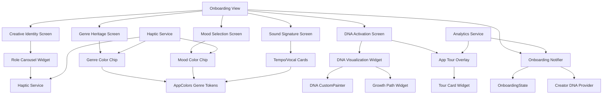

# Design Document: Onboarding Experience Modernization

## Overview

The Onboarding Experience Modernization transforms VHUNAMBI's 6-screen onboarding flow from a functional questionnaire into an immersive, visually rich brand experience that educates users about Creator DNA's unique capabilities. This design implements 7 critical UX enhancements (VH-007 through VH-013) identified during field testing, focusing on gesture-rich interactions, natural language copy, genre/mood color systems, DNA visualization, and privacy compliance.

### Design Goals

1. **Immersive Engagement**: Replace flat vertical lists with gesture-rich horizontal carousels with haptic feedback
2. **Intuitive Language**: Use natural descriptions and genre references instead of technical jargon (BPM → "Laid back")
3. **Visual Identity**: Establish consistent genre/mood color systems that permeate the entire app
4. **DNA Understanding**: Visualize Creator DNA construction through animated graphics showing user choices
5. **Feature Discovery**: Guide users through key capabilities via app tour and contextual coach marks
6. **Privacy Trust**: Provide accurate, audited privacy claims to build user confidence
7. **Accessibility**: Ensure all enhancements respect reduce-motion, haptics settings, and screen readers

### Design Principles

- **Tactile Delight**: Use haptic feedback to create satisfying micro-interactions
- **Progressive Disclosure**: Reveal complexity gradually through onboarding progression
- **Consistency**: Genre/mood colors established in onboarding carry through Studio, Explore, Library
- **Cultural Relevance**: Genre references (Amapiano, Kwaito, Gqom) anchor descriptions in African music context
- **Performance**: Maintain 60fps animations on mid-range devices (Snapdragon 720G, A12 Bionic)
- **Backward Compatibility**: Preserve internal enum values for existing DNA profiles

## Architecture

### High-Level Component Architecture



### State Flow

```
User Interaction → Notifier Method → State Update → Widget Rebuild → Analytics Event

Example (VH-007 Role Carousel Selection):
1. User taps role card
2. Card onTap → notifier.selectRole('Producer')
3. OnboardingNotifier updates state.selectedRole
4. Carousel rebuilds with check mark visible
5. Haptic feedback fires (light impact)
6. Analytics event: carousel_card_selected
```

### Technology Stack

- **UI Framework**: Flutter 3.44+, Material Design 3
- **State Management**: Riverpod 2.x (`StateNotifier`, `Provider`)
- **Haptics**: `HapticFeedback` API (iOS/Android)
- **Animation**: `AnimationController`, `CustomPainter`, `Curves`
- **Storage**: `Hive` (onboarding state), `SharedPreferences` (tour flags)
- **Analytics**: Firebase Analytics (event tracking)
- **Assets**: `flutter_svg` (DNA visualization graphics)

---

## Components and Interfaces

### VH-007: RoleCarouselWidget

**Interface:**

```dart
class RoleCarouselWidget extends ConsumerWidget {
  const RoleCarouselWidget({super.key});
  
  @override
  Widget build(BuildContext context, WidgetRef ref);
}

class _RoleCard extends StatelessWidget {
  final String role;
  final String description;
  final IconData icon;
  final bool isSelected;
  final bool isCentered;
  final VoidCallback onTap;
  
  const _RoleCard({
    required this.role,
    required this.description,
    required this.icon,
    required this.isSelected,
    required this.isCentered,
    required this.onTap,
  });
  
  @override
  Widget build(BuildContext context);
}
```

**Dependencies:**
- `onboardingProvider` (read: selectedRole)
- `onboardingProvider.notifier` (call: `selectRole(String)`)
- `HapticService` (call: `lightImpact()`, `selectionTick()`)

**Gestures:**
- **Tap card**: Select role, fire light impact haptic
- **Scroll carousel**: Snap to center card, fire selection tick on snap
- **Horizontal swipe**: Never triggers PageView page transition

**Properties:**
- Center card: scale 1.0, opacity 1.0
- Neighbor cards: scale 0.88, opacity 0.6
- Card dimensions: 280×340dp
- Spacing: 16dp between cards

---

### VH-008: GenreColorChip

**Interface:**

```dart
class GenreColorChip extends StatelessWidget {
  final String genre;
  final bool isSelected;
  final VoidCallback onTap;
  
  const GenreColorChip({
    super.key,
    required this.genre,
    required this.isSelected,
    required this.onTap,
  });
  
  @override
  Widget build(BuildContext context);
  
  GenreColorScheme _getColorScheme(String genre);
}
```

**Dependencies:**
- `AppColors.genreColorMap` (read: accent, surfaceTint, glow colors)
- `HapticService` (call: `lightImpact()`)

**Visual States:**
- **Unselected**: Gray border (2px), no background, gray text
- **Selected**: Genre accent border (3px), tinted surface (alpha 0.15), accent text, check mark icon

---

### VH-009: TempoVocalCard

**Interface:**

```dart
class TempoCard extends StatelessWidget {
  final String label;          // "Laid back"
  final String genreReference; // "Feels like Deep House and Kizomba: slow, smooth, swaying"
  final List<String> genres;   // ["Deep House", "Kizomba"]
  final bool isSelected;
  final VoidCallback onTap;
  
  const TempoCard({
    super.key,
    required this.label,
    required this.genreReference,
    required this.genres,
    required this.isSelected,
    required this.onTap,
  });
  
  @override
  Widget build(BuildContext context);
}

class VocalEnergyCard extends StatelessWidget {
  final String label;          // "Smooth and tender"
  final String styleReference; // "Like a love song: soft, close, warm voice"
  final bool isSelected;
  final VoidCallback onTap;
  
  const VocalEnergyCard({
    super.key,
    required this.label,
    required this.styleReference,
    required this.isSelected,
    required this.onTap,
  });
  
  @override
  Widget build(BuildContext context);
}
```

**Dependencies:**
- `AppColors.genreColorMap` (for genre color chips)
- `HapticService` (call: `lightImpact()`)

---

### VH-010: MoodColorChip

**Interface:**

```dart
class MoodColorChip extends StatelessWidget {
  final String mood;
  final bool isSelected;
  final VoidCallback onTap;
  
  const MoodColorChip({
    super.key,
    required this.mood,
    required this.isSelected,
    required this.onTap,
  });
  
  @override
  Widget build(BuildContext context);
  
  MoodColorScheme _getColorScheme(String mood);
}
```

**Dependencies:**
- `AppColors.moodColorMap` (read: accent, glow colors)
- `HapticService` (call: `lightImpact()`)

**Visual States:**
- **Unselected**: Gray border (2px), no background, gray text
- **Selected**: Mood accent border (3px), tinted surface (alpha 0.12), accent text, check mark icon

---

### VH-011: DNAVisualizationWidget

**Interface:**

```dart
class DNAVisualizationWidget extends ConsumerStatefulWidget {
  const DNAVisualizationWidget({super.key});
  
  @override
  ConsumerState<DNAVisualizationWidget> createState() => _DNAVisualizationWidgetState();
}

class _DNAVisualizationWidgetState extends ConsumerState<DNAVisualizationWidget>
    with SingleTickerProviderStateMixin {
  late AnimationController _animationController;
  late Animation<double> _buildUpAnimation;
  
  @override
  void initState();
  
  @override
  void dispose();
  
  @override
  Widget build(BuildContext context, WidgetRef ref);
}

class DNACustomPainter extends CustomPainter {
  final List<DNANode> nodes;
  final double animationProgress;
  final bool useReduceMotion;
  
  const DNACustomPainter({
    required this.nodes,
    required this.animationProgress,
    required this.useReduceMotion,
  });
  
  @override
  void paint(Canvas canvas, Size size);
  
  @override
  bool shouldRepaint(DNACustomPainter oldDelegate);
}
```

**Dependencies:**
- `onboardingProvider` (read: selectedGenres, selectedMoods, selectedRole)
- `MediaQuery.accessibilityFeaturesOf(context).reduceMotion` (check: accessibility)
- `AppColors.genreColorMap`, `AppColors.moodColorMap` (derive node colors)

**Animation:**
- Duration: 1800ms
- Curve: `Curves.easeOutCubic`
- Node light-up sequence: 18 nodes × 100ms delay each
- Reduce-motion: Static display with all nodes illuminated

---

### VH-012: AppTourOverlay

**Interface:**

```dart
class AppTourOverlay extends ConsumerStatefulWidget {
  const AppTourOverlay({super.key});
  
  @override
  ConsumerState<AppTourOverlay> createState() => _AppTourOverlayState();
}

class _AppTourOverlayState extends ConsumerState<AppTourOverlay> {
  final PageController _pageController = PageController();
  int _currentPage = 0;
  
  @override
  void dispose();
  
  @override
  Widget build(BuildContext context, WidgetRef ref);
  
  void _skipTour();
  void _continueTour();
}

class TourCard extends StatelessWidget {
  final String title;
  final String description;
  final IconData icon;
  final Widget? illustration;
  
  const TourCard({
    super.key,
    required this.title,
    required this.description,
    required this.icon,
    this.illustration,
  });
  
  @override
  Widget build(BuildContext context);
}
```

**Dependencies:**
- `SharedPreferences` (read/write: `has_completed_app_tour`)
- `analyticsService` (log: tour events)
- `Navigator` (pop: dismiss tour)

**Tour Cards:**
1. **Compose** (icon: `Icons.auto_awesome`, illustration: prompt → waveform → play)
2. **Write Lyrics First** (icon: `Icons.edit_note`, illustration: lyric sheet → edit → beat)
3. **Voice** (icon: `Icons.record_voice_over`, illustration: microphone + dialect flags)
4. **Crate & MPC** (icon: `Icons.library_music`, illustration: vinyl + 8-pad grid)
5. **Library & Market** (icon: `Icons.folder_special`, illustration: folder + download + coin)

---

### VH-013: PrivacyClaimRow

**Interface:**

```dart
class PrivacyClaimRow extends StatelessWidget {
  final String claimText;
  
  const PrivacyClaimRow({
    super.key,
    required this.claimText,
  });
  
  @override
  Widget build(BuildContext context);
}
```

**Dependencies:**
- `analyticsService` (log: `privacy_claim_displayed` event)

**Visual:**
- Lock icon (`Icons.lock_outline`)
- Claim text in `AppTypography.bodySmall`
- Light gray color (`AppColors.textSecondary`)
- Left-aligned row layout

---

## Data Models

### OnboardingState Model

```dart
@immutable
class OnboardingState {
  final int currentPage;
  final String? selectedRole;
  final String? experienceLevel;
  final List<String> selectedGenres;
  final List<String> selectedLanguages;
  final String? selectedTempo;
  final String? selectedVocalEnergy;
  final List<String> selectedMoods;
  final bool isDnaActivated;
  
  const OnboardingState({
    this.currentPage = 0,
    this.selectedRole,
    this.experienceLevel,
    this.selectedGenres = const [],
    this.selectedLanguages = const [],
    this.selectedTempo,
    this.selectedVocalEnergy,
    this.selectedMoods = const [],
    this.isDnaActivated = false,
  });
  
  OnboardingState copyWith({
    int? currentPage,
    String? selectedRole,
    String? experienceLevel,
    List<String>? selectedGenres,
    List<String>? selectedLanguages,
    String? selectedTempo,
    String? selectedVocalEnergy,
    List<String>? selectedMoods,
    bool? isDnaActivated,
  }) {
    return OnboardingState(
      currentPage: currentPage ?? this.currentPage,
      selectedRole: selectedRole ?? this.selectedRole,
      experienceLevel: experienceLevel ?? this.experienceLevel,
      selectedGenres: selectedGenres ?? this.selectedGenres,
      selectedLanguages: selectedLanguages ?? this.selectedLanguages,
      selectedTempo: selectedTempo ?? this.selectedTempo,
      selectedVocalEnergy: selectedVocalEnergy ?? this.selectedVocalEnergy,
      selectedMoods: selectedMoods ?? this.selectedMoods,
      isDnaActivated: isDnaActivated ?? this.isDnaActivated,
    );
  }
  
  // Validation
  bool get canProceed {
    return switch (currentPage) {
      0 => selectedRole != null && experienceLevel != null,
      1 => selectedGenres.isNotEmpty,
      2 => selectedLanguages.isNotEmpty,
      3 => selectedTempo != null && selectedVocalEnergy != null,
      4 => selectedMoods.isNotEmpty,
      5 => isDnaActivated,
      _ => false,
    };
  }
}
```

### AppTourState Model

```dart
@immutable
class AppTourState {
  final bool hasCompletedTour;
  final int lastViewedCardIndex;
  final DateTime? completedAt;
  
  const AppTourState({
    this.hasCompletedTour = false,
    this.lastViewedCardIndex = 0,
    this.completedAt,
  });
  
  AppTourState copyWith({
    bool? hasCompletedTour,
    int? lastViewedCardIndex,
    DateTime? completedAt,
  }) {
    return AppTourState(
      hasCompletedTour: hasCompletedTour ?? this.hasCompletedTour,
      lastViewedCardIndex: lastViewedCardIndex ?? this.lastViewedCardIndex,
      completedAt: completedAt ?? this.completedAt,
    );
  }
}
```

### GenreColorScheme Model

```dart
@immutable
class GenreColorScheme {
  final Color accent;
  final Color surfaceTint;
  final Color glow;
  
  const GenreColorScheme({
    required this.accent,
    required this.surfaceTint,
    required this.glow,
  });
}

// AppColors extension
extension GenreColors on AppColors {
  static const Map<String, GenreColorScheme> genreColorMap = {
    'Amapiano': GenreColorScheme(
      accent: Color(0xFFF97316),      // Vibrant Amber
      surfaceTint: Color(0xFFFED7AA), // Amber Inset
      glow: Color(0xFFFBBF24),        // Amber Glow
    ),
    'Afro House': GenreColorScheme(
      accent: Color(0xFFA855F7),      // Electric Purple
      surfaceTint: Color(0xFFE9D5FF), // Purple Inset
      glow: Color(0xFFC084FC),        // Purple Glow
    ),
    'Gqom': GenreColorScheme(
      accent: Color(0xFF22D3EE),      // Neon Cyan
      surfaceTint: Color(0xFFCFFAFE), // Cyan Inset
      glow: Color(0xFF67E8F9),        // Cyan Glow
    ),
    'Kwaito': GenreColorScheme(
      accent: Color(0xFFFB923C),      // Sunset Orange
      surfaceTint: Color(0xFFFFEDD5), // Orange Inset
      glow: Color(0xFFFDBBA0),        // Orange Glow
    ),
    'Afro Pop': GenreColorScheme(
      accent: Color(0xFFF472B6),      // Rose Pink
      surfaceTint: Color(0xFFFCE7F3), // Pink Inset
      glow: Color(0xFFF9A8D4),        // Pink Glow
    ),
    'Maskandi': GenreColorScheme(
      accent: Color(0xFFA16207),      // Earth Brown
      surfaceTint: Color(0xFFFEF3C7), // Brown Inset
      glow: Color(0xFFEAB308),        // Brown Glow
    ),
    'Hip-Hop': GenreColorScheme(
      accent: Color(0xFF3B82F6),      // Steel Blue
      surfaceTint: Color(0xFFDBEAFE), // Blue Inset
      glow: Color(0xFF93C5FD),        // Blue Glow
    ),
    'Gospel': GenreColorScheme(
      accent: Color(0xFFFBBF24),      // Gold Yellow
      surfaceTint: Color(0xFFFEF3C7), // Gold Inset
      glow: Color(0xFFFDE047),        // Gold Glow
    ),
  };
}
```

### MoodColorScheme Model

```dart
@immutable
class MoodColorScheme {
  final Color accent;
  final Color glow;
  
  const MoodColorScheme({
    required this.accent,
    required this.glow,
  });
}

// AppColors extension
extension MoodColors on AppColors {
  static const Map<String, MoodColorScheme> moodColorMap = {
    'Joyful': MoodColorScheme(
      accent: Color(0xFFFBBF24),  // Warm Yellow
      glow: Color(0xFFFDE047),
    ),
    'Melancholic': MoodColorScheme(
      accent: Color(0xFF3B82F6),  // Deep Blue
      glow: Color(0xFF93C5FD),
    ),
    'Energetic': MoodColorScheme(
      accent: Color(0xFFF97316),  // Red-Orange
      glow: Color(0xFFFB923C),
    ),
    'Calm': MoodColorScheme(
      accent: Color(0xFF14B8A6),  // Teal
      glow: Color(0xFF5EEAD4),
    ),
    'Romantic': MoodColorScheme(
      accent: Color(0xFFEC4899),  // Pink
      glow: Color(0xFFF472B6),
    ),
  };
}
```

### DNANode Model

```dart
@immutable
class DNANode {
  final String id;
  final Offset position;
  final Color color;
  final String label;
  final NodeType type;
  
  const DNANode({
    required this.id,
    required this.position,
    required this.color,
    required this.label,
    required this.type,
  });
}

enum NodeType {
  role,
  genre,
  mood,
  tempo,
  vocal,
}
```

---

## Correctness Properties

*A property is a characteristic or behavior that should hold true across all valid executions of a system—essentially, a formal statement about what the system should do. Properties serve as the bridge between human-readable specifications and machine-verifiable correctness guarantees.*

### Property 1: Carousel Gesture Isolation

*For any* horizontal swipe gesture inside the RoleCarouselWidget bounds, the onboarding PageView SHALL NOT transition to the next/previous page.

**Validates: Requirements REQ-VH007-02**

### Property 2: Haptic Feedback Fires on Interaction

*For any* role card tap or carousel snap event, the HapticService SHALL fire the appropriate haptic feedback (light impact for tap, selection tick for snap) when the system haptics setting is enabled.

**Validates: Requirements REQ-VH007-05, REQ-VH007-06**

### Property 3: Genre Color Consistency

*For any* genre selection across Onboarding, Studio, Explore, and Library, the genre accent color SHALL match the value from `AppColors.genreColorMap[genre].accent`.

**Validates: Requirements REQ-VH008-01, REQ-VH008-05**

### Property 4: Accessibility Color Compliance

*For any* selected GenreColorChip or MoodColorChip, the contrast ratio between text and tinted surface background SHALL be ≥ 4.5:1.

**Validates: Requirements REQ-VH008-06, REQ-VH010-07**

### Property 5: Natural Language Copy Preservation

*For any* tempo or vocal energy selection, the internal enum value SHALL remain unchanged while the displayed label uses natural language copy.

**Validates: Requirements REQ-VH009-01, REQ-VH009-06**

### Property 6: DNA Visualization Animation Performance

*For any* DNA visualization animation on mid-range devices (Snapdragon 720G, A12 Bionic), the animation SHALL maintain 60fps (< 16ms per frame).

**Validates: Requirements REQ-VH011-04**

### Property 7: Reduce Motion Compliance

*For any* animation (carousel snap, DNA visualization, tour transitions) when `AccessibilityFeatures.reduceMotion` is enabled, the animation SHALL be disabled or replaced with a static display.

**Validates: Requirements REQ-VH007-07, REQ-VH011-05, NFR-A11Y-04**

### Property 8: App Tour Skippability

*For any* app tour card, tapping the "Skip Tour" button SHALL immediately dismiss the tour overlay and navigate to Root_Shell without showing remaining cards.

**Validates: Requirements REQ-VH012-04, NFR-UX-03**

### Property 9: Tour Completion Persistence

*For any* user who completes or skips the app tour, the completion flag SHALL be persisted in SharedPreferences and the tour SHALL NOT reappear on subsequent app launches.

**Validates: Requirements REQ-VH012-06**

### Property 10: Privacy Claim Analytics Tracking

*For any* display of the privacy claim on the DNA activation screen, the system SHALL log a `privacy_claim_displayed` analytics event with the `claim_text` property set to the displayed claim verbatim.

**Validates: Requirements REQ-VH013-08**

---

## Error Handling

### VH-007: Carousel Gesture Conflicts

**Scenario:** User swipes horizontally on carousel but gesture is misinterpreted as PageView swipe

**Handling:**
```dart
GestureDetector(
  onHorizontalDragStart: (details) {
    // Lock PageView scrolling when carousel is being dragged
    _pageController.jumpTo(_pageController.offset);
  },
  onHorizontalDragUpdate: (details) {
    _carouselController.offset += details.delta.dx;
  },
  onHorizontalDragEnd: (details) {
    // Snap to nearest card
    _snapToCard();
  },
  child: PageView.builder(
    physics: _isCarouselDragging 
      ? const NeverScrollableScrollPhysics() 
      : const PageScrollPhysics(),
    // ...
  ),
)
```

**User Impact:** Carousel scrolls smoothly without accidentally changing pages.

---

### VH-008/VH-010: Missing Color Token

**Scenario:** Genre or mood string does not exist in color map

**Handling:**
```dart
GenreColorScheme _getColorScheme(String genre) {
  final scheme = AppColors.genreColorMap[genre];
  if (scheme == null) {
    debugPrint('Missing genre color for: $genre');
    return const GenreColorScheme(
      accent: AppColors.textSecondary,
      surfaceTint: AppColors.surfaceVariant,
      glow: AppColors.textSecondary,
    );
  }
  return scheme;
}
```

**User Impact:** Chip displays with fallback gray color instead of crashing.

---

### VH-009: Localization Missing

**Scenario:** Natural language copy string key does not exist in ARB file

**Handling:**
```dart
String _getTempoLabel(BuildContext context, String tempoKey) {
  try {
    return AppLocalizations.of(context)!.tempoLabel(tempoKey);
  } catch (error) {
    debugPrint('Missing tempo label for: $tempoKey');
    return tempoKey;  // Fallback to enum key
  }
}
```

**User Impact:** Technical enum key displayed instead of natural language, but no crash.

---

### VH-011: DNA Animation Frame Drop

**Scenario:** Animation stutters on low-end device

**Handling:**
```dart
@override
void initState() {
  super.initState();
  _animationController = AnimationController(
    duration: const Duration(milliseconds: 1800),
    vsync: this,
  );
  
  _buildUpAnimation = CurvedAnimation(
    parent: _animationController,
    curve: Curves.easeOutCubic,
  );
  
  // Check device performance
  SchedulerBinding.instance.addPostFrameCallback((_) {
    if (_animationController.lastElapsedDuration! > const Duration(milliseconds: 32)) {
      // Frame took > 32ms (< 30fps) — reduce animation complexity
      setState(() => _useSimplifiedAnimation = true);
    }
  });
  
  _animationController.forward();
}
```

**User Impact:** Animation complexity reduces automatically on low-end devices to maintain smooth performance.

---

### VH-012: App Tour Analytics Failure

**Scenario:** Firebase Analytics fails to log tour events

**Handling:**
```dart
Future<void> _logTourEvent(String eventName, Map<String, dynamic> parameters) async {
  try {
    await _analyticsService.logEvent(eventName, parameters);
  } catch (error) {
    debugPrint('Analytics event failed: $eventName - $error');
    // Tour continues without blocking user
  }
}
```

**User Impact:** Tour continues normally; analytics data lost but no user-facing error.

---

### VH-013: Privacy Audit Missing

**Scenario:** Privacy audit document (`PRIVACY_DATA_FLOW.md`) not completed

**Handling:**
- **Build-time assertion**: Add a test that fails if audit document does not exist
- **Fallback claim**: Display conservative fallback text ("Your privacy matters to us") instead of specific claim
- **Block production release**: Add CI check that prevents deployment until audit is approved

```dart
test('Privacy audit document exists', () {
  final auditFile = File('docs/compliance/PRIVACY_DATA_FLOW.md');
  expect(
    auditFile.existsSync(),
    isTrue,
    reason: 'Privacy audit must be completed before production release',
  );
});
```

**User Impact:** Production build fails until privacy audit is completed and approved.

---

## Testing Strategy

### Unit Testing

**VH-007: Carousel Logic**
- Test center card detection algorithm
- Test scale/opacity calculation for neighbor cards
- Test snap behavior on scroll end
- Test haptic service mock invocations

**VH-008/VH-010: Color Token Application**
- Test `_getColorScheme()` returns correct color for each genre/mood
- Test fallback color for missing token
- Test contrast ratio calculation for each color scheme

**VH-009: Natural Language Mapping**
- Test tempo enum → natural label mapping
- Test vocal energy enum → natural label mapping
- Test genre reference string composition
- Test backward compatibility with existing DNA profiles

**VH-011: DNA Node Derivation**
- Test DNA node color derivation from user selections
- Test node position calculation for double-helix layout
- Test animation progress interpolation
- Test reduce-motion static rendering

**VH-012: Tour State Management**
- Test completion flag persistence
- Test skip action at each card index
- Test analytics event logging
- Test tour dismissal navigation

---

### Widget Testing

**VH-007: RoleCarouselWidget**
```dart
testWidgets('Carousel snaps to center card on scroll end', (tester) async {
  await tester.pumpWidget(const MaterialApp(home: RoleCarouselWidget()));
  
  // Swipe left
  await tester.drag(find.byType(PageView), const Offset(-300, 0));
  await tester.pumpAndSettle();
  
  // Verify next card is centered
  expect(find.text('Producer'), findsOneWidget);
  // Verify haptic service called
  verify(mockHapticService.selectionTick()).called(1);
});
```

**VH-008: GenreColorChip**
```dart
testWidgets('Selected genre chip applies correct accent color', (tester) async {
  await tester.pumpWidget(MaterialApp(
    home: GenreColorChip(genre: 'Amapiano', isSelected: true, onTap: () {}),
  ));
  
  final container = tester.widget<Container>(find.byType(Container));
  expect(
    (container.decoration as BoxDecoration).border!.top.color,
    equals(const Color(0xFFF97316)),  // Amapiano accent
  );
});
```

**VH-011: DNAVisualizationWidget**
```dart
testWidgets('DNA animation respects reduce-motion setting', (tester) async {
  await tester.pumpWidget(MaterialApp(
    home: MediaQuery(
      data: const MediaQueryData(
        accessibleNavigation: false,
        boldText: false,
        disableAnimations: true,  // Reduce motion enabled
      ),
      child: const DNAVisualizationWidget(),
    ),
  ));
  
  await tester.pumpAndSettle();
  
  // Verify static rendering (no AnimationController active)
  final state = tester.state<_DNAVisualizationWidgetState>(
    find.byType(DNAVisualizationWidget),
  );
  expect(state._animationController.status, equals(AnimationStatus.completed));
});
```

**VH-012: AppTourOverlay**
```dart
testWidgets('Skip button dismisses tour immediately', (tester) async {
  await tester.pumpWidget(const MaterialApp(home: AppTourOverlay()));
  
  // Tap skip button
  await tester.tap(find.text('Skip Tour'));
  await tester.pumpAndSettle();
  
  // Verify tour dismissed
  expect(find.byType(AppTourOverlay), findsNothing);
  
  // Verify analytics event logged
  verify(mockAnalyticsService.logEvent(
    'app_tour_skipped',
    {'skipped_at_card_index': 0},
  )).called(1);
});
```

---

### Integration Testing

**End-to-End Onboarding Flow**
```dart
testWidgets('Complete onboarding with all enhancements', (tester) async {
  await tester.pumpWidget(const MyApp());
  
  // VH-007: Select role from carousel
  await tester.drag(find.byType(PageView), const Offset(-200, 0));
  await tester.pumpAndSettle();
  await tester.tap(find.text('Producer'));
  await tester.pumpAndSettle();
  
  // VH-008: Select genres with color chips
  await tester.tap(find.text('Amapiano'));
  await tester.tap(find.text('Gqom'));
  await tester.tap(find.text('Continue'));
  await tester.pumpAndSettle();
  
  // VH-009: Select tempo with natural language
  await tester.tap(find.text('Laid back'));
  await tester.tap(find.text('Smooth and tender'));
  await tester.tap(find.text('Continue'));
  await tester.pumpAndSettle();
  
  // VH-010: Select moods with color chips
  await tester.tap(find.text('Joyful'));
  await tester.tap(find.text('Continue'));
  await tester.pumpAndSettle();
  
  // VH-011: DNA visualization animates
  expect(find.byType(DNAVisualizationWidget), findsOneWidget);
  await tester.pump(const Duration(milliseconds: 1800));
  await tester.pumpAndSettle();
  
  // VH-012: App tour displays
  expect(find.byType(AppTourOverlay), findsOneWidget);
  await tester.tap(find.text('Get Started'));
  await tester.pumpAndSettle();
  
  // Verify navigation to Root_Shell
  expect(find.byType(MainScaffold), findsOneWidget);
});
```

**VH-013: Privacy Claim Display**
```dart
testWidgets('Privacy claim displayed on DNA screen', (tester) async {
  await tester.pumpWidget(const MyApp());
  
  // Navigate to DNA activation screen
  await navigateToDNAScreen(tester);
  
  // Verify claim text displayed
  expect(find.text('Your DNA profile is stored on your device'), findsOneWidget);
  
  // Verify analytics event logged
  verify(mockAnalyticsService.logEvent(
    'privacy_claim_displayed',
    {'claim_text': 'Your DNA profile is stored on your device'},
  )).called(1);
});
```

---

### Performance Testing

**VH-007: Carousel Scroll Performance**
```dart
test('Carousel maintains 60fps on mid-range devices', () async {
  final binding = WidgetTesterBinding.ensureInitialized() as AutomatedTestWidgetsFlutterBinding;
  binding.framePolicy = LiveTestWidgetsFlutterBindingFramePolicy.benchmarkLive;
  
  await tester.pumpWidget(const MaterialApp(home: RoleCarouselWidget()));
  
  // Simulate continuous scroll
  final dragGesture = await tester.startGesture(Offset(400, 300));
  await dragGesture.moveBy(const Offset(-1000, 0), timeStamp: const Duration(milliseconds: 100));
  
  // Measure frame times
  final frameTimes = <Duration>[];
  binding.addPersistentFrameCallback((duration) {
    frameTimes.add(duration);
  });
  
  await tester.pumpAndSettle();
  
  // Assert all frames < 16ms (60fps)
  expect(frameTimes.every((d) => d.inMilliseconds < 16), isTrue);
});
```

**VH-011: DNA Animation Performance**
```dart
test('DNA animation renders at 60fps', () async {
  // Similar performance test for DNA visualization
  // Measure paint times for CustomPainter during animation
});
```

---

### Accessibility Testing

**Screen Reader Support**
```dart
testWidgets('Carousel cards have semantic labels', (tester) async {
  await tester.pumpWidget(const MaterialApp(home: RoleCarouselWidget()));
  
  final semantics = tester.getSemantics(find.text('Producer'));
  expect(semantics.label, contains('Producer'));
  expect(semantics.isButton, isTrue);
});
```

**Color Independence**
```dart
testWidgets('Genre chip shows check mark in addition to color', (tester) async {
  await tester.pumpWidget(MaterialApp(
    home: GenreColorChip(genre: 'Amapiano', isSelected: true, onTap: () {}),
  ));
  
  // Verify check mark icon present
  expect(find.byIcon(Icons.check_circle), findsOneWidget);
});
```

**Reduce Motion Compliance**
```dart
testWidgets('All animations respect reduce-motion setting', (tester) async {
  // Test carousel snap animation
  // Test DNA visualization animation
  // Test app tour transitions
});
```

---

### Regression Testing

**Test Preservation Requirements**
- All 991 existing tests MUST continue passing
- Zero new analyzer warnings introduced
- No breaking changes to public APIs
- Backward compatibility with existing DNA profiles

**CI Pipeline Checks:**
1. `flutter test` — All unit + widget tests pass
2. `flutter analyze` — Zero errors, zero warnings
3. `flutter test --coverage` — Coverage ≥ 80%
4. Privacy audit document existence check
5. Asset bundle size delta < 500KB
