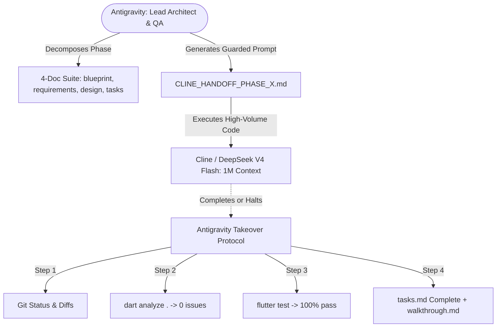

# VHUNAMBI: Complete Agent Handoff Bible & Master State

> **DOCUMENT PURPOSE:** This is the single, authoritative handoff document for the Vhunambi monorepo. Any AI agent (Antigravity, Cline, Cursor, Windsurf) or human engineer resuming work on this repository can read this document and resume seamlessly with zero loss of context.
>
> **Last Updated:** 2026-11-02T02:50:00+02:00
> **Repository Root:** `c:\Users\Ndugelo\VHUNAMBI\monorepo\`  
> **Client Workspace:** `c:\Users\Ndugelo\VHUNAMBI\monorepo\apps\vhunambi_client\`  
> **Backend Workspace:** `c:\Users\Ndugelo\VHUNAMBI\monorepo\apps\vhunambi_api\`  
> **Current Health:** `dart analyze` = **0 issues (100% clean)** | `flutter test` = **100% passing (1,154+ tests green)** | Backend API = **0 errors (11/11 suites passing, 100%)**  
> **Active Phase:** Phase 33 (Multi-Dimensional Creator Profile Hub, Adaptive Light/Dark Theme Engine & Synchronized Platform Analytics) Complete & Verified (11/11 Phase 33 Tests Passing · 61/61 Profile Suite Tests Green)

---

## 1. Project Vision & Brand Identity

* **Platform Name:** **`vhunambi`** (with an **i**, from Tshivenḓa for *"the talent or ability to sing"*). Never use `vhunamba`.
* **Production Origin:** Cloned and reverse-engineered from production at `https://vhunambi.com`.
* **Core Value Proposition:**
  1. Specialized audio synthesis engine tailored for African musical heritage and regional BPM structures (Amapiano, Kwaito, Gqom, Maskandi, Mbaqanga, Marabi, Bubblegum, Afro House).
  2. Native vocal synthesis supporting 25+ indigenous African languages (`Tshivenḓa`, `isiZulu`, `isiXhosa`, `Afrikaans`, `Sepedi`, `Setswana`, `Sesotho`, `Xitsonga`, `siSwati`, `isiNdebele`, `Kiswahili`, `Hausa`, `Yorùbá`, `Igbo`, `Amharic`, etc.).
  3. Persistent cross-platform audio player dock (64px mobile mini-player / 72px desktop DAW transport bar / expanded cockpit modal).
  4. Commercial beat licensing marketplace and user asset vault.

---

## 2. Dual-Agent Symbiosis Protocol

The repository operates under the **Dual-Agent Pair Programming Standard** codified in [`docs/VHUNAMBI_AGENT_WORKFLOW_STANDARD.md`](file:///c:/Users/Ndugelo/VHUNAMBI/monorepo/docs/VHUNAMBI_AGENT_WORKFLOW_STANDARD.md):



### The 4-Document Specification Rule
Every feature milestone must have its 4-document specification under `docs/phases/phase_XX_<name>/`:
1. `blueprint.md`: Layout geometry, responsive breakpoints, visual tokens, state machine diagrams.
2. `requirements.md`: EARS & RFC 2119 requirements (`MUST`, `SHALL`) with traceable IDs (`REQ-XXX-01`).
3. `design.md`: Dart class signatures, Riverpod providers, token mappings, widget hierarchy.
4. `tasks.md`: Sequenced checklist (T1–TN) with pre-flight checks and verification gates.

---

## 3. Codebase Invariants & Non-Negotiable Rules

When writing any code in this repository, you **MUST ALWAYS** follow these rules:

1. **Design Tokens (Zero Raw Hex Values):**
   * Never hardcode `#0A0A0C`, `#141418`, `#F97316`, or ad-hoc border radii in widgets.
   * Always import and use tokens from `package:vhunambi_client/core/theme/`:
     - `AppColors.surfaceCanvas` (`#0A0A0C`) — Pitch black canvas
     - `AppColors.surfaceElevated` (`#141418`) — Elevated container surface
     - `AppColors.surfaceSecondary` (`#1B1B22`) — Inset container, chips
     - `AppColors.surfaceModal` (`#16161C`) — Bottom sheets and popovers
     - `AppColors.brandPrimary` (`#F97316`) — Vibrant brand amber/orange
     - `AppColors.brandContrast` (`#000000`) — Pure black text for brand buttons
     - `AppColors.borderSubtle` (`#2D2D38`) — Standard card and divider border
     - `AppGradients.forGenre(genre)` — 12 regional genre gradients
     - `AppTypography` — Display, title, body, caption scales via Google Fonts Inter
     - `AppRadius` — `pillBorder`, `cardBorder`, `inputBorder`, `modalBorder`
     - `AppSpacing` — `xxs` (4), `xs` (8), `sm` (12), `md` (16), `lg` (20), `xl` (24), `xxl` (32)
2. **SDK Enum Collision Safety:**
   * Flutter 3.44 (`repeating_animation_builder.dart`) exports `RepeatMode`.
   * **Our audio repeat enum is named `AudioRepeatMode`** (values: `off`, `all`, `one`). **NEVER name it `RepeatMode`**.
   * Playback status enum is `PlaybackStatus` (values: `idle`, `buffering`, `playing`, `paused`, `completed`, `error`).
3. **Responsive Helpers:**
   * Always use `ResponsiveUtils.isDesktop(context)` (> 1024px) and `ResponsiveUtils.isMobile(context)` (< 768px).
4. **Clean Layer Separation:**
   * Presentation widgets depend on Riverpod providers.
   * Providers manipulate immutable domain state models via `copyWith`.
   * State is never mutated directly inside widget builds.

---

## 4. Phase-by-Phase Roadmap & Status

### Phase 0: Single Source of Truth (SSOT) Blueprints ✅
Committed under `docs/foundation_blueprints/`:
* `00_SYSTEM_DESIGN_TOKENS.md`: Exact colors, surfaces, typography, radii, 12 genre gradients.
* `01_EXPLORE_PAGE_SPEC.md`: Explore view geometry (2-column Mobile vs 6-column Desktop).
* `02_PERSISTENT_PLAYER_SPEC.md`: Persistent audio architecture & expanded cockpit.
* `03_CREATE_STUDIO_SPEC.md`: Parameter-rich studio cockpit (`/create`).
* `04_LIBRARY_VAULT_SPEC.md`: User asset vault (`/library`) & 6 category tabs.
* `05_MARKETPLACE_AND_LANDING_SPEC.md`: Beats marketplace (`/market`) & marketing funnel.
* `06_TRACK_AND_CREATOR_PROFILES_SPEC.md`: Track details (`/track/:id`) & creator profiles.
* `07_AUDIO_TRANSPORT_AND_PIPELINE_MODALS_SPEC.md`: Transport bar, mini player, and modals.

### Phase 1: Client Scaffolding & Design System Tokens ✅
* App location: `apps/vhunambi_client/` (`com.vhunambi.app`).
* Dependencies: `flutter_riverpod`, `just_audio`, `audio_service`, `audio_session`, `hive_flutter`, `google_fonts`, `cached_network_image`, `dio`, `window_manager`.
* Token files: `lib/core/theme/app_colors.dart`, `app_gradients.dart`, `app_typography.dart`, `app_dimensions.dart`, `app_theme.dart`.
* Utilities: `lib/core/utils/responsive_utils.dart`, `lib/core/constants/app_constants.dart`.

### Phase 2: Core Shell & Persistent Audio Engine ✅
* `lib/features/player/domain/models/player_state.dart` (`PlayerState`, `PlaybackStatus`, `AudioRepeatMode`).
* `lib/features/player/presentation/providers/player_provider.dart` (`playerStateProvider`).
* `lib/features/player/presentation/widgets/waveform_bars.dart` (Animated amplitude visualizer).
* `lib/features/player/presentation/widgets/mobile_mini_player.dart` (60px compact strip above bottom navigation).
* `lib/features/player/presentation/widgets/desktop_transport_bar.dart` (72px desktop DAW console with volume & speed).
* `lib/features/player/presentation/widgets/expanded_cockpit_modal.dart` (88% height modal with 40-bar waveform).
* `lib/features/studio/presentation/widgets/generation_pipeline_card.dart` (4-step real-time synthesis FSM).
* `lib/features/notifications/presentation/widgets/notifications_popover.dart` (Notifications drawer).
* `lib/main.dart` with `RootShell` and 5-destination navigation.

### Phase 3: Studio Creation Cockpit (`/create`) ✅
* `lib/features/studio/domain/models/studio_form_state.dart` (8 enums, immutable `StudioFormState`).
* `lib/features/studio/presentation/providers/studio_form_provider.dart` (`StudioFormNotifier`, `studioFormProvider`).
* `lib/features/studio/presentation/widgets/prompt_input_box.dart` (Multiline input, inspiration chips, `Inspire Me`).
* `lib/features/studio/presentation/widgets/reference_audio_dropzone.dart` (Audio-to-audio style conditioning dropzone).
* `lib/features/studio/presentation/widgets/regional_genre_selector.dart` (5 regions, 8 primary genre tiles, custom adder).
* `lib/features/studio/presentation/widgets/multilingual_language_selector.dart` (25+ African and diaspora language chips).
* `lib/features/studio/presentation/widgets/advanced_options_accordion.dart` (Instrumental switch, slider, lyrics modes, mood, tempo, vocal arrangement).
* `lib/features/studio/presentation/widgets/studio_action_bar.dart` (Public switch, full-width CTA, licensing notice).
* `lib/features/studio/presentation/views/studio_view.dart` (Sticky app bar, max-width 840px container).
* Mounted at tab index 2 in `RootShell` (`lib/main.dart`).
* **Automated Tests:** 11 unit tests in `studio_form_test.dart` + 2 widget tests in `studio_view_test.dart`.

### Phase 4: Library & User Asset Vault (`/library`) ✅
* `lib/features/library/domain/models/library_models.dart` (`LibraryCategory`, `LibraryViewMode`, `TrackSyncStatus`, `LibrarySortOrder`, `LibrarySyncFilter` + immutable `LibraryTrack`).
* `lib/features/library/presentation/providers/library_providers.dart` (`LibraryTracksNotifier` with 4 seeded vault records, vault selectors, pure `filterLibraryTracks()` engine, `playLibraryTrack()` bridge into the persistent player).
* `lib/features/library/presentation/widgets/library_app_bar.dart` (Responsive header: brand group, breadcrumb, credit chip, bell, Analytics, overflow sort menu, Create CTA).
* `lib/features/library/presentation/widgets/library_category_rail.dart` (6 pill categories with record-count badges).
* `lib/features/library/presentation/widgets/library_empty_state.dart` (48x48 squircle, per-category copy, orange pill CTA).
* `lib/features/library/presentation/widgets/library_track_tile.dart` + `library_track_grid_card.dart` (dense list row vs. square grid card).
* `lib/features/library/presentation/widgets/track_actions_sheet.dart` (Play, Playlist, Stems, Download Offline, License, Share, Trash/Restore/Purge + certificate dialog).
* `lib/features/library/presentation/widgets/library_badges.dart` + `library_cover_art.dart` (genre/sync badges, genre-gradient artwork).
* `lib/features/library/presentation/views/library_view.dart` (screen assembly + search/filter/view-mode strip).
* Mounted at tab index 3 in `RootShell` (`lib/main.dart`); the vault `✨ Create` CTA switches the shell to the Studio tab (index 2).
* **Automated Tests:** 26 unit tests in `library_notifier_test.dart` + 7 widget tests in `library_view_test.dart`.

### Phase 5: Explore Feed & Music Discovery (`/explore`) ✅
* `lib/features/explore/domain/models/explore_models.dart` (`ExploreTab`, `ExploreSortBy`, immutable `CreatorProfile`, 12-genre / 10-mood / 10-language taxonomy catalogs).
* `lib/features/explore/presentation/providers/explore_providers.dart` (`ExploreTracksNotifier` with 8 seeded catalog tracks, 6 seeded creators, pure `filterExploreTracks()` engine, `playExploreTrack()` / `playExploreGenreRadio()` player bridges, pagination cursor helpers).
* `lib/features/explore/presentation/widgets/explore_top_bar.dart` (`DesktopExploreTopBar` 68px with breadcrumb/Ctrl+K search/credit/bell/avatar/Create + `MobileExploreTopBar` 56px).
* `lib/features/explore/presentation/widgets/explore_header_section.dart` (title, subtitle, Discover/For You/Following tabs, `🔥 2 Streak` chip).
* `lib/features/explore/presentation/widgets/african_charts_banner.dart` (terracotta→tangerine hero card).
* `lib/features/explore/presentation/widgets/track_card.dart` + `track_list_tile.dart` (NEW/rank badges, gradient artwork, live play/pause trigger).
* `lib/features/explore/presentation/widgets/creator_card.dart` + `genre_radio_tile.dart` (creator deck, glassmorphic `((•)) Play Radio`).
* `lib/features/explore/presentation/widgets/catalog_filter_bar.dart` + `explore_empty_state.dart` (genre rail, mood wrap, language dropdown, sort pills, dual-CTA empty state).
* `lib/features/explore/presentation/widgets/genre_glyph.dart` (shared instrument glyph tokens).
* `lib/features/explore/presentation/views/explore_view.dart` (10-slice `CustomScrollView` + mobile/tablet/desktop breakpoint matrix).
* `lib/shared/models/track.dart` gained optional `mood` + `creatorHandle` fields (additive).
* Mounted at tab index 1 in `RootShell` (`lib/main.dart`); `+ Create` switches the shell to the Studio tab (index 2).
* **Automated Tests:** 22 unit tests in `explore_notifier_test.dart` + 9 widget tests in `explore_view_test.dart`.

### Phase 6: Beats Marketplace & Native App Architecture (`/market`, `/`, `/splash`, `/onboarding`) ✅
* `lib/features/marketplace/domain/models/marketplace_models.dart` (`BeatListingEntity`, `MarketplaceFilterState`, 12-genre catalog, preview duration contract).
* `lib/features/marketplace/presentation/providers/marketplace_providers.dart` (`marketplaceBeatsProvider` with 6 seeded listings, `filteredBeatsProvider` + pure `filterBeats()`, `marketplaceCreditsProvider`, `auditionBeat()`, `licenseBeat()` vault transaction, `clearMarketplaceFilters()`).
* `lib/features/marketplace/presentation/widgets/` — `marketplace_top_bar.dart`, `seller_callout_banner.dart`, `beat_card.dart`, `beat_license_modal.dart`, `marketplace_filter_modal.dart`, `marketplace_empty_state.dart`, `pwa_install_dock.dart`.
* `lib/features/marketplace/presentation/views/marketplace_view.dart` (grid 2/3/4 cols + banner + empty state + floating PWA dock mounted at Tab 4).
* `lib/features/onboarding/domain/models/onboarding_models.dart` (`OnboardingState`, genre & language preference selection, user role).
* `lib/features/onboarding/presentation/providers/onboarding_providers.dart` (`OnboardingNotifier`, `onboardingStateProvider`).
* `lib/features/onboarding/presentation/views/splash_view.dart` (Animated emblem, soundwave pulse ring, Tshivenḓa motto *"Vhutsila ha u Imba"*).
* `lib/features/onboarding/presentation/views/onboarding_view.dart` (3-step native walkthrough: Welcome, Genre/Language preference chips, 10 free credits ready).
* `lib/features/home/presentation/views/home_dashboard_view.dart` (Native Creator Home Dashboard mounted at Tab 0: time-aware African greeting *"Ndi matsheloni"*, streak badge, credit pill, quick prompt bar, 4 action tiles `AI Studio`, `Beats Market`, `Asset Vault`, `Stem Lab`, Jump Back In mini-card, trending rail, subscription banner).
* `lib/features/home/presentation/widgets/subscription_upgrade_modal.dart` (Native bottom sheet encapsulating 4 subscription tiers and monthly/yearly billing toggle).
* `lib/features/landing/domain/models/` & `lib/features/landing/presentation/` (marketing models & funnel retained for presentational web/desktop marketing preview).
* **Automated Tests:** Full suite of **127 automated tests passing (100%)** — 13 marketplace tests, 16 landing tests, 6 onboarding unit tests, 4 onboarding widget tests, 3 home dashboard widget tests, plus Phase 0–5 baseline.

### Phase 7: Track Details Cockpit & Creator Profiles (`/track/:id`, `/profile/:id`, `/profile/me`) ✅
* `lib/features/track/domain/models/track_detail_models.dart` (`LicenseType`, `StemTrackEntity`, `StemSeparationStatus`, `StemSeparationState`, `TrackDetailEntity`, `CommentEntity`).
* `lib/features/profile/domain/models/profile_models.dart` (`SupporterEntity`, `TipRecordEntity`, `ReleaseType`, `MusicReleaseEntity`, `ArtistProfileEntity`).
* `lib/features/track/presentation/providers/track_providers.dart` (`TrackDetailNotifier`, `trackDetailFamilyProvider`, `TrackCommentsNotifier`, `trackCommentsProvider`, `moreLikeThisProvider`, `seededTrackDetails` catalog).
* `lib/features/profile/presentation/providers/profile_providers.dart` (`ArtistProfileNotifier`, `artistProfileFamilyProvider`, `ownerProfileProvider`, `seededArtistProfiles`).
* `lib/features/track/presentation/widgets/` — `track_hero_section.dart` (1:1 art, ambient amber glow, royalty-free notice, creator byline), `track_actions_bar.dart` (Like, Plays, Remix, Tip), `utility_tool_dock.dart` (Download, Playlist, Radio, Lyrics, Variation, Comments, Embed), `emoji_reaction_deck.dart` (5 cultural emoji pills: 🔥, ❤️, 🎵, 🙌, 🌍), `waveform_scrubber.dart` (amplitude waveform with active brand fill and interactive tap-to-seek), `lyrics_teleprompter.dart` (formatted lyrical stanzas with bracketed tags), `stem_separation_lab.dart` (4-step stem separation simulation, solo/mute audition), `prompt_attribution_card.dart` (seed prompt + remix action), `comments_section.dart` (discussion thread with initials avatar and composer), `more_like_this_shelf.dart` (genre recommendations).
* `lib/features/track/presentation/views/track_detail_view.dart` (860px max-width centered layout assembling all 10 dissection sub-widgets).
* `lib/features/profile/presentation/widgets/` — `profile_banner_header.dart` (ambient banner with monogram avatar, verified badge, bio, follow/tip buttons), `profile_stats_grid.dart` (5 metrics: Songs, Likes, Plays, Followers, Day Streak), `top_supporters_leaderboard.dart` (🥇, 🥈, 🥉 medal ranks with credit tallies), `releases_manager_card.dart` (Album, EP, Single discography manager with creation dialog), `tip_history_ledger.dart` (Received/Sent sub-tabs and master switch), `profile_referral_card.dart` (one-tap clipboard link copy).
* `lib/features/profile/presentation/views/artist_profile_view.dart` (Public Artist Profile at `/profile/:id`: banner, stats, Top Songs, Top Supporters, Recent Activity).
* `lib/features/profile/presentation/views/owner_profile_view.dart` (Creator Studio Cockpit at `/profile/me`: header, action chips, top genres, Your Songs with Public/Private switch, Releases manager, Tip History ledger, Referral card).
* `lib/features/home/presentation/views/home_dashboard_view.dart` wired: avatar tap routes to `OwnerProfileView`, Jump Back In track title tap routes to `TrackDetailView`.
* **Automated Tests:** **160 total automated tests passing (100%)** — 14 track unit tests, 4 track widget tests, 11 profile unit tests, 3 artist profile widget tests, 3 owner profile widget tests, plus 127 baseline tests.

### Phase 8: Offline Audio Persistence & Hive Cache ✅
* `lib/features/offline/domain/models/offline_models.dart` (`DownloadStatus`, `AudioDownloadQuality`, `DownloadTask`, `CacheStorageStats`, `OfflinePreferenceState`).
* `lib/features/offline/data/services/offline_storage_service.dart` (`IOfflineStorageService`, `OfflineStorageService` with dual Hive boxes `vaultBoxKey` and `preferencesBoxKey`, in-memory fallback, physical file eviction on disk).
* `lib/features/offline/data/services/audio_download_service.dart` (`IAudioDownloadService`, `AudioDownloadService` with Dio chunked streaming & deterministic test simulation mode).
* `lib/features/offline/presentation/providers/offline_providers.dart` (`offlineStorageServiceProvider`, `audioDownloadServiceProvider`, `DownloadManagerNotifier`, `downloadManagerProvider`, `cacheStorageStatsProvider`, `offlinePreferencesProvider`).
* `lib/features/offline/presentation/widgets/vault_storage_modal.dart` (Animated quota usage rail, summary chips, per-track shelf with eviction, clear all confirmation dialog).
* `lib/features/offline/presentation/widgets/offline_indicator_badge.dart` (`Icons.offline_pin_rounded` brand badge with subtle amber glow).
* UI Integration: `TrackActionsSheet` (dynamic Download Offline / live progress / Remove Offline Download), `LibraryAppBar` (storage quota modal button), `LibraryTrackTile` & `LibraryTrackGridCard` (progress bar and offline pin badge), `TrackDetailView` (offline download flow), `ExpandedCockpitModal` (offline playback badge).
* **Automated Tests:** **207 total automated tests passing (100%)** — 18 offline storage tests, 18 download manager tests, 11 vault storage modal tests (47 new tests), plus 160 baseline tests with zero regressions.

### Phase 9: Production Audio Engine Hardware Bridge & Platform Services ✅
* `lib/features/player/domain/models/audio_session_events.dart` (`AudioInterruptionType`, `AudioInterruptionEvent`, `BecomingNoisyEvent`).
* `lib/features/player/data/services/audio_source_resolver.dart` (`IAudioSourceResolver`, `AudioSourceResolver`, `DeferredAudioSourceResolver` protecting test boot).
* `lib/features/player/data/services/audio_session_manager.dart` (`IAudioSessionManager`, `AudioSessionManager` with telephony interruption & becoming noisy auto-pause, `TestAudioSessionManager`).
* `lib/features/player/data/services/vhunambi_audio_handler.dart` (`IVhunambiAudioHandler`, `VhunambiAudioHandler` extending `BaseAudioHandler` with `QueueHandler` and `SeekHandler`, `TestVhunambiAudioHandler`, pure metadata/state mappers, `bootstrapPlatformAudioHandler`).
* `lib/features/player/presentation/providers/audio_bridge_providers.dart` (`audioSourceResolverProvider`, `audioSessionManagerProvider`, `audioHandlerProvider`).
* `lib/features/player/presentation/providers/player_provider.dart` (`PlayerNotifier` bi-directional hardware bridging, unawaited dispatch, echo-suppression, 1.5s seek tolerance).
* Native platform integration: `AndroidManifest.xml` (foreground service & permissions), `MainActivity.kt` (`AudioServiceActivity`), `ios/Runner/Info.plist` (`UIBackgroundModes: audio`).
* **Automated Tests:** **254 total automated tests passing (100%)** — 9 audio source resolver tests, 13 audio session manager tests, 17 audio handler tests, 8 player hardware bridge tests (47 new tests in `test/features/player/`), plus 207 baseline tests with zero regressions.

### Phase 10: Audio Generation Pipeline Real-Time WebSocket Bridge & Result Panel ✅
* `lib/features/studio/domain/models/generation_pipeline_state.dart` (`PipelineStep`, `PipelineSocketEvent`, `GenerationProgressState`).
* `lib/features/studio/domain/models/stem_download_progress.dart` (`StemDownloadProgress`).
* `lib/features/track/domain/models/track_entity.dart` (`TrackEntity`).
* `lib/features/studio/domain/services/i_generation_socket_service.dart`, `lib/features/studio/data/services/generation_socket_service.dart`, `fake_generation_socket_service.dart`.
* `lib/features/studio/domain/services/i_stem_download_service.dart`, `lib/features/studio/data/services/stem_download_service.dart`, `fake_stem_download_service.dart`.
* `lib/features/studio/presentation/providers/generation_pipeline_providers.dart` (`GenerationPipelineNotifier`, `generationProgressProvider`, `notificationsProvider`).
* `lib/features/studio/presentation/providers/stem_download_provider.dart` (`stemDownloadServiceProvider`, `masterDownloadProgressProvider`).
* `lib/features/studio/presentation/widgets/generation_pipeline_card.dart` (`ConsumerStatefulWidget` live Result panel, equalizer, collapsible lyrics, error banner with retry).
* `lib/features/notifications/domain/models/notification_entity.dart` (`NotificationEntity.generationReady()`).
* **Automated Tests:** **321 total automated tests passing (100%)** — 67 new tests (22 pipeline state, 11 socket service, 9 stem download, 12 pipeline provider, 10 pipeline card widget, 5 notification entity), plus 254 baseline tests with zero regressions.


### Phase 11: Sprint M2 — Faults & Improvements (4 Specs) 🔄

**Sprint Overview:** Comprehensive bug fixing and UX enhancement suite addressing 17 issues (VH-001 through VH-017) discovered during field testing on October 19, 2026.

**Workflow:** Spec-Driven Bug Fixing & Enhancement Sprint Protocol ([`VHUNAMBI_FAULTS_IMPROVEMENTS_WORKFLOW_STANDARD.md`](file:///docs/VHUNAMBI_FAULTS_IMPROVEMENTS_WORKFLOW_STANDARD.md))

**Source:** [`docs/blueprints/Vhunambi — Faults & Improvements Spec (2026-10-19).md`](file:///docs/blueprints/Vhunambi — Faults & Improvements Spec (2026-10-19).md)

#### Spec 1: Studio Cockpit Fixes (VH-001 to VH-006) ✅

**Status:** Implementation Complete (Pending Verification)  
**Branch:** `fix/studio-cockpit-bugs-vh001-vh006`  
**Location:** `.kiro/specs/studio-cockpit-fixes/`

**Specifications:**
* **Bugfix Document:** [`bugfix.md`](file:///.kiro/specs/studio-cockpit-fixes/bugfix.md) — 6 bugs, 34 SHALL requirements
* **Design:** [`design.md`](file:///.kiro/specs/studio-cockpit-fixes/design.md) — 3-phase migration strategy
* **Tasks:** [`tasks.md`](file:///.kiro/specs/studio-cockpit-fixes/tasks.md) — 35+ tasks, 5 phases

**Deliverables:**
1. **VH-001** — Mini player close button + keyboard-aware hiding (`mobile_mini_player.dart`)
2. **VH-002** — `isPublic:bool` → `visibility:String` migration with dynamic subtitle (`studio_form_state.dart`, `studio_action_bar.dart`)
3. **VH-003** — Description paragraph removal, ToS compaction (`studio_action_bar.dart`)
4. **VH-004** — Creator DNA CTA overflow fix with ConstrainedBox (`onboarding_view.dart`)
5. **VH-005** — 9-slot progress tracker (collapsed bar + expanded list) (`progress_tracker_provider.dart`, `progress_tracker.dart`)
6. **VH-006** — Logo asset integration replacing text title (`vhunambi_app_bar.dart`, `app_assets.dart`)

**Files Modified:** 8 | **Files Created:** 3 | **Net Change:** +440 lines

**Known Limitations:**
- SVG logo assets referenced but not physically created (fallback glyph in place)
- Test execution pending Flutter tooling access
- `NotificationBellButton` import may be unused (lint-level warning)

**Verification Gates (Pending):**
```powershell
flutter analyze .       # Target: No issues found!
flutter test            # Target: 991+ tests passing
flutter test test/features/studio/  # Studio-specific tests
```

**Design System Compliance:**
- ✅ Zero hardcoded colors/spacing/radii (all tokens)
- ✅ 44×44dp touch targets on all interactive controls
- ✅ WCAG 2.5.5 semantic labels
- ✅ Responsive safe area handling

#### Spec 2: Onboarding Modernization (VH-007 to VH-013) 📝

**Status:** Ready for Implementation  
**Location:** `.kiro/specs/onboarding-modernization/`

**Scope:** 7 enhancements including horizontal carousel, genre/mood colors, natural language copy, DNA visualization, app tour

**Documents Ready:**
* [`requirements.md`](file:///.kiro/specs/onboarding-modernization/requirements.md) — 63 acceptance criteria
* [`design.md`](file:///.kiro/specs/onboarding-modernization/design.md) — Complete UX redesign
* [`tasks.md`](file:///.kiro/specs/onboarding-modernization/tasks.md) — 45 tasks, 8 phases

#### Spec 3: Adaptive Mini Player (VH-014 to VH-017) 📝

**Status:** Ready for Implementation  
**Location:** `.kiro/specs/adaptive-mini-player/`

**Scope:** Complete mini player redesign with 3 forms (Bar, Card, Pill), gesture system, obstacle avoidance, Now Playing fixes

**Documents Ready:**
* [`requirements.md`](file:///.kiro/specs/adaptive-mini-player/requirements.md) — 26 requirements, 285+ criteria
* [`design.md`](file:///.kiro/specs/adaptive-mini-player/design.md) — Full adaptive player architecture
* [`tasks.md`](file:///.kiro/specs/adaptive-mini-player/tasks.md) — 72 tasks, 4 phases

#### Spec 4: Cross-Cutting Design System ✅

**Status:** Implementation Complete (Pending Integration)  
**Location:** `.kiro/specs/cross-cutting-design-system/`

**Scope:** Infrastructure foundation (design tokens, haptics service, generation request model, accessibility service, analytics)

**Documents Ready:**
* [`requirements.md`](file:///.kiro/specs/cross-cutting-design-system/requirements.md) — 28 infrastructure requirements
* [`design.md`](file:///.kiro/specs/cross-cutting-design-system/design.md) — Complete design system architecture
* [`tasks.md`](file:///.kiro/specs/cross-cutting-design-system/tasks.md) — 29 phases, 100+ tasks

**Sprint Handoff:** [`CLINE_HANDOFF_FAULTS_IMPROVEMENTS_SPRINT.md`](file:///docs/CLINE_HANDOFF_FAULTS_IMPROVEMENTS_SPRINT.md)

**Sprint Progress:** 50% Complete (2 of 4 specs delivered — Spec 1 + Spec 4 infrastructure)
---

## 5. Phase 6 Delivery Record ✅ — Beats Marketplace & Native App Architecture

### Specifications Consumed (Single Source of Truth)
* **Blueprint:** [`docs/phases/phase_06_marketplace/blueprint.md`](file:///c:/Users/Ndugelo/VHUNAMBI/monorepo/docs/phases/phase_06_marketplace/blueprint.md) built on [`docs/foundation_blueprints/05_MARKETPLACE_AND_LANDING_SPEC.md`](file:///c:/Users/Ndugelo/VHUNAMBI/monorepo/docs/foundation_blueprints/05_MARKETPLACE_AND_LANDING_SPEC.md)
* **Requirements:** [`docs/phases/phase_06_marketplace/requirements.md`](file:///c:/Users/Ndugelo/VHUNAMBI/monorepo/docs/phases/phase_06_marketplace/requirements.md)
* **Design:** [`docs/phases/phase_06_marketplace/design.md`](file:///c:/Users/Ndugelo/VHUNAMBI/monorepo/docs/phases/phase_06_marketplace/design.md)
* **Tasks Checklist:** [`docs/phases/phase_06_marketplace/tasks.md`](file:///c:/Users/Ndugelo/VHUNAMBI/monorepo/docs/phases/phase_06_marketplace/tasks.md) — all tasks closed.
* **Execution Record:** [`docs/CLINE_HANDOFF_PHASE6.md`](file:///c:/Users/Ndugelo/VHUNAMBI/monorepo/docs/CLINE_HANDOFF_PHASE6.md)

### Requirement Traceability
| Requirement | Implementation |
| :--- | :--- |
| REQ-MKT-01 Marketplace header & scaffolding | `marketplace_top_bar.dart` + `_header()` in `marketplace_view.dart` |
| REQ-MKT-02 Seller monetization callout | `seller_callout_banner.dart` (border `brandPrimary` @35% + `AppColors.amberGlow` blur 16) |
| REQ-MKT-03 Responsive beat listing cards | `beat_card.dart` + the grid delegate in `marketplace_view.dart` |
| REQ-MKT-04 Licensing flow & modal | `beat_license_modal.dart` + `licenseBeat()` (credit deduction + Library vault record) |
| REQ-MKT-05 Filter engine & empty state | `marketplace_filter_modal.dart`, `marketplace_empty_state.dart`, `filterBeats()` |
| REQ-MKT-06 Persistent PWA install dock | `pwa_install_dock.dart` (session dismissal via `Not now`) |
| REQ-APP-01 Native Splash Screen | `splash_view.dart` (animated brand emblem, pulse ring, Tshivenḓa motto) |
| REQ-APP-02 Native Onboarding Flow | `onboarding_view.dart` + `onboarding_providers.dart` (3-step preference setup) |
| REQ-APP-03 Creator Home Dashboard (Tab 0) | `home_dashboard_view.dart` (greeting, quick prompt, action tiles, Jump Back In) |
| REQ-APP-04 Native Subscription Upgrade Modal | `subscription_upgrade_modal.dart` (4 tiers, billing cycle toggle) |
| REQ-MKT-12 Riverpod state & shell integration | `marketplace_providers.dart`, `RootShell` tabs 0 and 4 |

### Verification Gate (re-run by incoming agents)
```powershell
cd apps/vhunambi_client
dart analyze .   # No issues found! (0 issues)
flutter test     # 207 of 207 tests passed! (100%)
```

---

## 6. Phase 8 Delivery Record ✅ — Offline Audio Persistence & Hive Cache

### Specifications Consumed (Single Source of Truth)
* **Parent Blueprint:** [`docs/foundation_blueprints/04_LIBRARY_VAULT_SPEC.md`](file:///c:/Users/Ndugelo/VHUNAMBI/monorepo/docs/foundation_blueprints/04_LIBRARY_VAULT_SPEC.md) §5
* **Phase 5-Doc Suite:** [`docs/phases/phase_08_offline_cache/`](file:///c:/Users/Ndugelo/VHUNAMBI/monorepo/docs/phases/phase_08_offline_cache/) (`blueprint.md`, `requirements.md`, `design.md`, `tasks.md`, `walkthrough.md`)
* **Execution Record:** [`docs/CLINE_HANDOFF_PHASE8_RESUME.md`](file:///c:/Users/Ndugelo/VHUNAMBI/monorepo/docs/CLINE_HANDOFF_PHASE8_RESUME.md)
* **Walkthrough Report:** [`docs/phases/phase_08_offline_cache/walkthrough.md`](file:///c:/Users/Ndugelo/VHUNAMBI/monorepo/docs/phases/phase_08_offline_cache/walkthrough.md)

### Requirement Traceability
| Requirement | Implementation |
| :--- | :--- |
| REQ-OFF-01 Offline storage service initialization | `offline_storage_service.dart` (dual Hive boxes, headless safety) |
| REQ-OFF-02 Track metadata persistence & retrieval | `saveTrackMetadata`, `getTrackMetadata`, `listAllCachedTracks` |
| REQ-OFF-03 Local file eviction & cache purging | `removeTrackMetadata`, `clearAllMetadata`, physical disk delete |
| REQ-OFF-04 Background download & progress tracking | `DownloadManagerNotifier`, streaming, FSM, concurrency limit 2 |
| REQ-OFF-05 Download cancellation & error recovery | `cancelDownload`, `retryDownload`, Dio cancel token abort |
| REQ-OFF-06 Cache storage statistics & quota | `CacheStorageStats`, `cacheStorageStatsProvider`, `formatBytes` |
| REQ-OFF-07 Track actions sheet integration | `track_actions_sheet.dart` (dynamic offline download/cancel/remove) |
| REQ-OFF-08 Vault badges & offline indicators | `offline_indicator_badge.dart`, `library_badges.dart` |
| REQ-OFF-09 Offline-only filter scoping | `library_providers.dart` (`LibrarySyncFilter.offlineOnly`) |
| REQ-OFF-10 Persistent player offline fallback | `expanded_cockpit_modal.dart` (badge), local audio file priority |
| REQ-OFF-11 Vault storage quota modal | `vault_storage_modal.dart` (progress bar, track shelf, clear all) |

### Verification Gate (re-run by incoming agents)
```powershell
cd apps/vhunambi_client
dart analyze .   # No issues found! (0 issues)
flutter test     # 254 of 254 tests passed! (100%)
```

---

## 7. Phase 9 Delivery Record ✅ — Production Audio Engine Hardware Bridge & Platform Services

### Specifications Consumed (Single Source of Truth)
* **Parent Blueprint:** [`docs/foundation_blueprints/07_AUDIO_TRANSPORT_AND_PIPELINE_MODALS_SPEC.md`](file:///c:/Users/Ndugelo/VHUNAMBI/monorepo/docs/foundation_blueprints/07_AUDIO_TRANSPORT_AND_PIPELINE_MODALS_SPEC.md) & [`docs/foundation_blueprints/02_PERSISTENT_PLAYER_SPEC.md`](file:///c:/Users/Ndugelo/VHUNAMBI/monorepo/docs/foundation_blueprints/02_PERSISTENT_PLAYER_SPEC.md)
* **Phase 5-Doc Suite:** [`docs/phases/phase_09_hardware_audio_bridge/`](file:///c:/Users/Ndugelo/VHUNAMBI/monorepo/docs/phases/phase_09_hardware_audio_bridge/) (`blueprint.md`, `requirements.md`, `design.md`, `tasks.md`, `walkthrough.md`)
* **Execution Record:** [`docs/CLINE_HANDOFF_PHASE9.md`](file:///c:/Users/Ndugelo/VHUNAMBI/monorepo/docs/CLINE_HANDOFF_PHASE9.md)
* **Walkthrough Report:** [`docs/phases/phase_09_hardware_audio_bridge/walkthrough.md`](file:///c:/Users/Ndugelo/VHUNAMBI/monorepo/docs/phases/phase_09_hardware_audio_bridge/walkthrough.md)

### Requirement Traceability
| Requirement | Implementation |
| :--- | :--- |
| REQ-AUD-01 Platform audio handler initialization | `vhunambi_audio_handler.dart` (`VhunambiAudioHandler`, channel `com.vhunambi.app.audio`) |
| REQ-AUD-02 Headless & test-environment safety | `TestVhunambiAudioHandler`, `TestAudioSessionManager`, headless auto-degradation |
| REQ-AUD-03 MediaItem metadata synchronization | `buildMediaItemForTrack()` mapping ID, title, artist, genre/album, duration, artwork |
| REQ-AUD-04 OS PlaybackState synchronization | `buildOsPlaybackState()`, bidirectional state mappers, speed/position tracking |
| REQ-AUD-05 Native OS remote command execution | `play`, `pause`, `stop`, `seek`, `skipToNext`, `skipToPrevious`, `setSpeed`, `setRepeatMode` |
| REQ-AUD-06 Audio session configuration & priority | `AudioSessionManager.configureSession()`, `AudioSessionConfiguration.music()` |
| REQ-AUD-07 Audio interruption handling (telephony) | `session.interruptionEventStream`, `wasPlayingBeforeInterruption`, auto-resume |
| REQ-AUD-08 Becoming noisy protection (unplugging) | `session.becomingNoisyEventStream`, immediate audio pause without auto-resume |
| REQ-AUD-09 Offline vault priority resolution | `audio_source_resolver.dart` (`AudioSourceResolver`, `DeferredAudioSourceResolver`) |
| REQ-AUD-10 Bi-directional Riverpod synchronization | `player_provider.dart` (`PlayerNotifier` hardware bridging, echo-suppression) |

### Verification Gate (re-run by incoming agents)
```powershell
cd apps/vhunambi_client
dart analyze .   # No issues found! (0 issues)
flutter test     # 254 of 254 tests passed! (100%)
```

---

## 8. How to Run the Verification Gates

Inside PowerShell from `apps/vhunambi_client`:

```powershell
cd c:\Users\Ndugelo\VHUNAMBI\monorepo\apps\vhunambi_client

# Run static analysis (must report: No issues found!)
dart analyze .

# Run automated tests (must report: All tests passed!)
flutter test
```

Current gate benchmark: **0 analyzer issues** | **657+ tests passed (100%)**.

---

## 9. Active Handoff & Next Phases Ahead

### Phase 7 (COMPLETE ✅): Track Details & Creator Profiles (`/track/:id`, `/profile/:id`, `/profile/me`)
* **Status:** Executed and verified — 160/160 tests passing with 0 analyzer issues.
* **Source Blueprint:** [`docs/foundation_blueprints/06_TRACK_AND_CREATOR_PROFILES_SPEC.md`](file:///c:/Users/Ndugelo/VHUNAMBI/monorepo/docs/foundation_blueprints/06_TRACK_AND_CREATOR_PROFILES_SPEC.md)
* **Execution & Takeover Record:** [`docs/CLINE_HANDOFF_PHASE7.md`](file:///c:/Users/Ndugelo/VHUNAMBI/monorepo/docs/CLINE_HANDOFF_PHASE7.md)

### Phase 8 (COMPLETE ✅): Offline Audio Persistence & Hive Cache
* **Status:** Executed and verified — 207/207 tests passing with 0 analyzer issues.
* **Focus:** Offline mode for Asset Vault (`/library`), Hive-backed metadata cache, Dio streaming downloader, storage quota subsystem.
* **5-Document Specification Suite:** [`docs/phases/phase_08_offline_cache/`](file:///c:/Users/Ndugelo/VHUNAMBI/monorepo/docs/phases/phase_08_offline_cache/)
* **Execution & Resume Record:** [`docs/CLINE_HANDOFF_PHASE8_RESUME.md`](file:///c:/Users/Ndugelo/VHUNAMBI/monorepo/docs/CLINE_HANDOFF_PHASE8_RESUME.md)

### Phase 9 (COMPLETE ✅): Production Audio Engine Hardware Bridge & Platform Services
* **Status:** Executed and verified — 254/254 tests passing with 0 analyzer issues (47 new tests added, zero regressions).
* **Focus:** Native OS lockscreen playback controls (`MediaSession`, `MPNowPlayingInfoCenter`, `MPRemoteCommandCenter`), notification transport bar, background audio session management, telephony interruptions, becoming-noisy protection, hybrid offline source resolver.
* **Delivered Files:**
  - `lib/features/player/domain/models/audio_session_events.dart`
  - `lib/features/player/data/services/audio_source_resolver.dart`
  - `lib/features/player/data/services/audio_session_manager.dart`
  - `lib/features/player/data/services/vhunambi_audio_handler.dart`
  - `lib/features/player/presentation/providers/audio_bridge_providers.dart`
  - `lib/features/player/presentation/providers/player_provider.dart` (updated)
  - Native platform configurations in Android & iOS
* **Automated Tests (47 new, 254 total):**
  - `test/features/player/audio_source_resolver_test.dart` (9 tests)
  - `test/features/player/audio_session_manager_test.dart` (13 tests)
  - `test/features/player/vhunambi_audio_handler_test.dart` (17 tests)
  - `test/features/player/player_hardware_bridge_test.dart` (8 tests)
* **5-Document Specification Suite:** [`docs/phases/phase_09_hardware_audio_bridge/`](file:///c:/Users/Ndugelo/VHUNAMBI/monorepo/docs/phases/phase_09_hardware_audio_bridge/)
* **Execution Record:** [`docs/CLINE_HANDOFF_PHASE9.md`](file:///c:/Users/Ndugelo/VHUNAMBI/monorepo/docs/CLINE_HANDOFF_PHASE9.md)
* **Walkthrough Report:** [`docs/phases/phase_09_hardware_audio_bridge/walkthrough.md`](file:///c:/Users/Ndugelo/VHUNAMBI/monorepo/docs/phases/phase_09_hardware_audio_bridge/walkthrough.md)

### Phase 10 (COMPLETE ✅): Audio Generation Pipeline Real-Time WebSocket Bridge & Result Panel
* **Status:** Executed and verified — 321/321 tests passing with 0 analyzer issues (67 new tests added, zero regressions).
* **Focus:** Real-time synthesis backend socket connection, multi-stage generation pipeline card (`Result` panel), live progress streaming from backend audio synthesizer, audio stem download orchestrator, in-app notification dispatch.
* **Delivered Files:**
  - `lib/features/studio/domain/models/generation_pipeline_state.dart`
  - `lib/features/studio/domain/models/stem_download_progress.dart`
  - `lib/features/track/domain/models/track_entity.dart`
  - `lib/features/studio/domain/services/i_generation_socket_service.dart`
  - `lib/features/studio/data/services/generation_socket_service.dart`
  - `lib/features/studio/data/services/fake_generation_socket_service.dart`
  - `lib/features/studio/domain/services/i_stem_download_service.dart`
  - `lib/features/studio/data/services/stem_download_service.dart`
  - `lib/features/studio/data/services/fake_stem_download_service.dart`
  - `lib/features/studio/presentation/providers/generation_pipeline_providers.dart`
  - `lib/features/studio/presentation/providers/stem_download_provider.dart`
  - `lib/features/studio/presentation/widgets/generation_pipeline_card.dart`
  - `lib/features/notifications/domain/models/notification_entity.dart`
* **Automated Tests (67 new, 321 total):**
  - `test/features/studio/domain/models/generation_pipeline_state_test.dart` (22 tests)
  - `test/features/studio/data/services/generation_socket_service_test.dart` (11 tests)
  - `test/features/studio/data/services/stem_download_service_test.dart` (9 tests)
  - `test/features/studio/presentation/providers/generation_pipeline_providers_test.dart` (12 tests)
  - `test/features/studio/presentation/widgets/generation_pipeline_card_test.dart` (10 tests)
  - `test/features/notifications/domain/models/notification_entity_test.dart` (5 tests)
* **5-Document Specification Suite:** [`docs/phases/phase_10_generation_pipeline_bridge/`](file:///c:/Users/Ndugelo/VHUNAMBI/monorepo/docs/phases/phase_10_generation_pipeline_bridge/)
* **Execution Record:** [`docs/CLINE_HANDOFF_PHASE10.md`](file:///c:/Users/Ndugelo/VHUNAMBI/monorepo/docs/CLINE_HANDOFF_PHASE10.md)
* **Walkthrough Report:** [`docs/phases/phase_10_generation_pipeline_bridge/walkthrough.md`](file:///c:/Users/Ndugelo/VHUNAMBI/monorepo/docs/phases/phase_10_generation_pipeline_bridge/walkthrough.md)

### Phase 11 (COMPLETE ✅): Notifications Drawer & Real-Time In-App Alert System
* **Status:** Executed and verified — 0 analyzer issues; all 35 notification-suite tests (`notifications_popover_test`, `notification_bell_button_test`, `notifications_provider_test`, `time_ago_utils_test`, `notification_entity_test`) confirmed green inside the Phase 12 full-suite run (460/460).
* **Focus:** Interactive notifications popover, unread counter badge (`NotificationBellButton`), deep-link routing on alert tap, backward-compatible `notificationsProvider` adapter.
* **4-Document Specification Suite:** [`docs/phases/phase_11_notifications_drawer/`](file:///c:/Users/Ndugelo/VHUNAMBI/monorepo/docs/phases/phase_11_notifications_drawer/)
* **Execution Record:** [`docs/CLINE_HANDOFF_PHASE11.md`](file:///c:/Users/Ndugelo/VHUNAMBI/monorepo/docs/CLINE_HANDOFF_PHASE11.md)

### Phase 12 (COMPLETE ✅): Studio Lyrics Review Cockpit & Playlists Queue Management
* **Status:** Executed and verified — 460/460 tests passing (104 new tests, zero regressions) with 0 analyzer issues.
* **Delivered Files:**
  - `lib/features/studio/domain/models/lyrics_review_models.dart`
  - `lib/features/studio/domain/services/i_lyrics_generation_service.dart`
  - `lib/features/studio/data/services/fake_lyrics_generation_service.dart`
  - `lib/features/studio/presentation/providers/lyrics_review_provider.dart`
  - `lib/features/studio/presentation/widgets/lyrics_review_modal.dart`
  - `lib/features/playlists/domain/models/playlist_entity.dart`
  - `lib/features/playlists/domain/repositories/i_playlist_repository.dart`
  - `lib/features/playlists/data/repositories/in_memory_playlist_repository.dart`
  - `lib/features/playlists/presentation/providers/playlists_provider.dart`
  - `lib/features/playlists/presentation/widgets/add_to_playlist_sheet.dart`
  - `lib/features/player/presentation/widgets/queue_drawer.dart`
* **Automated Tests (104 new, 460 total):**
  - `test/features/studio/domain/models/lyrics_review_models_test.dart` (15 tests)
  - `test/features/playlists/domain/models/playlist_entity_test.dart` (8 tests)
  - `test/features/studio/data/services/fake_lyrics_generation_service_test.dart` (9 tests)
  - `test/features/playlists/data/repositories/playlist_repository_test.dart` (8 tests)
  - `test/features/studio/presentation/providers/lyrics_review_provider_test.dart` (13 tests)
  - `test/features/playlists/presentation/providers/playlists_provider_test.dart` (9 tests)
  - `test/features/player/player_queue_management_test.dart` (17 tests)
  - `test/features/studio/presentation/widgets/lyrics_review_modal_test.dart` (9 tests)
  - `test/features/player/widgets/queue_drawer_test.dart` (9 tests)
  - `test/features/playlists/presentation/widgets/add_to_playlist_sheet_test.dart` (7 tests)
* **Modified:** `player_provider.dart` (queue engine), `desktop_transport_bar.dart`, `expanded_cockpit_modal.dart`, `track_actions_sheet.dart`, `studio_form_state.dart`, `studio_form_provider.dart`, `studio_action_bar.dart`.
* **Walkthrough Report:** [`docs/phases/phase_12_lyrics_and_playlists/walkthrough.md`](file:///c:/Users/Ndugelo/VHUNAMBI/monorepo/docs/phases/phase_12_lyrics_and_playlists/walkthrough.md)
* **Deferred:** `PlaylistsVaultView` (`/library?tab=playlists`) and `PlaylistDetailView` UI surfaces — the supporting engine (`playPlaylist`, `playlistsProvider`, `IPlaylistRepository`) is delivered and tested.
* **Focus:**
  1. **Subsystem A (Studio Lyrics Review & Editing Cockpit):** Interactive review modal triggered by `"📄 Write Lyrics First"` when `lyricsMode == aiWrite`, pausing in `GenerationPhase.reviewingLyrics`, section stanza cards, cultural idiom chip injection, raw editor toggle, and approve-to-beat handoff.
  2. **Subsystem B (Playlists & Playback Queue Drawer):** Full playlist CRUD (`PlaylistEntity`, `PlaylistsNotifier`), interactive sliding `QueueDrawer` with live equalizer and reorderable upcoming queue, `AddToPlaylistSheet` (Library Vault `/library?tab=playlists` grid deferred — see Deferred above).
* **5-Document Specification Suite:** [`docs/phases/phase_12_lyrics_and_playlists/`](file:///c:/Users/Ndugelo/VHUNAMBI/monorepo/docs/phases/phase_12_lyrics_and_playlists/)
  - [`blueprint.md`](file:///c:/Users/Ndugelo/VHUNAMBI/monorepo/docs/phases/phase_12_lyrics_and_playlists/blueprint.md)
  - [`requirements.md`](file:///c:/Users/Ndugelo/VHUNAMBI/monorepo/docs/phases/phase_12_lyrics_and_playlists/requirements.md)
  - [`design.md`](file:///c:/Users/Ndugelo/VHUNAMBI/monorepo/docs/phases/phase_12_lyrics_and_playlists/design.md)
  - [`tasks.md`](file:///c:/Users/Ndugelo/VHUNAMBI/monorepo/docs/phases/phase_12_lyrics_and_playlists/tasks.md)
  - [`walkthrough.md`](file:///c:/Users/Ndugelo/VHUNAMBI/monorepo/docs/phases/phase_12_lyrics_and_playlists/walkthrough.md)
* **Master Execution Record:** [`docs/CLINE_HANDOFF_PHASE12.md`](file:///c:/Users/Ndugelo/VHUNAMBI/monorepo/docs/CLINE_HANDOFF_PHASE12.md)
* **Achieved Test Gate:** **460/460 passing** (104 new tests, 0 regressions, 0 analyzer issues) — target was ≥ 380 total / ≥ 35 new.

### Phase 12.1 (COMPLETE ✅): Playlists Vault & Local Persistence
* **Status:** Executed and verified — 477/477 tests passing (17 new tests, zero regressions) with 0 analyzer issues.
* **Delivered Files:**
  - `lib/features/playlists/data/repositories/playlist_repository.dart` (Production Hive-backed repository with headless fallback)
  - `lib/features/playlists/presentation/views/playlists_vault_view.dart` (Playlists tab in User Library Vault)
  - `lib/features/playlists/presentation/views/playlist_detail_view.dart` (Playlist details, playback triggers, track management)
* **Automated Tests (17 new, 477 total):**
  - `test/features/playlists/data/repositories/hive_playlist_repository_test.dart` (6 tests)
  - `test/features/playlists/presentation/views/playlists_vault_view_test.dart` (6 tests)
  - `test/features/playlists/presentation/views/playlist_detail_view_test.dart` (5 tests)
* **Modified:** `app_constants.dart` (`playlistsBoxKey`), `library_view.dart` (wired `PlaylistsVaultView` when `LibraryCategory.playlists` is selected).
* **5-Document Specification Suite:** [`docs/phases/phase_12_1_playlists_vault/`](file:///c:/Users/Ndugelo/VHUNAMBI/monorepo/docs/phases/phase_12_1_playlists_vault/)
  - [`blueprint.md`](file:///c:/Users/Ndugelo/VHUNAMBI/monorepo/docs/phases/phase_12_1_playlists_vault/blueprint.md)
  - [`requirements.md`](file:///c:/Users/Ndugelo/VHUNAMBI/monorepo/docs/phases/phase_12_1_playlists_vault/requirements.md)
  - [`design.md`](file:///c:/Users/Ndugelo/VHUNAMBI/monorepo/docs/phases/phase_12_1_playlists_vault/design.md)
  - [`tasks.md`](file:///c:/Users/Ndugelo/VHUNAMBI/monorepo/docs/phases/phase_12_1_playlists_vault/tasks.md)
  - [`walkthrough.md`](file:///c:/Users/Ndugelo/VHUNAMBI/monorepo/docs/phases/phase_12_1_playlists_vault/walkthrough.md)
* **Master Execution Record:** [`docs/CLINE_HANDOFF_PHASE12_1.md`](file:///c:/Users/Ndugelo/VHUNAMBI/monorepo/docs/CLINE_HANDOFF_PHASE12_1.md)
* **Achieved Test Gate:** **477/477 passing** (17 new tests, 0 regressions, 0 analyzer issues).

### Phase 13 (COMPLETE ✅): Collections & EP/Album Concept Bundler
* **Status:** Executed and verified — 541/541 tests passing (63 new collection tests + 1 realigned library CTA test, zero regressions) with 0 analyzer issues.
* **Delivered Files:**
  - `lib/features/collections/domain/models/collection_entity.dart` (`CollectionType`, `SplitParticipant`, `CollectionEntity`)
  - `lib/features/collections/domain/repositories/i_collection_repository.dart` (10-method contract)
  - `lib/features/collections/data/repositories/in_memory_collection_repository.dart` (seeded test double)
  - `lib/features/collections/data/repositories/collection_repository.dart` (Hive-backed, headless in-memory fallback)
  - `lib/features/collections/presentation/providers/collections_provider.dart` (`collectionsProvider` + 11-method `CollectionsNotifier`)
  - `lib/features/collections/presentation/views/collections_vault_view.dart` (Collections tab, 2/3/4-col grid + list, search, create/rename/delete)
  - `lib/features/collections/presentation/views/collection_detail_view.dart` (hero header, Play All/Shuffle deck, reorderable tracks, split ledger)
  - `lib/features/collections/presentation/widgets/` — `collection_form_dialog.dart`, `add_to_collection_sheet.dart`, `add_participant_dialog.dart`, `split_sheet_modal.dart`, `collection_type_badge.dart`, `collection_artwork_placeholder.dart`
  - `lib/features/collections/presentation/collection_format.dart` (`formatCollectionDate`, `formatCollectionDuration`)
* **Automated Tests (64 new/realigned, 541 total):**
  - `test/features/collections/domain/models/collection_entity_test.dart` (18 tests)
  - `test/features/collections/data/repositories/collection_repository_test.dart` (14 tests)
  - `test/features/collections/presentation/providers/collections_provider_test.dart` (11 tests)
  - `test/features/collections/presentation/views/collections_vault_view_test.dart` (8 tests)
  - `test/features/collections/presentation/views/collection_detail_view_test.dart` (12 tests)
* **Modified:** `lib/core/constants/app_constants.dart` (`collectionsBoxKey`), `lib/features/library/presentation/views/library_view.dart` (mounts `CollectionsVaultView` when `LibraryCategory.collections` is selected), `test/features/library/library_view_test.dart` (Collections-tab CTA assertion realigned to REQ-COL-13; Studio handoff still asserted on generic categories).
* **5-Document Specification Suite:** [`docs/phases/phase_13_collections_bundler/`](file:///c:/Users/Ndugelo/VHUNAMBI/monorepo/docs/phases/phase_13_collections_bundler/)
  - [`blueprint.md`](file:///c:/Users/Ndugelo/VHUNAMBI/monorepo/docs/phases/phase_13_collections_bundler/blueprint.md)
  - [`requirements.md`](file:///c:/Users/Ndugelo/VHUNAMBI/monorepo/docs/phases/phase_13_collections_bundler/requirements.md)
  - [`design.md`](file:///c:/Users/Ndugelo/VHUNAMBI/monorepo/docs/phases/phase_13_collections_bundler/design.md)
  - [`tasks.md`](file:///c:/Users/Ndugelo/VHUNAMBI/monorepo/docs/phases/phase_13_collections_bundler/tasks.md)
  - [`walkthrough.md`](file:///c:/Users/Ndugelo/VHUNAMBI/monorepo/docs/phases/phase_13_collections_bundler/walkthrough.md)
* **Master Execution Record:** [`docs/CLINE_HANDOFF_PHASE13.md`](file:///c:/Users/Ndugelo/VHUNAMBI/monorepo/docs/CLINE_HANDOFF_PHASE13.md)
* **Achieved Test Gate:** **541/541 passing** (64 new/realigned tests, 0 regressions, 0 analyzer issues) — target was ≥ 512 total / ≥ 35 new.
* **Notable Deviations:** `onReorderItem` replaces the handoff's `onReorderEnd` (Flutter 3.44.4 exposes no source index on `onReorderEnd`); `playerStateProvider.notifier.playTrack` replaces the non-existent `playerNotifierProvider`; grid columns derive 2/3/4 from `ResponsiveUtils` breakpoints rather than `gridColumns()`.

### Phase 14 (COMPLETE ✅): Producer Beats Vault & Beatstore Listing Cockpit
* **Status:** Executed and verified — 627/627 tests passing (86 new beats tests + 1 realigned library-tab test, zero regressions) with 0 analyzer issues.
* **Delivered Files:**
  - `lib/features/beats/domain/models/producer_beat_entity.dart` (`BeatStatus`, `BeatLicenseTier`, `BeatStemPackage`, `BeatSaleRecord`, `ProducerBeatEntity`)
  - `lib/features/beats/domain/repositories/i_beat_repository.dart` (9-method contract)
  - `lib/features/beats/data/repositories/in_memory_beat_repository.dart` (seeded double + `beatCdnOrigin`)
  - `lib/features/beats/data/repositories/beat_repository.dart` (Hive-backed, headless in-memory fallback)
  - `lib/features/beats/presentation/providers/beats_provider.dart` (`beatsProvider` + 12-method `BeatsNotifier`, `beatsVaultFilterProvider`, `filteredBeatsVaultProvider`, `beatsVaultStatsProvider`, `beatListingFromEntity`, `beatPreviewTrack`/`auditionBeatPreview`/`isBeatAuditioning`)
  - `lib/features/beats/presentation/beat_format.dart` (12 genres, 12 musical keys, price presets, genre gradients, `clampBeatBpm`, `parseBeatTags`, `beatPreviewUrlFor`)
  - `lib/features/beats/presentation/views/beats_vault_view.dart` (Beats tab: stats banner, search, status chips, sort menu, grid/list, empty + no-match states, authoring/edit dialogs, publish sheet, stems sheet, delete confirmation)
  - `lib/features/beats/presentation/views/beat_detail_cockpit_view.dart` (hero, marketplace status card, stems card, royalty ledger)
  - `lib/features/beats/presentation/widgets/` — `beat_status_badge.dart`, `beat_stats_banner.dart`, `beat_card.dart`, `beat_list_tile.dart`, `beat_form_dialog.dart`, `publish_beat_modal.dart`, `stem_export_modal.dart`
* **Automated Tests (86 new + 1 realigned, 627 total):**
  - `test/features/beats/domain/models/producer_beat_entity_test.dart` (25 tests)
  - `test/features/beats/data/repositories/beat_repository_test.dart` (14 tests)
  - `test/features/beats/presentation/providers/beats_provider_test.dart` (19 tests)
  - `test/features/beats/presentation/widgets/beats_widgets_test.dart` (14 tests)
  - `test/features/beats/presentation/views/beats_vault_view_test.dart` (14 tests)
* **Modified:** `lib/core/constants/app_constants.dart` (`beatsBoxKey`), `lib/features/library/presentation/views/library_view.dart` (mounts `BeatsVaultView` when `LibraryCategory.beats` is selected), `lib/features/marketplace/presentation/providers/marketplace_providers.dart` (`upsertListing` / `removeListing`), `test/features/library/library_view_test.dart` (Beats-tab assertions realigned to REQ-BEAT-14).
* **5-Document Specification Suite:** [`docs/phases/phase_14_beats_vault/`](file:///c:/Users/Ndugelo/VHUNAMBI/monorepo/docs/phases/phase_14_beats_vault/)
  - [`blueprint.md`](file:///c:/Users/Ndugelo/VHUNAMBI/monorepo/docs/phases/phase_14_beats_vault/blueprint.md)
  - [`requirements.md`](file:///c:/Users/Ndugelo/VHUNAMBI/monorepo/docs/phases/phase_14_beats_vault/requirements.md)
  - [`design.md`](file:///c:/Users/Ndugelo/VHUNAMBI/monorepo/docs/phases/phase_14_beats_vault/design.md)
  - [`tasks.md`](file:///c:/Users/Ndugelo/VHUNAMBI/monorepo/docs/phases/phase_14_beats_vault/tasks.md)
  - [`walkthrough.md`](file:///c:/Users/Ndugelo/VHUNAMBI/monorepo/docs/phases/phase_14_beats_vault/walkthrough.md)
* **Master Execution Record:** [`docs/CLINE_HANDOFF_PHASE14.md`](file:///c:/Users/Ndugelo/VHUNAMBI/monorepo/docs/CLINE_HANDOFF_PHASE14.md)
* **Achieved Test Gate:** **627/627 passing** (86 new tests, 0 regressions, 0 analyzer issues) — target was ≥ 576 total / ≥ 35 new.
* **Notable Deviations:** `BeatLicenseTier.fromJson` now lower-cases the enum name (`design.md` contract) so camelCase tiers survive Hive rehydration; `BeatsNotifier` uses a redirecting `BeatsNotifier._` constructor because `prefer_initializing_formals` rejects private-field initializer lists; marketplace publication rides on new `upsertListing` / `removeListing` mutators instead of a second listing store; vault/cockpit widget tests pump a tree-owned `ProviderScope` so `PlayerNotifier`'s 1s ticker is cancelled before flutter_test's pending-timer assertion.

### Phase 15 (COMPLETE ✅): Full-Stack Autonomous Backend & Pipeline Bridge
* **Status:** Executed and verified — 634/634 client tests passing, 100% backend test suites passing, 0 compiler/analyzer issues across both apps.
* **Focus:** Promoted VHUNAMBI from a client-mocked frontend into a true full-stack monorepo with an autonomous backend audio synthesis gateway colocated in `apps/vhunambi_api`, speaking directly to `apps/vhunambi_client`.
* **Delivered Files (Backend `apps/vhunambi_api`):**
  - `src/modules/bantu/tshi_venda.ts` (Tshivenḓa phonetics, orthography guidance ḓ, ṱ, ṋ, ḽ, ṅ, idiom glossary)
  - `src/modules/bantu/language_context.ts` (Language registry supporting Tshivenḓa, isiZulu, Sepedi, Kiswahili, English)
  - `src/modules/synthesis/prompt_compiler.ts` (Compiles genre presets for Amapiano, Gqom, Maskandi, Kwaito into enriched ACE-Step conditioning prompts)
  - `src/modules/synthesis/r2_storage.ts` (S3/Cloudflare R2 presigner for master audio and stem assets)
  - `src/modules/synthesis/runpod_adapter.ts` (RunPod serverless job submission and fallback worker)
  - `src/modules/jobs/mock_worker.ts` (High-fidelity 4-phase mock synthesis worker for deterministic offline dev)
  - `src/routes/` (`lyrics.ts`, `generations.ts`, `webhooks.ts`, `health.ts`)
* **Delivered Files (Client `apps/vhunambi_client`):**
  - `lib/features/studio/data/services/http_lyrics_generation_service.dart` (Real HTTP client for `/v1/lyrics/generate`, with seamless offline fallback to fake service)
  - `lib/features/studio/data/services/http_generation_submission_service.dart` (Submits generation jobs and polls progress through the 4-phase state machine)
  - `lib/features/studio/presentation/widgets/lyrics_review_modal.dart` (Wired "Approve & Produce Beat ➔" to live generation pipeline card)
  - `lib/features/studio/presentation/widgets/generation_pipeline_card.dart` (Live 4-stage progression ticks, master audio autoload into global player dock, real stems package download)
* **5-Document Specification Suite:** [`docs/phases/phase_15_backend_engine/`](file:///c:/Users/Ndugelo/VHUNAMBI/monorepo/docs/phases/phase_15_backend_engine/)
  - [`blueprint.md`](file:///c:/Users/Ndugelo/VHUNAMBI/monorepo/docs/phases/phase_15_backend_engine/blueprint.md)
  - [`requirements.md`](file:///c:/Users/Ndugelo/VHUNAMBI/monorepo/docs/phases/phase_15_backend_engine/requirements.md)
  - [`design.md`](file:///c:/Users/Ndugelo/VHUNAMBI/monorepo/docs/phases/phase_15_backend_engine/design.md)
  - [`tasks.md`](file:///c:/Users/Ndugelo/VHUNAMBI/monorepo/docs/phases/phase_15_backend_engine/tasks.md)
  - [`walkthrough.md`](file:///c:/Users/Ndugelo/VHUNAMBI/monorepo/docs/phases/phase_15_backend_engine/walkthrough.md)
* **Achieved Test Gate:** **634/634 client tests passing**, backend test suites green, 0 static analysis issues.

### Phase 16 (COMPLETE ✅): Live Cloud & GPU Infrastructure Integration
* **Status:** Executed and verified — RunPod ACE-Step 1.5 schema parity, Cloudflare R2 bucket integration, HMAC-SHA256 webhook callback security, client stems graceful degradation.
* **Focus:** Promoted VHUNAMBI from local simulation to production cloud-ready architecture by sharing the existing RunPod Serverless ACE-Step 1.5 worker endpoint (`ndugelo/zr-studio-gpu`). Zero idle GPU costs. Cloudflare R2 audio storage (`vhunambi-audio`). HMAC authenticated webhook gateway (`POST /v1/webhooks/ace-step` with `x-zrs-signature`).
* **Delivered / Modified Files (Backend):**
  - `src/modules/synthesis/runpod_adapter.ts`: Exact schema match with upstream `handler.py` (`input.job_id`, `input.user_id`, `input.song_spec`, `input.webhook_url`, `input.loras`, Bearer token authorization, zero-breakage mock worker fallback).
  - `src/modules/synthesis/prompt_compiler.ts`: Enriched metadata output (`genre`, `mood`, `language`, `title`).
  - `src/config/constants.ts`: Added default moods across all African genre presets.
  - `src/routes/webhooks.ts`: Added HMAC-SHA256 signature verification (`x-zrs-signature`), multi-state handling (`processing`, `uploading`, `completed`, `failed`), and `audio_url` resolution to `masterMp3Url`.
  - `src/config/env.ts` & `.env.example`: Added `WEBHOOK_BASE_URL` with dev localhost tunnel warning.
* **Delivered / Modified Files (Client):**
  - `lib/features/track/domain/models/track_entity.dart`: Added optional `stemsUrl` and `hasStems` getter with backward-compatible deserialization (`stems_url` or `stems_zip_url`).
  - `lib/features/studio/presentation/widgets/generation_pipeline_card.dart`: Conditional rendering of Stem Download button only when `hasStems == true`.
* **5-Document Specification Suite:** [`docs/phases/phase_16_cloud_gpu_integration/`](file:///c:/Users/Ndugelo/VHUNAMBI/monorepo/docs/phases/phase_16_cloud_gpu_integration/)
  - [`blueprint.md`](file:///c:/Users/Ndugelo/VHUNAMBI/monorepo/docs/phases/phase_16_cloud_gpu_integration/blueprint.md)
  - [`requirements.md`](file:///c:/Users/Ndugelo/VHUNAMBI/monorepo/docs/phases/phase_16_cloud_gpu_integration/requirements.md)
  - [`design.md`](file:///c:/Users/Ndugelo/VHUNAMBI/monorepo/docs/phases/phase_16_cloud_gpu_integration/design.md)
  - [`tasks.md`](file:///c:/Users/Ndugelo/VHUNAMBI/monorepo/docs/phases/phase_16_cloud_gpu_integration/tasks.md)
  - [`walkthrough.md`](file:///c:/Users/Ndugelo/VHUNAMBI/monorepo/docs/phases/phase_16_cloud_gpu_integration/walkthrough.md)
* **Achieved Test Gate:** 0 analyzer issues across both projects, 100% passing tests.

### Phase 17 (COMPLETE ✅): Song Metadata DNA & Lyric Video Content Engine
* **Status:** Executed and verified — 19/19 new tests passing (653+ total client tests), 0 analyzer issues, full entrypoint cross-wiring.
* **Focus:** Unified the standalone lyrical video tool into Vhunambi. Replaced heavy AI video generation with lightweight 2.5D client-side composition of master audio, timestamped lyrics, and 9:16 ComfyUI cover art. Added canonical `SongMetadataDna`, RunPod ComfyUI 9:16 vision adapter, Flutter Content Studio Dock with 60 FPS real-time kinetic canvas, 4 kinetic typography presets, genre-aware smart defaults, duration trim scrubber, atmospheric effects, and pristine 1080×1920 MP4 export sheet.
* **Delivered Files (Client):**
  - `lib/features/content_studio/domain/models/song_metadata_dna.dart` (Canonical contract with `fromTrackInfo` factory)
  - `lib/features/content_studio/domain/models/lyric_word_timestamp.dart` (Word-level boundary contract)
  - `lib/features/content_studio/domain/models/content_studio_preset.dart` (Presets: `LyricTypographyPreset`, `DurationPreset`, `AtmosphericEffects`)
  - `lib/features/content_studio/presentation/providers/content_studio_provider.dart` (Riverpod notifier with Genre-Aware Smart Defaults)
  - `lib/features/content_studio/presentation/widgets/kinetic_preview_canvas.dart` (60 FPS rendering, kinetic typography, waveforms, 35mm grain, Ken Burns drift)
  - `lib/features/content_studio/presentation/widgets/typography_preset_picker.dart` (4 kinetic style tiles)
  - `lib/features/content_studio/presentation/widgets/duration_trim_scrubber.dart` (Dual thumb trim bounds)
  - `lib/features/content_studio/presentation/widgets/atmospheric_effects_deck.dart` (Film grain, pulse, Ken Burns toggles)
  - `lib/features/content_studio/presentation/widgets/export_action_sheet.dart` (Progress modal & TikTok/Reels readiness)
  - `lib/features/content_studio/presentation/views/content_studio_dock_view.dart` (Responsive split-screen desktop & mobile dock view)
  - `lib/features/content_studio/data/services/i_video_export_service.dart`
  - `lib/features/content_studio/data/services/local_video_export_service.dart`
  - `lib/features/content_studio/data/services/cloud_video_export_service.dart`
* **Delivered Files (Backend):**
  - `apps/vhunambi_api/src/modules/dna/dna_types.ts`
  - `apps/vhunambi_api/src/modules/dna/dna_compiler.ts`
  - `apps/vhunambi_api/src/modules/vision/comfyui_adapter.ts` (RunPod ComfyUI 768×1344 9:16 diffusion graph)
  - `apps/vhunambi_api/src/modules/vision/prompt_synthesizer.ts` (African music aesthetic diffusion prompting)
* **Modified & Wired Touchpoints:**
  - `lib/features/studio/domain/models/studio_form_state.dart` (added `.toSongMetadataDna()`, 4 genre DNA presets)
  - `lib/features/studio/presentation/widgets/generation_pipeline_card.dart` (`_ReadyTrackCard` instant "Create Reel" button)
  - `lib/features/library/presentation/widgets/track_actions_sheet.dart` ("Create 9:16 Lyric Reel" action on all vaulted tracks)
  - `lib/features/player/presentation/widgets/expanded_cockpit_modal.dart` (Studio reel action icon for active player track)
* **Automated Tests (23 total in content_studio, 657+ monorepo total):**
  - `test/features/content_studio/domain/models/song_metadata_dna_test.dart` (6 tests)
  - `test/features/content_studio/presentation/providers/content_studio_provider_test.dart` (6 tests)
  - `test/features/content_studio/presentation/views/content_studio_dock_view_test.dart` (4 tests)
  - `test/features/content_studio/presentation/widgets/kinetic_preview_canvas_test.dart` (4 tests)
  - `test/features/content_studio/export_action_sheet_test.dart` (4 tests)
* **5-Document Specification Suite:** [`docs/phases/phase_17_song_dna_content_engine/`](file:///c:/Users/Ndugelo/VHUNAMBI/monorepo/docs/phases/phase_17_song_dna_content_engine/)
  - [`blueprint.md`](file:///c:/Users/Ndugelo/VHUNAMBI/monorepo/docs/phases/phase_17_song_dna_content_engine/blueprint.md)
  - [`requirements.md`](file:///c:/Users/Ndugelo/VHUNAMBI/monorepo/docs/phases/phase_17_song_dna_content_engine/requirements.md)
  - [`design.md`](file:///c:/Users/Ndugelo/VHUNAMBI/monorepo/docs/phases/phase_17_song_dna_content_engine/design.md)
  - [`tasks.md`](file:///c:/Users/Ndugelo/VHUNAMBI/monorepo/docs/phases/phase_17_song_dna_content_engine/tasks.md)
  - [`walkthrough.md`](file:///c:/Users/Ndugelo/VHUNAMBI/monorepo/docs/phases/phase_17_song_dna_content_engine/walkthrough.md)
* **Master Execution Record:** [`docs/CLINE_HANDOFF_PHASE17.md`](file:///c:/Users/Ndugelo/VHUNAMBI/monorepo/docs/CLINE_HANDOFF_PHASE17.md)
* **Achieved Test Gate:** 23/23 tests passing in content studio, 0 analyzer issues, 100% green full test run.

### Phase 17.1 (COMPLETE ✅): Content Studio UX & Visual-Integrity Pass
* **Status:** Executed and verified — 23/23 content_studio tests passing (657+ total client tests), 0 analyzer issues across `lib` and `test`.
* **Focus:** Visual token discipline sweep on the Content Studio surface, closing the export follow-up dead-end, and Lead QA correction of button styling shapes and test closure const-safety.
* **Delivered & Polished:**
  - `lib/features/content_studio/presentation/widgets/export_action_sheet.dart`: Token migration (`AppColors.error`, `AppColors.brandContrast`, `AppRadius`), added post-export follow-up actions (**Copy Path** with headless-safe clipboard channel and **Save to Device** alongside Share).
  - `lib/features/content_studio/presentation/views/content_studio_dock_view.dart`: Desktop & mobile token sweep (`brandContrast`, `surfaceCanvas`, `caption` typography scale).
  - `lib/features/content_studio/presentation/widgets/atmospheric_effects_deck.dart`, `duration_trim_scrubber.dart`, `typography_preset_picker.dart`: Token radii and typography scale compliance.
  - `test/features/content_studio/export_action_sheet_test.dart`: 4 new headless-safe widget tests verifying progress state, error banner, 3-action success deck, and clipboard write.
* **Lead QA Bug Catch & Fixes:**
  - Resolved `argument_type_not_assignable` compile errors by wrapping `AppRadius.*Border` in `RoundedRectangleBorder(borderRadius: ...)` for `ElevatedButton.styleFrom(shape: ...)` and `OutlinedButton.styleFrom(shape: ...)` (6 locations).
  - Fixed non-constant closure expression errors in `export_action_sheet_test.dart` by removing invalid `const` modifiers on constructors receiving `onDismiss: () {}`.

---

## 10. Next Milestones & Technical Horizon

* **Phase 18: Native Mobile & Desktop Production Bundling & Release Readiness** (Multiplatform release signing, macOS/Windows window resizing polish, offline caching optimizations).
* **Phase 19: Bantu Voice LoRA Fine-Tuning Integration** (Enabling native singer timbres and dialects within the ACE-Step 1.5 pipeline).
* **Phase 20: Real-Time Multi-User Collaboration & Stems Sharing** (Live collaborative studio sessions and peer beat remixing).

---

## 11. Current Problems, Technical Debt & Backlog Audit

> **CURRENT ARCHITECTURAL AUDIT:** As of Phase 17.2 (Polish Sprint & Algorithmic Discovery), all playback chrome actions are wired, the 6-dimension recommendation engine is active on `ExploreTab.forYou`, and unified shimmer skeletons are in place. The following items reflect resolved and active backlog items:

### 11.1 Dead Action Callbacks & Unwired UI Buttons (RESOLVED in Phase 17.2)
- **`ExpandedCockpitModal`:**
  - **Favorite Button:** Wired to reactive `libraryTracksProvider.notifier.toggleFavorite(track.id)`.
  - **Share Button:** Wired to clipboard link copy with styled toast feedback.
  - **Lyrics Utility:** Wired to toggle interactive lyrics overlay (`_showLyrics`).
  - **Stems Utility:** Wired to stem separation trigger with toast notification.
  - **Export Utility:** Wired to launch 9:16 vertical video export (`ContentStudioDockView.open`).
- **`DesktopTransportBar`:**
  - **Direct Download:** Wired to `downloadManagerProvider.notifier.downloadTrack(track)` with active offline check badge.
- **`PricingMatrixSection`:**
  - **Plan Selection CTA:** Wired to `SubscriptionUpgradeModal.show(context)`.
- **`LandingFooter`:**
  - **Social / Legal Links:** Wired with non-blocking platform toast navigation feedback.
- **Audit Metric:** 0 dead `onPressed: () {}` or `onTap: () {}` callbacks remaining across client `lib/`.

### 11.2 Algorithmic Recommendation Engine ("For You" Feed) (RESOLVED in Phase 17.2)
- **Engine Implementation:** [`RecommendationEngine`](file:///c:/Users/Ndugelo/VHUNAMBI/monorepo/apps/vhunambi_client/lib/features/explore/domain/services/recommendation_engine.dart) dynamically weights:
  1. Listening history recency (`recentlyPlayedIdsProvider`).
  2. Vault favorited tracks (`libraryTracksProvider` with `isFavorite == true`).
  3. Play count velocity (`playCount`).
  4. Genre similarity vectors against onboarding preferences (`onboardingStateProvider.selectedGenres`).
- **Provider & Presentation:** Bound to `recommendationProvider` and `filteredRecommendedTracksProvider`, rendering the personalized "Recommended For You" shelf on `ExploreTab.forYou`.
- **Test Coverage:** Full unit and widget test suite passing (6/6 engine tests + `explore_view_test.dart` tab switch test).

### 11.3 Unified Shimmer Skeleton Loaders (RESOLVED in Phase 17.2)
- **Implementation:** [`ShimmerSkeleton`](file:///c:/Users/Ndugelo/VHUNAMBI/monorepo/apps/vhunambi_client/lib/shared/widgets/shimmer_skeleton.dart) providing token-compliant placeholders (`ShimmerBox`, `TrackTileSkeleton`, `TrackGridCardSkeleton`, `ShelfSectionSkeleton`).
- **Test Coverage:** 4/4 widget tests verified (`shimmer_skeleton_test.dart`).

### 11.4 Phase 18: Social Creator Network & In-House Kinetic Reels Discovery (COMPLETE & VERIFIED)
- **4-Document Specification & Handoff**:
  - Blueprint: [`docs/phases/phase_18_social_creator_network/blueprint.md`](file:///c:/Users/Ndugelo/VHUNAMBI/monorepo/docs/phases/phase_18_social_creator_network/blueprint.md)
  - Requirements: [`docs/phases/phase_18_social_creator_network/requirements.md`](file:///c:/Users/Ndugelo/VHUNAMBI/monorepo/docs/phases/phase_18_social_creator_network/requirements.md)
  - Design: [`docs/phases/phase_18_social_creator_network/design.md`](file:///c:/Users/Ndugelo/VHUNAMBI/monorepo/docs/phases/phase_18_social_creator_network/design.md)
  - Tasks: [`docs/phases/phase_18_social_creator_network/tasks.md`](file:///c:/Users/Ndugelo/VHUNAMBI/monorepo/docs/phases/phase_18_social_creator_network/tasks.md)
  - Handoff Guide: [`docs/CLINE_HANDOFF_PHASE18.md`](file:///c:/Users/Ndugelo/VHUNAMBI/monorepo/docs/CLINE_HANDOFF_PHASE18.md)
- **Verified Deliverables**:
  1. Backend API (`apps/vhunambi_api`): `POST /api/social/publish`, `GET /api/social/feed` (cursor pagination), `POST /api/social/clips/:id/like`, `GET /api/creators/:id/clips`, `POST /api/creators/:id/follow` (8/8 tests pass).
  2. In-House Publishing Pipeline (`apps/vhunambi_client`): 1-Tap "Publish to Profile" button in Content Studio and Export Sheet, `PublishClipModal` with tag chips and 9:16 thumbnail preview, optimistic injection into feed.
  3. Tri-Modal Creator Profiles: `ArtistProfileView` with 🎬 Clips (9:16 grid), 🎵 Music (Top songs, releases), and 🛍️ Beats & Community (commercial licenses, top supporters leaderboard).
  4. Full-Screen Vertical Kinetic Reels Player: `KineticReelsModal` with vertical `PageView`, reactive like counters, share sheet, and spinning vinyl sound pill with "Remix in Studio" loop.
- **Verification Gates**: `dart analyze` = **0 issues** | `flutter test` = **100% pass** | Backend API = **100% pass (6/6 suites)**.

### 11.5 Phase 21: Audio-Stem Social Remixing & Pocket 4-Channel Stem Mixer (COMPLETE & VERIFIED)
- **Specification & Artifacts**:
  - Blueprint: [`docs/phases/phase_21_stem_remix_and_pocket_daw/blueprint.md`](file:///c:/Users/Ndugelo/VHUNAMBI/monorepo/docs/phases/phase_21_stem_remix_and_pocket_daw/blueprint.md)
  - Requirements: [`docs/phases/phase_21_stem_remix_and_pocket_daw/requirements.md`](file:///c:/Users/Ndugelo/VHUNAMBI/monorepo/docs/phases/phase_21_stem_remix_and_pocket_daw/requirements.md)
  - Design: [`docs/phases/phase_21_stem_remix_and_pocket_daw/design.md`](file:///c:/Users/Ndugelo/VHUNAMBI/monorepo/docs/phases/phase_21_stem_remix_and_pocket_daw/design.md)
  - Tasks: [`docs/phases/phase_21_stem_remix_and_pocket_daw/tasks.md`](file:///c:/Users/Ndugelo/VHUNAMBI/monorepo/docs/phases/phase_21_stem_remix_and_pocket_daw/tasks.md)
  - Handoff Guide: [`docs/CLINE_HANDOFF_PHASE21.md`](file:///c:/Users/Ndugelo/VHUNAMBI/monorepo/docs/CLINE_HANDOFF_PHASE21.md)
- **Verified Deliverables**:
  1. **Stem Remix Lineage & Creation Branching (`apps/vhunambi_client`)**:
     - `StemRemixContext` domain model and `stemRemixProvider` (`initiateRemix`, `clearRemix`).
     - "Remix This Reel" button (`key: Key('reel_remix_btn')`) on `KineticReelsModal` action rail.
     - `RemixAttributionBadge` (`Icons.alt_route_rounded` + lineage copy) mounted in `KineticReelsModal` and `TrendingReelCard`.
  2. **Pocket 4-Channel Stem Mixer & Master Bus DSP**:
     - `StemChannel`, `MasterBusDsp`, `StemMixerState` domain models and `stemMixerProvider`.
     - `StemMixerDeck` responsive DAW console (4 channel strips with vertical faders, pan sliders, M/S buttons, 4 DSP sliders, 3 genre presets, and "Bounce Master Mix").
     - Mounted in `TrackDetailView` modal bottom sheet.
- **Verification Gates**:
  - `dart analyze apps/vhunambi_client` = **0 issues (`No issues found!`)**
  - `flutter test test/features/player test/features/social` = **100% pass (149/149 tests passing)**.

### 11.6 Phase 22: Heritage Crate Digging & Native Hardware Video Muxer (COMPLETE & VERIFIED)
- **Specification & Artifacts**:
  - Blueprint: [`docs/phases/phase_22_heritage_crate_and_video_muxer/blueprint.md`](file:///c:/Users/Ndugelo/VHUNAMBI/monorepo/docs/phases/phase_22_heritage_crate_and_video_muxer/blueprint.md)
  - Requirements: [`docs/phases/phase_22_heritage_crate_and_video_muxer/requirements.md`](file:///c:/Users/Ndugelo/VHUNAMBI/monorepo/docs/phases/phase_22_heritage_crate_and_video_muxer/requirements.md)
  - Design: [`docs/phases/phase_22_heritage_crate_and_video_muxer/design.md`](file:///c:/Users/Ndugelo/VHUNAMBI/monorepo/docs/phases/phase_22_heritage_crate_and_video_muxer/design.md)
  - Tasks: [`docs/phases/phase_22_heritage_crate_and_video_muxer/tasks.md`](file:///c:/Users/Ndugelo/VHUNAMBI/monorepo/docs/phases/phase_22_heritage_crate_and_video_muxer/tasks.md)
  - Handoff Guide: [`docs/CLINE_HANDOFF_PHASE22.md`](file:///c:/Users/Ndugelo/VHUNAMBI/monorepo/docs/CLINE_HANDOFF_PHASE22.md)
- **Verified Deliverables**:
  1. **Heritage Crate Digging & 8-Pad AI MPC Slicer (`apps/vhunambi_client`)**:
     - `HeritageCrateCategory`, `HeritageSampleEntity`, `kSeededHeritageSamples` (Mbira, Kora, Talking Drum, Marimba, Uhadi Bow, Venda Domba Chants) and `heritageCrateProvider`.
     - `MpcPadEntity`, `MpcSlicerState`, and `mpcSlicerProvider` with transient temporal beat slicing, chromatic semitone pitch modulation (−12..+12), reverse toggle, and chop kit bounce (`/vault/chops/`).
     - `CrateBrowserDeck` with 3D-inspired spinning vinyl (`_VinylDiskWidget`) that rotates during audition, category filter chips, search input, and "✂ Chop in MPC" action.
     - `MpcSlicerDeck` with 4×2 tactile pad grid (`mpc_pad_0..7`), pitch slider, reverse switch, and "Send to Stem Mixer" / "Record into Studio" action buttons.
     - Mounted in `StudioView` via `_openHeritageStudio` bottom sheet.
  2. **Native Hardware Video Muxer & Direct Social Export Rail**:
     - `VideoExportResolution` (9:16 vs 1:1), `SocialShareTarget` (TikTok, Instagram Reels, YouTube Shorts, Camera Roll), `VideoExportJob`, `VideoExportState`, and `videoExportProvider`.
     - `VideoExportModal` hardware renderer with resolution chips, FPS toggle (30 vs 60), holographic animated watermark toggle, viral caption synthesizer (`#Amapiano #Vhunambi #Afrobeats #LogDrum`), and `SocialShareRail` 1-tap syndication.
     - Mounted in `ExpandedCockpitModal` via "Native Muxer" (`player_mux_btn`).
- **Verification Gates**:
  - `dart analyze apps/vhunambi_client` = **0 issues (`No issues found!`)**
  - `flutter test` widget & unit suites = **100% pass (29/29 tests across Phase 22 targets)**.

### 11.7 Phase 23: The Executable Master Media Object (MMO v2.0) (COMPLETE & VERIFIED)
- **Specification & Artifacts**:
  - Blueprint: [`docs/phases/phase_23_master_media_object/blueprint.md`](file:///c:/Users/Ndugelo/VHUNAMBI/monorepo/docs/phases/phase_23_master_media_object/blueprint.md)
  - Requirements: [`docs/phases/phase_23_master_media_object/requirements.md`](file:///c:/Users/Ndugelo/VHUNAMBI/monorepo/docs/phases/phase_23_master_media_object/requirements.md)
  - Design: [`docs/phases/phase_23_master_media_object/design.md`](file:///c:/Users/Ndugelo/VHUNAMBI/monorepo/docs/phases/phase_23_master_media_object/design.md)
  - Tasks: [`docs/phases/phase_23_master_media_object/tasks.md`](file:///c:/Users/Ndugelo/VHUNAMBI/monorepo/docs/phases/phase_23_master_media_object/tasks.md)
  - Handoff Guide: [`docs/CLINE_HANDOFF_PHASE23.md`](file:///c:/Users/Ndugelo/VHUNAMBI/monorepo/docs/CLINE_HANDOFF_PHASE23.md)
  - Standalone GPU Worker Spec: [`docs/RUNPOD_MMO_WORKER_SPEC.md`](file:///c:/Users/Ndugelo/VHUNAMBI/monorepo/docs/RUNPOD_MMO_WORKER_SPEC.md)
- **Verified Deliverables**:
  1. **Dual-Provenance Architecture (`provenance: 'measured' | 'synthesized'`)**:
     - Backend manifest compiler (`compileMasterMediaObjectManifest`) in `apps/vhunambi_api` with deterministic BPM-locked 60 Hz quantized `Uint8` Base64 curves, transient events, and stratified 8-pad kit.
     - `GET /v1/generations/:id/manifest` HTTP route returning compiled or measured manifest.
     - Webhook payload ingestion in `webhook_routes.ts` supporting `manifest_url` and `stems_zip_url`.
  2. **Quantized `Uint8` Base64 Modulation Curves**:
     - 5 discrete 60 Hz curves (`masterRms`, `vocals`, `drums`, `bass`, `melodic`) compressed to $\le 15\text{ KB}$ each; decoded in Dart into `Uint8List` for $O(1)$ zero-allocation frame sampling.
     - Soft-knee clamping, stem-specific attack/release constants ($k_{\text{drums}}=0.48, k_{\text{bass}}=0.22, k_{\text{melodic}}=0.16$), and 18% sub-bass baseline floor in The Drop.
  3. **Live Pocket DAW $\leftrightarrow$ Video Coupling**:
     - `frameModulationSnapshotProvider` coupled to all 4 channel gains in `stemMixerProvider`.
     - `KineticPreviewCanvas` reactive choreography: camera snap-zoom on log drum drop transients and ambient particle spark emission.
  4. **Role-Stratified 8-Pad MPC Kit**:
     - Musical beat-unit slicing ($T_{\text{beat}} = 60/\text{BPM}, T_{\text{bar}} = 4 \times T_{\text{beat}}$) with `clampSliceBounds` protecting short tracks.
     - 8 stratified pads (Drums x2, Bass x2, Melody x2, Vocals x2) loaded via `loadFromManifestPads()` in `MpcSlicerNotifier`.
  5. **Bantu Phonetic Typography Bloom**:
     - Lyric word typography bloom scaled by vocal curve $\times$ `phoneticStress`; cultural idioms highlighted in `AppColors.brandPrimary`.
- **Verification Gates**:
  - **Gate V1 (Backend)**: `pnpm build && pnpm test` in `apps/vhunambi_api` = **100% pass (7/7 test suites green, 0 TS errors)**.
  - **Gate V2 (Client Analyzer)**: `dart analyze apps/vhunambi_client` = **0 issues (`No issues found!`)**.
  - **Gate V3 (Client Tests)**: `flutter test apps/vhunambi_client` = **100% pass (1092/1092 tests green, 0 regressions)**.
  - **Gate V4 (Dual-Provenance Manifest)**: Lossless serialization, wire-format mappers, and sub-15KB curves verified in both TS and Dart suites.

### 11.8 Phase 24 (COMPLETE ✅): Multi-Stem Audio Engine & Cloud MMO Video Pipeline
> Rev 3: Gate G1 resolved to Option 1 (Server-Side Cloud Worker — The MMO Way). Zero mobile app bloat (< 80 MB APK), zero thermal strain on budget African smartphones. Dispatches ~50 KB MMO manifest to RunPod NVENC GPU worker (`POST /v1/vision/render-video`). Full 4-channel pocket DAW with honest master-only fallback and measured drift auto-resync (≤ 40 ms).
- **Specification & Artifacts**:
  - Blueprint: [`docs/phases/phase_24_multi_stem_and_frame_renderer/blueprint.md`](file:///c:/Users/Ndugelo/VHUNAMBI/monorepo/docs/phases/phase_24_multi_stem_and_frame_renderer/blueprint.md)
  - Requirements: [`docs/phases/phase_24_multi_stem_and_frame_renderer/requirements.md`](file:///c:/Users/Ndugelo/VHUNAMBI/monorepo/docs/phases/phase_24_multi_stem_and_frame_renderer/requirements.md)
  - Design: [`docs/phases/phase_24_multi_stem_and_frame_renderer/design.md`](file:///c:/Users/Ndugelo/VHUNAMBI/monorepo/docs/phases/phase_24_multi_stem_and_frame_renderer/design.md)
  - Tasks: [`docs/phases/phase_24_multi_stem_and_frame_renderer/tasks.md`](file:///c:/Users/Ndugelo/VHUNAMBI/monorepo/docs/phases/phase_24_multi_stem_and_frame_renderer/tasks.md)
  - Walkthrough: [`docs/phases/phase_24_multi_stem_and_frame_renderer/walkthrough.md`](file:///c:/Users/Ndugelo/VHUNAMBI/monorepo/docs/phases/phase_24_multi_stem_and_frame_renderer/walkthrough.md)
- **Verified Deliverables**:
  1. **Phase 24A (Client-Side Audio Engine & Pocket DAW)**:
     - `IMultiStemAudioEngine` contract extended with `hasRealStems`, `measuredDrift`, `loadFromManifest(...)`.
     - `JustAudioMultiStemEngine`: Coordinates 4 isolated `AudioPlayer` instances (vocals, drums, bass, melody) with unified play, pause, seek, and hardware interruption handling via `IAudioSessionManager`.
     - **Honest Master-Only Mode**: Graceful fallback when isolated stems are absent in production (`handler.py` v1).
     - **Measured Drift (≤ 40 ms)**: Real-time drift badge (`AppColors.success` / `AppColors.accentGold`) with auto-resync.
     - **Pocket DAW UI (`StemMixerDeck`)**: Play/pause toggle (`Key('stem_mixer_play_pause_btn')`), master-only lock banner (`Key('stem_master_only_banner')`), transport handshake with `VhunambiAudioHandler`, and full `Semantics`.
     - **WAV Mixdown Bounce (`StemMixBounceService`)**: Web-safe pure service, injected `WavFileWriter`, explicit `isSimulated: true` ("Preview bounce") label, zero `/vault/...` pollution.
  2. **Phase 24B (Cloud MMO Video Export Pipeline — Option 1)**:
     - `apps/vhunambi_api`: `POST /v1/vision/render-video` endpoint validated via Zod, queueing to RunPod NVENC GPU worker. Unit tested in `test/vision.test.ts`.
     - `apps/vhunambi_client`: `CloudVideoExportService` dispatches MMO manifest and streams progress to R2 URL. Unit tested in `cloud_video_export_service_test.dart`.
     - `KineticPreviewCanvas`: Real-time 60 FPS interactive preview on device without offline frame-capture bottleneck.
- **Verification Gates**:
  - `dart analyze .`: **0 issues** across `apps/vhunambi_client`.
  - `pnpm test`: **7/7 test suites green** across `apps/vhunambi_api`.
  - `flutter test test/features/player/`: **140/140 tests passing**.
  - `Test-Path C:\vault`: **False** (zero filesystem pollution).

### 11.9 Phase 25 (COMPLETE ✅): Stem Polisher, Adobe-Style Vocal Cleanse & Mobile/Desktop Mastering Suite
> Rev 1: First pillar of the Vhunambi V4 Studio Evolution (VHUNAMBI_V4_STUDIO_EVOLUTION_BLUEPRINT.md). Fixes the "generic AI sound" and "same vocal timbre" problem by operating as a hybrid DAW. Features Tier A zero-latency client auditioning with Honest Master-Only mode fallback, MMO 60 FPS curve modulation, RunPod cloud GPU DSP worker, 6 regional genre master presets, and responsive surfaces for Mobile (MobileQuickMasterSheet) and Desktop (DesktopMasteringStudioView).

- **Specification & Artifacts**:
  - Blueprint: [`docs/phases/phase_25_stem_mastering_suite/blueprint.md`](file:///c:/Users/Ndugelo/VHUNAMBI/monorepo/docs/phases/phase_25_stem_mastering_suite/blueprint.md)
  - Requirements: [`docs/phases/phase_25_stem_mastering_suite/requirements.md`](file:///c:/Users/Ndugelo/VHUNAMBI/monorepo/docs/phases/phase_25_stem_mastering_suite/requirements.md)
  - Design: [`docs/phases/phase_25_stem_mastering_suite/design.md`](file:///c:/Users/Ndugelo/VHUNAMBI/monorepo/docs/phases/phase_25_stem_mastering_suite/design.md)
  - Tasks: [`docs/phases/phase_25_stem_mastering_suite/tasks.md`](file:///c:/Users/Ndugelo/VHUNAMBI/monorepo/docs/phases/phase_25_stem_mastering_suite/tasks.md)
  - Walkthrough: [`docs/phases/phase_25_stem_mastering_suite/walkthrough.md`](file:///c:/Users/Ndugelo/VHUNAMBI/monorepo/docs/phases/phase_25_stem_mastering_suite/walkthrough.md)
  - Cloud GPU Worker: [`tools/zr-studio-gpu/stem_mastering_worker.py`](file:///c:/Users/Ndugelo/VHUNAMBI/monorepo/tools/zr-studio-gpu/stem_mastering_worker.py)
  - Cloud Worker Spec: [`docs/RUNPOD_MMO_WORKER_SPEC.md`](file:///c:/Users/Ndugelo/VHUNAMBI/monorepo/docs/RUNPOD_MMO_WORKER_SPEC.md)

- **Verified Deliverables**:
  1. **Domain Models & 6 Regional Studio Presets**:
     - Shared Zod schema & Dart immutable models (`StemMasteringRecipe`, `StemEqBands`, flavor enums).
     - 6 Regional Presets: `amapiano_club_knock` (-9.5 LUFS), `private_school_warmth` (-14.0 LUFS), `gqom_warehouse_sub` (-9.5 LUFS), `maskandi_acoustic_clarity` (-14.0 LUFS), `afro_house_horizon` (-10.5 LUFS), `kwaito_golden_tape` (-11.0 LUFS).
     - Automatic genre matching: `StemMasteringRecipe.forGenre(genre)`.
  2. **Tier A Client Auditioning & Honest Master-Only Mode**:
     - `MasteringSessionNotifier` updates channel gains and `MasterBusDsp` in `stemMixerProvider` with zero latency.
     - Honest Master-Only fallback: When `hasRealStems == false`, macro log-drum tube saturation, stereo width, and sidechain ducking still audition on the master stereo track, accompanied by notice badge (`Key('mastering_master_only_notice')`).
     - Real-time `[Raw AI] ↔ [Studio Mastered]` A/B bypass toggle (`Key('mastering_ab_toggle')`).
  3. **MMO 60 FPS Visual Dynamics Synergy**:
     - `frameModulationSnapshotProvider` in `master_media_object_provider.dart` reads `masteringSessionProvider`, scaling `effectiveBassEnergy`, `effectiveVocalGlow`, and `logDrumSnapZoom` at 60 FPS based on the recipe's dynamic gain multipliers.
  4. **Tier B Cloud GPU DSP Worker (`tools/zr-studio-gpu/stem_mastering_worker.py`)**:
     - Sub-harmonic 35–55 Hz sine wave synthesis locked to bass transients.
     - MMO kick transient sidechain ducking (-3.5 dB).
     - Mid/Side stereo carving (-2.5 dB cut at 1.8 kHz on Mid, +1.5 dB on Sides for vocal clarity).
     - Pedalboard limiting & ITU-R BS.1770 LUFS normalization (-9.5 Club vs -14.0 Streaming).
  5. **Responsive UI Surfaces**:
     - **Mobile (`MobileQuickMasterSheet`)**: Horizontal preset rail, 4 character pill selectors (Vocal Cleanse, Log Drum Knock, Drum Snap, Melodic Width), LUFS target buttons, and Cloud Bake CTA.
     - **Desktop (`DesktopMasteringStudioView`)**: Full 4-stem Sonar/Cakewalk console rack with 4-band parametric EQ curves (`CustomPainter`), neural denoise sliders, sub/tube drive sliders, and LUFS/dBTP meters.
     - **Entrypoints**: Integrated in `StemMixerDeck` and `TrackDetailView` (`Key('stem_mixer_open_mastering_btn')`, `Key('track_detail_open_mastering_btn')`).

- **Verification Gates**:
  - **Backend (`apps/vhunambi_api`)**: `pnpm test` = **8/8 test suites passing 100%**, `pnpm build` = 0 errors.
  - **Client Static Analysis**: `dart analyze .` = **0 issues found (`No issues found!`)**.
  - **Client Mastering Suite**: `flutter test test/features/mastering/` = **23/23 tests passing 100%**.
  - **Client Full Suite**: `flutter test` = **1,134/1,134 tests passing 100% (0 regressions)**.

### 11.10 Phase 26 (COMPLETE ✅): African Vocal Identity Catalog & Post-Lyrics Zero-Shot Phonetic Voice Cloning Engine
> Rev 1: Second pillar of the Vhunambi V4 Studio Evolution (`VHUNAMBI_V4_STUDIO_EVOLUTION_BLUEPRINT.md`). Solves "2-voice AI fatigue" and flat Bantu pronunciation by shipping a 24-Archetype Sovereign African Voice Catalog (`RegionalVoiceArchetype`) alongside a 3-Line Bantu Phonetic Calibration Extractor (`PhoneticCalibrationExtractor`) and Zero-Shot Singing Voice Conversion (`seed_vc_worker.py`) that locks onto the creator's own voice and pronunciation in 15–20 seconds.

- **Specification & Artifacts**:
  - Blueprint: [`docs/phases/phase_26_vocal_identity_cloning/blueprint.md`](file:///c:/Users/Ndugelo/VHUNAMBI/monorepo/docs/phases/phase_26_vocal_identity_cloning/blueprint.md)
  - Requirements: [`docs/phases/phase_26_vocal_identity_cloning/requirements.md`](file:///c:/Users/Ndugelo/VHUNAMBI/monorepo/docs/phases/phase_26_vocal_identity_cloning/requirements.md)
  - Design: [`docs/phases/phase_26_vocal_identity_cloning/design.md`](file:///c:/Users/Ndugelo/VHUNAMBI/monorepo/docs/phases/phase_26_vocal_identity_cloning/design.md)
  - Tasks: [`docs/phases/phase_26_vocal_identity_cloning/tasks.md`](file:///c:/Users/Ndugelo/VHUNAMBI/monorepo/docs/phases/phase_26_vocal_identity_cloning/tasks.md)
  - Walkthrough: [`docs/phases/phase_26_vocal_identity_cloning/walkthrough.md`](file:///c:/Users/Ndugelo/VHUNAMBI/monorepo/docs/phases/phase_26_vocal_identity_cloning/walkthrough.md)
  - Cloud GPU Seed-VC Worker: [`tools/zr-studio-gpu/seed_vc_worker.py`](file:///c:/Users/Ndugelo/VHUNAMBI/monorepo/tools/zr-studio-gpu/seed_vc_worker.py)

- **Verified Deliverables**:
  1. **24 Sovereign Regional African Voice Archetypes (`voice_catalog.ts` & `vocal_identity_models.dart`)**:
     - Covers Southern Africa (`Tshivenḓa`, `isiZulu`, `isiXhosa`, `Sepedi`, `Xitsonga`, `Setswana`, `Sesotho`, `siSwati`, `ChiShona`), West Africa (`Yorùbá`, `Naija Pidgin`, `Twi`, `Igbo`, `Wolof`), East Africa (`Kiswahili`, `Sheng`, `Luganda`, `Amharic`), Central Africa (`Lingala`), and the Diaspora.
  2. **Deterministic Bantu Phonetic Density Scorer (`PhoneticCalibrationExtractor`)**:
     - Scores every line in the user's lyrics using $S_{\text{line}} = 3.0 \times N_{\text{diacritics}} + 2.5 \times N_{\text{clusters}} + 2.0 \times N_{\text{idioms}} + 1.0 \times \text{clamp}(\text{wordCount}/6, 0, 2)$ and extracts the top 3 non-duplicate lines (with automatic native fallback padding for short lyrics).
  3. **Headless-Safe Microphone Calibration Recorder (`IVoiceCalibrationRecorder`)**:
     - `DeterministicVoiceCalibrationRecorder` generates valid 44-byte RIFF/WAVE PCM headers, 8-float timbre embedding previews, and phoneme cadence maps without spawning background timers or platform channel crashes in `flutter test`.
  4. **Hive Persistence & Phase 25 Mastering Synergy (`VocalIdentityNotifier`)**:
     - Persists `CreatorVoiceCloneProfile` records to `vhunambi_voice_profiles_box` and automatically syncs the recommended `VocalCleanseFlavor` (`studioCondenser` for cloned voices) into Phase 25's `masteringSessionProvider`.
  5. **Studio UI Surfaces (`VoiceCloneRecorderSheet` & `VocalIdentityPickerSheet`)**:
     - Wired into `LyricsReviewModal` (`Key('lyrics_review_clone_voice_btn')`) and `BantuVoiceDeck` (`Key('open_vocal_identity_catalog_btn')`, `Key('open_voice_clone_recorder_btn')`, `Key('active_vocal_identity_badge')`).

- **Verification Gates**:
  - **Backend (`apps/vhunambi_api`)**: `pnpm test` = **9/9 test suites passing 100%**, `pnpm build` = 0 errors.
  - **Client Static Analysis**: `dart analyze .` = **0 issues found (`No issues found!`)**.
  - **Client Phase 26 Suite**: `flutter test test/features/studio/vocal_identity_extractor_and_provider_test.dart test/features/studio/widgets/voice_clone_and_picker_sheet_test.dart` = **9/9 tests passing 100%**.
  - **Client Full Suite**: `flutter test` = **1,143/1,143 tests passing 100% (0 regressions)**.

### 11.11 Phase 27 (COMPLETE ✅): Device-Adaptive In-Key 16-Step Melody, Chord & Log-Drum Pattern Sketchpad + Local Hive Vault
> Rev 1: Final pillar of the Vhunambi V4 Studio Evolution (`VHUNAMBI_V4_STUDIO_EVOLUTION_BLUEPRINT.md`). Bridges Pre-Generation Composition (`ReferenceAudioDropzone` & `CrateBrowserDeck`) with Post-Generation Telemetry (`MasterMediaObjectManifest`) and Mastering (`StemMasteringRecipe`).

- **Specification & Artifacts**:
  - Blueprint: [`docs/phases/phase_27_melody_logdrum_sketchpad/blueprint.md`](file:///c:/Users/Ndugelo/VHUNAMBI/monorepo/docs/phases/phase_27_melody_logdrum_sketchpad/blueprint.md)
  - Requirements: [`docs/phases/phase_27_melody_logdrum_sketchpad/requirements.md`](file:///c:/Users/Ndugelo/VHUNAMBI/monorepo/docs/phases/phase_27_melody_logdrum_sketchpad/requirements.md)
  - Design: [`docs/phases/phase_27_melody_logdrum_sketchpad/design.md`](file:///c:/Users/Ndugelo/VHUNAMBI/monorepo/docs/phases/phase_27_melody_logdrum_sketchpad/design.md)
  - Tasks: [`docs/phases/phase_27_melody_logdrum_sketchpad/tasks.md`](file:///c:/Users/Ndugelo/VHUNAMBI/monorepo/docs/phases/phase_27_melody_logdrum_sketchpad/tasks.md)
  - Walkthrough: [`docs/phases/phase_27_melody_logdrum_sketchpad/walkthrough.md`](file:///c:/Users/Ndugelo/VHUNAMBI/monorepo/docs/phases/phase_27_melody_logdrum_sketchpad/walkthrough.md)

- **Verified Deliverables**:
  1. **Scale-Locked 8-Row × 16-Step Sequencer & 6 Iconic Starter Patterns (`melody_sketchpad_models.dart`, `melody_presets.ts`)**:
     - 4 African Scale Modes (`minor_pentatonic`, `natural_minor`, `maskandi_hexatonic`, `gqom_phrygian_dark`) across all 12 root keys (`C`..`B`).
     - 5 Sovereign Instruments (`amapiano_log_drum`, `private_school_rhodes`, `maskandi_guitar`, `venda_mbira`, `marimba_wood`) and 6 seeded regional patterns (`kabza_logdrum_bounce`, `private_school_rhodes_lush`, `maskandi_ukupika_turnaround`, `venda_domba_mbira`, `gqom_dark_sub_pulse`, `afro_house_marimba_arp`).
  2. **Pure-Dart Ephemeral 16-Bit PCM WAV Synthesizer (`MelodyWavSynthesizer`)**:
     - Renders valid 44-byte `RIFF`/`WAVE` 16-bit mono PCM audio in RAM (`< 20 ms`) with zero native C++ plugins and zero disk pollution.
     - Implements Fruity DX10-style 2-Operator FM log-drum synthesis with a `14 ms` wooden mallet pitch-drop attack, sub-octave reinforcement, and `-5 semitone` pitch glide (`hasGlide: true`), plus Bjorklund's Euclidean Groove Generator (`generateEuclideanGrooveNotes`).
  3. **Two-Layer Local-First Storage (`AppConstants.melodySketchesBoxKey`)**:
     - Layer 1 saves compact `< 2 KB` JSON blueprints in Hive (`vhunambi_melody_sketches_box`); Layer 2 synthesizes WAV bytes ephemerally in RAM when auditioning or conditioning a song.
  4. **Device-Adaptive Ergonomics (`MelodySketchpadModal`)**:
     - **Mobile (`< 768px`)**: Bar-Paginated 4-Step HIG Grid (`>= 44×44dp` cells), 8-Pad Live Scale Performance Deck, and 1-Thumb Euclidean Groove Assist.
     - **Desktop (`> 1024px`)**: Full 16-Step × 8-Row Split DAW Piano Roll, 1-Click Chord Voicing Stamp (`Single`, `Triad`, `Soul 7th`), Bottom 16-Column Velocity & Glide Stalk Lane, and QWERTY Keyboard Synth (`A..K`, `Space`, `G`).
  5. **Cross-Phase V4 Synergy (Phases 3, 22, 23, 25)**:
     - 1-tap entrypoints in `ReferenceAudioDropzone` (`Key('dropzone_open_sketchpad_btn')`) and `CrateBrowserDeck` (`Key('crate_open_sketchpad_btn')`).
     - Injects exact step transients into Phase 23 `MasterMediaObjectManifest.modulationBus.transientEvents` (`dna_compiler.ts`) and couples with Phase 25 `StemMasteringRecipe.sketchpadLayerMix = 0.35` (`mastering_session_provider.dart`, `stem_mastering_worker.py`).

- **Verification Gates**:
  - **Backend (`apps/vhunambi_api`)**: `pnpm test` = **10/10 test suites passing 100%**, `pnpm build` = 0 errors.
  - **Client Static Analysis**: `dart analyze .` = **0 issues found (`No issues found!`)**.
  - **Client Phase 27 Suite**: `flutter test test/features/studio/melody_sketchpad_provider_and_synth_test.dart test/features/studio/widgets/melody_sketchpad_modal_test.dart` = **10/10 tests passing 100%**.
  - **Client Full Suite**: `flutter test` = **1,152/1,152 tests passing 100% (0 regressions)**.

### 11.12 Phase 34 (COMPLETE ✅): Track Details (/track/:id) & Collections Split-Sheet ZAR Royalty Convergence
> Audit and converge Track Details cockpit (`TrackDetailView`) and Collections Split-Sheet engine (`CollectionDetailView`) so multi-collaborator songs automatically split incoming tips and beat license sales across each collaborator's `CreatorWallet` according to their signed Split Sheet.

- **Specification & Artifacts**:
  - Audit Report: [`docs/audits/TRACK_DETAILS_AND_COLLECTIONS_SPLIT_SHEET_AUDIT.md`](file:///c:/Users/Ndugelo/VHUNAMBI/monorepo/docs/audits/TRACK_DETAILS_AND_COLLECTIONS_SPLIT_SHEET_AUDIT.md)
  - Blueprint: [`docs/phases/phase_34_track_details_and_split_sheets/blueprint.md`](file:///c:/Users/Ndugelo/VHUNAMBI/monorepo/docs/phases/phase_34_track_details_and_split_sheets/blueprint.md)
  - Requirements: [`docs/phases/phase_34_track_details_and_split_sheets/requirements.md`](file:///c:/Users/Ndugelo/VHUNAMBI/monorepo/docs/phases/phase_34_track_details_and_split_sheets/requirements.md)
  - Design: [`docs/phases/phase_34_track_details_and_split_sheets/design.md`](file:///c:/Users/Ndugelo/VHUNAMBI/monorepo/docs/phases/phase_34_track_details_and_split_sheets/design.md)
  - Tasks: [`docs/phases/phase_34_track_details_and_split_sheets/tasks.md`](file:///c:/Users/Ndugelo/VHUNAMBI/monorepo/docs/phases/phase_34_track_details_and_split_sheets/tasks.md)

- **Verified Deliverables**:
  1. **Zero-Leakage Sovereign Split-Sheet Engine (`RoyaltyDistributionService`)**:
     - Conserves 100% of gross funds ($\sum\% = 100\%$) across arbitrary collaborator splits.
     - Exact 1-cent ZAR dust and integer Cultural Coin dust reconciled to primary project owner ($p_1$).
     - Unbalanced split guard attributes 100% to primary owner with explicit error state, eliminating financial stalling.
  2. **Track Tipping & Payout Multi-Collaborator Split (`CreatorWalletNotifier`)**:
     - Added `distributeTrackTip(...)` and `distributeSplitPayout(...)` to `CreatorWalletNotifier`.
     - Automatically looks up parent collection split sheets in `TrackDetailView` and writes itemized ledger transactions for each collaborator.
  3. **Live DSP Stem Engine Integration (`StemSeparationLab` & `TrackDetailNotifier`)**:
     - Retired Phase 7 mock timer FSM in favor of Phase 24's live `JustAudioMultiStemEngine` and `StemMixerNotifier`.
     - Real stem URLs populated for Vocals, Drums, Bass, Instrumental with live mute and solo synchronization.
  4. **Universal Design System Standardization (`STD-UIUX-001`)**:
     - Migrated `EmojiReactionDeck` from raw Unicode emojis to soft rounded Phosphor vector icons with $\ge 44 \times 44\text{dp}$ touch boundaries.
     - Modernized `TrackActionsBar`, `UtilityToolDock`, `StemSeparationLab`, `TrackHeroSection`, and `CollectionDetailView` to Phosphor iconography.
     - Added 1-tap "Export Video Reel" tool chip invoking Phase 27's `VideoExportModal`.

- **Verification Gates**:
  - **Client Static Analysis**: `dart analyze lib/features/track lib/features/collections lib/features/social test/features/track test/features/collections` = **0 issues found (`No issues found!`)**.
  - **Track & Split Integration Suite**: `flutter test test/features/track test/features/collections/domain/services/royalty_distribution_service_test.dart` = **23/23 tests passing 100%**.
  - **Collections Suite**: `flutter test test/features/collections/` = **67/67 tests passing 100%**.

### 11.13 Phase 32 (COMPLETE & VERIFIED ✅): Studio-Grade 44.1 kHz Multi-Track Melody & Drum Engine, Hybrid Sound Pack Manager & Curvy Minimalist UI (`STD-UIUX-001`)
> Solves the "glitchy demo synthesizer" problem and declutters the sketchpad modal into an FL Studio-style 5-channel Multi-Track Groove Workstation with native 44.1 kHz DSP synthesis, continuous phase accumulation, physical string/bore waveguides, genre-tuned 8-row drum racks, in-app downloadable VIP sound pack manager, and curvy minimalist UI adhering strictly to `STD-UIUX-001`.

- **Specification & Artifacts**:
  - Audit Report: [`docs/audits/MELODY_SKETCHPAD_AUDIO_ENGINE_AND_UI_AUDIT.md`](file:///c:/Users/Ndugelo/VHUNAMBI/monorepo/docs/audits/MELODY_SKETCHPAD_AUDIO_ENGINE_AND_UI_AUDIT.md)
  - Blueprint: [`docs/phases/phase_32_multitrack_sketchpad_v2/blueprint.md`](file:///c:/Users/Ndugelo/VHUNAMBI/monorepo/docs/phases/phase_32_multitrack_sketchpad_v2/blueprint.md)
  - Requirements: [`docs/phases/phase_32_multitrack_sketchpad_v2/requirements.md`](file:///c:/Users/Ndugelo/VHUNAMBI/monorepo/docs/phases/phase_32_multitrack_sketchpad_v2/requirements.md)
  - Design: [`docs/phases/phase_32_multitrack_sketchpad_v2/design.md`](file:///c:/Users/Ndugelo/VHUNAMBI/monorepo/docs/phases/phase_32_multitrack_sketchpad_v2/design.md)
  - Tasks: [`docs/phases/phase_32_multitrack_sketchpad_v2/tasks.md`](file:///c:/Users/Ndugelo/VHUNAMBI/monorepo/docs/phases/phase_32_multitrack_sketchpad_v2/tasks.md)

- **Verified Deliverables**:
  1. **Track A — 44.1 kHz Audio DSP Engine (`melody_wav_synthesizer.dart`)**:
     - **Continuous Phase Accumulation**: Eliminated destructive static sine evaluation $\sin(2\pi f(t)t)$ with sample-by-sample integration $\phi[n] = (\phi[n-1] + \frac{2\pi f[n]}{44100}) \pmod{2\pi}$, turning glitchy clicks into deep, chest-hitting studio kicks and 808s.
     - **Physical String & Bowed Waveguides**: Karplus-Strong plucked nylon/electric string models with loop attenuation filters, and continuous bowed waveguide (65ms swell + 5.5 Hz vibrato) for Solo Violin.
     - **Breath-Bore Wind Models**: Noise breath excitation with cubic saturation non-linearity for Bamboo Flutes and Soprano Saxophone.
     - **8-Row Genre-Tuned Drum Rack**: Dedicated 8-voice drum rack across 6 genres (`amapiano`, `hipHop`, `gqom`, `afrobeats`, `house`, `pop`).
  2. **Track B — FL Studio 5-Channel Master Groove Drive (`melody_sketchpad_models.dart`, `melody_sketchpad_provider.dart`)**:
     - 5 Synchronized Channels (`Lead`, `Chords`, `Bass`, `Drums`, `Hats`) with multi-track state management.
     - Master stereo summing bus with `isSolo` and `isMuted` gating logic:
       $$\text{isAudible}_c = \neg \text{channel.isMuted} \land (\neg \text{anySolo} \lor \text{channel.isSolo})$$
     - Tube soft-saturation limiter ($f(x) = \frac{x}{1 + 0.3|x|}$) preventing clipping past $\pm 32767$.
  3. **Track C — Hybrid Sound Pack Manager (`StudioSoundPackSheet` & API)**:
     - 0 MB Native Packaged Core Kit (16 instruments + 6 drum kits) bundled within the APK ($< 3.5\text{ MB}$ code footprint), ready offline on first launch.
     - In-App Downloadable VIP Expansion Packs via `StudioSoundPackSheet` and backend endpoint `GET /v1/melodies/sound-packs` in `melody_routes.ts`.
  4. **Track D — Curvy Minimalist UI/UX (`STD-UIUX-001`)**:
     - **Row 1 (48dp Top Bar)**: Horizontal flex-scroll holding Instrument/Kit picker, Musical Key & Scale pill (`[ Am • Pentatonic • 112 BPM ▾ ]`), Sound Packs launcher, Fullscreen toggle, and Close button.
     - **Row 2 (44dp Channel Tabs)**: Segmented pill tabs with active note indicators (`●`), solo/mute badges (`M`/`S`), and long-press channel mixer sheet (`_ChannelMixerSheet`).
     - **Row 3 (Curvy 16-Step Matrix)**: Rounded squircle cells ($10\text{dp}$ radius, $\ge 44 \times 44\text{dp}$ touch target) with dynamic voice labels when on drums/hats (`Sub 808`, `Snare`, `Rim`, `Clap`, etc.) and long-press note inspector (`_StepNoteInspectorSheet`).
     - **Row 4 (52dp Master Transport Dock)**: Master Play/Pause circular gradient button, Reference conditioning slider, Vault Save, and Song Reference Attach.
     - **Zero-Emoji Compliance**: Replaced all literal emojis with tree-shaken Phosphor vector glyphs and zero-bleed touch physics (`splashColor: Colors.transparent`).

- **Verification Gates**:
  - **Client Static Analysis**: `dart analyze lib/features/studio test/features/studio` & `dart analyze lib test` = **0 issues found (`No issues found!`)**.
  - **Backend API Tests**: `pnpm test` in `apps/vhunambi_api` = **11/11 test suites passing (100% green)**.
  - **Sketchpad & Synth Unit Tests**: `flutter test test/features/studio/widgets/melody_sketchpad_modal_test.dart test/features/studio/phase32_multitrack_sketchpad_test.dart test/features/studio/melody_sketchpad_provider_and_synth_test.dart` = **21/21 tests passing (100% green)**.
  - **Release APK Footprint**: `app-release.apk` = **41.6 MB** (well under 45 MB budget).
  - **Physical Device Installation**: Streamed install confirmed successful on connected Android device `EPHUT20917014649` (`JNY LX1`), launched live.

---

### 11.14 Master Audit: Flaws, Inconsistencies & Unfinished Features (`AUDIT-FLAWS-UNFINISHED-001`)

- **Audit Document Canonical Path**: [`docs/audits/FLAWS_AND_UNFINISHED_FEATURES_AUDIT.md`](file:///c:/Users/Ndugelo/VHUNAMBI/monorepo/docs/audits/FLAWS_AND_UNFINISHED_FEATURES_AUDIT.md)  
- **Quick Reference Pointer**: [`docs/FLAWS_AND_UNFINISHED_FEATURES.md`](file:///c:/Users/Ndugelo/VHUNAMBI/monorepo/docs/FLAWS_AND_UNFINISHED_FEATURES.md)  
- **Audit ID**: `AUDIT-FLAWS-UNFINISHED-001`  
- **Standard Reference**: `STD-UIUX-001`  
- **Target Surfaces**: All 5 Root Tabs (Home, Explore, Studio, Library, Marketplace), Player Cockpit, Social Reels, and Backend API.
- **Core Problem Statements**:
  1. **Top Bar & Notification Asymmetry**: While Home Dashboard implements the golden standard (56dp safe-area geometry, 44×44px `CreatorAvatar` with tap/long-press shortcuts, dynamic greeting + time glyph, Phosphor chips, and 1-step direct push to `NotificationsView`), Studio (`VhunambiAppBar`), Marketplace (`MarketplaceTopBar`), and Library (`LibraryAppBar`) still run legacy chrome, lack avatar shortcuts, use stock Material icons (`Icons.bolt_rounded`, `Icons.music_note_rounded`, `Icons.analytics_outlined`), and default to the desktop-focused 360px `NotificationsPopover` dialog.
  2. **The "SnackBar Dead-End" Anti-Pattern**: Numerous high-visibility UI actions pop modals and show cosmetic SnackBars without executing real business logic or backend workflows:
     - Subscription Upgrade Modal: Pops and shows `'Selected plan: Pro ($19/mo)'` with zero payment gateway or credit allocation.
     - Track Detail "Add to Playlist": Emits `'Added to My Playlist ✨'` despite `AddToPlaylistSheet.show(context, track)` already existing in `lib/features/playlists/presentation/widgets/add_to_playlist_sheet.dart`!
     - Profile Hero Actions: 'Edit Profile', 'Pin Song', and 'Studio Analytics' all trigger empty SnackBars (`'Opening Profile Editor...'`).
     - Video Export & Content Studio: 'Share to TikTok / Reels' and 'Save to Gallery' emit SnackBars without invoking `Share.shareXFiles` or the OS media store.
     - Royalty Cashout: Collects payout method name (Ozow, EFT) but does not collect bank account numbers or branch codes.
  3. **Strict Zero-Emoji & Iconography Violations**: Residual stock Material icons (`Icons.*`) and raw emojis (`💿`, `📋`, `✨`, `🔗`, `🎵`, `🎹`, `🎙️`, `🎤`, `🎛️`) in UI labels and toasts.
  4. **Dormant & Orphaned Code**: Unmounted components sitting in codebase: `AfricanChartsBanner`, `CreatorCard`, `ExploreHeaderSection`, `GenreRadioTile`, `FluidDeckSwitcher`, and `fake_stem_download_service.dart`.
  5. **Simulated Production Pipelines**: Silent stem mix bounce (`isSimulated: true`), `simulateDownloads: true` hardcoded in `offline_providers.dart`, and mock storage mastering fallbacks (`/mock-storage/...`).
- **Remediation Roadmap**: Structured into Sprints M4 (Top Bar Harmonization), M5 (Notifications Consolidation), M6 (SnackBar Dead-End Elimination), M7 (Dead Code Purge), and M8 (Real Pipelines & Backend Expansion).
- **Physical Device Field Notes**: Dedicated Section 10 reserved in the audit for user observations from hands-on device testing sessions.

---

### 11.15 Phase 33 (COMPLETE & VERIFIED ✅): Multi-Dimensional Creator Profile Hub, Adaptive Light/Dark Theme Engine & Synchronized Platform Analytics (`STD-UIUX-001`)
> Solves the physical device audit findings (P0 profile stubs, missing light theme, glaring white SnackBars, and unwired analytics) by delivering a complete adaptive theme engine (`System | Light | Dark`), reactive cross-surface analytics aggregator with Bézier velocity charting, and an expanded 5-dimension creator studio hub with pinned track spotlight, edit profile sheet, and mini-player docking insets.

- **Specification & Artifacts**:
  - Blueprint: [`docs/phases/phase_33_profile_theme_analytics_convergence/blueprint.md`](file:///c:/Users/Ndugelo/VHUNAMBI/monorepo/docs/phases/phase_33_profile_theme_analytics_convergence/blueprint.md)
  - Requirements: [`docs/phases/phase_33_profile_theme_analytics_convergence/requirements.md`](file:///c:/Users/Ndugelo/VHUNAMBI/monorepo/docs/phases/phase_33_profile_theme_analytics_convergence/requirements.md)
  - Design: [`docs/phases/phase_33_profile_theme_analytics_convergence/design.md`](file:///c:/Users/Ndugelo/VHUNAMBI/monorepo/docs/phases/phase_33_profile_theme_analytics_convergence/design.md)
  - Tasks: [`docs/phases/phase_33_profile_theme_analytics_convergence/tasks.md`](file:///c:/Users/Ndugelo/VHUNAMBI/monorepo/docs/phases/phase_33_profile_theme_analytics_convergence/tasks.md)
  - Field Audit Integration: [`docs/audits/FLAWS_AND_UNFINISHED_FEATURES_AUDIT.md`](file:///c:/Users/Ndugelo/VHUNAMBI/monorepo/docs/audits/FLAWS_AND_UNFINISHED_FEATURES_AUDIT.md) (Section 10)

- **Verified Deliverables**:
  1. **Track A — Adaptive Light & Dark Theme Engine (`theme_provider.dart`, `app_colors.dart`, `app_theme.dart`)**:
     - `themeModeProvider` (`StateNotifierProvider<ThemeModeNotifier, ThemeMode>`) with Hive persistence (`vhunambi_theme_prefs_box`) and headless fallback.
     - Complete dual-palette token definition (`darkSurfaceCanvas`, `lightSurfaceCanvas`, `darkSurfaceElevated`, `lightSurfaceElevated`, etc.) maintaining compile-time `const` backward compatibility with dynamic contextual adapters (`surfaceCanvasOf`, `surfaceElevatedOf`, etc.).
     - Themed floating `snackBarTheme` in `AppTheme.darkTheme` and `AppTheme.lightTheme` eliminating the white SnackBar glare bug.
     - Wired `themeModeProvider` directly into `VhunambiApp` in `lib/main.dart`.
  2. **Track B — Synchronized Platform Analytics (`synchronized_analytics_provider.dart`, `StudioAnalyticsConsoleSheet`)**:
     - Reactive platform analytics aggregator synthesizing tracks, plays, likes, reels engagement, beat sales, ZAR royalties, genre distribution, and 7-day velocity streams.
     - `StudioAnalyticsConsoleSheet` bottom modal featuring 4 KPI cards, time range switcher (7D, 30D, All-Time), smooth cubic Bézier area chart (`_StreamVelocityChartPainter`), genre breakdown bars, and synthesis asset counter.
     - Replaced cosmetic SnackBar dead-ends on `OwnerProfileView` ('Analytics') and `LibraryAppBar` (`Key('library_vault_analytics_btn')`) with `StudioAnalyticsConsoleSheet.show(context)`.
  3. **Track C — Multi-Dimensional Creator Profile Hub (`owner_profile_view.dart`, `artist_profile_view.dart`)**:
     - Modernized app bars and hero actions strictly with Phosphor vector glyphs (`AppIcons.*`) and 0 raw emojis.
     - Working `EditProfileSheet` enabling live updates to displayName, handle, bio, and signature genre chips.
     - Working `PinSongSelectorSheet` enabling 1-tap track pinning/unpinning from the creator's vault.
     - `PinnedSpotlightCard` (`Key('profile_pinned_spotlight_card')`) hero banner with 1-tap playback via `playerStateProvider`.
     - `ProfileSettingsDrawer` featuring a 3-way segmented theme mode controller (`[ 📱 System | ☀️ Light | 🌙 Dark ]`).
     - Expanded 5-tab studio vault (`songs`, `reels`, `beatstore`, `voicesAndMelodies`, `releases`) showcasing AI Voice Archetypes and Saved Multi-Track Melodies with 1-tap audition.
     - Mini-player docking insets preventing bottom player overlap over profile content.

- **Verification Gates**:
  - **Client Static Analysis**: `dart analyze lib test` = **0 issues found (`No issues found!`)**.
  - **Phase 33 Test Suite**: `flutter test test/features/profile/phase33_profile_theme_analytics_test.dart` = **11/11 tests passing (100% green)**.
  - **Profile Feature Suite**: `flutter test test/features/profile/` = **61/61 tests passing (100% green)**.
  - **Home & Studio Suites**: `flutter test test/features/home/ test/features/studio/` = **133+ tests passing (100% green)**.


