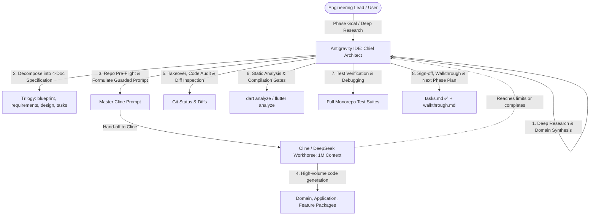

# LODA Autonomous Engineering Protocol: Dual-Agent Pair Programming Standard

## 1. Executive Summary & Operational Model

To maximize software quality, regulatory compliance, and token-cost efficiency across the LODA monorepo, engineering is structured around a **Dual-Agent Symbiosis**:



### Role Division

| Responsibilities | **Antigravity IDE** (Lead Architect & QA) | **Cline + DeepSeek V3/V4** (Workhorse Agent) |
|---|---|---|
| **Core Strengths** | Complex reasoning, regulatory synthesis, repository pre-flight, debugging, verification. | Massive 1M context headroom, rapid parallel code drafting, mechanical adherence to specifications. |
| **Primary Tasks** | - Research decomposition into 4-document specifications.<br>- Repo pre-flight checks (inspecting active enum names, existing test files, SDK rules).<br>- Guardrail prompt formulation.<br>- Takeover on token limits or task completion.<br>- Diagnosing async leaks, mock mismatches, and test failures.<br>- Final verification, sign-off, and walkthrough generation. | - Implementing domain models, value objects, and enforcers.<br>- Implementing application use cases and managers.<br>- Implementing UI screens and design-system widgets.<br>- Creating initial domain and use-case test files. |
| **Token Efficiency** | High-level reasoning consumes fewer premium tokens. | DeepSeek Flash handles large file generation cost-effectively without context dilution. |

---

## 2. The 4-Document Implementation Standard

Every research prompt or major feature phase must be decomposed into a standardized **Implementation Trilogy + Execution Plan** under `docs/researches/<tier>/<phase-name>/` before code is written:

```
docs/researches/<tier>/<phase-name>/
├── blueprint.md       # Architectural vision, legal foundations & mathematical models
├── requirements.md    # EARS / RFC 2119 functional and compliance requirements
├── design.md          # Concrete Dart/Flutter class designs, state machines & algorithms
└── tasks.md           # Sequenced implementation checklist & verification commands
```

### Specification Roles

1. **`blueprint.md`**
   - Authoritative regulatory foundations (NCA, Banks Act exemptions, FMA, CISCA, POPIA).
   - Formal mathematical models (Vasicek single risk factor model, in duplum formulas, APR ceilings).
   - High-level system interaction and data flow diagrams.

2. **`requirements.md`**
   - Unambiguous requirements formulated using RFC 2119 (`MUST`, `SHALL`, `MAY`) and the Easy Approach to Requirements Syntax (EARS).
   - Every requirement is assigned a traceable ID (e.g. `REQ-P2P-01`, `REQ-P2P-02`).

3. **`design.md`**
   - Production-ready Dart class signatures, field types, and constructor signatures.
   - Exact mathematical implementations, constant values, and state transition tables.
   - Explicit package boundaries (pure Dart in `loda_domain`, crypto/framework dependencies in `loda_application`).

4. **`tasks.md`**
   - Sequenced tasks (T1 to TN) ordered by dependency.
   - Pre-flight checks verifying existing codebase anchors.
   - Traceable checklist items with designated verification commands.
   - Known risks, trap warnings, and mitigations.

---

## 3. The Hand-Off & Prompt Formulation Protocol

When Antigravity prepares the task for Cline, it must not simply say "implement this". Antigravity must perform a **live repository pre-flight** and formulate a bulletproof prompt containing:

1. **Workspace Root & Target Packages**:
   - Exact directories for new files (`packages/core/loda_domain/lib/src/<feature>/`, etc.).
2. **Current Baseline**:
   - Number of existing passing tests (e.g., "136 domain tests passing clean").
3. **Repository Ground Truths & Trap Guards**:
   - *Test Preservation*: Flagging existing test files so Cline appends rather than overwrites.
   - *Live Enums & Types*: Verifying actual names in the codebase rather than theoretical names.
   - *SDK Constraints*: Enforcing Dart 3.5 rules (no digit separators like `800_000`, no `const BigInt`, all monetary units in `BigInt` minor currency units).
   - *Layer Hygiene*: Pure Dart in `loda_domain` (no third-party cryptographic or Flutter dependencies).
4. **Step-by-Step Task Sequence**:
   - Explicit instructions mirroring `tasks.md`.
5. **Success Criteria & Thresholds**:
   - Exact target test counts (e.g. "162+ domain tests, 6 application tests, 0 analysis issues").

---

## 4. The Takeover & Audit Protocol (When Cline Completes or Reaches Limits)

When Cline finishes or exhausts its session/tokens mid-stream, Antigravity immediately assumes command. The takeover follows a rigid 5-step checklist:

### Step 1: Git Status & Diff Inspection
```powershell
git status -s
git diff --stat
```
- Identify every created, modified, and deleted file.
- Inspect whether existing stubs or baseline tests were accidentally overwritten or modified.

### Step 2: Static Analysis Gate
```powershell
dart analyze packages/core/loda_domain packages/core/loda_application packages/features/loda_loan_borrower
flutter analyze apps/loda_mobile
```
- All target packages must report: `No issues found!`.

### Step 3: Domain & Application Test Suite Verification
```powershell
dart test packages/core/loda_domain/test/
dart test packages/core/loda_application/test/
```
- Confirm baseline tests continue to pass without regression.
- Verify all new domain and use-case tests execute and pass.

### Step 4: Feature & Widget Test Audit (Diagnosing Flaky/Failing UI Tests)
```powershell
flutter test packages/features/loda_loan_borrower/test/
```
- **Common Gotcha 1: Async Timer Leaks in Widget Tests**:
  - `Future.delayed` or timer loops inside test providers cause `!timersPending` assertion failures.
  - *Fix*: Replace delayed futures with an explicit `Completer<T>` that is pumped and completed before test disposal.
- **Common Gotcha 2: UI Duplicate Text Finders**:
  - When status chips and body text both render the same string (e.g. tier name), `find.text(...)` returns 2 candidates.
  - *Fix*: Use `findsWidgets` or `findsNWidgets(2)`.
- **Common Gotcha 3: Missing Widget Tests**:
  - If new screens or widgets were added, Antigravity writes dedicated widget tests (`test/<feature>_widgets_test.dart`) to ensure 100% test coverage.

### Step 5: Formal Sign-Off & Walkthrough Documentation
- Update `tasks.md` in the research directory:
  - Header status updated to `✅ Complete — 100% implemented & verified`.
  - Checkboxes marked complete.
- Generate `walkthrough.md` in the Antigravity artifact directory summarizing changes, test metrics, and architectural outcomes.
- Present the verified milestone to the user and outline next steps.

---

## 5. Monorepo Quality Metric Anchors

Every completed phase must satisfy this non-negotiable definition of done:

- [x] **Zero Static Analysis Issues**: `dart analyze` reports `No issues found!` across domain, application, and feature packages.
- [x] **Monotonic Test Suite Growth**: Total test count strictly increases; zero test regressions.
- [x] **Layer Decoupling**: Domain models contain zero framework imports; entities never depend on application use cases.
- [x] **Currency Precision**: Monetary calculations strictly utilize `BigInt` minor units (cents); no floating-point rounding errors.
- [x] **Statutory Enforcement**: Every regulatory rule (NCA interest ceilings, in duplum limits, Stokvel exemptions) is backed by dedicated automated tests.
