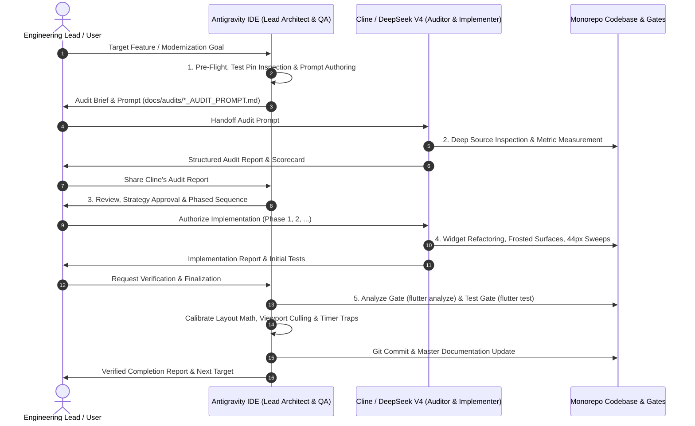

# 🔄 Dual-Agent "Audit-Then-Improve" Engineering Standard
## Lead Architect (Antigravity) & Implementation Specialist (Cline) Symbiosis

**Document Version:** 1.0.0 (October 2026)  
**Standard Authority:** Principal Mobile Systems Architect & Engineering Lead  
**Companion Standard:** [`docs/VHUNAMBI_AGENT_WORKFLOW_STANDARD.md`](file:///docs/VHUNAMBI_AGENT_WORKFLOW_STANDARD.md)  
**Applicability:** Monorepo UI/UX Refactoring, Accessibility Hardening, Performance Audits & Feature Upgrades

---

## 1. Executive Summary & Purpose

To maintain high development velocity while eliminating architectural regressions, design drift, and test failures, the engineering workflow in Vhunambi follows an **"Audit-Then-Improve" Dual-Agent Symbiosis**:



---

## 2. Division of Responsibilities

| Responsibility Area | **Antigravity** (Lead Architect & QA Gatekeeper) | **Cline** (Auditor & High-Velocity Implementer) |
| :--- | :--- | :--- |
| **System Vision** | Defines architectural boundaries, design system tokens, and global metric engines (`VhunambiTopBarMetrics`, `VhunambiBottomDockMetrics`). | Respects token strictness; implements against existing abstractions. |
| **Audit Phase** | Authors the comprehensive **Audit Brief & Prompt** under `docs/audits/`, enumerating target files, rigid test pins, and WCAG/HIG criteria. | Executes line-by-line inspection, verifies actual source behavior, measures sub-44px targets, and identifies discrepancies. |
| **Strategy Formulation** | Reviews Cline's audit findings, validates risk assessments, and decomposes the roadmap into decoupled, safe phases. | Executes phased implementation strictly adhering to the planned task sequence. |
| **Code Implementation** | Implements critical layout math, responsive branching, and architectural fixes when subtle bugs or test traps arise. | Rapidly edits widget hierarchies, expands hit target wrappers, applies frosted backdrops, and styles UI components. |
| **Verification & QA** | Executes `flutter analyze` and `flutter test` gates; diagnoses sliver viewport culling, async timer leaks, and finder collisions. | Runs initial local tests and reports pass/fail feedback during implementation iterations. |
| **Finalization** | Commits verified changes to Git, maintains documentation chronicles, and prepares the next sprint handoff. | Hands off cleanly after implementation without pushing unverified commits. |

---

## 3. The 5-Phase "Audit-Then-Improve" Lifecycle

### Phase 1: Lead Pre-Flight & Audit Prompt Formulation (Antigravity)
Before any code is modified, Antigravity performs an automated pre-flight check on the target module:
1. Identifies existing files, controllers, and presentation widgets.
2. Inspects existing widget tests to extract **rigid test pins** (exact strings, finder types, item counts, and routing assertions that must never break).
3. Defines clear HIG/WCAG metrics (e.g. 44×44px touch targets, frosted glass filters, safe-area offsets).
4. Commits the formal audit prompt to:
   ```
   docs/audits/<FEATURE_NAME>_AUDIT_PROMPT.md
   ```

### Phase 2: Read-Only Source Audit (Cline)
Cline operates in **read-only inspection mode**:
1. Inspects the source files line-by-line against the audit prompt.
2. Verifies actual layout constructs (e.g., whether `Positioned` is used, exact button sizes, hardcoded padding values).
3. Produces a structured **Audit Report**:
   - Executive Assessment & Gap Scoring.
   - Exact line-by-line finding inventory with line numbers.
   - Identified test guardrails and risk mitigation strategies.
   - Phased implementation recommendation.

### Phase 3: Strategic Review & Roadmap Approval (Antigravity & User)
1. User provides Cline's audit findings to Antigravity.
2. Antigravity evaluates the feasibility and confirms that the proposed phases do not introduce test regressions or layout collisions.
3. Antigravity formulates a phased execution command for Cline (or executes directly when optimal).

### Phase 4: Phased Implementation (Cline)
1. Cline implements the agreed phases incrementally:
   - **Phase A**: Surface styling, frosted backdrops, and standardized geometry metrics.
   - **Phase B**: Touch target expansion (44×44px bounding boxes, `minimumSize`, `ConstrainedBox`).
   - **Phase C**: Gesture and state bindings (drag-to-expand, scroll listeners).
2. Cline runs intermediate unit tests and produces a clean diff report.

### Phase 5: Verification Gate, Layout Calibration & Sign-Off (Antigravity)
1. **Static Analysis Gate**:
   ```powershell
   flutter analyze apps/vhunambi_client
   ```
   Must return `No issues found!`.
2. **Target Test Suite Verification**:
   ```powershell
   flutter test test/features/<feature_name>
   ```
3. **Trap Resolution & Calibration**:
   - If widget tests fail due to sliver viewport culling (physical size boundaries), Antigravity calibrates responsive touch geometry (`ResponsiveUtils.isMobile(context) ? 44 : 28`) and harmonizes section padding.
   - If tests fail due to widget unmounting, Antigravity replaces conditional tabs with `IndexedStack`.
4. **Full Regression Gate**:
   ```powershell
   flutter test test/features/
   ```
   Ensures all 805+ tests remain green.
5. **Git Commit & Chronicle Update**:
   - Commits with descriptive semantic commit (`feat(<feature>): ...`).
   - Updates [`docs/VHUNAMBI_MODERNIZATION_CHRONICLE.md`](file:///docs/VHUNAMBI_MODERNIZATION_CHRONICLE.md).

---

## 4. Architectural Trap Catalog & Mitigation Strategies

Based on the modernization of the 5 core systems, four major architectural traps have been identified and codified:

### Trap 1: Coordinated Bottom Dock Insets
* **Problem:** Each screen (Explore, Studio, Track, Library) used arbitrary hardcoded bottom padding (`80`, `110`, `120`), causing content to be hidden under the mini player or leaving huge empty gaps when no audio was playing.
* **Mitigation:** Always query `VhunambiBottomDockMetrics.scrollInset(context, hasActiveTrack: hasActiveTrack)` in the bottom-most sliver or padding of scrollable views.

### Trap 2: IndexedStack vs. Mode Switcher Unmounting
* **Problem:** Switching studio tabs (Generate, MPC Chopper, Crate Browser) using standard conditional rendering (`if (mode == ... )`) unmounts hidden tabs, breaking widget tests that expect cross-tab finders (`find.text('Advanced Options')`) to resolve on initial render.
* **Mitigation:** Use `IndexedStack(index: activeIndex, children: [...])` to keep all mode view trees mounted in memory while toggling visible index.

### Trap 3: Scroll-Aware App Bar Title Cross-Fading
* **Problem:** Hardcoding app bar titles creates visual clutter when hero track artwork or banners are visible, but removing them entirely leaves empty top bars when scrolled.
* **Mitigation:** Use a lightweight `ValueNotifier<bool>` attached to a `ScrollController` listener (threshold `offset > 240`). Cross-fade titles smoothly using `AnimatedOpacity` without triggering expensive rebuilds of the entire view tree.

### Trap 4: Sliver Viewport Culling & Desktop vs. Touchscreen Touch Targets
* **Problem:** Flutter's test runner enforces a fixed physical viewport (e.g. `Size(1280, 2800)`). Bumping multiple rows of chips from 28px to 44px expands the CustomScrollView height past 2800px, causing downstream slivers (`_LoadMoreButton`, `ExploreEmptyState`) to be culled by the sliver viewport, failing finders and tap actions.
* **Mitigation:** Apply responsive touch constraints:
  ```dart
  constraints: BoxConstraints(
    minHeight: ResponsiveUtils.isMobile(context) ? 44 : 28,
  ),
  padding: EdgeInsets.symmetric(
    horizontal: AppSpacing.sm,
    vertical: ResponsiveUtils.isMobile(context) ? 8 : 6,
  ),
  ```
  This guarantees strict 44×44px WCAG/HIG compliance on touchscreens while maintaining compact layout elegance and viewport safety on desktop pointer screens.

---

## 5. Reusable Templates

### Template A: Antigravity Audit Prompt Template
```markdown
# 🏛️ AUDIT BRIEF & PROMPT: [Feature Name]
**Target Agent:** Antigravity / Cline (Audit & Implementation Mode)  
**Target Codebase:** `apps/vhunambi_client` (Flutter / Dart)  
**Scope:** [Target Files & Features]  

## 🎯 Mission Statement & Purpose
You are acting as an independent, unbiased Principal Mobile Systems Architect and Design Systems Lead.
Audit and modernize [Target Feature] into high-performance frosted surfaces with mathematical geometry and 44px touch compliance.

## 📂 Primary Code Files Audited
- `apps/vhunambi_client/lib/features/...`

## 🔒 Rigid Test Guardrails (Must Never Break)
- Pin 1 — [Component / String Finder]
- Pin 2 — [State / Provider Binding]
- Pin 3 — [Routing Assertion]

## 🛠️ Verification Gates
- `flutter analyze apps/vhunambi_client` (0 issues)
- `flutter test test/features/...` (100% pass)
```

### Template B: Cline Audit Report Template
```markdown
# 🏛️ VHUNAMBI — [Feature Name] Audit Report
**Mode:** Plan / Read-Only · **Target:** `apps/vhunambi_client` · **Standard:** Principal Mobile Systems Architect

## Verification Notes (Confirmed in Source)
- [Observation 1 with exact file and line number]
- [Observation 2 with exact dimensions measured]

## Gap Scorecard
| Metric | Current State | Target State | Status |
| :--- | :--- | :--- | :--- |
| **Touch Targets** | [Current px] | 44×44px min | ❌ Non-compliant |
| **Frosted Surfaces** | Flat surface | BackdropFilter | ❌ Missing |
| **Dock Insets** | Hardcoded | VhunambiBottomDockMetrics | ❌ Inconsistent |

## Phased Implementation Plan
- **Phase 1**: [Geometry, Metrics & Surfaces]
- **Phase 2**: [Touch Targets & Ergonomics]
- **Phase 3**: [State, Gestures & Polish]
```

### Template C: Antigravity Verification & Sign-Off Template
```markdown
# 🏛️ [Feature Name] — Modernization Complete & Verified

## ✅ Verification Gates
- **`flutter analyze`**: No issues found! (0 errors, 0 warnings).
- **`flutter test`**: All X/X tests passed.
- **Full Suite**: 805/805 tests passed across all features.

## 🛠️ Implemented Modernizations
[Summary table of files and changes]

## 🔒 Preserved Test Pins
[Checklist confirming all guardrails remained green]
```
