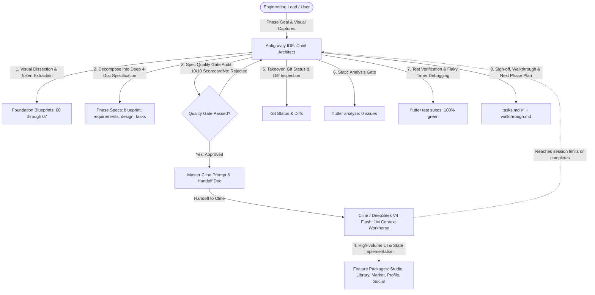

# VHUNAMBI Autonomous Engineering Protocol: Dual-Agent Pair Programming Standard

> **Platform:** African AI Music Synthesis & Commercial Licensing Platform  
> **Source Origin:** Production Web Client (`https://vhunambi.com`)  
> **Target:** Cross-Platform Client (Flutter/Dart — Windows, macOS, Android, iOS) & Node.js/Hono Gateway  
> **Engineering Model:** Dual-Agent Symbiosis (Antigravity IDE Chief Architect & QA + Cline/DeepSeek V4 Flash Workhorse)  
> **Revision:** 2.1 (Deep Specification Standard & Quality Invariant Reinforcement)

---

## 1. Executive Summary & Operational Model

To maximize development velocity, design token fidelity, and token-cost efficiency across the Vhunambi codebase, engineering is structured around a **Dual-Agent Symbiosis** (adapted from the LODA autonomous engineering standard):



### Role Division Matrix

| Dimension | **Antigravity IDE** (Lead Architect & QA Gatekeeper) | **Cline + DeepSeek V4 Flash** (Implementation Workhorse) |
|---|---|---|
| **Core Strengths** | Complex architectural reasoning, visual dissection from captures, repository pre-flight, debugging async leaks, responsive geometry calibration, verification gatekeeper. | Massive 1M context headroom, rapid multi-file generation, mechanical adherence to specifications, high-velocity widget implementation. |
| **Primary Tasks** | - Visual decomposition from screenshots into SSOT Foundation Blueprints (00–07).<br>- Decomposing phases into rigorous 4-document specifications (`blueprint`, `requirements`, `design`, `tasks`).<br>- Authoring foundational domain models, immutable state classes, and unit tests before handoff.<br>- Formulating bulletproof handoff documents (`CLINE_HANDOFF_PHASE<N>.md`).<br>- Post-implementation audit (`git diff`, `flutter analyze`, `flutter test`).<br>- Calibrating responsive constraints, sliver viewports, and touch hit-bounds.<br>- Final sign-off, commit, and `walkthrough.md` generation. | - Implementing complex UI widgets, custom painters, and layouts.<br>- Implementing Riverpod state notifiers, mutations, and side effects.<br>- Building forms, sliders, modals, bottom sheets, and action rails.<br>- Wiring widget keys for deterministic test automation.<br>- Creating comprehensive widget test suites mirroring the specification. |
| **Token Efficiency** | High-level reasoning consumes fewer premium tokens. | DeepSeek V4 Flash handles thousands of lines of Dart UI code cost-effectively without context dilution. |

---

## 2. The 4-Document Implementation Standard

Every implementation milestone must be decomposed into a standardized **4-Document Specification Suite** before any feature code is authored. Specifications reside in either of two recognized locations:

1. **Monorepo Milestone Archive:** `docs/phases/<phase_name>/`
2. **IDE-Native Feature Specifications:** `.kiro/specs/<feature_name>/`

Both directories are subject to the identical depth, completeness, and verification requirements defined in this standard.

```
docs/phases/<phase_name>/  OR  .kiro/specs/<feature_name>/
├── blueprint.md       # Architectural vision, dual ASCII wireframes, tokens, state machines & topologies
├── requirements.md    # Domain glossary, user stories, EARS/RFC 2119 criteria & traceability matrix
├── design.md          # Compilable Dart/TS models, Riverpod providers, SQLite DDL & API contracts
└── tasks.md           # Sequenced implementation tracks (T1 to TN), explicit keys & trap mitigations
```

Upon phase completion, a 5th document is generated as the immutable verification record:
```
docs/phases/<phase_name>/
└── walkthrough.md     # Post-implementation verification record, test metrics & physical device log
```

---

## 3. High-Quality Specification Document Standards

### 3.0 The "Zero-Summarization" Law & Engineering Depth Invariants

> **CRITICAL INVARIANT (ANTI-SUMMARY RULE):**  
> Under no circumstances may an agent or engineer generate "summarized", abbreviated, or high-level outline specifications. Vhunambi forbids placeholder pseudo-code, omitted fields (e.g., `// ... other fields`), and hand-waving bullet points.
>
> **Why?** Summarized specifications are the single largest source of downstream engineering failures:
> - They cause missing enum branches and compile breaks.
> - They lead to hardcoded theme assumptions (e.g., dark text on dark surfaces in Light Mode).
> - They lead to path-resolution crashes on physical devices (e.g., writing to Android root `/` instead of `Directory.systemTemp`).
> - They fail to specify 44×44px touch targets and cause UI layout overflows.
> - They omit test teardown semantics, causing unmanaged timer leaks in test runners.
>
> **Depth Mandate:** Every specification suite MUST match or exceed the technical depth, formal syntax, and exhaustive class coverage exhibited by the canonical **Gold Standard Exemplars** (Section 3.5).

---

### 3.1 `blueprint.md` Specification Standard

The `blueprint.md` is the **authoritative architectural, topological, and visual contract**. It bridges the product vision to concrete engineering geometries.

#### Mandatory Sections:
1. **Metadata Header**:
   - Phase/Feature code, status (`🟡 SPECIFICATION` → `✅ COMPLETE`), target workspaces (`apps/vhunambi_client`, `apps/vhunambi_api`), and upstream dependencies.
2. **Executive Summary & Cultural Musical Context**:
   - Cultural and musical grounding: regional BPM structures (Amapiano log drums, Maskandi guitars, Gqom syncopation), 25+ Bantu language phonetic requirements, and commercial royalty models.
3. **Forensic Defect & Root Cause Matrix (For Refactors & Bug Sweeps)**:
   - When resolving physical device, video, or UI issues (exemplified by `phase_44`), the blueprint MUST include a forensic defect table:
     | Timestamp / View | Defect Caught on Screen | Root Cause (File & Line) | Architectural Solution | Regression Defense |
     |---|---|---|---|---|
4. **System Topology & Cross-Layer Data Flow (Mermaid)**:
   - Complete diagram tracing user gestures $
ightarrow$ Flutter Riverpod $
ightarrow$ Local Outbox (Hive) $
ightarrow$ REST API (Hono) $
ightarrow$ SQLite WAL $
ightarrow$ Cloudflare R2 / RunPod GPU bridges.
5. **Dual-Viewport Layout Geometries (ASCII / Markdown Wireframes)**:
   - Modeled after the canonical standard in `docs/phases/phase_07_track_profiles/blueprint.md`:
   - **Desktop Viewport Wireframe (> 1024px)**: Full ASCII diagram showing header bars, artwork showcase sizes, sidebar action rails, waveform scrubbers, stem racks, and responsive padding.
   - **Mobile Viewport Wireframe (< 768px)**: Full ASCII diagram detailing safe area insets, 56px top bar, stacked controls, tab bars, and bottom dock clearance.
6. **Component Hierarchy Tree**:
   - Complete nested tree from View Root $
ightarrow$ Slivers / Scaffold $
ightarrow$ Custom Composites $
ightarrow$ Reusable Molecules $
ightarrow$ Interactive Atoms.
7. **Finite State Machine & State Transition Matrix**:
   - Mermaid `stateDiagram-v2` illustrating all lifecycle stages.
   - Mandatory State Transition Table:
     | Event / Trigger | Initial State | Target State | Guard Conditions | Side Effects / Outbox Actions |
     |---|---|---|---|---|
8. **Design Token Bindings Matrix**:
   - Exhaustive mapping of all UI elements to pre-defined tokens in `lib/core/theme/`:
     - Surfaces: `AppColors.surfaceCanvas`, `surfaceElevated`, `surfaceSecondary`, `surfaceModal`.
     - Text & Contrast: `AppColors.textPrimaryOf(context)`, `textSecondaryOf(context)` (with explicit cinema-dark locks on video surfaces).
     - Borders & Outlines: `AppColors.borderSubtleOf(context)`, `borderStrongOf(context)`.
     - Radii: `AppRadius.card`, `AppRadius.pill`, `AppRadius.modalBorder`.
     - Spacing: `AppSpacing.xs` through `AppSpacing.xxl`.
9. **Dock & Navigation Geometry Invariants**:
   - Explicit formulas integrating `VhunambiTopBarMetrics.totalHeight(context)`, `VhunambiBottomDockMetrics.scrollInset(context)`, and `modalSheetOpenCountProvider` suppression.

---

### 3.2 `requirements.md` Specification Standard

The `requirements.md` establishes the **unambiguous, testable acceptance criteria**. It defines the legal and operational contract of the feature.

#### Mandatory Sections:
1. **Exhaustive Domain Glossary**:
   - Modeled directly on the Gold Standard in `.kiro/specs/adaptive-mini-player/requirements.md`.
   - Must precede all requirements and provide alphabetical definitions for every domain entity, UI form, state flag, gesture type, audio term, and system metric introduced in the phase.
2. **User Stories & Numbered RFC-2119 / EARS Acceptance Criteria**:
   - Every functional capability must be introduced by a formal User Story:
     ```markdown
     ### Requirement N: [Feature Capability Name]
     **User Story:** As a [role/creator/listener], I want [capability], so that [outcome/value].
     #### Acceptance Criteria
     1. THE system SHALL [ubiquitous invariant]...
     2. WHEN [event/gesture], THE system SHALL [action]...
     3. WHILE [state], THE system SHALL [behavior]...
     4. IF [error/edge condition], THEN THE system SHALL [fallback action]...
     5. WHERE [platform/mode], THE system SHALL [mode behavior]...
     ```
3. **Non-Negotiable UX & Engineering Invariants**:
   - **REQ-*-TOUCH-XX (Touch Ergonomics)**: Every interactive control (button, tab, chip, icon button, scrubber thumb) **MUST** specify a minimum 44×44px touch bounding box (`minHeight: 44, minWidth: 44` or `kMinInteractiveDimension`) per Apple HIG and WCAG 2.1 AA.
   - **REQ-*-CINEMA-XX (Cinema Contrast Lock)**: Any control overlaid on full-screen video, camera preview, waveform canvas, or reels modal **MUST** be locked into `AppTheme.darkTheme` and use high-contrast white (`AppColors.darkTextPrimary`) with text dropshadows, regardless of device Light/Dark mode.
   - **REQ-*-PERF-XX (Performance & Animation Budget)**: All visual animations (spinning vinyl, waveform scrub, particle canvas) **MUST** maintain 60 FPS (16.6ms budget) and explicitly dispose tickers/controllers to prevent test teardown hangs.
   - **REQ-*-FS-XX (Filesystem Safety)**: All local file generation (remix mixdowns, WAV bounces, voice models, cache exports) **MUST** write to `Directory.systemTemp.path` or platform application documents; bare filenames are strictly prohibited.
4. **Requirements Traceability Matrix**:
   - Mandatory summary table mapping every requirement to its target implementation file, test suite, and verification command:
     | Requirement ID | Capability Description | Target Code Files | Target Test Suite | Test Type |
     |---|---|---|---|---|

---

### 3.3 `design.md` Specification Standard

The `design.md` is the **concrete engineering implementation blueprint**. It contains **compilable, real code declarations**, not vague pseudo-code.

#### Mandatory Sections:
1. **Domain Models & Immutable Entities (Dart / TypeScript)**:
   - Full, compilable class definitions with `@immutable`.
   - Explicit typed fields for every attribute (no `dynamic`).
   - Factory constructors (`fromJson`, `empty`, `initial`).
   - Complete `copyWith()` methods cloning every parameter.
   - Serialization logic (`toJson`, `toString`, `props` / `==` equality).
   - Hive type IDs and field annotations for durable client caching.
2. **State Management & Riverpod Notifiers**:
   - Complete Riverpod provider signatures (`StateNotifierProvider`, `NotifierProvider`, `AsyncNotifierProvider`).
   - Immutable state classes with explicit status enums (`idle`, `loading`, `success`, `error`).
   - Public notifier methods with full parameter types and return Futures.
   - Optimistic state update strategies and automatic rollback mechanisms.
3. **Backend Persistence DDL & REST API Contracts (When Backend is Touched)**:
   - Modeled after the Gold Standard in `docs/phases/phase_45_backend_sqlite_persistence_and_delta_sync/design.md`:
   - Complete SQLite DDL statements (`CREATE TABLE`, `CREATE INDEX`, foreign keys, cascade rules, WAL configuration).
   - Full REST route specifications (HTTP method, URL path, query params, request body JSON schema, response 200/201 schema, error 400/404/409 schemas).
   - Monotonic delta sync contracts with auto-incrementing `seq` cursor, ETag generation, and HTTP 304 Not Modified semantics.
4. **Widget Decomposition & Presentation Architecture**:
   - File-by-file breakdown with exact workspace paths.
   - Exact widget parameter lists and public constructors.
   - **Mandatory Deterministic Widget Keys**: Explicit table of `Key('...')` values applied to interactive widgets (e.g., `Key('open_verse_publish_btn')`, `Key('payout_submit_btn')`).
5. **Responsive Breakpoint Strategy**:
   - Responsive layout matrix comparing Mobile (< 768px), Tablet (768–1024px), and Desktop (> 1024px) behaviors.
6. **Error Recovery, Offline Outbox & Fallback Strategies**:
   - In-memory fallbacks when local disk writes fail (`FileSystemException`).
   - Durable offline mutation queueing with exponential backoff retry.
   - Audio decoding fallbacks to stereo master streams.

---

### 3.4 `tasks.md` Specification Standard

The `tasks.md` is the **executable implementation roadmap**. It directs agents and engineers in strict dependency order.

#### Mandatory Sections:
1. **Pre-Flight Verification Checklist**:
   - Git working directory cleanliness (`git status`).
   - Baseline static analysis report (`flutter analyze` or `dart analyze` = 0 issues).
   - Baseline test suite pass count (e.g., "44/44 tests passing, 100% green").
2. **Sequenced Implementation Tracks**:
   Tasks must be structured into non-conflicting, dependency-ordered tracks:
   - **Track A: Data Contracts & Backend Persistence** (SQLite DDL, schemas, API endpoints, delta sync).
   - **Track B: Domain Entities & Immutable Models** (Dart classes, enums, serializers, model unit tests).
   - **Track C: State Management & Offline Outbox** (Riverpod notifiers, repositories, state unit tests).
   - **Track D: Presentation Atoms & Reusable Molecules** (Widgets, buttons, sliders, custom painters).
   - **Track E: Composite Views, Modals & Shell Integration** (Sheets, full-screen dialogs, navigation integration).
   - **Track F: Regression Test Suites & Verification Gates** (Widget tests, golden tests, end-to-end flows).
3. **Task Item Granularity**:
   - Every task item must state:
     - Task ID (`T1.1`, `T1.2`, etc.).
     - Target file path (marked `[NEW]` or `[MODIFY]`).
     - Concrete, detailed implementation requirements.
     - Exact widget keys and token bindings.
     - Verification command for that specific step.
4. **Known Traps & Mitigations Matrix**:
   - Explicit table documenting known Flutter / Riverpod / Android / Vhunambi gotchas relevant to the phase:
     | Potential Trap | Root Cause | Mandatory Architectural Mitigation |
     |---|---|---|
     | Android root read-only crash | Bare filename passed to file I/O | Always resolve paths via `Directory.systemTemp.path` |
     | Light mode black-on-black overlay | Using dynamic text tokens on dark media | Lock video overlay tree into `AppTheme.darkTheme` |
     | Widget test timer teardown leak | Periodic ticker or spinning vinyl running | Explicitly call notifier `.dismiss()` or pump explicit durations |
     | SDK enum collision | Importing conflicting Flutter 3.44 names | Use `AudioRepeatMode`, never raw `RepeatMode` |
5. **Post-Flight Verification Gate**:
   - Exact copy-paste commands to execute and verify analyzer cleanliness and test pass counts.

---

### 3.5 Canonical "Gold Standard" Exemplars Registry

When authoring any new specification, agents and engineers MUST reference the following four canonical exemplar suites located in this repository:

| Canonical Exemplar | Workspace Path | Core Specialization & Exemplar Value |
|---|---|---|
| **Adaptive Mini Player** | [`.kiro/specs/adaptive-mini-player/`](file:///c:/Users/Ndugelo/VHUNAMBI/monorepo/.kiro/specs/adaptive-mini-player/) | **Gestural Mechanics & Exhaustive Rigor:** Benchmark for 48-term domain glossaries, state morphing diagrams, formal EARS user stories, and multi-file task breakdowns. |
| **Track & Creator Profiles** | [`docs/phases/phase_07_track_profiles/`](file:///c:/Users/Ndugelo/VHUNAMBI/monorepo/docs/phases/phase_07_track_profiles/blueprint.md) | **Dual-Viewport ASCII Geometries & Domain Dissection:** Benchmark for pixel-annotated desktop and mobile ASCII layouts, cultural reaction decks, stem separation racks, and profile stat grids. |
| **Video Defect Polish & Edge Outbox** | [`docs/phases/phase_44_frontend_flawless_polish_and_edge_outbox/`](file:///c:/Users/Ndugelo/VHUNAMBI/monorepo/docs/phases/phase_44_frontend_flawless_polish_and_edge_outbox/blueprint.md) | **Physical Walkthrough Triage & Offline Resiliency:** Benchmark for timestamped video defect matrices, root-cause forensics, filesystem exception fallbacks, cinema theme locks, and durable Hive outbox queueing. |
| **Backend SQLite WAL & Delta Sync** | [`docs/phases/phase_45_backend_sqlite_persistence_and_delta_sync/`](file:///c:/Users/Ndugelo/VHUNAMBI/monorepo/docs/phases/phase_45_backend_sqlite_persistence_and_delta_sync/blueprint.md) | **Database Persistence & Sync Architecture:** Benchmark for zero-dependency Node 24 `node:sqlite` WAL DDL schemas, monotonic sequence counters, idempotent mutation engines, and ETag/304 delta query contracts. |

---

### 3.6 The 10-Point Spec Quality Audit Scorecard (Pre-Code Gate)

Before an agent or engineer writes a single line of feature code, the specification suite MUST pass all 10 checks of this scorecard:

| # | Audit Criterion | Verification Standard | Pass/Fail |
|---|---|---|:---:|
| **1** | **No Placeholder Pseudo-Code** | All models and interfaces in `design.md` have full, compilable class declarations with types, constructors, and `copyWith` methods (zero `// ... other fields`). | [ ] |
| **2** | **Exhaustive Domain Glossary** | `requirements.md` begins with an alphabetical glossary defining all domain concepts, states, widgets, and audio terms introduced in the phase. | [ ] |
| **3** | **Dual-Viewport ASCII Wireframes** | `blueprint.md` provides explicit ASCII layouts for BOTH Desktop (> 1024px) and Mobile (< 768px) with pixel dimensions and safe area insets. | [ ] |
| **4** | **Formal EARS & RFC 2119 Syntax** | Every requirement in `requirements.md` utilizes `SHALL`, `WHEN`, `WHILE`, `IF... THEN` with a unique, traceable ID (`REQ-XXX-YY`). | [ ] |
| **5** | **44×44px Touch Ergonomics Mandate** | Every interactive atom in `requirements.md` and `design.md` specifies minimum 44×44px hit bounds per Apple HIG / WCAG 2.1 AA. | [ ] |
| **6** | **Cinema Dark Contrast Lock** | Full-screen video overlays, reels modals, and waveform visualizers are explicitly specified to lock into `AppTheme.darkTheme` with white text dropshadows. | [ ] |
| **7** | **Filesystem Temp Safety Mandate** | Any file bouncing, WAV generation, or caching specifies `Directory.systemTemp.path` with base64/in-memory fallback on `FileSystemException`. | [ ] |
| **8** | **Full Persistence DDL & Sync Contracts** | If backend or local database is touched, `design.md` contains full `CREATE TABLE` DDL schemas, types, indexes, and delta sync endpoints. | [ ] |
| **9** | **Deterministic Widget Keys Specified** | All interactive widgets in `design.md` and `tasks.md` have explicit `Key('...')` names mapped for test automation. | [ ] |
| **10** | **Known Traps & Mitigations Included** | `tasks.md` includes an explicit table of known Flutter/Riverpod/platform gotchas and concrete architectural defenses. | [ ] |

> **ENFORCEMENT:** If ANY of the 10 checks fail, the specification suite is **REJECTED**. The authoring agent MUST expand the specifications before any implementation code is generated.

---

## 4. The Master Handoff Protocol (`CLINE_HANDOFF_PHASE<N>.md`)

Before delegating high-volume implementation to Cline, Antigravity **MUST** author a standalone master handoff document under `docs/CLINE_HANDOFF_PHASE<N>.md` and formulate a guarded, copy-pasteable prompt.

### Handoff Document Structure:
1. **Header & Baseline Status**:
   - Target apps, branch, starting test count, and analyzer status.
2. **Executive Summary & Scope**:
   - High-level deliverables divided by track.
3. **Foundations Implemented by Chief Architect**:
   - List of domain models, state providers, and unit tests *already authored and verified green* by Antigravity prior to handoff. This provides Cline with rigid compile-time types to build against.
4. **Cline's Implementation Tasks**:
   - Direct, numbered UI tasks specifying file paths, layout widgets, touch sizes, and explicit widget keys.
5. **Widget Test Requirements**:
   - Specific assertions and interactions to test (e.g., tap key X, verify provider state Y, expect text Z).
6. **Pre-Flight Command Checklist**:
   - Copy-paste commands for Cline to verify its own work before declaring completion:
     ```powershell
     cd apps/vhunambi_client
     flutter analyze
     flutter test test/features/<feature>/...
     ```

---

## 5. Non-Negotiable Vhunambi Code & Architecture Standards

All agents (Antigravity and Cline) must strictly adhere to the following architectural rules:

### 5.1 Design Token Strictness
- **Zero Raw Hex Values**: Never hardcode `#111111`, `Color(0xFF...)`, or CSS hex strings in UI code. All colors must resolve through `AppColors` (e.g., `AppColors.surfaceCanvas`, `AppColors.brandPrimary`, `AppColors.accentGold`).
- **Zero Raw Text Styles**: Never use ad-hoc `TextStyle(fontSize: 16)`. All typography must resolve through `AppTypography` (e.g., `AppTypography.bodyMedium`, `AppTypography.headingSmall`).
- **Zero Raw Border Radii**: All radii must resolve through `AppRadius` (e.g., `AppRadius.card`, `AppRadius.pill`, `AppRadius.modalBorder`).
- **Zero Magic Spacing**: All padding and margins must resolve through `AppSpacing` (e.g., `AppSpacing.xs`, `AppSpacing.md`, `AppSpacing.xl`).

### 5.2 Touch Ergonomics (Apple HIG & Material 3)
- **Minimum 44×44px Hit Target**: Every interactive element (buttons, tabs, icon triggers, filter chips, sliders) must have a minimum interactive bounding box of 44×44px.
- Use `ConstrainedBox(constraints: BoxConstraints(minHeight: 44, minWidth: 44))` or button `minimumSize: const Size(44, 44)` on mobile viewports.
- Ensure visual padding does not shrink the hit area below 44px.

### 5.3 Safe-Area & Dock Coordinated Geometry
- **Top Bar**: Use `VhunambiTopBarMetrics.totalHeight(context)` (standard 56px content + `MediaQuery.paddingOf(context).top`) for all custom app bars.
- **Bottom Dock**: Use `VhunambiBottomDockMetrics.scrollInset(context)` for all scrollable views (`ListView`, `CustomScrollView`, `SingleChildScrollView`) to prevent content from hiding beneath the persistent audio transport and navigation dock.
- Use `VhunambiBottomDockMetrics.dockHeight(context)` for positioning floating action bars and modals above the dock.
- **Modal Sheet Open Suppression**: All floating player widgets and overlays must listen to `modalSheetOpenCountProvider` and hide when modals or sheets are actively open.

### 5.4 Collision-Safe Naming
- Audio repeat mode must be named `AudioRepeatMode` (`off`, `all`, `one`), **never** `RepeatMode` (which collides with Flutter 3.44's `repeating_animation_builder.dart`).
- Platform channel / audio session names must be uniquely namespaced (`vhunambi_audio_handler`).

### 5.5 Test Safety & Flaky Timer Prevention
- **No Unmanaged Animation Controllers**: Never create indefinite animation loops or `Future.delayed` without explicit disposal or test bypass.
- In widget tests, explicitly call notifier dismiss/teardown methods (`container.read(playerStateProvider.notifier).dismiss();`) to cleanly dispose periodic position tickers.
- In widget tests, use `await tester.pump()` with explicit durations instead of `tester.pumpAndSettle()` when continuous animations (spinning vinyl, pulsating glow) are active.
- Use `tester.binding.setSurfaceSize(const Size(1280, 800))` for desktop widget tests and `Size(390, 844)` for mobile widget tests.

---

## 6. The "Audit-Then-Improve" Modernization Protocol

For full-stack UI/UX refactoring, accessibility sweeps, and component modernizations, engineering follows the **Audit-Then-Improve Dual-Agent Protocol**:

- **Complete Standard**: [`docs/DUAL_AGENT_AUDIT_IMPROVE_WORKFLOW.md`](file:///c:/Users/Ndugelo/VHUNAMBI/monorepo/docs/DUAL_AGENT_AUDIT_IMPROVE_WORKFLOW.md)
- **Modernization Chronicle**: [`docs/VHUNAMBI_MODERNIZATION_CHRONICLE.md`](file:///c:/Users/Ndugelo/VHUNAMBI/monorepo/docs/VHUNAMBI_MODERNIZATION_CHRONICLE.md)
- **Audit Prompts & Briefs**: Stored under `docs/audits/` (e.g., [`docs/audits/TOP_BAR_NAVIGATION_AUDIT_PROMPT.md`](file:///c:/Users/Ndugelo/VHUNAMBI/monorepo/docs/audits/TOP_BAR_NAVIGATION_AUDIT_PROMPT.md)).

### The 8-Dimension Audit Scorecard:
Every audit prompt formulated by the Chief Architect must evaluate the target system across 8 standardized dimensions:
1. **Dock & Navigation Geometry**: Verification against `VhunambiBottomDockMetrics` and `modalSheetOpenCountProvider`.
2. **Top Bar & Header Geometry**: Verification against `VhunambiTopBarMetrics`.
3. **Touch Targets & Ergonomics**: Verification of 44×44px hit bounds across all interactive controls.
4. **Surface & Frosted Materials**: Verification of `BackdropFilter` glassmorphism and theme tokens.
5. **Responsive Viewport Layout**: Behavior across Mobile (< 768px), Tablet, and Desktop (> 1024px).
6. **State Preservation**: Retention of form, scroll, and tab state across view switches (`IndexedStack`).
7. **Keyboard & Accessibility**: Semantics, labels, focus nodes, and keyboard dismissals.
8. **Test Pins & Guardrails**: Verification of test coverage and protection against regressions.

---

## 7. Verification & Sign-Off Checklist (Non-Negotiable Gate)

Before any phase is marked `✅ Complete` in `README.md`, `tasks.md`, and the Git commit log, it must pass the Chief Architect's 5-step verification gate:

```powershell
# 1. Static Analysis Gate (0 issues across all targets)
cd apps/vhunambi_client
flutter analyze # OR dart analyze lib test

# 2. Complete Test Suite Gate (Zero regressions, 100% passing)
flutter test

# 3. Backend Verification Gate (if API touched)
cd ../vhunambi_api
pnpm build
pnpm test
```

- [x] **Zero Static Analysis Warnings**: `dart analyze lib test` reports `No issues found!`.
- [x] **Monotonic Test Suite Growth**: Total test count strictly increases; zero regressions.
- [x] **100% Design Token Adherence**: Verified by grep audit for raw `#` hex values.
- [x] **Tasks & Handoff Signed Off**: `tasks.md` updated with `✅ Complete` and all boxes checked.
- [x] **Walkthrough Document Committed**: `docs/phases/<phase_name>/walkthrough.md` generated with full test breakdown.
