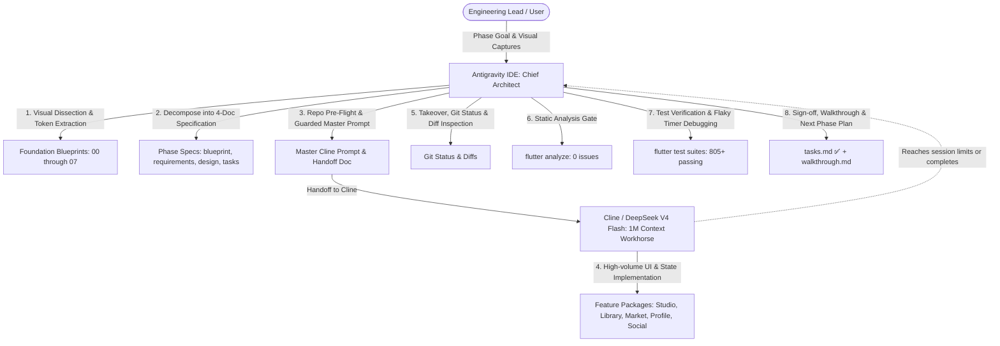

# VHUNAMBI Autonomous Engineering Protocol: Dual-Agent Pair Programming Standard

> **Platform:** African AI Music Synthesis & Commercial Licensing Platform  
> **Source Origin:** Production Web Client (`https://vhunambi.com`)  
> **Target:** Cross-Platform Client (Flutter/Dart — Windows, macOS, Android, iOS) & Node.js/Hono Gateway  
> **Engineering Model:** Dual-Agent Symbiosis (Antigravity IDE Chief Architect & QA + Cline/DeepSeek V4 Flash Workhorse)  
> **Revision:** 2.0 (Post-Phase 22 & Full-Stack Modernization Standard)

---

## 1. Executive Summary & Operational Model

To maximize development velocity, design token fidelity, and token-cost efficiency across the Vhunambi codebase, engineering is structured around a **Dual-Agent Symbiosis** (adapted from the LODA autonomous engineering standard):



### Role Division Matrix

| Dimension | **Antigravity IDE** (Lead Architect & QA Gatekeeper) | **Cline + DeepSeek V4 Flash** (Implementation Workhorse) |
|---|---|---|
| **Core Strengths** | Complex architectural reasoning, visual dissection from captures, repository pre-flight, debugging async leaks, responsive geometry calibration, verification gatekeeper. | Massive 1M context headroom, rapid multi-file generation, mechanical adherence to specifications, high-velocity widget implementation. |
| **Primary Tasks** | - Visual decomposition from screenshots into SSOT Foundation Blueprints (00–07).<br>- Decomposing phases into rigorous 4-document specifications (`blueprint`, `requirements`, `design`, `tasks`).<br>- Authoring foundational domain models, immutable state classes, and unit tests before handoff.<br>- Formulating bulletproof handoff documents (`CLINE_HANDOFF_PHASE<N>.md`).<br>- Post-implementation audit (`git diff`, `flutter analyze`, `flutter test`).<br>- Calibrating responsive constraints, sliver viewports, and touch hit-bounds.<br>- Final sign-off, commit, and `walkthrough.md` generation. | - Implementing complex UI widgets, custom painters, and layouts.<br>- Implementing Riverpod state notifiers, mutations, and side effects.<br>- Building forms, sliders, modals, bottom sheets, and action rails.<br>- Wiring widget keys for deterministic test automation.<br>- Creating comprehensive widget test suites mirroring the specification. |
| **Token Efficiency** | High-level reasoning consumes fewer premium tokens. | DeepSeek V4 Flash handles thousands of lines of Dart UI code cost-effectively without context dilution. |

---

## 2. The 4-Document Implementation Standard

Every implementation phase must be decomposed into a standardized **4-Document Specification Suite** under `docs/phases/<phase_name>/` before any feature code is authored:

```
docs/phases/<phase_name>/
├── blueprint.md       # Architectural vision, UI wireframes, visual tokens & state machine models
├── requirements.md    # EARS / RFC 2119 functional, audio synthesis, touch & UX requirements
├── design.md          # Concrete Dart/TS class signatures, Riverpod providers & widget hierarchies
└── tasks.md           # Sequenced implementation checklist (T1 to TN), keys & trap warnings
```

Upon phase completion, a 5th document is generated as the immutable verification record:
```
docs/phases/<phase_name>/
└── walkthrough.md     # Post-implementation verification record, test metrics & screenshot gallery
```

---

## 3. High-Quality Specification Document Standards

To ensure implementation agents (Cline or subagents) produce production-grade, bug-free code on the first pass, every specification document must satisfy strict structural and technical criteria.

### 3.1 `blueprint.md` Specification Standard

The `blueprint.md` is the **authoritative architectural and visual contract**. It must bridge the abstract product goal to concrete engineering geometries.

#### Mandatory Sections:
1. **Metadata Header**:
   - Phase number, codename, status (`🟡 SPECIFICATION` → `✅ COMPLETE`), target apps (`apps/vhunambi_client`, `apps/vhunambi_api`), and links to predecessor blueprints.
2. **Executive Summary & Cultural Context**:
   - Purpose of the feature in the Vhunambi ecosystem.
   - Cultural and musical grounding (e.g., Bantu language phonetics, Amapiano log drums, Maskandi guitars, regional tempo/BPM ranges).
3. **System Topology & Data Flow Diagram**:
   - Mermaid diagram illustrating client-side state, backend API routes, RunPod GPU bridges, Cloudflare R2 storage, and local Hive persistence.
4. **Viewport & Layout Wireframes (ASCII / Markdown)**:
   - Explicit mobile (< 768px) and desktop (> 1024px) structural layouts.
   - Exact vertical heights, safe area geometries, scroll hierarchies, and sticky headers/footers.
5. **Component Hierarchy Tree**:
   - Complete tree showing Parent View → Slivers / Columns → Widget Molecules → Interactive Atoms.
6. **State Machine & Lifecycle Models**:
   - Mermaid state diagrams documenting finite states (e.g., `idle` → `auditioning` → `slicing` → `bouncing` → `completed` / `error`).
   - State transition trigger table specifying events, source states, target states, and side effects.
7. **Design Token Bindings Table**:
   - Explicit mapping of every UI surface, border, text style, and icon to tokens from `AppColors`, `AppGradients`, `AppTypography`, `AppRadius`, and `AppSpacing`.
8. **Dock & Navigation Safe-Area Geometry**:
   - Explicit integration with `VhunambiTopBarMetrics` (total height + top safe area) and `VhunambiBottomDockMetrics` (scroll padding inset + bottom dock clearance).

---

### 3.2 `requirements.md` Specification Standard

The `requirements.md` establishes the **unambiguous, testable acceptance criteria**. Vhunambi mandates strict formal syntax to eliminate implementation ambiguity.

#### Mandatory Rules:
1. **RFC 2119 Compliance**:
   - Requirements must strictly utilize RFC 2119 imperative keywords: `MUST`, `MUST NOT`, `REQUIRED`, `SHALL`, `SHALL NOT`, `SHOULD`, `SHOULD NOT`, `RECOMMENDED`, `MAY`.
2. **EARS (Easy Approach to Requirements Syntax) Framing**:
   Every requirement must be formulated in one of the five EARS patterns:
   - **Ubiquitous**: *"The system SHALL [action]."*
   - **Event-Driven**: *"WHEN [trigger occurs], the system SHALL [action]."*
   - **State-Driven**: *"WHILE in [state], the system SHALL [action]."*
   - **Unwanted / Error**: *"IF [error/edge condition occurs], THEN the system SHALL [action]."*
   - **Optional Feature**: *"WHERE [feature/flag is enabled], the system SHALL [action]."*
3. **Traceable Requirement IDs**:
   - Format: `REQ-<PHASE_CODE>-<CATEGORY>-<INDEX>` (e.g., `REQ-CRATE-AUDIO-01`, `REQ-REEL-TOUCH-03`).
4. **Touch Target & Accessibility Mandate**:
   - Every interactive control (button, tab, chip, icon button, scrubber thumb) **MUST** specify a minimum 44×44px touch bounding box (`minHeight: 44`, `minWidth: 44` or `kMinInteractiveDimension`) in compliance with Apple HIG and WCAG 2.1 AA.
5. **Performance & Frame Budget**:
   - Interactive animations (vinyl spin, waveform scrub, kinetic canvas) **MUST** maintain 60 FPS (16.6ms frame budget) without triggering garbage collection pauses.
   - Vector-only or thumbnail-only mandates to prevent video memory leaks on mobile devices.
6. **Requirements Traceability Matrix**:
   - Table linking each Requirement ID to its target files, acceptance test type (Unit / Widget / Integration), and verification command.

---

### 3.3 `design.md` Specification Standard

The `design.md` is the **concrete engineering blueprint**. It must contain **real, production-ready code declarations**, not vague pseudo-code.

#### Mandatory Sections:
1. **Domain Models & Immutable Entities (Dart / TypeScript)**:
   - Complete class declarations with `@immutable`.
   - All fields typed (no `dynamic` unless strictly necessary for raw JSON).
   - Factory constructors (`fromJson`, `empty`, `initial`).
   - Complete `copyWith()` methods for immutable state cloning.
   - Hive type IDs and field annotations where local caching is required.
2. **State Management & Riverpod Notifiers**:
   - Full Riverpod provider signatures (`StateNotifierProvider`, `NotifierProvider`, `AsyncNotifierProvider`).
   - Immutable state class definitions with explicit status enums.
   - Complete public method signatures documenting parameter types and return futures.
   - State transition side effects and optimistic update rollbacks.
3. **Widget Decomposition & Presentation Architecture**:
   - File-by-file breakdown with exact target paths.
   - Exact widget parameters and public API constructors.
   - **Mandatory Widget Keys**: Explicit list of `Key('...')` values required on interactive elements to enable deterministic test automation (e.g., `key: Key('chop_${sample.id}')`, `key: const Key('mpc_pitch_slider')`).
4. **Responsive Breakpoint Strategy**:
   - Layout differentiation table comparing Mobile (< 768px), Tablet (768–1024px), and Desktop (> 1024px).
   - Explicit responsive builders (`ResponsiveUtils.isDesktop(context)`, `LayoutBuilder`, `MediaQuery`).
5. **Error Recovery & Offline Degradation**:
   - Network failure behavior (stale cache fallback, retry triggers).
   - Audio decoding failure behavior (graceful fallback to master stereo stream).

---

### 3.4 `tasks.md` Specification Standard

The `tasks.md` is the **executable implementation roadmap**. It directs the workhorse agent step-by-step in strict dependency order.

#### Mandatory Sections:
1. **Pre-Flight Verification Checklist**:
   - Branch cleanliness (`git status`).
   - Baseline static analysis (`flutter analyze` reports 0 issues).
   - Baseline test suite pass count (e.g., "805/805 tests passing").
2. **Sequenced Implementation Tracks**:
   Tasks must be organized into logical, non-blocking tracks ordered by architectural dependency:
   - **Track A: Backend / Data Contracts** (if applicable: API routes, DTOs, schemas).
   - **Track B: Domain Entities & Immutable State Models** (Dart classes, enums, unit tests).
   - **Track C: State Management & Riverpod Providers** (Notifiers, repositories, state tests).
   - **Track D: Presentation Components & Atoms** (Reusable widgets, custom painters, cards).
   - **Track E: Composite Views & Shell Integration** (Screens, routing, navigation docking).
   - **Track F: Test Suites & Quality Verification** (Unit tests, widget tests, analyzer gates).
3. **Task Item Granularity**:
   - Every task item must state:
     - Task ID (`T1.1`, `T1.2`, etc.).
     - Target file path (marked `(new)` or `(modify)`).
     - Concrete implementation summary.
     - Exact widget keys and tokens to bind.
4. **Known Traps & Mitigations Matrix**:
   - Table of known Flutter / Riverpod / Vhunambi traps specifically relevant to this phase's features (see Section 5 below).

---

## 4. The Master Handoff Protocol (`CLINE_HANDOFF_PHASE<N>.md`)

Before delegating high-volume implementation to Cline, Antigravity **MUST** author a standalone master handoff document under `docs/CLINE_HANDOFF_PHASE<N>.md` and formulate a guarded, copy-pasteable prompt.

### Handoff Document Structure:
1. **Header & Baseline Status**:
   - Target apps, branch, starting test count, and analyzer status.
2. **Executive Summary & Scope**:
   - High-level deliverables divided by track.
3. **Foundations Implemented by Chief Architect**:
   - List of domain models, state providers, and unit tests *already authored and verified green* by Antigravity prior to handoff. This provides Cline with rigid compile-time types to build against.
4. **Cline's Implementation Tasks**:
   - Direct, numbered UI tasks specifying file paths, layout widgets, touch sizes, and explicit widget keys.
5. **Widget Test Requirements**:
   - Specific assertions and interactions to test (e.g., tap key X, verify provider state Y, expect text Z).
6. **Pre-Flight Command Checklist**:
   - Copy-paste commands for Cline to verify its own work before declaring completion:
     ```powershell
     cd apps/vhunambi_client
     flutter analyze
     flutter test test/features/<feature>/...
     ```

---

## 5. Non-Negotiable Vhunambi Code & Architecture Standards

All agents (Antigravity and Cline) must strictly adhere to the following architectural rules:

### 5.1 Design Token Strictness
- **Zero Raw Hex Values**: Never hardcode `#111111`, `Color(0xFF...)`, or CSS hex strings in UI code. All colors must resolve through `AppColors` (e.g., `AppColors.surfaceCanvas`, `AppColors.brandPrimary`, `AppColors.accentGold`).
- **Zero Raw Text Styles**: Never use ad-hoc `TextStyle(fontSize: 16)`. All typography must resolve through `AppTypography` (e.g., `AppTypography.bodyMedium`, `AppTypography.headingSmall`).
- **Zero Raw Border Radii**: All radii must resolve through `AppRadius` (e.g., `AppRadius.card`, `AppRadius.pill`, `AppRadius.modalBorder`).
- **Zero Magic Spacing**: All padding and margins must resolve through `AppSpacing` (e.g., `AppSpacing.xs`, `AppSpacing.md`, `AppSpacing.xl`).

### 5.2 Touch Ergonomics (Apple HIG & Material 3)
- **Minimum 44×44px Hit Target**: Every interactive element (buttons, tabs, icon triggers, filter chips, sliders) must have a minimum interactive bounding box of 44×44px.
- Use `ConstrainedBox(constraints: BoxConstraints(minHeight: 44, minWidth: 44))` or button `minimumSize: const Size(44, 44)` on mobile viewports.
- Ensure visual padding does not shrink the hit area below 44px.

### 5.3 Safe-Area & Dock Coordinated Geometry
- **Top Bar**: Use `VhunambiTopBarMetrics.totalHeight(context)` (standard 56px content + `MediaQuery.paddingOf(context).top`) for all custom app bars.
- **Bottom Dock**: Use `VhunambiBottomDockMetrics.scrollInset(context)` for all scrollable views (`ListView`, `CustomScrollView`, `SingleChildScrollView`) to prevent content from hiding beneath the persistent audio transport and navigation dock.
- Use `VhunambiBottomDockMetrics.dockHeight(context)` for positioning floating action bars and modals above the dock.

### 5.4 Collision-Safe Naming
- Audio repeat mode must be named `AudioRepeatMode` (`off`, `all`, `one`), **never** `RepeatMode` (which collides with Flutter 3.44's `repeating_animation_builder.dart`).
- Platform channel / audio session names must be uniquely namespaced (`vhunambi_audio_handler`).

### 5.5 Test Safety & Flaky Timer Prevention
- **No Unmanaged Animation Controllers**: Never create indefinite animation loops or `Future.delayed` without explicit disposal or test bypass.
- In widget tests, use `await tester.pump()` with explicit durations instead of `tester.pumpAndSettle()` when continuous animations (spinning vinyl, pulsating glow) are active.
- Use `tester.binding.setSurfaceSize(const Size(1280, 800))` for desktop widget tests and `Size(390, 844)` for mobile widget tests.

---

## 6. The "Audit-Then-Improve" Modernization Protocol

For full-stack UI/UX refactoring, accessibility sweeps, and component modernizations, engineering follows the **Audit-Then-Improve Dual-Agent Protocol**:

- **Complete Standard**: [`docs/DUAL_AGENT_AUDIT_IMPROVE_WORKFLOW.md`](file:///c:/Users/Ndugelo/VHUNAMBI/monorepo/docs/DUAL_AGENT_AUDIT_IMPROVE_WORKFLOW.md)
- **Modernization Chronicle**: [`docs/VHUNAMBI_MODERNIZATION_CHRONICLE.md`](file:///c:/Users/Ndugelo/VHUNAMBI/monorepo/docs/VHUNAMBI_MODERNIZATION_CHRONICLE.md)
- **Audit Prompts & Briefs**: Stored under `docs/audits/` (e.g., [`docs/audits/TOP_BAR_NAVIGATION_AUDIT_PROMPT.md`](file:///c:/Users/Ndugelo/VHUNAMBI/monorepo/docs/audits/TOP_BAR_NAVIGATION_AUDIT_PROMPT.md)).

### The 8-Dimension Audit Scorecard:
Every audit prompt formulated by the Chief Architect must evaluate the target system across 8 standardized dimensions:
1. **Dock & Navigation Geometry**: Verification against `VhunambiBottomDockMetrics`.
2. **Top Bar & Header Geometry**: Verification against `VhunambiTopBarMetrics`.
3. **Touch Targets & Ergonomics**: Verification of 44×44px hit bounds across all interactive controls.
4. **Surface & Frosted Materials**: Verification of `BackdropFilter` glassmorphism and theme tokens.
5. **Responsive Viewport Layout**: Behavior across Mobile (< 768px), Tablet, and Desktop (> 1024px).
6. **State Preservation**: Retention of form, scroll, and tab state across view switches (`IndexedStack`).
7. **Keyboard & Accessibility**: Semantics, labels, focus nodes, and keyboard dismissals.
8. **Test Pins & Guardrails**: Verification of test coverage and protection against regressions.

---

## 7. Verification & Sign-Off Checklist (Non-Negotiable Gate)

Before any phase is marked `✅ Complete` in `README.md`, `tasks.md`, and the Git commit log, it must pass the Chief Architect's 5-step verification gate:

```powershell
# 1. Static Analysis Gate (0 issues across all targets)
cd apps/vhunambi_client
flutter analyze

# 2. Complete Test Suite Gate (Zero regressions, 100% passing)
flutter test

# 3. Backend Verification Gate (if API touched)
cd ../vhunambi_api
pnpm build
pnpm test
```

- [x] **Zero Static Analysis Warnings**: `flutter analyze` reports `No issues found!`.
- [x] **Monotonic Test Suite Growth**: Total test count strictly increases; zero regressions.
- [x] **100% Design Token Adherence**: Verified by grep audit for raw `#` hex values.
- [x] **Tasks & Handoff Signed Off**: `tasks.md` updated with `✅ Complete` and all boxes checked.
- [x] **Walkthrough Document Committed**: `docs/phases/<phase_name>/walkthrough.md` generated with full test breakdown.
