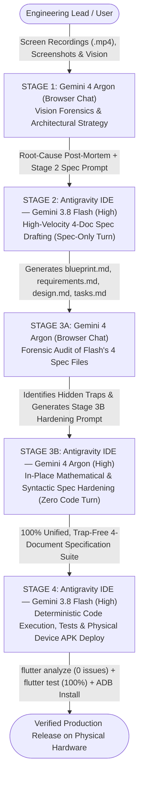

# VHUNAMBI Autonomous Engineering Protocol: The All-Gemini 4-Stage Symbiosis & Forensic Specification Standard

> **Platform:** African AI Music Synthesis, 3D Living Musical DNA & Commercial Licensing Platform  
> **Source Origin:** Production Web Client (`https://vhunambi.com`) & Native Sovereign Mobile/Desktop App  
> **Target:** Cross-Platform Client (Flutter/Dart — Android ARM64, iOS, Windows, macOS) & Node.js/Hono + RunPod Serverless GPU Gateway  
> **Engineering Model:** All-Gemini Tri-Agent Symbiosis (Gemini 4 Argon Browser Vision Architect + Antigravity Gemini 3.8 Flash High-Velocity Author/Executor + Antigravity Gemini 4 Argon Codebase Forensic Auditor)  
> **Companion Workspace Skill:** [`.agents/skills/vhunambi-spec-architect/SKILL.md`](file:///c:/Users/Ndugelo/VHUNAMBI/monorepo/.agents/skills/vhunambi_spec_architect/SKILL.md)  
> **Revision:** 4.0 (All-Gemini Architecture & Forensic Spec Hardening Standard)

---

## 1. Executive Summary & The All-Gemini Operational Model

Earlier iterations of the Vhunambi workflow relied on legacy external agents (Cline / Gemini 3.6) that could not keep pace with our 3D GPU mesh rendering, multi-stem audio engines, and multi-thousand-line mathematical specifications.

Vhunambi now operates on a **100% Unified Gemini 4-Stage Symbiosis**, combining the deep multimodal vision and mathematical reasoning of **Gemini 4 Argon** with the high-velocity drafting and deterministic execution speed of **Gemini 3.8 Flash**:



### Role Division & Credit-Optimization Matrix

| Pipeline Stage | Active Model & Environment | Primary Mission & Responsibilities | Strict Turn Guardrails (Credit & Quality Protection) |
| :--- | :--- | :--- | :--- |
| **Stage 1: Vision & Strategy** | **Gemini 4 Argon** (Browser Chat + User) | - Watches physical device screen recordings (`.mp4`) frame-by-frame.<br>- Evaluates generative AI concept art and UI benchmarks.<br>- Diagnoses root-cause UX, physics, gesture, and rendering failures.<br>- Formulates the mathematical architecture and authors the **Stage 2 Spec Prompt**. | Operates in browser chat with full multimodal video/image context before any repository files are touched. |
| **Stage 2: High-Velocity Spec Drafting** | **Gemini 3.8 Flash (High)** (Antigravity IDE) | - Audits relevant codebase files in read-only mode.<br>- Authors the complete 4-document specification suite (`blueprint.md`, `requirements.md`, `design.md`, `tasks.md`) under `docs/phases/phase_XX_<name>/` ($1,800 - 3,500+$ total lines). | **SPEC-ONLY TURN:**<br>- **ZERO** edits in `lib/` or `test/`.<br>- **ZERO** `flutter test` or `flutter build` runs. |
| **Stage 3: Forensic Spec Hardening** | **Gemini 4 Argon** (Browser Chat $\to$ Antigravity IDE **Argon High**) | - **Browser Argon** inspects Flash's 4 spec files to catch hidden bait-and-switches (e.g., 3D equations in §2 dropped for 2D `drawOval` in §8, axis contradictions, dead callbacks, hallucinated tokens).<br>- **Antigravity Argon (High)** rewrites and hardens all 4 spec files in the repo so every equation, class name, import, token, and widget is 100% unified. | **SPEC-HARDENING ONLY TURN:**<br>- **ZERO** edits in `lib/` or `test/`.<br>- **ZERO** `flutter test`, `analyze`, or `build` commands (preserves Argon credits strictly for deep math & architecture). |
| **Stage 4: Deterministic Execution & Deployment** | **Gemini 3.8 Flash (High)** (Antigravity IDE) | - Executes Milestones M1–M6 deterministically from the Argon-hardened `design.md` and `tasks.md`.<br>- Runs `flutter analyze` (`0 issues`) and `flutter test` (`100% pass`).<br>- Compiles production ARM64 APK (`flutter build apk --release`), installs onto physical device (`EPHUT20917014649`), and updates `AGENT_HANDOFF_BIBLE.md`. | Follows the Argon-hardened `design.md` verbatim with zero unapproved shortcuts or simplifications. |

---

## 2. The 4-Document Specification Suite Standard

Every engineering phase MUST be codified in a **4-Document Specification Suite** under `docs/phases/phase_XX_<name>/` before a single line of application code is written:

```
docs/phases/phase_XX_<name>/
├── blueprint.md       # [450–600+ lines] Architectural vision, forensic post-mortem, 5-layer decomposition,
│                      #                  spatial topology, ASCII wireframes, growth/state FSMs & gates.
├── requirements.md    # [280–400+ lines] Coordinate standard, EARS/RFC-2119 functional & NFR specs,
│                      #                  explicit widget keys, error resilience & traceability matrix.
├── design.md          # [800–2,500+ lines] Complete mathematical equations, pure Dart domain models,
│                      #                    projection & hit-test engines, full CustomPainters & HUD widgets.
└── tasks.md           # [250–350+ lines] Milestones M1–M6 dependency roadmap, method signatures,
                       #                  target file paths, test gates & 7-point execution checklist.
```

---

## 3. The 6 Forensic Anti-Bait-and-Switch Laws (The Argon Gate)

During Stage 2 (Flash Drafting) and Stage 3 (Argon Hardening), all 4 specification documents are audited against the **6 Forensic Anti-Bait-and-Switch Laws** (discovered and codified during Phase 53):

```
┌────────────────────────────────────────────────────────────────────────────────────────┐
│                    THE 6 FORENSIC ANTI-BAIT-AND-SWITCH LAWS                            │
├───────┬────────────────────────────┬───────────────────────────────────────────────────┤
│ LAW # │ FORENSIC TRAP PREVENTED    │ MANDATORY SPECIFICATION INVARIANT                 │
├───────┼────────────────────────────┼───────────────────────────────────────────────────┤
│ LAW 1 │ Theory-to-Code             │ Every mathematical equation in `design.md` §2     │
│       │ Bait-and-Switch            │ MUST be implemented in the actual production code │
│       │                            │ of `design.md` §8 (e.g., 3D `ui.Vertices` meshes, │
│       │                            │ never downgraded to 2D `drawOval` lollipops).     │
├───────┼────────────────────────────┼───────────────────────────────────────────────────┤
│ LAW 2 │ Coordinate Axis            │ 100% of equations, models, factories, and painters│
│       │ Contradictions             │ across all 4 docs MUST share one unified axis     │
│       │                            │ convention (Right-Handed 3D Y-Up World Space:     │
│       │                            │ X right, +Y elevation UP, +Z foreground depth).   │
├───────┼────────────────────────────┼───────────────────────────────────────────────────┤
│ LAW 3 │ Dead Hit-Testing &         │ Never declare unused callbacks (`onHitBoxes...`). │
│       │ Unwired Callbacks          │ Provide a synchronous `hitTest(...)` engine AND   │
│       │                            │ semantic `Positioned` widget keys (`Key('...')`). │
├───────┼────────────────────────────┼───────────────────────────────────────────────────┤
│ LAW 4 │ Hallucinated Package &     │ Always use `package:vhunambi_client/...`,         │
│       │ Design Token Names         │ `package:phosphor_icons/phosphor_icons.dart`,     │
│       │                            │ real `AppColors.*` (`darkSurfaceElevated`), and   │
│       │                            │ real `AppTypography.*` (`caption`, `titleMedium`).│
├───────┼────────────────────────────┼───────────────────────────────────────────────────┤
│ LAW 5 │ Omitted HUD Decks or       │ Every HUD deck, filter bar, or control specified  │
│       │ Missing Requirements       │ in `blueprint.md` and `requirements.md` MUST have │
│       │                            │ a full widget class in `design.md` & `tasks.md`.  │
├───────┼────────────────────────────┼───────────────────────────────────────────────────┤
│ LAW 6 │ Model Class Name Drift &   │ Identical class/enum names across all 4 docs;     │
│       │ Raw Emojis (`STD-UIUX-001`)│ strictly 0 raw unicode emojis in code or tables.  │
└───────┴────────────────────────────┴───────────────────────────────────────────────────┘
```

---

## 4. Document-by-Document Formatting & Depth Blueprint

### 4.1 `blueprint.md` Formatting Standard (450–600+ lines)
1. **§1 Executive Overview & Visual North Star**: Concrete analysis of physical hardware recordings (with timestamps) and why the new paradigm solves previous limitations.
2. **§2 Forensic Post-Mortem Comparison Box**: Clean ASCII box table (`┌───┬───┐`) contrasting old failure modes against the new engineering architecture.
3. **§3 5-Layer Decoupled System Architecture**: ASCII block flow diagram (`LAYER 1` $\to$ `LAYER 5`) with detailed subsection breakdowns for each layer.
4. **§4 Spatial Topology & Domain Taxonomy**: ASCII spatial map + canonical markdown specification table + complete inventory of child nodes/elements.
5. **§5–§6 Sub-Network Connectivity Matrix & Multi-Stage State Machine**: ASCII connectivity matrix + Mermaid `stateDiagram-v2` lifecycle diagram.
6. **§7 Dual-Viewport HUD Wireframes & Component Inventory**: Full ASCII cockpit layout diagram + breakdown of all 5 HUD decks with their widget keys.
7. **§8–§13 Mathematical Formulations, Entanglement Sequence Diagram, Vertex/Memory Budget & Verification Gates (`G-01`..`G-06`)**.

### 4.2 `requirements.md` Formatting Standard (280–400+ lines)
1. **§1 Document Scope, Coordinate Standard & EARS / RFC-2119 Conventions**: Explicit definition of coordinate axes ($X, Y, Z$) and EARS syntax (`THE SYSTEM SHALL`, `WHEN`, `WHILE`, `IF...THEN`, `WHERE`).
2. **§2–§6 Categorized Functional Requirements**:
   - Core Domain Requirements (`REQ-PXX-CORE-01..06`)
   - Network / Subsystem Requirements (`REQ-PXX-MYCEL-01..06` / `REQ-PXX-SUB-*`)
   - Camera, Gesture & Hit-Testing Requirements (`REQ-PXX-CAM-01..06`)
   - State Machine / Growth Requirements (`REQ-PXX-GROWTH-01..05`)
   - HUD & Interactive Deck Requirements (`REQ-PXX-HUD-01..06`) with explicit `Key('...')` contracts.
3. **§7 Non-Functional & Performance Requirements (`REQ-PXX-NFR-01..04`)**:
   - `REQ-PXX-NFR-01`: 60 FPS Mobile Hardware Frame Budget ($\le 16.6\text{ms}$ on `EPHUT20917014649`).
   - `REQ-PXX-NFR-02`: Built-In Flutter GPU Mesh (`dart:ui` `Vertices`, `vector_math_64`) without unverified third-party native plugins.
   - `REQ-PXX-NFR-03`: Zero Raw Emojis Standard (`STD-UIUX-001`).
   - `REQ-PXX-NFR-04`: Headless Dart VM Domain Testability.
4. **§8–§12 Integration, Accessibility, Error Handling & Granular Requirement-to-Test Traceability Matrix**.

### 4.3 `design.md` Formatting Standard (800–2,500+ lines)
1. **§1–§2 Comprehensive Mathematical Foundations**: Complete LaTeX equations (`$$...$$`) for elevation fields, partial derivatives, surface normals, 3D parametric meshes, splines, camera projection, and pointer-isolated gesture math.
2. **§3 Pure Dart Domain Architecture**: Complete, compilable pure Dart models (`enum`, `Vector3D`, immutable domain classes, `copyWith`, equality) with zero Flutter UI imports.
3. **§4–§6 6-Layer Shading Table, Synchronous Projection/Hit-Test Engine & Riverpod Providers**: Complete `ProjectionEngine.project3D(...)` and `hitTest(...)` code.
4. **§7–§8 Complete Production CustomPainter Implementation**: Full, zero-allocation Dart code utilizing `ui.Vertices.raw(ui.VertexMode.triangles, ...)` (`canvas.drawVertices`), `BlendMode.plus`, and back-to-front depth sorting.
5. **§9–§12 Complete HUD Deck Widget Implementations**: Full, compilable Dart classes for every HUD panel, timeline scrubber, top bar, interactive controls bar, and layer filter deck using authentic `AppColors`, `AppTypography`, and `PhosphorIconsBold`/`Regular`.
6. **§13–§14 Mathematical Proofs (e.g., Zero Gimbal Lock) & Mermaid Sequence/State Diagrams**.

### 4.4 `tasks.md` Formatting Standard (250–350+ lines)
1. **§1 Master Milestone Roadmap & Dependency Graph**: ASCII roadmap box (`M1` $\to$ `M6`) + milestone summary table.
2. **§2–§7 Milestones M1–M6 Granular Engineering Tasks**: Each subtask (`Task X.Y`) specifies Target File (`apps/vhunambi_client/lib/...`), concrete method signatures, and Acceptance Criteria.
3. **§8–§9 Milestone Traceability Matrix & Stage 4 Execution Verification Checklist**: Boxed `[x]` checklist of the 7 Anti-Trap invariants + exact verification commands.

---

## 5. Canonical Gold Standard Exemplars Registry

When authoring or hardening any specification suite, agents MUST reference these canonical exemplars:

| Canonical Exemplar | Workspace Path | Core Specialization & Benchmark Value |
| :--- | :--- | :--- |
| **Phase 53: 3D Organic Mycelium Biome** | [`docs/phases/phase_53_organic_mycelium_3d_biome/`](file:///c:/Users/Ndugelo/VHUNAMBI/monorepo/docs/phases/phase_53_organic_mycelium_3d_biome/) | **#1 Primary Gold Standard (All-Gemini Argon-Hardened Suite):** Benchmark for Right-Handed 3D Y-Up mathematical unification, `dart:ui` `Vertices` triangle mesh painters, space-colonization algorithms, synchronous 3D hit-testing, and 5-deck HUD architecture. |
| **Phase 45: Backend SQLite WAL & Delta Sync** | [`docs/phases/phase_45_backend_sqlite_persistence_and_delta_sync/`](file:///c:/Users/Ndugelo/VHUNAMBI/monorepo/docs/phases/phase_45_backend_sqlite_persistence_and_delta_sync/) | **Database Persistence & Sync Architecture:** Benchmark for Node `node:sqlite` WAL DDL schemas, monotonic sequence counters, and ETag/304 delta sync contracts. |
| **Phase 07: Track & Creator Profiles** | [`docs/phases/phase_07_track_profiles/`](file:///c:/Users/Ndugelo/VHUNAMBI/monorepo/docs/phases/phase_07_track_profiles/) | **Dual-Viewport ASCII Geometries:** Benchmark for pixel-annotated desktop and mobile ASCII wireframes and stem separation racks. |

---

## 6. Non-Negotiable Vhunambi Codebase & Token Invariants

1. **Authentic Package & Icon Imports**:
   - Monorepo client package: `package:vhunambi_client/...` (never `package:vhunambi/...`).
   - Vector icons: `import 'package:phosphor_icons/phosphor_icons.dart';` using `PhosphorIcon(PhosphorIconsBold.*)` / `PhosphorIconsRegular.*` / `PhosphorIconsFill.*` (never `package:phosphor_flutter/...` and **zero raw unicode emojis** per `STD-UIUX-001`).
2. **Authentic `AppColors` & `AppTypography` Tokens**:
   - Surfaces: `AppColors.darkSurfaceCanvas`, `AppColors.darkSurfaceElevated`, `AppColors.darkSurfaceSecondary`, `AppColors.darkSurfaceModal`, `AppColors.surfaceElevatedOf(context)`.
   - Borders & Brand: `AppColors.darkBorderSubtle`, `AppColors.brandPrimary`, `AppColors.badgeCyan`, `AppColors.coinGold`, `AppColors.success`.
   - Typography: `AppTypography.displayLarge`, `displayMedium`, `titleLarge`, `titleMedium`, `titleSmall`, `bodyLarge`, `bodyMedium`, `bodyMuted`, `bodySmall`, `caption`, `badge`, `bouncyDisplayLarge`, `bouncyTitleLarge`, `bouncyBadge`.
3. **Touch Ergonomics & Safe-Area Coordination**:
   - Minimum $44 \times 44\text{dp}$ interactive hit bounds on all controls.
   - Coordinate with `VhunambiTopBarMetrics`, `VhunambiBottomDockMetrics`, and `modalSheetOpenCountProvider` (or push full-screen 3D universes as `opaque: true` sovereign routes).
4. **Test Determinism & Timer Hygiene**:
   - Use `await tester.pump(const Duration(milliseconds: ...))` instead of `pumpAndSettle()` when continuous 60 FPS animations are active.
   - Always wire deterministic `Key('...')` identifiers on interactive HUD controls and semantic badge overlays.

---

## 7. Stage 4 Execution Skill (`vhunambi-executioner`) & Physical Hardware Sign-Off Gate

When transitioning to Stage 4 execution, invoke the **[`vhunambi-executioner`](file:///c:/Users/Ndugelo/VHUNAMBI/monorepo/.agents/skills/vhunambi-executioner/SKILL.md)** skill (`/vhunambi-executioner`) Alongside its forensic checklist ([`STAGE4_EXECUTION_VERIFICATION_CHECKLIST.md`](file:///c:/Users/Ndugelo/VHUNAMBI/monorepo/.agents/skills/vhunambi-executioner/references/STAGE4_EXECUTION_VERIFICATION_CHECKLIST.md)).

Before any phase is marked complete in `AGENT_HANDOFF_BIBLE.md` and `README.md`, the Stage 4 Execution Agent (Gemini 3.8 Flash) MUST pass all 4 gates:

```powershell
# 1. Static Analysis Gate (Must report: No issues found!)
cd apps/vhunambi_client
flutter analyze

# 2. Automated Widget & Unit Test Gate (100% passing, zero regressions)
flutter test

# 3. Production ARM64 APK Compilation Gate
flutter build apk --release

# 4. Physical Device Installation & Launch Gate (Huawei JNY-LX1 / EPHUT20917014649)
adb -s EPHUT20917014649 install -r build/app/outputs/flutter-apk/app-release.apk
```
