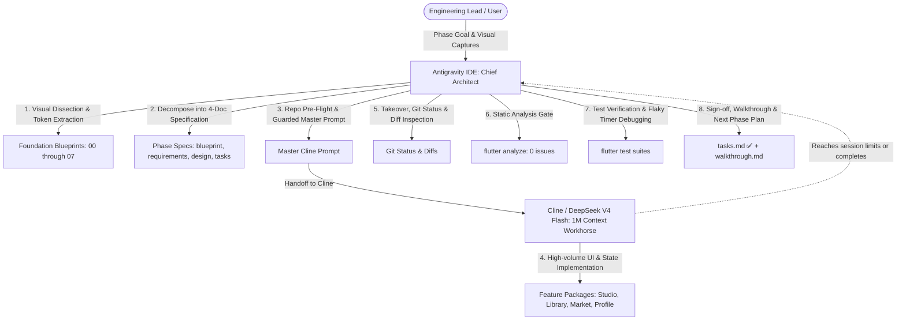

# VHUNAMBI Autonomous Engineering Protocol: Dual-Agent Pair Programming Standard

## 1. Executive Summary & Operational Model

To maximize development velocity, design token fidelity, and token-cost efficiency across the Vhunambi codebase, engineering is structured around a **Dual-Agent Symbiosis** (adapted from the LODA autonomous engineering standard):



### Role Division

| Responsibilities | **Antigravity IDE** (Lead Architect & QA) | **Cline + DeepSeek V4 Flash** (Workhorse Agent) |
|---|---|---|
| **Core Strengths** | Complex architectural reasoning, visual dissection from screenshots, repository pre-flight, debugging async leaks, verification gatekeeper. | Massive 1M context headroom, rapid multi-file generation, mechanical adherence to specifications, high-velocity widget implementation. |
| **Primary Tasks** | - Visual decomposition from screenshots into SSOT Foundation Blueprints (00–07).<br>- Decomposing phases into 4-document specifications (`blueprint`, `requirements`, `design`, `tasks`).<br>- Repo pre-flight checks (inspecting live enum names, active packages, SDK rules).<br>- Guardrail prompt formulation with copy-paste prompts for Cline.<br>- Post-implementation audit (`git diff`, `flutter analyze`, `flutter test`).<br>- Diagnosing Flutter timer leaks, provider state synchronization, and widget test failures.<br>- Final verification, sign-off, and walkthrough generation. | - Implementing domain models, immutable states, and enums.<br>- Implementing Riverpod state notifiers and providers.<br>- Implementing UI screens, form inputs, sliders, accordions, and dialog modals.<br>- Creating initial unit and widget tests for new screens. |
| **Token Efficiency** | High-level reasoning consumes fewer premium tokens. | DeepSeek V4 Flash handles thousands of lines of Dart UI code cost-effectively without context dilution. |

---

## 2. The 4-Document Implementation Standard

Every implementation phase must be decomposed into a standardized **4-Document Specification** under `docs/phases/<phase_name>/` before code generation begins:

```
docs/phases/<phase_name>/
├── blueprint.md       # Architectural vision, UI layouts, visual tokens & state machine models
├── requirements.md    # EARS / RFC 2119 functional, audio synthesis & UX requirements
├── design.md          # Concrete Dart/Flutter class designs, Riverpod providers & widget hierarchy
└── tasks.md           # Sequenced implementation checklist (T1 to TN) & verification commands
```

### Specification Roles

1. **`blueprint.md`**
   - Authoritative visual layout diagrams and breakpoint geometries (Mobile < 768px vs Desktop > 1024px).
   - Audio synthesis workflows, genre/rhythm pipelines, and cultural context (Tshivenḓa etymology, African regional music genres).
   - Component layout wireframes and state machine diagrams.

2. **`requirements.md`**
   - Unambiguous requirements formulated using RFC 2119 (`MUST`, `SHALL`, `MAY`) and the Easy Approach to Requirements Syntax (EARS).
   - Every requirement is assigned a traceable ID (e.g., `REQ-STUDIO-01`, `REQ-STUDIO-02`, `REQ-PLAYER-01`).

3. **`design.md`**
   - Production-ready Dart class signatures, field types, and constructor signatures.
   - Exact Riverpod provider signatures (`StateNotifierProvider`, `ChangeNotifierProvider`).
   - Widget tree hierarchy, styling token bindings (`AppColors`, `AppGradients`, `AppTypography`, `AppRadius`, `AppSpacing`).
   - State transition tables and error recovery mechanisms.

4. **`tasks.md`**
   - Sequenced tasks (T1 to TN) ordered strictly by dependency.
   - Pre-flight checks verifying existing codebase anchors.
   - Traceable checklist items with designated verification commands.
   - Known risks, trap warnings, and mitigations.

---

## 3. The Hand-Off & Prompt Formulation Protocol

When Antigravity prepares the task for Cline, it must not simply say "implement this feature". Antigravity must perform a **live repository pre-flight** and formulate a bulletproof prompt containing:

1. **Working Directory & Target Files**:
   - Exact directories for new and modified files (`apps/vhunambi_client/lib/features/<feature>/...`).
2. **Current Baseline**:
   - Current verification status (e.g., "`flutter analyze` reports 0 issues; all existing tests pass").
3. **Repository Ground Truths & Trap Guards**:
   - *Brand Identity*: Strictly **`vhunambi`** (with an **i**, from Tshivenḓa for *"the talent or ability to sing"*). Never use `vhunamba`.
   - *Design Tokens*: Strictly utilize `AppColors`, `AppGradients`, `AppTypography`, `AppRadius`, and `AppSpacing` from `package:vhunambi_client/core/theme/`. **Never hardcode raw hex values or ad-hoc border radii.**
   - *Collision-Safe Enums*: Audio repeat mode is `AudioRepeatMode` (`off`, `all`, `one`), **never** `RepeatMode` (which collides with Flutter 3.44's `repeating_animation_builder.dart`).
   - *Layer Hygiene*: Presentation widgets depend on Riverpod providers; providers manipulate domain state models; UI never mutates state directly.
   - *Responsive Helpers*: Use `ResponsiveUtils.isDesktop(context)` (> 1024px) vs `ResponsiveUtils.isMobile(context)` (< 768px).
4. **Step-by-Step Task Sequence**:
   - Explicit instructions directly mirroring `tasks.md`.
5. **Success Criteria & Thresholds**:
   - Exact verification commands (`flutter analyze` with 0 issues; `flutter test` with 100% pass rate).

---

## 4. The Takeover & Audit Protocol (When Cline Completes or Reaches Limits)

When Cline finishes or halts mid-stream, Antigravity immediately assumes command. The takeover follows a rigid 5-step checklist:

### Step 1: Git Status & Diff Inspection
```powershell
git status -s
git diff --stat
```
- Identify every created, modified, and deleted file.
- Inspect whether existing core files (like `main.dart`, `app_theme.dart`, or existing providers) were cleanly updated without breaking regressions.

### Step 2: Static Analysis Gate
```powershell
flutter analyze
```
- All targets inside `apps/vhunambi_client` must report: `No issues found!`.
- Immediately fix any unused imports, deprecated members, or type mismatches.

### Step 3: Test Suite Verification
```powershell
flutter test
```
- Confirm baseline tests continue to pass without regression.
- Verify all new unit, domain, and widget tests execute cleanly.

### Step 4: Widget Test & Flaky Timer Audit
- **Trap 1: Async Timer Leaks in Widget Tests**:
  - `Future.delayed` or repeating animation loops without cleanup cause `!timersPending` assertion failures.
  - *Fix*: Complete or cancel animation controllers or use `tester.pumpAndSettle()`.
- **Trap 2: Duplicate Text Finders**:
  - When buttons, chips, or body text both render the same string, `find.text(...)` returns multiple candidates.
  - *Fix*: Scope finders using `find.descendant` or specify `findsWidgets` / `findsNWidgets(n)`.
- **Trap 3: Overflow on Small Screens**:
  - Verify wrap behaviors (`SingleChildScrollView`, `Wrap`, or responsive column/grid switches) so mobile viewports never trigger render overflow yellow-and-black stripes.

### Step 5: Formal Sign-Off & Walkthrough Documentation
- Update `tasks.md` in the phase directory:
  - Header status updated to `✅ Complete — 100% implemented & verified`.
  - Checkboxes marked complete.
- Generate `walkthrough.md` in the Antigravity artifact directory summarizing changes, test metrics, and architectural outcomes.
- Present the verified milestone to the user and formulate the next phase prompt.

---

## 5. Monorepo Quality Metric Anchors

Every completed phase must satisfy this non-negotiable definition of done:

- [x] **Zero Static Analysis Issues**: `flutter analyze` reports `No issues found!` across the entire client application.
- [x] **Monotonic Test Suite Growth**: Total test count strictly increases; zero test regressions.
- [x] **Design Token Strictness**: Zero hardcoded hex values; 100% of surfaces, text styles, and radii resolve through `AppColors`, `AppTypography`, and `AppRadius`.
- [x] **Collision Safety**: Zero enum or type collisions with Flutter 3.44 core libraries (`AudioRepeatMode`).
- [x] **Responsive Parity**: Views adapt seamlessly across Mobile (< 768px) and Desktop (> 1024px) viewports matching SSOT Blueprints.
