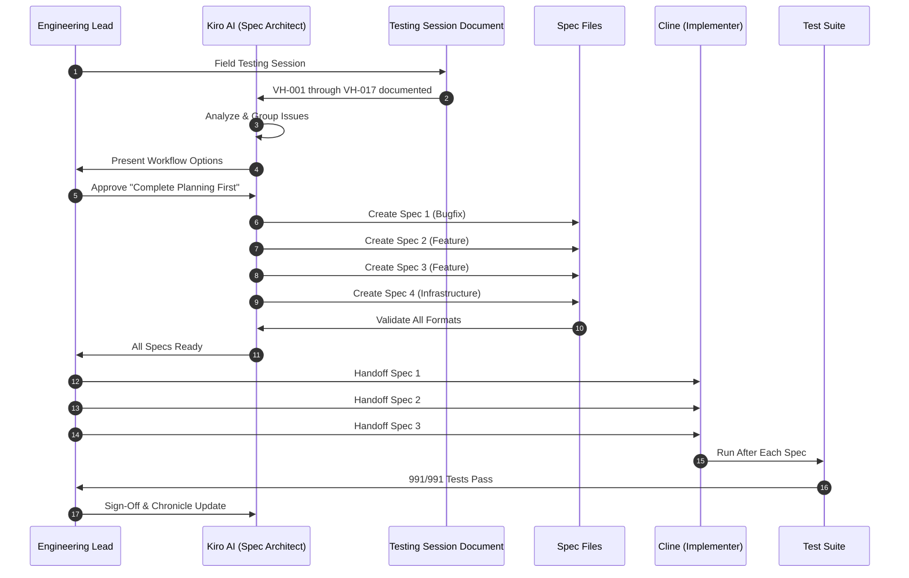
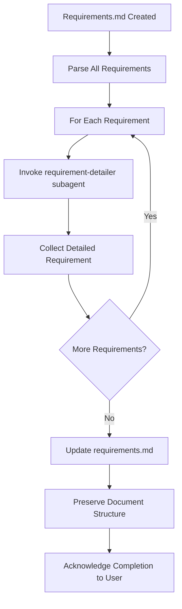

# 🔧 Vhunambi Faults & Improvements Workflow Standard
## Spec-Driven Bug Fixing & Enhancement Sprint Protocol

**Document Version:** 1.0.0 (October 2026)  
**Standard Authority:** Kiro AI + Cline Dual-Agent Symbiosis  
**Parent Standards:** [`DUAL_AGENT_AUDIT_IMPROVE_WORKFLOW.md`](file:///docs/DUAL_AGENT_AUDIT_IMPROVE_WORKFLOW.md), [`AGENT_HANDOFF_BIBLE.md`](file:///docs/AGENT_HANDOFF_BIBLE.md)  
**Applicability:** Comprehensive bug fixes and UX improvements from field testing sessions

---

## 1. Executive Summary & Purpose

This workflow standard documents the **Spec-Driven Bug Fixing & Enhancement Sprint** methodology used for the October 19, 2026 testing session improvements. It combines systematic planning with parallel implementation to rapidly address bugs and enhancements discovered during field testing while maintaining architectural integrity.

**Key Principles:**
1. **Complete Planning First** — All 4 specs created before implementation starts
2. **Parallel Execution Ready** — Independent specs can be implemented simultaneously  
3. **Test Baseline Protection** — 991 passing tests must remain green across all changes
4. **Requirements Detailing** — Every requirement auto-refined for precision and testability
5. **Format Validation** — All spec documents validated against format standards

---

## 2. Workflow Overview



---

## 3. The 4-Spec Organization Strategy

Based on the October 19, 2026 testing session, issues were organized into 4 parallel specs:

| Spec | Type | VH Items | Priority | Document Location |
|------|------|----------|----------|-------------------|
| **Spec 1: Studio Cockpit Fixes** | Bugfix | VH-001 to VH-006 | P0 | `.kiro/specs/studio-cockpit-fixes/` |
| **Spec 2: Onboarding Modernization** | Feature | VH-007 to VH-013 | P1-P2 | `.kiro/specs/onboarding-modernization/` |
| **Spec 3: Adaptive Mini Player** | Feature | VH-014 to VH-017 | P0-P1 | `.kiro/specs/adaptive-mini-player/` |
| **Spec 4: Cross-Cutting Design System** | Infrastructure | Design Tokens, Haptics, Analytics | Foundation | `.kiro/specs/cross-cutting-design-system/` |

**Organization Rationale:**
- **Separate Bugfix from Features** — Different workflow patterns (bugfix uses bug condition methodology)
- **Group by System** — Related VH items grouped together (cockpit vs onboarding vs player)
- **Extract Cross-Cutting** — Shared infrastructure (color tokens, haptics) in dedicated spec
- **Enable Parallelization** — Each spec can be implemented independently

---

## 4. Spec Creation Workflow

### Phase 1: Testing Session Documentation

**Input:** Field testing produces a comprehensive document:
- **Format:** Markdown document with structured VH item catalog
- **Content:** Problem descriptions, requirements, acceptance criteria, priority ratings
- **Example:** `Vhunambi — Faults & Improvements Spec (2026-10-19).md`

**Structure:**
```markdown
## Studio Cockpit
### VH-001 — Bottom player has no close action
**Problem:** The mini player cannot be dismissed...
**Requirements:** Add a close control...
**Acceptance criteria:** Tapping close stops audio...

### VH-002 — Public toggle is non-functional
...
```

### Phase 2: Priority Analysis & Grouping

**Kiro's Analysis:**
1. Scan all VH items for priority markers (P0, P1, P2)
2. Group by system/feature area (cockpit, onboarding, player)
3. Identify cross-cutting concerns (design tokens, haptics)
4. Propose spec organization strategy

**User Decision Points:**
- Priority order (bugs first vs. features first)
- Delivery strategy (complete all planning vs. start implementation)
- Workflow type (VH-001 incremental vs. skip to VH-014)

### Phase 3: Spec Type Selection

For each group, determine workflow:

**Bugfix Workflow** — Use when:
- VH item describes broken functionality
- Something is crashing or not working correctly
- Regression has been introduced
- Keywords: "fix", "bug", "crash", "error", "broken", "doesn't work"

**Feature Requirements-First Workflow** — Use when:
- Building new functionality
- Business requirements drive technical design
- Enhancing existing systems

**Feature Design-First Workflow** — Use when:
- Technical approach is clear
- Formalizing existing implementation
- Architecture-driven changes

### Phase 4: Spec Creation Sequence

For each spec, Kiro follows this sequence:

**Step 1: Requirements Document**
- Create `.kiro/specs/{feature-name}/requirements.md`
- Map VH items to formal requirements with EARS patterns
- Generate acceptance criteria and correctness properties
- Validate format with `validate_spec_format` tool
- **Automatic Requirements Detailing:**
  - Parse all requirements
  - Invoke `requirement-detailer` subagent for each requirement
  - Collect detailed versions
  - Update requirements.md with refined requirements

**Step 2: Design Document**
- Create `.kiro/specs/{feature-name}/design.md`
- Define architecture, components, data models
- Specify algorithms and error handling
- Include testing strategy
- Validate format

**Step 3: Tasks Document**
- Create `.kiro/specs/{feature-name}/tasks.md`
- Break down into granular, testable tasks
- Create dependency graph with waves for parallel execution
- Map tasks to requirements
- Validate format

**Step 4: Configuration**
- Create `.kiro/specs/{feature-name}/.config.kiro`
- Store spec metadata (type, workflow, feature name)

---

## 5. Requirements Detailing Protocol

**Automatic Detailing Workflow:**

After ANY requirements phase completes (requirements.md or bugfix.md is created), Kiro MUST execute the requirements detailing workflow:



**Detailing Rules:**
- MANDATORY for all requirements phases
- NEVER skip this step
- Do NOT ask user permission
- Execute BEFORE acknowledging completion
- Update in-place (replace original requirements)
- Preserve Introduction, Glossary, and structure

**Incorporation Standards:**
- Follow EARS format strictly (WHERE, WHILE, WHEN, IF, THEN, THE, SHALL)
- Make acceptance criteria precise based on clarifications
- DO NOT rewrite if clarification already exists
- Split compound responses into separate criteria

---

## 6. Format Validation & Quality Gates

**Validation Tool:** `validate_spec_format`

**When to Validate:**
- After EVERY spec document creation
- After EVERY spec document update
- Before acknowledging completion to user

**Validation Categories:**
- **[error]** — MUST be fixed before completion
- **[warning]** — Advisory, may be acceptable

**Fix Protocol:**
1. Call `validate_spec_format` with file path
2. If errors found, determine correct subagent and preset
3. Delegate fix to subagent with errors and current file contents
4. NEVER fix spec documents yourself — ALWAYS delegate
5. Re-validate after fix

---

## 7. Implementation Handoff Protocol

### Handoff Document Structure

**File:** `docs/CLINE_HANDOFF_FAULTS_IMPROVEMENTS_SPRINT.md`

**Required Sections:**
1. **Mission Statement** — Sprint goal and scope
2. **Spec Inventory** — All 4 specs with locations
3. **Implementation Sequence** — Priority order
4. **Test Baseline** — Current test count (991/991)
5. **Verification Gates** — How to validate completion
6. **Technical Context** — Stack, patterns, constraints
7. **Critical Rules** — Non-negotiables from handoff bible

### Implementation Phases

**Phase A: Spec 1 (P0 Bugs)**
- Highest priority bugs first
- Preserve existing tests
- Add new tests for fixed bugs

**Phase B: Spec 2 & 3 (Features)**
- Can be implemented in parallel
- Each has independent test suite
- Both use design tokens from Spec 4

**Phase C: Spec 4 (Infrastructure)**
- Implement first if Spec 2/3 depend on it
- Or implement last as migration phase
- Update existing code to use new tokens

---

## 8. Quality Metrics & Success Criteria

### Test Baseline Protection

**Before Sprint:** 991 passing tests  
**After Each Spec:** 991 + new tests (100% pass)  
**Target:** Zero regressions across all implementations

### Format Validation

**Requirement:** All spec documents pass `validate_spec_format`  
**Acceptable Warnings:** Missing PBT section when not applicable  
**Zero Tolerance:** [error] level issues

### Requirements Coverage

**Spec 1:** 34 SHALL requirements (VH-001 to VH-006)  
**Spec 2:** 63 acceptance criteria (VH-007 to VH-013)  
**Spec 3:** 26 requirements, 285+ criteria (VH-014 to VH-017)  
**Spec 4:** 28 requirements (infrastructure)

### Task Granularity

**Spec 1:** 35+ tasks, 5 phases, 12 dependency waves  
**Spec 2:** 45 tasks, 8 phases, 9 waves  
**Spec 3:** 72 tasks, 4 phases, 15 waves  
**Spec 4:** 29 phases, 100+ granular tasks, 18 waves

---

## 9. Deviation from Standard Workflows

### Adaptive Mini Player Exception

**VH-001 Original:** Add simple close button to mini player  
**VH-014 Expansion:** Complete adaptive mini player redesign

**Decision:** Build VH-014 adaptive player with close functionality included, making VH-001's simple solution obsolete. This is the ONLY case where a later VH item supersedes an earlier one.

**Justification:**
- VH-014 provides comprehensive solution
- Includes VH-001's close requirement as acceptance criterion
- Avoids throwaway work
- Delivers better UX

### Requirements Detailing Innovation

**New in This Sprint:**
- Automatic invocation of `requirement-detailer` subagent
- Parallel invocation for multiple requirements
- In-place update of requirements.md
- Executed before user acknowledgment

**Benefits:**
- More precise acceptance criteria
- Better testability
- Reduced ambiguity
- No manual intervention needed

---

## 10. Lessons Learned & Best Practices

### What Worked Well

1. **Complete Planning First** — Having all 4 specs ready before implementation enabled parallel work
2. **Automatic Requirements Detailing** — Improved requirement quality without manual intervention
3. **Format Validation** — Caught structural issues early
4. **Spec Organization** — Grouping by system created clear boundaries
5. **Test Baseline Protection** — Maintained quality throughout

### Process Improvements

1. **VH Item Format** — Testing documents should include:
   - Clear problem statements
   - Explicit acceptance criteria
   - Priority ratings (P0, P1, P2)
   - System/feature categorization

2. **Dependency Analysis** — Earlier identification of cross-cutting concerns (Spec 4) would optimize implementation order

3. **Estimation** — Each spec should include effort estimate:
   - Spec 1 (Bugfix): 2-3 days
   - Spec 2 (Feature): 3-5 days
   - Spec 3 (Feature): 5-7 days
   - Spec 4 (Infrastructure): 4-6 days

### Anti-Patterns Avoided

1. **❌ Implementation Before Planning** — Would have caused rework
2. **❌ Single Monolithic Spec** — Would have blocked parallelization
3. **❌ Manual Requirements Review** — Automated detailing was faster
4. **❌ Format Validation Last** — Catching errors early saved time

---

## 11. Future Workflow Enhancements

### Proposed Additions

1. **Automated Testing Session Parsing** — Tool to extract VH items from testing documents automatically
2. **Dependency Graph Visualization** — Visual representation of spec dependencies
3. **Progress Dashboard** — Real-time tracking of spec completion status
4. **Effort Estimation** — ML-based task effort prediction
5. **Automated Handoff Generation** — Generate Cline handoff from completed specs

### Tool Integration

**Potential Tools:**
- `parse_testing_session` — Extract VH items from markdown
- `visualize_spec_dependencies` — Generate Mermaid diagrams
- `estimate_effort` — Predict implementation time
- `generate_handoff` — Create Cline handoff document

---

## 12. Appendix: Document Templates

### Testing Session Document Template

```markdown
# Project Name — Faults & Improvements Spec (YYYY-MM-DD)

## 1. Summary and priority order

| ID | Item | Type | Priority |
| --- | --- | --- | --- |
| VH-001 | ... | Bug | P0 |
| VH-002 | ... | Feature | P1 |

## 2. [System Name]

### VH-001 — [Issue Title]

**Problem:** [Description]

**Requirements:**
- [Requirement 1]
- [Requirement 2]

**Acceptance criteria:**
- [Criterion 1]
- [Criterion 2]
```

### Spec Directory Structure

```
.kiro/specs/{feature-name}/
├── .config.kiro          # Spec metadata
├── requirements.md       # OR bugfix.md for bugfix workflow
├── design.md            # Technical design
└── tasks.md             # Implementation tasks
```

### Config File Template

```json
{
  "specType": "feature",
  "workflowType": "requirements-first",
  "featureName": "feature-name",
  "createdAt": "2026-10-19T00:00:00Z"
}
```

---

## 13. References

- **Parent Workflow:** [`DUAL_AGENT_AUDIT_IMPROVE_WORKFLOW.md`](file:///docs/DUAL_AGENT_AUDIT_IMPROVE_WORKFLOW.md)
- **Handoff Bible:** [`AGENT_HANDOFF_BIBLE.md`](file:///docs/AGENT_HANDOFF_BIBLE.md)
- **Modernization Chronicle:** [`VHUNAMBI_MODERNIZATION_CHRONICLE.md`](file:///docs/VHUNAMBI_MODERNIZATION_CHRONICLE.md)
- **Testing Session:** `docs/blueprints/Vhunambi — Faults & Improvements Spec (2026-10-19).md`

---

**Document Status:** ✅ Complete & Validated  
**Last Updated:** 2026-10-19  
**Next Review:** After first sprint using this workflow