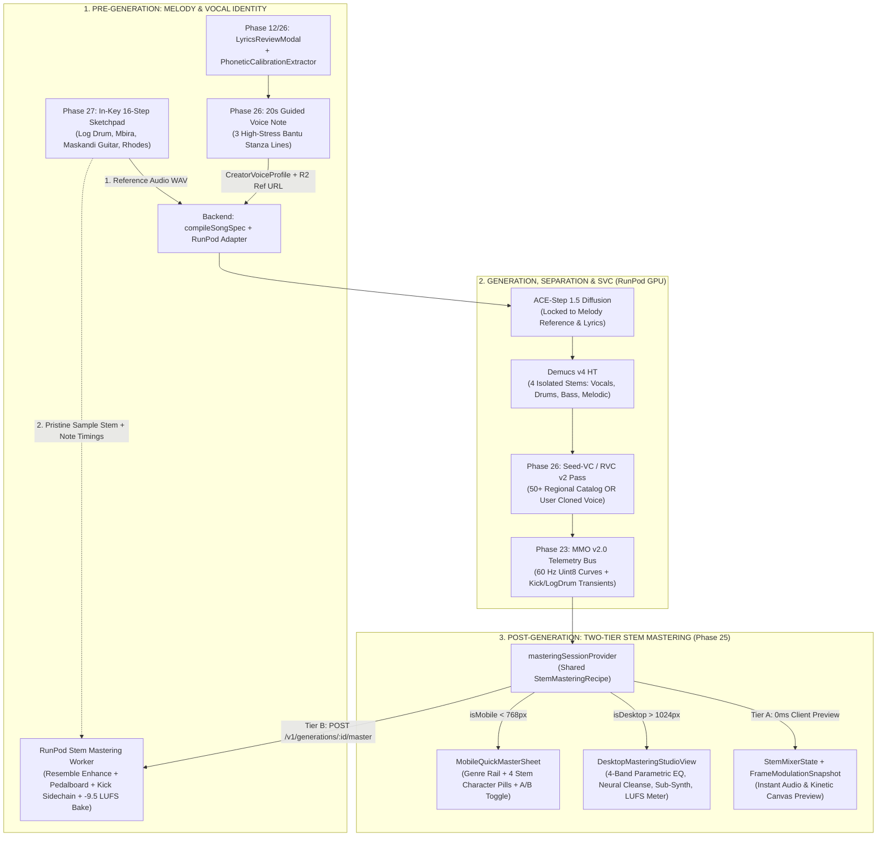

# VHUNAMBI V4: Studio Evolution & Synergistic Production Blueprint

> **Document Status:** Authoritative V4 Architectural Blueprint & Multi-Phase Sprint Plan  
> **Target Workspaces:**
> - **Client:** `c:\Users\Ndugelo\VHUNAMBI\monorepo\apps\vhunambi_client\` (Flutter 3.44+ / Dart 3.x / Riverpod / Hive)
> - **Backend API:** `c:\Users\Ndugelo\VHUNAMBI\monorepo\apps\vhunambi_api\` (Node.js 22 / Hono / TypeScript / Zod / aws4fetch)
> - **Cloud GPU Worker:** `tools/zr-studio-gpu/` (`ndugelo/zr-studio-gpu` — RunPod Serverless: ACE-Step 1.5 + Demucs v4 + Pedalboard + Resemble Enhance + Seed-VC)
>
> **Codebase Invariants:** Zero Raw Hex Tokens (`AppColors`, `AppGradients.forGenre(genre)`, `AppTypography`, `AppRadius`, `AppSpacing`), Apple HIG 44×44dp touch targets, `AudioRepeatMode` / `PlaybackStatus` enum safety, and `ResponsiveUtils.isMobile` / `ResponsiveUtils.isDesktop` layout branching.

---

## 1. Executive Summary: Solving the Two Existential Flaws of AI Music

Vhunambi V4 evolves the platform from an AI music generator into a **synergistic, studio-grade African audio workstation** by directly eliminating the two signature flaws of generative music ("Suno/Udio Fatigue"):

1. **Diffusion Phase Mud & Weak Low-End ("The AI Sheen"):**
   - **Problem:** Latent diffusion models generate the full stereo spectrum simultaneously, causing metallic high-frequency phase artifacts and hollow sub-bass where an Amapiano log drum sounds like cardboard rather than a chest-rattling wooden sub-bass knock.
   - **V4 Solution (Phase 25 — Stem Polisher & Mastering Suite):** Post-generation, non-destructive **Stem-Targeted Mastering** across the 4 isolated stems (`vocals.wav`, `drums.wav`, `bass.wav`, `melodic.wav`) with Adobe Podcast-style neural vocal restoration (`resemble-enhance`), sub-harmonic log-drum synthesis, MMO kick-triggered sidechain ducking, Mid/Side vocal pocket carving, and `-9.5 LUFS` commercial True-Peak limiting.
   - **Device-Split UX:** Lightweight 1-Tap Genre Presets + 4 Character Pill selectors on Mobile (`ResponsiveUtils.isMobile`) vs. a full Cakewalk/Sonar-style 4-Stem Mastering Workstation on Desktop (`ResponsiveUtils.isDesktop`).

2. **Vocal Convergence ("The Same Two AI Voices"):**
   - **Problem:** AI music tracks default to the same mean-averaged male/female vocal timbres with Western-pop vibrato that flattens indigenous Bantu tonal inflections.
   - **V4 Solution (Phase 26 — Vocal Identity & Zero-Shot Phonetic Voice Cloning):** Two-stage Singing Voice Conversion (SVC via Seed-VC / RVC v2) backed by a **50+ Regional African Voice Catalog** plus a **Post-Lyrics 3-Sentence Phonetic Calibration Recorder** inside `LyricsReviewModal` that captures both the user's vocal timbre and exact Bantu pronunciation cadence in 20 seconds.

3. **Uncontrolled Melodic Hallucination:**
   - **Problem:** Text prompts alone cannot dictate an exact chord turnaround or signature log-drum bounce pattern.
   - **V4 Solution (Phase 27 — In-Key Melody & Log-Drum Pattern Sketchpad):** A scale-locked 16-step DAW sequencer inside the Studio using authentic Heritage Crate instruments (`kSeededHeritageSamples`). Renders a loopable WAV buffer for **Pre-Generation ACE-Step 1.5 Audio-to-Audio Conditioning** AND preserves the studio-grade sample stem for **Post-Generation Mastering Layering**.

---

## 2. Synergistic V4 System Architecture



---

## 3. Deep-Dive: Phase 25 — Stem Polisher, Vocal Cleanse & Mobile/Desktop Mastering Suite

### 3.1 Core Architectural Principles
1. **No Heavy Audio DSP in Node.js:** `apps/vhunambi_api` remains a fast Hono/TypeScript gateway validating `StemMasteringRecipe` via Zod and orchestrating RunPod jobs (`task_type: "master_stems"`) or deterministic offline simulation in `mock_worker.ts`.
2. **Stems & Transients Already Exist:** `StemMixerDeck` ([`stem_mixer_state.dart`](file:///c:/Users/Ndugelo/VHUNAMBI/monorepo/apps/vhunambi_client/lib/features/player/domain/models/stem_mixer_state.dart)) and `MasterMediaObject` ([`master_media_object.dart`](file:///c:/Users/Ndugelo/VHUNAMBI/monorepo/apps/vhunambi_client/lib/features/content_studio/domain/models/master_media_object.dart)) already model the 4 isolated stems (`vocals`, `drums`, `bass`, `melody`), 60 Hz `Uint8` modulation curves, and `transientEvents` (`kick`, `log_drum_drop`, `snare_clap`, `vocal_onset`).
3. **Mastering Never Re-Runs Diffusion:** Re-running ACE-Step 1.5 would alter the composition. Instead, Phase 25 operates as a **Two-Tier Hybrid Pipeline**:
   - **Tier A (Zero-Latency Client Audition):** Instant preview in Flutter by coupling `masteringSessionProvider` into `stemMixerProvider` and `frameModulationSnapshotProvider`.
   - **Tier B (Lossless Cloud Stem-Bake):** `POST /v1/generations/:id/master` processes the 4 isolated stems in `< 4 seconds` using `resemble-enhance`, Spotify `Pedalboard`, and `pyloudnorm`, returning mastered audio URLs and an updated `MasterMediaObjectManifest`.

### 3.2 Per-Stem DSP Chains (Cakewalk/Sonar & Adobe Podcast Pipeline)

| Stem Channel | Raw AI Defect | Automated Stem Mastering Chain | DSP Engine |
| :--- | :--- | :--- | :--- |
| **1. `vocals.wav`** | Metallic phase swirl, boxy mid-range, room bleed. | **1. Neural Cleanse:** `resemble-enhance` strips diffusion phase noise & reverb.<br>**2. Vocal Sculpt:** HPF @ 95 Hz $\rightarrow$ De-Esser @ 6.5 kHz $\rightarrow$ 1176 FET Compressor (4:1) $\rightarrow$ +3.5 dB Air Shelf @ 11.5 kHz. | `resemble-enhance` + Spotify `Pedalboard` |
| **2. `bass.wav`** *(Log Drum)* | Hollow knock, weak weight below 60 Hz, clashes with kick. | **1. Sub-Harmonic Synth:** Phase-locked sub-octave sine ($35\text{–}55\text{ Hz}$).<br>**2. Wooden Knock Shaper:** +3.0 dB @ 165 Hz + asymmetric tube saturation.<br>**3. Kick-to-Bass Sidechain:** Ducks `bass.wav` by $-3.5\text{ dB}$ for $55\text{ ms}$ on every MMO `kick` transient. | Custom Sub-Synth + `Pedalboard` + MMO Transients |
| **3. `drums.wav`** | Dull snares/shakers, boxy 320 Hz low-mids. | **1. Boxiness Cut:** $-3.0\text{ dB}$ @ 320 Hz.<br>**2. Transient Snap:** Boosts initial $12\text{ ms}$ attack by $+3.5\text{ dB}$.<br>**3. Parallel New York Bus:** Blends 25% crushed bus (8:1) with 75% dry + 9.5 kHz shimmer. | `Pedalboard` Compressor & Filters |
| **4. `melodic.wav`** | Fights lead vocals at $1\text{–}3\text{ kHz}$, narrow stereo field. | **1. Mid-Channel Vocal Pocket:** M/S matrix cuts $-2.5\text{ dB}$ @ 1.8 kHz in Mid channel.<br>**2. Side-Channel Widener:** Boosts Side channel $+2.0\text{ dB}$ above 600 Hz. | M/S Matrix DSP + `Pedalboard` |
| **5. Master Bus** | Weak loudness ($-16\text{ LUFS}$), clips when turned up. | **SSL Bus Glue Compressor** (2:1, 30 ms attack) $\rightarrow$ **Brickwall True-Peak Limiter** ($-1.0\text{ dBTP}$) calibrated to **$-9.5\text{ LUFS}$** (Club/TikTok) or **$-14.0\text{ LUFS}$** (Streaming). | `pyloudnorm` + `Pedalboard` Limiter |

### 3.3 Shared Data Contract (`StemMasteringRecipe`)

Both Mobile's 1-tap Character Pills and Desktop's granular DAW sliders compile down to the exact same `StemMasteringRecipe` JSON contract:

```typescript
export type VocalCleanseFlavor = 'off' | 'studio_clean' | 'warm_intimate' | 'wide_anthem';
export type BassCharacterFlavor = 'natural' | 'heavy_wooden_knock' | 'deep_sub_808' | 'smooth_glide';
export type DrumCharacterFlavor = 'natural' | 'crisp_shakers' | 'club_punch' | 'vintage_warm';
export type MelodicCharacterFlavor = 'natural' | 'wide_stereo_pocket' | 'warm_rhodes' | 'bright_acoustic';

export interface StemEqBands {
  highpassHz: number;       // 20 .. 250 Hz
  lowGainDb: number;        // -12 .. +12 dB (120 Hz shelf)
  midGainDb: number;        // -12 .. +12 dB
  midFreqHz: number;        // 250 .. 5000 Hz
  airGainDb: number;        // -12 .. +12 dB (10 kHz shelf)
}

export interface StemMasteringRecipe {
  presetId: string;         // 'amapiano_club_knock' | 'private_school_warmth' | 'gqom_warehouse_sub' | 'maskandi_acoustic_clarity' | 'afro_house_horizon' | 'kwaito_golden_tape' | 'custom'
  targetLufs: -9.5 | -14.0; // -9.5 (Club/TikTok) or -14.0 (Streaming)
  vocals: {
    flavor: VocalCleanseFlavor;
    neuralDenoiseStrength: number;   // 0.0 .. 1.0
    neuralDereverbStrength: number;  // 0.0 .. 1.0
    compressionAmount: number;       // 0.0 .. 1.0
    eq: StemEqBands;
  };
  bass: {
    flavor: BassCharacterFlavor;
    subHarmonicMix: number;          // 0.0 .. 1.0
    knockDriveDb: number;            // 0.0 .. 9.0 dB
    sidechainDuckDb: number;         // 0.0 .. -6.0 dB
    eq: StemEqBands;
  };
  drums: {
    flavor: DrumCharacterFlavor;
    transientAttackSnap: number;     // -1.0 .. +1.0
    parallelCrushMix: number;        // 0.0 .. 1.0
    eq: StemEqBands;
  };
  melodic: {
    flavor: MelodicCharacterFlavor;
    midVocalPocketCutDb: number;     // 0.0 .. -6.0 dB
    stereoWidthBoost: number;        // 0.0 .. 1.0
    eq: StemEqBands;
  };
}
```

---

## 4. V4 Phase Numbering & Execution Roadmap

Because `docs/phases/phase_24_multi_stem_and_frame_renderer/` is already completed in the monorepo, the three V4 pillars are sequenced cleanly as **Phases 25, 26, and 27**:

| Phase | Directory | Core Scope | Priority |
| :--- | :--- | :--- | :--- |
| **Phase 25** | `docs/phases/phase_25_stem_mastering_suite/` | **Stem Polisher, Adobe-Style Vocal Cleanse & Mobile/Desktop Mastering Suite:** `StemMasteringRecipe`, 6 Genre Presets, `masteringSessionProvider` coupled with `StemMixerState` & `FrameModulationSnapshot`, `MobileQuickMasterSheet` (< 768px), `DesktopMasteringStudioView` (> 1024px), `POST /v1/generations/:id/master`, and `stem_mastering_worker.py`. | **P0 — Immediate Next Sprint** |
| **Phase 26** | `docs/phases/phase_26_vocal_identity_cloning/` | **Vocal Identity Library & Post-Lyrics Zero-Shot Voice Cloning:** 50+ Regional Voice Catalog (`GET /v1/voices/catalog`), `PhoneticCalibrationExtractor` (3 high-stress Bantu lines from approved lyrics), 20s `VoiceCloneRecorderSheet` in `LyricsReviewModal`, R2 presigned upload, `CreatorVoiceProfile` Hive cache, and RunPod Seed-VC / RVC v2 pass. | **P1 — Second V4 Sprint** |
| **Phase 27** | `docs/phases/phase_27_melody_logdrum_sketchpad/` | **In-Key 16-Step Melody & Log-Drum Pattern Sketchpad:** Scale-locked `MelodySketchpadModal` using Heritage Crate samples (`kSeededHeritageSamples`), fast WAV loop renderer feeding `ReferenceAudioDropzone` for ACE-Step 1.5 Audio-to-Audio conditioning, plus post-gen studio sample layering during Phase 25 Mastering. | **P2 — Third V4 Sprint** |

