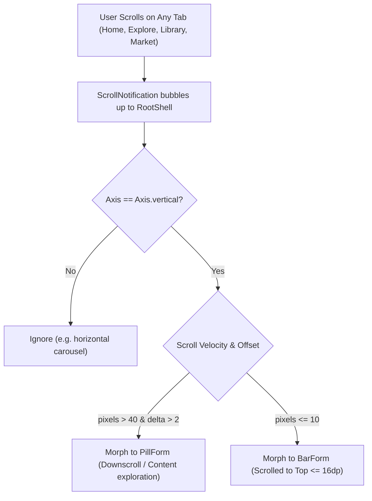
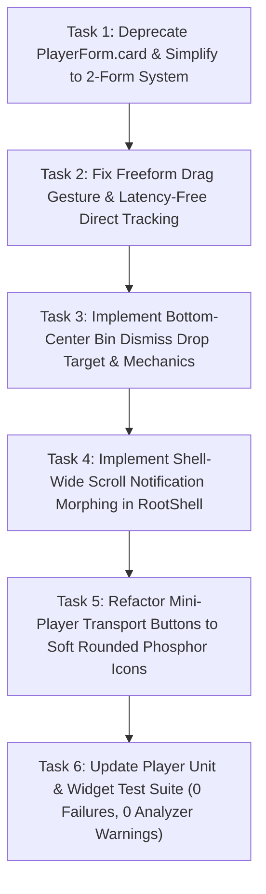

# Vhunambi Architecture Audit: Adaptive Mini-Player, Freeform Drag & Bin Dismiss

**Document ID:** `AUDIT-AMP-002`  
**Status:** DRAFT / PENDING REVIEW  
**Date:** 2026-10-31  
**Author:** Antigravity Agentic Systems Core  
**Scope:** Mobile Bottom Navigation Dock, Adaptive Mini-Player Morphing, Gesture Physics Engine, Drag-to-Dismiss Bin Mechanics, Vector Iconography Rounding

---

## 1. Executive Summary

During physical device verification on Android hardware (`EPHUT20917014649`), end-to-end evaluation of the Vhunambi mobile navigation dock and floating mini-player revealed five critical architectural defects and design inconsistencies:

1. **Root Tab Scroll Morphing Fragmentation:**  
   The mini-player successfully morphs from **Standard Bar** to **Floating Pill** when scrolling on the **Explore** page (`explore_view.dart`), but fails to morph on any other root tab (**Home**, **Library**, **Marketplace**, **Studio**). Furthermore, switching away from Explore forcibly resets the player to Bar, with zero scroll listeners active on the other views.
2. **Card Form Obsolescence & Deprecation (`PlayerForm.card`):**  
   The intermediate $128 \times 128\text{dp}$ floating square card (`card_form.dart`) conceived in Phase 33 is non-functional, visually disconnected from the design system, and clutters the mental model. Vhunambi architecture mandates deprecating the 3rd form entirely and standardizing on a clean 2-form system:
   - **Form 1: Standard Bar Form** (Docked above the bottom navigation bar).
   - **Form 2: Floating Pill Form** (Minimal, tactile floating capsule).
3. **Broken Freeform Dragging Mechanics:**  
   Dragging the floating mini-player is completely frozen on screen. Architectural trace reveals that while `startDrag()` records pointer coordinates, it leaves `_mode = PlayerMode.auto`. Because `calculateAutoPosition()` only uses pointer position in `manual` mode, it continuously returns the fixed dock position `(8.0, targetY)`. Furthermore, `AnimatedPositioned` runs with a `200ms` curve during drag, causing extreme latency, and touches snap the top-left corner directly to the finger due to missing grab-offset tracking.
4. **Missing Close / Dismiss Functionality & The "Drag to Bin" Pattern:**  
   The mini-player lacks an explicit, intuitive close mechanism. When the user holds and drags the mini-player:
   - The mini-player must enter active manual drag mode.
   - An animated **Bin Drop Target** (`_BinDismissTarget`) must dynamically emerge at the **bottom-center of the screen** above the bottom dock.
   - If the player is dragged into the collision boundary ($R \le 64\text{dp}$) and released, it triggers an animated collapse into the bin, permanently killing/dismissing the mini-player (`notifier.dismiss()`) and stopping audio playback.
   - If released outside the bin, the bin smoothly fades out and the mini-player snaps safely to the screen edge or dock.
5. **Sharp / Blocky Mini-Player Button Iconography:**  
   Transport controls (play/pause, skip previous, skip next) feature sharp edges, square ink splashes, and legacy Material icons (`Icons.music_note_rounded`, `Icons.pause_rounded`, `Icons.play_arrow_rounded` in `pill_form.dart`). In accordance with standard `STD-UIUX-001`, all mini-player controls must adopt soft, rounded Phosphor vector glyphs housed in circular, organic touch containers (`BoxDecoration(shape: BoxShape.circle)`).

---

## 2. Dimension 1: Root Tab Scroll Morphing Fragmentation

### 2.1 The Current Disconnect

In `apps/vhunambi_client/lib/features/explore/presentation/views/explore_view.dart` (lines 73–86):
```dart
body: NotificationListener<ScrollNotification>(
  onNotification: (notification) {
    if (notification is ScrollUpdateNotification) {
      if (notification.scrollDelta != null && notification.scrollDelta!.abs() > 2) {
        final controller = ref.read(miniPlayerControllerProvider);
        if (controller.form == PlayerForm.bar && controller.mode == PlayerMode.auto) {
          ref.read(miniPlayerControllerProvider.notifier).setForm(PlayerForm.pill);
        }
      }
    }
    return false;
  },
  child: CustomScrollView(...),
)
```

However, examining the remaining root tabs:
- **Home Dashboard (`home_dashboard_view.dart`):** Contains `CustomScrollView` with feeds, quick actions, and spotlight carousels, but **zero** `NotificationListener<ScrollNotification>`.
- **Library (`library_view.dart`):** Contains nested `ListView` and `GridView` inside `TabBarView`, but **zero** `NotificationListener<ScrollNotification>`.
- **Marketplace (`marketplace_view.dart`):** Contains `CustomScrollView` with beats, licenses, and seller cards, but **zero** `NotificationListener<ScrollNotification>`.
- **Root Shell Switcher (`main.dart`, lines 94–100):**
  ```dart
  // When leaving Explore tab, restore player to Bar form if in Auto mode
  final playerController = ref.read(miniPlayerControllerProvider);
  if (playerController.form == PlayerForm.pill && playerController.mode == PlayerMode.auto) {
    ref.read(miniPlayerControllerProvider.notifier).setForm(PlayerForm.bar);
  }
  ```

### 2.2 Defects Identified
1. **Per-View Fragmentation:** Scrolling logic was isolated to `explore_view.dart` instead of being handled uniformly at the shell navigation layer.
2. **Unidirectional Morphing:** On Explore, scrolling down morphs the bar to pill, but scrolling back to the top of the feed (`pixels == 0`) never restores the bar.
3. **Horizontal Scroll Collisions:** `notification.scrollDelta!.abs() > 2` did not inspect `notification.metrics.axis == Axis.vertical`, meaning fast horizontal swipes on horizontal carousels (e.g. reels rail, genre chips) could unintentionally trigger a vertical morph.

### 2.3 Proposed RootShell Unification
In Flutter, `ScrollNotification` bubbles up from all scrollable descendants through `IndexedStack`. Wrapping the `IndexedStack` inside `RootShell` (`main.dart`) in a unified `NotificationListener<ScrollNotification>` eliminates page-level duplication:



---

## 3. Dimension 2: Form Simplification & Deprecation of `PlayerForm.card`

### 3.1 Obsoletion of the Card Form
In Phase 33, `PlayerForm.card` ($128 \times 128\text{dp}$ square) was conceived as an intermediate step between docked Bar and floating Pill. In practice:
- It occupies excessive screen real estate without providing full cockpit controls.
- It lacks proper gesture bounding and clips against page content.
- Physical device testing confirmed that users prefer the docked **Bar** for bottom transport and the floating **Pill** for minimal background playback.

### 3.2 Clean Deprecation Strategy
1. **Enum Refactor (`mini_player_controller.dart`):**
   ```dart
   /// Mini player form — Bar (docked above bottom dock) or Pill (floating minimal capsule).
   enum PlayerForm { bar, pill }
   ```
2. **Decommission `card_form.dart`:**
   Remove `CardForm` widget and its imports from `mini_player_host.dart`.
3. **Legacy Migration Safeguard in `loadState()`:**
   If SharedPreferences contains a stored `formIndex == 1` from previous builds, clamp or remap it safely to `PlayerForm.pill`:
   ```dart
   final formIndex = prefs.getInt(_keyForm) ?? 0;
   _form = formIndex >= PlayerForm.values.length 
       ? PlayerForm.pill 
       : PlayerForm.values[formIndex];
   ```
4. **Test Suite Modernization:**
   Update `mini_player_controller_test.dart`, `phase33_adaptive_mini_player_test.dart`, and `mini_player_host_test.dart` to assert two-state morphing exclusively.

---

## 4. Dimension 3: Freeform Dragging Breakdown & Physics Engine

### 4.1 Root Cause of Frozen Drag
A code-level trace of `mini_player_host.dart` and `mini_player_controller.dart` reveals why dragging was completely non-functional:

```dart
// mini_player_host.dart line 68
final activePosition = controller.calculateAutoPosition(
  screenSize: screenSize,
  bottomSafeArea: bottomSafeArea,
);

// mini_player_controller.dart line 187
Offset calculateAutoPosition({required Size screenSize, required double bottomSafeArea}) {
  if (_mode == PlayerMode.manual) {
    return clampedPosition(screenSize, bottomSafeArea);
  }
  // When _mode is PlayerMode.auto:
  switch (_form) {
    case PlayerForm.bar:
      final defaultDockBottom = 56.0 + bottomSafeArea + 8.0;
      double targetY = screenSize.height - defaultDockBottom - 64.0;
      return Offset(8.0, targetY); // <-- ALWAYS RETURNED DURING DRAG!
  }
}
```

When dragging begins:
1. `_handleLongPressStart` calls `controller.startDrag(details.globalPosition)`.
2. `startDrag` sets `_position = globalPosition` and `_isDragging = true`, but **never** updates `_mode = PlayerMode.manual`.
3. As long as `_mode == PlayerMode.auto`, `calculateAutoPosition()` returns the static docked offset `(8.0, targetY)`. The mini-player is completely frozen in place!
4. Even if position was returned, `AnimatedPositioned` has a constant `duration: Duration(milliseconds: 200)`. During an active drag gesture, duration MUST be `Duration.zero` to achieve responsive 60/120fps direct tracking.
5. `_position = details.globalPosition` sets the top-left coordinate to the finger position without subtracting the initial grab anchor offset ($\Delta = \text{touch} - \text{widgetOrigin}$), causing an immediate jarring snap.

### 4.2 The Unified Gesture Engine Architecture

```dart
class DragState {
  final bool isDragging;
  final Offset position;
  final Offset grabOffset;
  final bool isOverBin;
}
```

During drag:
1. **On Drag Start:**
   - Record touch offset relative to player origin: `_grabOffset = details.globalPosition - _currentPosition`.
   - Set `_isDragging = true` and `_mode = PlayerMode.manual`.
   - Fire tactile haptic pulse (`HapticsService().mediumImpact()`).
2. **On Drag Update:**
   - Update unconstrained position: `newPos = details.globalPosition - _grabOffset`.
   - Clamp position within screen boundaries:
     $$\text{clampedX} = \text{clamp}(8.0, \text{screenWidth} - \text{width} - 8.0)$$
     $$\text{clampedY} = \text{clamp}(\text{topSafeArea} + 8.0, \text{screenHeight} - \text{height} - \text{bottomSafeArea} - 8.0)$$
   - Check collision with the bottom-center Bin Target.
3. **On Drag End:**
   - If `isOverBin`: Execute destroy animation $\rightarrow$ call `playerNotifier.dismiss()`.
   - If outside bin: Snap smoothly to the nearest edge (left or right, or docked bottom if near dock), and persist manual position.

---

## 5. Dimension 4: Drag-to-Dismiss / Close Function via Bottom-Center Bin Target

### 5.1 User Requirement
> *"the mini player has no close function, so lets put this function in drag, if user holds the mini player to trigger drag, they should be able to drag it around as they please and a new functionality should be added, the moment the user is in drag mode, at the bottom centre of the screen should appear a bin icon and when user drags the mini player to that icon boundries then lets go it completes kills the mini player, basically its close functionality"*

### 5.2 Drop Target Geometry & Visual States

```
+-----------------------------------------------------------+
|                                                           |
|                  [ Floating Mini-Player ]                 |
|                             ↓ (Drag)                      |
|                                                           |
|                                                           |
|                                                           |
|                                                           |
|                     +-----------------+                   |
|                     |   (  🗑️ BIN  )   |                   |
|                     +-----------------+                   |
|                   [ Mobile Bottom Nav ]                   |
+-----------------------------------------------------------+
```

| State | Bin Target Appearance | Mini-Player Appearance | Haptic Feedback |
| :--- | :--- | :--- | :--- |
| **Idle** | Hidden (`Opacity: 0.0`, `Scale: 0.6`) | Normal scale ($1.0\times$) | None |
| **Dragging (Free)** | Faded in (`Opacity: 1.0`, `Scale: 1.0`), frosted dark ring with subtle red border, `AppIcons.trash` | Elevated ($1.04\times$), ambient shadow | Medium impact on pick up |
| **Hovering over Bin** | Expanded ($1.25\times$), solid crimson glow (`AppColors.error`), bright white `AppIcons.trash` | Magnetized toward bin center, scaled down ($0.85\times$, `Opacity: 0.7`) | Heavy impact pulse upon boundary intersection |
| **Release in Bin** | Swallowed pulse bounce ($1.35\times \rightarrow 0$) | Sucked into center ($0\times 0$, `Opacity: 0`) in 180ms | Success / Heavy impact confirmation |
| **Release outside** | Fades out smoothly in 150ms | Springs smoothly to edge/dock | Light tick |

### 5.3 Collision Detection Mathematics
Let the Bin Target center be $C_{\text{bin}} = (X_b, Y_b)$ and the Mini-Player center be $C_{\text{player}} = (X_p + W_p/2, Y_p + H_p/2)$.

The Euclidean collision distance is:
$$d = \sqrt{(X_{\text{player\_center}} - X_{\text{bin\_center}})^2 + (Y_{\text{player\_center}} - Y_{\text{bin\_center}})^2}$$

The collision condition is:
$$\text{isOverBin} = d \le R_{\text{threshold}}, \quad \text{where } R_{\text{threshold}} = 64.0\text{dp}$$

When $\text{isOverBin}$ transitions from `false` $\rightarrow$ `true`:
- Trigger `HapticsService().heavyImpact()`.
- Scale Bin Target to $1.25\times$.

When release occurs with $\text{isOverBin} == \text{true}$:
```dart
// 1. Play absorb animation
await _dismissController.forward();
// 2. Clear track & dismiss audio session
ref.read(playerStateProvider.notifier).dismiss();
// 3. Reset controller to docked Bar
ref.read(miniPlayerControllerProvider.notifier).resetToDock();
```

---

## 6. Dimension 5: Mini Player Button Iconography & Rounding

### 6.1 Audit of Existing Mini-Player Controls

| File | Widget / Key | Current Icon / Container | Defect | Solution (STD-UIUX-001) |
| :--- | :--- | :--- | :--- | :--- |
| `mobile_mini_player.dart` | `mini_player_prev` | `PhosphorIcon(AppIcons.skipBack)` on bare `IconButton` | Square splash bounds, sharp triangle glyph | `IconButton.styleFrom(shape: CircleBorder())`, soft circular hover halo |
| `mobile_mini_player.dart` | `mini_player_play_pause` | `Icon(AppIcons.play/pause)` inside 44x44 circular orb | Uses `Icon()` instead of `PhosphorIcon()`, sharp pause glyph | `PhosphorIcon(AppIcons.play/pause)` with rounded geometry and high-contrast styling |
| `mobile_mini_player.dart` | `mini_player_next` | `PhosphorIcon(AppIcons.skipForward)` on bare `IconButton` | Square splash bounds, sharp triangle glyph | `IconButton.styleFrom(shape: CircleBorder())`, soft circular hover halo |
| `pill_form.dart` | Center Art | `Icon(Icons.music_note_rounded)` | Legacy Material icon | `PhosphorIcon(AppIcons.songs)` in circular gradient disc |
| `pill_form.dart` | Play/Pause | `Icon(Icons.play_arrow_rounded / pause_rounded)` | Legacy Material icon | `PhosphorIcon(AppIcons.play / pause)` in circular orb with tap feedback |
| New Component | `_BinDismissTarget` | None | Missing close/dismiss target | Soft circular pill with `PhosphorIcon(AppIcons.trash, size: 28)` |

---

## 7. Actionable Implementation Roadmap (Phase 35)



### Next Steps:
1. Present this architectural audit report and conversation artifact to the user.
2. Upon user review and approval, author the 4-doc specification suite under `docs/phases/phase_35_mini_player_drag_dismiss/` (`blueprint.md`, `requirements.md`, `design.md`, `tasks.md`).
3. Begin systematic, test-driven implementation.

