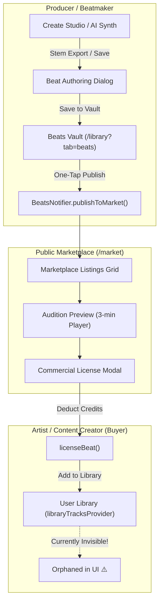

# Vhunambi Architecture Audit: Beats Marketplace & Library Beats Vault

**Document ID:** `AUDIT-BEAT-MKT-001`  
**Date:** 2026-10-30  
**Target:** Monorepo (`apps/vhunambi_client`, `apps/vhunambi_api`)  
**Scope:** Beats Marketplace (`/market`), Library Beats Tab (`/library?tab=beats`), Licensing, Studio Integration, and Platform Economy  
**Author:** Antigravity (Dual-Agent Symbiosis Protocol)

---

## 1. Executive Summary

Vhunambi features two dedicated surfaces dealing with instrumental beats:
1. **The Beats Marketplace** (`/market` — Tab Index 4): The **public commercial storefront** where producers list instrumental beats for sale and creators/artists browse, audition, and license non-exclusive commercial sync rights.
2. **The Library Beats Tab** (`/library?tab=beats` — Tab Index 3): The **producer's private management cockpit and inventory vault** (`BeatsVaultView`), where creators manage their own beats, set pricing/tags, inspect royalties/analytics, and toggle marketplace publishing.

While both features have polished, responsive UIs and robust domain models, our deep audit revealed **critical architectural disconnects**, most notably:
- **The "Invisible Licensed Beat" Bug**: When a user purchases a beat in the Marketplace, it is added to the general `LibraryTrack` collection, but cannot be seen anywhere in the Library UI because the "Beats" tab only displays producer-created beats and the "Licensing" tab filter is disabled.
- **Pure Client-Side Mocking**: The Marketplace and Beats Vault currently run exclusively in local storage (Hive and in-memory Riverpod); `apps/vhunambi_api` has zero endpoints for beats or licensing.
- **Dual Divergent Economies**: The Marketplace uses an isolated **"Credits"** currency, while the Social/Reels network uses **"Coins"** and **"ZAR"** (South African bank cashout).

Below is the complete architectural audit, entity mapping, user journeys, identified defects, and a strategic roadmap for Argon and the engineering team.

---

## 2. System Architecture & Entity Mapping

### 2.1 Architectural Role Distinction



### 2.2 Data Models & Codebase Layout

| Dimension | Beats Marketplace (`/market`) | Library Beats Tab (`/library?tab=beats`) |
| :--- | :--- | :--- |
| **Primary File Path** | `apps/vhunambi_client/lib/features/marketplace/` | `apps/vhunambi_client/lib/features/beats/` & `lib/features/library/` |
| **Domain Entity** | `BeatListingEntity` (`marketplace_models.dart`) | `ProducerBeatEntity` (`producer_beat_entity.dart`) |
| **Storage Engine** | In-memory `MarketplaceBeatsNotifier` (seeded + reactive) | Hive Box `vhunambi_beats` via `BeatRepository` |
| **Primary Provider** | `marketplaceBeatsProvider`, `filteredBeatsProvider` | `beatsProvider`, `filteredBeatsVaultProvider` |
| **User Role** | **Buyer / Explorer** (Auditioning & Purchasing) | **Seller / Producer** (Authoring, Inventory & Royalties) |
| **Key Actions** | Audition, Filter (Genre, BPM, Price), License for Credits | Create Beat, Edit Details, Stems Export, Publish/Unpublish, Sales Ledger |
| **Analytics Surfaced**| Total Sales on platform, Producer handle | Total Beats, Published vs Draft, Total Sales, Credits Earned |

### 2.3 Cross-Domain Synchronization Bridge

In `beats_provider.dart`, the two features are bridged through `MarketplaceBeatsNotifier`:
```dart
// beats_provider.dart (Lines 314-317 & 365)
if (beat.isPublished) {
  _marketplace?.upsertListing(beatListingFromEntity(beat));
}
```
When a producer publishes a beat in their Library vault, it dynamically injects a `BeatListingEntity` into the public Marketplace. If the beat is modified or switched back to "Draft", `_marketplace?.removeListing(id)` takes it down immediately.

---

## 3. Critical Findings & Architectural Bugs

### Finding 1: The "Invisible Licensed Beat" Bug (Critical UX Gap)
- **The Problem:** When an artist browses the Marketplace and taps **"License for 10 Credits"**, `licenseBeat()` successfully adds the purchased beat to `libraryTracksProvider` as:
  ```dart
  LibraryTrack(
    id: 'market_${beat.id}',
    title: beat.title,
    creatorName: beat.producerName,
    genre: beat.genre,
    isInstrumental: true,
    licenseType: beat.licenseType, // e.g. 'nonExclusiveCommercial'
  )
  ```
- **Why It Disappears:**
  1. In `library_view.dart`, tapping the **"Beats"** category rail bypasses standard library tracks and mounts `BeatsVaultView`.
  2. `BeatsVaultView` exclusively watches `beatsProvider` (`ProducerBeatEntity` — beats created by the user). It completely ignores `libraryTracksProvider`!
  3. In `library_providers.dart`, `_matchesCategory(track, LibraryCategory.songs)` enforces `!track.isInstrumental`, hiding it from the Songs tab.
  4. `_matchesCategory(track, LibraryCategory.licensing)` returns `false` unconditionally.
- **Impact:** The buyer's credits are deducted, but they **cannot access, play, or export the beat they just bought** anywhere in their Library!

### Finding 2: Zero Backend API Endpoints (Complete Client-Side Island)
- **The Problem:** An audit of `apps/vhunambi_api` revealed zero routes, controllers, or database schemas for beats or marketplace.
- **Current State:** All listings, sales records, and credit deductions live in Hive or client RAM. If a user publishes a beat on Phone A, Phone B will never see it.
- **Requirement:** `apps/vhunambi_api` must introduce `/api/marketplace/beats` and `/api/creators/:id/beats` backed by persistent database storage and R2 audio stem URLs.

### Finding 3: Two Unconnected Platform Currencies
- **The Problem:**
  - Marketplace uses **"Credits"** (`marketplaceCreditsProvider`, default balance: 10 credits).
  - Social Network & Reels uses **"Coins"** (purchased via ZAR, e.g., 100 coins = R19.99) and **"ZAR"** (cashout to Capitec, FNB, Standard Bank).
- **Impact:** Fragmented user experience. A creator earning ZAR or coins from viral reels and gifts cannot use those earnings to license beats in the Marketplace, and a producer selling beats earns abstract "Credits" instead of real South African Rand.

### Finding 4: Disconnect between Marketplace Beats and Studio Cockpit
- In Create Studio, the `ReferenceAudioDropzone` accepts uploaded audio or sketchpad patterns, but has no picker to **"Use Beat from Library"** or **"Browse Marketplace Beats"**.
- Producers in Studio who create an amazing MMO instrumental track have no direct button to **"Export as Sellable Beat"**; they must manually navigate to Library -> Beats and re-type the metadata.

---

## 4. Architectural Comparison Table

| Capability | Current State | Target Future State |
| :--- | :--- | :--- |
| **Viewing Purchased Beats** | Lost / Invisible in Library UI | Tab inside `/library?tab=beats`: [My Beats \| Licensed] |
| **Licensing Certificate** | Stubbed modal text | Full Certificate view + downloadable PDF / JSON manifest |
| **Audio File Delivery** | Plays 180s preview URL only | Delivers high-res Lossless WAV + 4-Stem ZIP (Drums, Bass, Melody, Other) |
| **Backend Integration** | 100% Mock / Local Hive | REST/GraphQL API on `vhunambi_api` with Postgres/Prisma & Cloudflare R2 |
| **Currency** | Abstract "Credits" | Unified with Creator Wallet (ZAR / Coins) |
| **Studio Bridge** | None | "Import Beat as Studio Backing Track" & "Publish Studio Track to Beatstore" |

---

## 5. Strategic Options for Discussion with Argon

### Option A: The "Two-Sided Studio & Storefront" (Recommended)
Treat the **Beats Marketplace** as the public exchange and the **Library Beats Tab** as the creator's merchant portal.
1. **Fix the Buyer Loop**: In `/library?tab=beats`, add a segmented control:
   - `[ My Catalog (Producer) ]`: Shows `BeatsVaultView` (stats, draft/publish, authoring).
   - `[ Licensed Beats (Purchased) ]`: Shows all licensed `LibraryTrack` instrumentals with download buttons for stems and commercial license certs.
2. **Unify the Economy**: Peg Credits directly to Coins/ZAR (e.g. 1 Beat License = 50 Coins or R49.00), routing 85% of net proceeds directly into the producer's `CreatorWallet` for bank payout.
3. **Bridge into Studio**: Add a 1-tap "Record Vocals over Beat" in the Marketplace that instantly loads the licensed beat's stems into the Studio cockpit.

### Option B: The "Unified Library Vault"
Consolidate beats directly into the core Library taxonomy:
- The "Beats" tab in Library displays all instrumentals (both produced and licensed), tagged with badges (`[Produced]` vs `[Licensed]`).
- Producer actions (edit pricing, publish to market) appear in the `⋮` track actions sheet rather than requiring a separate vault view.

---

## 6. Actionable Implementation Checklist

- [ ] **Phase 1: Fix Orphan Licensed Beats (Quick Fix)**
  - Update `LibraryCategoryRail` or `BeatsVaultView` to include a `Licensed Beats` view mode so purchased beats appear immediately.
  - Enable `_matchesCategory(track, LibraryCategory.licensing)` to show all tracks where `licenseType != null`.
- [ ] **Phase 2: Build `apps/vhunambi_api` Endpoints**
  - `GET /api/marketplace/beats`: Paginated beat feed with genre, BPM, and search filters.
  - `POST /api/marketplace/beats/:id/license`: Atomic transaction deducting credits/coins and issuing license records.
  - `GET /api/creators/:id/beats`: Authenticated producer beat repository.
  - `POST /api/creators/:id/beats`: Create / publish beat with stem uploads.
- [ ] **Phase 3: Currency & Wallet Convergence**
  - Wire beat sale royalties into `creatorWalletProvider` so producers can withdraw real ZAR to their South African bank accounts.
- [ ] **Phase 4: Studio Backing Track Integration**
  - Add "Load as Backing Track" in `ReferenceAudioDropzone` to pull directly from licensed Library beats.

