# Vhunambi Creator Profile System: Comprehensive Architectural & UX Audit
**Audit ID:** AUDIT-PROF-002  
**Date:** October 31, 2026  
**Scope:** `apps/vhunambi_client/lib/features/profile/` & `apps/vhunambi_api/src/routes/social_routes.ts`  
**Target:** Public Artist Profile (`/profile/:id`) and Account Owner Creator Studio (`/profile/me`)  
**Ecosystem Alignment:** V4.1 Social Architecture (Kinetic Reels, MMO 2.0, Cultural Tipping, Beats Marketplace, Bantu Voice Cloning, Creator DNA)

---

## 1. Executive Summary

The Vhunambi Profile System is built on an elegant **dual-route architecture**:
1. **Public Artist Profile (`/profile/:id` · `ArtistProfileView`)**: The consumer-facing destination for fans and collaborators visiting a creator via Explore, Kinetic Reels, or social feeds.
2. **Owner Creator Studio (`/profile/me` · `OwnerProfileView`)**: The private self-sovereign management cockpit where creators inspect sound analytics, cash out royalties, customize avatars, and configure catalog visibility.

While the foundational UI tokens and visual framing (amber-bronze ambient banner, monogram cutouts, stats grid) are visually striking, **the profile system has become architecturally stranded from the modern V4.1 engine**. Over the past 12 phases, Vhunambi launched the **Coin cultural micro-tipping economy**, **MMO 2.0 stem slicing**, **6-Preset Stem Mastering**, **24 Sovereign Voice Archetypes**, and the **Beats Marketplace**.

Currently, the Profile System exhibits **8 major architectural disconnects**:
- `ArtistProfileView` still uses an isolated, legacy modal tipping in raw "credits" rather than invoking `CreatorTippingSheet` (the 4 cultural gifts).
- A double-prefix bug in `creatorClipsFamilyProvider('creator_${profile.id}')` causes public artist reels grids to render completely empty.
- The "Beats" tab is purely cosmetic, displaying zero commercial beat listings from `/market`.
- `CreatorDnaProfileCard` is hardcoded to the local device owner's state and entirely absent from public artist profiles.
- Top bar and bottom dock navigation lack a direct route to the Owner Creator Studio.

---

## 2. Dual-Route System Architecture

```mermaid
graph TD
    subgraph Discovery & Entry Points
        ExploreFeed["Explore Social Feed (ExploreSocialPostCard)"]
        ReelsModal["Kinetic Reels Modal (@creator_link)"]
        TopBar["Top Bar Monogram / Avatar"]
        HomeDashboard["Home Dashboard Creator Avatar"]
    end

    subgraph Profile Routing Engine
        ArtistRoute["/profile/:id (ArtistProfileView)"]
        OwnerRoute["/profile/me (OwnerProfileView)"]
    end

    subgraph Artist Profile View
        Banner["ProfileBannerHeader (Banner + Avatar + Verified)"]
        StatsGrid["ProfileStatsGrid (5 Metrics: Songs, Likes, Plays, Followers, Streak)"]
        TriModalTabs{"Tri-Modal Navigation Tabs"}
        TabClips["Tab 0: Clips (Reels 9:16 Grid)"]
        TabMusic["Tab 1: Music (Top Songs, Releases, Activity)"]
        TabBeats["Tab 2: Beats (Commercial Beats & Supporters)"]
    end

    subgraph Owner Creator Studio View
        OwnerScaffold["Owner Scaffolding & AI Avatar Customizer"]
        QuickActions["Management Strip (Avatar, Edit, Pin Song, Analytics)"]
        TopGenres["Top Genre Analytics Chips"]
        OwnerDNA["Creator DNA Sound Attunement Meter"]
        OwnerSongs["Your Songs (Inline Public/Private Toggle)"]
        OwnerReels["My Clips & Reels Shelf"]
        WalletDeck["Creator Wallet & Cultural Tipping Deck"]
        DiscographyMgr["Releases Manager Card"]
        TipLedger["Tip History Ledger (Received vs Sent)"]
        ReferralCard["Profile Referral Link Card"]
    end

    ExploreFeed -->|Taps Creator Header| ArtistRoute
    ReelsModal -->|Taps Creator Pill| ArtistRoute
    TopBar -->|Missing Navigation Handler| OwnerRoute
    HomeDashboard -->|Taps Avatar| OwnerRoute

    ArtistRoute --> Banner
    ArtistRoute --> StatsGrid
    ArtistRoute --> TriModalTabs
    TriModalTabs --> TabClips
    TriModalTabs --> TabMusic
    TriModalTabs --> TabBeats

    OwnerRoute --> OwnerScaffold
    OwnerRoute --> QuickActions
    OwnerRoute --> TopGenres
    OwnerRoute --> OwnerDNA
    OwnerRoute --> OwnerSongs
    OwnerRoute --> OwnerReels
    OwnerRoute --> WalletDeck
    OwnerRoute --> DiscographyMgr
    OwnerRoute --> TipLedger
    OwnerRoute --> ReferralCard
```



---

## 3. Section-by-Section Deep Dive: `ArtistProfileView` (`/profile/:id`)

### 3.1. Ambient Cover Banner & Monogram Cutout (`ProfileBannerHeader`)
- **Visuals**: 140dp (mobile) / 180dp (desktop) radial gradient (`#78350F` bronze-amber to `#141418` canvas) with subtle watermark glyphs (piano, vinyl album, waveform equalizer).
- **Avatar Cutout**: 84dp circular avatar with a 4dp solid border matching `AppColors.surfaceCanvas`, creating an offset 3D cutout illusion.
- **Identity Labels**: Display name, handle (`@username`), blue verified badge (`#3B82F6`), and multiline creator biography.
- **Action Strip**:
  - `Follow / Following`: Optimistically updates follower count with animated pill states.
  - `Tip Artist`: Gold-outlined button triggering tip dialog.
  - `Share`: Copies `https://vhunambi.com/profile/$username` to clipboard.
  - `Report`: Flags profile for moderation review.

### 3.2. 5-Metric Performance Grid (`ProfileStatsGrid`)
- Renders a responsive 5-tile metric strip:
  1. **Songs**: Total published discography items.
  2. **Likes**: Cumulative fan appreciation counter.
  3. **Plays**: Stream playback counts formatted (e.g. `45.2K`).
  4. **Followers**: Community audience size (`1.8K`).
  5. **Day Streak**: Bantu creation streak (`🔥 4`).
- **Shortcoming**: Metrics are static snapshots from `ArtistProfileEntity` and do not reactively stream live plays or likes from the persistent jukebox.

### 3.3. Tri-Modal Tab Structure (`NestedScrollView` + `SliverPersistentHeader`)
- Uses pinned `_ProfileTabBarDelegate` with three distinct modes:
  - **Tab 0: Clips (`_reelsGrid`)**: 3-column (mobile) or 4-column (desktop) 9:16 vertical video thumbnails (`CreatorReelThumbnailCard`). Tapping launches `KineticReelsModal` centered on that clip.
  - **Tab 1: Music (`_discographyTab`)**: Ranked "Top Songs" list with inline transport controls, "Releases" list (Singles, EPs, Albums), and "Recent Activity" timestamped feed.
  - **Tab 2: Beats (`_beatsCommunityTab`)**: `_BeatLicenseCard` with genre tags, and `TopSupportersLeaderboard` showing 🥇 Gold, 🥈 Silver, 🥉 Bronze tipping fans.

---

## 4. Section-by-Section Deep Dive: `OwnerProfileView` (`/profile/me`)

### 4.1. Header & AI Avatar Customizer
- Displays user's avatar (`size: 68`) with an active edit pencil badge (`showEditBadge: true`).
- Tapping launches `AvatarCustomizationModal` with on-device generative avatar synthesis.
- Displays `@username • Verified Creator` status.

### 4.2. Studio Quick Actions Strip
- Horizontal wrapping row of 44dp HIG-compliant action pills:
  - 🎨 `Change Avatar ✨`
  - ✏️ `Edit Profile`
  - 📌 `Pin Song`
  - 📊 `Studio Analytics`
- **Shortcoming**: "Edit Profile", "Pin Song", and "Studio Analytics" currently only display placeholder snackbars rather than opening dedicated interfaces.

### 4.3. Creator DNA Sound Attunement (`CreatorDnaProfileCard`)
- Displays real-time Bantu Sound Signature Attunement (`0%` to `100%`).
- Shows attunement zone status (`NASCIENT`, `DEVELOPING`, `ATTUNED`, `MAESTRO`).
- Visualizes genre weights and regional scale affinities.

### 4.4. "Your Songs" Shelf with Inline Visibility Toggles
- Renders user's personal studio catalog.
- Each song features an inline `🌐 Public` vs `🔒 Private` pill switch.
- Includes full transport integration with `playerStateProvider.notifier.playTrack`.

### 4.5. "My Clips & Reels" Horizontal Discovery Shelf (`_OwnerReelsShelf`)
- Horizontal scrolling shelf (`height: 180dp`) showcasing all kinetic video reels published by the creator.
- Tapping opens the immersive 60 FPS `KineticReelsModal`.

### 4.6. Creator Wallet & Cultural Tipping Deck (`CreatorWalletDeck`)
- Displays user's earned ZAR royalties and incoming cultural gift statistics.
- Minimum cashout validation ($R50.00$) via Ozow, Capitec Pay, or EFT.

### 4.7. Discography Releases Manager & Tip History Ledger
- `ReleasesManagerCard`: Dialog enabling creators to bundle tracks into Singles, EPs, or Albums.
- `TipHistoryLedger`: Sub-tabbed financial ledger separating Received vs Sent transactions with timestamps.

---

## 5. The 8 Critical Findings & Architectural Traps

### 🚨 FINDING-PROF-001 (Critical): Currency Disconnect & Legacy Credit Tipping Modal
- **Location**: [`apps/vhunambi_client/lib/features/profile/presentation/views/artist_profile_view.dart#L38-L115`](file:///C:/Users/Ndugelo/VHUNAMBI/monorepo/apps/vhunambi_client/lib/features/profile/presentation/views/artist_profile_view.dart#L38-L115)
- **The Problem**: Tapping `Tip Artist` opens an archaic sheet offering raw `[10, 25, 50, 100]` "credits". This completely bypasses Phase 20's **Coin Economy** and the 4 canonical African cultural gifts in `CreatorTippingSheet`:
  - 👏 **Virtual Applause** (10 Coins)
  - ☕ **Virtual Coffee** (50 Coins)
  - 🎹 **Studio Beats** (100 Coins)
  - 👑 **Producer Crown** (500 Coins)
- **Impact**: Tipping on a public profile does not deduct user Coins, does not credit the creator's real ZAR balance, does not display culturally evocative animations, and does not broadcast celebratory comment announcements into the creator's feed.
- **Architectural Solution**: Deprecate `_showTipDialog` and directly route the `Tip Artist` action to `CreatorTippingSheet.show(context, clip: topClipOrDummy)`. Unify `ArtistProfileEntity.tipHistory` to record Coin/ZAR transactions rather than raw credits.

---

### 🚨 FINDING-PROF-002 (High): Double-Prefix `creator_` Clip Query Bug
- **Location**: [`apps/vhunambi_client/lib/features/profile/presentation/views/artist_profile_view.dart#L127-L129`](file:///C:/Users/Ndugelo/VHUNAMBI/monorepo/apps/vhunambi_client/lib/features/profile/presentation/views/artist_profile_view.dart#L127-L129)
- **The Problem**: `ArtistProfileView` queries reels via:
  ```dart
  final clips = ref.watch(creatorClipsFamilyProvider('creator_${profile.id}'));
  ```
- If an artist's ID is already `'creator_sigwa'`, `'creator_makhadzi'`, or `'cr_01'`, the provider searches for `'creator_creator_sigwa'`.
- In `creator_clips_provider.dart`:
  ```dart
  return feed.clips.where((clip) => clip.creatorId == creatorId).toList();
  ```
- Because no clip has `creatorId == 'creator_creator_sigwa'`, the query returns an empty list, and the "Clips" tab displays a permanent "No clips yet" empty state.
- **Architectural Solution**: Normalize creator IDs using a sanitizing utility:
  ```dart
  final normalizedCreatorId = profile.id.startsWith('creator_') 
      ? profile.id 
      : 'creator_${profile.id}';
  ```

---

### 🚨 FINDING-PROF-003 (High): Cosmetic "Beats" Tab Lacks Marketplace Integration
- **Location**: [`apps/vhunambi_client/lib/features/profile/presentation/views/artist_profile_view.dart#L570-L587`](file:///C:/Users/Ndugelo/VHUNAMBI/monorepo/apps/vhunambi_client/lib/features/profile/presentation/views/artist_profile_view.dart#L570-L587)
- **The Problem**: The public "Beats" tab only displays a static marketing container (`_BeatLicenseCard`) with genre tags and a supporter list. It does not load or render the producer's real beatstore listings from Phase 28 (`HttpMarketplaceRepository.getBeats(producerId: profile.id)`).
- **Impact**: Artists visiting a producer's profile cannot audition instrumentals, inspect stems, view licensing tiers (Non-Exclusive Lease vs Exclusive Master), or buy licenses directly.
- **Architectural Solution**: Connect Tab 2 to `marketplaceBeatsProvider`, filtering by `producerId == profile.id` and rendering real `BeatCard` widgets with direct licensing modals.

---

### 🚨 FINDING-PROF-004 (High): Missing Producer Cockpit in Owner Studio (`/profile/me`)
- **Location**: [`apps/vhunambi_client/lib/features/profile/presentation/views/owner_profile_view.dart#L364-L434`](file:///C:/Users/Ndugelo/VHUNAMBI/monorepo/apps/vhunambi_client/lib/features/profile/presentation/views/owner_profile_view.dart#L364-L434)
- **The Problem**: `OwnerProfileView` contains sections for "Your Songs" and "Releases", but zero controls for managing the producer's commercial beat listings on `/market`.
- **Impact**: Producers cannot view total beat sales, modify licensing prices, upload stem zip archives, or publish/unpublish beats from their creator cockpit.
- **Architectural Solution**: Add a dedicated "Producer Beatstore & Stems" section to `OwnerProfileView` with 1-tap "Publish Beat to Market" and real-time sales analytics.

---

### ⚠️ FINDING-PROF-005 (Medium): Creator DNA Disconnect between Owner and Visited Artist
- **Location**: [`apps/vhunambi_client/lib/features/creator_dna/presentation/widgets/creator_dna_profile_card.dart#L23`](file:///C:/Users/Ndugelo/VHUNAMBI/monorepo/apps/vhunambi_client/lib/features/creator_dna/presentation/widgets/creator_dna_profile_card.dart#L23)
- **The Problem**: `CreatorDnaProfileCard` unconditionally watches `creatorDnaProvider`, which is the local device owner's private DNA state. Because of this, it cannot be rendered on `ArtistProfileView` without falsely displaying the viewer's sound attunement instead of the artist's.
- **Impact**: Fans visiting an artist cannot inspect their signature tuning, Bantu rhythmic heritage, or authentic scale modes.
- **Architectural Solution**: Refactor `CreatorDnaProfileCard` to accept an optional `CreatorDnaProfile? dna` parameter or query an `artistDnaFamilyProvider(artistId)`. Mount the card in `ArtistProfileView` under the "Music" tab.

---

### ⚠️ FINDING-PROF-006 (Medium): Voice Identity & Cloned Vocal Model Showcase Missing
- **Location**: Profile Domain & Views
- **The Problem**: In Phase 26, Vhunambi implemented 24 Regional African Voice Archetypes and Zero-Shot Phonetic Voice Cloning. If an artist registers a voice clone profile on Vhunambi, there is no way for fans or collaborating producers to audition their AI vocal model or initiate a "Remix in Studio" session with that voice.
- **Architectural Solution**: Expose a "Vocal Identity" badge or player card on the public profile allowing visitors to audition voice samples and trigger Studio vocal conditioning.

---

### ⚠️ FINDING-PROF-007 (Medium): Navigation Orphaning (`_UserAvatar` Unresponsive)
- **Location**: [`apps/vhunambi_client/lib/features/explore/presentation/widgets/explore_top_bar.dart#L574-L595`](file:///C:/Users/Ndugelo/VHUNAMBI/monorepo/apps/vhunambi_client/lib/features/explore/presentation/widgets/explore_top_bar.dart#L574-L595)
- **The Problem**: The desktop explore top bar includes `_UserAvatar`, but it has no `onTap` gesture detector or navigation action. On mobile, the top bar has no user avatar at all. A user must navigate back to the Home tab and locate the small dashboard avatar to reach `/profile/me`.
- **Architectural Solution**: Wrap `_UserAvatar` in an `InkWell` navigating to `OwnerProfileView`. Add an avatar shortcut or drawer entry on mobile for instant access to the Creator Studio.

---

### ℹ️ FINDING-PROF-008 (Low): In-Memory Mock Repository & Stale Creator Registry
- **Location**: [`apps/vhunambi_client/lib/features/profile/data/repositories/profile_repository_impl.dart`](file:///C:/Users/Ndugelo/VHUNAMBI/monorepo/apps/vhunambi_client/lib/features/profile/data/repositories/profile_repository_impl.dart)
- **The Problem**: `ProfileRepositoryImpl` does not make actual network requests to `apps/vhunambi_api/src/routes/social_routes.ts` (`GET /api/creators/:id/clips`, `POST /api/creators/:id/follow`, `GET /api/creators/:id/wallet`).
- Furthermore, `seededArtistProfiles` in `profile_providers.dart` only contains 5 hardcoded creators (`fifi`, `me`, `sigwa_inaf`, `dj_vibe`, `ndugelo`), while Phase 29 introduced `makhadzi`, `khakhathi`, and `asake`.

---

## 6. Recommended Phase 30 Roadmap: Modern Creator Profile Convergence

```mermaid
flowchart TD
    subgraph Track A: Currency & Tipping Unification
        A1["Task 30.1: Replace _showTipDialog with CreatorTippingSheet (4 Cultural Gifts)"]
        A2["Task 30.2: Align TipRecordEntity & Ledger with Coins & ZAR Royalties"]
    end

    subgraph Track B: Kinetic Reels & Navigation Normalization
        B1["Task 30.3: Fix Double-Prefix Bug in creatorClipsFamilyProvider"]
        B2["Task 30.4: Wire Top-Bar _UserAvatar to OwnerProfileView & Mobile Entry"]
    end

    subgraph Track C: Beats Marketplace & Commercial Vault
        C1["Task 30.5: Populate Artist Profile 'Beats' Tab with Real BeatCard Listings"]
        C2["Task 30.6: Add 'Producer Beatstore Cockpit' to OwnerProfileView"]
    end

    subgraph Track D: Creator DNA & Bantu Identity
        D1["Task 30.7: Support Artist-Scoped Creator DNA in CreatorDnaProfileCard"]
        D2["Task 30.8: Expose Vocal Identity & Voice Cloning Showcase"]
    end

    A1 --> A2
    B1 --> B2
    C1 --> C2
    D1 --> D2
```



### Detailed Task Specifications

#### Track A: Currency & Tipping Unification
- **Task 30.1**: In `artist_profile_view.dart`, replace `_showTipDialog` with a call to `CreatorTippingSheet.show(context, clip: ...)`. When fans tip from an artist's profile, they can select from the 4 cultural gifts (Applause, Coffee, Beats, Crown), triggering real coin deductions and crediting the artist's ZAR wallet.
- **Task 30.2**: Update `ArtistProfileEntity` and `TipRecordEntity` so transaction amounts reflect Coins and ZAR royalties rather than legacy credits.

#### Track B: Kinetic Reels & Navigation Normalization
- **Task 30.3**: Normalize creator IDs in `ArtistProfileView` and `OwnerProfileView` so `creatorClipsFamilyProvider` correctly queries clips without `creator_creator_` double prefixes.
- **Task 30.4**: Update `_UserAvatar` in `explore_top_bar.dart` and the discovery drawer to open `OwnerProfileView` on tap, ensuring the user can always access their Creator Studio in 1 step.

#### Track C: Beats Marketplace & Commercial Vault
- **Task 30.5**: Connect Tab 2 ("Beats") of `ArtistProfileView` to `marketplaceBeatsProvider`, rendering the producer's real beat catalog with 1-tap licensing checkout.
- **Task 30.6**: In `OwnerProfileView`, add a "My Beatstore" management card allowing producers to inspect active beat listings, view royalties, and publish new beats to `/market`.

#### Track D: Creator DNA & Bantu Identity
- **Task 30.7**: Refactor `CreatorDnaProfileCard` to support viewing external artist sound signatures and mount it under the "Music" tab of `ArtistProfileView`.
- **Task 30.8**: Add a vocal archetype badge linking to the artist's cloned voice model from Phase 26, enabling collaborative remixing directly from the artist's profile.

---

## 7. Comprehensive Audit Scorecard

| Dimension | Current State | Target (Phase 30) | Status |
| :--- | :--- | :--- | :--- |
| **Visual Hierarchy & Styling** | Excellent ambient banner, monogram cutouts & stats grid adhering to design tokens | Preserved 100% | ✅ Compliant |
| **Cultural Micro-Tipping** | Isolated modal tipping in raw "credits" | 4 African Cultural Gifts via `CreatorTippingSheet` | ❌ Disconnected |
| **Kinetic Reels Grid** | Broken due to double-prefix ID bug | Normalized ID routing, instant 60 FPS playback | ⚠️ Buggy |
| **Commercial Beatstore** | Static marketing banner without real listings | Live producer beat listings with license checkout | ❌ Missing |
| **Owner Studio Cockpit** | Standalone song visibility and basic wallet | Integrated beatstore, stem manager & analytics | ⚠️ Incomplete |
| **Creator DNA Integration** | Hardcoded to local device owner | Dual-scoped (Owner Studio + Public Artist Profile) | ⚠️ Partial |
| **Voice Cloning Showcase** | No vocal archetype visibility | Auditionable voice profile & Studio conditioning | ❌ Missing |
| **Navigation Accessibility** | Top bar avatar unclickable; mobile route obscured | 1-step avatar tap from desktop top bar & drawer | ⚠️ Incomplete |

---

## 8. Conclusion & Next Steps

The Vhunambi Creator Profile System possesses all the foundational scaffolding required for a premier social music platform. By executing the 8 convergence tasks identified in this audit, we will bridge the profile views into the V4 creator flywheel—connecting viral reels, cultural tipping, commercial beat licensing, and Bantu sound identities into a seamless, production-grade creator experience.

