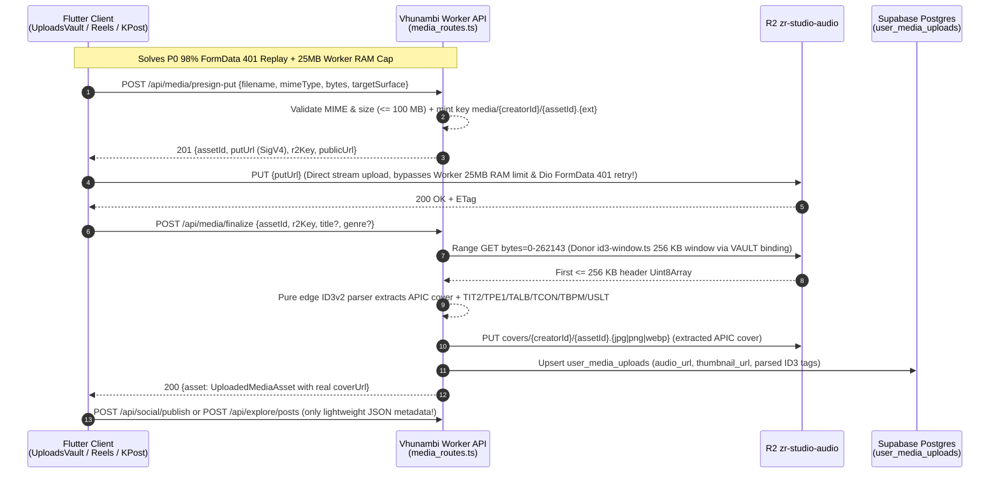
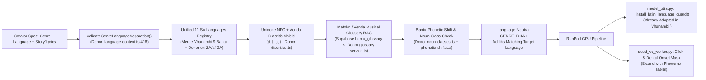
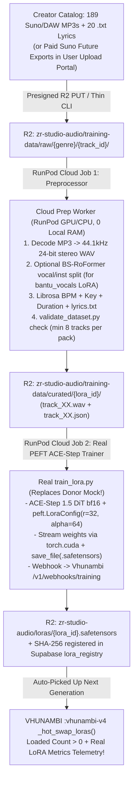

# Cross-Platform Forensic Resonance, Impedance-Mismatch & Integration Audit: Zania Explore v2.5 + Zania Music -> VHUNAMBI Monorepo

**Audit ID:** `AUDIT-CROSS-ZANIA-TO-VHUNAMBI-2026-11`  
**Date:** `2026-11-25`  
**Auditor Role:** Cross-Platform Forensic Systems Auditor & Integration Architect (`/vhunambi-forensic-auditor` + `/vhunambi-memory`)  
**Target Branch / HEAD (VHUNAMBI):** `fix/studio-cockpit-bugs-vh001-vh006` (`ef19708`)  
**Live Deployments Verified:**  
- Cloudflare Worker (`vhunambi-api`): `wrangler.toml` (`4d131620-95fc-443d-bd8b-0c964b72205c` / `zr-studio-audio` R2 + `GenerationSessionDO`)  
- Supabase Postgres (`cbnruevwrqwjnnoscgsz`): `user_media_uploads: 0`, `kinetic_posts: 0`, `published_clips: 9`  
- RunPod Serverless (`e7wt9pgo7djv55` / release v9): `ndugelo/zr-studio-gpu:vhunambi-v4` (`sha256:faa1394a73c8a36071dd42de43443fcee43877ad00012543278bc358ce5d319d`, `ready: 1`, `loras/*.safetensors`: all `10` keys currently `404`)  
**Scope:** Full 6-pillar cross-platform audit across:  
1. **Primary Sovereign Target:** [`c:/Users/Ndugelo/VHUNAMBI/monorepo`](file:///c:/Users/Ndugelo/VHUNAMBI/monorepo) (`apps/vhunambi_client` Flutter/Dart, `apps/vhunambi_api` Cloudflare Workers Hono TS, `supabase/` PostgreSQL, `tools/zr-studio-gpu/` RunPod Python)  
2. **Donor Ecosystem 1:** [`C:/Users/Ndugelo/Zania-Explore-v2.5/Zania-Explore`](file:///C:/Users/Ndugelo/Zania-Explore-v2.5/Zania-Explore) (Next.js / OpenNext Cloudflare Worker, D1 `zania-db`, R2 `zania-storage`)  
3. **Donor Ecosystem 2:** [`C:/Users/Ndugelo/Music/ZANIA MUSIC`](file:///C:/Users/Ndugelo/Music/ZANIA%20MUSIC) (`189` `.mp3`, `48` `.webp`, `44` `.png`, `20` `.txt` lyric files across `13` `READY/` genre folders)  

> [!IMPORTANT]
> **Read-Only Audit Guarantee & Domain Isolation:** Zero source files were modified in either `VHUNAMBI` or `Zania-Explore`. Every React/Next.js/`next/server`/`server-only`/D1/Drizzle/Dexie/Howler donor dependency is flagged explicitly and excluded unless cleanly ported to **Cloudflare Workers Hono TS**, **Supabase Postgres**, **Flutter/Dart**, or **RunPod Python**.

---

## 1. Executive Cross-Platform Topology & Master Integration Matrix

### 1.1 Cross-Platform Ecosystem Topology (ASCII)

```text
+---------------------------------------------------------------------------------------------------+
|                                   DONOR ECOSYSTEMS (READ-ONLY)                                    |
|                                                                                                   |
|  [Local Creator Vault: C:\Users\Ndugelo\Music\ZANIA MUSIC]                                        |
|   - 189 Suno/DAW MP3s across 13 READY/ folders (40/40 sampled carry ID3v2 APIC cover frames)      |
|   - 48 .webp + 44 .png covers + 20 code-switched .txt lyrics (e.g. Afrikaans/English/isiZulu)     |
|                                                                                                   |
|  [Zania-Explore-v2.5 (Next.js/OpenNext + D1 + R2 zania-storage)]                                  |
|   +--> scripts/lib/id3v2-parser.ts (Pure Uint8Array ID3v2 APIC extractor)                         |
|   +--> lib/music/{id3-window, extraction-scheduler, etag, cursor, track-mapper}.ts                |
|   +--> lib/bantu-engine/{core/config (11 SA langs), linguistics/(noun-classes, phonetic-shifts),  |
|   |                      terminology/glossary-service, translation/(router, nllb-adapter),        |
|   |                      music/language-context (validateGenreLanguageSeparation)}                |
|   +--> lib/zr-studio/{training-dataset.ts, r2-presigned.ts} + scripts/validate_dataset.py         |
|   +--> lib/monetization/{payfast-server.ts (AS328501 IPs + Inbound empty-field ITN),               |
|   |                      credit-prices.ts, smart-pack-recommendation.ts, paystack-server.ts,      |
|   |                      earn/rewarded-ad.ts} + lib/auth/sa-id-validator.ts                       |
|   +--> lib/monitoring/runpod-guard.ts + lib/api/{idempotency, rate-limit}.ts + lib/events/        |
|   -!- [REJECTED]: runpod-zr-studio/* mocks (train_lora.py writes MOCK_SAFETENSORS_DATA),          |
|                   hooks/use-zania-audio.ts (Howler.js DOM audio), lib/auth/credits.ts (D1/Drizzle)|
+-------------------------------------------------+-------------------------------------------------+
                                                  |
                         Port Pure TS / Dart / Python / SQL (Zero React/D1 Leak)
                                                  v
+---------------------------------------------------------------------------------------------------+
|                         SOVEREIGN TARGET: VHUNAMBI MONOREPO (c:\Users\Ndugelo\VHUNAMBI\monorepo)  |
|                                                                                                   |
|  1. Flutter Client (apps/vhunambi_client)                                                         |
|     - Uploads/Reels BUG: sovereign_api_client.dart:195 replays finalized FormData -> 98% fail!   |
|     - Kinetic Post BUG: create_kinetic_post_sheet.dart lacks direct R2 audio/image upload flow.   |
|     - Fix -> Direct R2 Presigned PUT + Dart smart-pack-recommendation + /v1/media/presign-put.    |
|                                                                                                   |
|  2. Edge API (apps/vhunambi_api - Hono on Cloudflare Workers + GenerationSessionDO)               |
|     - media_routes.ts: Fix RAM buffer + run id3v2-parser (APIC + TIT2/TPE1/TCON/TBPM/USLT).       |
|     - payment_routes.ts: P0 PAYFAST BUG! Skips empty fields on inbound ITN + lacks AS328501 IPs.  |
|     - explore_routes.ts: Port edge cursor.ts + FNV-1a etag.ts + R2 media proxy hardening.         |
|     - modules/bantu + lyrics: Add en/af + validateGenreLanguageSeparation + SA glossary/phonetics.|
|     - middleware/: Add HTTP Idempotency-Key + DO Rate Limiter + RunPod GQL Balance Guard.         |
|                                                                                                   |
|  3. Cloud Storage & DB (Supabase Postgres cbnruevwrqwjnnoscgsz + R2 zr-studio-audio)              |
|     - New tables/columns: extracted ID3 cover keys, training_datasets, bantu_glossary, idempotency|
|     - Direct ingest pipeline: zania-storage + ZANIA MUSIC -> zr-studio-audio (0 local Docker).    |
|                                                                                                   |
|  4. GPU Audio Engine (tools/zr-studio-gpu :vhunambi-v4 on RunPod L40S 48GB)                       |
|     - KEEP Vhunambi Inference/Cloning/Mastering (strictly superior to Zania).                     |
|     - BUILD Cloud LoRA Factory: RunPod Dataset Prepper + Real PEFT ACE-Step Trainer -> R2 loras/  |
|       -> _hot_swap_loras (model_utils.py:536) activates all 10 regional African .safetensors.     |
+---------------------------------------------------------------------------------------------------+
```

### 1.2 Master Cross-Platform Integration Matrix

| Pillar | Donor Subsystem (`Zania-Explore` / `ZANIA MUSIC`) | Vhunambi Target Surface | Verdict | Priority | Target Phase |
| :--- | :--- | :--- | :--- | :--- | :--- |
| **P1** | `scripts/lib/id3v2-parser.ts`, `lib/music/{id3-window,extraction-scheduler,etag,cursor}.ts`, `r2-presigned.ts` | `media_routes.ts`, `explore_routes.ts`, `sovereign_api_client.dart`, `create_kinetic_post_sheet.dart`, `kinetic_reel_publish_view.dart` | **PORT + ADAPT** | **P0** | Phase 84 |
| **P1** | `C:\Users\Ndugelo\Music\ZANIA MUSIC` (`189` MP3s) & `wrangler.jsonc` `zania-storage` | `zr-studio-audio` R2 + `user_media_uploads` + `explore_tracks` | **BULK INGEST** | **P1** | Phase 84 |
| **P2** | `lib/bantu-engine/{core/config,music/language-context,linguistics/*,terminology/*,translation/*}`, `lib/utils/diacritics.ts` | `modules/bantu/language_context.ts`, `modules/lyrics/{system_prompts,story_transform,llm_handler}.ts`, `seed_vc_worker.py` | **PORT + MERGE** | **P1** | Phase 86 |
| **P3** | `lib/zr-studio/training-dataset.ts`, `scripts/validate_dataset.py`, `runpod-zr-studio/training/config/*.yaml` | New `tools/zr-studio-training/` (Cloud Prep + Real PEFT Trainer) -> `zr-studio-audio/loras/*.safetensors` -> `model_utils.py:536` | **PORT SCHEMA + REPLACE MOCK** | **P0** | Phase 85 |
| **P4** | `lib/monetization/payfast-server.ts` (AS328501 IPs + inbound empty-field ITN), `credit-prices.ts`, `smart-pack-recommendation.ts`, `sa-id-validator.ts`, `earn/rewarded-ad.ts`, `paystack-server.ts` | `routes/payment_routes.ts`, `routes/wallet_routes.ts`, `routes/social_routes.ts`, `supabase/migrations/`, Flutter wallet/pack sheets | **CRITICAL FIX (P0) + PORT** | **P0** | Phase 86 / 87 |
| **P4** | `lib/auth/webauthn-service.ts` (`@simplewebauthn/server`) | Mobile-first Flutter client (`vhunambi_client`) | **DEFER** | **P3** | Future |
| **P5** | `lib/monitoring/runpod-guard.ts`, `lib/api/{idempotency,rate-limit}.ts`, `lib/events/{emit,ip-hash}.ts`, `zr-studio-viability.ts` | `modules/synthesis/runpod_adapter.ts`, `worker.ts`, `GenerationSessionDO`, `generation_routes.ts` | **PORT TO EDGE DO/KV** | **P1** | Phase 86 / 87 |
| **P6** | `runpod-zr-studio/{handler,model_utils,retake_manager,training/train_lora}.py`, `hooks/use-zania-audio.ts`, `lib/auth/credits.ts` | `tools/zr-studio-gpu/*`, `core/audio/*`, `vhunambi_db.ts` | **REJECT** | — | Never |

---

## 2. Pillar 1 — Music Ingestion, Embedded ID3v2 Extraction & Creator Distribution Flywheel

### 2.1 End-to-End Direct-to-R2 + ID3v2 Extraction & Publish Flow (Mermaid)



### 2.2 Dual-Repo Schema, Wire & Runtime Diff

| Capability | Donor Citation (`Zania-Explore`) | Vhunambi Target Citation (`VHUNAMBI`) | Impedance Mismatch & Required Porting Action |
| :--- | :--- | :--- | :--- |
| **Pure Edge ID3v2 `APIC` Extractor** | [`id3v2-parser.ts#L170`](file:///C:/Users/Ndugelo/Zania-Explore-v2.5/Zania-Explore/scripts/lib/id3v2-parser.ts#L170) (`extractApicFrame`), [`id3-window.ts#L1-L84`](file:///C:/Users/Ndugelo/Zania-Explore-v2.5/Zania-Explore/lib/music/id3-window.ts#L1-L84) (`262144` byte Range window) | [`media_routes.ts#L43-L164`](file:///c:/Users/Ndugelo/VHUNAMBI/monorepo/apps/vhunambi_api/src/routes/media_routes.ts#L43-L164) (`thumbnailUrl = null` at L56) | **100% Edge-Compatible Pure `Uint8Array`.** Extend `id3v2-parser.ts` to decode `TIT2`, `TPE1`, `TALB`, `TCON`, `TBPM`, `USLT` frames (ID3v2.3/v2.4 synchsafe & UTF-16LE/BE/UTF-8) and invoke during `POST /api/media/finalize` on `audio/*` uploads via R2 `range: { offset: 0, length: 262144 }`. |
| **Node Script ID3 & D1 Cover Mapper** | [`extract-cover-art.ts#L1-L306`](file:///C:/Users/Ndugelo/Zania-Explore-v2.5/Zania-Explore/scripts/extract-cover-art.ts#L1-L306), [`cover-art.ts#L1-L82`](file:///C:/Users/Ndugelo/Zania-Explore-v2.5/Zania-Explore/lib/music/cover-art.ts#L1-L82), [`metadata-extractor.ts#L11-L100`](file:///C:/Users/Ndugelo/Zania-Explore-v2.5/Zania-Explore/scripts/upload-zania-music/metadata-extractor.ts#L11-L100) | [`r2_storage.ts#L1-L180`](file:///c:/Users/Ndugelo/VHUNAMBI/monorepo/apps/vhunambi_api/src/modules/synthesis/r2_storage.ts#L1-L180) | **Blocked Raw:** `cover-art.ts` uses D1 Drizzle; `extract-cover-art.ts` uses Node `fs`/`crypto`; `metadata-extractor.ts` imports `music-metadata`. Port ONLY `id3v2-parser.ts` + pure fallback title/genre heuristics to edge TS. Keep `metadata-extractor.ts` strictly in local/CI bulk ingest CLI for `ZANIA MUSIC`. |
| **Concurrency-Capped Extraction Mutex** | [`extraction-scheduler.ts#L19-L60`](file:///C:/Users/Ndugelo/Zania-Explore-v2.5/Zania-Explore/lib/music/extraction-scheduler.ts#L19-L60) (`MAX_CONCURRENT = 3`) | None in [`vhunambi_track_artwork.dart#L17-L100`](file:///c:/Users/Ndugelo/VHUNAMBI/monorepo/apps/vhunambi_client/lib/core/widgets/vhunambi_track_artwork.dart#L17-L100) | Useful in Vhunambi **server-side backfill worker** or Flutter vault batch cover-backfill queue so mounting 20+ cards never floods R2 `/r2/:key` with concurrent range pulls alongside live `just_audio` streaming. |
| **Keyset Pagination & Edge ETag** | [`cursor.ts#L20-L76`](file:///C:/Users/Ndugelo/Zania-Explore-v2.5/Zania-Explore/lib/music/cursor.ts#L20-L76), [`etag.ts#L1-L28`](file:///C:/Users/Ndugelo/Zania-Explore-v2.5/Zania-Explore/lib/music/etag.ts#L1-L28) | [`explore_routes.ts#L1-L260`](file:///c:/Users/Ndugelo/VHUNAMBI/monorepo/apps/vhunambi_api/src/routes/explore_routes.ts#L1-L260), [`track-mapper.ts#L55-L100`](file:///C:/Users/Ndugelo/Zania-Explore-v2.5/Zania-Explore/lib/music/track-mapper.ts#L55-L100) | Both `cursor.ts` (Web `TextEncoder`/`btoa`) and `etag.ts` (pure 32-bit FNV-1a) are **100% Node-free & Cloudflare Worker-safe**. Wire into `GET /api/explore/tracks` + `If-None-Match` 304 support to cut mobile bandwidth as Zania Music scales the feed past 200+ tracks. |
| **P0 `98%` Reels/Video Upload Failure** | [`r2-presigned.ts#L77-L100`](file:///C:/Users/Ndugelo/Zania-Explore-v2.5/Zania-Explore/lib/zr-studio/r2-presigned.ts#L77-L100) (`aws4fetch` SigV4 PUT + 50m cache) | [`sovereign_api_client.dart#L195-L206`](file:///c:/Users/Ndugelo/VHUNAMBI/monorepo/apps/vhunambi_client/lib/core/network/sovereign_api_client.dart#L195-L206), [`media_upload_queue_provider.dart#L178`](file:///c:/Users/Ndugelo/VHUNAMBI/monorepo/apps/vhunambi_client/lib/features/media/presentation/providers/media_upload_queue_provider.dart#L178), [`kinetic_reel_publish_view.dart#L1-L655`](file:///c:/Users/Ndugelo/VHUNAMBI/monorepo/apps/vhunambi_client/lib/features/content_studio/presentation/views/kinetic_reel_publish_view.dart#L1-L655) | **Dual Root Cause Proven:** (1) On `401`, `sovereign_api_client.dart:195-206` calls `client.fetch<dynamic>(opts)` directly on a consumed single-use `FormData` stream (`onSendProgress` hits `0.98` clamp at `media_upload_queue_provider.dart:178`, auth expires or retries, and Dio crashes on finalized stream); (2) Large multipart video bodies buffer via `arrayBuffer()` inside Worker V8 RAM (`media_routes.ts` / `social_routes.ts#L145-L220`). **Fix:** Port `r2-presigned.ts` `aws4fetch` PUT flow to `media_routes.ts` (`/presign-put` + `/finalize`) + refresh token pre-flight before `PUT` in Dart. |
| **Kinetic Post Real Media Upload** | — (Zania has no Kinetic Post equivalent) | [`create_kinetic_post_sheet.dart#L1-L1393`](file:///c:/Users/Ndugelo/VHUNAMBI/monorepo/apps/vhunambi_client/lib/features/explore/presentation/widgets/create_kinetic_post_sheet.dart#L1-L1393), [`kinetic_post_composer_bar.dart#L1-L112`](file:///c:/Users/Ndugelo/VHUNAMBI/monorepo/apps/vhunambi_client/lib/features/explore/presentation/widgets/kinetic_post_composer_bar.dart#L1-L112) | Wire `uploads_vault_view.dart` / `vhunambi_media_upload_service.dart` + `/api/media/presign-put` + `/api/media/finalize` directly into `create_kinetic_post_sheet.dart` so creator posts carry real uploaded audio snippets, extracted `APIC` covers, and attached photos/videos. |

### 2.3 Zania Storage & Local `ZANIA MUSIC` Zero-Duplication Ingestion Strategy
1. **Verified Local Catalog Inventory (`C:\Users\Ndugelo\Music\ZANIA MUSIC`):**
   - `189` `.mp3` files (`40/40` sampled carry embedded ID3v2 `APIC` artwork in their first `256 KB`), `48` `.webp`, `44` `.png`, `20` `.txt` lyric sheets across `13` `READY/` folders (`Afro`, `Celestial`, `Epic orchestration`, `Extras`, `house`, `Instrumental`, `Jazz`, `Phonk`, `Pop`, `Rap`, `Rock`, `Trap`, `Wave`).
   - Sample verified at [`C:/Users/Ndugelo/Music/ZANIA MUSIC/READY/Afro/Amapiano/Afriyano/geeste woon/lyrics.txt`](file:///C:/Users/Ndugelo/Music/ZANIA%20MUSIC/READY/Afro/Amapiano/Afriyano/geeste%20woon/lyrics.txt): multi-lingual Afrikaans + English + isiZulu Amapiano lyrics paired with sibling `cover.webp` and `.mp3` inside the same leaf directory!
2. **Existing Cloud Bucket (`zania-storage`):** Declared in Donor [`wrangler.jsonc`](file:///C:/Users/Ndugelo/Zania-Explore-v2.5/Zania-Explore/wrangler.jsonc).
3. **Sovereign Non-Duplicating Ingestion:**
   - Do **NOT** copy `zania-storage` objects byte-for-byte into `zr-studio-audio` if `vhunambi-api` can mount an optional read-only `ZANIA_STORAGE` `[[r2_buckets]]` binding in [`wrangler.toml`](file:///c:/Users/Ndugelo/VHUNAMBI/monorepo/apps/vhunambi_api/wrangler.toml#L15-L18) (serving under `/r2/zania/*`), **OR** run a one-shot Cloudflare R2-to-R2 server-side copy / local manifest uploader keyed by SHA-256 (`content_sha256` unique index) so duplicate Suno/DAW tracks never create duplicate objects.
   - Map all ingested tracks under tenant `creator_id` (e.g., creator owner account) with `source_origin = 'creator_upload_zania'`, preserving ID3 `TIT2`, `TPE1`, derived folder genre (`Afro/Amapiano -> Amapiano`), extracted `APIC` / sibling `cover.webp` artwork URL, and sibling `.txt` lyrics in `explore_tracks` + `user_media_uploads`.

---

## 3. Pillar 2 — Bantu Linguistic Engine, Genre≠Language Separation & Phonetic Conditioning

### 3.1 Cultural Sovereignty & Translation Pipeline Architecture (Mermaid)



### 3.2 Line-Verified Parity vs. Missing Donor Capabilities

| Component | Already in Vhunambi? | Donor Citation | Vhunambi Citation | Forensic Finding & Porting Contract |
| :--- | :---: | :--- | :--- | :--- |
| **9 Official Bantu Language Contexts** | **YES (Adopted)** | [`music/language-context.ts#L1-L360`](file:///C:/Users/Ndugelo/Zania-Explore-v2.5/Zania-Explore/lib/bantu-engine/music/language-context.ts#L1-L360) | [`modules/bantu/language_context.ts#L17-L90`](file:///c:/Users/Ndugelo/VHUNAMBI/monorepo/apps/vhunambi_api/src/modules/bantu/language_context.ts#L17-L90) | Vhunambi covers `ve, zu, xh, nso, st, tn, ss, nr, ts` with idioms & ad-libs. |
| **11-Language Completeness (`en-ZA`, `af-ZA` Bug!)** | **PARTIAL (BUG!)** | [`bantu-engine/core/config.ts#L13-L67`](file:///C:/Users/Ndugelo/Zania-Explore-v2.5/Zania-Explore/lib/bantu-engine/core/config.ts#L13-L67) | [`modules/bantu/language_context.ts#L92-L100`](file:///c:/Users/Ndugelo/VHUNAMBI/monorepo/apps/vhunambi_api/src/modules/bantu/language_context.ts#L92-L100), [`llm_handler.ts#L330`](file:///c:/Users/Ndugelo/VHUNAMBI/monorepo/apps/vhunambi_api/src/modules/lyrics/llm_handler.ts#L330) | **Verified Bug:** Vhunambi's `MUSIC_LANGUAGES` omits English (`en`) & Afrikaans (`af`). When `studio_form_state.dart:250` defaults to `language = 'English'` or a user writes Afrikaans (like `geeste woon/lyrics.txt`!), `getLanguageContext(language)` fails to match and falls through! Add `en` (`en-ZA`) & `af` (`af-ZA`) matching Donor `SUPPORTED_LOCALES` + `NLLB_CODES`. |
| **Genre≠Language Separation Validator + Prompt Leak Fix** | **PARTIAL (LEAK!)** | [`music/language-context.ts#L362-L445`](file:///C:/Users/Ndugelo/Zania-Explore-v2.5/Zania-Explore/lib/bantu-engine/music/language-context.ts#L362-L445), [`LANGUAGE-SEPARATION-FIX.md#L1-L100`](file:///C:/Users/Ndugelo/Zania-Explore-v2.5/Zania-Explore/docs/ZR-Studio/LANGUAGE-SEPARATION-FIX.md#L1-L100) | [`story_transform.ts#L9-L100`](file:///c:/Users/Ndugelo/VHUNAMBI/monorepo/apps/vhunambi_api/src/modules/lyrics/story_transform.ts#L9-L100), [`system_prompts.ts#L25-L31`](file:///c:/Users/Ndugelo/VHUNAMBI/monorepo/apps/vhunambi_api/src/modules/lyrics/system_prompts.ts#L25-L31) | **Cultural Leak Confirmed:** `story_transform.ts` is clean, BUT `system_prompts.ts:25` hardcodes Zulu ad-libs `("Yebo!", "Shisa!", "Eish!", "Aa!")` directly inside the `amapiano` genre prompt regardless of user language, and `maskandi` at L31 injects `Izibongo`! Port Donor `validateLanguageNeutrality()` & `validateGenreLanguageSeparation()` into Vhunambi's test suite + inject ad-libs dynamically from `getLanguageContext(language).adLibs`. |
| **Latin Phoneme Guard (anti-Mandarin drift)** | **YES (Adopted)** | [`ZR-STUDIO-INTEGRATION-UPDATE.md`](file:///C:/Users/Ndugelo/Zania-Explore-v2.5/Zania-Explore/docs/legendary-langauge-system/ZR-STUDIO-INTEGRATION-UPDATE.md) | [`tools/zr-studio-gpu/model_utils.py#L299-L320`](file:///c:/Users/Ndugelo/VHUNAMBI/monorepo/tools/zr-studio-gpu/model_utils.py#L299-L320) | Already live in Vhunambi `:vhunambi-v4` (`_install_latin_language_guard()`). Keep as-is. |
| **Proto-Bantu 18 Noun Classes & Cognate Shifts** | **NO (Gap)** | [`noun-classes.ts#L1-L156`](file:///C:/Users/Ndugelo/Zania-Explore-v2.5/Zania-Explore/lib/bantu-engine/linguistics/noun-classes.ts#L1-L156), [`phonetic-shifts.ts#L22-L80`](file:///C:/Users/Ndugelo/Zania-Explore-v2.5/Zania-Explore/lib/bantu-engine/linguistics/phonetic-shifts.ts#L22-L80) | Absent from `apps/vhunambi_api/src/modules/bantu/` | Pure TypeScript, zero Node/D1 imports (except type imports!). Port directly into `modules/bantu/` to power grammatical concord verification and phonetic rhyme/cognate suggestions in Lyrics Cockpit. |
| **Tshivenda Phonology + Unicode NFC Diacritics** | **NO (Gap)** | [`tshivenda/phonology.ts#L1-L180`](file:///C:/Users/Ndugelo/Zania-Explore-v2.5/Zania-Explore/lib/languages/tshivenda/phonology.ts#L1-L180), [`diacritics.ts#L1-L139`](file:///C:/Users/Ndugelo/Zania-Explore-v2.5/Zania-Explore/lib/utils/diacritics.ts#L1-L139) | [`seed_vc_worker.py#L12-L15,L79-L100`](file:///c:/Users/Ndugelo/VHUNAMBI/monorepo/tools/zr-studio-gpu/seed_vc_worker.py#L79-L100) (`is_onset_spike = > 0.14` heuristic only) | Port `diacritics.ts` into `modules/bantu/` (guaranteeing `ḓ ḽ ṋ ṱ` survive tokenization without ASCII folding) and feed Tshivenda dental/velar + Nguni click onset maps into `seed_vc_worker.py` transient weighting. |
| **Workers AI + NLLB-200 + Mafoko Glossary Translation** | **NO (Gap)** | [`router.ts#L1-L123`](file:///C:/Users/Ndugelo/Zania-Explore-v2.5/Zania-Explore/lib/bantu-engine/translation/router.ts#L1-L123), [`nllb-adapter.ts#L1-L79`](file:///C:/Users/Ndugelo/Zania-Explore-v2.5/Zania-Explore/lib/bantu-engine/translation/nllb-adapter.ts#L1-L79), [`glossary-service.ts#L1-L80`](file:///C:/Users/Ndugelo/Zania-Explore-v2.5/Zania-Explore/lib/bantu-engine/terminology/glossary-service.ts#L1-L80) | Absent from [`lyrics_routes.ts`](file:///c:/Users/Ndugelo/VHUNAMBI/monorepo/apps/vhunambi_api/src/routes/lyrics_routes.ts) | Replace `getD1()` / Drizzle in `glossary-service.ts` with Supabase `bantu_glossary` table queries and add `AI` binding (`workers-ai-adapter.ts`) or HF NLLB fallback in `lyrics_routes.ts` for authentic multi-language lyric translation. |

---

## 4. Pillar 3 — Cloud-Only Zero-Local-RAM LoRA Training Pipeline (`ZANIA MUSIC` -> RunPod -> R2 -> `:vhunambi-v4`)

### 4.1 Verified Hardware Constraint & Live Pipeline Reality
- **Laptop Hardware Boundary:** `8 GB RAM / 1 TB HDD / Intel Iris Xe / Core i5 11th Gen` — running local Docker Desktop, CUDA training, or heavy FFmpeg stem separation locally freezes/crashes the workstation. Every heavy compute step **must** execute in **Cloudflare Workers + RunPod Serverless / Pods**.
- **Vhunambi Inference Reality (`:vhunambi-v4`):**
  - [`studio_routes.ts#L16-L26`](file:///c:/Users/Ndugelo/VHUNAMBI/monorepo/apps/vhunambi_api/src/routes/studio_routes.ts#L16-L26) serves all `10` canonical packs from [`lora_catalog.ts#L19-L159`](file:///c:/Users/Ndugelo/VHUNAMBI/monorepo/apps/vhunambi_api/src/modules/synthesis/lora_catalog.ts#L19-L159) and passes them via [`runpod_adapter.ts#L171,L242-L243`](file:///c:/Users/Ndugelo/VHUNAMBI/monorepo/apps/vhunambi_api/src/modules/synthesis/runpod_adapter.ts#L171) into GPU `handler.py`.
  - On the GPU worker, [`model_utils.py#L536-L598`](file:///c:/Users/Ndugelo/VHUNAMBI/monorepo/tools/zr-studio-gpu/model_utils.py#L536-L598) (`_hot_swap_loras`) + [`verify_safetensors_artifact`](file:///c:/Users/Ndugelo/VHUNAMBI/monorepo/tools/zr-studio-gpu/model_utils.py#L139-L150) honestly downloads from `zr-studio-audio/loras/<lora_id>.safetensors`, computes SHA-256, and logs `"loaded_count": 0` today solely because those 10 R2 objects are `404`.
- **Zania Donor Training Reality (Mock Exposed!):**
  - Donor [`training-dataset.ts#L22-L100`](file:///C:/Users/Ndugelo/Zania-Explore-v2.5/Zania-Explore/lib/zr-studio/training-dataset.ts#L22-L100), [`scripts/validate_dataset.py#L1-L100`](file:///C:/Users/Ndugelo/Zania-Explore-v2.5/Zania-Explore/scripts/validate_dataset.py#L1-L100), and YAML configs ([`amapiano.yaml`](file:///C:/Users/Ndugelo/Zania-Explore-v2.5/Zania-Explore/runpod-zr-studio/training/config/amapiano.yaml), [`bantu-vocals.yaml`](file:///C:/Users/Ndugelo/Zania-Explore-v2.5/Zania-Explore/runpod-zr-studio/training/config/bantu-vocals.yaml)) define an immediately reusable dataset + hyperparameter contract (`lora_rank: 32`, `lora_alpha: 64`).
  - **CRITICAL WARNING (`Law 1`):** Donor [`train_lora.py#L201-L218`](file:///C:/Users/Ndugelo/Zania-Explore-v2.5/Zania-Explore/runpod-zr-studio/training/train_lora.py#L201-L218) is a **mock script** (`f.write(b"MOCK_SAFETENSORS_DATA")`) targeting legacy URL `https://zania-explore.vercel.app/api/zr-studio/webhooks/training`. It **must NOT** be copied blindly.

### 4.2 Cloud-Only Training & Auto-Activation Pipeline (Mermaid)



### 4.3 Genre Alignment Mapping: `ZANIA MUSIC` -> `AFRICAN_LORA_PACKS` (`lora_catalog.ts`)

| Vhunambi `lora_catalog.ts` Pack (`r2Key`) | `ZANIA MUSIC` Source Folder Readiness (`189` MP3s) | Donor YAML Reference | Readiness / Action Required |
| :--- | :--- | :--- | :--- |
| `loras/amapiano_logdrum_v1.safetensors` & `amapiano_private_school_v1.safetensors` | `READY/Afro/` (`52` tracks including `Amapiano/Afriyano/*`) | [`amapiano.yaml`](file:///C:/Users/Ndugelo/Zania-Explore-v2.5/Zania-Explore/runpod-zr-studio/training/config/amapiano.yaml) (`r=32, alpha=64, 12 epochs`) | **Ready (>= 8 tracks)** after separating Amapiano vs Afrobeats subsets into `training-data/curated/` via cloud WAV prep. |
| `loras/afrobeats_lagos_v1.safetensors` | `READY/Afro/Afro beats/` (`Pop afro`, `Magic Lamp`, `Venda afro` etc.) | Reuse `amapiano.yaml` base (`lr=1e-4`) | **Ready (>= 8 tracks)** via existing `ZANIA MUSIC` `Afro beats/` catalog. |
| `loras/bantu_vocals` *(new 11th pack!)* / `venda_malende_v1.safetensors` | `Venda afro/` (`Mufunwa`, `Mulalo Wanga`, `Muthu wanga`, `Ṅwala Makoleni`) + `geeste woon/lyrics.txt` | [`bantu-vocals.yaml`](file:///C:/Users/Ndugelo/Zania-Explore-v2.5/Zania-Explore/runpod-zr-studio/training/config/bantu-vocals.yaml) (`epochs=20, lr=5e-5, bs=1`) | **Extract Venda Vocal Stems** via Phase 82 `bs_roformer` in Cloud Prepper + expand with new Suno Venda/Bantu renders to hit `>= 8` tracks (`validate_dataset.py:49`). |
| `loras/sgija_bacardi_v1.safetensors`, `gqom_durban_v1.safetensors`, `maskandi_picking_v1.safetensors`, `kwaito_township_v1.safetensors`, `afro_gospel_choir_v1.safetensors` | `house` (`20`), `Pop` (`35`), `Rock` (`23`), `Phonk` (`5`), `Trap` (`4`), `Rap` (`1`) — **missing pure Gqom/Maskandi/Kwaito/Gospel folders** | [`gqom.yaml`](file:///C:/Users/Ndugelo/Zania-Explore-v2.5/Zania-Explore/runpod-zr-studio/training/config/gqom.yaml), [`maskandi.yaml`](file:///C:/Users/Ndugelo/Zania-Explore-v2.5/Zania-Explore/runpod-zr-studio/training/config/maskandi.yaml) | **Suno Creator Flywheel Target:** Generate `8–15` clean tracks per missing genre (Gqom, Maskandi, Kwaito, Gospel, Sgija) or ingest tagged community creator uploads in Portal until `count >= 8` -> auto-queue cloud training! |

---

## 5. Pillar 4 — Fintech, Monetization Hygiene, Rewarded Ads & SA KYC

### 5.1 P0 PayFast Production Vulnerability Exposed by Cross-Repo Diff

Comparing [`Zania-Explore/lib/monetization/payfast-server.ts#L38-L165`](file:///C:/Users/Ndugelo/Zania-Explore-v2.5/Zania-Explore/lib/monetization/payfast-server.ts#L38-L165) against [`VHUNAMBI/apps/vhunambi_api/src/routes/payment_routes.ts#L60-L93,L182-L217`](file:///c:/Users/Ndugelo/VHUNAMBI/monorepo/apps/vhunambi_api/src/routes/payment_routes.ts#L60-L93) reveals **two critical P0 PayFast defects** currently live in Vhunambi:

1. **Inbound ITN Signature Rejects Valid Live Payments (`payment_routes.ts:67-68,204`):**
   - Donor [`payfast-server.ts#L88-L132`](file:///C:/Users/Ndugelo/Zania-Explore-v2.5/Zania-Explore/lib/monetization/payfast-server.ts#L88-L132) documents the `v15.11` live PayFast outage: PayFast's outbound form omits empty fields, **but PayFast's inbound ITN POST includes empty fields (`m_payment_id=`, `name_first=`, `custom_str3=&`) in the MD5 signature string**.
   - Vhunambi's `verifyPayFastSignatureConstantTime` ([`payment_routes.ts#L78-L93`](file:///c:/Users/Ndugelo/VHUNAMBI/monorepo/apps/vhunambi_api/src/routes/payment_routes.ts#L78-L93)) delegates to the **same** `computePayFastSignature` helper ([`payment_routes.ts#L60-L76`](file:///c:/Users/Ndugelo/VHUNAMBI/monorepo/apps/vhunambi_api/src/routes/payment_routes.ts#L60-L76)) whose L67 (`if (rawVal !== undefined && rawVal !== null && String(rawVal).trim() !== '')`) **skips empty values**! Result: real PayFast ITNs with any empty parameter will fail with `400 INVALID_PAYFAST_SIGNATURE` and fail to credit the user's wallet.
2. **Missing PayFast Source IP Range Verification (`AS328501`):**
   - Donor [`payfast-server.ts#L38-L61,L159-L165`](file:///C:/Users/Ndugelo/Zania-Explore-v2.5/Zania-Explore/lib/monetization/payfast-server.ts#L38-L61) enforces both legacy PayFast CIDR blocks (`197.97.145.144/28`, `41.74.179.192/27`) and PayFast's 2026 AS328501 netblocks (`102.64.113.0/24`, `102.216.36.0/24`, `102.216.37.0/24`).
   - Vhunambi [`payment_routes.ts#L182-L217`](file:///c:/Users/Ndugelo/VHUNAMBI/monorepo/apps/vhunambi_api/src/routes/payment_routes.ts#L182-L217) performs **zero** `CF-Connecting-IP` allowlist check on `/api/payments/payfast/itn`.

### 5.2 Remaining Pillar 4 Porting Matrix

| Donor Asset | Citation (`Zania-Explore`) | Vhunambi Counterpart | Porting Verdict & Notes |
| :--- | :--- | :--- | :--- |
| **Canonical Spend Price Registry** | [`credit-prices.ts#L45-L90`](file:///C:/Users/Ndugelo/Zania-Explore-v2.5/Zania-Explore/lib/monetization/credit-prices.ts#L45-L90) | Scattered constants across `generation_routes.ts`, `wallet_routes.ts`, client sheets | **PORT:** Create `apps/vhunambi_api/src/modules/monetization/spend_prices.ts` + expose via `GET /api/payments/payfast/packs` / `/api/wallet/rates` so Flutter, Worker API, and tests never drift. |
| **Pure Smart Pack Recommender** | [`smart-pack-recommendation.ts#L42-L67`](file:///C:/Users/Ndugelo/Zania-Explore-v2.5/Zania-Explore/lib/monetization/smart-pack-recommendation.ts#L42-L67) | None (Vhunambi shows flat packs `SOVEREIGN_COIN_PACKS` at [`payment_routes.ts#L29-L48`](file:///c:/Users/Ndugelo/VHUNAMBI/monorepo/apps/vhunambi_api/src/routes/payment_routes.ts#L29-L48)) | **PORT 1:1:** Zero React/D1 deps. Implement `recommendPack(deficit, vertical)` in both TS (`payment_routes.ts`) and Dart for deficit prompts. |
| **SA ID 13-Digit Luhn & DOB/Citizen Validator** | [`sa-id-validator.ts#L14-L100`](file:///C:/Users/Ndugelo/Zania-Explore-v2.5/Zania-Explore/lib/auth/sa-id-validator.ts#L14-L100) | [`wallet_routes.ts#L89-L103`](file:///c:/Users/Ndugelo/VHUNAMBI/monorepo/apps/vhunambi_api/src/routes/wallet_routes.ts#L89-L103), [`social_routes.ts#L646-L735`](file:///c:/Users/Ndugelo/VHUNAMBI/monorepo/apps/vhunambi_api/src/routes/social_routes.ts#L646-L735), [`bank_accounts`](file:///c:/Users/Ndugelo/VHUNAMBI/monorepo/supabase/migrations/20261110000001_phase62_hybrid_cloud_schema.sql#L94-L106) | **PORT:** Pure TS Luhn + DOB + SA citizen check. Attach optional KYC verification (`POST /api/wallet/kyc/verify-sa-id`) before unlocking instant `capitec_pay` / `ozow` / `payfast` creator cashouts >= R50. |
| **Paystack Rail & Rewarded Ad / Streak Earn** | [`paystack-server.ts#L1-L75`](file:///C:/Users/Ndugelo/Zania-Explore-v2.5/Zania-Explore/lib/monetization/paystack-server.ts#L1-L75), [`rewarded-ad.ts#L1-L140`](file:///C:/Users/Ndugelo/Zania-Explore-v2.5/Zania-Explore/lib/monetization/earn/rewarded-ad.ts#L1-L140) | `payment_routes.ts` (PayFast only) | **ADAPT:** Port Paystack HMAC-SHA512 webhook verification (`crypto.subtle` WebCrypto) alongside PayFast for card/Nigeria/Ghana creator support, and store rewarded-ad / streak caps in Supabase `wallet_ledger` instead of D1. |
| **WebAuthn Passkeys (`@simplewebauthn/server`)** | [`webauthn-service.ts#L1-L100`](file:///C:/Users/Ndugelo/Zania-Explore-v2.5/Zania-Explore/lib/auth/webauthn-service.ts#L1-L100) | Flutter Android/iOS biometric/JWT (`vhunambi_client`) | **DEFER:** Browser Origin + `getD1()` dependency; incompatible with Android native APK flow without Flutter Passkeys + `rpID` assetlinks setup. |

---

## 6. Pillar 5 — Edge Operational Resilience, RunPod Guards & Viability Telemetry

| Guard / Telemetry Subsystem | Donor Implementation & Line Proof | Vhunambi Current State & Line Proof | Edge Porting Blueprint (Cloudflare Worker + DO) |
| :--- | :--- | :--- | :--- |
| **Pre-Dispatch RunPod Balance Guard** | [`runpod-guard.ts#L27-L67`](file:///C:/Users/Ndugelo/Zania-Explore-v2.5/Zania-Explore/lib/monitoring/runpod-guard.ts#L27-L67): GraphQL `clientBalance` query, `$2` critical / `$5` warning, 5s timeout | [`runpod_adapter.ts#L56-L136,L182-L189`](file:///c:/Users/Ndugelo/VHUNAMBI/monorepo/apps/vhunambi_api/src/modules/synthesis/runpod_adapter.ts#L56-L136): checks `/v2/{id}/health` only; **never checks account balance** | Port pure `fetch('https://api.runpod.io/graphql')` into `runpod_adapter.ts` with 60s isolate cache + DO alert: warn admins at `< $5`, fast-fallback to `simulateSynthesisPipeline()` or graceful `402/503` instead of stranding jobs at `< $1.00`. |
| **HTTP `Idempotency-Key` Middleware** | [`idempotency.ts#L1-L85`](file:///C:/Users/Ndugelo/Zania-Explore-v2.5/Zania-Explore/lib/api/idempotency.ts#L1-L85): Request-level idempotency store | `sync_mutation_log` has SQLite `idempotency_key`, **zero HTTP `Idempotency-Key` middleware** on `POST /v1/generations`, `POST /api/payments/payfast/checkout`, or `POST /api/wallet/payout` | Build Hono middleware backed by `GenerationSessionDO` SQLite storage (already configured in [`wrangler.toml#L23-L30`](file:///c:/Users/Ndugelo/VHUNAMBI/monorepo/apps/vhunambi_api/wrangler.toml#L23-L30)!) with 24h TTL to stop duplicate GPU spend on flaky mobile retries. |
| **DO-Backed Rate Limiting (Replacing Per-Isolate Map)** | [`rate-limit.ts#L13-L80`](file:///C:/Users/Ndugelo/Zania-Explore-v2.5/Zania-Explore/lib/api/rate-limit.ts#L13-L80): Uses `NextResponse` + single-isolate `Map` | Zero rate limiter on `generation_routes.ts` / `lyrics_routes.ts` / `media_routes.ts` | **Do NOT use Donor's `Map`** globally (fails across Worker isolates) or `NextResponse`. Keep Zania's `429` + `Retry-After` + `X-RateLimit-*` wire headers backed by a lightweight `RateLimiterDO` or `GenerationSessionDO` RPC. |
| **Privacy-Safe Edge Event Bus & IP Hashing** | [`ip-hash.ts#L11-L18`](file:///C:/Users/Ndugelo/Zania-Explore-v2.5/Zania-Explore/lib/events/ip-hash.ts#L11-L18) (`crypto.subtle` SHA-256), [`emit.ts#L54-L100`](file:///C:/Users/Ndugelo/Zania-Explore-v2.5/Zania-Explore/lib/events/emit.ts#L54-L100) (`next/headers` `cookies()` + D1/Queue) | Ad-hoc logs in Worker | **Port `ip-hash.ts` 1:1** (`globalThis.crypto.subtle`). Replace `cookies()` / `getD1()` in `emit.ts` with Hono headers + Supabase `platform_events` async `ctx.waitUntil()` batch writer. |
| **Commercial Viability & Unit Economics Generator** | [`zr-studio-viability.ts#L25-L89`](file:///C:/Users/Ndugelo/Zania-Explore-v2.5/Zania-Explore/lib/reporting-engine/generators/zr-studio-viability.ts#L25-L89) (analyzes segments, genre demand, MMV revenue from D1) | No admin commercial viability aggregator in `vhunambi_api` | Port data-aggregation interfaces from `D1` SQL queries to Supabase views over `generation_jobs`, `wallet_ledger`, and `explore_tracks`. |

---

## 7. Pillar 6 — Comprehensive Rejection & Anti-Duplication Census

> [!WARNING]
> **Anti-Regression Rule:** Importing older Zania Donor modules that Vhunambi has already surpassed would **downgrade** production audio fidelity, mobile hardware stability, or transactional safety. Every rejected donor module below is backed by dual-repo code proof.

| Donor File / Module (Cited) | Vhunambi Superior Counterpart (Cited) | Exact Forensic Reason for Rejection |
| :--- | :--- | :--- |
| [`Zania-Explore/runpod-zr-studio/model_utils.py#L35-L100`](file:///C:/Users/Ndugelo/Zania-Explore-v2.5/Zania-Explore/runpod-zr-studio/model_utils.py#L35-L100), [`handler.py#L1-L100`](file:///C:/Users/Ndugelo/Zania-Explore-v2.5/Zania-Explore/runpod-zr-studio/handler.py#L1-L100) | [`VHUNAMBI/tools/zr-studio-gpu/model_utils.py#L123-L320,L536-L605`](file:///c:/Users/Ndugelo/VHUNAMBI/monorepo/tools/zr-studio-gpu/model_utils.py#L123-L320), [`handler.py#L621-L720`](file:///c:/Users/Ndugelo/VHUNAMBI/monorepo/tools/zr-studio-gpu/handler.py#L621-L720), [`model_router.py#L1-L100`](file:///c:/Users/Ndugelo/VHUNAMBI/monorepo/tools/zr-studio-gpu/model_router.py#L1-L100) | Vhunambi already runs ACE-Step 1.5 `bf16`, MiniMax 3.0 routing, SHA-256 verified `_hot_swap_loras`, `_install_latin_language_guard`, C1 raised-cosine section repaint (`splice_repainted_section`), and real MMO telemetry. Donor `runpod-zr-studio/` hardcodes fake JSON training stats and lacks Multi-Model Routing, BS-RoFormer, Seed-VC, and Matchering 2.0. |
| [`Zania-Explore/runpod-zr-studio/retake_manager.py#L1-L100`](file:///C:/Users/Ndugelo/Zania-Explore-v2.5/Zania-Explore/runpod-zr-studio/retake_manager.py#L1-L100) | [`VHUNAMBI/tools/zr-studio-gpu/model_utils.py#L166-L221`](file:///c:/Users/Ndugelo/VHUNAMBI/monorepo/tools/zr-studio-gpu/model_utils.py#L166-L221) + Phase 83 `POST /v1/generations/:id/repaint` | Zania `retake_manager.py` uses offline `np.fft.fft` similarity heuristics without stem separation or sample-exact boundary crossfading. Superseded by Vhunambi Phase 83 Section Inpainting + Stem Repaint. |
| [`Zania-Explore/runpod-zr-studio/training/train_lora.py#L201-L218`](file:///C:/Users/Ndugelo/Zania-Explore-v2.5/Zania-Explore/runpod-zr-studio/training/train_lora.py#L201-L218) *(mock execution body only)* | Planned Phase 85 Real PEFT LoRA Trainer | Lines `201-215` simulate epochs and write `b"MOCK_SAFETENSORS_DATA"`. Keep only the CLI/R2/config scaffolding pattern and replace L169-218 with real ACE-Step DiT LoRA training. |
| [`Zania-Explore/hooks/use-zania-audio.ts#L1-L100`](file:///C:/Users/Ndugelo/Zania-Explore-v2.5/Zania-Explore/hooks/use-zania-audio.ts#L1-L100) | `apps/vhunambi_client` `just_audio` + [`EP-P64-HARDWARE-AUDIO-BOOTSTRAP`](file:///c:/Users/Ndugelo/VHUNAMBI/monorepo/docs/memory/CORTEX_INDEX.md) + `EP-P65-CRASH-AUDIO-SHIELD` | Browser DOM `Howl`/`HTMLAudioElement`/Zustand engine. Completely incompatible with native Android/iOS Flutter playback. |
| [`Zania-Explore/lib/auth/credits.ts#L12-L100`](file:///C:/Users/Ndugelo/Zania-Explore-v2.5/Zania-Explore/lib/auth/credits.ts#L12-L100) & [`glossary-service.ts#L18-L80`](file:///C:/Users/Ndugelo/Zania-Explore-v2.5/Zania-Explore/lib/bantu-engine/terminology/glossary-service.ts#L18-L80) *(D1 bindings)* | [`supabase/migrations/20261110000001_phase62_hybrid_cloud_schema.sql#L77-L106,L351-L390`](file:///c:/Users/Ndugelo/VHUNAMBI/monorepo/supabase/migrations/20261110000001_phase62_hybrid_cloud_schema.sql#L77-L106) | Cloudflare D1 + Drizzle ORM wrapper + `next/headers` `server-only`. Vhunambi uses Supabase PostgreSQL (`execute_atomic_payout` RPC with `FOR UPDATE` row locking). |
| [`Zania-Explore/lib/bantu-engine/music/language-context.ts#L1-L360`](file:///C:/Users/Ndugelo/Zania-Explore-v2.5/Zania-Explore/lib/bantu-engine/music/language-context.ts#L1-L360) *(duplicate array)* | [`VHUNAMBI/apps/vhunambi_api/src/modules/bantu/language_context.ts#L17-L90`](file:///c:/Users/Ndugelo/VHUNAMBI/monorepo/apps/vhunambi_api/src/modules/bantu/language_context.ts#L17-L90) | Already ported in Phase 36! Only merge missing `en`/`af` entries + `validateGenreLanguageSeparation()` guards — never maintain two parallel `MUSIC_LANGUAGES` arrays. |

---

## 8. Unified Multi-Phase Integration Roadmap (`Phase 84` -> `Phase 87+`) & Connectome Contracts

### 8.1 Phase Sequence & Dependency Graph

1. **Phase 84 — Media Pipeline Overhaul: Direct-to-R2 Presigned Upload (Fixing `98%` Reels Failure), Kinetic Post Real Uploads, Edge ID3v2 Extraction & Zania Music Flywheel Ingest**
   - Fixes P0 `sovereign_api_client.dart` `FormData` 401 replay crash and Worker `25 MB` RAM exhaustion via `aws4fetch` `/api/media/presign-put` + `/api/media/finalize`.
   - Ports `id3v2-parser.ts` (extended for `APIC` + `TIT2`/`TPE1`/`TALB`/`TCON`/`TBPM`/`USLT`) + `id3-window.ts` + `cursor.ts` + `etag.ts`.
   - Wires real audio/image upload into `create_kinetic_post_sheet.dart`.
   - Executes zero-duplication bulk ingest of `189` local `ZANIA MUSIC` tracks + `zania-storage` into `zr-studio-audio` + Supabase `explore_tracks`/`user_media_uploads`.
   - **`concept_hubs[]`:** `["media_artwork", "audio_transport", "social_graph", "explore_discovery", "storage_r2"]`
   - **`consumes[]`:** `["EP-P79-USER-MEDIA-REGISTRY-API", "EP-P79-MEDIA-UPLOAD-ENGINE", "EP-P78-REAL-AUDIO-VIDEO-INGEST", "EP-P74-REELS-STUDIO-PIPELINE", "EP-P69-KPOST-FOCUS-ROUTE", "EP-P68-TRACK-ARTWORK"]`
   - **New `endpoints[]` Proposed:**
     - `EP-P84-R2-PRESIGN-DIRECT` (`backend_api`, `/api/media/presign-put` & `/api/media/finalize`)
     - `EP-P84-EDGE-ID3-EXTRACTOR` (`backend_media_parser`, `modules/media/id3v2_parser.ts`)
     - `EP-P84-KPOST-MEDIA-UPLOAD` (`client_ui_and_repo`, `create_kinetic_post_sheet.dart`)
     - `EP-P84-EXPLORE-CURSOR-ETAG` (`backend_api_pagination`, `explore_routes.ts`)
     - `EP-P84-ZANIA-CATALOG-INGEST` (`cli_and_r2_bridge`, bulk Zania Music importer)

2. **Phase 85 — Cloud-Only Zero-Local-RAM LoRA Factory (`ZANIA MUSIC` -> RunPod Prep & Real PEFT Trainer -> R2 `loras/*.safetensors` -> `:vhunambi-v4` Live Activation)**
   - Builds `tools/zr-studio-training/` (cloud RunPod audio prepper: MP3->44.1kHz 24-bit WAV, optional BS-RoFormer stem extraction, Librosa BPM/key, ported `TrainingTrackMetadataSchema` & `validate_dataset.py` checker).
   - Replaces Donor mock trainer with genuine **PEFT ACE-Step 1.5 DiT `bf16` LoRA trainer** (`lora_rank: 32, lora_alpha: 64`) triggered asynchronously on RunPod GPU, writing verified `.safetensors` + SHA-256 directly to `zr-studio-audio/loras/*.safetensors` so [`_hot_swap_loras`](file:///c:/Users/Ndugelo/VHUNAMBI/monorepo/tools/zr-studio-gpu/model_utils.py#L536-L598) goes from `loaded_count: 0` to live activation across Amapiano, Afrobeats, and Bantu Vocals!
   - **`concept_hubs[]`:** `["ai_synthesis_gpu", "media_artwork", "sync_outbox"]`
   - **`consumes[]`:** `["EP-P83-SOVEREIGN-LORA-CATALOG", "EP-P82-BS-ROFORMER-SEED-VC", "EP-P84-ZANIA-CATALOG-INGEST"]`
   - **New `endpoints[]` Proposed:**
     - `EP-P85-CLOUD-DATASET-PREP` (`gpu_cloud_prep`, R2 raw MP3 -> validated WAV+JSON dataset)
     - `EP-P85-PEFT-LORA-TRAINER` (`gpu_training_worker`, RunPod real ACE-Step PEFT trainer + webhook)
     - `EP-P85-LORA-REGISTRY-DB` (`backend_api_and_schema`, Supabase `lora_training_jobs` & verified SHA-256 registry)

3. **Phase 86 — PayFast Production P0 ITN/IP Fix, Unified Monetization Hygiene, Bantu 11-Language Guard & Edge Operational Hardening**
   - **P0:** Fix `payment_routes.ts` PayFast inbound ITN empty-field MD5 verification + add Donor `AS328501` PayFast IP allowlist.
   - Port `SPEND_PRICES`, `recommendPack`, and `sa-id-validator.ts` (`POST /api/wallet/kyc/verify-sa-id`).
   - Add missing `en`/`af` to `language_context.ts`, purge hardcoded Zulu/English genre leaks in `system_prompts.ts` with `validateGenreLanguageSeparation()`, port `noun-classes.ts`, `phonetic-shifts.ts`, `diacritics.ts`, and `glossary-service` -> Supabase `bantu_glossary` + NLLB/Workers AI translation router.
   - Port `runpod-guard.ts` balance guard, DO-backed `Idempotency-Key` middleware, and DO-backed `429` rate limiter.
   - **`concept_hubs[]`:** `["wallet_payments", "identity_role", "bantu_nlp", "ai_synthesis_gpu", "ui_surface_std"]`
   - **`consumes[]`:** `["EP-P80-GENERATION-CONTRACT-V6", "EP-P66-ACESTEP-PROMPT-HYGIENE", "EP-P66-LYRICS-REFINE-STORY"]`
   - **New `endpoints[]` Proposed:**
     - `EP-P86-PAYFAST-ITN-HARDENED` (`backend_payments_p0`, inbound empty-field ITN + AS328501 IP check)
     - `EP-P86-SPEND-PRICE-SSOT` (`shared_monetization_contract`, `SPEND_PRICES` + `recommendPack`)
     - `EP-P86-SA-ID-KYC-LUHN` (`backend_kyc`, `sa_id_validator`)
     - `EP-P86-BANTU-PHONETIC-NLP` (`backend_bantu_engine`, 11-lang + glossary + noun-classes + phonetic-shifts)
     - `EP-P86-EDGE-DO-GUARD` (`edge_resilience`, RunPod balance guard + `Idempotency-Key` + DO rate limit)

4. **Phase 87 — Paystack Pan-African Rail, Rewarded Ad-to-Generate Flywheel, Privacy Event Bus & Commercial Viability BI**
   - Port `paystack-server.ts`, `rewarded-ad.ts` + daily streak ledger, `ip-hash.ts` + `platform_events` queue, and Supabase-backed `zr-studio-viability` analytics.
   - **`concept_hubs[]`:** `["wallet_payments", "sync_outbox", "explore_discovery"]`
   - **`consumes[]`:** `["EP-P86-SPEND-PRICE-SSOT", "EP-P86-PAYFAST-ITN-HARDENED"]`
   - **New `endpoints[]` Proposed:**
     - `EP-P87-PAYSTACK-GATEWAY` (`backend_payments`)
     - `EP-P87-REWARDED-EARN-LEDGER` (`backend_monetization_earn`)
     - `EP-P87-EDGE-ANALYTICS-VIABILITY` (`backend_telemetry`)

### 8.2 Verification Gate Commands per Integration Phase

```powershell
# Phase 84 Verification (Edge ID3v2 + Direct-to-R2 + Client Upload/KPost/Reels)
cd apps/vhunambi_api; npx tsc --noEmit; npm test
cd ../vhunambi_client; flutter analyze; flutter test

# Phase 85 Verification (Dataset Validator + Cloud Trainer Unit Checks + GPU Smoke)
python -m unittest discover -s tools/zr-studio-gpu/tests
python -m pytest tools/zr-studio-training/tests

# Phase 86 & 87 Verification (PayFast ITN Empty-Field Regression, AS328501 IP, Bantu Separation, Balance Guard)
cd apps/vhunambi_api; npx tsc --noEmit; npm test
node .agents/skills/vhunambi-memory/scripts/consolidate_memory.mjs
```
