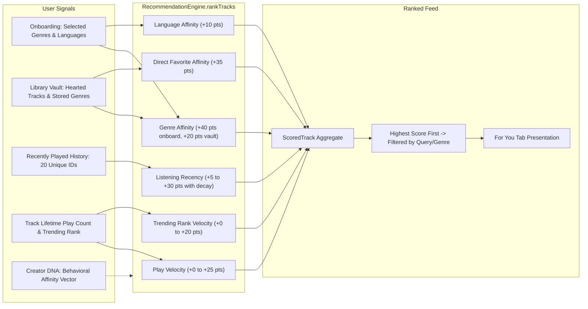

# Vhunambi Architecture Audit: The Explore & Heritage Discovery Feed

**Document ID:** `AUDIT-EXPLORE-PAGE-001`  
**Date:** 2026-10-31  
**Target:** `apps/vhunambi_client` (`lib/features/explore`, `lib/features/social`, `lib/features/creator_dna`), `apps/vhunambi_api`  
**Scope:** Explore View (`ExploreView`), Top Navigation Bars, Discovery Header & Tabs, African Charts Banner, Kinetic Reels Shelf, Dynamic Hero Grid, Rising Matrix, Featured Creators, Genre Radios, Catalog Filter Engine, Recommendation Engine, and Audio Transport Bridge  
**Author:** Antigravity (Advanced Agentic Architecture Group)

---

## 1. Executive Summary

The **Explore Page** (`/explore`, mounted at **Tab Index 1** of `RootShell` in `main.dart`) is Vhunambi's primary public music discovery, cultural curation, and algorithmic recommendation engine. While the **Studio** (`/create`) enables music creation and the **Library** (`/library`) serves as the private creator asset vault, **Explore** represents the public storefront and communal listening lounge of the platform.

```
┌──────────────────────────────────────────────────────────────────────────────────────────────┐
│                                 VHUNAMBI PRIMARY NAVIGATION SHELL                            │
├───────────────────┬───────────────────┬───────────────────┬───────────────────┬──────────────┤
│ Tab 0: Home       │ Tab 1: Explore    │ Tab 2: Studio     │ Tab 3: Library    │ Tab 4: Market│
│ Personal Cockpit  │ Public Discovery  │ Generative DAW    │ Asset Vault       │ Beat Store   │
│ Greeting/Recents  │ Grids, Radio, DNA │ Creation Lab      │ Songs, Beats, DAW │ Commercial   │
└───────────────────┴───────────────────┴───────────────────┴───────────────────┴──────────────┘
```

### Key Audit Conclusions:
1. **Flawless Sliver Virtualization & Responsive Geometry**: The entire view is constructed as a unified `CustomScrollView` hosting 11 sliver adapters and grids, adapting smoothly from a high-density 2-column mobile touch flow (< 768px) to an expansive 6-column desktop ultrawide mosaic (> 1024px).
2. **Sophisticated Multi-Factor Recommendation Stack**: The "For You" tab utilizes a dedicated 7-factor algorithmic scoring engine (`RecommendationEngine`) factoring in genre affinity (40 pts), direct favorites (35 pts), play velocity (25 pts), listening recency (30 pts), language affinity (10 pts), and trending velocity (20 pts), augmented by client-side Creator DNA profiling (`DnaExploreRanker`).
3. **High-Performance Audio Transport Dock Integration**: Every play trigger (`TrackCard`, `TrackListTile`, `GenreRadioTile`) interfaces seamlessly with the global `playerStateProvider` without rebuilding unaffected sliver tiles, and automatically sets up smart genre-scoped queues.
4. **Architectural Gaps & Defect Hotspots**:
   - **Pure Client-Side RAM Island**: The explore catalog runs on 8 static seed tracks in RAM (`_seedTracks()`); `apps/vhunambi_api` currently lacks `/api/explore` endpoints.
   - **Incomplete "Following" Sub-Tab**: Selecting the "Following" tab falls back to the default "New This Week" feed; creator follow filtering is not yet plumbed.
   - **Disconnected Profile CTA**: In `CreatorCard`, the `"View profile ->"` action has no callback wired in `ExploreView` (`onViewProfile: null`).
   - **Charts Banner Stub**: The African Music Charts banner CTA only displays a transient snackbar notice rather than a dedicated leaderboard modal.

---

## 2. Information Architecture & Sliver Hierarchy

The page is rendered inside a `Scaffold` featuring a custom `PreferredSize` top bar and a unified `CustomScrollView`. Below is the complete top-to-bottom layout hierarchy:

```mermaid
flowchart TD
    Root[ExploreView Scaffold] --> TopBar[PreferredSize AppBar: DesktopExploreTopBar / MobileExploreTopBar]
    Root --> Body[CustomScrollView]
    
    Body --> S1["1. ExploreHeaderSection\n(Title, Subtitle, Tabs: Discover/For You/Following, Streak Chip)"]
    Body --> S2["2. AfricanChartsBanner\n(Terracotta Gradient Hero, Ambient Artwork, View -> CTA)"]
    Body --> S3["3. TrendingReelsShelf\n(Horizontal 9:16 Kinetic Video Reels, Genre Pills, Fullscreen Modal)"]
    Body --> S4["4. Hero Track Grid\n(If For You: Recommended For You | Else: New This Week - 6 Cards)"]
    Body --> S5["5. Rising Tracks Matrix\n(Mobile: Dense Vertical List | Desktop: 2-Column Split Matrix)"]
    Body --> S6["6. Featured Creators Deck\n(Mobile: 2x3 Grid | Desktop: 6-Column Single Row Monogram Deck)"]
    Body --> S7["7. Genre Radio Mosaic\n(12 African Heritage Genres, Gradient Background, ((•)) Play Radio)"]
    Body --> S8["8. CatalogFilterBar\n(Genre Pill Rail, Mood Chips, Language Dropdown, Sort: Newest/Most Liked)"]
    Body --> S9["9. Catalog Grid or ExploreEmptyState\n(Filtered All Songs Grid | Empty State with Heritage Emblem + Reset)"]
    Body --> S10["10. _LoadMoreButton\n(Pagination Cursor Controller, Advances by 6 Tracks)"]
    Body --> S11["11. Transport Inset Spacer\n(Dynamic Height adapting to Active Audio Player Dock)"]
```



---

## 3. Responsive Breakpoint & Layout Geometry Matrix

`ExploreView` recalculates its grid delegates dynamically based on `ResponsiveUtils` (`isMobile`, `isTablet`, `isDesktop`):

| Section | Mobile (< 768px) | Tablet (768px – 1024px) | Desktop Ultrawide (> 1024px) | Child Aspect Ratio / Spacing |
| :--- | :---: | :---: | :---: | :--- |
| **Top Bar** | 56px + Safe Area | 68px Full | 68px Full | Mobile: Compact search & create; Desktop: 560px search with `Ctrl+K` |
| **Hero Grid** (`New This Week` / `For You`) | 2 Columns | 4 Columns | 6 Columns | Mobile: `0.75` | Tablet: `0.74` | Desktop: `0.72` (Spacing: 8dp mobile / 16dp desktop) |
| **Rising Tracks** | 1 Column (Dense vertical `SliverList`) | 1 Column | 2 Columns (Side-by-Side Matrix) | `childAspectRatio: 4.8` on desktop (balanced two-column layout) |
| **Featured Creators** | 2 Columns (3 rows) | 3 Columns (2 rows) | 6 Columns (Single row deck) | Mobile/Tablet: `2.2` | Desktop: `1.8` |
| **Genre Radio** | 2 Columns (6 rows) | 3 Columns (4 rows) | 6 Columns (2 rows) | `childAspectRatio: 1.4` (12 African genres) |
| **Catalog Grid** ("All Songs") | 2 Columns | 4 Columns | 6 Columns | Same as Hero Grid (`0.75` / `0.74` / `0.72`) |
| **Transport Inset** | Dynamic 64–112dp | Dynamic 64–112dp | Dynamic 64–112dp | `VhunambiBottomDockMetrics.scrollInset` |

---

## 4. Comprehensive Section & Component Audit

### 4.1 Top Navigation Bars (`DesktopExploreTopBar` & `MobileExploreTopBar`)
* **File:** [`lib/features/explore/presentation/widgets/explore_top_bar.dart`](file:///C:/Users/Ndugelo/VHUNAMBI/monorepo/apps/vhunambi_client/lib/features/explore/presentation/widgets/explore_top_bar.dart)
* **Purpose:** Provides brand context, instant universal catalog search, credit balance awareness, notifications access, user profile access, and a primary CTA into the Create Studio.
* **Component Breakdown:**
  1. **Desktop Variant (`DesktopExploreTopBar` - 68px height):**
     - `_BrandGroup`: Branded circular monogram (`vhunambiGlyph`), bold wordmark `"VHUNAMBI"`, and route breadcrumb `"/ Explore"`.
     - `_ExploreSearchField`: 44px pill container constrained to `maxWidth: 560px`. Bound directly to `exploreSearchQueryProvider`. Features a `Ctrl + K` (or `Cmd + K`) keyboard shortcut badge powered by `CallbackShortcuts`.
     - `_CreditPill`: Branded indicator displaying `⚡ 10 songs left`, reminding users of their monthly generative allowance.
     - `NotificationBellButton`: Standard interactive bell icon with unread indicator badge.
     - `_UserAvatar`: 36×36px circular avatar with `1.5px` border in `AppColors.brandPrimary`.
     - `_CreateAction`: Prominent orange pill button (`ElevatedButton.icon`) with `+ Create` label routing to Studio (Tab 2).
  2. **Mobile Variant (`MobileExploreTopBar` - 56px height):**
     - Employs `VhunambiTopBarSurface` from the core design kit.
     - Compact 28px brand emblem anchor. (Note: dead back chevron was deliberately removed since Explore is an `IndexedStack` root tab).
     - Full-width flexible `_ExploreSearchField` (shortcut badge suppressed).
     - Compact 36×36px square `+ Create` icon button with `44×44px` hit-target compliance.

---

### 4.2 Page Header & Discovery Tabs (`ExploreHeaderSection`)
* **File:** [`lib/features/explore/presentation/widgets/explore_header_section.dart`](file:///C:/Users/Ndugelo/VHUNAMBI/monorepo/apps/vhunambi_client/lib/features/explore/presentation/widgets/explore_header_section.dart)
* **Purpose:** Establishes page identity, controls top-level feed projection modes, and reinforces daily engagement through gamification.
* **Component Breakdown:**
  - **Typography**: Display header `"Explore"` (`AppTypography.displayLarge`) and subtitle `"Discover AI music from creators around the world"`.
  - **Sub-Navigation Tabs (`_TabPill`)**:
    - **Discover**: Standard curated editorial drops (`New This Week`).
    - **For You**: Algorithmically personalized recommendation stream (`filteredRecommendedTracksProvider`).
    - **Following**: Reserved for creators the user follows.
    - *Design Details*: Pill shape with active indicator (`AppColors.brandPrimary` background, `AppColors.brandContrast` bold text) and minimum 44px hit-target.
  - **Gamification Streak Chip (`_StreakChip`)**:
    - Displays daily login/creation streak (`🔥 2 Streak`).
    - Uses `AppColors.surfaceSecondary` container with `AppColors.streakFire` flame glyph.

---

### 4.3 African Music Charts Hero Banner (`AfricanChartsBanner`)
* **File:** [`lib/features/explore/presentation/widgets/african_charts_banner.dart`](file:///C:/Users/Ndugelo/VHUNAMBI/monorepo/apps/vhunambi_client/lib/features/explore/presentation/widgets/african_charts_banner.dart)
* **Purpose:** Hero callout celebrating regional chart-toppers across South Africa, West Africa, and East Africa.
* **Component Breakdown:**
  - **Visual Surface**: Decorated with `AppGradients.africanChartsBanner` (warm Terracotta to Tangerine gradient) with a 16px corner radius (`AppRadius.cardBorder`).
  - **Ambient Artwork**: Positioned background image of `AppAssets.heritageCrateCover` with 18% opacity and soft linear gradient vignette for text legibility.
  - **Content & CTA**:
    - Leading `Icons.trending_up_rounded` (28px).
    - Bold headline `"African Music Charts"` and subtitle `"Top songs across All Africa, South Africa, West & East Africa"`.
    - CTA button `"View ->"` (`ElevatedButton`, min-height 44px).
  - **Responsive Adaptation**: Arranges as a `Column` on mobile and a `Row` on desktop.

---

### 4.4 Trending Kinetic Reels Discovery Shelf (`TrendingReelsShelf`)
* **File:** [`lib/features/social/presentation/widgets/trending_reels_shelf.dart`](file:///C:/Users/Ndugelo/VHUNAMBI/monorepo/apps/vhunambi_client/lib/features/social/presentation/widgets/trending_reels_shelf.dart)
* **Purpose:** Visual bridge connecting the music discovery feed with the 9:16 vertical video social network (Phase 19 integration).
* **Component Breakdown:**
  - **Header Row**: Flame icon, title `"Trending Kinetic Reels 🎬"`, subtitle `"Discover African Creators"`, and a `"View all ->"` action.
  - **Genre Filter Rail**: Horizontally scrollable pills (`kTrendingGenres`: All, Amapiano, Gqom, Afrobeat, Kwaito, Maskandi) filtering `trendingReelsProvider`.
  - **Horizontal Reels Carousel**:
    - Cards styled with 9:16 aspect ratio (140px width mobile / 160px desktop).
    - Displays animated kinetic background gradient (`AppGradients.forGenre`), creator avatar, verified badge, song title, and virality stats (like count, play count).
    - Tapping opens the full-screen zero-video feed (`KineticReelsModal.show`) with the 3-player LRU audio pool.

---

### 4.5 Discovery Track Card (`TrackCard`)
* **File:** [`lib/features/explore/presentation/widgets/track_card.dart`](file:///C:/Users/Ndugelo/VHUNAMBI/monorepo/apps/vhunambi_client/lib/features/explore/presentation/widgets/track_card.dart)
* **Purpose:** The primary square grid tile used in both the Hero Grid (`New This Week` / `Recommended For You`) and the Catalog Browser ("All Songs").
* **Component Breakdown:**
  1. **1:1 Cover Artwork**:
     - Uses `CachedNetworkImage` with fallback to `AppGradients.forGenre(track.genre)`.
     - Overlaid with centered vector instrument glyph (`exploreGenreGlyph(track.genre)`).
  2. **Badges**:
     - `✨ NEW`: Rendered if `track.isNew == true` (cyan pill badge).
     - `#1`, `#2`, `#3`: Rendered if `track.trendingRank != null` (orange pill badge).
  3. **Live Playback State Indicator**:
     - When `isCurrent == true`, a 24×24px circular indicator overlays the bottom-right of the cover art with play/pause icons.
     - Card border highlights in `AppColors.brandPrimary`.
  4. **Track Metadata**:
     - Title in `AppTypography.bodyLarge` with ellipsis.
     - Subtitle format: `[Genre] • [Language] • [Duration]` (e.g., `Amapiano • Tshivenḓa • 3:36`).
  5. **Social Footer**:
     - Heart icon with `likeCount`.
     - Play arrow with `playCount`.
     - Creator handle aligned to the right (e.g., `@sigwa_inaf`).
  6. **Performance Optimization**:
     - Utilizes `ref.watch(playerStateProvider.select(...))` to decouple the card from the 1-second position ticker, preventing unnecessary rebuilds.

---

### 4.6 Dense Rising Track Row (`TrackListTile`)
* **File:** [`lib/features/explore/presentation/widgets/track_list_tile.dart`](file:///C:/Users/Ndugelo/VHUNAMBI/monorepo/apps/vhunambi_client/lib/features/explore/presentation/widgets/track_list_tile.dart)
* **Purpose:** Presents trending and fast-rising music in a compact, high-velocity audio list row.
* **Component Breakdown:**
  - **Leading Artwork**: 48×48px square container with genre gradient and heritage icon.
  - **Center Information**: Track title, creator name, genre, and duration.
  - **Social Metric**: Heart icon + like count.
  - **Trailing Action Button**: 36×36px circular play/pause button centered in a 44×44px hit-target. Toggles playback immediately or sets active track.

---

### 4.7 Featured Creators Deck (`CreatorCard`)
* **File:** [`lib/features/explore/presentation/widgets/creator_card.dart`](file:///C:/Users/Ndugelo/VHUNAMBI/monorepo/apps/vhunambi_client/lib/features/explore/presentation/widgets/creator_card.dart)
* **Purpose:** Highlights top African producers and artists creating on Vhunambi.
* **Component Breakdown:**
  - **Monogram Avatar**: 48×48px circle with bold 2-letter uppercase initials (e.g., `SI`, `ND`, `FI`).
  - **Artist Details**: Artist name, verified badge (`Icons.verified_rounded` in cyan), primary genre, and total published songs count (`"96 songs"`).
  - **Action Link**: `"View profile ->"` styled in `AppTypography.caption` with `AppColors.brandPrimary`.

---

### 4.8 Twelve-Genre Radio Mosaic (`GenreRadioTile` & `GenreGlyph`)
* **Files:** 
  - [`lib/features/explore/presentation/widgets/genre_radio_tile.dart`](file:///C:/Users/Ndugelo/VHUNAMBI/monorepo/apps/vhunambi_client/lib/features/explore/presentation/widgets/genre_radio_tile.dart)
  - [`lib/features/explore/presentation/widgets/genre_glyph.dart`](file:///C:/Users/Ndugelo/VHUNAMBI/monorepo/apps/vhunambi_client/lib/features/explore/presentation/widgets/genre_glyph.dart)
* **Purpose:** 1-tap continuous radio streaming grouped by authentic African genres.
* **Component Breakdown:**
  - **Gradients**: Custom dual-tone linear gradients mapped to each regional genre (e.g., Ochre for Amapiano, Shebeen Violet for Marabi, Ultraviolet for Gqom).
  - **Header Tag**: Genre name + localized glyph icon (e.g., grand piano for Amapiano/Marabi/Jazz, waves for Gqom, acoustic guitar/notes for Maskandi).
  - **Glassmorphic Radio Overlay**: Centered translucent pill (`((•)) Play Radio`) with backdrop blur and subtle border.
  - **Playback Engine**: Calling `playExploreGenreRadio(ref, genre)` queries all matching tracks in the catalog, begins playback of the first track, and queues the remainder into `playerStateProvider`.

---

### 4.9 Multifaceted Catalog Filter Engine (`CatalogFilterBar`)
* **File:** [`lib/features/explore/presentation/widgets/catalog_filter_bar.dart`](file:///C:/Users/Ndugelo/VHUNAMBI/monorepo/apps/vhunambi_client/lib/features/explore/presentation/widgets/catalog_filter_bar.dart)
* **Purpose:** Provides deep filtering across 4 dimensions (Genre, Mood, Language, Sort Order) over the "All Songs" catalog.
* **Component Breakdown:**
  1. **Section Header & Active Indicator**:
     - Shows title `"All Songs"` and dynamic result counter (e.g., `"8 tracks"`).
     - Contextual `"Clear filters"` action appears whenever filters or search queries are active.
  2. **Genre Filter Rail**:
     - Horizontally scrolling pill rail starting with `'All'` followed by all 12 curated genres.
     - Selecting a genre resets the pagination cursor and silently logs a `BehaviorEvent.genreFilterTap(genre)` to the Creator DNA pipeline (`creatorDnaProvider`).
  3. **Mood Chip Wrap**:
     - Flex wrap of 10 emoji-tagged mood filters (`😊 Uplifting`, `⚡ Energetic`, `🌧️ Melancholic`, `❤️ Romantic`, `🕊️ Peaceful`, `🔥 Angry`, `📻 Nostalgic`, `🌙 Mysterious`, `🎉 Party`, `🖤 Dark`).
  4. **Language Dropdown Selector (`_LanguageDropdown`)**:
     - `PopupMenuButton` covering 10 official South African languages (`isiZulu`, `isiXhosa`, `Afrikaans`, `English`, `Sepedi`, `Setswana`, `Sesotho`, `Xitsonga`, `siSwati`, `Tshivenḓa`).
     - Highlights active language with a checkmark and primary color accent.
  5. **Sort Order Pills**:
     - `🔥 Newest` (`ExploreSortBy.newest`): Retains newest catalog release order.
     - `❤️ Most Liked` (`ExploreSortBy.mostLiked`): Re-sorts projection descending by `likeCount`.

---

### 4.10 Universal Empty State (`ExploreEmptyState`)
* **File:** [`lib/features/explore/presentation/widgets/explore_empty_state.dart`](file:///C:/Users/Ndugelo/VHUNAMBI/monorepo/apps/vhunambi_client/lib/features/explore/presentation/widgets/explore_empty_state.dart)
* **Purpose:** Graceful recovery when filter combinations return 0 results.
* **Component Breakdown:**
  - **Visual Emblem**: Translucent circular medallion blending `AppAssets.heritageCrateCover` with a centered `Icons.search_off_rounded` icon.
  - **Messaging**: Headline `"No songs match these filters"` and actionable helper text.
  - **Dual CTAs**:
    - `"Clear filters"`: Resets all filters back to default.
    - `"Create a song"`: Routes directly into Studio to compose a new track in the filtered genre/language.

---

### 4.11 Cursor Pagination (`_LoadMoreButton`)
* **File:** Located in `explore_view.dart` (lines 244–282).
* **Purpose:** Virtualized progressive disclosure for catalog browsing.
* **Mechanism:**
  - Driven by `exploreVisibleCountProvider` with a page size of `exploreCatalogPageSize = 6`.
  - Tapping `"Load more"` invokes `loadMoreExploreTracks(ref)`, expanding the visible count by 6 until reaching the total track count, at which point the button cleanly unmounts.

---

## 5. Algorithmic Recommendation & Creator DNA Stack

The Explore feed does not simply display a static list; it dynamically computes personalization via a dual-engine architecture:



### Algorithmic Scoring Formula (`RecommendationEngine.dart`):
$$\text{Score} = S_{\text{genre}} + S_{\text{favorite}} + S_{\text{velocity}} + S_{\text{recency}} + S_{\text{language}} + S_{\text{trending}}$$
Where:
- $S_{\text{genre}} = 40.0$ (if in onboarding preferred genres) $+ 20.0$ (if genre exists in favorited vault tracks).
- $S_{\text{favorite}} = 35.0$ (if the exact track is favorited in the user's library vault).
- $S_{\text{velocity}} = \min\left(25.0, \frac{\text{playCount}}{1000} \times 2.5\right)$.
- $S_{\text{recency}} = \max\left(5.0, 30.0 - (\text{recentIndex} \times 2.5)\right)$.
- $S_{\text{language}} = 10.0$ (if matching user preferred languages).
- $S_{\text{trending}} = \max(0.0, 20.0 - (\text{trendingRank} \times 2.0))$.

---

## 6. Comprehensive Audit Findings & Defect Register

| Defect / Opportunity ID | Severity | Component | Finding Description | Recommended Remediation |
| :--- | :---: | :--- | :--- | :--- |
| **FINDING-EXP-001** | **High** | `explore_providers.dart` | **Client-Side RAM Island (No Backend API)**: The entire catalog is locked to 8 hardcoded tracks in `_seedTracks()`. `apps/vhunambi_api` has zero endpoints for public track discovery or catalog search. | Implement `GET /api/explore/tracks`, `GET /api/explore/creators`, and `GET /api/explore/charts` in `apps/vhunambi_api` with Postgres/Prisma pagination. |
| **FINDING-EXP-002** | **Medium** | `explore_view.dart:90-96` | **Incomplete "Following" Sub-Tab**: Selecting `ExploreTab.following` falls into the default `else` branch displaying `New This Week`, ignoring followed creators. | Connect `ExploreTab.following` to `followingCreatorsProvider` and filter tracks whose `creatorId` is in the user's follow list. |
| **FINDING-EXP-003** | **Medium** | `explore_view.dart:140` | **Dead Action on Featured Creators**: `CreatorCard` provides an `onViewProfile` callback, but `ExploreView` does not pass it (`onViewProfile: null`), causing taps on `"View profile ->"` to do nothing. | Route `onViewProfile` to a dedicated `CreatorProfileModal` or push to `/creators/:id`. |
| **FINDING-EXP-004** | **Low** | `explore_view.dart:194` | **Stubbed Charts Banner CTA**: Tapping `"View ->"` on `AfricanChartsBanner` displays a transient SnackBar notice stating charts will expand later. | Build a dedicated `AfricanChartsBottomSheet` displaying top 10 rankings across SA, Nigeria, Kenya, and Ghana. |
| **FINDING-EXP-005** | **Medium** | `apps/vhunambi_client` | **Creation-to-Discovery Disconnect**: When a user generates a track in Studio or exports a mix, it is added to `libraryTracksProvider`, but is never published to `exploreTracksProvider`. | Add an optional `"Publish to Explore"` toggle during Studio export to register new tracks into the public catalog. |
| **FINDING-EXP-006** | **Low** | `track_card.dart:90-106` | **Metadata Truncation on Small Viewports**: On compact phones (< 360dp width), the subtitle `[Genre] • [Language] • [Duration]` occasionally truncates the duration. | Format duration as a separate trailing pill or use compact abbreviations (e.g., `Amapiano • Tsh • 3:36`). |

---

## 7. Strategic Recommendations & Execution Roadmap

To elevate the Explore experience from its current polished prototype stage to a fully production-grade, server-backed discovery engine, we recommend a 3-step execution plan:

1. **Step 1: Backend Explore API (`apps/vhunambi_api`)**:
   - Create `src/modules/explore/explore_service.ts` and `src/routes/explore_routes.ts`.
   - Mount `GET /api/explore/feed` with cursor-based pagination, returning curated playlists, charts, rising tracks, and creator profiles.
2. **Step 2: Dynamic Creator Profiles & Following Feed**:
   - Implement `CreatorProfileModal` to display an artist's full catalog, bio, and follow button.
   - Wire `ExploreTab.following` to only display releases from creators the user follows.
3. **Step 3: African Charts Modal**:
   - Upgrade `AfricanChartsBanner` to open a tabbed leaderboard modal with 4 regional tabs: **All Africa**, **South Africa (Amapiano & Gqom)**, **West Africa (Afrobeats)**, and **East Africa (Bongo Flava)**.

