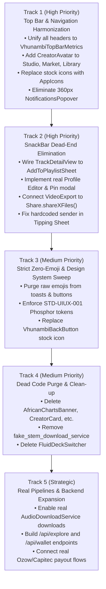

# 🔍 Vhunambi Architecture & Design Audit: Flaws, Inconsistencies & Unfinished Features

**Document ID:** `AUDIT-FLAWS-UNFINISHED-001`  
**Standard Reference:** `STD-UIUX-001` (Vhunambi UI/UX, Touch Physics & Iconography Standard)  
**Creation Date:** 2026-11-01  
**Target Platform:** Mobile, Tablet & Desktop (`apps/vhunambi_client`), Backend API (`apps/vhunambi_api`)  
**Audit Status:** Active Engineering Living Audit & Remediation Roadmap  
**Originating Context:** Post-Phase 32 (Sketchpad V2) & Phase 34 (Mobile Nav Modernization) Comprehensive Surface Review  

---

## 1. Executive Summary & Audit Philosophy

During the development of Vhunambi V4, rapid prototyping and localized modernization sprints (such as Phase 29 Explore Decluttering, Phase 30 Creator Profile, Phase 31 Home Dashboard, Phase 32 Sketchpad V2, and Phase 34 Nav Bar) elevated certain screens to high-fidelity, world-class mobile experiences. 

However, because these sprints focused on specific verticals, the codebase developed **architectural drift**, **design system divergence**, and **feature stubs (dead ends)**:

1. **Top Bar & Navigation Asymmetry**: The **Home Dashboard** features the modern golden standard (56dp safe-area geometry, 44×44px `CreatorAvatar` with profile shortcut, authentic Bantu greeting, dynamic time glyph, vector streak and coin chips, and a 1-step direct `NotificationsView` transition). In contrast, **Studio**, **Marketplace**, and **Library** still feature legacy headers, crowded mobile rows, stock Material icons, and lacking avatar shortcuts.
2. **Notification Drawer Duality**: Tapping the notification bell in Studio, Marketplace, Library, or Desktop Explore opens a cramped, legacy 360px popup modal dialog (`NotificationsPopover`) designed for desktop, while Home and Mobile Explore push the modern full-screen `NotificationsView()`.
3. **The "SnackBar Dead-End" Anti-Pattern**: Numerous high-visibility UI buttons across the platform do not perform real operations, trigger backend workflows, or open proper modals. Instead, they simply dismiss the sheet and display a cosmetic `SnackBar` (e.g. Subscription Upgrade, Profile Editor, Pin Song, Studio Analytics, Stems Export, Share to TikTok, Save to Gallery).
4. **Dormant & Orphaned Code**: Several complete, styled widgets (e.g. `AfricanChartsBanner`, `CreatorCard`, `ExploreHeaderSection`, `GenreRadioTile`, `FluidDeckSwitcher`) remain in the codebase despite being completely unmounted and unused, adding dead weight to the project.
5. **Simulated Production Services**: Crucial media pipelines (such as offline downloads, audio bounce, and mastering fallbacks) run in simulated mode (`isSimulated: true`, `simulateDownloads: true`, and `/mock-storage/...` fallback URLs), masking missing real-world implementations.

This audit catalogues every identified flaw, inconsistency, and unfinished feature, providing exact file paths, line references, root cause analyses, and an actionable prioritized remediation plan.

---

## 2. Category A: Top Bar & Header Navigation Chrome Inconsistencies

```
┌──────────────────────────────────────────────────────────────────────────────────────────────────┐
│                                   TOP BAR HARMONIZATION SPECTRUM                                 │
├───────────────────────────────────┬──────────────────────────────────────────────────────────────┤
│ 🟢 MODERN GOLDEN STANDARD (Home)  │ 🔴 LEGACY / INCONSISTENT SURFACES (Studio, Market, Library)   │
├───────────────────────────────────┼──────────────────────────────────────────────────────────────┤
│ • 56dp invariant VhunambiTopBar   │ • Fixed / squished rows on notched displays                  │
│ • 44x44 CreatorAvatar (tap/hold)  │ • Missing creator avatar shortcut entirely                   │
│ • Bantu greeting + time glyph     │ • Static hardcoded text titles ('Studio', 'My Library')      │
│ • Sovereign Phosphor tokens       │ • Stock Material icons (Icons.bolt_rounded, Icons.search)    │
│ • 1-step push NotificationsView() │ • Defaults to 360px legacy NotificationsPopover dialog       │
│ • Fluid spacing & no overflow     │ • Crammed mobile rows risking RenderFlex overflow            │
└───────────────────────────────────┴──────────────────────────────────────────────────────────────┘
```

### 2.1 The Benchmark: Home Dashboard (`features/home/presentation/views/home_dashboard_view.dart`)
The Home Dashboard top chrome represents the intended UX baseline codified in `STD-UIUX-001`:
- **Safe Area Geometry**: Padded with `EdgeInsets.fromLTRB(isDesktop ? 32 : 16, 16, isDesktop ? 32 : 16, 12)`, immune to notch clipping.
- **Creator Identity Anchor**: Renders `CreatorAvatar` (44×44px Apple HIG / WCAG target). Tap navigates directly to `OwnerProfileView()`; long-press opens `AvatarCustomizationModal()`.
- **Cultural Greeting**: Dynamic Bantu greeting (`greetingText`) paired with celestial phase glyph (`timeGlyph`).
- **Metric Chips**: Pill-shaped `PhosphorIcon(AppIcons.flame)` streak counter and `PhosphorIcon(AppIcons.coin)` balance chip.
- **1-Step Alert Access**: Tapping the notification bell directly executes `Navigator.of(context).push(MaterialPageRoute(builder: (_) => const NotificationsView()))`.

---

### 2.2 Studio Cockpit Header (`core/widgets/vhunambi_app_bar.dart`)
* **Location:** `apps/vhunambi_client/lib/core/widgets/vhunambi_app_bar.dart#L18-L93`
* **Identified Flaws:**
  1. **Stock Material Icon:** Line 68 renders `Icon(Icons.bolt_rounded, size: 15, color: AppColors.brandPrimary)` rather than `PhosphorIcon(AppIcons.lightning)` or `AppIcons.bolt`.
  2. **Hardcoded Center Route Title:** Lines 44–50 render a centered `Text('Studio')` bounded by two `const Spacer()` widgets. This wastes horizontal screen space and causes collision on narrow viewports (< 375dp).
  3. **Legacy Notification Drawer Default:** Line 87 renders `const NotificationBellButton()` without supplying `onPressed`. As a result, tapping the bell triggers the desktop modal `NotificationsPopover.show(context)` instead of navigating to `NotificationsView()`.
  4. **Missing Profile Avatar:** Unlike Home and Explore, the Studio header provides zero quick-link to the creator's profile or avatar settings.

---

### 2.3 Marketplace Top Bar (`features/marketplace/presentation/widgets/marketplace_top_bar.dart`)
* **Location:** `apps/vhunambi_client/lib/features/marketplace/presentation/widgets/marketplace_top_bar.dart#L16-L212`
* **Identified Flaws:**
  1. **Stock Fallback Icon:** Line 50–54 uses `Icon(Icons.music_note_rounded)` in the image error builder instead of `PhosphorIcon(AppIcons.songs)`.
  2. **Stock Search & Bolt Icons:** Line 136 uses `Icon(Icons.search_rounded)` and line 195 uses `Icon(Icons.bolt_rounded)`.
  3. **Legacy Notification Drawer Default:** Line 80 renders `const NotificationBellButton()`, invoking `NotificationsPopover.show(context)` on mobile.
  4. **Crammed Mobile Row & Lack of Avatar:** On mobile, `MarketplaceTopBar` jams the brand monogram, a 42dp `TextField`, a `_CreditChip`, and the bell button all into a single row. On devices with widths $\le 360\text{dp}$, this causes severe layout tension or overflow. No user profile avatar is available.

---

### 2.4 Library Vault Top Bar (`features/library/presentation/widgets/library_app_bar.dart`)
* **Location:** `apps/vhunambi_client/lib/features/library/presentation/widgets/library_app_bar.dart#L22-L96`
* **Identified Flaws:**
  1. **Stock Analytics Icon:** Line 412 uses `Icon(Icons.analytics_outlined)`.
  2. **Legacy Notification Drawer Default:** Lines 61 & 89 invoke `NotificationBellButton()` with no `onPressed`, triggering `NotificationsPopover`.
  3. **Overcrowded Mobile Header:** The mobile row (lines 83–96) places the brand group, credit pill, notification bell, overflow menu, and create button on a single line without progressive disclosure.
  4. **Missing Profile Avatar:** Zero avatar shortcut to `OwnerProfileView`.

---

### 2.5 Desktop vs Mobile Explore Top Bar Asymmetry (`features/explore/presentation/widgets/explore_top_bar.dart`)
* **Location:** `apps/vhunambi_client/lib/features/explore/presentation/widgets/explore_top_bar.dart`
* **Identified Flaws:**
  1. **Notification Routing Disparity:** In `MobileExploreTopBar` (line 157), `_NotificationBellAction` pushes `NotificationsView()`. But in `DesktopExploreTopBar` (line 64), `NotificationBellButton` is passed without `onPressed`, triggering `NotificationsPopover.show(context)`. Desktop and mobile behave completely differently for the same action.
  2. **Avatar Sizing Inconsistency:** Mobile Explore uses a 26×26dp avatar container with `AppIcons.user`, whereas Home uses a 44×44dp `CreatorAvatar` with user profile image and custom monogram.

---

### 2.6 Global Back Button Defect (`core/widgets/vhunambi_top_bar_kit.dart`)
* **Location:** `apps/vhunambi_client/lib/core/widgets/vhunambi_top_bar_kit.dart#L121-L143`
* **Identified Flaws:**
  * Line 137 hardcodes `const Icon(Icons.chevron_left_rounded)`. Every pushed sub-route in the app using `VhunambiBackButton` displays a stock Material icon instead of `PhosphorIcon(AppIcons.caretLeft)` or `AppIcons.arrowLeft`.

---

## 3. Category B: The Notification Dual-Surface Defect

```
                                  [ Notification Bell Tap ]
                                              │
                      ┌───────────────────────┴───────────────────────┐
                      ▼                                               ▼
         [ Home & Mobile Explore ]                      [ Studio, Market, Library, ]
                      │                                 [      Desktop Explore     ]
                      ▼                                               │
           Direct 1-Step Transition                                   ▼
             NotificationsView()                           NotificationsPopover.show()
         ┌─────────────────────────┐                      ┌─────────────────────────┐
         │ • Full-screen responsive│                      │ • 360px floating modal  │
         │ • Search & Category Tabs│                      │ • Fixed top-right inset │
         │ • Priority badge badges │                      │ • Awkward mobile layout │
         │ • 100% Mobile ergonomic│                      │ • Stock Material icons  │
         └─────────────────────────┘                      └─────────────────────────┘
```

### 3.1 Architectural Conflict
There are two competing notification presentation layers in the application:
1. **`NotificationsView`** (`features/notifications/presentation/views/notifications_view.dart`): Modern full-screen responsive page with search bar, priority filtering (`All`, `Mentions`, `Tips`, `System`), swipe-to-dismiss, and mark-as-read gestures.
2. **`NotificationsPopover`** (`features/notifications/presentation/widgets/notifications_popover.dart`): Legacy modal bottom-sheet / dialog constrained to `width: 360` with a fixed inset `insetPadding: EdgeInsets.only(top: 70, right: 16)`.

### 3.2 Mobile Ergonomics & Breakage
- On mobile devices, `NotificationsPopover.show(context)` renders an off-center dialog that clips near the right edge of the screen, fails to use full viewport height, and confuses users who expect a standard mobile navigation push.
- Inside `NotificationsPopover` (line 159), there is an awkward button labelled `"View All Alerts in Center ➔"` which pops the dialog and *then* pushes `NotificationsView()`, forcing the user into a two-step hop.
- `NotificationsPopover` contains multiple stock Material icons: `Icons.notifications_outlined` (line 66) and `Icons.check` (line 110).

---

## 4. Category C: Design System & Iconography Violations (`STD-UIUX-001`)

Under `STD-UIUX-001 §2.1`, using raw Unicode emojis as buttons, badges, or controls and using stock Material icons instead of centralized `AppIcons` tokens is strictly banned. The audit revealed significant residual violations across core surfaces:

### 4.1 Residual Stock Material Icons Inventory (`Icons.*`)

| File Path | Line | Stock Material Icon Used | Prescribed Phosphor Replacement (`AppIcons`) |
| :--- | :--- | :--- | :--- |
| `core/widgets/vhunambi_top_bar_kit.dart` | 137 | `Icons.chevron_left_rounded` | `AppIcons.caretLeft` / `AppIcons.arrowLeft` |
| `core/widgets/vhunambi_app_bar.dart` | 68 | `Icons.bolt_rounded` | `AppIcons.lightning` |
| `features/marketplace/.../marketplace_top_bar.dart` | 51, 136, 196 | `Icons.music_note_rounded`, `Icons.search_rounded`, `Icons.bolt_rounded` | `AppIcons.songs`, `AppIcons.search`, `AppIcons.lightning` |
| `features/library/.../library_app_bar.dart` | 413 | `Icons.analytics_outlined` | `AppIcons.waveform` / `PhosphorIconsRegular.chartBar` |
| `features/track/.../track_detail_view.dart` | 278, 301, 340, 587, 645, 780, 817 | `Icons.download_rounded`, `Icons.tune_rounded`, `Icons.auto_awesome_rounded`, `Icons.share_rounded`, `Icons.music_note_rounded` | `AppIcons.download`, `AppIcons.mixer`, `AppIcons.sparkle`, `AppIcons.share`, `AppIcons.songs` |
| `features/profile/.../owner_profile_view.dart` | 350, 361 | `Icons.push_pin_rounded`, `Icons.analytics_outlined` | `PhosphorIconsRegular.pushPin`, `PhosphorIconsRegular.chartLineUp` |
| `features/profile/.../creator_wallet_deck.dart` | 57 | `Icons.account_balance_rounded` | `PhosphorIconsRegular.bank` |
| `features/profile/.../profile_referral_card.dart` | 88 | `Icons.copy_rounded` | `AppIcons.copy` |
| `features/content_studio/.../export_action_sheet.dart`| 153, 183 | `Icons.share_rounded`, `Icons.copy_rounded` | `AppIcons.share`, `AppIcons.copy` |
| `features/beats/.../stem_export_modal.dart` | 35, 40, 45, 50 | `Icons.album_rounded`, `Icons.graphic_eq_rounded`, `Icons.piano_rounded`, `Icons.auto_awesome_rounded` | `AppIcons.drums`, `AppIcons.bass`, `AppIcons.piano`, `AppIcons.sparkle` |
| `features/beats/.../beat_detail_cockpit_view.dart` | 625, 631, 637, 643, 652 | `Icons.album_rounded`, `Icons.graphic_eq_rounded`, `Icons.piano_rounded`, `Icons.auto_awesome_rounded`, `Icons.folder_zip_rounded` | `AppIcons.drums`, `AppIcons.bass`, `AppIcons.piano`, `AppIcons.sparkle`, `PhosphorIconsRegular.archive` |
| `features/studio/.../mpc_slicer_deck.dart` | 123, 147 | `Icons.tune_rounded`, `Icons.mic_none_rounded` | `AppIcons.mixer`, `AppIcons.microphone` |
| `features/studio/.../reference_audio_dropzone.dart`| 65, 112, 141, 260, 331, 446, 490 | `Icons.graphic_eq_rounded`, `Icons.shopping_bag_rounded`, `Icons.piano_rounded`, `Icons.audio_file_rounded`, etc. | Sovereign Phosphor tokens in `AppIcons` |

---

### 4.2 Strict Emoji Ban Violations in UI Controls & Toasts

| File Path | Line | Offending Literal Emoji Code | Fix Required |
| :--- | :--- | :--- | :--- |
| `features/profile/.../owner_profile_view.dart` | 159 | `'Release "$title" created! 💿'` | Remove `'💿'`, use clean typography + Phosphor checkmark |
| `features/profile/.../profile_referral_card.dart` | 83 | `'Profile link copied: $link 📋'` | Remove `'📋'` |
| `features/track/.../track_detail_view.dart` | 393 | `'Embed snippet copied to clipboard! 📋'` | Remove `'📋'` |
| `features/track/.../track_detail_view.dart` | 461 | `'Added to My Playlist ✨'` | Remove `'✨'`, replace with real playlist filing |
| `features/track/.../track_detail_view.dart` | 792 | `'Track link copied to clipboard! 🔗'` | Remove `'🔗'` |
| `features/profile/.../artist_profile_view.dart` | 185 | `'Profile link copied! 🔗'` | Remove `'🔗'` |
| `features/social/.../kinetic_reels_modal.dart` | 311 | `'Loaded sound into Studio: ${clip.title} 🎵'` | Remove `'🎵'` |
| `features/studio/.../mpc_slicer_deck.dart` | 112 | `'Chop kit bounced & sent to Stem Mixer! 🎹'` | Remove `'🎹'` |
| `features/studio/.../mpc_slicer_deck.dart` | 124 | `Text('🎹 Send to Stem Mixer')` | Replace `'🎹'` with `PhosphorIcon(AppIcons.piano)` |
| `features/studio/.../mpc_slicer_deck.dart` | 136 | `'Chop kit routed into Studio prompt context 🎙️'` | Remove `'🎙️'` |
| `features/studio/.../reference_audio_dropzone.dart`| 468, 516 | `'Attached "${beat.title}" as backing beat 🎤'` | Remove `'🎤'` |
| `features/studio/.../reference_audio_dropzone.dart`| 480 | `Text('🎛️ My Produced Beats')` | Replace `'🎛️'` with `PhosphorIcon(AppIcons.mixer)` |

---

## 5. Category D: Unfinished Features & Placeholder "SnackBar/Toast" Dead-Ends

A critical finding of this audit is the prevalence of **"Mock Actions"**—buttons that appear interactive and complete, but in reality simply display a temporary toast notification (`ScaffoldMessenger.showSnackBar`) without performing any real logic, data persistence, or external integration:

```
┌──────────────────────────────────────────────────────────────────────────────────────────────────┐
│                                   MOCK ACTION / SNACKBAR DEAD-END                                │
├───────────────────────────────┬───────────────────────────────┬──────────────────────────────────┤
│ User Action                   │ Current Code Behavior         │ Required Real Implementation     │
├───────────────────────────────┼───────────────────────────────┼──────────────────────────────────┤
│ Upgrade Subscription Tier     │ Closes modal & shows          │ Launch PayFast / Stripe gateway, │
│ ($9 / $19 / $49 / mo)         │ "Selected plan: Pro ($19/mo)" │ allocate monthly coin credits    │
├───────────────────────────────┼───────────────────────────────┼──────────────────────────────────┤
│ Tap "Add to Playlist" on      │ Shows SnackBar:               │ Open AddToPlaylistSheet.show()   │
│ Track Details page            │ "Added to My Playlist ✨"     │ (which already exists in repo!)  │
├───────────────────────────────┼───────────────────────────────┼──────────────────────────────────┤
│ Tap "Edit Profile", "Pin Song"│ Shows SnackBar:               │ Open profile edit modal,         │
│ or "Studio Analytics" on Prof │ "Opening Profile Editor..."   │ song pin sheet, analytics view   │
├───────────────────────────────┼───────────────────────────────┼──────────────────────────────────┤
│ Share Reel to TikTok / Insta  │ Sets state variable & shows   │ Trigger system share sheet       │
│ in Video Export Modal         │ "Shared to TikTok!"           │ with rendered MP4 video file     │
├───────────────────────────────┼───────────────────────────────┼──────────────────────────────────┤
│ Tap Legal / Terms in Footer   │ Shows SnackBar:               │ Launch external browser /        │
│ (Privacy, Terms, Licensing)   │ "Terms: https://..."          │ in-app legal policy sheet        │
├───────────────────────────────┼───────────────────────────────┼──────────────────────────────────┤
│ Cash Out Royalties            │ Initiates payout with method  │ Collect banking details, branch, │
│ (Ozow, Capitec Pay, EFT)      │ name as account details       │ account number & verify via API  │
└───────────────────────────────┴───────────────────────────────┴──────────────────────────────────┘
```

### 5.1 Subscription Checkout Stub (`home/presentation/widgets/subscription_upgrade_modal.dart`)
* **Code Reference:** Lines 276–285
* **Defect:** When a creator selects "Upgrade to Pro" or "Upgrade to Master", the modal runs:
  ```dart
  onPressed: () {
    Navigator.of(context).pop();
    ScaffoldMessenger.of(context).showSnackBar(
      SnackBar(
        content: Text('Selected plan: ${tier.name} ($price/mo)'),
        backgroundColor: AppColors.surfaceElevated,
      ),
    );
  }
  ```
  No payment intent is created, no fiat gateway is called, and no credits are credited to `creatorWalletProvider`.

---

### 5.2 Disconnected "Add to Playlist" (`track/presentation/views/track_detail_view.dart`)
* **Code Reference:** Lines 459–463
* **Defect:** In `TrackDetailView`, the secondary utility dock has an `onAddToPlaylist` action. It executes:
  ```dart
  onAddToPlaylist: () {
    ScaffoldMessenger.of(context).showSnackBar(
      const SnackBar(content: Text('Added to My Playlist ✨')),
    );
  }
  ```
* **The Irony:** The project **already contains** a fully implemented, responsive playlist picker: `AddToPlaylistSheet.show(context, track)` in `apps/vhunambi_client/lib/features/playlists/presentation/widgets/add_to_playlist_sheet.dart`! The action was simply never wired to the existing sheet.

---

### 5.3 Profile Action Stubs (`profile/presentation/views/owner_profile_view.dart`)
* **Code Reference:** Lines 340–370
* **Defect:** In the owner profile hero action row, three core creator controls are dead ends:
  - **Edit Profile:** Emits `SnackBar(content: Text('Opening Profile Editor...'))`. Does not open any profile editor.
  - **Pin Song:** Emits `SnackBar(content: Text('Select a song to pin to top'))`. Does not open a track selector.
  - **Studio Analytics:** Emits `SnackBar(content: Text('Opening Analytics Console...'))`. Does not open analytics.

---

### 5.4 Video Export Social Sharing Stub (`social/presentation/widgets/video_export_modal.dart`)
* **Code Reference:** `video_export_modal.dart#L251-L258` & `video_export_provider.dart#L116-L126`
* **Defect:** In `video_export_provider.dart`, the `shareTo(SocialShareTarget target)` function does not communicate with any OS sharing facility:
  ```dart
  Future<bool> shareTo(SocialShareTarget target) async {
    if (state.outputPath == null && state.status != VideoExportStatus.completed) {
      ...
      return false;
    }
    state = state.copyWith(lastSharedTarget: target);
    return true;
  }
  ```
  The UI then displays `SnackBar(content: Text('Shared to ${target.label}!'))`. Nothing was actually shared or sent to TikTok, Instagram Reels, or YouTube Shorts.

---

### 5.5 Content Studio Export Stubs (`content_studio/presentation/widgets/export_action_sheet.dart`)
* **Code Reference:** Lines 143–152 & 196–205
* **Defect:** 
  - **Share to Socials:** Line 146 pops the modal and shows `SnackBar(content: Text('Ready for TikTok / Instagram Reels share sheet!'))` without calling `Share.shareXFiles()`.
  - **Save to Device Gallery:** Line 199 pops and shows `SnackBar(content: Text('Saved to your device gallery'))` without saving the file to the OS media store.

---

### 5.6 Landing Page Footer Legal Stubs (`landing/presentation/widgets/landing_footer.dart`)
* **Code Reference:** Lines 125–133
* **Defect:** Tapping "Terms of Service", "Privacy Policy", "Commercial Licensing", or "Copyright & Takedown" does not open a browser or in-app document. It displays a floating SnackBar:
  ```dart
  ScaffoldMessenger.of(context).showSnackBar(
    SnackBar(
      content: Text('$link: https://vhunambi.com/${link.toLowerCase().replaceAll(' ', '-')}'),
      ...
    ),
  );
  ```

---

### 5.7 Creator Royalty Payout Account Data Defect (`profile/presentation/widgets/creator_wallet_deck.dart`)
* **Code Reference:** Lines 41–70 & `creator_wallet_provider.dart#L335-L340`
* **Defect:** When cashing out ZAR royalties via Ozow, Capitec Pay, or EFT, the dialog lets the user pick the method from a list, but **never collects the destination account number, bank name, account holder name, or phone number**. In `creator_wallet_provider.dart:339`, it passes:
  ```dart
  accountDetails: payoutMethod, // e.g. literally passes "Ozow" or "EFT"
  ```
  This is a critical gap for real financial transactions.

---

### 5.8 Hardcoded User Identity in Tipping Sheet (`social/presentation/widgets/creator_tipping_sheet.dart`)
* **Code Reference:** Lines 93–100
* **Defect:** When a user sends a cultural gift / tip to a creator, the sender identity is hardcoded:
  ```dart
  final ok = await wallet.sendGift(
    clipId: _effectiveClipId,
    recipientCreatorId: _effectiveCreatorId,
    senderUsername: 'ndugelo_musician',      // HARDCODED
    senderDisplayName: 'Ndugelo Musician',  // HARDCODED
    gift: _selected,
    message: _messageController.text.trim(),
  );
  ```
  It does not resolve the authenticated creator from `ownerProfileProvider`.

---

### 5.9 Cockpit Master A/B & Studio Remix SnackBars (`player/presentation/widgets/expanded_cockpit_modal.dart`)
* **Code Reference:** Lines 820–846
* **Defect:** 
  - **A/B Bypass:** Tapping A/B toggles state and displays a 1.5-second SnackBar: `'Studio Master DSP: ACTIVE'`. On a dedicated hardware-style cockpit player, A/B bypass should be indicated by an on-deck illuminated LED toggle pill, not a disruptive mobile toast.
  - **Remix in Studio:** Tapping Remix updates prompt text, pops the modal, and shows `'Loaded "$title" into Studio for remixing'`, but does not switch the shell tab to Studio or load the multitrack stems.

---

## 6. Category E: Dormant, Dead & Orphaned Code

During previous modernization phases, new components were created while old components were simply disconnected from view hierarchies rather than deleted or archived. These dormant files inflate repository size and confuse future maintainers:

```
┌──────────────────────────────────────────────────────────────────────────────────────────────────┐
│                                   DORMANT & ORPHANED CODE INVENTORY                              │
├───────────────────────────────────┬───────────────────┬──────────────────────────────────────────┤
│ File Path                         │ Lines of Code     │ Status & Reason for Abandonment          │
├───────────────────────────────────┼───────────────────┼──────────────────────────────────────────┤
│ `features/explore/presentation/`  │ 151 LOC           │ Completely unmounted. Built in Phase 6,  │
│ `widgets/african_charts_banner.dart`│                 │ superseded by Phase 29 decluttering.     │
├───────────────────────────────────┼───────────────────┼──────────────────────────────────────────┤
│ `features/explore/presentation/`  │ 134 LOC           │ Completely unmounted. Built for Phase 6  │
│ `widgets/creator_card.dart`       │                   │ featured creators, replaced by Reels.    │
├───────────────────────────────────┼───────────────────┼──────────────────────────────────────────┤
│ `features/explore/presentation/`  │ 140 LOC           │ Completely unmounted. Replaced by        │
│ `widgets/explore_header_section.dart`│                │ MobileExploreTopBar in Phase 29.         │
├───────────────────────────────────┼───────────────────┼──────────────────────────────────────────┤
│ `features/explore/presentation/`  │ 130 LOC           │ Completely unmounted. Replaced by        │
│ `widgets/genre_radio_tile.dart`   │                   │ Discovery Drawer in Phase 29.            │
├───────────────────────────────────┼───────────────────┼──────────────────────────────────────────┤
│ `features/studio/presentation/`   │ 116 LOC           │ Completely unmounted. Custom kinetic tab │
│ `widgets/fluid_deck_switcher.dart`│                   │ bar never connected to StudioView.       │
├───────────────────────────────────┼───────────────────┼──────────────────────────────────────────┤
│ `features/studio/data/services/`  │ 67 LOC            │ Dummy 3-tick timer emitting hardcoded    │
│ `fake_stem_download_service.dart` │                   │ paths; duplicates real downloader.       │
└───────────────────────────────────┴───────────────────┴──────────────────────────────────────────┘
```

---

## 7. Category F: Simulated Production Services & Pipelines

Several production services are currently running in simulated or stubbed mode, creating the illusion of complete functionality while producing dummy data:

1. **Stem Mix Bounce Service (`player/data/services/stem_mix_bounce_service.dart:25-99`):**
   - The service creates a WAV header and fills the audio payload with **pure silence** (`Uint8List(totalSamples * channels * 2)` filled with zeros). It flags `isSimulated: true`. Real multi-stem mixing down to a single audio master does not yet exist.
2. **Audio Download Service Production Provider (`offline/presentation/providers/offline_providers.dart:18-20`):**
   - In production code, the provider is registered as:
     ```dart
     final audioDownloadServiceProvider = Provider<IAudioDownloadService>((ref) {
       return AudioDownloadService(simulateDownloads: true);
     });
     ```
     `simulateDownloads: true` is hardcoded! Offline caching does not perform real HTTP streaming downloads in the app.
3. **Mastering Session Offline Simulation Fallback (`mastering/presentation/providers/mastering_session_provider.dart:407-434`):**
   - When baking a production master via HTTP fails or times out, the notifier catches the error and silently sets:
     ```dart
     final fallbackMp3 = '/mock-storage/${state.trackId}_mastered.mp3';
     final fallbackWav = '/mock-storage/${state.trackId}_mastered.wav';
     ```
     It returns `true`, tricking the UI into displaying that mastering succeeded when the files do not exist.
4. **Beats Stems Export Simulation (`beats/presentation/widgets/stem_export_modal.dart:15-22`):**
   - Per-stem audition, individual stem download, and full ZIP bundle export are declared as simulations:
     ```dart
     onAuditionStem: (stem) => _showSnack(context, 'Auditioning $stem stem'),
     onDownloadStem: (stem) => _showSnack(context, 'Downloading $stem stem'),
     ```

---

## 8. Category G: Backend API Route Gaps (`apps/vhunambi_api`)

Auditing the Hono/Node backend server (`apps/vhunambi_api/src/routes`) revealed key endpoint disparities between client features and backend routes:

| Client Feature | Current Client Implementation | Backend Route Status | Gap Description |
| :--- | :--- | :--- | :--- |
| **Explore Discovery Feed** | 8 static seed tracks in RAM (`explore_providers.dart`) | ❌ **Missing** | No `/api/explore` endpoint exists for dynamic song feeds, trending algorithms, or genre radios. |
| **User Library Vault** | Local Hive database | ❌ **Missing** | No `/api/library` sync endpoint exists to sync user library tracks across devices. |
| **Playlists** | Local Hive database | ❌ **Missing** | No `/api/playlists` CRUD routes exist. |
| **Subscription & Checkout** | Dummy SnackBar | ❌ **Missing** | No `/api/subscriptions` or payment webhook routes exist for card/fiat processing. |
| **Royalty Payouts** | Dummy state decrement | ❌ **Missing** | No `/api/wallet/payout` route exists to interface with banking gateways (Ozow/Stripe/PayFast). |

---

## 9. Prioritized Remediation Roadmap

To systematically resolve these flaws without disrupting active development, the work is organized into five prioritized implementation tracks:



### Sprint M4: Universal Top Bar Harmonization & Sovereign Phosphor Migration
- **Goal:** Elevate Studio, Marketplace, and Library headers to the Home Dashboard standard (`STD-UIUX-001`).
- **Tasks:**
  1. Refactor `VhunambiAppBar` (Studio): Add `CreatorAvatar` (44×44px), replace `Icons.bolt_rounded` with `AppIcons.lightning`, replace centered title with transient or responsive layout, wire notification bell directly to `NotificationsView()`.
  2. Refactor `MarketplaceTopBar`: Add `CreatorAvatar`, replace `Icons.music_note_rounded`, `Icons.search_rounded`, and `Icons.bolt_rounded` with `AppIcons` tokens, wire bell directly to `NotificationsView()`.
  3. Refactor `LibraryAppBar`: Clean up mobile crowding, add `CreatorAvatar`, wire bell directly to `NotificationsView()`, replace `Icons.analytics_outlined` with `AppIcons.waveform`.
  4. Refactor `DesktopExploreTopBar`: Wire bell directly to `NotificationsView()`.
  5. Update `VhunambiBackButton`: Replace stock `Icons.chevron_left_rounded` with `PhosphorIcon(AppIcons.caretLeft)`.

### Sprint M5: Notifications Consolidation (Abolish `NotificationsPopover`)
- **Goal:** Unify all notification interactions into the responsive `NotificationsView`.
- **Tasks:**
  1. Deprecate and remove `NotificationsPopover`.
  2. Update `NotificationBellButton`: Default `onTap` to push `NotificationsView()` across all platforms.

### Sprint M6: Unfinished Features & Placeholder Banner Elimination
- **Goal:** Eliminate dummy SnackBars and wire real user experiences.
- **Tasks:**
  1. In `TrackDetailView`, replace line 460 SnackBar with `AddToPlaylistSheet.show(context, track)`.
  2. In `OwnerProfileView`, build real sheets for `Edit Profile`, `Pin Song`, and `Studio Analytics`.
  3. In `VideoExportModal` and `ExportActionSheet`, wire native file sharing using `share_plus` (`Share.shareXFiles()`).
  4. In `CreatorTippingSheet`, resolve the sender identity dynamically from `ownerProfileProvider`.
  5. In `CreatorWalletDeck`, create a modal collecting real bank account number, account holder name, and branch code before initiating a payout.
  6. In `ExpandedCockpitModal`, replace master A/B SnackBar with an on-deck toggle LED pill indicator.

### Sprint M7: Dead Code Purge & Orphan Cleanup
- **Goal:** Remove dead weight and unmounted code.
- **Tasks:**
  1. Delete `features/explore/presentation/widgets/african_charts_banner.dart`.
  2. Delete `features/explore/presentation/widgets/creator_card.dart`.
  3. Delete `features/explore/presentation/widgets/explore_header_section.dart`.
  4. Delete `features/explore/presentation/widgets/genre_radio_tile.dart`.
  5. Delete `features/studio/presentation/widgets/fluid_deck_switcher.dart`.
  6. Delete `features/studio/data/services/fake_stem_download_service.dart`.

### Sprint M8: Backend Convergence & Real Pipelines
- **Goal:** Replace simulated pipelines with real implementations.
- **Tasks:**
  1. Flip `simulateDownloads: false` in `offline_providers.dart` and verify real offline audio caching.
  2. Implement backend routes for `/api/explore` and `/api/wallet`.
  3. Connect real ZAR payout verification and Stripe/PayFast subscription checkout.

---

## 10. User Device Testing Notes & Field Findings

> [!NOTE]
> Physical device test session on Huawei Android ARM64 (`EPHUT20917014649` / `JNY LX1`) running release build `com.vhunambi.vhunambi_client` over Vulkan/Impeller. Reference screenshot: `Screenshot_20261101_194851`.

### 10.1 Physical Device Testing Log (User Appended)

| Date | Device Model & OS | Screen / Feature Tested | Observed Flaw or Defect | Severity (P0-P3) | Notes / Expected Behavior |
| :--- | :--- | :--- | :--- | :--- | :--- |
| **2026-11-01** | Huawei ARM64 (`EPHUT20917014649`) | Creator Profile (`/profile/me`) | **Dead-End Stubs on Profile Hero Actions**: Tapping `Studio Analytics` popped up a default white Material SnackBar saying *"Opening Analytics Console..."* that does nothing. `Edit Profile` and `Pin Song` are also disconnected SnackBar stubs. | **P0** | Should open real interactive sheets: `EditProfileSheet`, `PinSongSelectorSheet`, and `StudioAnalyticsConsoleSheet`. |
| **2026-11-01** | Huawei ARM64 (`EPHUT20917014649`) | Creator Profile (`/profile/me`) | **Floating Mini-Player Mid-Screen Overlap**: Floating mini-player (*"Grateful in the Li... 1:01 / 3:29"*) is pushed halfway up the screen, sitting directly on top of the `Creator DNA` card instead of docking at the bottom navigation inset. | **P0** | Mini-player must respect bottom safe-area insets and dock cleanly above bottom nav without obscuring profile content. |
| **2026-11-01** | Huawei ARM64 (`EPHUT20917014649`) | Creator Profile (`/profile/me`) | **Raw Emojis in Action Pills**: Four hero action buttons (`Change Avatar`, `Edit Profile`, `Pin Song`, `Studio Analytics`) still use raw Unicode emojis (`✨`, `✏️`, `📌`, `📊`), violating `STD-UIUX-001`. | **P1** | Replace with tree-shaken Phosphor vector tokens (`AppIcons.camera`, `AppIcons.edit`, `PhosphorIconsRegular.pushPin`, `PhosphorIconsRegular.chartLineUp`). |
| **2026-11-01** | Huawei ARM64 (`EPHUT20917014649`) | Global App Shell & Appearance | **Missing Adaptive Light Mode & Theme Switcher**: App is locked to dark mode (#0A0A0C). No daylight support for outdoor listening. | **P0** | Add Warm African Daylight Light Mode auto-synced to OS (`ThemeMode.system`) + manual 3-way toggle (`[ System \| Light \| Dark ]`). |
| **2026-11-01** | Huawei ARM64 (`EPHUT20917014649`) | Creator Profile (`/profile/me`) | **Missing 5-Dimension Creator Vault Tabs**: Profile only displays songs and releases. Cloned Vocal DNA (Phase 26) and Saved Multi-Track Melody Grooves (Phase 32) have no home in the creator profile. | **P1** | Expand to 5 tabs: `[ Songs \| Reels \| Beatstore \| Voices & Melodies \| Releases ]`. |
| **2026-11-01** | Huawei ARM64 (`EPHUT20917014649`) | Analytics Across App | **Unsynchronized & Disconnected Analytics**: `ProfileStatsGrid`, `TOP GENRES`, Library analytics, and Wallet earnings live in static silos and never aggregate live metrics. | **P0** | Implement reactive `synchronizedAnalyticsProvider` driving real-time profile stats and `StudioAnalyticsConsoleSheet`. |

---

### 10.2 User General Observations & UX Recommendations
- **Dark Mode White SnackBar Glare**: When a SnackBar appears on dark mode screens, it renders with a glaring white background and black text, completely clashing with the dark theme. Global `SnackBarThemeData` must be styled with `AppColors.surfaceElevated` / `AppColors.surfaceModal`.
- **Pinned Anthem Spotlight**: The profile needs an immediate visual spotlight card (`profile_pinned_spotlight_card`) right under the bio for the artist's pinned track with 1-tap playback.
- **Unified Identity Sync**: Updating display name or bio in `EditProfileSheet` should persist across the user's published songs, reels, and beatstore.

