# Sovereign Forensic Audit: "THE HIVE" (`hive_flutter`) Persistence, Cognitive Memory & Edge-Sync Brain

**Audit Date:** November 10, 2026  
**Target Subsystem:** Client Persistence Layer, Edge Outbox, Offline Vault & Cognitive State (`apps/vhunambi_client/lib/` & `apps/vhunambi_api/src/db/`)  
**Audit Document Path:** `docs/audits/HIVE_PERSISTENCE_ENGINE_COMPREHENSIVE_AUDIT.md`  
**Related Documents & Specs:**
- `docs/PRIVACY_DATA_FLOW.md` (On-Device vs. Cloud Encryption Claims)
- `docs/AGENT_HANDOFF_BIBLE.md` (Phase 8, Phase 14, Phase 17, Phase 23, Phase 26, Phase 27, Phase 32, Phase 33, Phase 35, Phase 44–48, Phase 58, Phase 59)
- `apps/vhunambi_client/lib/main.dart`
- `apps/vhunambi_client/lib/core/constants/app_constants.dart`
- `apps/vhunambi_client/lib/core/sync/sync_outbox_service.dart`
- `apps/vhunambi_client/lib/core/sync/edge_sync_coordinator.dart`
- `apps/vhunambi_api/src/db/vhunambi_db.ts`

---

## 1. Executive Summary: The "Volatile Brain Paradox"

Architectural inspection across every Dart and TypeScript file in the Vhunambi monorepo reveals a profound operational paradox at the heart of the client:

> **By design, "THE HIVE" is architected to be Vhunambi's sovereign client-side brain centre—governing 20 distinct storage boxes spanning creator identity telemetry (DNA), acoustic signatures, neural media manifests (MMO), zero-shot voice clones, sketchpad compositions, commercial beatstore deeds, encrypted offline audio, and the transactional mutation outbox.**  
> **In live production runtime today, however, that entire 20-box brain operates in a silent in-memory lobotomy.**

Specifically:
1. **`Hive.initFlutter()` is completely absent from `main.dart` (`apps/vhunambi_client/lib/main.dart#L31-L48`) and from every `.dart` file in `lib/`.** Because `Hive` is never initialized with an OS application documents path and zero feature boxes are opened during app startup:
   - The **4 boxes** that actively invoke `Hive.openBox(...)` (`SyncOutboxService`, `LicenseCertificateRepository`, and `OfflineStorageService` vault + prefs) throw an internal `HiveError` ("You need to initialize Hive or provide a path...") on real devices/desktop, catch the error, and **silently degrade to volatile RAM maps**.
   - The **14 "passive adopter" boxes** that guard access via `if (!kIsWeb && Hive.isBoxOpen(...))` evaluate cleanly to `false`, silently routing reads/writes to per-instance RAM maps or returning early (`return;`) with **zero persistence and zero crash logs**.
   - **2 declared box keys** (`vhunambi_tokens` and `vhunambi_tracks`) are completely **orphaned** with zero consumers anywhere in `lib/`.
2. Consequently, closing and restarting the Vhunambi client currently wipes playlists, beat catalogs, split-sheet collections, cloned voices, sketchpad grooves, sound signatures, Creator DNA weights, sound packs, theme choice, Studio ghost drafts, license certificates, offline track index metadata, and pending sync outbox records—while only **3 features backed by `SharedPreferences`** (`GenerationRequestNotifier`, `MiniPlayerController`, `AppTourOverlay`) survive process termination.

### 1.1 Headline Metrics Snapshot

| Metric | Count / Finding | Verification Source |
| :--- | :--- | :--- |
| **Total Hive Box Keys Declared** | **20** (`18` in `AppConstants`, `2` feature-local) | `app_constants.dart#L12-L50`, `sync_outbox_service.dart#L146`, `http_library_sync_repository.dart#L10` |
| **App Startup `Hive.initFlutter()` Calls** | **0** | `apps/vhunambi_client/lib/main.dart#L31-L48` (exhaustive `lib/` search) |
| **Boxes Calling `Hive.openBox()`** | **4** (all fail over to RAM without `initFlutter()`) | `SyncOutboxService`, `LicenseCertificateRepository`, `OfflineStorageService` (×2) |
| **Passive `Hive.isBoxOpen()` Boxes** | **14** (never opened by any bootstrapper) | Playlists, Library v1, Collections, Beats, Profiles, DNA, Studio, Notifications, MMO, Voices, Sketchpad, Packs, Theme, Signatures |
| **Orphaned / Unused Box Keys** | **2** | `tokenBoxKey`, `tracksBoxKey` |
| **Unwired Repositories** | **1** (`NotificationRepository` never injected into `NotificationsNotifier`) | `notifications_provider.dart#L1-L258` |
| **HiveAESCipher / Encrypted Boxes** | **0** (contradicts `docs/PRIVACY_DATA_FLOW.md#L118`) | Zero occurrences of `HiveAesCipher` or `flutter_secure_storage` in `lib/` & `pubspec.yaml` |
| **Manual `.compact()` Calls** | **0** | Zero occurrences across entire `apps/vhunambi_client/lib/` |
| **Persistence Engine Split-Brain** | **Dual Stack** (`Hive` intended + `SharedPreferences` active + in-memory Wallet) | `main.dart#L35`, `mini_player_controller.dart#L302`, `app_tour_overlay.dart#L81`, `creator_wallet_provider.dart` |

---

## 2. Current State Analysis: Blueprint vs. Reality

```
┌─────────────────────────────────────────────────────────────────────────────────────────────────┐
│                          VHUNAMBI CLIENT STARTUP (`main.dart#L31-L48`)                          │
├─────────────────────────────────────────────────────────────────────────────────────────────────┤
│  1. WidgetsFlutterBinding.ensureInitialized()                                                   │
│  2. await SharedPreferences.getInstance()        ──► WORKS ON DISK (GenerationRequest, Player,  │
│  3. TokenRegistration + DesignTokenRegistry.seal()                  AppTourOverlay)             │
│  4. [MISSING] await Hive.initFlutter()           ──► NEVER CALLED                               │
│  5. [MISSING] Hive.openBox(...) Bootstrap        ──► NEVER CALLED (0 of 18 active boxes opened) │
│  6. runApp(ProviderScope(...))                                                                  │
└──────────────────────────────────────────────────┬──────────────────────────────────────────────┘
                                                   │
                 ┌─────────────────────────────────┴─────────────────────────────────┐
                 ▼                                                                   ▼
┌─────────────────────────────────────────┐                         ┌─────────────────────────────────────────┐
│    4 "ACTIVE OPENER" BOXES              │                         │   14 "PASSIVE ADOPTER" BOXES            │
│    (SyncOutbox, Certificates, Vault×2)  │                         │   (Library v1, Playlists, DNA, Studio,  │
│                                         │                         │    Voices, Sketchpad, MMO, Theme, etc.) │
│  Calls Hive.openBox(key)                │                         │                                         │
│       │                                 │                         │  Checks Hive.isBoxOpen(key)             │
│       ▼                                 │                         │       │                                 │
│  Throws HiveError (no homePath)         │                         │       ▼                                 │
│       │                                 │                         │  Returns false cleanly                  │
│       ▼                                 │                         │       │                                 │
│  Caught -> degrades to _inMemory* Map   │                         │       ▼                                 │
│  (Volatile RAM — wiped on restart)      │                         │  Writes to _inMemoryFallback OR no-ops  │
└─────────────────────────────────────────┘                         └─────────────────────────────────────────┘
```

### 2.1 Root Cause of the Silent Lobotomy
To prevent `flutter test` suites from crashing on headless VM workers without filesystem plugins (`path_provider` / `MissingPluginException` / unhandled Completer errors inside `HiveImpl`), the engineering team codified a strict **Safe Storage Invariant** across Phases 8–59 (explicitly documented in `studio_session_repository.dart#L10-L31` and `notification_repository.dart#L8-L32`):
- **Do not use `@HiveType` / `build_runner` codegen.**
- **Do not call `Hive.openBox()` unconditionally inside repositories**; instead, adopt an already-open box via `Hive.isBoxOpen(...)`, or catch errors into an in-memory `Map` fallback.

While this invariant succeeded at making unit and widget tests 100% deterministic (`100%` pass rate without test mocks throwing Hive exceptions), **nobody ever built the corresponding production bootstrapper in `main.dart`** (`await Hive.initFlutter()` + opening the 18 active boxes before `runApp()`). Because every repository fails gracefully and silently into RAM, the bug produces **zero red screens and zero test failures**, masking complete non-persistence in production builds.

### 2.2 Secondary Structural Disconnects Discovered
1. **`NotificationRepository` Is Completely Unwired (`notifications_v1`)**:
   - `NotificationRepository` (`apps/vhunambi_client/lib/features/notifications/data/repositories/notification_repository.dart#L15-L146`) implements bounded 500-item priority eviction and Hive serialization.
   - However, `NotificationsNotifier` and `notificationsProvider` (`apps/vhunambi_client/lib/features/notifications/presentation/providers/notifications_provider.dart#L125-L175`) hold only an in-memory `List<NotificationEntity>`, import neither `Hive` nor `NotificationRepository`, and call `seedDemoAlerts()` on every `RootShell` mount (`main.dart#L98`).
2. **Onboarding Completion Gate Ignores Persisted DNA (`SplashView` ↔ `OnboardingNotifier` ↔ `CreatorDnaRepository`)**:
   - Completing onboarding calls `creatorDnaProvider.notifier.seedFromOnboarding(...)` (`onboarding_view.dart#L72-L86`), which attempts to persist `onboardingCompleted: true` into `vhunambi_creator_dna`, and toggles in-memory `onboardingStateProvider.notifier.completeOnboarding()` (`onboarding_view.dart#L89`).
   - On next app launch, `SplashView._onSplashComplete()` (`splash_view.dart#L74-L82`) reads **only** `onboardingStateProvider` (`onboarding_providers.dart#L5-L6`), which defaults unconditionally to `hasCompletedOnboarding: false` and never queries Hive or `creatorDnaProvider`. Returning creators are therefore routed through onboarding on every cold start.
3. **`EdgeSyncCoordinator` Lacks Automatic Triggers, Hydrators & Canonical API Routing**:
   - `EdgeSyncCoordinator` (`apps/vhunambi_client/lib/core/sync/edge_sync_coordinator.dart`) exposes `onAppResumed()` (line 138) and `registerDeltaHydrator()` (line 125), **neither of which has a single caller anywhere in `apps/vhunambi_client/lib/`**.
   - Only `ProfileSettingsDrawer` (`profile_settings_drawer.dart#L34,L262`) invokes `edgeSyncCoordinatorProvider` manually via the "Sync Now" button.
   - Moreover, `edgeSyncCoordinatorProvider` (lines 117 & 364) defaults `_apiBaseUrl` to `'https://api.vhunambi.com'`, diverging from both `AppConstants.apiBaseUrl` (`'https://vhunambi-api.zaniaexplore.co.za/v1'`) and the Phase 59 HTTP repositories (`'http://localhost:3000/api'` / `'http://10.0.2.2:3000/api'`), while posting to `/api/v1/sync/mutations`. (Notably, `server.ts#L80-L81` mounts both `/api/sync` and `/api/v1/sync`.)
4. **Fragmented Persistence Stack (`SharedPreferences` + Unpersisted Wallet)**:
   - While Hive was meant to hold `vhunambi_prefs`, three core components bypass Hive and write directly to `SharedPreferences`: `GenerationRequestNotifier` (`generation_request_notifier.dart#L48-L75`), `MiniPlayerController` (`mini_player_controller.dart#L300-L331`), and `AppTourOverlay` (`app_tour_overlay.dart#L81,L90`).
   - Meanwhile, `CreatorWalletNotifier` (`creator_wallet_provider.dart#L70-L120`) maintains the user's coin balance and transaction history purely in Riverpod RAM / HTTP backend calls with **zero local Hive wallet cache**.
5. **Security & Privacy Documentation Drift**:
   - `docs/PRIVACY_DATA_FLOW.md#L21-L37,L118` formally asserts that Hive local storage on-device is encrypted with **"AES-256 (at rest)"**.
   - In reality, **zero boxes** pass `encryptionCipher: HiveAesCipher(...)` to `Hive.openBox`, and `flutter_secure_storage` (required to hold an OS Keychain/Keystore master key) is not even listed in `apps/vhunambi_client/pubspec.yaml`.
   - Meanwhile, binary `.vmf` audio files use `VaultEnvelopeCrypto` (`vault_envelope_crypto.dart#L12-L24`), a pure-Dart SHA-256 CTR stream cipher whose default key derives deterministically from a **hardcoded source constant** (`'vhunambi_vault_master_seed_2026_argon_flash'`).

---

## 3. Role & Architectural Function: What Hive Does & How It Works

### 3.1 Functional Role in the Vhunambi Stack
Within Vhunambi's target architecture, Hive fills **four distinct architectural roles**:

1. **Zero-Latency Operational State Store (UI & DSP Hot Cache)**:  
   Supplies sub-millisecond synchronous `box.get(key)` access (once opened in RAM) so 60 FPS visualizers (`MasterMediaObjectNotifier`), theme switching (`ThemeModeNotifier`), audio stem mixing, and profile lookups never stall waiting on async SQL or network calls.
2. **Offline-First Mutable Edge Buffer (Sync Nervous System)**:  
   Acts as a write-ahead client outbox (`SyncOutboxService` -> `vhunambi_sync_outbox_box`) that captures offline user actions (`create`, `update`, `delete`, `cosign`, `tip`, `beat_license`, `library_track`, `playlist`) with deterministic idempotency keys, replays them in strict financial-first priority order (`critical` -> `normal` -> `background`), and reconciles against the backend's Node/SQLite WAL (`vhunambi_db.ts`) via Last-Write-Wins (LWW) timestamps or optimistic `baseSeq` locking.
3. **Encrypted Media & Binary DSP Registry**:  
   Tracks local filesystem locations, byte quotas, and SHA-256 integrity references for downloaded `.vmf` encrypted audio stems (`OfflineStorageService`) and compact `< 8 KB` binary acoustic DNA vectors (`SoundSignatureRepository` via `SigCodec`).
4. **Sovereign On-Device Personalization & Draft Memory**:  
   Retains private creative context—Creator DNA behavioral weights (`vhunambi_creator_dna`), Studio Ghost Session crash-recovery drafts (`vhunambi_studio_session`), saved melody sketchpad patterns (`vhunambi_melody_sketches_box`), and cloned voice profiles (`vhunambi_voice_profiles_box`)—on device unless explicitly invoked for cloud synthesis.

### 3.2 Engineering Standard: Zero-Codegen JSON + `SigCodec` Binary Standard
Across the codebase, Vhunambi intentionally rejects standard Hive code generation (`hive_generator`, `@HiveType`, `TypeAdapter`, `build_runner`):
- **19 out of 20 boxes** store untyped Dart `Map<String, dynamic>`, `List<dynamic>`, `String`, or primitives serialized manually via model `.toJson()` / `.fromJson()`. This prevents Dart SDK version conflicts and brittle binary field-index migrations (e.g., `SyncMutationRecord.fromJson` cleanly handles schema `v1 -> v2` defaults on read without regenerating binary adapters).
- **1 box (`vhunambi_sound_signatures_box`)** uses a custom hand-packed binary codec (`SigCodec` in `sig_codec.dart#L17-L120`) yielding `< 8 KB` `Uint8List` records containing pitch F0 curves, 4 formants, 16-coefficient cepstral timbre descriptors, onset grids, and mastering parameters.

### 3.3 Full-Stack Client-Server Architecture Diagram

```mermaid
flowchart TB
    subgraph UI ["Presentation & 60 FPS Audio/Visual Surfaces"]
        Studio["StudioView / MelodySketchpad / VocalCloner"]
        Player["Player / 3D Biome (MMO 60 FPS)"]
        Market["Beatstore Checkout"]
        VaultUI["Library Vault & Offline Manager"]
        Shell["Explore / Playlists / Profile / Settings"]
    end

    subgraph Brain ["THE HIVE (20 Declared Client Boxes — Intended Local Brain Center)"]
        direction TB
        subgraph SyncLobe ["1. Edge Outbox & Cloud Delta"]
            Outbox["vhunambi_sync_outbox_box\n(1,000 cap, Priority + DLQ)"]
            LibSync["vhunambi_library_tracks_v1\n(Phase 59 LWW Cloud Delta)"]
            PlayBox["vhunambi_playlists\n(Cloud + Local CRUD)"]
        end
        subgraph VaultCommerce ["2. Vault Assets & Commercial Rights"]
            VaultIdx["library_tracks\n(.vmf Disk Path Index)"]
            CertBox["vhunambi_license_certificates\n(SHA-256 Ownership Deeds)"]
            BeatsBox["vhunambi_beats\n(Producer Catalog & Sales)"]
            ColBox["vhunambi_collections\n(Track Bundles & Royalty Splits)"]
        end
        subgraph CognitiveLobe ["3. Creator Intelligence & Audio DNA"]
            DnaBox["vhunambi_creator_dna\n(Weights + 500 Event FIFO Log)"]
            SigBox["vhunambi_sound_signatures_box\n(Binary SigCodec <= 8 KB)"]
            VoiceBox["vhunambi_voice_profiles_box\n(Zero-Shot Clones JSON)"]
            MmoBox["vhunambi_mmo_manifest_box\n(Pre-computed Modulation Curves)"]
        end
        subgraph StudioUX ["4. Session, Tools & Shell State"]
            GhostBox["vhunambi_studio_session\n(800ms Debounced Draft)"]
            SketchBox["vhunambi_melody_sketches_box\n(< 2 KB 16-Step Grooves)"]
            PacksBox["vhunambi_sound_packs_box\n(Installed Expansions)"]
            PrefsUi["vhunambi_prefs / theme / profiles\n(+ unwired notifications_v1)"]
        end
    end

    subgraph DiskFS ["OS Filesystem & SharedPreferences"]
        DiskVmf["AppDocs/vhunambi_vault/audio/*.vmf\n(VaultEnvelopeCrypto CTR)"]
        SharedP["SharedPreferences (ACTIVE ON DISK)\nMiniPlayer / GenReq / AppTour"]
    end

    subgraph Cloud ["apps/vhunambi_api (Hono + SQLite WAL vhunambi_db.ts)"]
        SyncApi["POST /api/sync/mutations & GET /delta\n(Idempotency + SAVEPOINT + seq cursor)"]
        LibApi["GET/POST /api/library/sync\nDELETE /api/library/:id"]
        PlApi["GET/PUT/DELETE /api/playlists"]
        MktApi["POST /api/marketplace/license"]
        WalApi["SQLite wallet_ledger & bank_accounts"]
    end

    Studio --> GhostBox & SketchBox & VoiceBox & PacksBox & DnaBox & SigBox
    Player --> MmoBox
    VaultUI --> LibSync & VaultIdx
    Market --> CertBox & BeatsBox & Outbox
    Shell --> PlayBox & ColBox & PrefsUi

    VaultIdx --> DiskVmf
    Outbox <-->|"Manual Sync Now\n(onAppResumed unwired)"| SyncApi
    LibSync <-->|"HTTP LWW Merge"| LibApi
    PlayBox <-->|"HTTP CRUD + Outbox"| PlApi
    CertBox --> Outbox
```



---

## 4. "Brain Centre" Control Map: Complete 20-Box Forensic Inventory

Asking *"What is Hive the brain centre of, and what does it control?"* maps directly onto Vhunambi's **7 Cognitive & Operational Control Domains**. Below is the verified inventory of every single declared Hive box across the repository.

### 4.1 Complete Box-by-Box Audit Matrix

| # | Box Key Constant & String | Owner Class & Exact Source Location | Init Strategy | Domain & What It Controls | Current Live Prod State |
| :--- | :--- | :--- | :--- | :--- | :--- |
| **1** | `SyncOutboxService.boxName`<br>`'vhunambi_sync_outbox_box'` | `SyncOutboxService`<br>[sync_outbox_service.dart#L145-L414](file:///c:/Users/Ndugelo/VHUNAMBI/monorepo/apps/vhunambi_client/lib/core/sync/sync_outbox_service.dart#L145-L414) | **Active `openBox<Map>`** (`try/catch` RAM fallback) | **Edge Nervous System**: Priority outbox (`critical`/`normal`/`background`), idempotency keys, retry/TTL (5 retries, 7d), DLQ, 1,000-item eviction | ❌ **RAM Only** (`openBox` fails silently without `initFlutter()`) |
| **2** | `AppConstants.licenseCertificatesBoxKey`<br>`'vhunambi_license_certificates'` | `LicenseCertificateRepository`<br>[license_certificate_repository.dart#L9-L66](file:///c:/Users/Ndugelo/VHUNAMBI/monorepo/apps/vhunambi_client/lib/features/marketplace/data/repositories/license_certificate_repository.dart#L9-L66) | **Active `openBox`** (`try/catch` RAM fallback) | **Commercial Legal Ledger**: Phase 58 FIPS 180-4 SHA-256 beatstore ownership certificates (`SovereignLicenseCertificate`) & terms | ❌ **RAM Only** (`openBox` fails -> `_memory`) |
| **3** | `AppConstants.vaultBoxKey`<br>`'library_tracks'` | `OfflineStorageService`<br>[offline_storage_service.dart#L28-L280](file:///c:/Users/Ndugelo/VHUNAMBI/monorepo/apps/vhunambi_client/lib/features/offline/data/services/offline_storage_service.dart#L28-L280) | **Active `openBox`** (`try/catch` RAM fallback) | **Offline Binary Cache Index**: Maps cached `trackId` -> local `.vmf` file path, `fileSizeBytes`, `downloadedAt`; drives `isTrackCachedLocally()` | ❌ **RAM Only** (`openBox` fails -> `_inMemoryVault`; `.vmf` files orphan on restart) |
| **4** | `AppConstants.preferencesBoxKey`<br>`'vhunambi_prefs'` | `OfflineStorageService` & `OfflinePreferencesNotifier`<br>[offline_storage_service.dart#L70-L92](file:///c:/Users/Ndugelo/VHUNAMBI/monorepo/apps/vhunambi_client/lib/features/offline/data/services/offline_storage_service.dart#L70-L92) | **Active `openBox`** (`try/catch` RAM fallback) | **Quota & Offline Rules**: `isOfflineModeForced`, `downloadWifiOnly`, `storageLimitBytes` | ❌ **RAM Only** (`openBox` fails -> `_inMemoryPrefs`) |
| **5** | `kLibraryTracksHiveBoxKey`<br>`'vhunambi_library_tracks_v1'` | `HttpLibrarySyncRepository`<br>[http_library_sync_repository.dart#L10-L150](file:///c:/Users/Ndugelo/VHUNAMBI/monorepo/apps/vhunambi_client/lib/features/library/data/repositories/http_library_sync_repository.dart#L10-L150) | **Passive `isBoxOpen`** (RAM fallback `_inMemoryFallback`) | **Cloud-Synced Vault Index**: Stores user's full `LibraryTrack` records with `updatedAtMs` LWW timestamps, play counts, soft-deletes, licenses | ❌ **RAM Only** (`isBoxOpen` always `false`) |
| **6** | `AppConstants.playlistsBoxKey`<br>`'vhunambi_playlists'` | `PlaylistRepository`<br>[playlist_repository.dart#L16-L158](file:///c:/Users/Ndugelo/VHUNAMBI/monorepo/apps/vhunambi_client/lib/features/playlists/data/repositories/playlist_repository.dart#L16-L158) | **Passive `isBoxOpen`** (RAM fallback) | **User Curation**: Playlist definitions, track ordering, creator metadata; syncs via `PUT/DELETE /api/playlists` & outbox | ❌ **RAM Only** (`isBoxOpen` always `false`) |
| **7** | `AppConstants.collectionsBoxKey`<br>`'vhunambi_collections'` | `CollectionRepository`<br>[collection_repository.dart#L15-L150](file:///c:/Users/Ndugelo/VHUNAMBI/monorepo/apps/vhunambi_client/lib/features/collections/data/repositories/collection_repository.dart#L15-L150) | **Passive `isBoxOpen`** (RAM fallback) | **EP/Album & Royalty Splits**: `CollectionEntity` bundles, ordered track IDs, contributor split-sheet percentages | ❌ **RAM Only** (`isBoxOpen` always `false`; local-only, no HTTP sync yet) |
| **8** | `AppConstants.beatsBoxKey`<br>`'vhunambi_beats'` | `BeatRepository`<br>[beat_repository.dart#L14-L150](file:///c:/Users/Ndugelo/VHUNAMBI/monorepo/apps/vhunambi_client/lib/features/beats/data/repositories/beat_repository.dart#L14-L150) | **Passive `isBoxOpen`** (RAM fallback) | **Producer Inventory**: Producer's drafted/published beats, audition counters, and `BeatSaleRecord` ledgers | ❌ **RAM Only** (`isBoxOpen` always `false`) |
| **9** | `AppConstants.profileBoxKey`<br>`'vhunambi_profiles'` | `ProfileCache`<br>[profile_cache.dart#L10-L150](file:///c:/Users/Ndugelo/VHUNAMBI/monorepo/apps/vhunambi_client/lib/core/cache/profile_cache.dart#L10-L150) | **Passive `isBoxOpen`** (RAM fallback) | **Social Identity Cache**: 20-entry LRU / 24h TTL cache for visited `ArtistProfileEntity` pages | ❌ **RAM Only** (`isBoxOpen` always `false`) |
| **10** | `AppConstants.creatorDnaBoxKey`<br>`'vhunambi_creator_dna'` | `CreatorDnaRepository`<br>[creator_dna_repository.dart#L9-L105](file:///c:/Users/Ndugelo/VHUNAMBI/monorepo/apps/vhunambi_client/lib/features/creator_dna/data/repositories/creator_dna_repository.dart#L9-L105) | **Passive `isBoxOpen`** (RAM fallback) | **Personalization Cortex**: `dna_profile` (genre/language/mood weights, tempo, role) + `behavior_log` (500-event FIFO history) | ❌ **RAM Only** (`isBoxOpen` always `false`) |
| **11** | `AppConstants.studioSessionBoxKey`<br>`'vhunambi_studio_session'` | `StudioSessionRepository`<br>[studio_session_repository.dart#L17-L106](file:///c:/Users/Ndugelo/VHUNAMBI/monorepo/apps/vhunambi_client/lib/features/studio/data/services/studio_session_repository.dart#L17-L106) | **Passive `isBoxOpen`** (RAM fallback) | **Studio Crash Recovery**: 800ms-debounced `current_draft` holding prompt, genre, language, lyrics, vocal settings, reference audio path | ❌ **RAM Only** (defeats crash-recovery across cold restarts) |
| **12** | `AppConstants.notificationsBoxKey`<br>`'notifications_v1'` | `NotificationRepository`<br>[notification_repository.dart#L15-L146](file:///c:/Users/Ndugelo/VHUNAMBI/monorepo/apps/vhunambi_client/lib/features/notifications/data/repositories/notification_repository.dart#L15-L146) | **Passive `isBoxOpen`** (RAM fallback) | **Alert Memory**: Designed to hold up to 500 notifications under single key `'notifications'` with read-first eviction | ❌ **Unwired + RAM Only** (Never imported/used by `NotificationsNotifier`) |
| **13** | `AppConstants.mmoBoxKey`<br>`'vhunambi_mmo_manifest_box'` | `MasterMediaObjectNotifier`<br>[master_media_object_provider.dart#L54-L100](file:///c:/Users/Ndugelo/VHUNAMBI/monorepo/apps/vhunambi_client/lib/features/content_studio/presentation/providers/master_media_object_provider.dart#L54-L100) | **Passive `isBoxOpen`** (`_inMemoryMmoCache`) | **60 FPS DSP Runtime**: Compiled `MasterMediaObject` modulation curves keyed by `dna.id` as full JSON string | ❌ **RAM Only** (Recomputes every session) |
| **14** | `AppConstants.voiceProfilesBoxKey`<br>`'vhunambi_voice_profiles_box'` | `VocalIdentityNotifier`<br>[vocal_identity_provider.dart#L143-L203](file:///c:/Users/Ndugelo/VHUNAMBI/monorepo/apps/vhunambi_client/lib/features/studio/presentation/providers/vocal_identity_provider.dart#L143-L203) | **Passive `isBoxOpen`** (silent early `return`) | **Vocal Identity Vault**: All user zero-shot `CreatorVoiceCloneProfile` records serialized into `'cloned_voice_profiles_json'` | ❌ **RAM Only** (Saves no-op; clones vanish on restart) |
| **15** | `AppConstants.melodySketchesBoxKey`<br>`'vhunambi_melody_sketches_box'` | `MelodySketchpadNotifier`<br>[melody_sketchpad_provider.dart#L282-L315](file:///c:/Users/Ndugelo/VHUNAMBI/monorepo/apps/vhunambi_client/lib/features/studio/presentation/providers/melody_sketchpad_provider.dart#L282-L315) | **Passive `isBoxOpen`** (silent early `return`) | **Symbolic Pattern Vault**: All user 16-step melody, chord & log-drum blueprints (`< 2 KB` JSON) | ❌ **RAM Only** (Saves no-op; compositions vanish on restart) |
| **16** | `AppConstants.soundPacksBoxKey`<br>`'vhunambi_sound_packs_box'` | `SoundPackManagerNotifier`<br>[sound_pack_manager_provider.dart#L37-L79](file:///c:/Users/Ndugelo/VHUNAMBI/monorepo/apps/vhunambi_client/lib/features/studio/presentation/providers/sound_pack_manager_provider.dart#L37-L79) | **Passive `isBoxOpen`** (silent early `return`) | **Expansion Kit State**: List of downloaded third-party/optional MPC & studio sound pack IDs | ❌ **RAM Only** (Installed packs reset to un-downloaded on restart) |
| **17** | `AppConstants.themePrefsBoxKey`<br>`'vhunambi_theme_prefs_box'` | `ThemeModeNotifier` / `themeModeProvider`<br>[theme_provider.dart#L31-L86](file:///c:/Users/Ndugelo/VHUNAMBI/monorepo/apps/vhunambi_client/lib/core/theme/theme_provider.dart#L31-L86) | **Passive `isBoxOpen`** (`null` box fallback) | **Theme Chrome**: `'selected_theme_mode'` (`light` / `dark` / `system`) synced to `AppColors` | ❌ **RAM Only** (Resets to `ThemeMode.system` every launch) |
| **18** | `AppConstants.soundSignaturesBoxKey`<br>`'vhunambi_sound_signatures_box'` | `SoundSignatureRepository`<br>[sound_signature_repository.dart#L12-L79](file:///c:/Users/Ndugelo/VHUNAMBI/monorepo/apps/vhunambi_client/lib/features/sound_signature/data/sound_signature_repository.dart#L12-L79) | **Passive `isBoxOpen`** (silent early `return`) | **Acoustic DNA Codec Store**: Binary `< 8 KB` `SigCodec` blobs encoding F0 pitch curves, formants, cepstral descriptors & rhythm | ❌ **RAM Only / Lost** (Has *no* in-memory map — `saveSignature()` is a complete no-op!) |
| **19** | `AppConstants.tokenBoxKey`<br>`'vhunambi_tokens'` | Declared in [app_constants.dart#L12](file:///c:/Users/Ndugelo/VHUNAMBI/monorepo/apps/vhunambi_client/lib/core/constants/app_constants.dart#L12) | None | Intended for Auth / JWT token persistence | ⚠️ **Orphaned** (0 references in `lib/`) |
| **20** | `AppConstants.tracksBoxKey`<br>`'vhunambi_tracks'` | Declared in [app_constants.dart#L13](file:///c:/Users/Ndugelo/VHUNAMBI/monorepo/apps/vhunambi_client/lib/core/constants/app_constants.dart#L13) | None | Superseded early tracks store (`library_tracks` & `vhunambi_library_tracks_v1` replaced it) | ⚠️ **Orphaned** (0 references in `lib/`) |

> **Critical Caveat on `SoundSignatureRepository`:** Unlike the repositories that keep an internal `_inMemoryFallback` map so mutations at least survive within the active session, [`SoundSignatureRepository`](file:///c:/Users/Ndugelo/VHUNAMBI/monorepo/apps/vhunambi_client/lib/features/sound_signature/data/sound_signature_repository.dart#L56-L61) checks `if (!Hive.isBoxOpen(...)) return;` and writes **nowhere else**. Until `vhunambi_sound_signatures_box` is opened at startup, recorded acoustic signatures aren't even retained in memory across reads.

### 4.2 Summary of What Hive Controls as the "Brain Centre"
Viewed holistically, Hive is not merely a key-value cache—it is designed to be **4 lobes of one unified client brain**:
1. **The Cortex (Creator Intelligence)**: Learns *who the creator is* (`vhunambi_creator_dna` + 500 behavioral signals), *how they sound* (`vhunambi_voice_profiles_box`, `vhunambi_sound_signatures_box`), and feeds ranking/suggestions back into Explore, Studio defaults, and DNA-boosted notifications.
2. **The Workshop Short-Term & Symbolic Memory**: Preserves live creative flow (`vhunambi_studio_session` 800ms drafts), symbolic sheet music (`vhunambi_melody_sketches_box`), installed kit tools (`vhunambi_sound_packs_box`), and real-time audio-reactive shader curves (`vhunambi_mmo_manifest_box`).
3. **The Vault & Commercial Ledger**: Anchors digital ownership—licensed beat deeds (`vhunambi_license_certificates`), producer inventories and sales (`vhunambi_beats`), split-sheet collections (`vhunambi_collections`), user playlists (`vhunambi_playlists`), offline `.vmf` file pointers (`library_tracks`), and cloud-converged library metadata (`vhunambi_library_tracks_v1`).
4. **The Autonomic Sync Nervous System**: Guarantees eventual consistency between offline edge actions and the backend SQLite WAL ledger via `vhunambi_sync_outbox_box` (`SyncOutboxService`).

---

## 5. Strategic Importance & Scaling Analysis

### 5.1 Why Hive Is Load-Bearing for Vhunambi's Business & UX
1. **African Connectivity & Mobile Data Economics**:  
   Vhunambi targets creators across Southern, West, and East Africa where network connectivity can switch abruptly from fiber/5G to 3G/edge or zero signal (load-shedding/transit). Once activated, Hive turns the client into a full **Offline-First Edge Node**: playback of encrypted `.vmf` files, multi-track melody composing, beat authoring, playlist curation, and purchase/tip queueing work with **0 ms network latency** and zero repeated cover/metadata bandwidth waste.
2. **Economic & Legal Integrity (Financial-First Sync Priority)**:  
   In `SyncOutboxService.getPendingBatch()` ([sync_outbox_service.dart#L221-L230](file:///c:/Users/Ndugelo/VHUNAMBI/monorepo/apps/vhunambi_client/lib/core/sync/sync_outbox_service.dart#L221-L230)), beat licenses (`SyncPriority.critical`) overtake social scrolls/analytics (`SyncPriority.background`), and `_compact()` ([sync_outbox_service.dart#L360-L402](file:///c:/Users/Ndugelo/VHUNAMBI/monorepo/apps/vhunambi_client/lib/core/sync/sync_outbox_service.dart#L360-L402)) is explicitly engineered to **never evict `critical` records** even past the 1,000-record queue limit. If Hive is left uninitialized, however, any queued critical purchase/tip before reconnect vanishes if the app is background-killed by iOS/Android.
3. **Protecting Creative Flow (Anti-Data-Loss Guarantee)**:  
   Writing lyrics in `Tshivenḓa` or `isiZulu`, programming 16-step Amapiano log-drum grooves, and calibrating 20-second Bantu voice takes represent high creative effort. Hive's synchronous in-RAM read cache paired with disk flush guarantees instantaneous responsiveness without frame drops in the audio/3D biome threads.

---

### 5.2 Scaling Bottlenecks & Failure Modes (When Hive Scales Past Prototype Size)

Simply adding `await Hive.initFlutter()` and opening all 18 active boxes solves the cold-start persistence failure, **but immediately exposes 7 concrete scaling ceilings** verified in the current code:

#### Scaling Risk 1: Eager Full-Box RAM Hydration (`Box` vs. `LazyBox`) — *High Impact at 1k–10k+ Items*
- **Observed Code**: Every single consumer uses `Hive.openBox(...)` / `Hive.box(...)` (`Box`), never `Hive.openLazyBox(...)`. In Hive, opening a standard `Box` **reads the entire `.hive` file from disk and deserializes every value into Dart heap memory at startup**.
- **Scaling Ceiling**:
  - `vhunambi_mmo_manifest_box` stores full frame-level modulation curve JSON strings per `SongMetadataDna`. As a user collects 500–2,000 tracks in their Library, eagerly opening `vhunambi_mmo_manifest_box` and `vhunambi_library_tracks_v1` pushes startup memory and cold-start UI block into **tens/hundreds of megabytes and hundreds of milliseconds**—risking Android low-RAM kills.
  - Even `SyncOutboxService` (`vhunambi_sync_outbox_box`) holds up to 1,000 full JSON mutation payloads in RAM at once, then linearly parses every record on `getPendingMutations()` and `deadLetterRecords` (`sync_outbox_service.dart#L204,L235`).

#### Scaling Risk 2: Whole-Collection Single-Key Write Amplification ($O(N)$ Serialization) — *High Disk Bloat*
Several stores pack an entire growing array under a **single Hive key**:
- `NotificationRepository`: puts all `List<NotificationEntity>` (up to 500 objects) under one key `'notifications'` ([notification_repository.dart#L17,L138-L144](file:///c:/Users/Ndugelo/VHUNAMBI/monorepo/apps/vhunambi_client/lib/features/notifications/data/repositories/notification_repository.dart#L17,L138-L144)). Marking 1 notification as read reads, deserializes, mutates, re-serializes, and appends all 500 entries to the `.hive` log.
- `CreatorDnaRepository`: puts the entire `behavior_log` list (up to 500 events) under `'behavior_log'` ([creator_dna_repository.dart#L11,L78-L92](file:///c:/Users/Ndugelo/VHUNAMBI/monorepo/apps/vhunambi_client/lib/features/creator_dna/data/repositories/creator_dna_repository.dart#L11,L78-L92)). *Every single track play, skip, scroll, or filter tap* triggers a full rewrite of the 500-event array.
- `VocalIdentityNotifier` (`_profilesListKey = 'cloned_voice_profiles_json'`) and `MelodySketchpadNotifier` (`_savedListKey`) encode the entire list into one monolithic JSON `String`.

#### Scaling Risk 3: Zero Compaction (`compact()` Never Called) — *Unbounded Disk Growth*
- Hive uses an **append-only log format** (`.hive` binary log): updating or deleting a key appends a new frame/tombstone at EOF rather than overwriting bytes in place. Hive only compacts automatically under a heuristic fraction (~15%+ deleted/overwritten frames at box close/open, or manually).
- Search across `apps/vhunambi_client/lib/` confirms **0 calls to `.compact()`**. High-churn boxes (`vhunambi_creator_dna`, `vhunambi_sync_outbox_box`, `vhunambi_studio_session`, `notifications_v1`, `vhunambi_library_tracks_v1`) under mobile OS termination (which bypasses `Hive.close()`) can accumulate megabytes of stale append frames without reclaiming disk space.

#### Scaling Risk 4: Split-Brain Vault Indexing (`library_tracks` vs. `vhunambi_library_tracks_v1`) — *State Divergence Bug*
Vhunambi maintains **two separate track registries** for the same user library plus one dead declaration:
1. `tracksBoxKey = 'vhunambi_tracks'` (dead/unused).
2. `vaultBoxKey = 'library_tracks'` inside [`OfflineStorageService`](file:///c:/Users/Ndugelo/VHUNAMBI/monorepo/apps/vhunambi_client/lib/features/offline/data/services/offline_storage_service.dart#L125-L146) (tracking `.vmf` file paths & byte sizes).
3. `kLibraryTracksHiveBoxKey = 'vhunambi_library_tracks_v1'` inside [`HttpLibrarySyncRepository`](file:///c:/Users/Ndugelo/VHUNAMBI/monorepo/apps/vhunambi_client/lib/features/library/data/repositories/http_library_sync_repository.dart#L10-L149) (tracking Phase 59 cloud delta `updatedAtMs`, play counts, licenses).
- **Bug at Scale**: Deleting/purging a track in `LibraryTracksNotifier.purgeTrackPermanently` ([library_providers.dart#L270-L287](file:///c:/Users/Ndugelo/VHUNAMBI/monorepo/apps/vhunambi_client/lib/features/library/presentation/providers/library_providers.dart#L270-L287)) removes it from `vhunambi_library_tracks_v1`, **but does NOT call `OfflineStorageService.removeTrackMetadata(id)`** to clean `library_tracks` or delete the physical `.vmf` audio file on disk! As users cycle hundreds of generated takes, orphaned encrypted audio files leak permanent disk storage. Similarly, `cacheStorageStatsProvider` (`offline_providers.dart#L40-L56`) estimates cache usage by multiplying count by hardcoded `8500000` bytes (`8.5 MB`) instead of reading `OfflineStorageService.getTotalCachedSizeBytes()`.

#### Scaling Risk 5: Linear Scans & Missing Secondary Indexes (`O(N)` Full Box Iteration)
- Hive supports **only primary-key lookup** (`box.get(id)`). Operations like sorting `getAllPlaylists()`, sorting `getAllCollections()`, `ProfileCache._enforceSizeLimit()` (`profile_cache.dart#L105-L150`), `SoundSignatureRepository.getAllSignatures()` (`sound_signature_repository.dart#L39-L53`, which binary-decodes *every* signature on every call!), and `SyncOutboxService.getPendingBatch()` scan and deserialize **100% of box entries** into Dart objects per call. Past ~5,000 tracks/signatures, frame drops on the UI isolate become measurable unless shifted or indexed.

#### Scaling Risk 6: Non-Atomic Cross-Box Commerce Mutations
- During `BeatCheckoutNotifier.purchaseBeat()` ([beat_checkout_provider.dart#L250-L350](file:///c:/Users/Ndugelo/VHUNAMBI/monorepo/apps/vhunambi_client/lib/features/marketplace/presentation/providers/beat_checkout_provider.dart#L250-L350)), checkout spans 5 independent state/storage targets (`creatorWalletProvider`, `vhunambi_library_tracks_v1`, `library_tracks`, `vhunambi_license_certificates`, `vhunambi_beats`, and `vhunambi_sync_outbox_box`) with **no write-ahead saga or cross-box transaction**. An OS process kill mid-write can leave coins deducted or certificate issued while Vault delivery or outbox enqueue is lost.

#### Scaling Risk 7: Web Exclusion (`kIsWeb`), Encryption Gap, and `hive_flutter` Package Lifecycle
- **Flutter Web (`kIsWeb`)**: Almost every Hive store explicitly disables Hive when `kIsWeb == true` (`ProfileCache`, `PlaylistRepository`, `HttpLibrarySyncRepository`, `BeatRepository`, `CollectionRepository`, `CreatorDnaRepository`, `LicenseCertificateRepository`, `OfflineStorageService`, `MasterMediaObjectNotifier`). If Vhunambi ships its Web desktop studio target, users have zero IndexedDB persistence unless `kIsWeb` guards are selectively lifted for non-filesystem boxes.
- **Unencrypted User Data**: As noted in §2.2, `PRIVACY_DATA_FLOW.md` promises AES-256 at-rest encryption, yet zero Hive boxes pass an `encryptionCipher`.
- **Ecosystem Package Currency**: `pubspec.yaml#L46` pins `hive_flutter: ^1.1.0` (the original unmaintained upstream Hive v2 branch). For long-term Flutter 3.x+ / Wasm / 10k+ record scaling, migrating either to community-maintained `hive_ce_flutter` (drop-in) or structured embedded SQLite (`drift` / `sqlite3`, matching the backend's SQLite WAL engine) will eventually be necessary once collection queries outgrow key-value scans.

---

## 6. Why Hive Favours a Few Things & Ignores Others: The 10 Ignored App Domains

A forensic sweep across all **36 Riverpod provider files** in `apps/vhunambi_client/lib/features/` reveals why Hive currently appears selective and uneven. While early phases declared Hive boxes for Studio drafts (`vhunambi_studio_session`), Playlists (`vhunambi_playlists`), and Creator DNA (`vhunambi_creator_dna`), **10 high-value user-facing domains were left 100% in ephemeral RAM (or fragmented into `SharedPreferences`)**:

| # | Ignored Domain / Subsystem | Current Volatile Provider / File | What the User Loses on Every Restart | Target Hive Box (Phase 60) |
| :--- | :--- | :--- | :--- | :--- |
| **1** | **Creator Wallet, Coin Ledger & Saved SA Bank Accounts** | [`CreatorWalletNotifier`](file:///c:/Users/Ndugelo/VHUNAMBI/monorepo/apps/vhunambi_client/lib/features/wallet/presentation/providers/creator_wallet_provider.dart#L29-L182) | `userCoinsBalance` resets to `250`, `creatorEarnedZar` resets to `R1,420.00`, `creatorReceivedCoins` resets to `4,750`, and all top-ups, beat purchases, tips, and saved SA payout bank accounts (`Capitec`, `FNB`, `Standard Bank`, `Nedbank`, `Absa`, `TymeBank`) vanish offline. | `vhunambi_wallet_ledger_box` (Encrypted Tier 0) |
| **2** | **Player Session, Queue, Seek Position, Hero Mode & Recently Played** | [`PlayerNotifier`](file:///c:/Users/Ndugelo/VHUNAMBI/monorepo/apps/vhunambi_client/lib/features/player/presentation/providers/player_provider.dart#L59-L76), [`RecentlyPlayedNotifier`](file:///c:/Users/Ndugelo/VHUNAMBI/monorepo/apps/vhunambi_client/lib/features/library/presentation/providers/library_providers.dart#L126-L140) | Player always cold-starts with hardcoded `'track_default_1'` (`Grateful in the Light` at `0:13`). Active queue, current track, seek position, shuffle/repeat mode, 3D Hero mode (`artwork`/`biome3d`/`lyrics`), and the 20-item `recentlyPlayedIdsProvider` history are lost. | `vhunambi_playback_session_box` (Tier 0) |
| **3** | **4-Stem Mixer & Per-Track Mastering DSP Recipes** | [`StemMixerNotifier`](file:///c:/Users/Ndugelo/VHUNAMBI/monorepo/apps/vhunambi_client/lib/features/player/presentation/providers/stem_mixer_provider.dart#L10-L160), [`MasteringSessionNotifier`](file:///c:/Users/Ndugelo/VHUNAMBI/monorepo/apps/vhunambi_client/lib/features/studio/presentation/providers/mastering_session_provider.dart#L65-L160) | Both [`StemMixerState`](file:///c:/Users/Ndugelo/VHUNAMBI/monorepo/apps/vhunambi_client/lib/features/player/domain/models/stem_mixer_state.dart#L74-L97) (4-stem gain/pan/mute/solo + `MasterBusDsp` log drum saturation, vocal plate reverb, sidechain, stereo width) and [`StemMasteringRecipe`](file:///c:/Users/Ndugelo/VHUNAMBI/monorepo/apps/vhunambi_client/lib/features/studio/domain/models/stem_mastering_recipe.dart#L124-L140) already implement `.toJson()`/`.fromJson()`, **yet neither notifier writes to Hive**! Custom per-track mixes and mastering presets evaporate when switching tracks or restarting. | `vhunambi_stem_dsp_recipes_box` (Tier 1) |
| **4** | **Heritage Crate Favorites, Custom 8-Pad MPC Slicer Kits & 3D Biome Leaves** | [`HeritageCrateNotifier`](file:///c:/Users/Ndugelo/VHUNAMBI/monorepo/apps/vhunambi_client/lib/features/studio/presentation/providers/heritage_crate_provider.dart#L96-L200), [`MyceliumBiomeGraphNotifier`](file:///c:/Users/Ndugelo/VHUNAMBI/monorepo/apps/vhunambi_client/lib/features/studio/presentation/providers/mycelium_biome_provider.dart#L48-L60) | Starred Heritage Crate loops (`toggleFavorite`), custom 8-pad MPC transient slice/pitch/reverse kits (`MpcSlicerNotifier`), and custom 3D Mycelium Biome harmony leaves + branch stem lock modes exist only in memory. | `vhunambi_crate_mpc_kits_box` (Tier 1) |
| **5** | **Explore Discovery Feed, Kinetic Posts, A&R Co-Signs & Radio Cache** | [`ExploreTracksNotifier`](file:///c:/Users/Ndugelo/VHUNAMBI/monorepo/apps/vhunambi_client/lib/features/explore/presentation/providers/explore_providers.dart#L191-L345) | Phase 59 fetches `/api/explore` over HTTP, but never caches the feed bundle, liked track IDs, user A&R Co-Sign votes (`coSignVotesProvider`), or recent search queries locally in Hive for instant zero-latency offline startup. | `vhunambi_tracks` (Repurposed orphaned key, Tier 1) |
| **6** | **Social Kinetic Reels, Multi-Tap Loves, Comments & Remix Lineage** | [`SocialFeedNotifier`](file:///c:/Users/Ndugelo/VHUNAMBI/monorepo/apps/vhunambi_client/lib/features/social/presentation/providers/social_feed_provider.dart#L41-L152), [`ReelsCommentsNotifier`](file:///c:/Users/Ndugelo/VHUNAMBI/monorepo/apps/vhunambi_client/lib/features/social/presentation/providers/reels_comments_provider.dart#L29-L133), [`RemixLineageNotifier`](file:///c:/Users/Ndugelo/VHUNAMBI/monorepo/apps/vhunambi_client/lib/features/social/presentation/providers/remix_lineage_provider.dart#L8-L160) | Kinetic Reels feed, multi-tap heart burst counters, user-posted timestamped reel comments, stem remix configurations, and `RemixNode` lineage graphs have zero Hive persistence. | `vhunambi_social_reels_box` (Tier 1) |
| **7** | **Marketplace Beat Catalog & Exclusive Buyout Locks** | [`MarketplaceBeatsNotifier`](file:///c:/Users/Ndugelo/VHUNAMBI/monorepo/apps/vhunambi_client/lib/features/marketplace/presentation/providers/marketplace_providers.dart#L40-L43), [`HttpMarketplaceRepository`](file:///c:/Users/Ndugelo/VHUNAMBI/monorepo/apps/vhunambi_client/lib/features/marketplace/data/repositories/http_marketplace_repository.dart#L20-L120) | While purchased user beats use `vhunambi_beats`, the public marketplace catalog and `isExclusiveSold` buyout lock flags live in RAM (`_fallbackBeats`). An exclusive buyout does not survive an offline cold restart unless cached in Hive. | `vhunambi_marketplace_catalog_box` (Tier 1) |
| **8** | **Content Studio Lyric Video & Shader Drafts** | [`ContentStudioNotifier`](file:///c:/Users/Ndugelo/VHUNAMBI/monorepo/apps/vhunambi_client/lib/features/explore/presentation/providers/content_studio_provider.dart#L94-L160) | Lyric typography preset (`Kinetic Bold`, `Neon Glow`, `Editorial Serif`, `Minimal Clean`), atmospheric shader toggles (`smoke`, `grain`, ` embers`, `lightRays`), 15s trim window, and manual word-timestamp alignments are discarded when closing the modal. | `vhunambi_studio_session` (`content_studio_draft_<trackId>`) |
| **9** | **Owner Creator Profile Edits & Sovereign Auth/Onboarding Genesis** | [`ArtistProfileNotifier`](file:///c:/Users/Ndugelo/VHUNAMBI/monorepo/apps/vhunambi_client/lib/features/profile/presentation/providers/profile_providers.dart#L74-L150), [`OnboardingNotifier`](file:///c:/Users/Ndugelo/VHUNAMBI/monorepo/apps/vhunambi_client/lib/features/onboarding/presentation/providers/onboarding_providers.dart#L15-L75) | Edits to `'me'` (`displayName`, `username`, `bio`, `avatarUrl`, `pinnedTrackId`, `tipsEnabled`, `tipHistory`) mutate RAM without writing through to `ProfileCache` (`vhunambi_profiles`). Meanwhile, `OnboardingState` (`hasCompletedOnboarding`, `birthYear`, `generationEra`, `culturalHeritage`) is never hydrated in `SplashView`. | `vhunambi_profiles` + `vhunambi_tokens` (Repurposed orphaned key, Encrypted Tier 0) |
| **10** | **Edge Sync Sequence Cursor & Scattered `SharedPreferences` Keys** | [`EdgeSyncCoordinator`](file:///c:/Users/Ndugelo/VHUNAMBI/monorepo/apps/vhunambi_client/lib/core/sync/edge_sync_coordinator.dart#L66), [`MiniPlayerController`](file:///c:/Users/Ndugelo/VHUNAMBI/monorepo/apps/vhunambi_client/lib/core/widgets/mini_player_controller.dart#L300-L331), [`GenerationRequestNotifier`](file:///c:/Users/Ndugelo/VHUNAMBI/monorepo/apps/vhunambi_client/lib/features/studio/presentation/providers/generation_request_provider.dart#L118-L148) | `EdgeSyncCoordinator.lastServerSeq` resets to `0` on every restart, forcing delta sync (`GET /api/v1/sync/delta?since_seq=0`) to replay from sequence 0. Meanwhile, `MiniPlayerController` (form/mode/XY offset), `GenerationRequestModel`, and `AppTourOverlay` split storage into `SharedPreferences`. | `vhunambi_prefs` (Tier 0) |

---

## 7. Phase 60 Target Topology: The 26-Box Sovereign Hive Brain

By activating all 18 original boxes, repurposing the **2 orphaned `AppConstants` keys** (`vhunambi_tokens` and `vhunambi_tracks`), and introducing **6 new domain boxes** (`vhunambi_wallet_ledger_box`, `vhunambi_playback_session_box`, `vhunambi_stem_dsp_recipes_box`, `vhunambi_crate_mpc_kits_box`, `vhunambi_social_reels_box`, `vhunambi_marketplace_catalog_box`), **Phase 60 (`docs/phases/phase_60_sovereign_hive_brain_and_persistence_convergence/`)** transforms Hive into a deterministic **3-Tier, 26-Box Sovereign Brain**:

1. **Tier 0 — Eager Hot-Boot Sovereign Nucleus (7 Boxes, opened in parallel < 15 ms before `runApp`)**:
   - `vhunambi_tokens` (Encrypted `HiveAesCipher` — session identity, device genesis, `OnboardingState` completion & cultural era)
   - `vhunambi_prefs` (Unified app flags, `EdgeSyncCoordinator.lastServerSeq` cursor, `MiniPlayer` geometry, `AppTour` completion, checkout write-ahead journal)
   - `vhunambi_theme_prefs_box` (Theme mode & Morning Mist / Mountain Silhouette tokens)
   - `vhunambi_creator_dna` (Encrypted `HiveAesCipher` — `CreatorDnaProfile` + $O(1)$ ring-buffered `behavior_event_<seq>` records)
   - `vhunambi_sync_outbox_box` (Encrypted `HiveAesCipher` — durable offline mutation WAL queue)
   - `vhunambi_wallet_ledger_box` (Encrypted `HiveAesCipher` — `userCoinsBalance`, `creatorEarnedZar`, `creatorReceivedCoins`, saved SA bank details, and $O(1)$ `tx_<id>` ledger entries)
   - `vhunambi_playback_session_box` (Active player queue, current track ID, seek position, repeat/shuffle flags, 3D Hero mode, and 20-item `recently_played_ids`)
2. **Tier 1 — Eager Domain Repository Matrix (17 Boxes, opened in parallel during bootstrap)**:
   - `vhunambi_library_tracks_v1`, `library_tracks` (`vaultBoxKey`), `vhunambi_playlists`, `vhunambi_collections`, `vhunambi_beats`, `vhunambi_license_certificates` (Encrypted `HiveAesCipher`), `vhunambi_marketplace_catalog_box`, `vhunambi_profiles`, `notifications_v1` ($O(1)$ per-notification keys), `vhunambi_studio_session` (including Content Studio drafts), `vhunambi_voice_profiles_box` (Encrypted `HiveAesCipher`, $O(1)$ per-profile keys), `vhunambi_melody_sketches_box` ($O(1)$ per-sketch keys), `vhunambi_sound_packs_box`, `vhunambi_stem_dsp_recipes_box`, `vhunambi_crate_mpc_kits_box`, `vhunambi_tracks` (Explore discovery & radio cache), `vhunambi_social_reels_box` (Reels feed, comments, remix lineage cache).
3. **Tier 2 — Heavy Payload & Compaction-Managed Boxes (2 Boxes)**:
   - `vhunambi_mmo_manifest_box` (60fps `MasterMediaObject` curve manifests)
   - `vhunambi_sound_signatures_box` (Encrypted `HiveAesCipher` — `.vss` binary signatures with in-memory L1 cache fallback in `SoundSignatureRepository`).

---

## 8. Prioritized Remediation Roadmap (Executed in Phase 60)

### P0 — Critical Blockers (Activate the Real Hive Brain Immediately)
1. **Create `SovereignHiveBootstrapService` & Call in `main()` (`apps/vhunambi_client/lib/main.dart`)**:
   - Guarded by `if (!kIsWeb && !isFlutterTest)`, execute `await Hive.initFlutter();` once before `runApp(...)`.
   - Derive a deterministic 256-bit sovereign key via `HiveAesVaultCipher` and open all **26 boxes** cleanly across Tiers 0–2 in parallel batches.
   - Update `OfflineStorageService`, `LicenseCertificateRepository`, `SoundSignatureRepository` (adding L1 memory fallback), and `SyncOutboxService` so all repositories work identically in production Hive and headless `flutter test`.
2. **Fix Onboarding & Notification Disconnects**:
   - Hydrate `OnboardingNotifier` (`onboarding_providers.dart`) from `vhunambi_tokens` / `CreatorDnaRepository` *before* `SplashView` navigates so returning users land directly in `RootShell`.
   - Upgrade `NotificationRepository` to $O(1)$ per-entity keys (`notif_<id>`) with automatic migration from the legacy `'notifications'` list key, and wire it into `NotificationsNotifier` (`notifications_provider.dart`).
3. **Unify Base URLs, Persist `lastServerSeq`, & Activate `EdgeSyncCoordinator` Lifecycle**:
   - Point `edgeSyncCoordinatorProvider` (`edge_sync_coordinator.dart#L361-L365`) to the unified API base URL (`http://localhost:3000` / `10.0.2.2:3000` or `--dart-define=API_BASE_URL`) matching Phase 59 repositories.
   - Persist `lastServerSeq` and `lastSyncedAt` in `vhunambi_prefs`, attach an `AppLifecycleListener` in `VhunambiApp` calling `edgeSyncCoordinatorProvider.notifier.onAppResumed()`, and register `HttpLibrarySyncRepository` / `PlaylistRepository` via `registerDeltaHydrator(...)`.

### P1 — Domain Expansion & Data Integrity (The 10 Missing Subsystems)
4. **Persist the 10 Ignored App Domains in Hive**:
   - Create and wire `WalletLedgerRepository` (`vhunambi_wallet_ledger_box`), `PlaybackSessionRepository` (`vhunambi_playback_session_box`), `StemDspRecipeRepository` (`vhunambi_stem_dsp_recipes_box`), `CrateMpcKitsRepository` (`vhunambi_crate_mpc_kits_box`), `ExploreCacheRepository` (`vhunambi_tracks`), `SocialReelsCacheRepository` (`vhunambi_social_reels_box`), `MarketplaceCatalogCacheRepository` (`vhunambi_marketplace_catalog_box`), `ContentStudioNotifier` draft persistence (`vhunambi_studio_session`), and `ArtistProfileNotifier` owner write-through (`vhunambi_profiles`).
5. **Consolidate Vault Purge & Eliminate Single-Key Write Amplification**:
   - Wire `LibraryTracksNotifier.purgeTrackPermanently(id)` (`library_providers.dart#L270`) to invoke `offlineStorageService.removeTrackMetadata(id)` so physical `.vmf` audio files and `library_tracks` entries never orphan, and wire `cacheStorageStatsProvider` to real byte totals.
   - Refactor `NotificationRepository`, `CreatorDnaRepository` (`behavior_log`), `VocalIdentityNotifier`, and `MelodySketchpadNotifier` from $O(N)$ single-key array rewrites to $O(1)$ per-entity keys with backward-compatible read migration.

### P2 — Security Compliance, Atomic Checkout Journal & Compaction HUD
6. **Enforce AES-256 `HiveAesCipher` Encryption & Atomic Checkout Write-Ahead Journal**:
   - Apply `HiveAesCipher` to sensitive boxes (`vhunambi_tokens`, `vhunambi_creator_dna`, `vhunambi_voice_profiles_box`, `vhunambi_sound_signatures_box`, `vhunambi_license_certificates`, `vhunambi_sync_outbox_box`, `vhunambi_wallet_ledger_box`) to fulfill `docs/PRIVACY_DATA_FLOW.md`.
   - Add a `CheckoutWriteAheadJournal` in `vhunambi_prefs` around `BeatCheckoutNotifier.purchaseBeat()` so interrupted multi-box checkouts reconcile deterministically on next boot.
   - Add `HiveCompactionScheduler` + an interactive **Sovereign Hive Brain & Storage Telemetry HUD** inside `ProfileSettingsDrawer` (`Key('hive_brain_status_card')`, `Key('hive_compact_now_btn')`).

---
**End of Audit**

