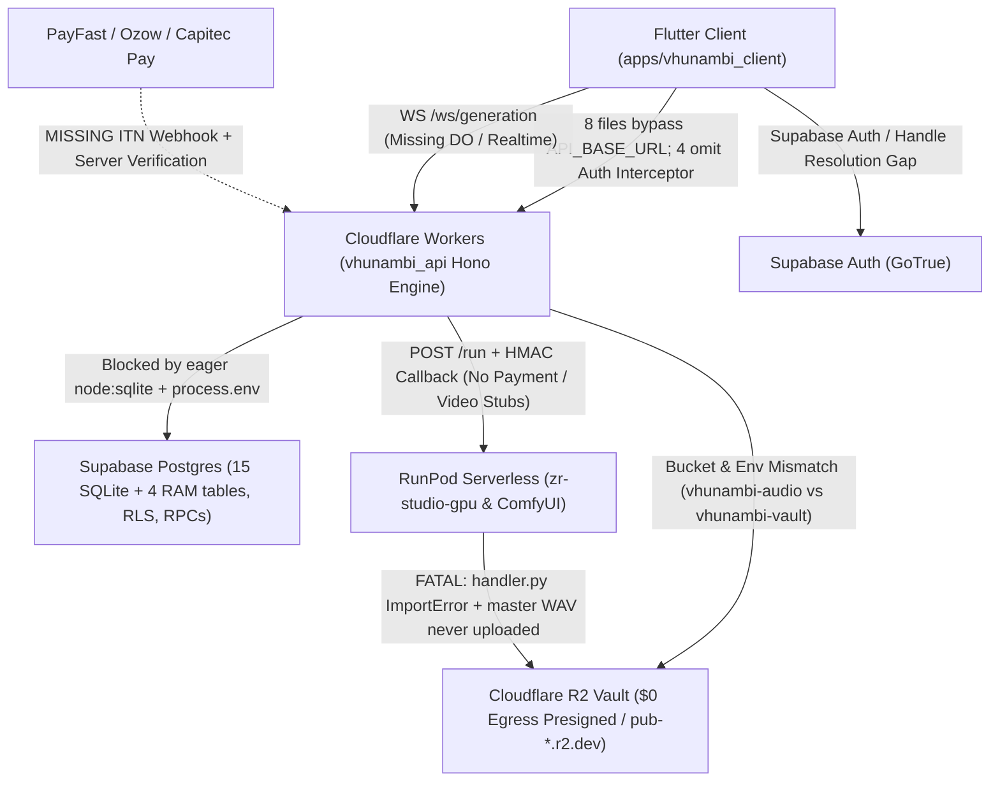

# Phase 62 Forensic Pre-Spec Audit: Hybrid Cloud Stack Topology (Supabase + Cloudflare Workers/R2 + RunPod GPU)

**Audit Date:** November 10, 2026  
**Target Architecture:** Phase 62 — Hybrid Cloud Production Topology (`Supabase Auth & Postgres` + `Cloudflare Workers / Hyperdrive / R2 $0 Egress` + `RunPod Serverless GPU`)  
**Predecessor Baseline:** Phase 61 Complete (`flutter analyze` = 0 issues; 1,497 Flutter tests passing; 18 `apps/vhunambi_api` Node/SQLite test suites passing)  
**Scope Inspected:**
- Backend API Gateway & Persistence: [`apps/vhunambi_api/src/`](file:///c:/Users/Ndugelo/VHUNAMBI/monorepo/apps/vhunambi_api/src/server.ts) (all 14 route modules, [`vhunambi_db.ts`](file:///c:/Users/Ndugelo/VHUNAMBI/monorepo/apps/vhunambi_api/src/db/vhunambi_db.ts), middleware, security, build/CI config)
- Serverless GPU Worker: [`tools/zr-studio-gpu/`](file:///c:/Users/Ndugelo/VHUNAMBI/monorepo/tools/zr-studio-gpu/handler.py) ([`handler.py`](file:///c:/Users/Ndugelo/VHUNAMBI/monorepo/tools/zr-studio-gpu/handler.py), [`mmo_extractor.py`](file:///c:/Users/Ndugelo/VHUNAMBI/monorepo/tools/zr-studio-gpu/mmo_extractor.py), [`stem_mastering_worker.py`](file:///c:/Users/Ndugelo/VHUNAMBI/monorepo/tools/zr-studio-gpu/stem_mastering_worker.py), [`seed_vc_worker.py`](file:///c:/Users/Ndugelo/VHUNAMBI/monorepo/tools/zr-studio-gpu/seed_vc_worker.py), [`Dockerfile`](file:///c:/Users/Ndugelo/VHUNAMBI/monorepo/tools/zr-studio-gpu/Dockerfile), [`requirements.txt`](file:///c:/Users/Ndugelo/VHUNAMBI/monorepo/tools/zr-studio-gpu/requirements.txt))
- Flutter Client Networking & Config: [`apps/vhunambi_client/lib/`](file:///c:/Users/Ndugelo/VHUNAMBI/monorepo/apps/vhunambi_client/lib/core/constants/app_constants.dart) & [`pubspec.yaml`](file:///c:/Users/Ndugelo/VHUNAMBI/monorepo/apps/vhunambi_client/pubspec.yaml)

---

## 1. Executive Summary & Severity Scorecard

### 1.1 Headline Audit Verdict

Migrating Vhunambi onto the **Hybrid Cloud Stack (`Supabase + Cloudflare Workers + Cloudflare R2 + RunPod GPU`)** is architecturally viable with **minimal route signature churn** because [`apps/vhunambi_api`](file:///c:/Users/Ndugelo/VHUNAMBI/monorepo/apps/vhunambi_api/src/server.ts) is already built on Hono and uses edge-compatible [`aws4fetch`](file:///c:/Users/Ndugelo/VHUNAMBI/monorepo/apps/vhunambi_api/src/modules/synthesis/r2_storage.ts#L1) for R2 presigning.

However, this forensic audit identified **23 concrete deployment blockers, security exploits, split-brain bugs, and unimplemented media stubs** that MUST be designed into the Phase 62 specification suite before provisioning credentials or shipping a build:

- **Endpoint Footprint Audited:** **75 unique logical endpoints** (79 registered Hono route handlers including 4 duplicate `remixes` registrations, expanding to **110 concrete HTTP path+method combinations** across `/v1`, `/api`, and `/api/v1` mount aliases in [`server.ts`](file:///c:/Users/Ndugelo/VHUNAMBI/monorepo/apps/vhunambi_api/src/server.ts#L45-L87)) + **3 missing production endpoint families** (`WS /ws/generation`, `GET /v1/vision/:id`, `/api/payments/payfast/*`).
- **Database Schema Gap:** SQLite in [`vhunambi_db.ts`](file:///c:/Users/Ndugelo/VHUNAMBI/monorepo/apps/vhunambi_api/src/db/vhunambi_db.ts#L268-L534) defines **15 tables**; the initial draft Phase 62 SQL snippet only covers **6 tables** (`creators`, `users`, `auth_sessions`, `sync_mutation_log`, `wallet_ledger`, `bank_accounts`) and **1 RPC** (`execute_atomic_payout`), leaving **9 existing SQLite tables** + **4 volatile RAM stores** + **2 financial/licensing RPCs** + **column drift** unmapped.
- **Cloudflare Workers Runtime Blockers:** Zero `wrangler.toml`, zero Worker `fetch(request, env, ctx)` entrypoint, eager top-level `node:sqlite` + `node:fs` initialization at import time ([`vhunambi_db.ts:3490`](file:///c:/Users/Ndugelo/VHUNAMBI/monorepo/apps/vhunambi_api/src/db/vhunambi_db.ts#L3490)), top-level `process.env` reads ([`env.ts`](file:///c:/Users/Ndugelo/VHUNAMBI/monorepo/apps/vhunambi_api/src/config/env.ts#L25-L41)), `process.uptime()` / `process.memoryUsage()` in `/health`, `scryptSync` CPU budget pressure, and `setTimeout` background mock workers killed on response return.
- **RunPod GPU Container (`tools/zr-studio-gpu`) Will Crash on Boot:** Fatal `ImportError` + argument mismatch in [`handler.py`](file:///c:/Users/Ndugelo/VHUNAMBI/monorepo/tools/zr-studio-gpu/handler.py#L33), [`Dockerfile`](file:///c:/Users/Ndugelo/VHUNAMBI/monorepo/tools/zr-studio-gpu/Dockerfile#L20-L22) omits copying `stem_mastering_worker.py` and `seed_vc_worker.py`, `seed_vc_worker.py` never writes audio bytes to disk, and `mmo_extractor.py` never uploads `master_wav_path` to R2 (`audio_url` is `null`).
- **Critical Un-Gated Financial Exploits Still Open:** `POST /api/wallet/topup` ([`wallet_routes.ts:39`](file:///c:/Users/Ndugelo/VHUNAMBI/monorepo/apps/vhunambi_api/src/routes/wallet_routes.ts#L39)) and `POST /api/sync/mutations` (`entityType: 'tip'` at [`vhunambi_db.ts:1316-1317`](file:///c:/Users/Ndugelo/VHUNAMBI/monorepo/apps/vhunambi_api/src/db/vhunambi_db.ts#L1316-L1317)) allow any authenticated user to mint unlimited ZAR & Coins without payment verification; **no PayFast/Ozow ITN webhook exists**.

### 1.2 Risk & Readiness Scorecard

| Severity | Finding Category | Verified Defect Summary | Primary Evidence |
| :---: | :--- | :--- | :--- |
| **P0** | **RunPod Worker Crash & Missing Audio Upload** | Fatal `ImportError` (`master_stems_to_commercial_target`), omitted worker files in `Dockerfile`, `seed_vc_worker` disk no-op, missing `master_mp3_url` R2 upload. | [`handler.py`](file:///c:/Users/Ndugelo/VHUNAMBI/monorepo/tools/zr-studio-gpu/handler.py#L33), [`Dockerfile`](file:///c:/Users/Ndugelo/VHUNAMBI/monorepo/tools/zr-studio-gpu/Dockerfile#L20-L22), [`mmo_extractor.py`](file:///c:/Users/Ndugelo/VHUNAMBI/monorepo/tools/zr-studio-gpu/mmo_extractor.py#L240-L273) |
| **P0** | **Cloudflare Workers Runtime Incompatibility** | Eager `DatabaseSync` (`node:sqlite`), `fs.mkdirSync`, `process.uptime()`, `dotenv.config()`, module-load `process.env`, no `wrangler.toml`, no Worker entrypoint. | [`vhunambi_db.ts`](file:///c:/Users/Ndugelo/VHUNAMBI/monorepo/apps/vhunambi_api/src/db/vhunambi_db.ts#L1-L4), [`env.ts`](file:///c:/Users/Ndugelo/VHUNAMBI/monorepo/apps/vhunambi_api/src/config/env.ts#L1-L41), [`server.ts`](file:///c:/Users/Ndugelo/VHUNAMBI/monorepo/apps/vhunambi_api/src/server.ts#L35-L43) |
| **P0** | **Unlimited Free ZAR/Coin Minting & Missing PayFast ITN** | `POST /api/wallet/topup` and `POST /api/sync/mutations` (`tip`) blindly credit balances; zero PayFast/Ozow ITN webhook or verification; client `topUpCoins()` is local-only. | [`wallet_routes.ts`](file:///c:/Users/Ndugelo/VHUNAMBI/monorepo/apps/vhunambi_api/src/routes/wallet_routes.ts#L39-L50), [`vhunambi_db.ts`](file:///c:/Users/Ndugelo/VHUNAMBI/monorepo/apps/vhunambi_api/src/db/vhunambi_db.ts#L1316-L1317), [`subscription_upgrade_modal.dart`](file:///c:/Users/Ndugelo/VHUNAMBI/monorepo/apps/vhunambi_client/lib/features/home/presentation/widgets/subscription_upgrade_modal.dart#L254) |
| **P0** | **Supabase GoTrue JWT Rejection** | `verifyAccessJwt()` requires `cid` + `sid` claims and `isSessionActive()` checks `public.auth_sessions`; GoTrue JWTs (`sub`, `session_id`, `user_metadata`) fail with `401 AUTH_TOKEN_MALFORMED` / `AUTH_SESSION_REVOKED`. | [`crypto_token.ts`](file:///c:/Users/Ndugelo/VHUNAMBI/monorepo/apps/vhunambi_api/src/security/crypto_token.ts#L181-L189), [`auth_middleware.ts`](file:///c:/Users/Ndugelo/VHUNAMBI/monorepo/apps/vhunambi_api/src/middleware/auth_middleware.ts#L83-L92) |
| **P0** | **Draft Supabase SQL Drops 9 Tables & 1 RPC** | Draft SQL creates 6 of 15 tables, omits `record_beat_license_atomic`, has `creators`/`sync_mutation_log` column drift, and ignores 4 volatile RAM stores. | [`vhunambi_db.ts`](file:///c:/Users/Ndugelo/VHUNAMBI/monorepo/apps/vhunambi_api/src/db/vhunambi_db.ts#L268-L534) |
| **P0** | **Volatile Isolate RAM State in Workers** | `job_store`, `social_service`, `marketplace_service`, `voice_catalog` store mutable state in process `Map`s — completely lost/split across Cloudflare isolates. | [`job_store.ts`](file:///c:/Users/Ndugelo/VHUNAMBI/monorepo/apps/vhunambi_api/src/modules/jobs/job_store.ts#L4), [`social_service.ts`](file:///c:/Users/Ndugelo/VHUNAMBI/monorepo/apps/vhunambi_api/src/modules/social/social_service.ts#L19-L36), [`marketplace_service.ts`](file:///c:/Users/Ndugelo/VHUNAMBI/monorepo/apps/vhunambi_api/src/modules/marketplace/marketplace_service.ts#L14-L15) |
| **P1** | **Split-Brain Creator Wallet & Double Royalty Credit** | `HttpSocialRepository` calls `GET /api/creators/:id/wallet` (volatile RAM), leaving SQLite `GET /api/wallet/:creatorId` unused by Flutter; `licenseBeat()` credits seller in both SQLite and volatile RAM. | [`http_social_repository.dart`](file:///c:/Users/Ndugelo/VHUNAMBI/monorepo/apps/vhunambi_client/lib/features/social/data/repositories/http_social_repository.dart#L459-L461), [`marketplace_service.ts`](file:///c:/Users/Ndugelo/VHUNAMBI/monorepo/apps/vhunambi_api/src/modules/marketplace/marketplace_service.ts#L426-L483) |
| **P1** | **Unauthenticated Costly AI & Write Endpoints** | 7 route modules (`explore`, `generation`, `lyrics`, `vision`, `voices`, `melodies`, 10 `social` routes) + `POST /api/marketplace/beats` & `DELETE /api/marketplace/beats/:id` lack auth/tenant checks. | [`explore_routes.ts`](file:///c:/Users/Ndugelo/VHUNAMBI/monorepo/apps/vhunambi_api/src/routes/explore_routes.ts), [`social_routes.ts`](file:///c:/Users/Ndugelo/VHUNAMBI/monorepo/apps/vhunambi_api/src/routes/social_routes.ts), [`lyrics_routes.ts`](file:///c:/Users/Ndugelo/VHUNAMBI/monorepo/apps/vhunambi_api/src/routes/lyrics_routes.ts) |
| **P1** | **Flutter Base URL Fragmentation & `/v1` Trap** | 8 Flutter classes hardcode `localhost:3000` / `10.0.2.2:3000` / `api.vhunambi.com`; `AppConstants.apiBaseUrl` defaults to stale `vhunambi-api.zaniaexplore.co.za/v1`; 4 HTTP services omit `authDioInterceptorProvider`. | [`app_constants.dart`](file:///c:/Users/Ndugelo/VHUNAMBI/monorepo/apps/vhunambi_client/lib/core/constants/app_constants.dart#L9-L21), [`edge_sync_coordinator.dart`](file:///c:/Users/Ndugelo/VHUNAMBI/monorepo/apps/vhunambi_client/lib/core/sync/edge_sync_coordinator.dart#L133-L139) |
| **P1** | **Missing WebSocket Server (`WS /ws/generation`)** | Both `generationRoutes` (`ws://localhost:3000/ws/generation`) and `GenerationSocketService` (`wss://api.vhunambi.com/ws/generation`) point to a WebSocket endpoint that does not exist in `apps/vhunambi_api`. | [`generation_routes.ts`](file:///c:/Users/Ndugelo/VHUNAMBI/monorepo/apps/vhunambi_api/src/routes/generation_routes.ts#L89), [`generation_socket_service.dart`](file:///c:/Users/Ndugelo/VHUNAMBI/monorepo/apps/vhunambi_client/lib/features/studio/data/services/generation_socket_service.dart#L20) |
| **P1** | **Dead Media Domains & R2 Env/Bucket Collisions** | 135 backend lines + 171 Flutter lines embed unresolved domains (`cdn.vhunambi.com`, `cdn.vhunambi.za`, `r2.vhunambi.com`, `assets.vhunambi.com`, `vhunambi.za`, `/mock-storage/*`). Bucket names diverge (`vhunambi-audio` vs `vhunambi-vault`). | [`env.ts`](file:///c:/Users/Ndugelo/VHUNAMBI/monorepo/apps/vhunambi_api/src/config/env.ts#L15), [`mmo_extractor.py`](file:///c:/Users/Ndugelo/VHUNAMBI/monorepo/tools/zr-studio-gpu/mmo_extractor.py#L212-L216) |
| **P2** | **Stubbed Video Render, Sound Signature & Grok Handlers** | `POST /v1/vision/render-video`, Flutter `CloudVideoExportService`, `POST /v1/voices/signatures` presign, `POST /v1/lyrics/refine`, `GET /social/clips/:id/remixes` (5x dupes), and `GROK_API_KEY` are stubs/dead code. | [`vision_routes.ts`](file:///c:/Users/Ndugelo/VHUNAMBI/monorepo/apps/vhunambi_api/src/routes/vision_routes.ts#L103-L136), [`voice_routes.ts`](file:///c:/Users/Ndugelo/VHUNAMBI/monorepo/apps/vhunambi_api/src/routes/voice_routes.ts#L161), [`llm_handler.ts`](file:///c:/Users/Ndugelo/VHUNAMBI/monorepo/apps/vhunambi_api/src/modules/lyrics/llm_handler.ts#L123-L166) |

### 1.3 Hybrid Stack Architecture & Audited Critical Gaps Flow



---

## 2. Master Endpoint-by-Endpoint Inventory & Cloud Mapping Matrix

### 2.1 System & Static Storage Routes ([`server.ts`](file:///c:/Users/Ndugelo/VHUNAMBI/monorepo/apps/vhunambi_api/src/server.ts#L45-L56))

| Method & Mounted Path(s) | Auth & Tenant Gate | Current Storage / Runtime | Target Hybrid Stack Layer | Flutter Client Status | Phase 62 Action Required |
| :--- | :--- | :--- | :--- | :--- | :--- |
| `GET /health`, `GET /v1/health` | Public (`cors` only) | Uses `process.uptime()`, `process.memoryUsage().rss`, RAM `countActiveJobs()` | Cloudflare Workers (`Date.now() - bootTs`, safe `typeof process` guard, DB `generation_jobs` count) | Manual smoke check | Remove Node-only `process.memoryUsage()` assumption; add optional DB/R2 probe flag. |
| `GET /mock-storage/:filename` | Public | Returns plaintext string `"Mock Audio Binary Content..."` | Dev-only OR proxy `env.VHUNAMBI_VAULT.get(key)` streaming R2 bytes in prod (`GET /r2/*`) | Used by `vocal_identity_models.dart` (24x) & `mastering_session_provider.dart` | Replace plaintext mock with R2 public dev URL / Worker R2 binding stream / presigned URLs. |

### 2.2 Sovereign Identity & Auth ([`auth_routes.ts`](file:///c:/Users/Ndugelo/VHUNAMBI/monorepo/apps/vhunambi_api/src/routes/auth_routes.ts#L1-L167))

Mounted identically at `/v1/auth/*`, `/api/auth/*`, and `/api/v1/auth/*` ([`server.ts:73-75`](file:///c:/Users/Ndugelo/VHUNAMBI/monorepo/apps/vhunambi_api/src/server.ts#L73-L75)).

| Method & Endpoint | Auth & Tenant Gate | Current Storage / Runtime | Target Hybrid Stack Layer | Flutter Client Caller & Status | Phase 62 Action Required |
| :--- | :--- | :--- | :--- | :--- | :--- |
| `POST /*/auth/register` | Public | SQLite `creators`, `users` (`scryptSync`), `wallet_ledger` genesis coins, `auth_sessions` | Supabase GoTrue `auth.admin.createUser` / `/signup` + Postgres `auth.users` trigger -> `creators`, `users`, `wallet_ledger` | [`SovereignAuthRepository.register`](file:///c:/Users/Ndugelo/VHUNAMBI/monorepo/apps/vhunambi_client/lib/core/auth/sovereign_auth_repository.dart#L136) (uses hardcoded `resolveApiRootUrl()`) | Proxy registration to GoTrue + auto-provision creator profile & welcome coins; keep response shape `AuthTokenBundle`. |
| `POST /*/auth/login` | Public | SQLite lookup by `email \| handle \| creator_id`, `scryptSync` verify, HS256 JWT | Supabase GoTrue `/token?grant_type=password` after Postgres handle-to-email lookup | [`SovereignAuthRepository.login`](file:///c:/Users/Ndugelo/VHUNAMBI/monorepo/apps/vhunambi_client/lib/core/auth/sovereign_auth_repository.dart#L184) (uses `resolveApiRootUrl()`) | Resolve `@handle` -> email in Postgres first, then authenticate via GoTrue (supports 1-tap studio switching). |
| `POST /*/auth/refresh` | Refresh Token Body | SQLite `auth_sessions` rotation + reuse detection | Supabase GoTrue `/token?grant_type=refresh_token` | [`SovereignAuthRepository.refresh`](file:///c:/Users/Ndugelo/VHUNAMBI/monorepo/apps/vhunambi_client/lib/core/auth/sovereign_auth_repository.dart#L228) via [`SovereignApiClient`](file:///c:/Users/Ndugelo/VHUNAMBI/monorepo/apps/vhunambi_client/lib/core/network/sovereign_api_client.dart#L29) | Delegate refresh rotation to GoTrue `/token?grant_type=refresh_token` + normalize response to `AuthTokenBundle`. |
| `POST /*/auth/logout` | `sovereignAuthMiddleware` | SQLite `UPDATE auth_sessions SET revoked=1` | Supabase GoTrue `/logout` (`scope=local`) + Worker revocation check | [`SovereignAuthRepository.logout`](file:///c:/Users/Ndugelo/VHUNAMBI/monorepo/apps/vhunambi_client/lib/core/auth/sovereign_auth_repository.dart#L261) | Revoke GoTrue session; return `{ loggedOut: true }` cleanly. |
| `GET /*/auth/me` | `requireAuthenticatedUser` | SQLite `users` + `creators` + `wallet_ledger` | Supabase Postgres via `IDatabaseAdapter` keyed on `authUser.creatorId` | [`SovereignAuthRepository.fetchMe`](file:///c:/Users/Ndugelo/VHUNAMBI/monorepo/apps/vhunambi_client/lib/core/auth/sovereign_auth_repository.dart#L289) | Support both GoTrue JWTs and local test JWTs in `auth_middleware.ts`. |
| `GET /*/auth/sessions` | `requireAuthenticatedUser` | SQLite `auth_sessions` | Supabase `auth.sessions` (via Service Role/Postgres RPC) or Worker session metadata | [`SovereignAuthRepository.fetchSessions`](file:///c:/Users/Ndugelo/VHUNAMBI/monorepo/apps/vhunambi_client/lib/core/auth/sovereign_auth_repository.dart#L309) | Adapt query so `GET /auth/sessions` works with GoTrue `auth.sessions` in prod and `auth_sessions` in SQLite tests. |

### 2.3 Explore & Heritage Discovery ([`explore_routes.ts`](file:///c:/Users/Ndugelo/VHUNAMBI/monorepo/apps/vhunambi_api/src/routes/explore_routes.ts#L1-L92))

Mounted at `/api/explore/*` and `/api/v1/explore/*` ([`server.ts:78-79`](file:///c:/Users/Ndugelo/VHUNAMBI/monorepo/apps/vhunambi_api/src/server.ts#L78-L79)).

| Method & Endpoint | Auth & Tenant Gate | Current Storage / Runtime | Target Hybrid Stack Layer | Flutter Client Caller & Status | Phase 62 Action Required |
| :--- | :--- | :--- | :--- | :--- | :--- |
| `GET /*/explore` | **NONE** (public read OK) | SQLite `explore_tracks`, `kinetic_posts` | Cloudflare Workers -> Supabase Postgres + R2 public URLs | [`HttpExploreRepository.fetchExploreBundle`](file:///c:/Users/Ndugelo/VHUNAMBI/monorepo/apps/vhunambi_client/lib/features/explore/data/repositories/http_explore_repository.dart#L104) (**no auth interceptor**, hardcoded `localhost:3000/api`) | Move seeded `cdn.vhunambi.za` track/cover URLs to R2 public URLs; add `authDioInterceptorProvider`. |
| `GET /*/explore/tracks` | **NONE** (public read OK) | SQLite `explore_tracks` | Cloudflare Workers -> Postgres (`explore_tracks`) | [`HttpExploreRepository`](file:///c:/Users/Ndugelo/VHUNAMBI/monorepo/apps/vhunambi_client/lib/features/explore/data/repositories/http_explore_repository.dart) (hardcoded URL) | Migrate query + ranking to Postgres; wire `API_BASE_URL`. |
| `POST /*/explore/tracks` | **NONE (P1 Hole)** | SQLite `explore_tracks` | **Add `sovereignAuthMiddleware` + `assertTenantCreatorAccess`** -> Postgres | None direct (also via `/sync/mutations`) | Lock write route behind auth + creator ownership; enforce R2 asset URL validation. |
| `GET /*/explore/radio/:genre` | **NONE** (public read OK) | SQLite `explore_tracks` | Cloudflare Workers -> Postgres + Edge Cache (`Cache-Control`) | [`exploreGenreRadioProvider`](file:///c:/Users/Ndugelo/VHUNAMBI/monorepo/apps/vhunambi_client/lib/features/explore/presentation/providers/explore_providers.dart#L111-L115) | Rewrite URL assets to R2; wire `API_BASE_URL`. |
| `GET /*/explore/feed` | **NONE** (public read OK) | SQLite `kinetic_posts` | Cloudflare Workers -> Postgres (`kinetic_posts`) | [`HttpExploreRepository`](file:///c:/Users/Ndugelo/VHUNAMBI/monorepo/apps/vhunambi_client/lib/features/explore/data/repositories/http_explore_repository.dart) | Migrate to Postgres `kinetic_posts`. |
| `POST /*/explore/posts/:id/cosign` | **NONE (P1 Spoofing Hole)** | SQLite `kinetic_posts` | **Add `sovereignAuthMiddleware`** -> Postgres atomic counter + dedupe | [`HttpExploreRepository`](file:///c:/Users/Ndugelo/VHUNAMBI/monorepo/apps/vhunambi_client/lib/features/explore/data/repositories/http_explore_repository.dart) (**no auth interceptor**) | Require auth (under strict mode) and resolve actor `creatorId` from JWT rather than trusting body blindly. |
| `POST /*/explore/posts/:id/repost` | **NONE (P1 Spoofing Hole)** | SQLite `kinetic_posts` | **Add `sovereignAuthMiddleware`** -> Postgres atomic increment | [`HttpExploreRepository`](file:///c:/Users/Ndugelo/VHUNAMBI/monorepo/apps/vhunambi_client/lib/features/explore/data/repositories/http_explore_repository.dart) (**no auth interceptor**) | Add `sovereignAuthMiddleware`; inject `authDioInterceptorProvider` in [`exploreRepositoryProvider`](file:///c:/Users/Ndugelo/VHUNAMBI/monorepo/apps/vhunambi_client/lib/features/explore/presentation/providers/explore_providers.dart#L106-L108). |

### 2.4 Cloud Vault Library ([`library_routes.ts`](file:///c:/Users/Ndugelo/VHUNAMBI/monorepo/apps/vhunambi_api/src/routes/library_routes.ts#L1-L98))

Mounted at `/api/library/*` and `/api/v1/library/*` ([`server.ts:80-81`](file:///c:/Users/Ndugelo/VHUNAMBI/monorepo/apps/vhunambi_api/src/server.ts#L80-L81)).

| Method & Endpoint | Auth & Tenant Gate | Current Storage / Runtime | Target Hybrid Stack Layer | Flutter Client Caller & Status | Phase 62 Action Required |
| :--- | :--- | :--- | :--- | :--- | :--- |
| `GET /*/library` | `sovereignAuthMiddleware` + `assertTenantCreatorAccess` | SQLite `user_library_sync` | Cloudflare Workers -> Supabase Postgres (`user_library_sync` + RLS) | [`HttpLibrarySyncRepository`](file:///c:/Users/Ndugelo/VHUNAMBI/monorepo/apps/vhunambi_client/lib/features/library/data/repositories/http_library_sync_repository.dart#L80) (interceptor wired, **hardcoded `:3000/api`**) | Port LWW queries to `PostgresDatabaseAdapter`; fix hardcoded Flutter URL. |
| `GET /*/library/sync` | `sovereignAuthMiddleware` + `assertTenantCreatorAccess` | SQLite `user_library_sync` | Cloudflare Workers -> Supabase Postgres | [`HttpLibrarySyncRepository`](file:///c:/Users/Ndugelo/VHUNAMBI/monorepo/apps/vhunambi_client/lib/features/library/data/repositories/http_library_sync_repository.dart#L80) | Same as above + return monotonic Postgres `BIGSERIAL seq`. |
| `POST /*/library/sync` | `sovereignAuthMiddleware` + `assertTenantCreatorAccess` | SQLite `user_library_sync` + `sync_mutation_log` | Cloudflare Workers -> Postgres transactional LWW upsert + `sync_mutation_log` | [`HttpLibrarySyncRepository`](file:///c:/Users/Ndugelo/VHUNAMBI/monorepo/apps/vhunambi_client/lib/features/library/data/repositories/http_library_sync_repository.dart#L80) | Wrap LWW upsert + mutation log append in one Postgres transaction. |
| `DELETE /*/library/:id` | `sovereignAuthMiddleware` + owner check | SQLite `user_library_sync` | Cloudflare Workers -> Postgres + optional R2 key cleanup | [`HttpLibrarySyncRepository`](file:///c:/Users/Ndugelo/VHUNAMBI/monorepo/apps/vhunambi_client/lib/features/library/data/repositories/http_library_sync_repository.dart#L80) | Migrate to Postgres; ensure user-owned private stems in R2 are reference-counted before cleanup. |

### 2.5 Playlists & Sharing ([`playlist_routes.ts`](file:///c:/Users/Ndugelo/VHUNAMBI/monorepo/apps/vhunambi_api/src/routes/playlist_routes.ts#L1-L196))

Mounted at `/api/playlists/*` and `/api/v1/playlists/*` ([`server.ts:82-83`](file:///c:/Users/Ndugelo/VHUNAMBI/monorepo/apps/vhunambi_api/src/server.ts#L82-L83)).

| Method & Endpoint | Auth & Tenant Gate | Current Storage / Runtime | Target Hybrid Stack Layer | Flutter Client Caller & Status | Phase 62 Action Required |
| :--- | :--- | :--- | :--- | :--- | :--- |
| `GET /*/playlists` | `sovereignAuthMiddleware` + `assertTenantCreatorAccess` | SQLite `playlists` | Cloudflare Workers -> Postgres (`playlists`) | [`PlaylistRepository`](file:///c:/Users/Ndugelo/VHUNAMBI/monorepo/apps/vhunambi_client/lib/features/playlists/data/repositories/playlist_repository.dart#L74) (interceptor wired, **hardcoded `:3000/api`**) | Add `playlists` table to Supabase SQL; fix Flutter URL. |
| `GET /*/playlists/:id` | `sovereignAuthMiddleware` + private owner check | SQLite `playlists` | Cloudflare Workers -> Postgres | [`PlaylistRepository`](file:///c:/Users/Ndugelo/VHUNAMBI/monorepo/apps/vhunambi_client/lib/features/playlists/data/repositories/playlist_repository.dart#L74) | Support lookup by `id` or `share_code`. |
| `POST /*/playlists` | `sovereignAuthMiddleware` + owner check | SQLite `playlists` | Cloudflare Workers -> Postgres + `sync_mutation_log` | [`PlaylistRepository`](file:///c:/Users/Ndugelo/VHUNAMBI/monorepo/apps/vhunambi_client/lib/features/playlists/data/repositories/playlist_repository.dart#L74) | Port upsert to Postgres transaction. |
| `PUT /*/playlists/:id` | `sovereignAuthMiddleware` + owner check | SQLite `playlists` | Cloudflare Workers -> Postgres + `sync_mutation_log` | [`PlaylistRepository`](file:///c:/Users/Ndugelo/VHUNAMBI/monorepo/apps/vhunambi_client/lib/features/playlists/data/repositories/playlist_repository.dart#L74) | Port update to Postgres transaction. |
| `DELETE /*/playlists/:id` | `sovereignAuthMiddleware` + owner check | SQLite `playlists` | Cloudflare Workers -> Postgres + `sync_mutation_log` | [`PlaylistRepository`](file:///c:/Users/Ndugelo/VHUNAMBI/monorepo/apps/vhunambi_client/lib/features/playlists/data/repositories/playlist_repository.dart#L74) | Port delete to Postgres transaction. |
| `POST /*/playlists/:id/share` | `sovereignAuthMiddleware` + owner check | SQLite `playlists`; mints `https://vhunambi.za/p/${shareCode}` ([`L2479`](file:///c:/Users/Ndugelo/VHUNAMBI/monorepo/apps/vhunambi_api/src/db/vhunambi_db.ts#L2479)) | Cloudflare Workers -> Postgres (`playlists`) | [`PlaylistRepository`](file:///c:/Users/Ndugelo/VHUNAMBI/monorepo/apps/vhunambi_client/lib/features/playlists/data/repositories/playlist_repository.dart#L378) | Since app has no custom domain, route `shareUrl` to Worker share handler (`https://<worker>.workers.dev/p/$code`) + App Deep Link `vhunambi://p/$code`. |

### 2.6 Wallet, SA Banking & Missing Payment Gateway ([`wallet_routes.ts`](file:///c:/Users/Ndugelo/VHUNAMBI/monorepo/apps/vhunambi_api/src/routes/wallet_routes.ts#L1-L82))

Mounted at `/api/wallet/*` and `/api/v1/wallet/*` ([`server.ts:84-85`](file:///c:/Users/Ndugelo/VHUNAMBI/monorepo/apps/vhunambi_api/src/server.ts#L84-L85)).

| Method & Endpoint | Auth & Tenant Gate | Current Storage / Runtime | Target Hybrid Stack Layer | Flutter Client Caller & Status | Phase 62 Action Required |
| :--- | :--- | :--- | :--- | :--- | :--- |
| `GET /*/wallet/banks` | `sovereignAuthMiddleware` (public metadata OK) | Hardcoded `SA_BANK_REGISTRY` | Cloudflare Workers static metadata | [`HttpSocialRepository.fetchSupportedBanks`](file:///c:/Users/Ndugelo/VHUNAMBI/monorepo/apps/vhunambi_client/lib/features/social/data/repositories/http_social_repository.dart#L515) | Keep Edge static JSON; ensure no Node deps. |
| `GET /*/wallet/:creatorId` | `sovereignAuthMiddleware` + `assertTenantCreatorAccess` | SQLite `wallet_ledger` | Cloudflare Workers -> Postgres (`wallet_ledger`) | **ZERO Flutter callers!** (Flutter calls `/creators/:id/wallet`) | Unify wallet read onto `wallet_ledger` and switch `HttpSocialRepository` to `/wallet/:creatorId`. |
| `POST /*/wallet/topup` | `sovereignAuthMiddleware` + `assertTenantCreatorAccess` | **EXPLOITABLE:** Blind `INSERT INTO wallet_ledger` | Gate behind admin/test-mode or signed Payment Gateway verification; production coins only via verified ITN webhook | **ZERO Flutter callers!** (`SubscriptionUpgradeModal` only calls local `topUpCoins()`) | **Disable unverified `/wallet/topup` in `NODE_ENV=production`**; replace with PayFast/Ozow checkout session + verified ITN webhook! |
| `POST /*/wallet/payout` | `sovereignAuthMiddleware` + `assertTenantCreatorAccess` | SQLite `BEGIN IMMEDIATE` -> `bank_accounts` + `wallet_ledger` + `sync_mutation_log` | Cloudflare Workers -> Supabase RPC `execute_atomic_payout(...)` (`FOR UPDATE` balance check) | [`HttpSocialRepository.requestPayout`](file:///c:/Users/Ndugelo/VHUNAMBI/monorepo/apps/vhunambi_client/lib/features/social/data/repositories/http_social_repository.dart#L587) (when structured bank present) | Wire to `execute_atomic_payout` RPC; add idempotency key + realistic `pending_settlement` status instead of fake instant EFT unless settlement API integrated. |
| *(NEW)* `POST /api/payments/payfast/checkout` | **MISSING** | Does not exist | Cloudflare Workers -> creates `payment_topups` row (`pending`) + returns PayFast/Ozow signed redirect URL | Needed by [`subscription_upgrade_modal.dart`](file:///c:/Users/Ndugelo/VHUNAMBI/monorepo/apps/vhunambi_client/lib/features/home/presentation/widgets/subscription_upgrade_modal.dart#L254) | Author in Phase 62 spec: checkout initiation endpoint for ZAR Coin packs & Pro plans. |
| *(NEW)* `POST /api/payments/payfast/itn` | **MISSING** | Does not exist | Cloudflare Workers -> verifies PayFast MD5/passphrase signature, source IP, amount match, server-to-server `/eng/query/validate`, then atomically credits `wallet_ledger` | PayFast/Ozow Server Callback | Author in Phase 62 spec with idempotent `pf_payment_id` deduplication table `payment_webhook_events`. |

### 2.7 Delta Sync Engine ([`sync_routes.ts`](file:///c:/Users/Ndugelo/VHUNAMBI/monorepo/apps/vhunambi_api/src/routes/sync_routes.ts#L1-L106))

Mounted at `/api/sync/*` and `/api/v1/sync/*` ([`server.ts:86-87`](file:///c:/Users/Ndugelo/VHUNAMBI/monorepo/apps/vhunambi_api/src/server.ts#L86-L87)).

| Method & Endpoint | Auth & Tenant Gate | Current Storage / Runtime | Target Hybrid Stack Layer | Flutter Client Caller & Status | Phase 62 Action Required |
| :--- | :--- | :--- | :--- | :--- | :--- |
| `POST /*/sync/mutations` | `sovereignAuthMiddleware` + payload owner check | SQLite `SAVEPOINT` loop -> `sync_mutation_log`, `library_track`, `playlist`, `explore_tracks`, `beat_licenses`, `tip` -> **`topupWallet()`**! | Cloudflare Workers -> Postgres transactional batch / RPC (`apply_sync_mutations_batch`) | [`EdgeSyncCoordinator.syncNow`](file:///c:/Users/Ndugelo/VHUNAMBI/monorepo/apps/vhunambi_client/lib/core/sync/edge_sync_coordinator.dart#L232) (uses `authHeadersBuilder`, **hardcoded `:3000`**) | **CRITICAL:** Reject or debit sender ledger for `entityType === 'tip'` & reject unverified `amountPaidCoins` overrides on `beat_license` (price MUST come from server catalog)! Wire `API_BASE_URL` in Flutter. |
| `GET /*/sync/delta` | `sovereignAuthMiddleware` + `assertTenantCreatorAccess` | SQLite `sync_mutation_log` (`LIMIT 3x` fetched then JS filtered!) + `ETag` `304` | Cloudflare Workers -> Postgres indexed SQL filtering (`creator_id = $2 OR entity_type IN (...)`) + `ETag` | [`EdgeSyncCoordinator.syncNow`](file:///c:/Users/Ndugelo/VHUNAMBI/monorepo/apps/vhunambi_client/lib/core/sync/edge_sync_coordinator.dart#L337-L338) | Replace JS-side 3x overfetch filter with SQL `WHERE` clause on `(creator_id, seq)` so dense multi-tenant traffic never starves pagination. |

### 2.8 Beats Marketplace & Cryptographic Licensing ([`marketplace_routes.ts`](file:///c:/Users/Ndugelo/VHUNAMBI/monorepo/apps/vhunambi_api/src/routes/marketplace_routes.ts#L1-L175))

Mounted at `/api/marketplace/*` ([`server.ts:70`](file:///c:/Users/Ndugelo/VHUNAMBI/monorepo/apps/vhunambi_api/src/server.ts#L70)).

| Method & Endpoint | Auth & Tenant Gate | Current Storage / Runtime | Target Hybrid Stack Layer | Flutter Client Caller & Status | Phase 62 Action Required |
| :--- | :--- | :--- | :--- | :--- | :--- |
| `GET /api/marketplace/beats` | `sovereignAuthMiddleware` | **VOLATILE RAM** `Map` `marketplaceBeats` ([`marketplace_service.ts:14`](file:///c:/Users/Ndugelo/VHUNAMBI/monorepo/apps/vhunambi_api/src/modules/marketplace/marketplace_service.ts#L14)); `r2.vhunambi.com` URLs | Cloudflare Workers -> Postgres (`marketplace_assets`) + R2 URLs | [`HttpMarketplaceRepository`](file:///c:/Users/Ndugelo/VHUNAMBI/monorepo/apps/vhunambi_client/lib/features/marketplace/data/repositories/http_marketplace_repository.dart#L64) (interceptor wired, hardcoded `:3000`) | Eliminate RAM `marketplaceBeats`; read/seed directly in `marketplace_assets` Postgres table; replace `r2.vhunambi.com` URLs. |
| `GET /api/marketplace/beats/:id` | `sovereignAuthMiddleware` | **VOLATILE RAM** `marketplaceBeats.get(id)` | Cloudflare Workers -> Postgres (`marketplace_assets`) | [`HttpMarketplaceRepository`](file:///c:/Users/Ndugelo/VHUNAMBI/monorepo/apps/vhunambi_client/lib/features/marketplace/data/repositories/http_marketplace_repository.dart) | Query `marketplace_assets`. |
| `POST /api/marketplace/beats` | `sovereignAuthMiddleware` (**NO Tenant Check!**) | **VOLATILE RAM** `marketplaceBeats.set()` (trusts any `producerId` in body!) | Cloudflare Workers -> Postgres (`marketplace_assets`) + **enforce `assertTenantCreatorAccess` / overwrite `producerId` from JWT** | [`HttpMarketplaceRepository`](file:///c:/Users/Ndugelo/VHUNAMBI/monorepo/apps/vhunambi_client/lib/features/marketplace/data/repositories/http_marketplace_repository.dart) | Persist in Postgres + enforce producer ownership on upsert. |
| `DELETE /api/marketplace/beats/:id` | `sovereignAuthMiddleware` (**NO Owner Check!**) | **VOLATILE RAM** `marketplaceBeats.delete(id)` (any user can delete Kabza/seed beats!) | Cloudflare Workers -> Postgres (`marketplace_assets`) + **enforce `producer_id === authUser.creatorId`** | [`HttpMarketplaceRepository`](file:///c:/Users/Ndugelo/VHUNAMBI/monorepo/apps/vhunambi_client/lib/features/marketplace/data/repositories/http_marketplace_repository.dart) | Enforce producer ownership check before delete + prevent deleting beats with active exclusive buyouts. |
| `POST /api/marketplace/beats/:id/license` | `sovereignAuthMiddleware` + `assertTenantCreatorAccess` | Reads RAM beat -> SQLite `recordBeatLicenseAtomic` + **double-credits RAM `social_service` wallet**! | Cloudflare Workers -> **Postgres RPC `record_beat_license_atomic(...)`** + R2 presigned stem delivery | [`HttpMarketplaceRepository`](file:///c:/Users/Ndugelo/VHUNAMBI/monorepo/apps/vhunambi_client/lib/features/marketplace/data/repositories/http_marketplace_repository.dart) | Read beat from DB (`FOR UPDATE` row lock), remove duplicate RAM `creditProducerBeatRoyalty`, deliver R2 presigned stem URLs. |
| `GET /api/marketplace/licenses/verify/:certificateId` | `sovereignAuthMiddleware` | SQLite `beat_licenses` SHA-256 verification | Cloudflare Workers -> Postgres (`beat_licenses`) WebCrypto/crypto SHA-256 verification | Public/Client certificate verifier | Allow public or authenticated read of verification receipt; port hash check to WebCrypto/`node:crypto` (`nodejs_compat`). |
| `GET /api/marketplace/licenses/:buyerId` | `sovereignAuthMiddleware` + `assertTenantCreatorAccess` | Reads RAM `userLicenses` first, falls back to SQLite `beat_licenses` | Cloudflare Workers -> Postgres (`beat_licenses`) directly | [`HttpMarketplaceRepository`](file:///c:/Users/Ndugelo/VHUNAMBI/monorepo/apps/vhunambi_client/lib/features/marketplace/data/repositories/http_marketplace_repository.dart) | Drop RAM `userLicenses`; read `beat_licenses` + hydrate fresh R2 presigned stem URLs. |
| `GET /api/marketplace/producers/:producerId/beats` | `sovereignAuthMiddleware` | **VOLATILE RAM** `marketplaceBeats` filter | Cloudflare Workers -> Postgres (`marketplace_assets`) | [`HttpMarketplaceRepository`](file:///c:/Users/Ndugelo/VHUNAMBI/monorepo/apps/vhunambi_client/lib/features/marketplace/data/repositories/http_marketplace_repository.dart) | Query `marketplace_assets WHERE producer_id = $1`. |

### 2.9 Social Creator Network ([`social_routes.ts`](file:///c:/Users/Ndugelo/VHUNAMBI/monorepo/apps/vhunambi_api/src/routes/social_routes.ts#L1-L359))

Mounted at `/api/*` ([`server.ts:67`](file:///c:/Users/Ndugelo/VHUNAMBI/monorepo/apps/vhunambi_api/src/server.ts#L67)). **10 of 12 endpoints lack `sovereignAuthMiddleware`, and 100% of `social_service.ts` state lives in volatile RAM `Map`/`Set` globals.**

| Method & Endpoint | Auth & Tenant Gate | Current Storage / Runtime | Target Hybrid Stack Layer | Flutter Client Caller & Status | Phase 62 Action Required |
| :--- | :--- | :--- | :--- | :--- | :--- |
| `POST /api/social/publish` | **NONE** (spoofable `creatorId`) | **VOLATILE RAM** `clips` Map ([`social_service.ts:19`](file:///c:/Users/Ndugelo/VHUNAMBI/monorepo/apps/vhunambi_api/src/modules/social/social_service.ts#L19)) (ignores SQLite `published_clips`!) | **`sovereignAuthMiddleware` + `assertTenantCreatorAccess`** -> Postgres `published_clips` + R2 assets | [`HttpSocialRepository`](file:///c:/Users/Ndugelo/VHUNAMBI/monorepo/apps/vhunambi_client/lib/features/social/data/repositories/http_social_repository.dart#L66) (interceptor wired, hardcoded `:3000/api`) | Migrate to `published_clips` Postgres table; fix dead `cdn.vhunambi.com` / `vhunambi.com` share URLs. |
| `GET /api/social/feed` | **NONE** (public OK) | **VOLATILE RAM** `clips` Map | Postgres `published_clips` + user-scoped `isLikedByMe` join | [`HttpSocialRepository.getFeed`](file:///c:/Users/Ndugelo/VHUNAMBI/monorepo/apps/vhunambi_client/lib/features/social/data/repositories/http_social_repository.dart#L75) | Read cursor-paginated feed from Postgres `published_clips`. |
| `POST /api/social/clips/:id/like` | **NONE** (global bool toggle!) | **VOLATILE RAM** mutates `clip.isLikedByMe` globally for ALL users | **`sovereignAuthMiddleware`** -> Postgres `social_likes (clip_id, creator_id)` | [`HttpSocialRepository`](file:///c:/Users/Ndugelo/VHUNAMBI/monorepo/apps/vhunambi_client/lib/features/social/data/repositories/http_social_repository.dart) | Replace global boolean toggle with per-user `social_likes` table + derived count. |
| `GET /api/social/clips/:id/remixes` | **NONE** (**registered 5 duplicate times!** [`L138,187,216,223,355`](file:///c:/Users/Ndugelo/VHUNAMBI/monorepo/apps/vhunambi_api/src/routes/social_routes.ts#L138)) | **VOLATILE RAM** `clips` scan | Postgres `published_clips WHERE remixed_from_clip_id = $1` | [`HttpSocialRepository`](file:///c:/Users/Ndugelo/VHUNAMBI/monorepo/apps/vhunambi_client/lib/features/social/data/repositories/http_social_repository.dart) | Deduplicate to 1 route registration; back with indexed `remixed_from_clip_id` column. |
| `GET /api/social/clips/:id/comments` | **NONE** (public OK) | **VOLATILE RAM** `commentsByClip` Map (ignores SQLite `reel_comments`!) | Postgres `reel_comments` | [`HttpSocialRepository`](file:///c:/Users/Ndugelo/VHUNAMBI/monorepo/apps/vhunambi_client/lib/features/social/data/repositories/http_social_repository.dart) | Read from `reel_comments` Postgres table. |
| `POST /api/social/clips/:id/comments` | **NONE** (spoofable `userId`) | **VOLATILE RAM** `commentsByClip` | **`sovereignAuthMiddleware` + `resolveEffectiveCreatorId`** -> Postgres `reel_comments` | [`HttpSocialRepository`](file:///c:/Users/Ndugelo/VHUNAMBI/monorepo/apps/vhunambi_client/lib/features/social/data/repositories/http_social_repository.dart) | Authenticate author; persist in Postgres `reel_comments`. |
| `POST /api/social/comments/:id/like` | **NONE** (global toggle!) | **VOLATILE RAM** linear scan across all threads | **`sovereignAuthMiddleware`** -> Postgres comment likes | [`HttpSocialRepository`](file:///c:/Users/Ndugelo/VHUNAMBI/monorepo/apps/vhunambi_client/lib/features/social/data/repositories/http_social_repository.dart) | Persist per-user comment likes in Postgres. |
| `POST /api/social/clips/:id/tip` | **NONE (Free Tipping Hole)** | **VOLATILE RAM** `creatorWallets` (credits recipient + posts comment with **zero coin/ZAR debit from sender**!) | **`sovereignAuthMiddleware` + Postgres RPC `send_cultural_tip_atomic(...)`** (debits sender `wallet_ledger`, credits recipient 70/30 remix split) | [`HttpSocialRepository`](file:///c:/Users/Ndugelo/VHUNAMBI/monorepo/apps/vhunambi_client/lib/features/social/data/repositories/http_social_repository.dart) | **CRITICAL:** Require auth + deduct sender balance inside atomic Postgres transaction + post persistent celebration comment. |
| `GET /api/creators/:id/clips` | **NONE** (public OK) | **VOLATILE RAM** `clips` filter | Postgres `published_clips WHERE creator_id = $1` | [`HttpSocialRepository`](file:///c:/Users/Ndugelo/VHUNAMBI/monorepo/apps/vhunambi_client/lib/features/social/data/repositories/http_social_repository.dart) | Query Postgres `published_clips`. |
| `POST /api/creators/:id/follow` | **NONE** (hardcoded `ME = 'vhunambi_user'`) | **VOLATILE RAM** `following` Set | **`sovereignAuthMiddleware`** -> Postgres `social_follows (follower_id, target_creator_id)` | [`HttpSocialRepository`](file:///c:/Users/Ndugelo/VHUNAMBI/monorepo/apps/vhunambi_client/lib/features/social/data/repositories/http_social_repository.dart) | Persist per-user follow edges in Postgres instead of `ME` constant in RAM. |
| `GET /api/creators/:id/wallet` | `sovereignAuthMiddleware` + `assertTenantCreatorAccess` | **VOLATILE RAM** `creatorWallets` (split-brain vs `/api/wallet/:creatorId` SQLite!) | Postgres `wallet_ledger` (unified with `/api/wallet/:creatorId`) | [`HttpSocialRepository.getCreatorWallet`](file:///c:/Users/Ndugelo/VHUNAMBI/monorepo/apps/vhunambi_client/lib/features/social/data/repositories/http_social_repository.dart#L460) | **Unify both endpoints** onto the exact same Postgres `wallet_ledger` service! |
| `POST /api/creators/:id/wallet/payout` | `sovereignAuthMiddleware` + `assertTenantCreatorAccess` | Hybrid: calls SQLite when bank+acct present, ALSO mutates volatile `creatorWallets` RAM! | Postgres `execute_atomic_payout(...)` RPC only | [`HttpSocialRepository.requestPayout`](file:///c:/Users/Ndugelo/VHUNAMBI/monorepo/apps/vhunambi_client/lib/features/social/data/repositories/http_social_repository.dart#L622) | Drop volatile `social_service.requestPayout()`; route solely to unified `wallet_ledger` payout RPC. |

### 2.10 AI Synthesis, Mastering & Webhooks ([`generation_routes.ts`](file:///c:/Users/Ndugelo/VHUNAMBI/monorepo/apps/vhunambi_api/src/routes/generation_routes.ts#L1-L277), [`webhook_routes.ts`](file:///c:/Users/Ndugelo/VHUNAMBI/monorepo/apps/vhunambi_api/src/routes/webhook_routes.ts#L1-L112))

| Method & Endpoint | Auth & Tenant Gate | Current Storage / Runtime | Target Hybrid Stack Layer | Flutter Client Caller & Status | Phase 62 Action Required |
| :--- | :--- | :--- | :--- | :--- | :--- |
| `POST /v1/generations` | **NONE** (trusts `input.userId`) | **VOLATILE RAM** [`job_store.ts`](file:///c:/Users/Ndugelo/VHUNAMBI/monorepo/apps/vhunambi_api/src/modules/jobs/job_store.ts#L4) + dispatches RunPod `/v2/:id/run` or `setTimeout` [`mock_worker.ts`](file:///c:/Users/Ndugelo/VHUNAMBI/monorepo/apps/vhunambi_api/src/modules/synthesis/mock_worker.ts); returns bogus `ws://localhost:3000/ws/generation` | **`sovereignAuthMiddleware`** -> Postgres `generation_jobs` + RunPod Serverless GPU (or DO Alarm / `ctx.waitUntil` in mock mode) | [`HttpGenerationSubmissionService.submitGeneration`](file:///c:/Users/Ndugelo/VHUNAMBI/monorepo/apps/vhunambi_client/lib/features/studio/data/services/http_generation_submission_service.dart#L26) (**no auth interceptor**, reads `AppConstants.apiBaseUrl`) | Persist jobs in Postgres `generation_jobs`; gate credits/quotas by creator; pass `authDioInterceptorProvider`; fix returned `websocketUrl` dynamically from request origin. |
| `GET /v1/generations/mastering/presets` | **NONE** (public metadata OK) | Static `GENRE_MASTER_PRESETS` | Cloudflare Workers static JSON | Manual / Studio mastering | Works in Workers as-is. |
| `GET /v1/generations/:id` | **NONE** (should check job owner!) | **VOLATILE RAM** `getJob(id)` + RunPod fallback poll | **`sovereignAuthMiddleware`** + Postgres `generation_jobs` + RunPod `/status/:id` fallback sync -> persist updates to Postgres! | [`HttpGenerationSubmissionService.pollGenerationProgress`](file:///c:/Users/Ndugelo/VHUNAMBI/monorepo/apps/vhunambi_client/lib/features/studio/data/services/http_generation_submission_service.dart#L70) | Read/update `generation_jobs` in Postgres; verify RunPod `output` also persists `stem_urls`, `manifest_url`, `master_mp3_url`. |
| `GET /v1/generations/:id/manifest` | **NONE** | **VOLATILE RAM** `getJob(id)` -> fallback synthetic manifest (`/mock-storage/...`) | Postgres `generation_jobs.manifest_json` or R2 `manifests/*.json` fetch | MMO consumers | Persist MMO manifest in R2 / `generation_jobs`; remove `/mock-storage` defaults in prod. |
| `POST /v1/generations/:id/master` | **NONE** | Reads RAM `job` or synthetic seeded ID; enriches metadata JSON with **`/mock-storage/${id}_mastered.mp3`** (**never runs server DSP!**) | **`sovereignAuthMiddleware`** -> Postgres `generation_jobs` + dispatch RunPod `stem_mastering_worker` job (or document Tier A local bake vs Tier B GPU render clearly) | [`MasteringSessionNotifier.bakeProductionMaster`](file:///c:/Users/Ndugelo/VHUNAMBI/monorepo/apps/vhunambi_client/lib/features/mastering/presentation/providers/mastering_session_provider.dart#L451) (**hardcoded `localhost:3000`**, **no auth header**) | Fix hardcoded `localhost:3000` + attach Bearer header; decide whether Tier B dispatches RunPod mastering task so returned `masteredMp3Url`/`masteredWavUrl` point to real R2 audio rather than empty `/mock-storage/*`. |
| `POST /v1/webhooks/ace-step` | HMAC-SHA256 `x-zrs-signature` (`!==`, uses default dev secret `env.ts:39`) | Uses `node:crypto` + updates **VOLATILE RAM** `job_store.ts` | Cloudflare Workers WebCrypto (`crypto.subtle` / constant-time compare) -> updates Postgres `generation_jobs` + broadcasts push event to **Durable Object WS / Supabase Realtime** | RunPod `zr-studio-gpu/handler.py` callback | Require non-empty `ZR_WEBHOOK_SECRET` in prod; use `timingSafeEqual`; push `pipeline_event` frames to active WS listeners! |
| *(MISSING)* `WS /ws/generation` | **DOES NOT EXIST** | Advertised by `generationRoutes` (`L89`) & dialed by [`GenerationSocketService`](file:///c:/Users/Ndugelo/VHUNAMBI/monorepo/apps/vhunambi_client/lib/features/studio/data/services/generation_socket_service.dart#L20) (`wss://api.vhunambi.com/ws/generation`) | **Cloudflare Durable Object (`GenerationSessionDO`)** WebSocket Hibernation API (handles `PING`/`PONG` + emits `pipeline_event` on `/webhooks/ace-step`) OR **Supabase Realtime** | [`GenerationSocketService`](file:///c:/Users/Ndugelo/VHUNAMBI/monorepo/apps/vhunambi_client/lib/features/studio/data/services/generation_socket_service.dart#L19-L83) | Implement `GenerationSessionDO` at `/ws/generation` matching exact `PING`/`PONG`/`pipeline_event`/`ERROR` wire contract & wire dynamic `WS_ORIGIN_URL`! |

### 2.11 Lyrics, Vision, Voices & Melodies ([`lyrics_routes.ts`](file:///c:/Users/Ndugelo/VHUNAMBI/monorepo/apps/vhunambi_api/src/routes/lyrics_routes.ts), [`vision_routes.ts`](file:///c:/Users/Ndugelo/VHUNAMBI/monorepo/apps/vhunambi_api/src/routes/vision_routes.ts), [`voice_routes.ts`](file:///c:/Users/Ndugelo/VHUNAMBI/monorepo/apps/vhunambi_api/src/routes/voice_routes.ts), [`melody_routes.ts`](file:///c:/Users/Ndugelo/VHUNAMBI/monorepo/apps/vhunambi_api/src/routes/melody_routes.ts))

| Method & Endpoint | Auth & Tenant Gate | Current Storage / Runtime | Target Hybrid Stack Layer | Flutter Client Caller & Status | Phase 62 Action Required |
| :--- | :--- | :--- | :--- | :--- | :--- |
| `POST /v1/lyrics/generate` | **NONE (LLM Billing Hole)** | Calls Anthropic REST API if `ZR_LLM_PROVIDER === 'claude'`; **ignores `GROK_API_KEY` completely**; falls back to offline mock | **`sovereignAuthMiddleware`** -> Cloudflare Workers `fetch()` to Anthropic / xAI Grok | [`HttpLyricsGenerationService`](file:///c:/Users/Ndugelo/VHUNAMBI/monorepo/apps/vhunambi_client/lib/features/studio/data/services/http_lyrics_generation_service.dart#L20) (**no auth interceptor**, uses `AppConstants.apiBaseUrl`) | Gate behind auth + rate limit; implement Grok provider branch (`https://api.x.ai/v1/chat/completions`); verify active Anthropic model ID; attach `authDioInterceptorProvider`. |
| `POST /v1/lyrics/refine` | **NONE** | **STUB:** Never calls LLM! Only appends `idiomToInsert` if provided | **`sovereignAuthMiddleware`** -> LLM refinement call (Claude / Grok) | **Zero Flutter HTTP callers wired** | Implement real LLM instruction refinement or mark local-only helper. |
| `POST /v1/lyrics/story-transform` | **NONE** | Deterministic local template transform (`story_transform.ts`) | **`sovereignAuthMiddleware`** -> Workers pure TS (+ optional LLM enhancement) | **Zero Flutter HTTP callers wired** (client uses local Dart story transform) | Wire auth + expose optional cloud transform cleanly. |
| `POST /v1/vision/generate` | **NONE (GPU Billing Hole)** | Dispatches to `RUNPOD_COMFYUI_URL` or `RUNPOD_COMFYUI_ENDPOINT_ID`, returns `jobId` with `status: 'queued'` & **no `outputImageUrl`** (fallback returns mock `https://r2.vhunambi.com/visuals/mock/...`) | **`sovereignAuthMiddleware`** -> Postgres `vision_jobs` -> RunPod ComfyUI -> upload result PNG to R2 | **Zero Flutter HTTP callers wired** ([`create_kinetic_post_sheet.dart:144`](file:///c:/Users/Ndugelo/VHUNAMBI/monorepo/apps/vhunambi_client/lib/features/explore/presentation/widgets/create_kinetic_post_sheet.dart#L144) hardcodes fake `cdn.vhunambi.com` URL) | Add auth + add **`GET /v1/vision/:id` polling endpoint** that fetches completed ComfyUI image, uploads to R2, and returns R2 URL! |
| *(MISSING)* `GET /v1/vision/:id` | **MISSING** | Does not exist — ComfyUI async `prompt_id`/`id` can never be retrieved! | Cloudflare Workers -> polls ComfyUI `/history/:id` or RunPod `/status/:id`, stores PNG in R2 `visuals/<id>.png` | Needed by Studio / Kinetic Post creator | Add `GET /v1/vision/:id` in Phase 62 spec. |
| `POST /v1/vision/render-video` | **NONE** | **100% STUB:** Returns `status: 'completed'` + fabricated URL `https://r2.vhunambi.com/reels/vhunambi_...mp4` synchronously! | **`sovereignAuthMiddleware`** -> Enqueue RunPod GPU NVENC render job / Cloudflare Stream OR explicitly scope offline/client-side vs GPU Phase 63 | [`CloudVideoExportService`](file:///c:/Users/Ndugelo/VHUNAMBI/monorepo/apps/vhunambi_client/lib/features/content_studio/data/services/cloud_video_export_service.dart#L17-L40) (**NEVER makes HTTP call!** Sleeps 90ms & returns fake URL) | **Critical spec decision:** Either build real RunPod FFmpeg/NVENC video worker + polling (`GET /v1/vision/render-video/:id`) OR explicitly mark Server NVENC Video Rendering as out-of-scope / Tier-2 deferred so UI doesn't export 404 MP4 links! |
| `GET /v1/voices/catalog` | **NONE** (public catalog OK) | Static 24 archetypes; **all 24 `samplePreviewUrl` point to `/mock-storage/*.mp3`** | Cloudflare Workers + R2 public URLs (`audio/voice-previews/*.mp3`) | [`vocal_identity_models.dart`](file:///c:/Users/Ndugelo/VHUNAMBI/monorepo/apps/vhunambi_client/lib/features/studio/domain/models/vocal_identity_models.dart#L259-L604) hardcodes `/mock-storage/*.mp3` | Generate/upload real 24 vocal sample clips to R2 Vault or fallback clean TTS/synth previews. |
| `POST /v1/voices/extract-calibration` | **NONE** | Pure local scoring (`voice_catalog.ts`) | **`sovereignAuthMiddleware`** -> Workers pure TS | **Zero Flutter HTTP callers wired** | Pure CPU TS — Workers-compatible as-is once auth added. |
| `POST /v1/voices/clone` | **NONE** | **VOLATILE RAM** `clonedVoiceStore` ([`voice_catalog.ts:549`](file:///c:/Users/Ndugelo/VHUNAMBI/monorepo/apps/vhunambi_api/src/modules/voices/voice_catalog.ts#L549)) + returns unverified `https://r2.vhunambi.com/voice-clones/...` + math-sin fake embedding! | **`sovereignAuthMiddleware`** -> Postgres `voice_clones` table + presigned R2 PUT URL for real WAV upload | **Zero Flutter HTTP callers wired** | Replace `clonedVoiceStore` RAM Map with Postgres `voice_clones` + real R2 presigned PUT URL via `r2_storage.ts`. |
| `GET /v1/voices/clone/:id` | **NONE** | **VOLATILE RAM** `clonedVoiceStore` | **`sovereignAuthMiddleware`** + tenant check -> Postgres `voice_clones` | **Zero Flutter HTTP callers wired** | Migrate to Postgres `voice_clones`. |
| `POST /v1/voices/signatures` | **NONE** | **VOLATILE RAM** `soundSignatureStore` ([`voice_catalog.ts:592`](file:///c:/Users/Ndugelo/VHUNAMBI/monorepo/apps/vhunambi_api/src/modules/voices/voice_catalog.ts#L592)); **ignores SQLite `sound_signatures`!**; returns fake hardcoded URL `?presigned=true&ttl=900` ([`L161`](file:///c:/Users/Ndugelo/VHUNAMBI/monorepo/apps/vhunambi_api/src/routes/voice_routes.ts#L161)) | **`sovereignAuthMiddleware`** -> Postgres `sound_signatures` + real [`getPresignedPutUrl`](file:///c:/Users/Ndugelo/VHUNAMBI/monorepo/apps/vhunambi_api/src/modules/synthesis/r2_storage.ts#L25)`(\`signatures/${id}/raw.wav\`)` | **Zero Flutter HTTP callers wired** | Replace fake `?presigned=true` string with genuine AWS4 S3 presigned PUT URL + persist in `sound_signatures` Postgres table. |
| `POST /v1/voices/signatures/:id/analyze` | **NONE** | **STUB:** Reads RAM Map, returns fabricated `job_embed_*` without dispatching GPU | **`sovereignAuthMiddleware`** -> Check R2 object exists + dispatch RunPod speaker embedding extraction | **Zero Flutter HTTP callers wired** | Wire to Postgres + RunPod worker embedding job or explicit deterministic fallback. |
| `PATCH /v1/voices/signatures/:id/recipe` | **NONE** | **VOLATILE RAM** `soundSignatureStore` | **`sovereignAuthMiddleware`** + owner check -> Postgres `sound_signatures` | **Zero Flutter HTTP callers wired** | Persist recipe updates to Postgres `sound_signatures`. |
| `GET /v1/voices/signatures/:id` | **NONE** | **VOLATILE RAM** `soundSignatureStore` | **`sovereignAuthMiddleware`** + owner check -> Postgres `sound_signatures` + presigned GET | **Zero Flutter HTTP callers wired** | Read from Postgres `sound_signatures`. |
| `DELETE /v1/voices/signatures/:id` | **NONE** | **VOLATILE RAM** `soundSignatureStore.delete(id)` (**never deletes from R2!**) | **`sovereignAuthMiddleware`** + owner check -> Postgres `DELETE` + `VHUNAMBI_VAULT.delete(...)` on R2 | **Zero Flutter HTTP callers wired** | Delete both Postgres row AND actual R2 objects (`signatures/<id>/raw.wav`, embeddings). |
| `GET /v1/melodies/presets` | **NONE** (public OK) | Static presets | Workers static JSON | None HTTP (bundled in Dart) | Workers-compatible as-is. |
| `GET /v1/melodies/sound-packs` | **NONE** (public OK) | Returns 6 packs pointing to **`https://cdn.vhunambi.com/packs/*.tar.gz`** | Workers JSON pointing to R2 public URLs (`packs/*.tar.gz`) | [`studio_sound_pack_models.dart`](file:///c:/Users/Ndugelo/VHUNAMBI/monorepo/apps/vhunambi_client/lib/features/studio/domain/models/studio_sound_pack_models.dart#L117-L177) hardcodes `cdn.vhunambi.com` | Upload expansion `.tar.gz` sound packs to R2 Vault or disable non-bundled downloads until uploaded. |
| `POST /v1/melodies/render-reference` | **NONE** | Synthesizes inline WAV payload + returns fake `r2ReferenceUrl: 'https://r2.vhunambi.com/sketchpad-refs/...'` ([`melody_presets.ts:281`](file:///c:/Users/Ndugelo/VHUNAMBI/monorepo/apps/vhunambi_api/src/modules/melody/melody_presets.ts#L281)) | **`sovereignAuthMiddleware`** -> write rendered loop WAV to R2 (`env.VHUNAMBI_VAULT.put(...)`) and return real R2/presigned URL | **Zero Flutter HTTP callers wired** | Write real WAV bytes into R2 so RunPod can pull custom sketchpad loops cleanly. |

---

## 3. Database & State Convergence Audit (SQLite 15 Tables + 4 RAM Stores vs Draft Phase 62 SQL)

### 3.1 Full Schema Inventory Diff

Comparing [`vhunambi_db.ts`](file:///c:/Users/Ndugelo/VHUNAMBI/monorepo/apps/vhunambi_api/src/db/vhunambi_db.ts#L268-L534) (15 SQLite tables) and the 4 volatile in-memory modules against the draft Phase 62 SQL snippet reveals **9 missing SQLite tables**, **4 brand-new required Postgres tables**, **column drift on 2 core tables**, and **2 missing ACID RPCs**.

| # | Table / Store Name | Current SQLite / RAM Location | In Draft Phase 62 SQL? | Phase 62 Schema Drift & Required Migration |
| :-: | :--- | :--- | :---: | :--- |
| 1 | `creators` | SQLite [`vhunambi_db.ts:296`](file:///c:/Users/Ndugelo/VHUNAMBI/monorepo/apps/vhunambi_api/src/db/vhunambi_db.ts#L296) | **Yes (DRIFT!)** | **DRIFT:** Draft SQL defines `bio`, `followers_count`, `following_count`, `is_verified`, whereas SQLite/API reads `archetype`, `tier`, `reputation_score`, `data_json` + nullable `avatar_url`, `updated_at`. Merge BOTH column sets so Supabase queries + Phase 61 DTOs both work cleanly! |
| 2 | `users` | SQLite [`vhunambi_db.ts:502`](file:///c:/Users/Ndugelo/VHUNAMBI/monorepo/apps/vhunambi_api/src/db/vhunambi_db.ts#L502) | **Yes (Partial)** | Needs nullable/Sentinel `password_hash` when user authenticates via Supabase `auth.users` (`auth_uid UUID UNIQUE REFERENCES auth.users(id) ON DELETE CASCADE`) + `LOWER(...)` functional indexes for case-insensitive `@handle` / `email` lookups. |
| 3 | `auth_sessions` | SQLite [`vhunambi_db.ts:516`](file:///c:/Users/Ndugelo/VHUNAMBI/monorepo/apps/vhunambi_api/src/db/vhunambi_db.ts#L516) | **Yes** | Kept for SQLite local tests + custom JWT session tracking; if using GoTrue JWTs in production, `auth_middleware.ts` must NOT reject GoTrue `session_id`s absent from `public.auth_sessions`. |
| 4 | `sync_mutation_log` | SQLite [`vhunambi_db.ts:268`](file:///c:/Users/Ndugelo/VHUNAMBI/monorepo/apps/vhunambi_api/src/db/vhunambi_db.ts#L268) | **Yes (DRIFT!)** | **DRIFT:** Draft SQL lacks `creator_id TEXT NOT NULL DEFAULT 'system'` and composite index `idx_sync_mutation_creator_seq (creator_id, seq)` added in Phase 61 (`L275, L291`)! Note `payload_json` can become `JSONB` (or store serialized text consistently with adapter). |
| 5 | `wallet_ledger` | SQLite [`vhunambi_db.ts:454`](file:///c:/Users/Ndugelo/VHUNAMBI/monorepo/apps/vhunambi_api/src/db/vhunambi_db.ts#L454) | **Yes** | Add `INDEX idx_wallet_ledger_creator_created (creator_id, created_at DESC)` and `UNIQUE (reference)` (nullable partial unique index on gateway refs) to guarantee idempotency for grants, tips, and topups. |
| 6 | `bank_accounts` | SQLite [`vhunambi_db.ts:469`](file:///c:/Users/Ndugelo/VHUNAMBI/monorepo/apps/vhunambi_api/src/db/vhunambi_db.ts#L469) | **Yes** | Match `execute_atomic_payout` UPSERT (`ON CONFLICT (id) DO UPDATE`) using deterministic key `'bank_' || creator_id || '_' || lower(bank_code)`. |
| 7 | `explore_tracks` | SQLite [`vhunambi_db.ts:312`](file:///c:/Users/Ndugelo/VHUNAMBI/monorepo/apps/vhunambi_api/src/db/vhunambi_db.ts#L312) | **NO (Missing!)** | Must create in Supabase Postgres + seed 12 regional heritage tracks with real R2 URLs. |
| 8 | `kinetic_posts` | SQLite [`vhunambi_db.ts:333`](file:///c:/Users/Ndugelo/VHUNAMBI/monorepo/apps/vhunambi_api/src/db/vhunambi_db.ts#L333) | **NO (Missing!)** | Must create in Supabase Postgres (`cosign_count`, `repost_count`, `discovery_stage`). |
| 9 | `published_clips` | SQLite [`vhunambi_db.ts:353`](file:///c:/Users/Ndugelo/VHUNAMBI/monorepo/apps/vhunambi_api/src/db/vhunambi_db.ts#L353) (unused by `social_service.ts`!) | **NO (Missing!)** | Create extended schema in Postgres supporting `track_id`, `title`, `caption`, `tags JSONB`, `audio_url`, `cover_url`, `dna JSONB`, `remixed_from_clip_id`, `remix_attribution`, `like_count`, `comment_count`, `remix_count` + migrate `social_service.ts` off RAM `Map`! |
| 10 | `reel_comments` | SQLite [`vhunambi_db.ts:370`](file:///c:/Users/Ndugelo/VHUNAMBI/monorepo/apps/vhunambi_api/src/db/vhunambi_db.ts#L370) (unused by `social_service.ts`!) | **NO (Missing!)** | Extend with `username`, `display_name`, `avatar_url`, `is_creator`, `like_count`, `user_reel_loves`, `gift_emoji`, `gift_name` so `social_service` persists comments. |
| 11 | `marketplace_assets` | SQLite [`vhunambi_db.ts:382`](file:///c:/Users/Ndugelo/VHUNAMBI/monorepo/apps/vhunambi_api/src/db/vhunambi_db.ts#L382) (rarely read!) | **NO (Missing!)** | **Critical:** Draft mentions catalog, SQLite only writes exclusive buyouts here while `marketplace_service.ts` serves from RAM! Migrate all beat listings & 6 seed beats into Postgres `marketplace_assets`. |
| 12 | `beat_licenses` | SQLite [`vhunambi_db.ts:408`](file:///c:/Users/Ndugelo/VHUNAMBI/monorepo/apps/vhunambi_api/src/db/vhunambi_db.ts#L408) | **NO (Missing!)** | **P0 Financial/Legal Registry!** Stores cryptographic `license_hash UNIQUE` certificates (`VHUNAMBI_LIC_V2`). Draft text mentioned `beat_licenses` in diagram but omitted `CREATE TABLE` from the SQL block! |
| 13 | `sound_signatures` | SQLite [`vhunambi_db.ts:428`](file:///c:/Users/Ndugelo/VHUNAMBI/monorepo/apps/vhunambi_api/src/db/vhunambi_db.ts#L428) | **NO (Missing!)** | Extend with `r2_audio_key`, `recipe_json`, `embedding_json`, `consent_at_iso` and replace volatile `soundSignatureStore` RAM `Map` in `voice_catalog.ts`. |
| 14 | `user_library_sync` | SQLite [`vhunambi_db.ts:441`](file:///c:/Users/Ndugelo/VHUNAMBI/monorepo/apps/vhunambi_api/src/db/vhunambi_db.ts#L441) | **NO (Missing!)** | Draft text mentioned `library_tracks` in diagram; must define `user_library_sync` (with `(creator_id, updated_at)` index) in Postgres migration! |
| 15 | `playlists` | SQLite [`vhunambi_db.ts:484`](file:///c:/Users/Ndugelo/VHUNAMBI/monorepo/apps/vhunambi_api/src/db/vhunambi_db.ts#L484) | **NO (Missing!)** | Mentioned in diagram only; must create `playlists` table (`is_public BOOLEAN`, `share_code UNIQUE`, `track_ids_json JSONB`). |
| 16 | `generation_jobs` *(NEW)* | Volatile RAM [`job_store.ts:4`](file:///c:/Users/Ndugelo/VHUNAMBI/monorepo/apps/vhunambi_api/src/modules/jobs/job_store.ts#L4) | **NEW REQUIRED** | Columns: `generation_id PK`, `creator_id`, `provider_task_id`, `status`, `step`, `progress_pct`, `track_title`, `genre`, `language`, `duration_sec`, `master_mp3_url`, `stems_zip_url`, `stem_urls_json`, `manifest_url`, `manifest_json`, `error_message`, `created_at`, `updated_at`. |
| 17 | `voice_clones` *(NEW)* | Volatile RAM [`voice_catalog.ts:549`](file:///c:/Users/Ndugelo/VHUNAMBI/monorepo/apps/vhunambi_api/src/modules/voices/voice_catalog.ts#L549) | **NEW REQUIRED** | Persists creator zero-shot `CreatorVoiceCloneProfile` + `r2_reference_url` per `creator_id`. |
| 18 | `social_interactions` *(NEW)* | Volatile RAM (`following` Set, global bools `isLikedByMe` in [`social_service.ts:36,245,255,314`](file:///c:/Users/Ndugelo/VHUNAMBI/monorepo/apps/vhunambi_api/src/modules/social/social_service.ts#L36)) | **NEW REQUIRED** | Normalize `social_follows (follower_creator_id, target_creator_id PK)`, `clip_likes (clip_id, creator_id PK)`, `comment_likes (comment_id, creator_id PK)` so multi-user likes/follows aren't global booleans! |
| 19 | `payment_topups` *(NEW)* | None (missing payment gateway ledger!) | **NEW REQUIRED** | Tracks PayFast / Ozow / Capitec Pay checkouts (`checkout_id PK`, `creator_id`, `provider`, `provider_payment_id UNIQUE`, `amount_zar`, `coins_granted`, `status`, `raw_itn_json`, `verified_at`, `created_at`) to guarantee zero double-credit on webhook retries! |

### 3.2 Missing PostgreSQL Atomic RPCs & Auth Sync Triggers

The draft Phase 62 SQL only showed `execute_atomic_payout(...)`. Three additional Postgres server-side primitives are mandatory to match SQLite `BEGIN IMMEDIATE` guarantees under concurrent Cloudflare Worker edge traffic:

1. **`record_beat_license_atomic(...)` PL/pgSQL RPC:**
   - Must execute `SELECT * FROM public.marketplace_assets WHERE id = p_beat_id FOR UPDATE;` to serialize competing exclusive buyout attempts across distributed Workers isolates (equivalent to SQLite `BEGIN IMMEDIATE` + [`_executeBeatLicenseInsert`](file:///c:/Users/Ndugelo/VHUNAMBI/monorepo/apps/vhunambi_api/src/db/vhunambi_db.ts#L2838-L2994)).
   - Checks `is_exclusive_sold` AND `EXISTS (SELECT 1 FROM public.beat_licenses WHERE beat_id = p_beat_id AND tier IN ('exclusive_stem', 'unlimited_commercial'))` -> returns `'exclusive_conflict'`.
   - Computes buyer balance with row lock `SELECT id FROM public.wallet_ledger WHERE creator_id = p_buyer_id FOR UPDATE;` (or locks `creators` row `SELECT id FROM public.creators WHERE id = p_buyer_id FOR UPDATE` since `wallet_ledger` sums multiple append-only rows — **critical subtlety: locking `creators` row serializes all concurrent debits/topups for a user!**) -> returns `'insufficient_funds'` if `balance_coins < p_amount_coins`.
   - Atomically inserts `beat_licenses` row, inserts debit row (`-amount_zar`, `-amount_coins`, `type='license_purchase'`), inserts 85% royalty row (`+producer_zar`, `+producer_coins`, `type='license_sale'`), and sets `is_exclusive_sold = true, exclusive_buyer_id = p_buyer_id` when exclusive.
   - **Also apply the same `SELECT ... FROM public.creators WHERE id = p_creator_id FOR UPDATE` lock inside `execute_atomic_payout(...)`**! Without locking the parent `creators` row, two simultaneous `wallet_ledger` inserts still bypass `SUM()` checks under Postgres `READ COMMITTED` snapshot isolation!

2. **Safe `apply_sync_mutations_batch` + Fixing the `tip` Minting Exploit (`vhunambi_db.ts:1316-1317`):**
   - [`vhunambi_db.ts:1316-1317`](file:///c:/Users/Ndugelo/VHUNAMBI/monorepo/apps/vhunambi_api/src/db/vhunambi_db.ts#L1316-L1317) currently runs `this.topupWallet(m.payload?.recipientId, m.payload?.amountZar, m.payload?.amountCoins)` whenever an outbox mutation has `entityType === 'tip'`! And [`sync_routes.ts:19-34`](file:///c:/Users/Ndugelo/VHUNAMBI/monorepo/apps/vhunambi_api/src/routes/sync_routes.ts#L19-L34) allows any user to pass `creatorId: self, recipientId: self`!
   - **Required Fix (both SQLite & Postgres):** `entityType === 'tip'` in sync mutations MUST perform an atomic balance check & debit on `authUser.creatorId` before crediting `recipientId` (rejecting self-tips or insufficient balance), AND `entityType === 'beat_license'` must look up canonical beat pricing from `marketplace_assets` instead of trusting client-submitted `amountPaidCoins` (`vhunambi_db.ts:1348-1349`) when online!
   - Likewise, push [`getDelta()`](file:///c:/Users/Ndugelo/VHUNAMBI/monorepo/apps/vhunambi_api/src/db/vhunambi_db.ts#L1498-L1601) tenant visibility filtering directly into Postgres SQL `WHERE seq > $1 AND (...)` rather than fetching `limit * 3` rows into Worker memory.

3. **Supabase `auth.users` Auto-Provisioning Trigger (`on_auth_user_created`):**
   - If any user signs up directly via Supabase Auth (Email, Magic OTP, Google/Apple OAuth) instead of `/api/auth/register`, a Postgres `AFTER INSERT ON auth.users FOR EACH ROW` trigger must deterministically mint:
     - `public.creators` row (`id = 'creator_' || slug`, `@handle`, `display_name`)
     - `public.users` row (`auth_uid = NEW.id`, `creator_id`, `handle`, `email`)
     - Optional idempotent welcome grant row in `public.wallet_ledger` (`id = 'wtx_welcome_' || creator_id`).

4. **Supabase Row-Level Security (RLS) Policy Matrix:**
   - Enable RLS on all 19 tables so `SUPABASE_ANON_KEY` (if ever exposed directly by Flutter for Supabase Realtime) can ONLY read public entities (`explore_tracks`, `kinetic_posts`, `published_clips`, `reel_comments`, `marketplace_assets`) and the user's own tenant rows where `creator_id = (auth.jwt() ->> 'creator_id')`, while `wallet_ledger` and `bank_accounts` are **read-only for authenticated owner and write-locked exclusively to `service_role` / SECURITY DEFINER RPCs**!

### 3.3 Dual-Driver Database Adapter (`IDatabaseAdapter`) Architecture

Because `npm test` in [`package.json:10`](file:///c:/Users/Ndugelo/VHUNAMBI/monorepo/apps/vhunambi_api/package.json#L10) currently passes 18 offline suites synchronously against `node:sqlite`, Phase 62 should split persistence into an async interface [`IDatabaseAdapter`](file:///c:/Users/Ndugelo/VHUNAMBI/monorepo/apps/vhunambi_api/src/db/vhunambi_db.ts):
- **`SqliteDatabaseAdapter`:** Dynamic import (`await import('./sqlite_adapter.js')`) loaded ONLY under Node.js / `NODE_ENV=test`; zero static top-level reference to `node:sqlite`, `node:fs`, or `node:path` so Wrangler/esbuild tree-shakes it out of the Cloudflare Workers bundle!
- **`PostgresDatabaseAdapter`:** Uses Cloudflare **Hyperdrive** (`env.HYPERDRIVE.connectionString`) with `postgres` (postgres.js — works natively in Cloudflare Workers `nodejs_compat`) or `@supabase/supabase-js` `SERVICE_ROLE` RPC calls. **Hyperdrive (`postgres.js`) is strongly preferred** over pure PostgREST because Hyperdrive pools persistent TCP/TLS connections close to JNB/CPT edge and executes parameterized SQL joins, cursor delta queries, and `SELECT ... FOR UPDATE` transactions cleanly without 30+ manual PostgREST RPC wrappers.

---

## 4. Cloudflare Workers Runtime & Edge Deployment Blocker Audit

Inspecting [`apps/vhunambi_api/`](file:///c:/Users/Ndugelo/VHUNAMBI/monorepo/apps/vhunambi_api/package.json) exposes **7 hard blockers** preventing deployment to `https://vhunambi-api.<you>.workers.dev`:

1. **No Worker Entrypoint or `wrangler.toml`:**
   - Only [`src/index.ts`](file:///c:/Users/Ndugelo/VHUNAMBI/monorepo/apps/vhunambi_api/src/index.ts#L1-L18) exists, importing `@hono/node-server`'s `serve()` and printing localhost logs. There is no `src/worker.ts` exporting `export default { fetch(request, env, ctx) { ... } }` and no `wrangler.toml`/`wrangler.jsonc` at repo root or `apps/vhunambi_api/`.
   - [`tsconfig.json`](file:///c:/Users/Ndugelo/VHUNAMBI/monorepo/apps/vhunambi_api/tsconfig.json#L4-L5) uses `"module": "NodeNext"` and `"moduleResolution": "NodeNext"` and lacks `@cloudflare/workers-types`. Wrangler bundles TS nicely once `wrangler.toml` + `@cloudflare/workers-types` (`types`) are configured (`compatibility_flags = ["nodejs_compat"]`, `compatibility_date = "2026-10-01"` or current LTS).

2. **Top-Level `node:sqlite` + `node:fs` Eager Crash (`vhunambi_db.ts`):**
   - [`vhunambi_db.ts:1-4`](file:///c:/Users/Ndugelo/VHUNAMBI/monorepo/apps/vhunambi_api/src/db/vhunambi_db.ts#L1-L4) imports `DatabaseSync` from `'node:sqlite'`, `'node:fs'`, `'node:path'` at module evaluation time and immediately runs `export const vhunambiDb = new VhunambiDatabase()` on line `3490`, calling `fs.mkdirSync` (`L250`). Cloudflare Workers `nodejs_compat` does **NOT** support `node:sqlite` or writable `fs` in `/app/data`. **Workerd throws an instant startup exception.**

3. **Module-Scope `process.env` & `dotenv.config()` (`env.ts`, `crypto_token.ts`, `auth_middleware.ts`):**
   - [`env.ts:1-41`](file:///c:/Users/Ndugelo/VHUNAMBI/monorepo/apps/vhunambi_api/src/config/env.ts#L1-L41) executes `dotenv.config()` and freezes `export const env` from `process.env` when modules load.
   - [`crypto_token.ts:28`](file:///c:/Users/Ndugelo/VHUNAMBI/monorepo/apps/vhunambi_api/src/security/crypto_token.ts#L28) reads `process.env.VHUNAMBI_JWT_SECRET` and [`auth_middleware.ts:27`](file:///c:/Users/Ndugelo/VHUNAMBI/monorepo/apps/vhunambi_api/src/middleware/auth_middleware.ts#L27) reads `process.env.VHUNAMBI_AUTH_MODE`.
   - In Cloudflare Workers, secrets & bindings (`VHUNAMBI_JWT_SECRET`, `SUPABASE_URL`, `HYPERDRIVE`, `VHUNAMBI_VAULT` R2 bucket, etc.) arrive per-request on `c.env`, NOT `process.env` (unless `nodejs_compat_populate_process_env` is enabled, which still runs after module top-level evaluation if cached into constants!). All config readers must accept `c.env` per request!

4. **`process.uptime()` / `process.memoryUsage()` in `/health` ([`server.ts:38-39`](file:///c:/Users/Ndugelo/VHUNAMBI/monorepo/apps/vhunambi_api/src/server.ts#L38-L39)):**
   - Must wrap in `typeof process?.uptime === 'function'` / `typeof process?.memoryUsage === 'function'` fallbacks so `GET /health` & `GET /v1/health` do not throw `TypeError` on edge V8 isolates.

5. **Worker CPU Budget & `scryptSync` (`crypto_token.ts:59,92`):**
   - Every register/login running synchronous [`scryptSync`](file:///c:/Users/Ndugelo/VHUNAMBI/monorepo/apps/vhunambi_api/src/security/crypto_token.ts#L59) with `N=16384, r=8, p=1` consumes ~40–100ms pure CPU time on V8 isolates (Worker Free tier has a 10ms CPU limit; Paid Workers plan default 30s). Routing production password verification to **Supabase GoTrue** removes CPU-heavy hashing from Cloudflare Workers completely! (Also migrate HMAC-SHA256 JWT / webhook signature verification to WebCrypto `crypto.subtle` or `nodejs_compat` `createHmac` — verify constant-time `timingSafeEqual` for webhooks at [`webhook_routes.ts:39`](file:///c:/Users/Ndugelo/VHUNAMBI/monorepo/apps/vhunambi_api/src/routes/webhook_routes.ts#L39)).

6. **`mock_worker.ts` `setTimeout` Termination & In-Memory Stores:**
   - [`simulateSynthesisPipeline`](file:///c:/Users/Ndugelo/VHUNAMBI/monorepo/apps/vhunambi_api/src/modules/synthesis/mock_worker.ts#L12-L58) uses chained `setTimeout` callbacks at 1.5s, 3.0s, 4.5s, 6.0s and mutates volatile `jobs` `Map`. Cloudflare Workers freeze/terminate background timers immediately after sending the HTTP response unless wrapped in `c.executionCtx.waitUntil(...)` or moved to Durable Object Alarms / Cloudflare Queues. Worse, across isolates, `GET /v1/generations/:id` hits a different isolate that doesn't have the `jobs` `Map` entry!

7. **Missing WebSocket Endpoint (`WS /ws/generation`) & CI/CD Mismatch:**
   - [`generation_routes.ts:89`](file:///c:/Users/Ndugelo/VHUNAMBI/monorepo/apps/vhunambi_api/src/routes/generation_routes.ts#L89) returns `ws://localhost:3000/ws/generation?id=...`, and Flutter [`GenerationSocketService`](file:///c:/Users/Ndugelo/VHUNAMBI/monorepo/apps/vhunambi_client/lib/features/studio/data/services/generation_socket_service.dart#L20) opens `WebSocket.connect('wss://api.vhunambi.com/ws/generation?id=...')`, sending `{"type":"PING"}` every 25s and expecting `{"type":"PONG"}`, `{"type":"pipeline_event", ...}`, or `{"type":"ERROR", ...}`. **Zero WebSocket route exists in `apps/vhunambi_api` today!**
   - **Recommended Worker Solution:** Cloudflare **Durable Object (`GenerationSessionDO`)** using WebSocket Hibernation API keyed by `generationId` — accepts client WebSockets at `GET /ws/generation?id=<genId>` and receives internal `POST` push notifications whenever `/v1/webhooks/ace-step` processes RunPod status callbacks.
   - **CI/CD Pipeline Gap:** [`.github/workflows/deploy_api.yml`](file:///c:/Users/Ndugelo/VHUNAMBI/monorepo/.github/workflows/deploy_api.yml#L45-L64) builds an Alpine Node Docker image (`push: false`) via [`Dockerfile`](file:///c:/Users/Ndugelo/VHUNAMBI/monorepo/apps/vhunambi_api/Dockerfile) — it has zero `cloudflare/wrangler-action` deployment step and zero `supabase db push` step. Keep [`Dockerfile`](file:///c:/Users/Ndugelo/VHUNAMBI/monorepo/apps/vhunambi_api/Dockerfile) cleanly for optional Node container parity, OR replace/augment CI with `wrangler deploy` on `main`.

---

## 5. Supabase Auth (GoTrue) ↔ Sovereign JWT & Multi-Tenant Identity Convergence Audit

### 5.1 JWT Claim Schema & Session Validation Incompatibilities

If Supabase Auth (GoTrue) mints the JWT using `SUPABASE_JWT_SECRET` set identically as `VHUNAMBI_JWT_SECRET` on Cloudflare Workers, **three breaking failures still occur in the current Phase 61 middleware**:

1. **Mandatory Top-Level Claims (`cid`, `sid`) Reject GoTrue JWTs ([`crypto_token.ts:181-189`](file:///c:/Users/Ndugelo/VHUNAMBI/monorepo/apps/vhunambi_api/src/security/crypto_token.ts#L181-L189)):**
   - Current check:
     ```ts
     if (!claims || typeof claims.sub !== 'string' || typeof claims.cid !== 'string' || typeof claims.sid !== 'string' || typeof claims.exp !== 'number') {
       return { valid: false, reason: 'MALFORMED' };
     }
     ```
   - A standard Supabase GoTrue HS256 JWT payload contains:
     - `sub`: GoTrue `auth.users.id` UUID (NOT `'usr_cern'`)
     - `session_id`: GoTrue UUID (NOT top-level `sid`)
     - `email`, `role: 'authenticated'`, `aal`, `amr`, `user_metadata: { creator_id, handle }` (NOT top-level `cid` or `hdl`!).
   - **Fix Options:**
     - **Layer 1 (Middleware Normalization — Mandatory):** Teach `verifyAccessJwt()` / `sovereignAuthMiddleware` to resolve:
       - `creatorId = claims.cid ?? claims.app_metadata?.creator_id ?? claims.user_metadata?.creator_id` (plus Postgres fallback lookup by `auth_uid = claims.sub` if claim absent!)
       - `sessionId = claims.sid ?? claims.session_id`
       - `handle = claims.hdl ?? claims.user_metadata?.handle`
       - `role = claims.app_metadata?.vhunambi_role ?? (claims.role === 'authenticated' ? 'creator' : claims.role)` (note GoTrue uses `claims.role === 'authenticated'` for ALL users, which could collide if ever compared against `'admin'` or `'creator'`).
     - **Layer 2 (Supabase Custom Access Token Hook — Strongly Recommended):** Add Postgres `custom_access_token_hook(event jsonb)` in Supabase Auth Hooks so Supabase natively embeds `cid`, `hdl`, `creator_id` directly inside issued JWTs AND keeps Supabase RLS policies `(auth.jwt() ->> 'creator_id')` fast without DB subqueries!

2. **Revoked-Session Blocker ([`auth_middleware.ts:83-92`](file:///c:/Users/Ndugelo/VHUNAMBI/monorepo/apps/vhunambi_api/src/middleware/auth_middleware.ts#L83-L92)):**
   - Today line 83 executes `vhunambiDb.isSessionActive(claims.sid)` against `public.auth_sessions`. Even with `session_id` mapped to `sid`, a token issued directly by GoTrue (`auth.sessions`) does NOT have a row in `public.auth_sessions` -> **every API call fails with HTTP `401 AUTH_SESSION_REVOKED`**!
   - **Fix:** When running against Supabase, either: (a) Worker `/api/auth/*` mirrors active `session_id` rows / revocation tombstones, OR (b) `PostgresDatabaseAdapter.isSessionActive(sid)` checks `auth.sessions WHERE id = $1::uuid AND (not_after IS NULL OR not_after > now())` (and `public.auth_sessions` in SQLite). Also check `aud === 'authenticated'` / issuer if accepting GoTrue tokens directly, and handle ES256/RS256 JWKS support as a defensive future-proof in case a new Supabase project uses asymmetric JWT signing keys by default instead of legacy HS256 shared secret! *(Critical Supabase note: newer Supabase projects default to ECC P-256 / JWKS asymmetric signing keys unless legacy HS256 is explicitly configured or JWKS verification is supported! Specifying HS256 + JWKS fallback eliminates a huge deployment surprise.)*

3. **`VHUNAMBI_AUTH_MODE` Default in Production (`auth_middleware.ts:27-28`):**
   - [`isStrictAuthEnforced(c)`](file:///c:/Users/Ndugelo/VHUNAMBI/monorepo/apps/vhunambi_api/src/middleware/auth_middleware.ts#L22-L29) allows unauthenticated requests whenever `VHUNAMBI_AUTH_MODE !== 'strict'`! In Phase 62 production `wrangler.toml`, **`VHUNAMBI_AUTH_MODE = "strict"`** MUST be enforced on Cloudflare Workers, while keeping permissive guest mode only in explicit local dev/test suites! And audit which Flutter cold-boot calls run BEFORE sign-in (e.g. `GET /api/explore`, `GET /api/marketplace/beats`, `GET /api/social/feed` public browse endpoints must explicitly allow guest read WITHOUT throwing `401` on home landing!).

### 5.2 `@handle` Login, 7 Seeded Creators & Minor Seed Drift

- **Email Domain & ID Mismatches Observed:**
  - [`vhunambi_db.ts:1153-1203`](file:///c:/Users/Ndugelo/VHUNAMBI/monorepo/apps/vhunambi_api/src/db/vhunambi_db.ts#L1153-L1203) seeds 7 accounts with `@vhunambi.co.za` emails and **`creator_black_coffee`** (`L1198`).
  - [`sovereign_auth_session.dart:43`](file:///c:/Users/Ndugelo/VHUNAMBI/monorepo/apps/vhunambi_client/lib/core/auth/sovereign_auth_session.dart#L43) defaults guest email to `cern@vhunambi.za`.
  - [`auth_providers.dart:79`](file:///c:/Users/Ndugelo/VHUNAMBI/monorepo/apps/vhunambi_client/lib/features/auth/providers/auth_providers.dart#L79) maps studio switcher `@blackcoffee` offline fallback to **`creator_blackcoffee`** (missing underscore vs `creator_black_coffee` in SQLite!). Reconcile to one canonical ID (`creator_blackcoffee` or `creator_black_coffee`) before seeding Supabase!
- **Client Auth Topology Decision:** Keep Flutter talking to Worker `/api/auth/{register,login,refresh,logout,me,sessions}` (Worker proxies GoTrue REST endpoints with `SUPABASE_URL` + `SUPABASE_SERVICE_ROLE_KEY` / `ANON_KEY`) rather than importing `supabase_flutter` everywhere — **why?** Zero changes to [`SovereignAuthRepository`](file:///c:/Users/Ndugelo/VHUNAMBI/monorepo/apps/vhunambi_client/lib/core/auth/sovereign_auth_repository.dart), [`SovereignApiClient`](file:///c:/Users/Ndugelo/VHUNAMBI/monorepo/apps/vhunambi_client/lib/core/network/sovereign_api_client.dart) single-flight `401` refresh, and preserves `@handle` identifier login + deterministic offline/widget-test mode in [`pubspec.yaml`](file:///c:/Users/Ndugelo/VHUNAMBI/monorepo/apps/vhunambi_client/pubspec.yaml) without adding heavy native Supabase SDK initialization delays on test harnesses.

---

## 6. RunPod Serverless GPU (`zr-studio-gpu`), ComfyUI & LLM Pipeline Audit

### 6.1 Four Fatal / Critical Bugs in [`tools/zr-studio-gpu/`](file:///c:/Users/Ndugelo/VHUNAMBI/monorepo/tools/zr-studio-gpu/handler.py)

The GPU worker currently advertised in Docker/specs (`ndugelo/zr-studio-gpu:v2`) **cannot execute end-to-end in production** due to 4 verified defects:

1. **FATAL `ImportError` + Recipe Schema Crash ([`handler.py:33,205-222`](file:///c:/Users/Ndugelo/VHUNAMBI/monorepo/tools/zr-studio-gpu/handler.py#L33)):**
   - `handler.py:33` executes `from stem_mastering_worker import master_stems_to_commercial_target`, and `L218-222` calls it with `stems`, `sr`, and a flat recipe `{ target_lufs, true_peak_db, log_drum_sub_boost, sidechain_ducking }`.
   - [`stem_mastering_worker.py:122-127`](file:///c:/Users/Ndugelo/VHUNAMBI/monorepo/tools/zr-studio-gpu/stem_mastering_worker.py#L122-L127) defines `master_stems_with_recipe(stems, sr, recipe, transient_events)` — a completely different function name requiring a 4th argument `transient_events` (currently extracted in Stage 5 *after* Stage 4!) and a deeply nested `recipe` schema (`recipe['vocals']['eq']['highpassHz']`, `recipe['bass']['subHarmonicMix']`, etc.). Attempting to run `python -u handler.py` throws **`ImportError: cannot import name 'master_stems_to_commercial_target'`** immediately on container boot!

2. **FATAL Missing Modules & Dependencies in [`Dockerfile`](file:///c:/Users/Ndugelo/VHUNAMBI/monorepo/tools/zr-studio-gpu/Dockerfile#L14-L22) & [`requirements.txt`](file:///c:/Users/Ndugelo/VHUNAMBI/monorepo/tools/zr-studio-gpu/requirements.txt):**
   - `Dockerfile:20-22` only executes `COPY mmo_extractor.py .` and `COPY handler.py .` — **never copies `seed_vc_worker.py` or `stem_mastering_worker.py`!**
   - `requirements.txt` omits **`pedalboard`** and **`pyloudnorm`** (so `stem_mastering_worker.py` silently degrades to its `_FallbackProcessor` pass-through clip!).
   - `Dockerfile` also has **zero ACE-Step / `model_utils` package or weights**, meaning `handler.py:103-117` always enters its `except Exception` fallback and generates a **55Hz + 110Hz pure sine test tone** (`0.5 * sin(2*pi*55*t)`)! The Docker base image or build layers MUST bundle/pull the real `ZRModelManager` / ACE-Step 1.5 weights (or clearly document RunPod Network Volume `/runpod-volume/models` mount + fallback guard).

3. **FATAL Silent No-Op in [`seed_vc_worker.py:82-118`](file:///c:/Users/Ndugelo/VHUNAMBI/monorepo/tools/zr-studio-gpu/seed_vc_worker.py#L82-L118):**
   - `handler.py:160-167` calls `convert_vocal_stem_with_seed_vc(..., output_wav_path=converted_vox_path)` and then checks `if os.path.exists(converted_vox_path):`.
   - `seed_vc_worker.py:82-118` only returns a metadata dictionary and **never writes any file to `output_wav_path`**, so `svc_executed` is always `False` and zero voice conversion occurs!

4. **FATAL Master Audio Never Uploaded to R2 ([`mmo_extractor.py:240-273`](file:///c:/Users/Ndugelo/VHUNAMBI/monorepo/tools/zr-studio-gpu/mmo_extractor.py#L240-L273)):**
   - `upload_artifacts_to_r2(job_id, master_wav_path, stem_wav_paths, manifest_dict)` accepts `master_wav_path` cleanly... and then **completely ignores it**! It only uploads the 4 stems, the stems ZIP, and `manifest.json`. `result_urls["master_mp3_url"]` is **never populated**, so [`handler.py:297`](file:///c:/Users/Ndugelo/VHUNAMBI/monorepo/tools/zr-studio-gpu/handler.py#L297) sends `"audio_url": None` and [`webhook_routes.ts:94`](file:///c:/Users/Ndugelo/VHUNAMBI/monorepo/apps/vhunambi_api/src/routes/webhook_routes.ts#L94) completes the job with `masterMp3Url: ""`! Furthermore, [`runpod_adapter.ts:135-150`](file:///c:/Users/Ndugelo/VHUNAMBI/monorepo/apps/vhunambi_api/src/modules/synthesis/runpod_adapter.ts#L135-L150) polling fallback ignores `stem_urls` and `manifest_url` returned in RunPod `output`.
   - Fix must convert `master_wav_path` to commercial 320kbps MP3 (via `ffmpeg`, already installed in `Dockerfile:8`) AND upload both `master.mp3` and `master.wav` to R2, populating `master_mp3_url`, `master_wav_url`, `stem_urls`, `stems_zip_url`, and `manifest_url`!

### 6.2 Webhook HMAC Secret & Constant-Time Caveat

- [`handler.py:35`](file:///c:/Users/Ndugelo/VHUNAMBI/monorepo/tools/zr-studio-gpu/handler.py#L35) defaults `WEBHOOK_SECRET = ""` (skips signing header if unset), while [`env.ts:39`](file:///c:/Users/Ndugelo/VHUNAMBI/monorepo/apps/vhunambi_api/src/config/env.ts#L39) defaults `ZR_WEBHOOK_SECRET = 'dev_webhook_secret_vhunambi_2026'`. Wait: if RunPod forgets `ZR_WEBHOOK_SECRET` in RunPod Endpoint Env Vars, API rejects **100% of webhooks with HTTP 401** while `generation_routes.ts` silently falls back only when polled!
- [`webhook_routes.ts:39`](file:///c:/Users/Ndugelo/VHUNAMBI/monorepo/apps/vhunambi_api/src/routes/webhook_routes.ts#L39) compares HMAC signatures via `!==` instead of `timingSafeEqual`. Use `crypto.timingSafeEqual` and verify header presence cleanly.

### 6.3 ComfyUI Vision, Server Video Render, Voices & LLM Gaps

- **Vision (`comfyui_adapter.ts` & `vision_routes.ts`):** `POST /v1/vision/generate` dispatches ComfyUI jobs and returns `status: 'queued'` without `outputImageUrl`, yet **no `GET /v1/vision/:id` polling/fetch endpoint exists**, and ComfyUI pod outputs aren't pushed/copied to R2! `POST /v1/vision/render-video` ([`vision_routes.ts:103-136`](file:///c:/Users/Ndugelo/VHUNAMBI/monorepo/apps/vhunambi_api/src/routes/vision_routes.ts#L103-L136)) + Flutter [`CloudVideoExportService`](file:///c:/Users/Ndugelo/VHUNAMBI/monorepo/apps/vhunambi_client/lib/features/content_studio/data/services/cloud_video_export_service.dart#L17-L40) are **pure synthetic stubs** returning fake `https://r2.vhunambi.com/reels/*.mp4` strings.
- **Voice Signatures (`voice_routes.ts`):** `POST /v1/voices/signatures` ([`L161`](file:///c:/Users/Ndugelo/VHUNAMBI/monorepo/apps/vhunambi_api/src/routes/voice_routes.ts#L161)) returns a hardcoded fake string `?presigned=true&ttl=900` instead of calling `r2_storage.getPresignedPutUrl()`; `/analyze` fakes a `job_embed_*`; `DELETE` doesn't delete from R2.
- **LLM (`llm_handler.ts` & `lyrics_routes.ts`):** `GROK_API_KEY` ([`env.ts:10`](file:///c:/Users/Ndugelo/VHUNAMBI/monorepo/apps/vhunambi_api/src/config/env.ts#L10)) is declared and never read anywhere; [`generateLyricsFromLLM`](file:///c:/Users/Ndugelo/VHUNAMBI/monorepo/apps/vhunambi_api/src/modules/lyrics/llm_handler.ts#L117-L167) hardcodes deprecated/older `claude-3-5-sonnet-20241022` and has no Grok branch; `POST /v1/lyrics/refine` never invokes an LLM.

---

## 7. Cloudflare R2 `$0 Egress`, Secrets Reconciliation & Dead Domains Audit

### 7.1 Environment Variable & Bucket Naming Collisions

Three different naming conventions exist across the repo vs the Phase 62 topology draft:

| Subsystem | Variable Name(s) Read in Code Today | Default Bucket / Value | Conflict with Phase 62 Plan |
| :--- | :--- | :--- | :--- |
| API Gateway (`env.ts:12-15`) | `R2_ACCESS_KEY_ID`, `R2_SECRET_ACCESS_KEY`, `R2_ENDPOINT`, `R2_BUCKET` | `'vhunambi-audio'` | Draft `.env` / Topology uses `vhunambi-vault` / `vhunambi-media-vault` & `R2_S3_ENDPOINT`. Standardize on **`R2_BUCKET=vhunambi-vault`** across Wrangler + RunPod + `.env.example`! |
| RunPod GPU (`mmo_extractor.py:212-216`) | `R2_ACCOUNT_ID`, `R2_ACCESS_KEY_ID`, `R2_SECRET_ACCESS_KEY`, `R2_BUCKET_NAME`, `R2_PUBLIC_BASE_URL` | `'vhunambi-audio'`, `'https://r2.vhunambi.com'` | Reads **`R2_BUCKET_NAME`** (NOT `R2_BUCKET`!) and constructs endpoint from `R2_ACCOUNT_ID`! Support BOTH (`os.environ.get("R2_BUCKET") or os.environ.get("R2_BUCKET_NAME", "vhunambi-vault")`) & `R2_ENDPOINT` / `R2_ACCOUNT_ID` fallback! |
| R2 S3 Presigning (`r2_storage.ts:32-55`) | `env.R2_ENDPOINT`, `env.R2_BUCKET` | Path-style: `${endpoint}/${bucket}/${key}` | Works on `https://<account_id>.r2.cloudflarestorage.com`! Verify `R2_ENDPOINT` contains NO trailing bucket name so path-style signing doesn't double-bucket the URL. |

### 7.2 Full Secrets & Bindings Checklist (`wrangler secret put` & `wrangler.toml`)

The initial Phase 62 credential playbook listed only 6 secrets (`SUPABASE_URL`, `SUPABASE_ANON_KEY`, `SUPABASE_SERVICE_ROLE_KEY`, `VHUNAMBI_JWT_SECRET`, `RUNPOD_API_KEY`, `RUNPOD_ENDPOINT_ID`). Full forensic inspection shows **16+ distinct bindings/secrets** are actively referenced by [`apps/vhunambi_api/src`](file:///c:/Users/Ndugelo/VHUNAMBI/monorepo/apps/vhunambi_api/src/config/env.ts) + Phase 62 services:

- **Wrangler `[vars]` / Public Non-Secrets:** `NODE_ENV="production"`, `VHUNAMBI_AUTH_MODE="strict"`, `R2_BUCKET="vhunambi-vault"`, `R2_PUBLIC_BASE_URL` (your enabled R2 `https://pub-<id>.r2.dev` OR `https://vhunambi-api.<you>.workers.dev/r2`), `ZR_LLM_PROVIDER="claude"|"grok"`, `WEBHOOK_BASE_URL="https://vhunambi-api.<you>.workers.dev"`, `SUPABASE_URL`.
- **Wrangler `[[hyperdrive]]` & `[[r2_buckets]]` Native Bindings:** `HYPERDRIVE` (`id` -> Supabase direct Postgres URI with port 5432 or Supavisor session/transaction), `VHUNAMBI_VAULT` (`bucket_name = "vhunambi-vault"`), `GENERATION_DO` (Durable Object for `/ws/generation`).
- **Wrangler Secrets (`wrangler secret put`):**
  1. `VHUNAMBI_JWT_SECRET` (exact Supabase JWT Secret, >= 32 chars)
  2. `SUPABASE_ANON_KEY`
  3. `SUPABASE_SERVICE_ROLE_KEY`
  4. `R2_ENDPOINT` (`https://<account_id>.r2.cloudflarestorage.com`)
  5. `R2_ACCESS_KEY_ID`
  6. `R2_SECRET_ACCESS_KEY`
  7. `RUNPOD_API_KEY`
  8. `RUNPOD_ENDPOINT_ID`
  9. `ZR_WEBHOOK_SECRET` (must match RunPod endpoint env var!)
  10. `ANTHROPIC_API_KEY` / `GROK_API_KEY` (as needed for live lyrics)
  11. `RUNPOD_COMFYUI_URL` / `RUNPOD_COMFYUI_ENDPOINT_ID` (if ComfyUI vision live)
  12. `PAYFAST_MERCHANT_ID`, `PAYFAST_MERCHANT_KEY`, `PAYFAST_PASSPHRASE` (and/or Ozow keys)
- **RunPod Serverless Endpoint Env Vars (`zr-studio-gpu`):** `R2_ACCOUNT_ID`, `R2_ENDPOINT`, `R2_BUCKET`, `R2_ACCESS_KEY_ID`, `R2_SECRET_ACCESS_KEY`, `R2_PUBLIC_BASE_URL`, `ZR_WEBHOOK_SECRET`.

### 7.3 Complete Census of Dead Domains & `/mock-storage/*` (No Custom Domain Constraint!)

Because Vhunambi does **not** purchase a marketing domain (`vhunambi.com` / `vhunambi.za` / `zaniaexplore.co.za`), **all 6 fake hosts and relative mock routes below will return NXDOMAIN / 404 on real devices** unless replaced with R2 `https://pub-<id>.r2.dev/...`, presigned R2 URLs, or a Worker R2 streaming route (`GET /r2/:key+`):

| Dead Origin / Path Pattern | Backend Occurrences | Flutter Client Occurrences | Required Phase 62 Resolution |
| :--- | :--- | :--- | :--- |
| `https://r2.vhunambi.com/...` | [`marketplace_service.ts:86-223`](file:///c:/Users/Ndugelo/VHUNAMBI/monorepo/apps/vhunambi_api/src/modules/marketplace/marketplace_service.ts#L86), [`vision_routes.ts:116`](file:///c:/Users/Ndugelo/VHUNAMBI/monorepo/apps/vhunambi_api/src/routes/vision_routes.ts#L116), [`voice_routes.ts:161`](file:///c:/Users/Ndugelo/VHUNAMBI/monorepo/apps/vhunambi_api/src/routes/voice_routes.ts#L161), [`comfyui_adapter.ts:189`](file:///c:/Users/Ndugelo/VHUNAMBI/monorepo/apps/vhunambi_api/src/modules/vision/comfyui_adapter.ts#L189), [`voice_catalog.ts:578`](file:///c:/Users/Ndugelo/VHUNAMBI/monorepo/apps/vhunambi_api/src/modules/voices/voice_catalog.ts#L578), [`melody_presets.ts:281`](file:///c:/Users/Ndugelo/VHUNAMBI/monorepo/apps/vhunambi_api/src/modules/melody/melody_presets.ts#L281), [`mmo_extractor.py:216`](file:///c:/Users/Ndugelo/VHUNAMBI/monorepo/tools/zr-studio-gpu/mmo_extractor.py#L216) | `cloud_video_export_service.dart`, `content_studio_dock_view.dart`, `http_marketplace_repository.dart`, `track_actions_sheet.dart`, `expanded_cockpit_modal.dart`, `pinned_spotlight_card.dart`, `beat_delivery_unpacker_service.dart`, `reel_audio_pool_service.dart`, `generation_pipeline_card.dart` | Parameterize with `R2_PUBLIC_BASE_URL` (`pub-*.r2.dev` or `<worker>/r2`) + presigned URLs for private stems/clones/signatures; upload real seed assets to R2. |
| `https://cdn.vhunambi.com/...` & `https://cdn.vhunambi.za/...` & `https://assets.vhunambi.com/...` | [`vhunambi_db.ts:550-1216`](file:///c:/Users/Ndugelo/VHUNAMBI/monorepo/apps/vhunambi_api/src/db/vhunambi_db.ts#L550), [`social_service.ts:168`](file:///c:/Users/Ndugelo/VHUNAMBI/monorepo/apps/vhunambi_api/src/modules/social/social_service.ts#L168), [`melody_routes.ts:67-123`](file:///c:/Users/Ndugelo/VHUNAMBI/monorepo/apps/vhunambi_api/src/routes/melody_routes.ts#L67), [`dna_compiler.ts:529`](file:///c:/Users/Ndugelo/VHUNAMBI/monorepo/apps/vhunambi_api/src/modules/dna/dna_compiler.ts#L529) | `in_memory_beat_repository.dart`, `social_music_post.dart`, `explore_providers.dart:433`, `create_kinetic_post_sheet.dart`, `landing_providers.dart`, `marketplace_providers.dart:434`, `remix_lineage_provider.dart`, `social_feed_provider.dart`, `studio_sound_pack_models.dart`, `direct_daw_vocal_upload_sheet.dart`, `track_providers.dart`, `track_detail_view.dart` | Consolidate every CDN origin onto a single `AppConstants.mediaBaseUrl` / R2 bucket keyspace & seed real MP3/WAV/JPG objects in R2. |
| `/mock-storage/*` | [`server.ts:50`](file:///c:/Users/Ndugelo/VHUNAMBI/monorepo/apps/vhunambi_api/src/server.ts#L50), [`r2_storage.ts:29,50`](file:///c:/Users/Ndugelo/VHUNAMBI/monorepo/apps/vhunambi_api/src/modules/synthesis/r2_storage.ts#L29), [`voice_catalog.ts:29-351`](file:///c:/Users/Ndugelo/VHUNAMBI/monorepo/apps/vhunambi_api/src/modules/voices/voice_catalog.ts#L29), [`mastering_presets.ts:282-298`](file:///c:/Users/Ndugelo/VHUNAMBI/monorepo/apps/vhunambi_api/src/modules/mastering/mastering_presets.ts#L282), [`dna_compiler.ts:527-535`](file:///c:/Users/Ndugelo/VHUNAMBI/monorepo/apps/vhunambi_api/src/modules/dna/dna_compiler.ts#L527) | [`vocal_identity_models.dart:259-604`](file:///c:/Users/Ndugelo/VHUNAMBI/monorepo/apps/vhunambi_client/lib/features/studio/domain/models/vocal_identity_models.dart#L259), [`master_media_object.dart:815-825`](file:///c:/Users/Ndugelo/VHUNAMBI/monorepo/apps/vhunambi_client/lib/features/content_studio/domain/models/master_media_object.dart#L815), [`mastering_session_provider.dart:478-496`](file:///c:/Users/Ndugelo/VHUNAMBI/monorepo/apps/vhunambi_client/lib/features/mastering/presentation/providers/mastering_session_provider.dart#L478) | Restrict `/mock-storage/*` to offline test/local mode; use R2 audio files for the 24 vocal previews + mastered stems in prod! |
| `https://vhunambi.com/...` & `https://vhunambi.za/p/...` & `vhunambi-api.zaniaexplore.co.za` | [`vhunambi_db.ts:1103,2479`](file:///c:/Users/Ndugelo/VHUNAMBI/monorepo/apps/vhunambi_api/src/db/vhunambi_db.ts#L2479), [`social_service.ts:216`](file:///c:/Users/Ndugelo/VHUNAMBI/monorepo/apps/vhunambi_api/src/modules/social/social_service.ts#L216) | [`app_constants.dart:8,11`](file:///c:/Users/Ndugelo/VHUNAMBI/monorepo/apps/vhunambi_client/lib/core/constants/app_constants.dart#L8-L11), `playlist_repository.dart:378`, `playlists_vault_view.dart:128`, `cloud_video_export_service.dart:17`, `generation_socket_service.dart:20` | Replace `*.vhunambi.com/za` API/WS URLs with Worker `*.workers.dev` origin + `vhunambi://` deep links for shared playlists/reels. |
| External Third-Party Avatars | [`vhunambi_db.ts:3113,3258`](file:///c:/Users/Ndugelo/VHUNAMBI/monorepo/apps/vhunambi_api/src/db/vhunambi_db.ts#L3113) (`api.dicebear.com`) | [`avatar_customization_modal.dart:34-74`](file:///c:/Users/Ndugelo/VHUNAMBI/monorepo/apps/vhunambi_client/lib/features/profile/presentation/widgets/avatar_customization_modal.dart#L34-L74) (`images.unsplash.com`) | Optional cleanup: migrate static presets to R2 `/avatars/*` for predictable caching. |

---

## 8. South African Financial Integrity & Payment Gateway Gap Audit

### 8.1 Four Open Monetary Vulnerabilities Requiring Phase 62 Hardening

1. **Unverified `/api/wallet/topup` Minting Exploit:** [`wallet_routes.ts:39-50`](file:///c:/Users/Ndugelo/VHUNAMBI/monorepo/apps/vhunambi_api/src/routes/wallet_routes.ts#L39-L50) calls [`vhunambiDb.topupWallet(creatorId, amountZar, amountCoins)`](file:///c:/Users/Ndugelo/VHUNAMBI/monorepo/apps/vhunambi_api/src/db/vhunambi_db.ts#L2585-L2595) directly for any caller-supplied `amountZar` and `amountCoins` (`INSTANT_TOPUP`, `status='completed'`). In production, **any logged-in user can `POST /api/wallet/topup` `{ amountZar: 100000, amountCoins: 500000 }` and immediately withdraw real ZAR via `/api/wallet/payout`!**
2. **Unverified `sync/mutations` `tip` Minting Exploit:** [`vhunambi_db.ts:1316-1317`](file:///c:/Users/Ndugelo/VHUNAMBI/monorepo/apps/vhunambi_api/src/db/vhunambi_db.ts#L1316-L1317) runs `topupWallet` blindly on `'tip'` mutations without deducting sender coins/ZAR!
3. **Wallet Split-Brain + Double Royalty Credit:**
   - Flutter's [`CreatorWalletNotifier`](file:///c:/Users/Ndugelo/VHUNAMBI/monorepo/apps/vhunambi_client/lib/features/social/presentation/providers/creator_wallet_provider.dart#L240) reads `getCreatorWallet()` -> `GET /api/creators/:id/wallet`, which reads volatile RAM `creatorWallets` (pre-seeded with fake `R1,420.00` balance!) — completely disconnected from SQLite/Postgres `wallet_ledger` (`GET /api/wallet/:creatorId`)!
   - When licensing a beat, [`licenseBeat()`](file:///c:/Users/Ndugelo/VHUNAMBI/monorepo/apps/vhunambi_api/src/modules/marketplace/marketplace_service.ts#L426-L483) writes 85% royalty to SQLite `wallet_ledger` (`L426`) AND calls `creditProducerBeatRoyalty` on volatile RAM (`L477`).
   - Flutter [`SubscriptionUpgradeModal`](file:///c:/Users/Ndugelo/VHUNAMBI/monorepo/apps/vhunambi_client/lib/features/home/presentation/widgets/subscription_upgrade_modal.dart#L254,449) only calls `creatorWalletProvider.notifier.topUpCoins(...)` in local Hive with **no HTTP request or payment gateway at all**!
4. **No Live PayFast / Ozow Checkout or ITN Settlement Validation:**
   - Current payout statuses in [`requestPayout`](file:///c:/Users/Ndugelo/VHUNAMBI/monorepo/apps/vhunambi_api/src/db/vhunambi_db.ts#L2665) mark `capitec_pay`, `ozow`, and `payfast` payouts `'instant_cleared'` locally and mint a synthetic `VH-PAY-*` gateway reference without contacting any bank/PSP API.
   - Required PayFast ITN contract in Phase 62 (`POST /api/payments/payfast/checkout` + `POST /api/payments/payfast/itn`):
     1. Client requests checkout -> Worker creates `payment_topups` row (`status='pending'`), generates signed PayFast form parameters (`merchant_id`, `merchant_key`, `m_payment_id`, `amount`, `notify_url`, MD5 `signature` with `PAYFAST_PASSPHRASE`), returns URL for Flutter in-app browser/WebView.
     2. PayFast calls `POST /api/payments/payfast/itn` -> Worker MUST: (a) check `payment_status === 'COMPLETE'`, (b) recompute MD5 signature in field order using `PAYFAST_PASSPHRASE` (`c.env`), (c) verify amount matches `payment_topups.amount_zar`, (d) validate `POST https://www.payfast.co.za/eng/query/validate` returns `VALID` (or sandbox host when configured), and (e) transactionally credit `wallet_ledger` guarded by unique `pf_payment_id` constraint!

---

## 9. Flutter Client Configuration, Base URLs & Auth Interceptor Audit

### 9.1 Per-Service / Per-Repository Networking Audit ([`apps/vhunambi_client/lib/`](file:///c:/Users/Ndugelo/VHUNAMBI/monorepo/apps/vhunambi_client/lib/core/constants/app_constants.dart))

Setting `--dart-define=API_BASE_URL=https://vhunambi-api.<you>.workers.dev` **today fails across almost the entire Flutter app** because 8 separate networking classes ignore `AppConstants.apiBaseUrl` while 2 others assume a `/v1` suffix!

| Client Service / Repository | File & Line(s) | Current Default Base URL | Reads `API_BASE_URL`? | Path Appended | Auth Interceptor / Headers? |
| :--- | :--- | :--- | :---: | :--- | :---: |
| `AppConstants.apiBaseUrl` | [`app_constants.dart:9-12`](file:///c:/Users/Ndugelo/VHUNAMBI/monorepo/apps/vhunambi_client/lib/core/constants/app_constants.dart#L9-L12) | `https://vhunambi-api.zaniaexplore.co.za/v1` | Yes (with stale default & `/v1` suffix!) | Used by Studio Lyrics/Gen | N/A |
| `AppConstants.resolveApiRootUrl()` | [`app_constants.dart:15-21`](file:///c:/Users/Ndugelo/VHUNAMBI/monorepo/apps/vhunambi_client/lib/core/constants/app_constants.dart#L15-L21) | `http://10.0.2.2:3000` (Android) / `http://localhost:3000` | **NO** | Base for Auth repo | N/A |
| `SovereignAuthRepository` | [`sovereign_auth_repository.dart:49`](file:///c:/Users/Ndugelo/VHUNAMBI/monorepo/apps/vhunambi_client/lib/core/auth/sovereign_auth_repository.dart#L49) | `AppConstants.resolveApiRootUrl()` | **NO** | `$_apiRootUrl/api/auth/*` | Explicit Bearer on `/logout`, `/me`, `/sessions` |
| `EdgeSyncCoordinator` | [`edge_sync_coordinator.dart:129-139`](file:///c:/Users/Ndugelo/VHUNAMBI/monorepo/apps/vhunambi_client/lib/core/sync/edge_sync_coordinator.dart#L129-L139) | `http://10.0.2.2:3000` / `http://localhost:3000` | **NO** | `$_apiBaseUrl/api/v1/sync/*` | Yes (`_authHeadersBuilder`) |
| `HttpExploreRepository` | [`http_explore_repository.dart:95-101`](file:///c:/Users/Ndugelo/VHUNAMBI/monorepo/apps/vhunambi_client/lib/features/explore/data/repositories/http_explore_repository.dart#L95-L101) | `http://localhost:3000/api` | **NO** | `$_baseUrl/explore*` | **NO (`exploreRepositoryProvider` omits interceptor!)** |
| `HttpLibrarySyncRepository` | [`http_library_sync_repository.dart:80-86`](file:///c:/Users/Ndugelo/VHUNAMBI/monorepo/apps/vhunambi_client/lib/features/library/data/repositories/http_library_sync_repository.dart#L80-L86) | `http://localhost:3000/api` | **NO** | `$_baseUrl/library*` | Yes (`library_providers.dart:20`) |
| `HttpMarketplaceRepository` | [`http_marketplace_repository.dart:63-69`](file:///c:/Users/Ndugelo/VHUNAMBI/monorepo/apps/vhunambi_client/lib/features/marketplace/data/repositories/http_marketplace_repository.dart#L63-L69) | `http://localhost:3000/api/marketplace` | **NO** | `$_baseUrl/beats*`, `/licenses*` | Yes (`marketplace_providers.dart:29`) |
| `PlaylistRepository` | [`playlist_repository.dart:74-80`](file:///c:/Users/Ndugelo/VHUNAMBI/monorepo/apps/vhunambi_client/lib/features/playlists/data/repositories/playlist_repository.dart#L74-L80) | `http://localhost:3000/api` | **NO** | `$_baseUrl/playlists*` | Yes (`playlists_provider.dart:17`) |
| `HttpSocialRepository` | [`http_social_repository.dart:66-72`](file:///c:/Users/Ndugelo/VHUNAMBI/monorepo/apps/vhunambi_client/lib/features/social/data/repositories/http_social_repository.dart#L66-L72) | `http://localhost:3000/api` | **NO** | `$_baseUrl/social/*`, `/creators/*`, `/wallet/*` | Yes (`social_repository_provider.dart:9`) |
| `HttpGenerationSubmissionService` | [`http_generation_submission_service.dart:23`](file:///c:/Users/Ndugelo/VHUNAMBI/monorepo/apps/vhunambi_client/lib/features/studio/data/services/http_generation_submission_service.dart#L23) | `AppConstants.apiBaseUrl` (`/v1`) | Partial (expects `/v1` suffix!) | `$_baseUrl/generations*` | **NO (`generationSubmissionServiceProvider` omits interceptor!)** |
| `HttpLyricsGenerationService` | [`http_lyrics_generation_service.dart:25`](file:///c:/Users/Ndugelo/VHUNAMBI/monorepo/apps/vhunambi_client/lib/features/studio/data/services/http_lyrics_generation_service.dart#L25) | `AppConstants.apiBaseUrl` (`/v1`) | Partial (expects `/v1` suffix!) | `$_baseUrl/lyrics/generate` | **NO (`lyricsGenerationServiceProvider` omits interceptor!)** |
| `MasteringSessionNotifier` | [`mastering_session_provider.dart:451,510`](file:///c:/Users/Ndugelo/VHUNAMBI/monorepo/apps/vhunambi_client/lib/features/mastering/presentation/providers/mastering_session_provider.dart#L451) | `http://localhost:3000` | **NO** | `$apiBaseUrl/v1/generations/:id/master` | **NO (raw `_httpClient.post`, only `Content-Type`)** |
| `GenerationSocketService` | [`generation_socket_service.dart:20`](file:///c:/Users/Ndugelo/VHUNAMBI/monorepo/apps/vhunambi_client/lib/features/studio/data/services/generation_socket_service.dart#L20) | `wss://api.vhunambi.com/ws/generation` | **NO** | `?id=$generationId` | **NO (no WS token/auth query or header)** |
| `CloudVideoExportService` | [`cloud_video_export_service.dart:17`](file:///c:/Users/Ndugelo/VHUNAMBI/monorepo/apps/vhunambi_client/lib/features/content_studio/data/services/cloud_video_export_service.dart#L17) | `https://api.vhunambi.com` | **NO** | **NONE (never makes HTTP call!)** | **NO** |

### 9.2 Canonical Phase 62 Client Configuration Contract

To eradicate the `/v1` vs root URL concatenation trap:
1. Introduce **`AppConstants.apiOriginUrl`** (`String.fromEnvironment('API_BASE_URL', defaultValue: '')`, stripping any trailing `/` or `/v1`, falling back to `10.0.2.2:3000`/`localhost:3000` only when unset or local dev).
2. Derive deterministic accessors:
   - `resolveApiRootUrl()` -> `apiOriginUrl` (used by Auth `/api/auth`, Sync `/api/v1/sync`, Explore `/api/explore`, Library `/api/library`, Playlists `/api/playlists`, Social `/api/social`, Marketplace `/api/marketplace`, Mastering `/v1/generations/...`, Video `/v1/vision/...`)
   - `apiV1BaseUrl` -> `'${resolveApiRootUrl()}/v1'` (used by `HttpGenerationSubmissionService` & `HttpLyricsGenerationService`)
   - `wsOriginUrl` -> derived automatically (`https://` -> `wss://`, `http://` -> `ws://`) -> `'${wsOriginUrl}/ws/generation'`
   - `mediaPublicBaseUrl` (`String.fromEnvironment('MEDIA_BASE_URL', defaultValue: '...')` -> R2 public URL).
3. Wire `authDioInterceptorProvider` / `sovereignApiClientProvider` into **all 4 currently unauthenticated providers**: `exploreRepositoryProvider`, `generationSubmissionServiceProvider`, `lyricsGenerationServiceProvider`, and `masteringSessionProvider`.

---

## 10. Ordered Phase 62 Spec Readiness Matrix (Workstreams for `/vhunambi-spec-architect`)

When authoring Phase 62's 4-document spec suite (`blueprint.md`, `requirements.md`, `design.md`, `tasks.md`), organize the implementation across **8 clean milestones** so every audit item above has an exact home and test gate:

| Milestone | Scope & Technical Deliverables | Key Audit Gaps Closed |
| :--- | :--- | :--- |
| **M62.1: Async Dual-Driver DB & Complete 19-Table Supabase SQL** | Refactor `VhunambiDatabase` into async `IDatabaseAdapter` (`SqliteDatabaseAdapter` dynamically loaded in Node/tests; `PostgresDatabaseAdapter` via Cloudflare Hyperdrive `postgres.js` in prod). Author idempotent Supabase Postgres migrations for all 15 existing tables + 4 new tables (`generation_jobs`, `voice_clones`, `social_interactions`, `payment_topups`) + 3 `FOR UPDATE` RPCs (`execute_atomic_payout`, `record_beat_license_atomic`, `send_cultural_tip_atomic`) + `on_auth_user_created` trigger + RLS policies. | Eliminates eager `node:sqlite`/`fs` crash; fixes 9 missing tables + schema drift; keeps all 18 `npm test` suites passing offline. |
| **M62.2: Cloudflare Workers Entrypoint, Hyperdrive, R2 & Durable Object WS** | Add `src/worker.ts`, `wrangler.toml` (`nodejs_compat`, `HYPERDRIVE`, `VHUNAMBI_VAULT` R2 bucket, `GENERATION_DO` Durable Object), request-scoped `c.env` adapter replacing module-load `env`/`dotenv`, `GET /r2/*` R2 proxy fallback, `GenerationSessionDO` implementing `WS /ws/generation` (`PING`/`PONG`/`pipeline_event`), safe `/health`, and CI `wrangler deploy`. | Eliminates Workers runtime crashes, `setTimeout` kills, and missing WebSocket server. |
| **M62.3: Supabase GoTrue Auth Convergence & Strict Tenant Enforcement** | Support GoTrue HS256 + JWKS + `custom_access_token_hook` claims (`cid`, `hdl`, `session_id`) inside `crypto_token.ts` + `auth_middleware.ts`, remove `public.auth_sessions` blocker for GoTrue tokens, proxy `/api/auth/{register,login,refresh,logout,me,sessions}` to GoTrue with `@handle`-to-email lookup, seed 7 canonical creators cleanly (`creator_black_coffee` vs `creator_blackcoffee` fixed), set `VHUNAMBI_AUTH_MODE=strict` in prod while keeping public explore/catalog reads open. | Resolves `401 AUTH_SESSION_REVOKED` / malformed claim blockers; preserves `@handle` login & zero breaking changes in Flutter. |
| **M62.4: Volatile-RAM Elimination & Security Hardening** | Migrate `job_store.ts`, `social_service.ts`, `marketplace_service.ts`, and `voice_catalog.ts` off in-memory `Map`/`Set` globals into Postgres (`IDatabaseAdapter`). Unify `GET /api/creators/:id/wallet` onto `wallet_ledger`, remove double royalty credit in `licenseBeat()`, fix `sync/mutations` `tip` minting exploit & `beat_license` client-price trust, add owner checks on `POST/DELETE /api/marketplace/beats*` & `POST /api/explore/tracks`, add auth to `lyrics`/`generation`/`vision`/`voices`, deduplicate 5x `remixes` route. | Eliminates cross-isolate data loss, wallet split-brain, and unauthenticated write/billing vectors. |
| **M62.5: SA Payment Gateway (PayFast ITN / Ozow) & Financial Integrity** | Lock down or disable unauthenticated `/api/wallet/topup` in production; add `POST /api/payments/payfast/checkout` + verified `POST /api/payments/payfast/itn` (MD5 passphrase, amount check, PayFast `/eng/query/validate`, unique `pf_payment_id` idempotency in `payment_topups`); normalize bank payout statuses (`processing` vs `instant_cleared`). | Closes P0 infinite ZAR minting exploit; connects `SubscriptionUpgradeModal` to real server ledger. |
| **M62.6: RunPod `zr-studio-gpu`, ComfyUI Polling, Grok LLM & R2 Asset Seeding** | Fix `handler.py` `master_stems_with_recipe` import & nested recipe adapter; copy `seed_vc_worker.py` & `stem_mastering_worker.py` into `Dockerfile`; add `pedalboard` + `pyloudnorm` to `requirements.txt`; implement real Seed-VC audio output write + FFmpeg 320kbps MP3 & master WAV upload in `mmo_extractor.py`; standardize `R2_BUCKET=vhunambi-vault` across Workers & RunPod; implement `GET /v1/vision/:id` ComfyUI poll -> R2, genuine `getPresignedPutUrl` in `/v1/voices/signatures`, Grok handler in `llm_handler.ts`, and either RunPod NVENC render queue or scoped honest contract for `/v1/vision/render-video`; seed 24 vocal previews & catalog audio into R2. | Fixes fatal GPU Worker startup crash & null `audio_url`; eliminates dead `cdn.vhunambi.com` / `r2.vhunambi.com` 404s. |
| **M62.7: Flutter Client Unified Origin, Interceptor Wiring & Real Cloud Checkouts** | Unify `AppConstants` (`apiOriginUrl`, `wsOriginUrl`, `mediaPublicBaseUrl`) across all **8 hardcoded `:3000` / `api.vhunambi.com` files**; replace stale `zaniaexplore.co.za` default; attach `authDioInterceptorProvider` / `sovereignApiClientProvider` to `Explore`, `Generation`, `Lyrics`, and `Mastering`; point `HttpSocialRepository.getCreatorWallet` at canonical wallet ledger; wire `CloudVideoExportService` & `SubscriptionUpgradeModal` checkout flow cleanly while keeping offline widget test sandboxes deterministic. | Enables `--dart-define=API_BASE_URL=https://vhunambi-api.<you>.workers.dev` to route 100% of Flutter calls to live edge infrastructure. |
| **M62.8: Offline Regression + Live Hybrid Smoke Verification Gate** | Run full `apps/vhunambi_api` unit suite (18+ SQLite tests + new Worker/Postgres/webhook/payment/auth mock tests), `wrangler dev` local Edge Worker verification against live Supabase/R2 dev credentials, GPU dry-run payload verification, and `flutter analyze` + full Flutter test suite (`1,497+` tests) + APK smoke build with `--dart-define`. | Guarantees zero regressions offline and validated cloud cutover. |

### 10.1 Pre-Execution Dashboard Prerequisites Checklist (Manual Operator Actions)

Before executing Phase 62 deployment milestones (`M62.2`–`M62.8`):
1. **Supabase:** Create `vhunambi-prod` (nearest region e.g. `eu-west-1` / `af-south-1` if available); copy `SUPABASE_URL`, `SUPABASE_ANON_KEY`, `SUPABASE_SERVICE_ROLE_KEY`, **JWT Secret** (`Settings -> API -> JWT Settings`), and direct Postgres connection string (for Cloudflare Hyperdrive); configure Auth Custom Access Token Hook after M62.1 migration runs; disable or verify email confirmation UX policy for `@handle` onboarding.
2. **Cloudflare:** Create single R2 bucket **`vhunambi-vault`**, generate R2 S3 API token (`Object Read & Write`), enable `r2.dev` public subdomain (for public catalog previews/covers, keeping stems/signatures private via Worker proxy or presigned URLs); configure **Hyperdrive** pointing to Supabase Postgres; record `workers.dev` subdomain & upload all secrets via `wrangler secret put`.
3. **RunPod:** Build & push fixed `ndugelo/zr-studio-gpu:v3` image (`tools/zr-studio-gpu`), verify ACE-Step/Seed-VC model weights mount or download, set `R2_*` + `ZR_WEBHOOK_SECRET` on the Serverless Endpoint, and configure RunPod Worker env matching `wrangler.toml`.
4. **PayFast (SA):** Register Sandbox (dev) / Live Merchant ID + Key + Passphrase for Coins & Pro plan checkouts.
