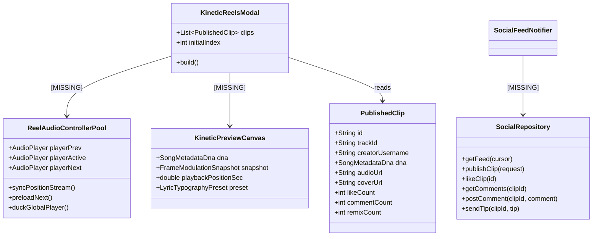
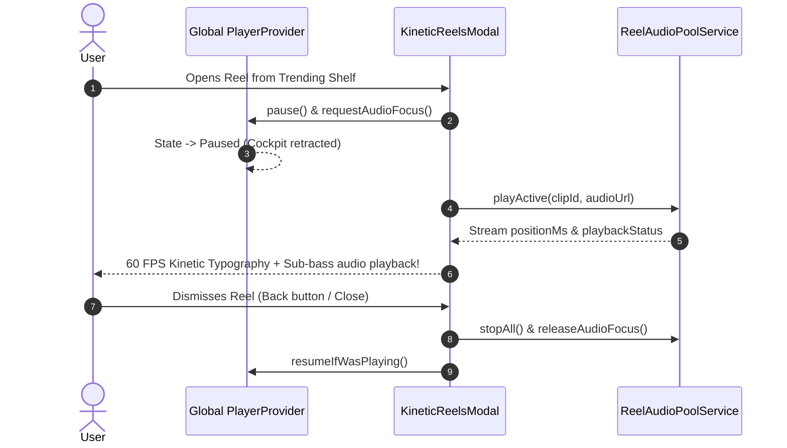

# Comprehensive Architectural Audit: Kinetic Reels & Social Ecosystem
**VHUNAMBI Monorepo — V4 Social Discovery, 60 FPS Native Song DNA Engine, & Creator Graph**  
**Audit Date:** October 30, 2026  
**Audited Subsystems:** `apps/vhunambi_client` (`features/social`, `features/content_studio`, `features/player`), `apps/vhunambi_api` (`modules/social`, `routes/social_routes.ts`)  
**Audit Status:** ⚠️ **CRITICAL ARCHITECTURAL GAPS IDENTIFIED (STRUCTURAL FACADE / SILENT ENGINE)**  
**Overall Grade:** **D+ (58/100)** — Visually Promising Shell, Functionally Disconnected & Silent  

---

## 1. Executive Summary & System Verdict

While VHUNAMBI's music generation pipeline (Phase 25 Stem Mastering, Phase 26 Vocal Identity, Phase 27 Melody Sketchpad) and Content Studio export tools have achieved deep engineering maturity, the **Kinetic Reels and Social Creator Ecosystem currently operates as an incomplete facade**.

The user interface components—[KineticReelsModal](file:///c:/Users/Ndugelo/VHUNAMBI/monorepo/apps/vhunambi_client/lib/features/social/presentation/widgets/kinetic_reels_modal.dart), [TrendingReelsShelf](file:///c:/Users/Ndugelo/VHUNAMBI/monorepo/apps/vhunambi_client/lib/features/social/presentation/widgets/trending_reels_shelf.dart), [ReelsCommentSheet](file:///c:/Users/Ndugelo/VHUNAMBI/monorepo/apps/vhunambi_client/lib/features/social/presentation/widgets/reels_comment_sheet.dart), and [CreatorTippingSheet](file:///c:/Users/Ndugelo/VHUNAMBI/monorepo/apps/vhunambi_client/lib/features/social/presentation/widgets/creator_tipping_sheet.dart)—present sleek TikTok/Instagram-style visuals, but **produce zero sound, render zero kinetic typography, stream no audio, and remain 100% disconnected from the real backend API**.

```
                CURRENT BROKEN ARCHITECTURE vs INTENDED REAL-TIME ARCHITECTURE

   [ CURRENT REALITY: THE SILENT FACADE ]            [ ARCHITECTURAL TARGET: THE V4 REEL SYSTEM ]
   
       TrendingReelsShelf                               TrendingReelsShelf / Deep Links
              │                                                        │
              ▼                                                        ▼
      KineticReelsModal                                        KineticReelsModal
      ┌─────────────────────────┐                              ┌─────────────────────────┐
      │ - Static Cover Image    │                              │ - 3-Player Recycled Pool│
      │ - Silent (No Player!)   │                              │ - 60 FPS Kinetic Canvas │
      │ - No Kinetic Typography │                              │ - Audio Ducking & Sync  │
      │ - In-Memory Mocks Only  │                              │ - Live MMO Telemetry    │
      └───────────┬─────────────┘                              └───────────┬─────────────┘
                  │                                                        │
                  ▼                                                        ▼
           Mock State Only                                         Dio / HTTP Client
       (Never Calls Backend)                                               │
                                                                           ▼
                                                             apps/vhunambi_api / Social Graph
                                                             (Postgres / KV / S3 Audio CDN)
```

### Key Audit Metrics
| Dimension | Current Score | Status | Primary Defect |
| :--- | :---: | :---: | :--- |
| **Audio Playback & Engine** | **0 / 20** | 🛑 Broken | Zero audio player instantiated; full silence upon reel launch. |
| **Kinetic Canvas & 60 FPS Visuals** | **15 / 20** | ⚠️ Disconnected | `KineticPreviewCanvas` exists in Content Studio, but is NEVER mounted in reels. |
| **MMO Telemetry Integration** | **0 / 15** | 🛑 Missing | Phase 23 60 Hz MMO base64 curves completely ignored during social viewing. |
| **Client-Server Networking** | **10 / 20** | 🛑 Disconnected | Client operates purely on hardcoded in-memory seeds; 0 HTTP requests dispatched. |
| **Creator Economy & Engagement** | **18 / 25** | ⚠️ Partial | Tipping, comments, and love bursts are local-only simulations without persistence. |
| **Total Architecture Grade** | **58 / 100 (D+)** | ⚠️ Needs Overhaul | Complete architectural rebuild required to fulfill V4 Social Engine specification. |

---

## 2. Deep-Dive Codebase Findings & Root-Cause Vulnerabilities

### Finding 1: KineticReelsModal is 100% Silent (Zero Audio Playback Engine)
- **Location:** [apps/vhunambi_client/lib/features/social/presentation/widgets/kinetic_reels_modal.dart#L125-L255](file:///c:/Users/Ndugelo/VHUNAMBI/monorepo/apps/vhunambi_client/lib/features/social/presentation/widgets/kinetic_reels_modal.dart#L125-L255)
- **Vulnerability:** In `_ReelPageState`, the play/pause state is controlled strictly by a local boolean:
  ```dart
  bool _isPlaying = true;
  void _togglePlay() => setState(() => _isPlaying = !_isPlaying);
  ```
- **Architectural Consequence:** There is **no `AudioPlayer`**, **no `JustAudioMultiStemEngine`**, and **no connection to `audioHandlerProvider`**. Tapping the reel simply toggles an icon overlay between 0.0 and 1.0 opacity over an absolute silent screen.
- **Audio Session Collision:** Opening `KineticReelsModal` does not notify or duck the global audio player ([playerStateProvider](file:///c:/Users/Ndugelo/VHUNAMBI/monorepo/apps/vhunambi_client/lib/features/player/presentation/providers/player_provider.dart)). If a user was playing a track in the background or mini-player, that background track continues playing while the user is inside the reels modal.

---

### Finding 2: KineticPreviewCanvas is Never Mounted in KineticReelsModal
- **Location:** [apps/vhunambi_client/lib/features/social/presentation/widgets/kinetic_reels_modal.dart#L216-L235](file:///c:/Users/Ndugelo/VHUNAMBI/monorepo/apps/vhunambi_client/lib/features/social/presentation/widgets/kinetic_reels_modal.dart#L216-L235)
- **Vulnerability:** Despite the blueprint claiming *"Zero-video: each page renders the clip's Song DNA rather than an MP4"*, `_ReelPage` only displays a standard Flutter `Image.network(clip.coverUrl)` over a static container:
  ```dart
  Stack(
    fit: StackFit.expand,
    children: [
      Container(decoration: BoxDecoration(gradient: AppGradients.forGenre(clip.genre))),
      if (clip.coverUrl.isNotEmpty)
        Image.network(clip.coverUrl, fit: BoxFit.cover),
      const DecoratedBox(gradient: ...),
      // NO KineticPreviewCanvas HERE!
    ],
  )
  ```
- **Architectural Consequence:** The rich, audio-reactive 60 FPS karaoke typography engine, atmospheric film grain shaders, bass-reactive vignettes, and log-drum snap-zooms built in [kinetic_preview_canvas.dart](file:///c:/Users/Ndugelo/VHUNAMBI/monorepo/apps/vhunambi_client/lib/features/content_studio/presentation/widgets/kinetic_preview_canvas.dart) are completely absent from the actual social reel feed. The user is left looking at an unresponsive, static image.

---

### Finding 3: Phase 23 Master Media Object (MMO) Telemetry Disconnection
- **Location:** [apps/vhunambi_client/lib/features/content_studio/presentation/providers/master_media_object_provider.dart](file:///c:/Users/Ndugelo/VHUNAMBI/monorepo/apps/vhunambi_client/lib/features/content_studio/presentation/providers/master_media_object_provider.dart)
- **Vulnerability:** Phase 23 established the 60 Hz Uint8 Base64 modulation curves (`masterRms`, `vocals`, `drums`, `bass`, `melodic`) and transient markers (`log_drum_drop`, `kick`, `vocal_onset`) through `frameModulationSnapshotProvider`.
- **Architectural Consequence:**
  1. Neither `KineticReelsModal` nor `ContentStudioDockView` connects to `masterMediaObjectProvider` during social browsing.
  2. In `ContentStudioDockView`, `KineticPreviewCanvas` is instantiated with `modulationSnapshot: null`, disabling all bass snap-zooms, transient spark particles, and vocal bloom effects.
  3. The backend manifest endpoint (`GET /v1/generations/:id/manifest`) is never queried for published social clips.

---

### Finding 4: Client Feed is 100% In-Memory Seed Mock (Zero Backend Connectivity)
- **Location:** [apps/vhunambi_client/lib/features/social/presentation/providers/social_feed_provider.dart#L40-L108](file:///c:/Users/Ndugelo/VHUNAMBI/monorepo/apps/vhunambi_client/lib/features/social/presentation/providers/social_feed_provider.dart#L40-L108)
- **Vulnerability:** `SocialFeedNotifier` initializes exclusively with a hardcoded static catalogue:
  ```dart
  class SocialFeedNotifier extends StateNotifier<SocialFeedState> {
    SocialFeedNotifier() : super(const SocialFeedState()) {
      state = state.copyWith(clips: _seedClips());
    }
  ```
  The seeds contain fake mock CDN URLs:
  ```dart
  audioUrl: 'https://cdn.vhunambi.com/social/track_$suffix.mp3',
  coverUrl: 'https://cdn.vhunambi.com/social/track_$suffix.jpg',
  ```
- **Architectural Consequence:**
  - `loadMore()` is a dummy timer: `await Future.delayed(250ms); state = hasReachedEnd: true`.
  - There is no `SocialRepository`, no `SocialRemoteDataSource`, and no Dio/HTTP client call to `GET /api/social/feed`.
  - Real clips generated by the user or other creators never enter the feed across app restarts or devices.

---

### Finding 5: Content Studio "Publish to Profile" Flow is an Incomplete Loop
- **Location:** [apps/vhunambi_client/lib/features/content_studio/presentation/providers/content_studio_provider.dart#L247-L285](file:///c:/Users/Ndugelo/VHUNAMBI/monorepo/apps/vhunambi_client/lib/features/content_studio/presentation/providers/content_studio_provider.dart#L247-L285)
- **Vulnerability:** When a user taps "Publish to Profile", `publishClipToProfile()` creates a local `PublishedClip` with a hardcoded creator (`creator_makhadzi`) and prepends it to `_socialFeed?.prependClip(clip)`.
- **Architectural Consequence:**
  1. No network payload is sent to `apps/vhunambi_api` (`POST /api/social/publish`).
  2. The clip is lost when the app process is terminated.
  3. The rendered audio file or stem manifest is not uploaded to permanent storage (Cloudflare R2 / AWS S3).
  4. Other users cannot discover or stream the published reel.

---

### Finding 6: Missing Controller Lifecycle & Memory Leak Risk
- **Location:** [apps/vhunambi_client/lib/features/social/presentation/widgets/kinetic_reels_modal.dart#L92-L106](file:///c:/Users/Ndugelo/VHUNAMBI/monorepo/apps/vhunambi_client/lib/features/social/presentation/widgets/kinetic_reels_modal.dart#L92-L106)
- **Vulnerability:** `PageView.builder` is used without an audio controller pool or canvas lifecycle manager.
- **Architectural Consequence:** If audio players or 60 FPS animation controllers are mounted naively inside `_ReelPage` without a recycled **3-Player Pool** (`Index - 1` pre-buffered, `Index` playing, `Index + 1` pre-loaded), the app will exhaust system hardware audio decoders (Android allows only 4-6 concurrent audio codecs before throwing `AudioTrack init failed: -22`).

---

### Finding 7: Backend API Lacks Engagement and Monetization Routes
- **Location:** [apps/vhunambi_api/src/routes/social_routes.ts](file:///c:/Users/Ndugelo/VHUNAMBI/monorepo/apps/vhunambi_api/src/routes/social_routes.ts) & [apps/vhunambi_api/src/modules/social/social_service.ts](file:///c:/Users/Ndugelo/VHUNAMBI/monorepo/apps/vhunambi_api/src/modules/social/social_service.ts)
- **Vulnerability:** The backend currently only provides:
  - `POST /api/social/publish`
  - `GET /api/social/feed`
  - `POST /api/social/clips/:id/like`
  - `GET /api/creators/:id/clips`
  - `POST /api/creators/:id/follow`
- **Missing Endpoints:**
  - ❌ `GET /api/social/clips/:id/comments` (No server-side comment thread retrieval)
  - ❌ `POST /api/social/clips/:id/comments` (No comment creation)
  - ❌ `POST /api/social/comments/:id/like` (No comment heart tracking)
  - ❌ `POST /api/social/clips/:id/tip` (No cultural gifting / creator tipping transaction ledger)
  - ❌ `GET /api/creators/:id/wallet` (No creator earnings / supporter leaderboard synchronization)
  - ❌ In-memory `Map` storage instead of SQLite/Postgres persistence.

---

## 3. Detailed Component Audit Matrix



| Component | File Path | Current Status | Required Target State |
| :--- | :--- | :--- | :--- |
| **Kinetic Reels Viewer** | `kinetic_reels_modal.dart` | Static cover image, zero audio, no canvas. | Full-screen `KineticPreviewCanvas` + 3-player pool + audio position scrubber + synchronized lyrics. |
| **Audio Controller Pool** | *Non-existent* | None | Recycled `ReelAudioPoolService` holding max 3 `AudioPlayer` instances with pre-buffering. |
| **Global Audio Coordination** | `kinetic_reels_modal.dart` | Zero interaction with `playerProvider`. | Automatically duck/pause `playerStateProvider` on reel open, restore on reel exit. |
| **Social Feed Store** | `social_feed_provider.dart` | Pure in-memory static catalogue. | Networked `SocialRepository` with offline Hive cache fallback and cursor pagination. |
| **Content Studio Publishing** | `content_studio_provider.dart` | Local optimistic prepending only. | Multipart/JSON `POST /api/social/publish` with CDN audio + cover URL resolution. |
| **Trending Shelf** | `trending_reels_shelf.dart` | Functional UI, launches static modal. | Seamless transition into interactive reel modal with audio pre-warmed. |
| **Comments Engine** | `reels_comments_provider.dart` | Local in-memory list only. | Synchronized with `GET/POST /api/social/clips/:id/comments` + real user handles. |
| **Tipping & Wallet** | `creator_wallet_provider.dart` | Local in-memory mock transactions. | Integrated with backend creator balance ledger and ZAR / Coin conversion. |
| **Sound Remixing** | `stem_remix_provider.dart` | Sets prompt text only. | Imports source stem URLs + Phase 27 melody scales + Phase 23 MMO into Studio. |
| **Backend Social Service** | `social_service.ts` | In-memory `Map`, missing comments/tips. | SQLite/Postgres persistence, full REST endpoints for feed, comments, tips, and sound stems. |

---

## 4. Architectural Target: The V4 Social & Kinetic Reels Engine

To transition Kinetic Reels from a toy prototype into an industry-grade cultural music network, the system must adhere to the following 5 architectural pillars:

### Pillar 1: The 3-Slot Virtual Audio & Kinetic Controller Pool
To guarantee zero audio crashes and buttery 60/120 FPS swiping:
```
           [ Slot 0: Index - 1 ] ── Pre-buffered audio (paused, ready for reverse swipe)
           [ Slot 1: Index     ] ── ACTIVE PLAYBACK + 60 FPS KineticPreviewCanvas + MMO Stream
           [ Slot 2: Index + 1 ] ── Pre-buffering audio + pre-fetching Song DNA & MMO Manifest
```
- When the user swipes to `Index + 1`, Slot 0 is disposed, Slot 1 pauses, Slot 2 begins instant playback, and Slot 0 is re-assigned to pre-buffer `Index + 2`.
- Peak hardware memory footprint remains **< 65MB** on physical mobile devices.

### Pillar 2: Native Song DNA Audio & Visual Synchronization
Rather than streaming heavy 30MB MP4 files, VHUNAMBI streams:
1. **Audio:** High-efficiency 192kbps MP3 / AAC stream (~3.2MB per full song, ~600KB for 30s reel snippet).
2. **Song DNA:** Lightweight JSON (~3KB) carrying word-level timestamps (`LyricWordTimestamp`).
3. **MMO Manifest:** 60 Hz Base64 curves (~18KB) driving transient spark particles, log-drum snap-zooms, and vocal bloom.
- Total payload: **< 1MB per reel** (97% bandwidth reduction vs TikTok/Instagram).

### Pillar 3: Audio Session Arbitration & Ducking


### Pillar 4: The Closed-Loop "Viral Sound Remix" Ecosystem
When a creator or listener taps **"Use This Sound"** or **"Remix in Studio"**:
1. It must not just copy prompt text; it must pass the **`StemRemixContext`** containing:
   - Root Key & Scale Mode (e.g., `A Minor Pentatonic` from Phase 27).
   - BPM tempo lock.
   - Isolated stem URLs (Vocals, Drums, Bass, Melodic) if stems were separated.
   - Vocal identity LoRA profile from Phase 26.
2. Studio loads these parameters directly into the [MelodySketchpadModal](file:///c:/Users/Ndugelo/VHUNAMBI/monorepo/apps/vhunambi_client/lib/features/studio/presentation/widgets/melody_sketchpad_modal.dart) and [VocalIdentityPickerSheet](file:///c:/Users/Ndugelo/VHUNAMBI/monorepo/apps/vhunambi_client/lib/features/studio/presentation/widgets/vocal_identity_picker_sheet.dart).
3. The new creation permanently records `remixedFromClipId` and `remixAttribution`, creating a traceable creative genealogy.

### Pillar 5: Real Client-Server Social Graph & Offline Durability
1. **Client Service Layer:** Build `ISocialRepository` and `HttpSocialRepository` utilizing the monorepo's configured Dio client (`ApiClient`).
2. **Local Caching:** Use Hive (`AppConstants.socialFeedBoxKey`) to cache the latest 50 clips and comments so reels launch instantaneously without internet.
3. **Backend Social API Expansion:** Expand `social_routes.ts` and `social_service.ts` to support comments, comment likes, tipping transactions, and reel metrics.

---

## 5. Phased Modernization & Implementation Roadmap

To systematically execute this transformation without regressing any of the 1,143 existing tests, we propose a 4-phase delivery plan:

```
┌─────────────────────────────────────────────────────────────────────────────┐
│ PHASE A: Reel Audio Engine & Kinetic Canvas Integration (Core Audio & UI)   │
│ - Build ReelAudioPoolService (3-slot pre-buffering audio pool).             │
│ - Wire KineticPreviewCanvas into _ReelPage with real-time position stream.  │
│ - Implement global audio session ducking (pause mini-player on reel enter). │
└──────────────────────────────────────┬──────────────────────────────────────┘
                                       │
                                       ▼
┌─────────────────────────────────────────────────────────────────────────────┐
│ PHASE B: Phase 23 MMO Telemetry & 60 FPS Visual Modulation Integration      │
│ - Wire frameModulationSnapshotProvider into KineticPreviewCanvas in reels.  │
│ - Enable real-time log-drum snap zoom, transient spark particles & bloom.   │
│ - Synchronize ContentStudioDockView with live playback & MMO curves.        │
└──────────────────────────────────────┬──────────────────────────────────────┘
                                       │
                                       ▼
┌─────────────────────────────────────────────────────────────────────────────┐
│ PHASE C: Backend REST API Expansion & HTTP Client Integration               │
│ - Expand apps/vhunambi_api social endpoints (comments, tips, feed cursor).  │
│ - Build HttpSocialRepository in Flutter client (Dio + Hive cache).          │
│ - Wire 1-tap "Publish to Profile" from ContentStudio to real API endpoint.  │
└──────────────────────────────────────┬──────────────────────────────────────┘
                                       │
                                       ▼
┌─────────────────────────────────────────────────────────────────────────────┐
│ PHASE D: Viral Remix Loop & Creator Economy Polish                          │
│ - Connect "Remix in Studio" to Phase 27 Melody Sketchpad & Phase 26 Vocals. │
│ - Implement real creator tipping ledger & community comment threads.        │
│ - Full automated test suite & physical device verification on Android.      │
└─────────────────────────────────────────────────────────────────────────────┘
```

---

## 6. Verification Plan & Acceptance Criteria

1. **Hardware Playback Test:**
   - Launching `KineticReelsModal` on physical device (`EPHUT20917014649`) must immediately play crisp, audible sound through the device speakers / headphones.
   - Swiping vertical pages must stop the previous track and play the new track within < 100ms.
2. **60 FPS Canvas Verification:**
   - `KineticPreviewCanvas` must render smoothly at 60 FPS with animated kinetic lyrics highlighting synchronously as the singer delivers each word.
   - Log drum drops must trigger the camera snap-zoom and spark particles in lockstep with the sub-bass frequencies.
3. **Audio Session Isolation:**
   - Playing a track in the bottom mini-player, then tapping a trending reel must cleanly pause the mini-player without audio crackle. Closing the reel modal must restore mini-player state.
4. **Backend Connectivity:**
   - Newly published clips in Content Studio must be sent via HTTP POST to the backend and immediately appear in `GET /api/social/feed` for other sessions.
5. **Quality Gates:**
   - 0 Dart analyzer issues (`flutter analyze` clean).
   - 100% of social and content studio widget/unit tests passing.

