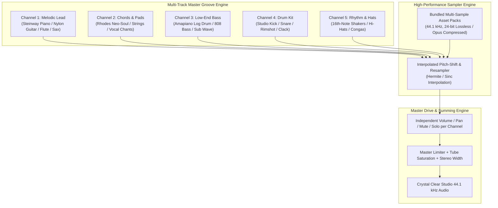

# Engineering & UI/UX Audit: Melody Sketchpad Audio Engine & Modern Harmonic Interface

**Document ID:** `AUDIT-SKETCHPAD-V2-001`  
**Date:** October 31, 2026  
**Status:** Complete Architectural Audit & Recommendations for Argon  
**Target Surface:** `apps/vhunambi_client/lib/features/studio/presentation/widgets/melody_sketchpad_modal.dart`  
**Audio Services:** `melody_wav_synthesizer.dart`, `sketchpad_audio_player_service.dart`, `melody_sketchpad_provider.dart`

---

## Executive Summary

The Vhunambi Melody Sketchpad was initially designed as an in-key 16-step proof-of-concept synthesizer. While functionally operable, the user experience currently faces two critical blockers:

1. **Audio Engine Fidelity & Monophonic Limitation**:
   - The engine relies on pure Dart mathematical equations (`math.sin`, pseudo-noise formulas) downsampled to **22,050 Hz**.
   - It lacks anti-aliased wavetables, physical modeling, and studio multi-samples. Consequently, drums sound like digital clicks/glitches, pianos sound hollow/synthetic, and log drums lack genuine sub-transient punch.
   - Crucially, it is **strictly monophonic per pattern**: users cannot compose a complete musical groove (kick + hi-hat + chords + lead + bass) into one master drive.
2. **UI/UX Clutter & Mobile Space Deprivation**:
   - The interface stacks four horizontal scrolling chip rails on top of each other, consuming over **220dp of vertical viewport height** on mobile devices.
   - It relies on raw Unicode emojis, Material icons, and verbose button text rather than modern rounded vector icons (`STD-UIUX-001`), dropdowns, sliding curvy tabs, or gesture-driven controls.

This audit provides the complete technical blueprint to transform the Melody Sketchpad into a **Studio-Grade Harmonic Master Melody & Drum Engine** inspired by the efficiency and layering power of FL Studio's Channel Rack.

---

## 1. Deep-Dive Audio Engine Audit: Why Does It Sound Like a "Demo"?

### 1.1 Root Causes of Poor Sound Quality

```
[ Current Pure-Dart DSP Pipeline ]
Step Matrix -> Math Formula (sin / exp / random noise) -> 22,050 Hz Mono Buffer -> Hard Clamp / Tanh Saturation
                                     │
                 ┌───────────────────┴────────────────────┐
                 ▼                                        ▼
          Severe Aliasing                  No Harmonic Resonance
(Highs fold over at 11kHz -> Glitchy clicks)  (Plastic synthetic decay; no wood/string realism)
```

1. **22,050 Hz Downsampling & Nyquist Foldover**:
   - `MelodyWavSynthesizer` explicitly downsamples output to `sampleRate = 22050` to reduce CPU overhead.
   - Any transient harmonic above $11,025\text{ Hz}$ reflects back into the audible spectrum as harsh, metallic digital aliasing. This is why kicks sound like "sound glitches" instead of deep studio thumps.
2. **Formulaic Math vs. Real Acoustic Resonators**:
   - **Piano**: Currently approximated with just 4 sine waves at static frequency ratios (`root + 1.1892*f0 + 1.4983*f0 + 1.7818*f0`). Real pianos have rich inharmonicity, soundboard acoustics, hammer-strike transients, and sympathetic string resonance that math approximations cannot reproduce without physical modeling or sampling.
   - **Guitars & Flutes**: Cannot be synthesized with a basic 6-harmonic sine summation. A flute requires breath turbulences, air column embouchure transitions, and natural vibrato; an acoustic guitar requires plectrum scrape, fretboard buzz, and body cavity resonance.
   - **Log Drum**: Approximated with 2-operator FM synthesis. While decent on headphones, it lacks the signature warm South African FL Studio Fruity DX10 / native sample timbre heard in real Amapiano records.
3. **Single-Instrument Monophony (The "One and Done" Flaw)**:
   - A `MelodyPatternEntity` holds exactly **one instrument at a time**.
   - In commercial music production (FL Studio, Ableton, Logic), a melody is never isolated: it locks into a **groove pocket** consisting of:
     $$\text{Master Groove} = \text{Chords (Piano/Rhodes)} + \text{Lead (Flute/Guitar/Sax)} + \text{Bass/Log-Drum} + \text{Beats (Kick/Hi-Hats/Percussion)}$$
   - Currently, a user can only audition a piano *or* a log drum, leaving the user feeling like they are testing an isolated toy demo rather than crafting a song.

---

## 2. Audio Engine Evolution: Transitioning to FL Studio-Grade Sampling & Multi-Track Stacking

### 2.1 Do We Need Real Instrument & Sample Libraries?
**Yes, absolutely.** Real DAWs do not synthesize natural instruments with raw trigonometric equations. They use curated, studio-recorded **multi-sample banks (WAV / Opus / SoundFont)** recorded by session musicians and sound designers.

### 2.2 Recommended Architecture: Hybrid Multi-Track Sample Engine



### 2.3 Proposed Instrument & Rhythm Catalog

| Category | Instruments & Presets | Sound Source / Strategy |
| :--- | :--- | :--- |
| **Melodic Leads** | Concert Grand Piano, Nylon Acoustic Guitar, African Bamboo Flute, Soprano Saxophone, Electric Clean Guitar, Solo Violin | 3-Octave Chromatic Multi-Sample Bank (`.opus` / `.wav`) |
| **Soul & Chords** | Private School Rhodes (Tine + Bell), Warm Analog Poly-Pad, Mbaqanga Organ, Vocal Choirs | Multi-sample keygroups with sustain loops |
| **Bass & Low-End** | Authentic Amapiano Log Drum (Deep DX10 sample with real pitch glide), 808 Sub Boom, Gqom Heavy Sub, Slap Electric Bass | Authentic South African studio one-shots + pitch tracking |
| **Beats & Grooves** | Amapiano Percussive Knocks, Hip Hop Boombap Kicks, Gqom Heavy Kicks, Afrobeats Snare/Rims, Pop Crisp Kicks | Studio Drum One-Shots (Punchy 24-bit transients) |
| **Rhythm & Hats** | 16th-Note African Shakers (Mbaḓi), Ghost Hi-Hats, Woodblocks, Claps, Triangle Percs | Velocity-sensitive round-robin one-shots |

### 2.4 Multi-Track Channel Rack Data Model (Draft for Argon)

```dart
/// A unified multi-track pattern containing up to 8 synchronized instrument tracks.
class MultiTrackGrooveEntity {
  final String id;
  final String name;
  final int bpm;
  final String musicalKey;
  final AfricanScaleMode scaleMode;
  final List<SketchpadChannel> channels; // Lead, Chords, Bass, Drums, Hats
  final double swingPercent; // 0..100% African groove shuffle
  
  const MultiTrackGrooveEntity({
    required this.id,
    required this.name,
    required this.bpm,
    required this.musicalKey,
    required this.scaleMode,
    required this.channels,
    this.swingPercent = 12.0,
  });
}

class SketchpadChannel {
  final String id;
  final String name;
  final InstrumentType instrument;
  final List<MelodyStepNote> notes;
  final double volume; // 0.0 to 1.5
  final double pan;    // -1.0 to 1.0
  final bool isMuted;
  final bool isSolo;
}
```

---

## 3. UI/UX Audit: From Cluttered Chip Rails to a Minimalist Harmonic Cockpit

### 3.1 Current Visual & Ergonomic Defects

| UI Element | Current Flaw | Ergonomic Impact |
| :--- | :--- | :--- |
| **Header Bar** | Generic text, basic close icon, non-standard layout | Wastes ~60dp; no full-screen or project actions |
| **Instrument Rail** | Horizontal scroll of `ChoiceChip` with raw Unicode emojis (`🥁`, `🎹`, `🪵`) | Forces user to scroll horizontally just to see 5 instruments; text is clipped on smaller screens |
| **Key & Scale Rail** | 6 Key chips + 4 Scale chips + Presets all crammed into 1 scrolling row | Overwhelming visual noise; easy to mis-tap; unintuitive |
| **Toolbar Strip** | Horizontal row of switches and buttons (`Live Pad Mode`, `Glide`, `BPM Slider`) | Consumes critical vertical space; leaves only 160dp for the actual 8-row piano roll! |
| **Touch Targets** | Notes and controls lack standard rounded design tokens and tactile hold states | Difficult to tap precisely on phone screens ($< 768\text{dp}$) |

### 3.2 The New Minimalist & Curvy UI Design System (`STD-UIUX-001`)

```
┌─────────────────────────────────────────────────────────────┐
│ [🎹 Vhunambi Groove Cockpit]   [Am • Pentatonic ▾]   [⛶] [✕] │ <- Compact Curvy Top Bar
├─────────────────────────────────────────────────────────────┤
│ (▶ Play Groove)  [● Lead]  [● Chords]  [● Log Drum]  [● Drums]│ <- Sliding Curvy Channel Tabs
├─────────────────────────────────────────────────────────────┤
│                                                             │
│  [Row 7 - High]  [ ] [ ] [■] [ ] [ ] [ ] [■] [ ] ...       │
│  [Row 6]         [ ] [■] [ ] [ ] [ ] [■] [ ] [ ] ...       │
│  [Row 5]         [■] [ ] [ ] [ ] [■] [ ] [ ] [ ] ...       │ <- Harmonic Curvy 16-Step Matrix
│  [Row 4 - Root]  [ ] [ ] [ ] [■] [ ] [ ] [ ] [■] ...       │    (Rounded pill cells with neon glow)
│  ...                                                        │
│                                                             │
├─────────────────────────────────────────────────────────────┤
│ [Hold: Velocity/Glide]   [Euclidean Groove ▾]   [BPM: 114 ▾]│ <- Minimal Bottom Utility Dock
└─────────────────────────────────────────────────────────────┘
```

### 3.3 Core UI/UX Enhancements for Mobile Friendliness

1. **Sliding Curvy Channel Tabs (Channel Rack Selector)**:
   - Replace the stacked rows with a single, sleek horizontal glassmorphic slider featuring soft pill shapes (`AppRadius.pillBorder`).
   - Each tab represents a track: **Lead (Piano/Flute)**, **Chords (Rhodes)**, **Bass (Log Drum)**, **Drums (Kick/Hats)**.
   - Shows active note dots inside the tab pill so users see the overall groove at a glance.
2. **Compact Dropdowns for Key & Scale**:
   - Replace 15 individual scrolling chips with a single elegant pill dropdown: `[ Am • Minor Pentatonic ▾ ]`.
   - Tapping it opens a soft-blur bottom sheet or popup menu.
3. **Gesture & Hold-to-Access Power Utilities**:
   - **Hold on a Step**: Opens a floating radial/curved mini-menu for:
     - Velocity (Slider: $0..100\%$)
     - Pitch Glide ($\pm 5$ semitones)
     - Chord Stamp (Single / Triad / 7th)
   - **Double-Tap Step**: Delete note.
   - **Slide across Steps**: Multi-step painting.
4. **Full-Screen Immersion Toggle**:
   - Add a full-screen toggle icon (`PhosphorIconsRegular.cornersOut`) so producers can expand the sketchpad to fill the entire mobile display with backdrop blur (`ImageFilter.blur(sigmaX: 16, sigmaY: 16)`).
5. **Modern Iconography (`AppIcons` / Phosphor Icons)**:
   - Completely eliminate raw emojis (`🥁`, `🎹`, `🪵`, `🎸`, `💾`).
   - Use vector icons: `PhosphorIconsRegular.pianoKeys`, `guitar`, `musicNotes`, `waveSine`, `slidersHorizontal`, `play`, `pause`.

---

## 4. Architectural Implementation Blueprint (Action Items for Argon)

### Phase 1: High-Fidelity Audio Multi-Sampler Engine
- [ ] Create `MultiSampleBankService` to bundle and cache high-quality 44.1 kHz instrument samples (Studio Piano, Rhodes, Log Drum, Flute, Kick, Hi-Hat, Shaker).
- [ ] Implement multi-track audio summing in `MelodyWavSynthesizer` or native audio buffer engine to mix multiple channels simultaneously with independent gain and pan.
- [ ] Upgrade output sample rate from 22,050 Hz to **44,100 Hz** with cubic Hermite pitch interpolation to prevent aliasing.

### Phase 2: Multi-Track Data Models & State Management
- [ ] Introduce `MultiTrackGrooveEntity` and `SketchpadChannel` in `melody_sketchpad_models.dart`.
- [ ] Extend `MelodySketchpadNotifier` with channel switching, per-channel note editing, and master playback synchronization.
- [ ] Ensure backward compatibility with Phase 25 mastering (`MasterMediaObjectManifest` and `StemMasteringRecipe`).

### Phase 3: Minimalist Curvy UI/UX Redesign
- [ ] Redesign `MelodySketchpadModal` into a declustered, mobile-first interface adhering to `STD-UIUX-001`.
- [ ] Implement sliding channel tabs with mute/solo controls.
- [ ] Replace key/scale chip clutter with compact dropdowns.
- [ ] Implement hold-to-edit velocity and chord stamping gestures.
- [ ] Add full-screen expansion mode for focused mobile production.

---

## 5. Summary & Hand-off

This audit establishes the path to elevate the Melody Sketchpad from an isolated synthetic toy into an **industry-competitive mobile music creation powerhouse**. By combining studio multi-samples with FL Studio-style multi-track groove layering and a declustered, curvy, gesture-rich UI, Vhunambi will empower creators to build authentic, release-ready African melodies effortlessly.

