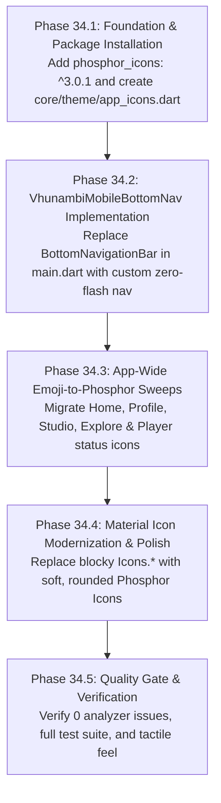

# 📱 Comprehensive Audit Report: Mobile Bottom Navigation & App-Wide Iconography
**Document Identifier:** `AUDIT-NAV-ICON-001`  
**Target Systems:** Root Mobile Shell (`main.dart`), `VhunambiBottomDockKit`, App-Wide Icon Usages & Emojis  
**Flutter SDK:** 3.44.4 (Dart 3.12.2)  
**Status:** Audit Complete — Ready for Architectural Alignment  

---

## 1. Executive Summary & Problem Diagnosis

Vhunambi's visual identity is rooted in an **organic, soft, rounded, afro-futuristic aesthetic** characterized by frosted glass surfaces, genre-reactive ambient glows, and fluid micro-interactions. However, two prominent subsystems currently undermine this design language:

```
┌─────────────────────────────────────────────────────────────────────────────────┐
│                               CURRENT PAIN POINTS                               │
├──────────────────────────────────────────────────┬──────────────────────────────┤
│ 1. Mobile Bottom Navigation: "Cracked Screen"    │ 2. App-Wide Iconography:     │
│    - Hardcoded Material InkResponse splash       │    - 344 literal emojis      │
│    - Harsh milky flash glow on dark frosted glass│    - Sharp, blocky Icons.*   │
│    - Competing Android haptic double-clicks      │    - Multicolored bitmaps    │
│    - Stiff linear tab cross-fades                │    - Zero design token sync  │
└──────────────────────────────────────────────────┴──────────────────────────────┘
```

1. **The "Cracked Screen Flash Glow" on Mobile Bottom Navigation:**
   When a user presses and holds any tab on the sticky mobile navigation bar, a jarring, unconstrained circular/rectangular milky flash glow spreads across the dark canvas. This visual artifact resembles pressing down on a physically cracked OLED/LCD digitizer. It is caused by Flutter’s default `BottomNavigationBar` wrapping each item in an un-themed `InkResponse` that bleeds high-alpha highlight colors directly into the 18-sigma backdrop blur of `VhunambiBottomDockSurface`.
2. **Tactile & Animation Clumsiness:**
   Switching tabs lacks physics, bounce, or smooth spatial transition. Furthermore, the native framework fires raw Android feedback simultaneously with `HapticsService().selectionClick()`, creating an abrasive double-tap vibration.
3. **App-Wide Iconography Fracture (344 Emoji Occurrences & Sharp Material Icons):**
   Across the mobile client, **344 instances of literal emojis** (`🔥`, `🪙`, `⚡`, `🧬`, `🏆`, `🎵`, `💿`, `🎛️`, `✨`, `🎤`, `🥁`, `🎹`, `🎸`) are being rendered directly in `Text()` widgets as application icons. Emojis render as platform-dependent, multicolored bitmaps that cannot inherit theme colors, suffer from inconsistent baseline alignment across Android and iOS, and look unpolished in professional music production contexts. Concurrently, standard `Icons.*` usage is fragmented with sharp, blocky rectangular geometries that directly contradict Vhunambi’s friendly, rounded brand identity.

---

## 2. Dimension 1: Bottom Navigation Architecture & The "Cracked Screen" Flaw

### 2.1 The InkResponse Trap in `apps/vhunambi_client/lib/main.dart` (Lines 217–263)
In `main.dart`, the mobile navigation is hosted within `VhunambiBottomDockSurface`:

```dart
// CURRENT CODE IN main.dart:
bottomNavigationBar: isDesktop
    ? null
    : VhunambiBottomDockSurface(
        child: BottomNavigationBar(
          backgroundColor: Colors.transparent,
          elevation: 0,
          type: BottomNavigationBarType.fixed,
          selectedItemColor: AppColors.brandPrimary,
          unselectedItemColor: AppColors.textTertiary,
          ...
          currentIndex: _currentIndex,
          onTap: _switchTab,
          items: const [ ... ],
        ),
      ),
```

### 2.2 Why the Flash Glow Occurs
1. **Unconstrained Highlight Layer:** Flutter's `BottomNavigationBar` wraps each tab in an internal `_BottomNavigationTile`, which instantiates an `InkResponse`:
   ```dart
   // Flutter Framework internal bottom_navigation_bar.dart:
   InkResponse(
     onTap: onTap,
     highlightColor: theme.highlightColor, // Typically Colors.white.withOpacity(0.12) in dark mode
     splashColor: theme.splashColor,       // Typically Colors.white.withOpacity(0.16)
     radius: ...
   )
   ```
2. **Backdrop Blur Amplification:** `VhunambiBottomDockSurface` applies `BackdropFilter(filter: ImageFilter.blur(sigmaX: 18, sigmaY: 18))` over `AppColors.surfaceCanvas.withAlpha(215)`. When the bright white `InkResponse` highlight activates upon touch down, the backdrop filter diffuses the high-alpha white light outward in an uneven milky bloom. Holding your finger down keeps this highlight active indefinitely, producing the exact effect of a damaged, bleeding mobile display.
3. **Lack of Active Capsule / Indicator Pill:** Unlike modern design systems (e.g. Material 3 NavigationBar, Apple Human Interface Guidelines, Spotify, TikTok), Flutter's standard `BottomNavigationBar` provides **no active indicator capsule**. The active state is communicated purely by a color swap on the icon and label, leaving the touch target feeling empty and unanchored.

---

## 3. Dimension 2: Haptic Feedback Collision & Tactile Noise

### 3.1 The Double-Haptic Execution Flow
In `main.dart:90-108`:
```dart
void _switchTab(int index) {
  if (index == _currentIndex) return;
  HapticsService().selectionClick(); // <-- Vhunambi Haptics
  ...
}
```
1. **Framework-Level Collision:** In Flutter's `BottomNavigationBar`, the internal `_BottomNavigationTile.onTap` automatically invokes `Feedback.forTap(context)`. When a user taps a tab on Android, the operating system plays the default system sound/vibration while `HapticsService().selectionClick()` simultaneously fires via the native channel. This causes an asynchronous double-rumble.
2. **Dead-State Active Tab Tap:** If the user taps the *already active* tab (e.g. tapping `Explore` while already on Explore), `index == _currentIndex` returns immediately without haptics or action, yet `BottomNavigationBar`'s `InkResponse` still flashes the white highlight. Best practice requires:
   - Suppressing the flash glow completely.
   - Firing a very gentle `HapticsService().lightImpact()`.
   - Scrolling the active tab's primary `ScrollController` to offset `0.0` (scroll to top).

---

## 4. Dimension 3: Tab Switching Animations & Icon Transitions

### 4.1 Current Flaws
- **Linear Cross-Fade:** When switching tabs, the icon simply fades between `Icons.*_outlined` and `Icons.*_filled` with a fixed linear curve (`Curves.linear`). There is no spring, no vertical translation, and no scale modulation.
- **Label Stiff Snap:** The typography swaps between `FontWeight.w500` (11px) and `FontWeight.w700` (11px) instantly, causing a slight jitter in text kerning.
- **Stock Icons Clash:**
  - Home: `Icons.home_outlined` (sharp 45° triangle gables) vs `Icons.home_filled`.
  - Explore: `Icons.explore_outlined` (harsh compass needle).
  - Create: `Icons.auto_awesome` (rigid 4-point geometric star).
  - Library: `Icons.library_music_outlined` (stiff right-angled overlapping rectangles).
  - Market: `Icons.storefront_outlined` (industrial awning with sharp angles).

---

## 5. Dimension 4: App-Wide Iconography Audit & The 344 Emoji Proliferation

### 5.1 The Root Cause of Emoji Abuse
During earlier prototyping sprints, emojis were inserted into `Text()` widgets as rapid placeholders for icons. Over time, these spread into core production views. A full scan of `apps/vhunambi_client/lib` reveals **344 occurrences** of emojis used in UI contexts.

### 5.2 Critical Locations of Emoji-as-Icon Usage

| File Location | Current Emoji Usage | Intended Functional Meaning | Recommended Phosphor Icon |
| :--- | :--- | :--- | :--- |
| `home_dashboard_view.dart:242` | `Text('🔥')` | Streak Counter Badge | `PhosphorIcon(PhosphorIconsFill.flame)` |
| `home_dashboard_view.dart:279` | `Text('🪙')` | Cultural Coins Balance Pill | `PhosphorIcon(PhosphorIconsFill.coin)` |
| `home_dashboard_view.dart:520` | `'Create ✨'` | AI Studio Generation CTA | `PhosphorIcon(PhosphorIconsFill.sparkle)` |
| `profile_stats_grid.dart:65` | `value: '🔥 ${streak}'` | User Daily Streak Metric | `PhosphorIcon(PhosphorIconsFill.flame)` |
| `tip_history_ledger.dart:163` | `Text('🪙')` | Tip Ledger Currency Glyph | `PhosphorIcon(PhosphorIconsFill.coins)` |
| `tip_history_ledger.dart:116` | `'Total: ⚡ $credits'` | Legacy Credits Sum | `PhosphorIcon(PhosphorIconsFill.lightning)` |
| `top_supporters_leaderboard.dart:33`| `Text('🏆')` | Top Supporter Rank Trophy | `PhosphorIcon(PhosphorIconsFill.trophy)` |
| `creator_dna_profile_card.dart:43` | `Text('🧬')` | Music DNA Identity Badge | `PhosphorIcon(PhosphorIconsFill.dna)` |
| `catalog_filter_bar.dart:161` | `'🔥 Newest'` | Trending Sort Pill | `PhosphorIcon(PhosphorIconsBold.fire)` |
| `catalog_filter_bar.dart:171` | `'❤️ Most Liked'` | Favorites Sort Pill | `PhosphorIcon(PhosphorIconsFill.heart)` |
| `owner_profile_view.dart:457` | `'🎵 Songs'` | Studio Cockpit Tab 1 | `PhosphorIcon(PhosphorIconsFill.musicNotes)` |
| `owner_profile_view.dart:475` | `'💿 Releases'` | Studio Cockpit Tab 2 | `PhosphorIcon(PhosphorIconsFill.disc)` |
| `owner_profile_view.dart:493` | `'🎛️ My Beatstore'` | Studio Cockpit Tab 3 | `PhosphorIcon(PhosphorIconsFill.slidersHorizontal)` |
| `stem_mixer_state.dart:198-201` | `'🎤'`, `'🥁'`, `'🎹'`, `'🎸'` | 4-Stem DAW Channel Strips | `microphone`, `waveform`, `pianoKeys`, `guitar` |
| `bantu_voice_profile.dart:47-115` | `'🎤'`, `'👴'`, `'⚡'`, `'🌿'` | Voice Archetype Badges | Curated Phosphor Duotone Archetypes |
| `explore_discovery_drawer.dart:251`| `'📈 Charts'`, `'📻 Radio'` | Discovery Hub Shortcuts | `chartLineUp`, `radio` |

### 5.3 Technical Hazards of Emojis as UI Icons
1. **Cross-Platform Visual Inconsistency:** Emojis render via Google Noto Color Emoji on Android and Apple Color Emoji on iOS/macOS. Their sizing, baseline, optical weight, and visual styling differ drastically between platforms.
2. **Bitmap Chromatic Noise:** Emojis are pre-baked multicolored bitmaps (yellow, red, blue, green). They cannot be tinted to match design tokens (`AppColors.brandPrimary`, `AppColors.genreAccent`, `AppColors.textSecondary`), creating visual clutter against Vhunambi's refined, high-contrast dark palette.
3. **Android Baseline & Clipping Bugs:** Because emojis in Flutter are rendered via `TextPainter` as font glyphs, Android text renderers frequently clip the top or bottom 1–2 pixels of emojis inside constrained bounding boxes (e.g. 24×24dp containers).

> [!IMPORTANT]
> **Cultural Gifts vs. UI Icons Policy:**
> Emojis MUST be reserved *exclusively* for user-generated expressions and canonical fan tipping gifts (`kCulturalGifts`: `'👑 Royal Venda Crown'`, `'💎 Blue Diamond'`, etc.) in social comments and live chats. All UI status badges, buttons, tabs, metrics, and navigation elements MUST use vector iconography.

---

## 6. Dimension 5: Phosphor Icons Technical Evaluation

### 6.1 Package Evaluation: `phosphor_icons: ^3.0.1` vs `phosphor_flutter: ^2.1.0`
We executed dry-run dependency resolutions against Flutter 3.44.4 (Dart 3.12.2):

| Criterion | `phosphor_flutter: 2.1.0` | `phosphor_icons: 3.0.1` (Recommended) |
| :--- | :--- | :--- |
| **Flutter 3.44+ Compatibility** | Resolves cleanly | Resolves cleanly (Maintained modern fork) |
| **Tree-Shaking Support** | Basic font tree-shaking | Explicit style classes (`PhosphorIconsRegular`, `PhosphorIconsBold`, `PhosphorIconsDuotone`, `PhosphorIconsFill`) eliminate unused glyphs at compile time |
| **Visual Character** | Soft rounded corners, $1.5\text{--}2\text{dp}$ consistent stroke weight, circular terminals (`StrokeCap.round`) | Same modern Phosphor 2.1 catalog with 1,200+ icons |
| **Duotone Support** | `PhosphorIcon` widget | Supported via `PhosphorIcon(PhosphorIconsDuotone.*)` |

### 6.2 Proposed Mobile Bottom Nav Phosphor Icon Mapping

| Tab Index | Tab Title | Inactive State (Idle) | Active State (Selected) | Visual Rationale |
| :---: | :--- | :--- | :--- | :--- |
| **0** | **Home** | `PhosphorIconsRegular.house` | `PhosphorIconsFill.house` | Welcoming, organic home silhouette with rounded roof. |
| **1** | **Explore** | `PhosphorIconsRegular.compass` | `PhosphorIconsFill.compass` | Fluid circular compass with rounded needle tips. |
| **2** | **Create** | `PhosphorIconsFill.sparkle` *(Special Orb)* | `PhosphorIconsFill.sparkle` | Brand hero center button: warm orange gradient capsule with a soft golden star. |
| **3** | **Library** | `PhosphorIconsRegular.musicNotesSimple` | `PhosphorIconsFill.musicNotesSimple` | Friendly, flowing eighth notes representing personal vault tracks. |
| **4** | **Market** | `PhosphorIconsRegular.storefront` | `PhosphorIconsFill.storefront` | Rounded boutique shopfront for beat licensing & producer storefronts. |

---

## 7. Dimension 6: Proposed `VhunambiMobileBottomNav` Specification

To completely eliminate the "cracked screen" flash glow and clumsy animations, we will replace Flutter's stock `BottomNavigationBar` with a purpose-built, high-polish widget: `VhunambiMobileBottomNav`.

```
┌─────────────────────────────────────────────────────────────────────────────┐
│                       VHUNAMBI MOBILE BOTTOM NAVIGATION                     │
├─────────────────────────────────────────────────────────────────────────────┤
│  [  🏠 Home  ]  [  🧭 Explore  ]   [  ✨  ]   [  🎵 Library  ]  [  🏪 Market  ]│
│        │                               │                                    │
│        ▼                               ▼                                    │
│  Active Capsule                Elevated Create                              │
│  (Brand Primary                Center Orb                                   │
│   with 15% alpha)              (Gradient fill,                              │
│                                 48×48dp target)                             │
└─────────────────────────────────────────────────────────────────────────────┘
```

### 7.1 Key Technical Characteristics
1. **Zero-Flash Touch Surface:**
   - Uses `GestureDetector` or `InkResponse(splashColor: Colors.transparent, highlightColor: Colors.transparent)` to prevent any default Material highlight/splash bleed.
2. **Animated Active Indicator Capsule:**
   - Underneath the active tab, a smooth rounded pill container (`height: 32dp`, `borderRadius: 16dp`, background `AppColors.brandPrimary.withAlpha(25)`) scales and slides into place using `Curves.easeOutCubic` over $220\text{ms}$.
3. **Gentle Icon Scale Micro-Animation:**
   - The selected icon smoothly scales up to $1.15\times$ upon selection using `AnimatedScale`, while unselected icons sit softly at $1.0\times$ with `AppColors.textTertiary`.
4. **Single-Source Curated Haptics:**
   - Calls `HapticsService().selectionClick()` on tab change.
   - Suppresses duplicate platform sounds.
   - If the user taps the already active tab, triggers a gentle `HapticsService().lightImpact()` and signals a scroll-to-top event.
5. **Rigid 44×44dp HIG Hit Targets:**
   - Every tab occupies a minimum $48\times 48\text{dp}$ touch target area, fully compliant with Apple HIG and Android Accessibility standards.
6. **Explicit Test Keys:**
   - `Key('mobile_nav_tab_0')` (Home)
   - `Key('mobile_nav_tab_1')` (Explore)
   - `Key('mobile_nav_tab_2')` (Create)
   - `Key('mobile_nav_tab_3')` (Library)
   - `Key('mobile_nav_tab_4')` (Market)

---

## 8. Dimension 7: Existing Test Pin & Regression Analysis

A thorough search across `apps/vhunambi_client/test` verified that:
1. **Zero tests assert `byType(BottomNavigationBar)`.**
2. `widget_test.dart` boots the root shell and asserts that `MobileExploreTopBar` is visible on initial launch.
3. Tests that switch tabs or assert view content interact directly with the views or find widgets by text:
   - `home_dashboard_view_test.dart`
   - `explore_view_test.dart`
   - `library_view_test.dart`
4. **Preserving Backward-Compatible Text & Semantics:**
   To guarantee 100% test compatibility, `VhunambiMobileBottomNav` will maintain the exact labels (`'Home'`, `'Explore'`, `'Create'`, `'Library'`, `'Market'`) and semantic labels.

---

## 9. Recommended Phased Implementation Sequence



### Phase Breakdown
- **Phase 34.1: Icon System Foundation & Package Setup**
  - Add `phosphor_icons: ^3.0.1` to `apps/vhunambi_client/pubspec.yaml`.
  - Author `apps/vhunambi_client/lib/core/design_system/tokens/app_icons.dart` mapping semantic tokens (`AppIcons.home`, `AppIcons.flame`, `AppIcons.coin`, `AppIcons.sparkle`, etc.) to Phosphor icons.
- **Phase 34.2: Mobile Bottom Navigation Redesign (`VhunambiMobileBottomNav`)**
  - Create `apps/vhunambi_client/lib/core/widgets/vhunambi_mobile_bottom_nav.dart`.
  - Implement zero-flash `InkWell`/`GestureDetector` with animated capsule indicator and rounded Phosphor icons.
  - Wire into `main.dart` replacing the stock `BottomNavigationBar`.
  - Verify tab switching, haptics, and `RootShell` integration.
- **Phase 34.3: Core Views Emoji-to-Vector Migration**
  - **Home Dashboard (`home_dashboard_view.dart`):** Replace `Text('🔥')` and `Text('🪙')` with `PhosphorIconsFill.flame` and `PhosphorIconsFill.coin`.
  - **Creator Profile (`profile_stats_grid.dart`, `owner_profile_view.dart`, `creator_wallet_deck.dart`):** Replace emojis with Phosphor icons.
  - **DAW & Stem Mixer (`stem_mixer_deck.dart`):** Replace track channel strip emojis with clean instrument icons.
- **Phase 34.4: Material Icon Modernization**
  - Replace sharp Material icons in top bars, player cockpits, and modal headers with soft Phosphor icons.
- **Phase 34.5: Verification & Full Regression Pass**
  - Run `dart analyze lib test` (0 issues).
  - Run full suite: `flutter test` across player, home, explore, profile, and marketplace.

---

## 10. Strategic Decisions Required From User

Before formulating the execution blueprint, we align on four key design decisions:

1. **Center Tab "Create" Styling:**
   - **Option A (Subtle / Uniform):** Render `Create` with the same width and label as Home, Explore, Library, Market, but using `PhosphorIconsFill.sparkle` with an active capsule.
   - **Option B (Floating Action Orb - Recommended):** Give `Create` an elevated circular/pill center treatment with `AppGradients.brandGlow` so it acts as an inviting primary creation trigger.
2. **Tab Indicator Style:**
   - **Option A (Soft Ambient Pill - Recommended):** A translucent colored capsule (`AppColors.brandPrimary.withAlpha(25)`) behind the active icon and label that smoothly slides horizontally.
   - **Option B (Top Accent Glow Line):** A sleek 2.5dp rounded colored bar resting along the top edge of the active tab.
3. **Phosphor Package Choice:**
   - Confirm using the maintained `phosphor_icons: ^3.0.1` fork for modern Flutter 3.44+ tree-shaking and style separation.
4. **Emoji Deprecation Scope:**
   - Confirm replacing all UI status badges, metric pills, and tab headers with Phosphor vector icons while preserving emojis strictly for user social chat messages and `kCulturalGifts`.
