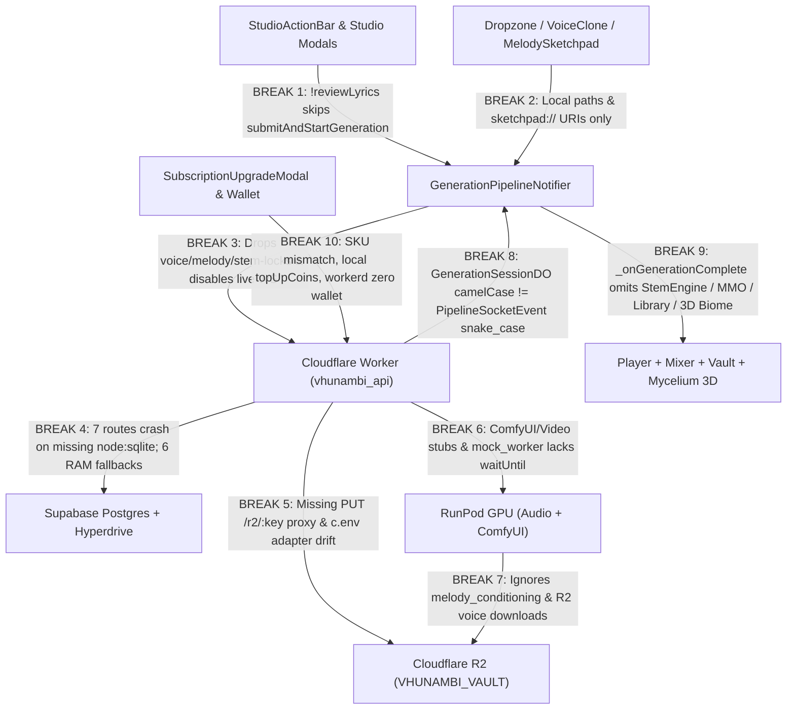

# Phase 63 Forensic Pre-Spec Audit: End-to-End Studio-to-Cloud Execution Loop & Live Preflight Cockpit

**Audit Date:** November 11, 2026  
**Target Phase:** Phase 63 — End-to-End Studio-to-Cloud Execution Loop, `workerd` Persistence Bridge, PayFast & Vision Live Media Wiring, and 5-Pillar Cloud Preflight Cockpit  
**Predecessor Baseline:** Phase 62 (`docs/phases/phase_62_hybrid_cloud_stack_topology_convergence/`) + [`HYBRID_CLOUD_STACK_TOPOLOGY_PHASE62_AUDIT.md`](file:///c:/Users/Ndugelo/VHUNAMBI/monorepo/docs/audits/HYBRID_CLOUD_STACK_TOPOLOGY_PHASE62_AUDIT.md)  
**Scope Inspected (Static Forensic Audit — Zero Source/Test Mutations):**
- **Cloudflare Worker Gateway, Persistence & Routes:** [`apps/vhunambi_api/src/`](file:///c:/Users/Ndugelo/VHUNAMBI/monorepo/apps/vhunambi_api/src/server.ts) ([`worker.ts`](file:///c:/Users/Ndugelo/VHUNAMBI/monorepo/apps/vhunambi_api/src/worker.ts), [`wrangler.toml`](file:///c:/Users/Ndugelo/VHUNAMBI/monorepo/apps/vhunambi_api/wrangler.toml), [`package.json`](file:///c:/Users/Ndugelo/VHUNAMBI/monorepo/apps/vhunambi_api/package.json), [`env.ts`](file:///c:/Users/Ndugelo/VHUNAMBI/monorepo/apps/vhunambi_api/src/config/env.ts), [`supabase_cloud_driver.ts`](file:///c:/Users/Ndugelo/VHUNAMBI/monorepo/apps/vhunambi_api/src/db/supabase_cloud_driver.ts), [`vhunambi_db.ts`](file:///c:/Users/Ndugelo/VHUNAMBI/monorepo/apps/vhunambi_api/src/db/vhunambi_db.ts), [`auth_middleware.ts`](file:///c:/Users/Ndugelo/VHUNAMBI/monorepo/apps/vhunambi_api/src/middleware/auth_middleware.ts), all 14 route files, storage/synthesis/vision/realtime modules)
- **Supabase Postgres Production Schema:** [`20261110000001_phase62_hybrid_cloud_schema.sql`](file:///c:/Users/Ndugelo/VHUNAMBI/monorepo/supabase/migrations/20261110000001_phase62_hybrid_cloud_schema.sql)
- **RunPod Serverless GPU Worker:** [`tools/zr-studio-gpu/handler.py`](file:///c:/Users/Ndugelo/VHUNAMBI/monorepo/tools/zr-studio-gpu/handler.py) & [`seed_vc_worker.py`](file:///c:/Users/Ndugelo/VHUNAMBI/monorepo/tools/zr-studio-gpu/seed_vc_worker.py)
- **Flutter Monorepo Client:** [`apps/vhunambi_client/lib/`](file:///c:/Users/Ndugelo/VHUNAMBI/monorepo/apps/vhunambi_client/lib/core/constants/app_constants.dart) (Studio pipeline, Voice/Signature/Melody providers, Multi-Stem Audio Engine, Content Studio, Wallet/PayFast UI, Social Repository, Profile Settings Drawer)

---

## Executive Summary & Risk Scorecard

### Headline Audit Verdict

Phase 62 successfully built the Supabase Postgres 19-table migration, Worker entrypoint ([`worker.ts`](file:///c:/Users/Ndugelo/VHUNAMBI/monorepo/apps/vhunambi_api/src/worker.ts)), Durable Object session coordinator ([`GenerationSessionDO`](file:///c:/Users/Ndugelo/VHUNAMBI/monorepo/apps/vhunambi_api/src/modules/realtime/generation_session_do.ts)), PayFast crypto verifier ([`payment_routes.ts`](file:///c:/Users/Ndugelo/VHUNAMBI/monorepo/apps/vhunambi_api/src/routes/payment_routes.ts)), and RunPod boot repairs. However, **cross-stack forensic inspection across all 5 operational pillars confirms that flipping live dashboard credentials right now will fail end-to-end execution in runtime, persistence, wire serialization, and Flutter wiring**:

1. **Cloudflare `workerd` V8 Isolate Persistence Trap (P0):** Seven domain route modules still call `vhunambiDb.*` without an `isNodeSqliteAvailable()` guard (throwing `SQLITE_UNAVAILABLE_IN_EDGE_ISOLATE` in [`VhunambiDatabase`](file:///c:/Users/Ndugelo/VHUNAMBI/monorepo/apps/vhunambi_api/src/db/vhunambi_db.ts#L348-L349)). Meanwhile, [`SupabaseCloudDriver`](file:///c:/Users/Ndugelo/VHUNAMBI/monorepo/apps/vhunambi_api/src/db/supabase_cloud_driver.ts#L21-L181) is only imported in [`auth_routes.ts`](file:///c:/Users/Ndugelo/VHUNAMBI/monorepo/apps/vhunambi_api/src/routes/auth_routes.ts#L3) and lacks write/update/delete primitives, `HYPERDRIVE` ([`wrangler.toml`](file:///c:/Users/Ndugelo/VHUNAMBI/monorepo/apps/vhunambi_api/wrangler.toml#L16-L18)) has no Postgres driver installed in [`package.json`](file:///c:/Users/Ndugelo/VHUNAMBI/monorepo/apps/vhunambi_api/package.json#L23-L30), six subsystems drop into volatile isolate RAM or return hardcoded zeros, [`server.ts`](file:///c:/Users/Ndugelo/VHUNAMBI/monorepo/apps/vhunambi_api/src/server.ts#L80-L132) exposes `GET /r2/:key` without a `PUT /r2/:key` proxy, and SQLite $\leftrightarrow$ Postgres column/sign drift breaks pass-through queries.
2. **Broken Studio-to-Stem Mixer & 3D Biome Loop (P0):** Clicking Generate in instrumental or custom-lyrics mode inside [`StudioActionBar._handleGenerate`](file:///c:/Users/Ndugelo/VHUNAMBI/monorepo/apps/vhunambi_client/lib/features/studio/presentation/widgets/studio_action_bar.dart#L186-L189) **never calls `submitAndStartGeneration`**, stalling the pipeline card forever; [`GenerationPipelineNotifier`](file:///c:/Users/Ndugelo/VHUNAMBI/monorepo/apps/vhunambi_client/lib/features/studio/presentation/providers/generation_pipeline_providers.dart#L94) explicitly **disables live WebSocket connections** against `GenerationSocketService` and omits voice/melody/reference/stem-lock context; `GenerationSessionDO` broadcasts camelCase events that [`PipelineSocketEvent.fromJson`](file:///c:/Users/Ndugelo/VHUNAMBI/monorepo/apps/vhunambi_client/lib/features/studio/domain/models/generation_pipeline_state.dart#L45-L71) decodes as snake_case (mapping `'synthesizing'` and `'queued'` to `PipelineStep.failed`); pre-gen R2 callers are completely unwired; RunPod Python workers drop `melody_conditioning` and never download reference audio from R2; and `_onGenerationComplete` never loads [`JustAudioMultiStemEngine`](file:///c:/Users/Ndugelo/VHUNAMBI/monorepo/apps/vhunambi_client/lib/features/player/data/services/just_audio_multi_stem_engine.dart#L89), [`StemMixerNotifier`](file:///c:/Users/Ndugelo/VHUNAMBI/monorepo/apps/vhunambi_client/lib/features/player/presentation/providers/stem_mixer_provider.dart#L73), [`MasterMediaObjectNotifier`](file:///c:/Users/Ndugelo/VHUNAMBI/monorepo/apps/vhunambi_client/lib/features/content_studio/presentation/providers/master_media_object_provider.dart#L87), [`libraryTracksProvider`](file:///c:/Users/Ndugelo/VHUNAMBI/monorepo/apps/vhunambi_client/lib/features/library/presentation/providers/library_providers.dart#L242), or [`MyceliumBiomeGraphNotifier`](file:///c:/Users/Ndugelo/VHUNAMBI/monorepo/apps/vhunambi_client/lib/features/studio/presentation/providers/mycelium_biome_provider.dart#L21-L40).
3. **PayFast ZAR Live-Flow & Wallet Sync Breaks (P0/P1):** On `workerd`, PayFast checkouts live in volatile RAM and status polling returns hardcoded `walletBalanceCoins: 0` ([`payment_routes.ts`](file:///c:/Users/Ndugelo/VHUNAMBI/monorepo/apps/vhunambi_api/src/routes/payment_routes.ts#L337-L339)); server coin packs (`pack_starter_500` R55 / 500, `pack_producer_1500` R150 / 1,500, `pack_mogul_5000` R450 / 5,000) diverge from Flutter (`100` R45 / `300` R120 / `1,000` R350 in [`subscription_upgrade_modal.dart`](file:///c:/Users/Ndugelo/VHUNAMBI/monorepo/apps/vhunambi_client/lib/features/home/presentation/widgets/subscription_upgrade_modal.dart#L160-L191)); `SubscriptionUpgradeModal` only mints coins locally and renders raw emoji `'🪙'`; and [`CreatorWalletNotifier.loadWallet`](file:///c:/Users/Ndugelo/VHUNAMBI/monorepo/apps/vhunambi_client/lib/features/social/presentation/providers/creator_wallet_provider.dart#L229-L246) never syncs `userCoinsBalance`.
4. **Cloud Vision & Video Render Remain Synthetic Stubs (P1):** `POST /v1/vision/render-video` returns synchronous fake `r2.vhunambi.com/reels/*.mp4` metadata without GPU dispatch ([`vision_routes.ts`](file:///c:/Users/Ndugelo/VHUNAMBI/monorepo/apps/vhunambi_api/src/routes/vision_routes.ts#L168-L226)); `GET /v1/vision/:id` normalizes RunPod URLs without ingesting output PNG bytes into `VHUNAMBI_VAULT` R2; [`comfyui_adapter.ts`](file:///c:/Users/Ndugelo/VHUNAMBI/monorepo/apps/vhunambi_api/src/modules/vision/comfyui_adapter.ts#L115-L189) ignores per-request `c.env`; and five Flutter video/vision callers hardcode 80–600ms delays or fake URLs.
5. **Missing 5-Pillar Preflight Probe & Live Diagnostic UI (P1):** Neither `/api/system/preflight` nor an interactive [`ProfileSettingsDrawer`](file:///c:/Users/Ndugelo/VHUNAMBI/monorepo/apps/vhunambi_client/lib/features/profile/presentation/widgets/profile_settings_drawer.dart) diagnostic cockpit exists to verify Postgres, R2, RunPod Audio/ComfyUI, Anthropic/PayFast, and `WEBHOOK_BASE_URL` readiness before testing.

### Severity & Readiness Scorecard

| Severity | Pillar | Verified Defect Summary | Primary Evidence |
| :---: | :---: | :--- | :--- |
| **P0** | **1** | 7 route files call unguarded `vhunambiDb.*` -> immediate `SQLITE_UNAVAILABLE_IN_EDGE_ISOLATE` crash on `workerd`. | [`explore_routes.ts`](file:///c:/Users/Ndugelo/VHUNAMBI/monorepo/apps/vhunambi_api/src/routes/explore_routes.ts), [`library_routes.ts`](file:///c:/Users/Ndugelo/VHUNAMBI/monorepo/apps/vhunambi_api/src/routes/library_routes.ts), [`playlist_routes.ts`](file:///c:/Users/Ndugelo/VHUNAMBI/monorepo/apps/vhunambi_api/src/routes/playlist_routes.ts), [`sync_routes.ts`](file:///c:/Users/Ndugelo/VHUNAMBI/monorepo/apps/vhunambi_api/src/routes/sync_routes.ts), [`wallet_routes.ts`](file:///c:/Users/Ndugelo/VHUNAMBI/monorepo/apps/vhunambi_api/src/routes/wallet_routes.ts) |
| **P0** | **1** | `SupabaseCloudDriver` is write-blind (zero `insert`/`patch`/`delete` or Hyperdrive `postgres` driver); 6 modules fall back to volatile isolate RAM or return zero balances; `auth/logout` revocation skipped on `workerd`. | [`supabase_cloud_driver.ts`](file:///c:/Users/Ndugelo/VHUNAMBI/monorepo/apps/vhunambi_api/src/db/supabase_cloud_driver.ts#L21-L181), [`auth_routes.ts`](file:///c:/Users/Ndugelo/VHUNAMBI/monorepo/apps/vhunambi_api/src/routes/auth_routes.ts#L307-L394), [`social_service.ts`](file:///c:/Users/Ndugelo/VHUNAMBI/monorepo/apps/vhunambi_api/src/modules/social/social_service.ts#L639-L650), [`marketplace_service.ts`](file:///c:/Users/Ndugelo/VHUNAMBI/monorepo/apps/vhunambi_api/src/modules/marketplace/marketplace_service.ts#L477-L491) |
| **P0** | **1** | Critical SQLite $\leftrightarrow$ Postgres schema & sign drift (`beat_licenses`, `wallet_ledger` negative payout convention, `user_library_sync`, `sync_mutation_log`, `playlists`, `marketplace_assets`). | [`vhunambi_db.ts`](file:///c:/Users/Ndugelo/VHUNAMBI/monorepo/apps/vhunambi_api/src/db/vhunambi_db.ts#L387-L584), [`20261110000001_phase62_hybrid_cloud_schema.sql`](file:///c:/Users/Ndugelo/VHUNAMBI/monorepo/supabase/migrations/20261110000001_phase62_hybrid_cloud_schema.sql#L61-L283) |
| **P0** | **2** | `StudioActionBar` skips `submitAndStartGeneration()` when `!reviewLyrics`; `GenerationPipelineNotifier` disables real WS, drops vocal/melody/ref context, and never feeds `StemMixerNotifier`, `JustAudioMultiStemEngine`, `MasterMediaObjectNotifier`, Library, or 3D Biome. | [`studio_action_bar.dart`](file:///c:/Users/Ndugelo/VHUNAMBI/monorepo/apps/vhunambi_client/lib/features/studio/presentation/widgets/studio_action_bar.dart#L186-L189), [`generation_pipeline_providers.dart`](file:///c:/Users/Ndugelo/VHUNAMBI/monorepo/apps/vhunambi_client/lib/features/studio/presentation/providers/generation_pipeline_providers.dart#L71-L252) |
| **P0** | **2** | `GenerationSessionDO` camelCase JSON & `'synthesizing'`/`'queued'` steps vs `PipelineSocketEvent.fromJson` snake_case JSON (`stepFromString` -> `PipelineStep.failed`). | [`generation_session_do.ts`](file:///c:/Users/Ndugelo/VHUNAMBI/monorepo/apps/vhunambi_api/src/modules/realtime/generation_session_do.ts#L41-L45), [`generation_pipeline_state.dart`](file:///c:/Users/Ndugelo/VHUNAMBI/monorepo/apps/vhunambi_client/lib/features/studio/domain/models/generation_pipeline_state.dart#L45-L71) |
| **P1** | **1/2** | `server.ts` lacks `PUT /r2/:key{.*}` binding upload proxy; `mock_worker.ts` timers omit `ctx.waitUntil` & DO broadcast; `runpod_adapter.ts` & `comfyui_adapter.ts` ignore `c.env`; RunPod fallback polling drops `stem_urls` / `manifest_url`. | [`server.ts`](file:///c:/Users/Ndugelo/VHUNAMBI/monorepo/apps/vhunambi_api/src/server.ts#L80-L132), [`mock_worker.ts`](file:///c:/Users/Ndugelo/VHUNAMBI/monorepo/apps/vhunambi_api/src/modules/synthesis/mock_worker.ts#L12-L58), [`runpod_adapter.ts`](file:///c:/Users/Ndugelo/VHUNAMBI/monorepo/apps/vhunambi_api/src/modules/synthesis/runpod_adapter.ts#L32-L151), [`generation_routes.ts`](file:///c:/Users/Ndugelo/VHUNAMBI/monorepo/apps/vhunambi_api/src/routes/generation_routes.ts#L159-L163) |
| **P1** | **2** | Pre-gen R2 callers (`ReferenceAudioDropzone`, `MelodySketchpad`, `VocalIdentity`, `SoundSignature`) are local-only; `POST /v1/melodies/render-reference` never writes WAV bytes to R2; RunPod `handler.py` & `seed_vc_worker.py` drop `melody_conditioning` & R2 voice downloads. | [`melody_routes.ts`](file:///c:/Users/Ndugelo/VHUNAMBI/monorepo/apps/vhunambi_api/src/routes/melody_routes.ts#L136-L153), [`handler.py`](file:///c:/Users/Ndugelo/VHUNAMBI/monorepo/tools/zr-studio-gpu/handler.py#L120-L330), [`seed_vc_worker.py`](file:///c:/Users/Ndugelo/VHUNAMBI/monorepo/tools/zr-studio-gpu/seed_vc_worker.py#L106-L133), [`melody_sketchpad_provider.dart`](file:///c:/Users/Ndugelo/VHUNAMBI/monorepo/apps/vhunambi_client/lib/features/studio/presentation/providers/melody_sketchpad_provider.dart#L851-L870) |
| **P1** | **3** | PayFast status returns `walletBalanceCoins: 0` on `workerd`, lacks `sandbox-settle` route, disagrees on pack SKUs/prices with `SubscriptionUpgradeModal` (which also uses local `topUpCoins()` and `'🪙'`), and `CreatorWalletNotifier` never updates `userCoinsBalance`. | [`payment_routes.ts`](file:///c:/Users/Ndugelo/VHUNAMBI/monorepo/apps/vhunambi_api/src/routes/payment_routes.ts#L29-L48), [`subscription_upgrade_modal.dart`](file:///c:/Users/Ndugelo/VHUNAMBI/monorepo/apps/vhunambi_client/lib/features/home/presentation/widgets/subscription_upgrade_modal.dart#L160-L304), [`creator_wallet_provider.dart`](file:///c:/Users/Ndugelo/VHUNAMBI/monorepo/apps/vhunambi_client/lib/features/social/presentation/providers/creator_wallet_provider.dart#L229-L246) |
| **P1** | **4** | `POST /v1/vision/render-video` & 5 Flutter video/vision callers are fake sleep/URL stubs; `GET /v1/vision/:id` fails to ingest RunPod PNGs into R2; `ContentStudio` injects `LocalVideoExportService` instead of `CloudVideoExportService`. | [`vision_routes.ts`](file:///c:/Users/Ndugelo/VHUNAMBI/monorepo/apps/vhunambi_api/src/routes/vision_routes.ts#L168-L332), [`content_studio_provider.dart`](file:///c:/Users/Ndugelo/VHUNAMBI/monorepo/apps/vhunambi_client/lib/features/content_studio/presentation/providers/content_studio_provider.dart#L17-L19), [`cloud_video_export_service.dart`](file:///c:/Users/Ndugelo/VHUNAMBI/monorepo/apps/vhunambi_client/lib/features/content_studio/data/services/cloud_video_export_service.dart#L24-L44) |
| **P2** | **5** | Zero `GET /api/system/preflight` probe endpoint and zero `ProfileSettingsDrawer` live diagnostic cockpit UI. | [`server.ts`](file:///c:/Users/Ndugelo/VHUNAMBI/monorepo/apps/vhunambi_api/src/server.ts), [`profile_settings_drawer.dart`](file:///c:/Users/Ndugelo/VHUNAMBI/monorepo/apps/vhunambi_client/lib/features/profile/presentation/widgets/profile_settings_drawer.dart) |

### End-to-End Breakpoint Topology Map

---

## Section 1 — Pillar 1: Cloudflare `workerd` V8 Isolate Persistence Engine & `SupabaseCloudDriver` Convergence

### 1.1 Exhaustive Census of Unguarded `vhunambiDb.*` Call Sites (7 Crash-Prone Route Files)

In Node test runs, `process.getBuiltinModule('node:sqlite')` resolves `DatabaseSync`. Inside Cloudflare Workers (`workerd`), [`VhunambiDatabase`](file:///c:/Users/Ndugelo/VHUNAMBI/monorepo/apps/vhunambi_api/src/db/vhunambi_db.ts#L348-L349) throws `Error('SQLITE_UNAVAILABLE_IN_EDGE_ISOLATE')` on any unguarded method invocation. Every unguarded call site below crashes with HTTP `500` inside `workerd`:

| Route Module | Verified Unguarded `vhunambiDb.*` Lines | Operations Affected | Required Cloud Engine Bridge |
| :--- | :--- | :--- | :--- |
| [`explore_routes.ts`](file:///c:/Users/Ndugelo/VHUNAMBI/monorepo/apps/vhunambi_api/src/routes/explore_routes.ts#L20-L110) | `L20`, `L32`, `L53`, `L69`, `L80`, `L100`, `L110` | `listExploreTracks`, `listKineticPosts`, `publishExploreTrack`, `getExploreRadioByGenre`, `cosignKineticPost`, `repostKineticPost` | Postgres `explore_tracks`, `kinetic_posts` via Edge Data Engine |
| [`library_routes.ts`](file:///c:/Users/Ndugelo/VHUNAMBI/monorepo/apps/vhunambi_api/src/routes/library_routes.ts#L20-L96) | `L20`, `L25`, `L37`, `L42`, `L56`, `L79`, `L92`, `L96` | `listLibraryTracks`, `getLibraryUpdatesSince`, `upsertLibraryTrackLww`, `appendSyncMutation`, `deleteLibraryTrack` | Postgres `user_library_sync` + `sync_mutation_log` |
| [`playlist_routes.ts`](file:///c:/Users/Ndugelo/VHUNAMBI/monorepo/apps/vhunambi_api/src/routes/playlist_routes.ts#L22-L193) | `L22`, `L28`, `L35`, `L70`, `L85`, `L89`, `L100`, `L127`, `L132`, `L147`, `L160`, `L164`, `L172`, `L184`, `L193` | Full playlist CRUD + share code lookup + `sync_mutation_log` append | Postgres `playlists` + `sync_mutation_log` |
| [`sync_routes.ts`](file:///c:/Users/Ndugelo/VHUNAMBI/monorepo/apps/vhunambi_api/src/routes/sync_routes.ts#L51-L74) | `L51`, `L74` | `applyBatchMutations`, `pullMutationsSince` (`seq` cursor sync) | Postgres `sync_mutation_log` + domain LWW tables |
| [`wallet_routes.ts`](file:///c:/Users/Ndugelo/VHUNAMBI/monorepo/apps/vhunambi_api/src/routes/wallet_routes.ts#L21-L89) | `L21`, `L37`, `L67`, `L89` | `getWalletSnapshot`, `topUpCoins` (blocked under strict mode), `recordBankAccount`, `executeAtomicPayout` | Postgres `wallet_ledger`, `bank_accounts`, RPC `execute_atomic_payout` |
| [`marketplace_routes.ts`](file:///c:/Users/Ndugelo/VHUNAMBI/monorepo/apps/vhunambi_api/src/routes/marketplace_routes.ts#L173) | `L173` (while [`marketplace_service.ts`](file:///c:/Users/Ndugelo/VHUNAMBI/monorepo/apps/vhunambi_api/src/modules/marketplace/marketplace_service.ts) guards other paths) | `GET /*/marketplace/licenses/verify/:certificateCode` -> `verifyBeatLicense` | Postgres `beat_licenses` |
| [`social_routes.ts`](file:///c:/Users/Ndugelo/VHUNAMBI/monorepo/apps/vhunambi_api/src/routes/social_routes.ts#L322-L333) | `L322`, `L333` (`recordBankAccount` & `executeAtomicPayout` when parsed 10-digit SA account matches) | Payout withdrawal route with valid SA bank info | Postgres `bank_accounts` + RPC `execute_atomic_payout` |

### 1.2 Volatile Isolate RAM Fallbacks, Zero-Balance Stubs & Auth Revocation Gaps

Modules that already guard `isNodeSqliteAvailable()` silently degrade into ephemeral isolate memory or return fabricated empty responses:

| Module | RAM Map / Guard Location | Degraded Behavior in Live Cloudflare Workers |
| :--- | :--- | :--- |
| [`job_store.ts`](file:///c:/Users/Ndugelo/VHUNAMBI/monorepo/apps/vhunambi_api/src/modules/jobs/job_store.ts#L5) | `edgeIsolateFallbackJobs` Map | Webhook hits Isolate B after POST hit Isolate A -> `GET /v1/generations/:id` sees stale queued job or `404`. |
| [`payment_routes.ts`](file:///c:/Users/Ndugelo/VHUNAMBI/monorepo/apps/vhunambi_api/src/routes/payment_routes.ts#L64-L339) | `edgeIsolateCheckouts` Map (`L64`); status `L337-L339` | PayFast ITN hits different isolate than `/payfast/checkout` -> `404 CHECKOUT_NOT_FOUND`; status hardcodes `walletBalanceCoins: 0, walletBalanceZar: 0` (`L338-L339`). |
| [`vision_routes.ts`](file:///c:/Users/Ndugelo/VHUNAMBI/monorepo/apps/vhunambi_api/src/routes/vision_routes.ts#L40) | `visionMetaFallbackStore` Map | Vision metadata & video job results vanish across worker isolates. |
| [`voice_catalog.ts`](file:///c:/Users/Ndugelo/VHUNAMBI/monorepo/apps/vhunambi_api/src/modules/voices/voice_catalog.ts#L561-L562) | `edgeIsolateClonedVoices`, `edgeIsolateSoundSignatures` | Cloned voices and `.vss` signatures disappear across isolates and never sync to `voice_clones`. |
| [`marketplace_service.ts`](file:///c:/Users/Ndugelo/VHUNAMBI/monorepo/apps/vhunambi_api/src/modules/marketplace/marketplace_service.ts#L18-L19) | `fallbackMarketplaceListings`, `fallbackBeatLicenses`; `L477-L491` | Skips buyer wallet coin/ZAR debit and producer royalty ledger persistence completely when `isNodeSqliteAvailable()` is false! |
| [`social_service.ts`](file:///c:/Users/Ndugelo/VHUNAMBI/monorepo/apps/vhunambi_api/src/modules/social/social_service.ts#L25-L29) | `fallbackSocialPosts`, `fallbackCreatorWallets`, etc.; `L639-L650`, `L801` | `getCreatorWallet()` returns hardcoded `0` coins / `0.00` ZAR (`L642-L645`); `requestPayout()` returns `null` (`L801`). |
| [`auth_routes.ts`](file:///c:/Users/Ndugelo/VHUNAMBI/monorepo/apps/vhunambi_api/src/routes/auth_routes.ts#L307-L394) & [`auth_middleware.ts`](file:///c:/Users/Ndugelo/VHUNAMBI/monorepo/apps/vhunambi_api/src/middleware/auth_middleware.ts#L96-L97) | `L307-L313` (logout), `L325-L343` (`/me`), `L374-L394` (`/sessions`), `L96-L97` (middleware) | `GET /auth/me` returns hardcoded `0` wallet balance on `workerd`; `GET /auth/sessions` returns synthetic 1-item array; `POST /auth/logout` omits DB revocation on `workerd`, and `sovereignAuthMiddleware` skips `isSessionActive()` when `!isNodeSqliteAvailable()`. |

### 1.3 `SupabaseCloudDriver` & Hyperdrive Missing Primitives

- [`supabase_cloud_driver.ts`](file:///c:/Users/Ndugelo/VHUNAMBI/monorepo/apps/vhunambi_api/src/db/supabase_cloud_driver.ts#L21-L181) currently exposes ONLY: `fromSelect()`, `rpc()`, `fetchCreatorByIdentifier()`, `fetchCreatorWalletSummary()`, `signUpWithPassword()`, `signInWithPassword()`, `refreshSession()`, and `signOut()`. It is **imported solely in [`auth_routes.ts`](file:///c:/Users/Ndugelo/VHUNAMBI/monorepo/apps/vhunambi_api/src/routes/auth_routes.ts#L3)**.
- Missing CRUD primitives required for `workerd` convergence:
  - `insertRow(table, body, returning?)` / `upsertRow(table, body, onConflict)` (`Prefer: resolution=merge-duplicates,return=representation`)
  - `patchRows(table, filterQuery, patchBody)` (`PATCH /rest/v1/...`)
  - `deleteRows(table, filterQuery)` (`DELETE /rest/v1/...`)
- **Hyperdrive Gap:** [`wrangler.toml`](file:///c:/Users/Ndugelo/VHUNAMBI/monorepo/apps/vhunambi_api/wrangler.toml#L16-L18) binds `HYPERDRIVE`, yet [`package.json`](file:///c:/Users/Ndugelo/VHUNAMBI/monorepo/apps/vhunambi_api/package.json#L23-L30) installs zero Postgres client (`postgres` / `pg`), leaving `c.env.HYPERDRIVE` dead code. Phase 63 should standardize either Supabase PostgREST Service-Role + RPC calls in `SupabaseCloudDriver` for edge-safe REST/RPC execution OR `postgres` over `c.env.HYPERDRIVE.connectionString` when TCP pooling is active (PostgREST `SupabaseCloudDriver` requires zero binary TCP shims in `workerd` and respects atomic `PL/pgSQL` RPCs).

### 1.4 `workerd` Per-Request `c.env`, `ctx.waitUntil()`, & Missing `PUT /r2/:key{.*}` Proxy

1. **Module-Scoped `env` Loss:** [`runpod_adapter.ts`](file:///c:/Users/Ndugelo/VHUNAMBI/monorepo/apps/vhunambi_api/src/modules/synthesis/runpod_adapter.ts#L32-L44) (`L32`, `L113`) and [`comfyui_adapter.ts`](file:///c:/Users/Ndugelo/VHUNAMBI/monorepo/apps/vhunambi_api/src/modules/vision/comfyui_adapter.ts#L115-L150) call `resolveRuntimeEnv()` **without passing `c.env`**, causing Worker secrets (`RUNPOD_API_KEY`, `RUNPOD_ENDPOINT_ID`, `RUNPOD_COMFYUI_ENDPOINT_ID`, `WEBHOOK_BASE_URL`, `ZR_WEBHOOK_SECRET`, `R2_PUBLIC_BASE_URL`) bound per request in Cloudflare Workers to resolve as empty strings.
2. **Killed Background Timers in `mock_worker.ts`:** [`runMockSynthesisWorker`](file:///c:/Users/Ndugelo/VHUNAMBI/monorepo/apps/vhunambi_api/src/modules/synthesis/mock_worker.ts#L12-L58) schedules nested `setTimeout` chains without `ctx.waitUntil(...)` and **never calls `broadcastGenerationEventToDo(...)`** on progress/completion/failure. On `workerd`, timers terminate once the `201 Created` response returns.
3. **RunPod Fallback Poll Drops Stems & Manifest:** When webhook delivery is delayed, [`generation_routes.ts`](file:///c:/Users/Ndugelo/VHUNAMBI/monorepo/apps/vhunambi_api/src/routes/generation_routes.ts#L159-L163) and [`checkRunPodJobStatus`](file:///c:/Users/Ndugelo/VHUNAMBI/monorepo/apps/vhunambi_api/src/modules/synthesis/runpod_adapter.ts#L132-L151) extract ONLY `audioUrl` and `stemsZipUrl`, dropping `stem_urls`, `manifest_url`, and `master_wav_url`.
4. **Missing `PUT /r2/:key{.*}` Upload Proxy:** [`server.ts`](file:///c:/Users/Ndugelo/VHUNAMBI/monorepo/apps/vhunambi_api/src/server.ts#L80-L132) mounts `GET /r2/:key{.*}` using `c.env.VHUNAMBI_VAULT.get(key)`, while [`r2_storage.ts`](file:///c:/Users/Ndugelo/VHUNAMBI/monorepo/apps/vhunambi_api/src/modules/synthesis/r2_storage.ts#L45-L60) returns `${WEBHOOK_BASE_URL}/r2/${key}?presigned=1` whenever `R2_ACCESS_KEY_ID` / `R2_ENDPOINT` are unset — **but there is NO `PUT /r2/:key{.*}` handler**, causing every R2 upload without S3 API keys (and browser/Flutter dev loopback uploads) to fail with `404`. Adding HMAC-signed `PUT /r2/:key{.*}` writing to `c.env.VHUNAMBI_VAULT.put(key, ...)` closes both S3-keyed and Worker-binding R2 flows.

### 1.5 Exact SQLite (`vhunambi_db.ts`) $\leftrightarrow$ Postgres (`20261110000001_phase62_hybrid_cloud_schema.sql`) Schema & Sign-Convention Diff Matrix

Translating `vhunambiDb.*` calls into Postgres queries requires explicit column/sign mappers on these 6 divergent tables:

| Table | SQLite Definition ([`vhunambi_db.ts`](file:///c:/Users/Ndugelo/VHUNAMBI/monorepo/apps/vhunambi_api/src/db/vhunambi_db.ts#L387-L584)) | Postgres Definition ([`phase62_hybrid_cloud_schema.sql`](file:///c:/Users/Ndugelo/VHUNAMBI/monorepo/supabase/migrations/20261110000001_phase62_hybrid_cloud_schema.sql#L61-L283)) | Critical Behavioral / Schema Divergence |
| :--- | :--- | :--- | :--- |
| **`wallet_ledger`** | `L572-584`: `data_json TEXT`; **stores positive `amount_zar`** on `tx_type = 'payout'` and subtracts `'payout'` inside `getWalletSnapshot()`. | `L77-86`, `L426-427`: `metadata_json JSONB`; `execute_atomic_payout` inserts **negative `-ABS(p_amount_zar)`** with `tx_type = 'payout_withdrawal'`. | Reading `SUM(amount_zar)` naively in SQLite vs Postgres reverses payout arithmetic unless bridged via sign-aware ledger reader! Also `data_json` $\neq$ `metadata_json`. |
| **`beat_licenses`** | `L527-540`: `coins_paid, zar_paid, producer_coins, producer_zar, issued_at, data_json`. | `L224-240`: `beat_title, buyer_name, producer_name, amount_paid_zar, amount_paid_coins, master_file_sha256, terms_json, stems_urls_json, purchased_at`. | Almost every non-PK column name differs; `record_beat_license_atomic` (`L477-525`) writes normalized Postgres schema. |
| **`user_library_sync`** | `L560-568`: `id TEXT PRIMARY KEY`, `creator_id, item_type, title, data_json, created_at, updated_at TEXT`. | `L261-283`: Normalized telemetry/license columns + composite **`PRIMARY KEY (id, creator_id)`** + **`updated_at BIGINT`**. | `updated_at` ISO string vs epoch ms `BIGINT`; JSON blob vs first-class columns (`tempo_bpm`, `stem_urls_json`, `master_mp3_url`, etc.). |
| **`sync_mutation_log`** | `L387-395`: `seq, idempotency_key, entity_type, entity_id, action, payload_json, creator_id, created_at TEXT`. | `L61-71`: `seq, mutation_id, creator_id, entity_type, entity_id, operation, payload_json JSONB, client_ts BIGINT, server_ts TIMESTAMPTZ`. | `idempotency_key` $\leftrightarrow$ `mutation_id`; `action` $\leftrightarrow$ `operation`; `created_at` $\leftrightarrow$ `client_ts` / `server_ts`. |
| **`playlists`** | `L481-497`: `cover_url, data_json, is_public INTEGER (0/1), share_code`. | `L200-217`: `cover_image_url, share_url, tracks_json, is_public BOOLEAN`. | Column rename (`cover_url` $\to$ `cover_image_url`) + boolean type + `tracks_json` vs `data_json`. |
| **`marketplace_assets`** | `L506-520`: `price_coins, price_zar, data_json, is_exclusive_sold INTEGER`. | `L177-194`: Adds `asset_category`, `buyer_creator_id`, `is_exclusive_sold BOOLEAN`, `updated_at BIGINT`, structured metadata columns. | `updated_at` `BIGINT` + boolean cast + `asset_category`. |

---

## Section 2 — Pillar 2: End-to-End Studio $\to$ R2 Presigned Upload $\to$ RunPod $\to$ `WS /ws/generation` $\to$ 4-Stem Mixer, Library & 3D Mycelium Biome Loop

### 2.1 Stage-by-Stage Forensic Breakpoint Trace

#### Stage A: Studio Submission Dead-End & Missing Context (`apps/vhunambi_client`)
1. **`StudioActionBar._handleGenerate` Silent Stall ([`studio_action_bar.dart`](file:///c:/Users/Ndugelo/VHUNAMBI/monorepo/apps/vhunambi_client/lib/features/studio/presentation/widgets/studio_action_bar.dart#L186-L189)):**
   When `formState.isInstrumental == true` OR `formState.lyricsMode != LyricsMode.aiWrite`, `_handleGenerate` sets `formNotifier.triggerGeneration()` and executes `return;` **without calling `ref.read(generationProgressProvider.notifier).submitAndStartGeneration(...)`**. The UI transitions into generating phase and permanently renders `_PipelineSkeletonLoader`.
2. **Modals Omit Tempo, Key & Cloud Parameters:**
   - [`LyricsReviewModal._approveDraft`](file:///c:/Users/Ndugelo/VHUNAMBI/monorepo/apps/vhunambi_client/lib/features/studio/presentation/widgets/lyrics_review_modal.dart#L907-L917) calls `submitAndStartGeneration(...)` passing only `trackTitle`, `genre`, `language`, `lyrics`, `isInstrumental` — omitting `tempoBpm` and `musicalKey`.
   - [`SongDnaNodeTreeModal`](file:///c:/Users/Ndugelo/VHUNAMBI/monorepo/apps/vhunambi_client/lib/features/studio/presentation/widgets/song_dna_node_tree_modal.dart#L348-L356) does the same (and uses freeform `formState.prompt` instead of resolved title).
3. **`GenerationPipelineNotifier.submitAndStartGeneration` Strips Cloud Context & Disables Live WS ([`generation_pipeline_providers.dart`](file:///c:/Users/Ndugelo/VHUNAMBI/monorepo/apps/vhunambi_client/lib/features/studio/presentation/providers/generation_pipeline_providers.dart#L71-L169)):**
   - Does NOT read `vocalIdentityProvider` (`selectedVoiceId`, `clonedVoiceProfileId`), `melodySketchpadProvider.attachedPattern` (`melodyPattern`, `melodyReferenceId`), `studioFormProvider` (`referenceAudioUrl` / sound signature URL, `pregenStemLocks` / `lockedStemsPayload`), or authenticated `creatorId` (`userId`).
   - **Line 94 explicitly blocks real WebSockets:** `if (_socketFactory != null && socket is! GenerationSocketService)` restricts WebSocket listening to fake test sockets! Production builds force pure HTTP `pollGenerationProgress` (`L163-168`), which caps polling at `30 * 3s = 90s` ([`http_generation_submission_service.dart`](file:///c:/Users/Ndugelo/VHUNAMBI/monorepo/apps/vhunambi_client/lib/features/studio/data/services/http_generation_submission_service.dart#L78)) — too short for cold RunPod GPU starts (60–180s).
   - Backend [`SubmitGenerationSchema`](file:///c:/Users/Ndugelo/VHUNAMBI/monorepo/apps/vhunambi_api/src/routes/generation_routes.ts#L37-L56) omits `pregenStemLocks` and `lockedStemsPayload` even though [`compileSongSpec`](file:///c:/Users/Ndugelo/VHUNAMBI/monorepo/apps/vhunambi_api/src/modules/synthesis/prompt_compiler.ts#L19-L75) reads them!

#### Stage B: Unwired Pre-Gen R2 Presigned Upload & Voice/Melody/Signature Callers
| Feature / Caller | Backend Endpoint Already Implemented | Current Flutter Client Reality |
| :--- | :--- | :--- |
| **Reference Audio Dropzone** | `POST /v1/voices/signatures` presigned R2 PUT (`r2_storage.ts`) | [`reference_audio_dropzone.dart`](file:///c:/Users/Ndugelo/VHUNAMBI/monorepo/apps/vhunambi_client/lib/features/studio/presentation/widgets/reference_audio_dropzone.dart#L201-L224) only stores local `result.fileName`; never reads bytes or PUTs to R2 presigned URL. |
| **Sound Signatures** | `POST /v1/voices/signatures`, `GET /v1/voices/signatures`, `PATCH .../recipe`, `POST .../analyze`, `DELETE ...` ([`voice_routes.ts`](file:///c:/Users/Ndugelo/VHUNAMBI/monorepo/apps/vhunambi_api/src/routes/voice_routes.ts#L161-L318)) | [`SoundSignatureRepository`](file:///c:/Users/Ndugelo/VHUNAMBI/monorepo/apps/vhunambi_client/lib/features/sound_signature/data/sound_signature_repository.dart#L12-L114) is Hive + in-memory only; zero HTTP calls. |
| **Voice Cloning** | `POST /v1/voices/clone` ([`voice_routes.ts`](file:///c:/Users/Ndugelo/VHUNAMBI/monorepo/apps/vhunambi_api/src/routes/voice_routes.ts#L95-L155)) | [`VocalIdentityNotifier`](file:///c:/Users/Ndugelo/VHUNAMBI/monorepo/apps/vhunambi_client/lib/features/studio/presentation/providers/vocal_identity_provider.dart#L408-L451) only saves profile locally in Hive; never uploads voice sample to R2 or registers profile via API. |
| **Melody Sketchpad** | `POST /v1/melodies/render-reference` ([`melody_routes.ts`](file:///c:/Users/Ndugelo/VHUNAMBI/monorepo/apps/vhunambi_api/src/routes/melody_routes.ts#L136-L161)) | [`MelodySketchpadNotifier`](file:///c:/Users/Ndugelo/VHUNAMBI/monorepo/apps/vhunambi_client/lib/features/studio/presentation/providers/melody_sketchpad_provider.dart#L851-L870) fabricates `'sketchpad://${state.activePattern.id}.wav'` locally. **Backend trap too:** [`melody_routes.ts`](file:///c:/Users/Ndugelo/VHUNAMBI/monorepo/apps/vhunambi_api/src/routes/melody_routes.ts#L148-L153) returns a URL string without writing rendered WAV bytes to `VHUNAMBI_VAULT` R2! |

#### Stage C: RunPod Python GPU Worker Reference Gaps ([`tools/zr-studio-gpu/`](file:///c:/Users/Ndugelo/VHUNAMBI/monorepo/tools/zr-studio-gpu/handler.py))
- [`handler.py`](file:///c:/Users/Ndugelo/VHUNAMBI/monorepo/tools/zr-studio-gpu/handler.py#L120-L330): Never inspects `job_input.get("melody_conditioning")` transmitted by [`runpod_adapter.ts`](file:///c:/Users/Ndugelo/VHUNAMBI/monorepo/apps/vhunambi_api/src/modules/synthesis/runpod_adapter.ts#L74), nor passes melody guide contour / locked stem URLs into ACE-Step conditioning.
- [`prompt_compiler.ts`](file:///c:/Users/Ndugelo/VHUNAMBI/monorepo/apps/vhunambi_api/src/modules/synthesis/prompt_compiler.ts#L76-L90) constructs `svcConfig = { mode, voiceId, f0Method, protectConsonants }` (without `r2_reference_url`, `archetype_id`, or `cloned_profile_id`), whereas [`seed_vc_worker.py`](file:///c:/Users/Ndugelo/VHUNAMBI/monorepo/tools/zr-studio-gpu/seed_vc_worker.py#L106-L133) looks up `archetype_id`/`cloned_profile_id` and applies synthetic gain/diff shaping without downloading a voice reference WAV from R2.

#### Stage D: Wire Protocol Drift Between `GenerationSessionDO` and Flutter `PipelineSocketEvent`
[`GenerationSessionDO`](file:///c:/Users/Ndugelo/VHUNAMBI/monorepo/apps/vhunambi_api/src/modules/realtime/generation_session_do.ts#L41-L45) and [`PipelineSocketEvent.fromJson`](file:///c:/Users/Ndugelo/VHUNAMBI/monorepo/apps/vhunambi_client/lib/features/studio/domain/models/generation_pipeline_state.dart#L45-L71) speak incompatible dialects on `WS /ws/generation`:

| Field / Value | Worker [`GenerationSessionDO`](file:///c:/Users/Ndugelo/VHUNAMBI/monorepo/apps/vhunambi_api/src/modules/realtime/generation_session_do.ts#L10-L45) Emits | Flutter [`PipelineSocketEvent.fromJson`](file:///c:/Users/Ndugelo/VHUNAMBI/monorepo/apps/vhunambi_client/lib/features/studio/domain/models/generation_pipeline_state.dart#L45-L71) Expects | Impact on Live Stream |
| :--- | :--- | :--- | :--- |
| Job ID | `generationId` (camelCase) | `generation_id` (snake_case) | Decodes as `''` |
| Step | `'queued'`, `'synthesizing'`, `'separating_stems'`, `'ready'`, `'failed'` | Only `'starting_up'`, `'writing_lyrics'`, `'producing_beat'`, `'ready'` | **`'queued'`, `'synthesizing'`, `'separating_stems'` hit default branch -> `PipelineStep.failed`!** |
| Progress | `progressPct` (`0` to `100` integer) | `progress_percent` (`0.0` to `1.0` double) | Stays at `0.0` |
| Step Index & Msg | *Not sent* | `step_index`, `status_message` | Defaults to `0` & `''` |
| Completion | `masterMp3Url`, `stemsZipUrl`, `stemUrls`, `manifestUrl` | `completed_track` nested `Map` (`TrackEntity.fromJson`) | `completedTrack` stays `null` -> pipeline never finishes! |

#### Stage E: Post-Completion Convergence Loop (`_onGenerationComplete`) Broken
In [`_onGenerationComplete`](file:///c:/Users/Ndugelo/VHUNAMBI/monorepo/apps/vhunambi_client/lib/features/studio/presentation/providers/generation_pipeline_providers.dart#L228-L252), finishing a track only triggers offline master download, notification, and `playerStateProvider.notifier.playTrack(track.toTrack())`:
1. [`VhunambiAudioHandler.playTrack`](file:///c:/Users/Ndugelo/VHUNAMBI/monorepo/apps/vhunambi_client/lib/features/player/data/services/vhunambi_audio_handler.dart#L618-L622) streams ONLY the stereo master URL and ignores `track.stemUrls`.
2. [`JustAudioMultiStemEngine.loadFromManifest`](file:///c:/Users/Ndugelo/VHUNAMBI/monorepo/apps/vhunambi_client/lib/features/player/data/services/just_audio_multi_stem_engine.dart#L89) is **never invoked**.
3. [`StemMixerNotifier.loadMixForTrack`](file:///c:/Users/Ndugelo/VHUNAMBI/monorepo/apps/vhunambi_client/lib/features/player/presentation/providers/stem_mixer_provider.dart#L73) is **never invoked** (4-stem sliders remain unpopulated for freshly generated tracks).
4. [`MasterMediaObjectNotifier.updateManifest`](file:///c:/Users/Ndugelo/VHUNAMBI/monorepo/apps/vhunambi_client/lib/features/content_studio/presentation/providers/master_media_object_provider.dart#L87) is **never hydrated** from `GET /v1/generations/:id/manifest`.
5. [`libraryTracksProvider.notifier.addTrack`](file:///c:/Users/Ndugelo/VHUNAMBI/monorepo/apps/vhunambi_client/lib/features/library/presentation/providers/library_providers.dart#L242) is **never called** (compare [`direct_daw_vocal_upload_sheet.dart`](file:///c:/Users/Ndugelo/VHUNAMBI/monorepo/apps/vhunambi_client/lib/features/studio/presentation/widgets/direct_daw_vocal_upload_sheet.dart#L141) which explicitly adds uploaded tracks to Library + Explore).
6. [`MyceliumBiomeGraphNotifier`](file:///c:/Users/Ndugelo/VHUNAMBI/monorepo/apps/vhunambi_client/lib/features/studio/presentation/providers/mycelium_biome_provider.dart#L21-L40) does NOT watch `generationProgressProvider` or `masterMediaObjectProvider` and therefore never sprouted new 3D botanical/lineage nodes when a song completes.

### 2.2 Target Phase 63 Closed-Loop Contract
1. `StudioActionBar._handleGenerate` submits BOTH AI-lyrics-reviewed songs AND instrumental/custom-lyrics songs through one canonical `submitAndStartGeneration(...)` call carrying `tempoBpm`, `musicalKey`, `selectedVoiceId`, `clonedVoiceProfileId`, `melodyPattern`, `melodyReferenceId`, uploaded `referenceAudioUrl` (`POST /v1/voices/signatures` -> R2 presigned PUT), and `pregenStemLocks` / `lockedStemsPayload`.
2. `GenerationSessionDO` emits dual-compatible telemetry (preserving existing camelCase keys for Phase 62 consumers/tests PLUS `generation_id`, `progress_percent`, `step_index`, `status_message`, and `completed_track` / normalized URLs), and `PipelineSocketEvent.fromJson` / `stepFromString` decodes both cleanly (`queued`/`starting_up` -> `startingUp`, `synthesizing` -> `producingBeat`, `separating_stems` -> `producingBeat`, `ready` -> `ready`).
3. `GenerationPipelineNotifier` uses live WebSockets in production when `_socketFactory` or `GenerationSocketService` points to `AppConstants.resolveWsUrl('/ws/generation?id=...')` AND keeps adaptive HTTP polling (`>= 180s` cold-boot budget) as automatic fallback.
4. `_onGenerationComplete` atomically fetches `GET /v1/generations/:id/manifest` -> normalizes all URLs via `AppConstants.normalizeCloudMediaUrl(...)` -> calls `libraryTracksProvider.notifier.addTrack(...)` -> hydrates `masterMediaObjectProvider(dna).notifier.updateManifest(manifest)` -> hydrates `stemMixerProvider.notifier.loadMixForTrack(...)` & `JustAudioMultiStemEngine.loadFromManifest(...)` -> updates `myceliumBiomeGraphProvider`.

---

## Section 3 — Pillar 3: Live PayFast ZAR Checkout, Sandbox ITN Verifier & Wallet Hydration

### 3.1 Backend & Client Audit Findings

| Gap Area | Verified Current Behavior | Exact Evidence | Required Phase 63 Fix |
| :--- | :--- | :--- | :--- |
| **`workerd` Checkout Persistence & Balance** | Checkouts stored in volatile `edgeIsolateCheckouts` Map; `GET /api/payments/payfast/status/:checkoutId` returns hardcoded `walletBalanceCoins: 0, walletBalanceZar: 0` when SQLite is absent. | [`payment_routes.ts`](file:///c:/Users/Ndugelo/VHUNAMBI/monorepo/apps/vhunambi_api/src/routes/payment_routes.ts#L64-L339) | Persist pending/settled checkouts in Postgres `payment_checkouts` via Edge DB Bridge + execute atomic ITN ledger credit `record_payfast_itn_atomic` (or SQL transaction) returning true post-credit `walletBalanceCoins` / `walletBalanceZar`. |
| **Sandbox Controlled Settlement Endpoint** | PayFast ITN endpoint exists (`POST /api/payments/payfast/itn`), but there is no authenticated Worker helper to verify end-to-end sandbox settlement without external PayFast callbacks during localhost / staging tests. | [`payment_routes.ts`](file:///c:/Users/Ndugelo/VHUNAMBI/monorepo/apps/vhunambi_api/src/routes/payment_routes.ts#L160-L324) | Add `POST /api/payments/payfast/sandbox-settle/:checkoutId` gated by `PAYFAST_SANDBOX === true` + `sovereignAuthMiddleware` + creator ownership (`403` when `PAYFAST_SANDBOX=false`), computing canonical MD5 signature and invoking the exact ITN idempotent atomic credit path. |
| **SKU & ZAR Price Drift** | Server defines `pack_starter_500` (`500` coins, `R55.00`), `pack_producer_1500` (`1500`, `R150.00`), `pack_mogul_5000` (`5000`, `R450.00`). Flutter offers `100` (`R45`), `300` (`R120`), `1000` (`R350`). | [`payment_routes.ts`](file:///c:/Users/Ndugelo/VHUNAMBI/monorepo/apps/vhunambi_api/src/routes/payment_routes.ts#L29-L48) vs [`subscription_upgrade_modal.dart`](file:///c:/Users/Ndugelo/VHUNAMBI/monorepo/apps/vhunambi_client/lib/features/home/presentation/widgets/subscription_upgrade_modal.dart#L160-L191) | Align Flutter SKUs strictly to `pack_starter_500` (`500` / `R55`), `pack_producer_1500` (`1,500` / `R150`), and `pack_mogul_5000` (`5,000` / `R450`), or fetch catalog dynamically from `GET /api/payments/payfast/packs`. |
| **Local Minting & Raw Emoji Violation** | `SubscriptionUpgradeModal` calls local `topUpCoins(coins)` directly (`L253-272`, `L448-467`) with zero API checkout/status calls, and renders raw Unicode emoji `'🪙'` (`L304`). | [`subscription_upgrade_modal.dart`](file:///c:/Users/Ndugelo/VHUNAMBI/monorepo/apps/vhunambi_client/lib/features/home/presentation/widgets/subscription_upgrade_modal.dart#L253-L467) | Replace `'🪙'` with `PhosphorIconsBold.coins` / `AppColors`; wire `ISocialRepository` + `HttpSocialRepository` to call `POST /api/payments/payfast/checkout`, launch checkout URL via `url_launcher`, and poll `GET /api/payments/payfast/status/:checkoutId` (+ explicit "Complete Sandbox Test" button only when backend indicates sandbox mode). |
| **`CreatorWalletNotifier.loadWallet` Drift** | `loadWallet()` updates `wallet` (ZAR), `transactions`, and `isLoading`, **never updating `userCoinsBalance`** from server `wallet.coinsBalance` / `balanceCoins`. | [`creator_wallet_provider.dart`](file:///c:/Users/Ndugelo/VHUNAMBI/monorepo/apps/vhunambi_client/lib/features/social/presentation/providers/creator_wallet_provider.dart#L229-L246) | Rehydrate both ZAR ledger AND `userCoinsBalance` inside `loadWallet()` and post-PayFast status reconciliation, plus purge `_memorySnapshot` / `userCoinsBalance` cleanly in account transitions. |

---

## Section 4 — Pillar 4: Cloud Vision Artwork & Content Studio Video Export Wiring

### 4.1 Backend ComfyUI & NVENC Render Gaps

| Route / Adapter | Current Reality | Evidence | Phase 63 Convergence Requirement |
| :--- | :--- | :--- | :--- |
| [`comfyui_adapter.ts`](file:///c:/Users/Ndugelo/VHUNAMBI/monorepo/apps/vhunambi_api/src/modules/vision/comfyui_adapter.ts#L115-L189) | Calls `resolveRuntimeEnv()` without `c.env`; fallback URLs hardcode `https://r2.vhunambi.com/visuals/cover_fallback.png` (`L189`). | [`comfyui_adapter.ts`](file:///c:/Users/Ndugelo/VHUNAMBI/monorepo/apps/vhunambi_api/src/modules/vision/comfyui_adapter.ts#L115-L189) | Accept `cOrEnv` parameter from `vision_routes.ts`; pass through `resolveMediaUrl(..., cOrEnv)`. |
| [`GET /v1/vision/:id`](file:///c:/Users/Ndugelo/VHUNAMBI/monorepo/apps/vhunambi_api/src/routes/vision_routes.ts#L264-L332) | When RunPod ComfyUI finishes, `L303-312` only calls `normalizeVisionUrl(remoteUrl, c)` — external expiring RunPod URLs are NOT fetched and persisted into `VHUNAMBI_VAULT` R2; metadata sits in volatile `visionMetaFallbackStore` (`L40`). | [`vision_routes.ts`](file:///c:/Users/Ndugelo/VHUNAMBI/monorepo/apps/vhunambi_api/src/routes/vision_routes.ts#L40-L332) | Ingest ephemeral RunPod PNG/base64 bytes into R2 key `vision/${id}.png` via `uploadToR2(key, bytes, 'image/png', c)`, emit canonical R2 URL, and persist job state in Edge DB (`generation_jobs`). |
| [`POST /v1/vision/render-video`](file:///c:/Users/Ndugelo/VHUNAMBI/monorepo/apps/vhunambi_api/src/routes/vision_routes.ts#L168-L226) | Synchronous stub! Immediately returns `status: 'completed'` and fabricated `.../reels/vhunambi_${safeTitle}_${ts}.mp4` (`L181`) with zero RunPod / GPU / R2 object creation. | [`vision_routes.ts`](file:///c:/Users/Ndugelo/VHUNAMBI/monorepo/apps/vhunambi_api/src/routes/vision_routes.ts#L168-L258) | Dispatch real render payload (audio URL, cover art, kinetic timestamps, resolution, fps, webhook callback) to RunPod NVENC/ComfyUI endpoint when configured (creating a real `generation_jobs` row with async polling via `GET /v1/vision/render-video/:id`), or deterministic Worker R2 preview artifact in local mock mode (`NODE_ENV=test` / unconfigured GPU) rather than broken fake URLs. |

### 4.2 Flutter Client Vision & Video Stubs (5 Disconnected Callers)

1. [`videoExportServiceProvider`](file:///c:/Users/Ndugelo/VHUNAMBI/monorepo/apps/vhunambi_client/lib/features/content_studio/presentation/providers/content_studio_provider.dart#L17-L19) instantiates `LocalVideoExportService()` instead of routing authenticated cloud exports through `CloudVideoExportService`.
2. [`CloudVideoExportService.exportVideo`](file:///c:/Users/Ndugelo/VHUNAMBI/monorepo/apps/vhunambi_client/lib/features/content_studio/data/services/cloud_video_export_service.dart#L24-L44) contains **zero HTTP requests** — performs a 90ms `Future.delayed` and returns hardcoded `'https://r2.vhunambi.com/reels/vhunambi_${title}.mp4'`. Must call `POST /v1/vision/render-video` via injected `Dio` (`authDioInterceptorProvider`) + poll `GET /v1/vision/render-video/:id` until completed.
3. [`VideoExportNotifier`](file:///c:/Users/Ndugelo/VHUNAMBI/monorepo/apps/vhunambi_client/lib/features/social/presentation/providers/video_export_provider.dart#L89-L98) fakes an 80ms loop and emits `'.../vault/videos/reel_${ts}.mp4'`.
4. [`ContentStudioDockView`](file:///c:/Users/Ndugelo/VHUNAMBI/monorepo/apps/vhunambi_client/lib/features/content_studio/presentation/views/content_studio_dock_view.dart#L237-L364) (`L237-239`, `L362-364`) synthesizes local fake `r2.vhunambi.com/visuals/cover_reroll_*.png` instead of polling `POST /v1/vision/generate` -> `GET /v1/vision/:id`.
5. [`CreateKineticPostSheet`](file:///c:/Users/Ndugelo/VHUNAMBI/monorepo/apps/vhunambi_client/lib/features/explore/presentation/widgets/create_kinetic_post_sheet.dart#L128-L151) fakes a 600ms sleep and mints `https://cdn.vhunambi.com/reels/${id}.mp4`, while [`generation_pipeline_card.dart`](file:///c:/Users/Ndugelo/VHUNAMBI/monorepo/apps/vhunambi_client/lib/features/studio/presentation/widgets/generation_pipeline_card.dart#L621) falls back to `'https://r2.vhunambi.com/visuals/default_9_16.png'` without calling `AppConstants.normalizeCloudMediaUrl(...)`.

---

## Section 5 — Pillar 5: 5-Pillar Cloud Stack Preflight & Live Diagnostic Cockpit

### 5.1 Backend Preflight Endpoint Contract (`GET /api/system/preflight` & `GET /v1/system/preflight`)

Mount identically at `/api/system/preflight`, `/api/v1/system/preflight`, and `/v1/system/preflight` (gated by `sovereignAuthMiddleware` when `VHUNAMBI_AUTH_MODE=strict`, readable safely in diagnostics without leaking raw secret strings):

- **Pillar 1 — Supabase Auth & Postgres/Edge DB**: Probes `SUPABASE_URL/auth/v1/health` and executes a `SELECT count` / lightweight query via `SupabaseCloudDriver` (and/or Hyperdrive/SQLite fallback indicator), reporting latency ms + active engine (`'postgres_cloud'` vs `'node_sqlite'`).
- **Pillar 2 — Cloudflare R2 Vault (`VHUNAMBI_VAULT`)**: Performs R2 binding `head('__preflight_probe')` / `list({ limit: 1 })` or signed S3 `HEAD` + validates `R2_PUBLIC_BASE_URL` reachability (flags dead legacy domains or `localhost` mismatch in release mode).
- **Pillar 3 — RunPod Serverless GPU (ACE-Step Audio + ComfyUI Vision)**: Probes `https://api.runpod.ai/v2/${RUNPOD_ENDPOINT_ID}/health` and `${RUNPOD_COMFYUI_ENDPOINT_ID}/health` (short 3s timeout, never billing GPU inference seconds), returning queue depth, `workersIdle`, `workersRunning`.
- **Pillar 4 — LLM, PayFast & Durable Object WebSockets**: Verifies `ANTHROPIC_API_KEY` / `ZR_LLM_PROVIDER` config presence + optional lightweight check, validates `PAYFAST_MERCHANT_ID` / `PAYFAST_PASSPHRASE` / `PAYFAST_SANDBOX` mode, confirms `GENERATION_SESSION_DO` binding availability.
- **Pillar 5 — Webhook Callback Loopback Reachability**: Inspects `WEBHOOK_BASE_URL` (`resolveRuntimeEnv(c)`); fails/warns loudly if `WEBHOOK_BASE_URL` points to `localhost`/`127.0.0.1` while `RUNPOD_API_KEY` is active (RunPod cloud workers cannot reach loopback callbacks!).

Returns HTTP `200` (with aggregate `status: 'healthy' | 'degraded' | 'misconfigured'`, `timestamp`, `pillars: { supabase, r2Vault, runpodAudio, runpodVision, paymentAndLlm, webhookCallback }`, each with `{ status, latencyMs, mode, summary }`). Zero secret keys/tokens are ever returned.

### 5.2 Flutter Diagnostic Cockpit Contract (`ProfileSettingsDrawer`)

Add a compact `CloudStackDiagnosticCard` section inside [`ProfileSettingsDrawer`](file:///c:/Users/Ndugelo/VHUNAMBI/monorepo/apps/vhunambi_client/lib/features/profile/presentation/widgets/profile_settings_drawer.dart) backed by a dedicated Riverpod `cloudPreflightProvider` (`dio` via `authDioInterceptorProvider`):
- Displays resolved `AppConstants.resolveApiRootUrl()`, `AppConstants.resolveMediaBaseUrl()`, and 5 live status rows (Supabase DB, Cloudflare R2, RunPod Audio GPU, RunPod Vision ComfyUI, PayFast & Webhooks) with per-pillar latency badge and `"Run 5-Pillar Probe"` refresh action.
- Strictly adheres to Vhunambi UI tokens (`AppColors`, `AppTypography`, `AppSpacing`, `PhosphorIcons`) — zero hardcoded hex values and zero raw Unicode emojis.

---

## Section 6 — Master Unwired Endpoint Matrix, Phase 63 Milestone Roadmap & Anti-Trap Guardrails

### 6.1 Summary Matrix of Unwired Backend $\leftrightarrow$ Flutter Endpoints

| Backend Route (`apps/vhunambi_api`) | Current Backend Persistence Defect | Current Flutter Integration Gap | Phase 63 Converged State |
| :--- | :--- | :--- | :--- |
| `POST /v1/generations` & `GET /v1/generations/:id` | Volatile `edgeIsolateFallbackJobs` Map; drops `stem_urls`/`manifest_url` on RunPod poll | `StudioActionBar` skips call when `!reviewLyrics`; omits voice/melody/ref/locks | Edge DB `generation_jobs` + full payload forwarding + 180s poll fallback |
| `WS /ws/generation` (`GenerationSessionDO`) | `mock_worker` lacks DO broadcasts & `waitUntil`; camelCase payload | Disabled for production `GenerationSocketService` (`L94`); `fromJson` snake_case bug | Unified camelCase + snake_case decoder; live DO WS active in production |
| `GET /v1/generations/:id/manifest` | Volatile fallback job store lacks persisted manifest | Never fetched or fed to `StemMixer`, `JustAudioMultiStemEngine`, `MMO`, or `Biome` | Atomic post-completion hydration loop across player, mixer, library & 3D biome |
| `POST /v1/voices/signatures` & `/v1/voices/clone` | `voice_catalog` uses volatile RAM Maps on `workerd`; no `PUT /r2/:key` proxy | `ReferenceAudioDropzone`, `SoundSignatureRepository`, `VocalIdentityNotifier` local-only | Presigned R2 PUT (or `PUT /r2/:key` HMAC proxy) + Edge DB `voice_clones` + RunPod R2 download |
| `POST /v1/melodies/render-reference` | Returns URL string without writing WAV bytes to `VHUNAMBI_VAULT` R2 | `MelodySketchpadNotifier` creates `sketchpad://` URI only | Renders PCM/WAV to R2, returns real R2 URL, forwarded in `melodyConditioning` |
| `GET / POST /api/explore/*` | Unguarded `vhunambiDb.*` crashes `workerd` | Mixed interceptor/URL coverage verified in Phase 62 | Dual-engine Edge Bridge over `explore_tracks` & `kinetic_posts` |
| `GET / POST / DELETE /api/library/*`, `/playlists/*`, `/sync/*`, `/wallet/*` | Unguarded `vhunambiDb.*` crashes `workerd`; `wallet_ledger` & `user_library_sync` schema drift | `CreatorWalletNotifier` ignores remote `userCoinsBalance` | Edge Bridge with SQLite/Postgres schema & sign normalization + full wallet hydration |
| `POST /api/payments/payfast/*` | `edgeIsolateCheckouts` RAM; status returns `0` balance; missing `sandbox-settle` | `SubscriptionUpgradeModal` uses mismatched SKUs, `topUpCoins()`, `'🪙'` emoji | Postgres checkouts + `sandbox-settle` + live PayFast launch & status poll |
| `POST /v1/vision/generate`, `GET /v1/vision/:id`, `POST /v1/vision/render-video` | Synchronous stub video URLs; `comfyui_adapter` drops `c.env`; no RunPod -> R2 ingestion | 5 Flutter callers fake 80–600ms delays & `r2.vhunambi.com` URLs | Real R2 binary ingestion, async GPU video render + polling, `CloudVideoExportService` active |
| `GET /api/system/preflight` | Endpoint does not exist | No diagnostic widget in `ProfileSettingsDrawer` | Live 5-pillar probe + `CloudStackDiagnosticCard` in drawer |

### 6.2 Ordered Phase 63 Implementation Roadmap (`M63.1`–`M63.5`)

1. **`M63.1` — `workerd` Edge Persistence Bridge & `PUT /r2/:key` Proxy:**
   - Extend `SupabaseCloudDriver` with `insertRow`, `upsertRow`, `patchRows`, `deleteRows`, plus typed domain/RPC helpers; normalize SQLite $\leftrightarrow$ Postgres column/sign drift (`wallet_ledger`, `beat_licenses`, `user_library_sync`, `sync_mutation_log`, `playlists`, `marketplace_assets`).
   - Route ALL 7 unguarded route files, `job_store`, `social_service`, `marketplace_service`, `voice_catalog`, `payment_routes`, `vision_routes`, and `auth_routes`/`auth_middleware` through a single `EdgePersistenceBridge` (`Node SQLite` in local Node unit tests; `SupabaseCloudDriver` in `workerd` isolates — eliminating all silent volatile RAM fallbacks).
   - Pass `c` / `c.env` through `runpod_adapter.ts` & `comfyui_adapter.ts`; register `ctx.waitUntil()` for `mock_worker` + add DO WebSocket broadcast; mount HMAC-signed `PUT /r2/:key{.*}` on `VHUNAMBI_VAULT`.
2. **`M63.2` — Studio $\to$ R2 Pre-Gen Upload $\to$ RunPod $\to$ WS $\to$ Multi-Stem & 3D Biome Loop:**
   - Fix `StudioActionBar._handleGenerate` for instrumental/custom-lyrics modes and add missing parameters in modals.
   - Wire R2 presigned uploads + API calls for `ReferenceAudioDropzone`, `SoundSignatureRepository`, `VocalIdentityNotifier`, and `MelodySketchpadNotifier` (+ actual WAV write in `POST /v1/melodies/render-reference`); wire `melody_conditioning` & R2 voice sample fetch in `tools/zr-studio-gpu/handler.py` / `seed_vc_worker.py`.
   - Harmonize `GenerationSessionDO` $\leftrightarrow$ `PipelineSocketEvent.fromJson`, enable real WebSocket streaming in `GenerationPipelineNotifier`, expand polling budget, forward `stem_urls`/`manifest_url` in `checkRunPodJobStatus`, and close `_onGenerationComplete` into `JustAudioMultiStemEngine`, `StemMixerNotifier`, `MasterMediaObjectNotifier`, `libraryTracksProvider`, and `MyceliumBiomeGraphNotifier`.
3. **`M63.3` — Live PayFast ZAR Checkout, `sandbox-settle` & Wallet Coin Sync:**
   - Move PayFast checkouts out of RAM into Postgres/Bridge; fix `GET /api/payments/payfast/status/:checkoutId` wallet hydration on `workerd`; add gated `POST /api/payments/payfast/sandbox-settle/:checkoutId`.
   - Unify pack SKUs (`500 / R55`, `1500 / R150`, `5000 / R450`), wire `HttpSocialRepository` PayFast checkout/status methods, replace `topUpCoins()` & `'🪙'` in `SubscriptionUpgradeModal`, and sync `userCoinsBalance` inside `CreatorWalletNotifier.loadWallet`.
4. **`M63.4` — Cloud Vision R2 Ingestion & Content Studio Async Video Render:**
   - Fix `GET /v1/vision/:id` RunPod PNG $\to$ `VHUNAMBI_VAULT` R2 persistence; replace synchronous stub in `POST /v1/vision/render-video` with async render dispatch/poll.
   - Bind `videoExportServiceProvider` to cloud-backed export in production (while keeping test overrides clean), wire `CloudVideoExportService`, `VideoExportNotifier`, `ContentStudioDockView`, `CreateKineticPostSheet`, and normalize fallback artwork URLs in `generation_pipeline_card.dart`.
5. **`M63.5` — 5-Pillar Preflight Probe & Live Diagnostic Cockpit + Full Test Verification:**
   - Implement `GET /api/system/preflight` & `/v1/system/preflight`.
   - Implement `CloudStackDiagnosticCard` in `ProfileSettingsDrawer` + `cloudPreflightProvider`.
   - Add dedicated Node Worker-isolate simulation tests (`isNodeSqliteAvailable = false` mock + mocked `fetch`/`VHUNAMBI_VAULT`), RunPod Python schema tests, and Flutter pipeline/wallet/vision/preflight unit+widget tests.

### 6.3 Phase 60–62 Anti-Trap Guardrails for Phase 63 Spec & Execution

1. **Preserve Dual-Mode Node SQLite Fast Path:** Never break local `node --test` suites expecting `VhunambiDatabase` (SQLite) when `SUPABASE_URL` / `SUPABASE_SERVICE_ROLE_KEY` are unset. The persistence bridge must dispatch: `if (isNodeSqliteAvailable()) use vhunambiDb; else requireEdgeSupabaseDriver(c)` (and test BOTH paths explicitly!).
2. **Test-Mode Network & Socket Hygiene (`flutter test` Anti-Timeout Rule):** All new real WebSocket connections in `GenerationPipelineNotifier`, R2 upload calls, PayFast status polling timers, and `ProfileSettingsDrawer` preflight probes MUST respect injected fakes (`_socketFactory`, DI HTTP/Dio mocks, `isTestMode` / `autoProbe = false` flags) so widget tests never spawn lingering `WebSocketChannel` sockets or real `Timer.periodic` loops causing 15–30 minute test hangs.
3. **Preserve Phase 60/61 Sovereign Hive Sanitizers & Ciphers:** Keep both `HiveAesVaultCipher.createCipher()` and `buildCipher()`, purge static L1 caches (`WalletLedgerRepository`, `PlaybackSessionRepository`, `StemDspRecipeRepository`, `CreatorWalletNotifier._memorySnapshot` / `userCoinsBalance`) in `SovereignHiveAccountSanitizer.sanitizeForAccountTransition()`, and avoid eager top-level `Dio` / network calls in `ProviderScope` boot.
4. **Canonical Creator ID & Auth Claims Parity:** Maintain `canonicalizeCreatorId` normalization across Supabase GoTrue UUID $\leftrightarrow$ `'user_creator_01'` / `'vhunambi_creator_01'` aliases in Postgres queries inside `EdgePersistenceBridge` so `assertTenantCreatorAccess` never mismatches on `workerd`.

