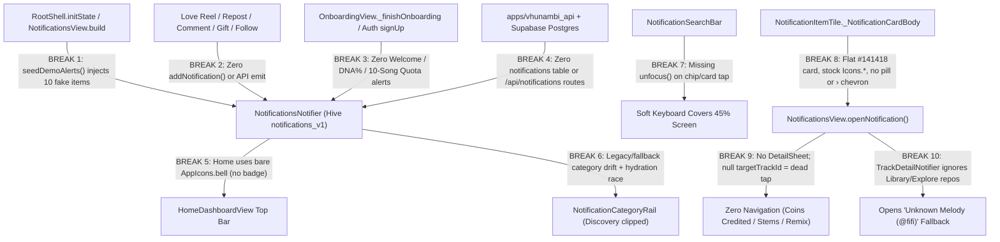

# Phase 67 — Full-Stack Notifications Center UI/UX, Mock Purge, Onboarding Milestones & Event Architecture Forensic Audit

**Document ID:** `AUDIT-NOTIF-P67-001`  
**Date:** 2026-11-16  
**Branch / Commit:** `fix/studio-cockpit-bugs-vh001-vh006` (`f87b38c`)  
**Audit Scope:** Read-only static & video-correlated forensic audit across `apps/vhunambi_client/lib/`, `apps/vhunambi_api/src/`, and `supabase/migrations/`  
**Physical Device & Visual References:** `video_1.mp4`, `video_2.mp4`, `LODA Notifications Center UI.png`  
**Predecessor Baseline:** [`NOTIFICATIONS_FEATURE_AUDIT.md`](file:///c:/Users/Ndugelo/VHUNAMBI/monorepo/docs/audits/NOTIFICATIONS_FEATURE_AUDIT.md), [`FLAWS_AND_UNFINISHED_FEATURES_AUDIT.md`](file:///c:/Users/Ndugelo/VHUNAMBI/monorepo/docs/audits/FLAWS_AND_UNFINISHED_FEATURES_AUDIT.md), [`PHASE63_E2E_CLOUD_PIPELINE_AND_PREFLIGHT_AUDIT.md`](file:///c:/Users/Ndugelo/VHUNAMBI/monorepo/docs/audits/PHASE63_E2E_CLOUD_PIPELINE_AND_PREFLIGHT_AUDIT.md)

---

## 1. Executive Summary & Video-Correlated Defect Matrix

### 1.1 Headline Audit Verdict

Inspection of the physical-device recordings (`video_1.mp4`, `video_2.mp4`) alongside the live codebase confirms that Vhunambi's Notifications Center (`features/notifications/`) currently operates as a **self-seeding offline demo facade disconnected from authentic onboarding state, real social/studio/quota events, deep-link routing, and backend persistence**:

1. **Aggressive Mock Pollution on Boot & Empty State (`P0`)**: Every fresh install or cleared inbox is immediately repopulated with **10 hardcoded Phase 40 fake alerts** (`phase40SeededNotifications`) by both [`RootShell.initState`](file:///c:/Users/Ndugelo/VHUNAMBI/monorepo/apps/vhunambi_client/lib/main.dart#L148-L150) and [`NotificationsView.build`](file:///c:/Users/Ndugelo/VHUNAMBI/monorepo/apps/vhunambi_client/lib/features/notifications/presentation/views/notifications_view.dart#L31-L41). Meanwhile, tapping top-up packs in [`SubscriptionUpgradeModal._buildTopUpPack`](file:///c:/Users/Ndugelo/VHUNAMBI/monorepo/apps/vhunambi_client/lib/features/home/presentation/widgets/subscription_upgrade_modal.dart#L257-L270) locally fabricates `"Coins Credited! (R450)"` alerts without PayFast ITN confirmation.
2. **Dead Taps, Missing Detail Sheet & Wrong-Track Fallback (`P0`)**: [`NotificationsView.openNotification`](file:///c:/Users/Ndugelo/VHUNAMBI/monorepo/apps/vhunambi_client/lib/features/notifications/presentation/views/notifications_view.dart#L48-L58) aborts silently (`if (targetTrackId == null || targetTrackId.isEmpty) return;`) for every System, Social, Wallet, and Video Export alert. Conversely, alerts carrying mock or uncatalogued `targetTrackId` values (`'trk_pipeline_001'` or new cloud IDs) push [`TrackDetailView`](file:///c:/Users/Ndugelo/VHUNAMBI/monorepo/apps/vhunambi_client/lib/features/track/presentation/views/track_detail_view.dart#L46-L58), whose [`_lookupInitialTrack`](file:///c:/Users/Ndugelo/VHUNAMBI/monorepo/apps/vhunambi_client/lib/features/track/presentation/providers/track_providers.dart#L202-L219) falls back to hardcoded **`"Unknown Melody"` by `@fifi`** because it only searches `seededTrackDetails` (never `libraryTracksProvider` or `exploreTracksProvider`).
3. **Zero Real Social, Onboarding, Quota, or Backend Event Producers (`P0`)**: Loving a reel (`"Loved 2x!"` in [`KineticReelsModal._recordLove`](file:///c:/Users/Ndugelo/VHUNAMBI/monorepo/apps/vhunambi_client/lib/features/social/presentation/widgets/kinetic_reels_modal.dart#L880-L898)), reposting (`"Reposted @ndugelo's post!"` in [`RepostKineticPostSheet._submitRepost`](file:///c:/Users/Ndugelo/VHUNAMBI/monorepo/apps/vhunambi_client/lib/features/explore/presentation/widgets/repost_kinetic_post_sheet.dart#L46-L85)), commenting, following, and cultural gifting emit **zero** notification records. Across the entire backend (`apps/vhunambi_api/src/` and `supabase/migrations/`), **no `notifications` table, no `/api/notifications` routes, and no 10-song/month Free Tier quota tracker exist**.
4. **Home Bell Blindness, Keyboard Lock & Visual Surface Monotony (`P1`/`P2`)**: [`HomeDashboardView`](file:///c:/Users/Ndugelo/VHUNAMBI/monorepo/apps/vhunambi_client/lib/features/home/presentation/views/home_dashboard_view.dart#L310-L333) renders a bare `PhosphorIcon(AppIcons.bell)` with **no unread count badge**; [`NotificationSearchBar`](file:///c:/Users/Ndugelo/VHUNAMBI/monorepo/apps/vhunambi_client/lib/features/notifications/presentation/widgets/notification_search_bar.dart#L23-L125) never unfocuses when tapping category chips or cards; [`NotificationCategoryRail`](file:///c:/Users/Ndugelo/VHUNAMBI/monorepo/apps/vhunambi_client/lib/features/notifications/presentation/widgets/notification_category_rail.dart#L30-L57) clips `Discovery` off-screen with no scroll affordance; and 100% of cards use flat identical `#141418` (`darkSurfaceElevated`) fills with stock `Icons.*` glyphs (`STD-UIUX-001` violations).

### 1.2 End-to-End Breakpoint Topology Map



### 1.3 Master Defect & Evidence Matrix (`video_1.mp4` & `video_2.mp4`)

| ID | Sev | Observed Video / Live Symptom | Root Cause in Codebase | Exact File & Line Evidence |
|---|---|---|---|---|
| **N-01** | `P0` | `video_1.mp4 (00:00)`: 6+ fake demo items (`"Open Stems Collaboration @makhadzi"`, `"New Open-Verse Remix @fifi"`, etc.) auto-appear on fresh load. | `RootShell.initState` calls `seedDemoAlerts()` unconditionally; `NotificationsView.build` also auto-seeds whenever `state.isEmpty && shouldAutoSeedDemoAlerts`. | [`main.dart#L148-L150`](file:///c:/Users/Ndugelo/VHUNAMBI/monorepo/apps/vhunambi_client/lib/main.dart#L148-L150), [`notifications_provider.dart#L13-L131`](file:///c:/Users/Ndugelo/VHUNAMBI/monorepo/apps/vhunambi_client/lib/features/notifications/presentation/providers/notifications_provider.dart#L13-L131), [`#L197-L204`](file:///c:/Users/Ndugelo/VHUNAMBI/monorepo/apps/vhunambi_client/lib/features/notifications/presentation/providers/notifications_provider.dart#L197-L204), [`notifications_view.dart#L31-L41`](file:///c:/Users/Ndugelo/VHUNAMBI/monorepo/apps/vhunambi_client/lib/features/notifications/presentation/views/notifications_view.dart#L31-L41) |
| **N-02** | `P0` | `video_1.mp4 (00:00)`: `"Coins Credited! ... (R450)"` appears from local mock top-up without real payment settlement. | `SubscriptionUpgradeModal._buildTopUpPack` locally adds `"Coins Credited!"` + calls `walletNotifier.topUpCoins(coins)` on tap without waiting for PayFast ITN (`pack_mogul_5000`, `R450`). | [`subscription_upgrade_modal.dart#L184-L194`](file:///c:/Users/Ndugelo/VHUNAMBI/monorepo/apps/vhunambi_client/lib/features/home/presentation/widgets/subscription_upgrade_modal.dart#L184-L194), [`#L257-L270`](file:///c:/Users/Ndugelo/VHUNAMBI/monorepo/apps/vhunambi_client/lib/features/home/presentation/widgets/subscription_upgrade_modal.dart#L257-L270) |
| **N-03** | `P0` | `video_1.mp4 (00:28–00:38)`: Tapping `"Coins Credited!"`, `"Social Link Shared"`, `"Open Stems Collaboration"`, or `"New Open-Verse Remix"` does nothing beyond clearing the unread dot. | `NotificationsView.openNotification` immediately returns if `targetTrackId ?? metadata['trackId']` is null/empty; no `NotificationDetailBottomSheet` or typed deep-link router exists. | [`notifications_view.dart#L48-L58`](file:///c:/Users/Ndugelo/VHUNAMBI/monorepo/apps/vhunambi_client/lib/features/notifications/presentation/views/notifications_view.dart#L48-L58), [`notifications_provider.dart#L23-L38`](file:///c:/Users/Ndugelo/VHUNAMBI/monorepo/apps/vhunambi_client/lib/features/notifications/presentation/providers/notifications_provider.dart#L23-L38), [`explore_social_post_card.dart#L68-L76`](file:///c:/Users/Ndugelo/VHUNAMBI/monorepo/apps/vhunambi_client/lib/features/explore/presentation/widgets/explore_social_post_card.dart#L68-L76) |
| **N-04** | `P0` | `video_1.mp4 (00:30)`: Tapping render completion notification opens unrelated **`Unknown Melody (@fifi)`** track screen. | `notif_p40_act_3` (`targetTrackId: 'trk_pipeline_001'`) and generated track IDs do not exist in `seededTrackDetails`, so `_lookupInitialTrack` falls back to hardcoded `'Unknown Melody' / '@fifi'`; meanwhile `VideoExportModal` creates `"Reel Render Completed"` with `targetTrackId: null`. | [`track_providers.dart#L202-L219`](file:///c:/Users/Ndugelo/VHUNAMBI/monorepo/apps/vhunambi_client/lib/features/track/presentation/providers/track_providers.dart#L202-L219), [`notifications_provider.dart#L57-L64`](file:///c:/Users/Ndugelo/VHUNAMBI/monorepo/apps/vhunambi_client/lib/features/notifications/presentation/providers/notifications_provider.dart#L57-L64), [`video_export_modal.dart#L143-L152`](file:///c:/Users/Ndugelo/VHUNAMBI/monorepo/apps/vhunambi_client/lib/features/social/presentation/widgets/video_export_modal.dart#L143-L152) |
| **N-05** | `P0` | `video_2.mp4 (00:00–00:26)`: Loving `@makhadzi`'s reel (`Loved 2x!`) and reposting `@ndugelo`'s post (`Reposted @ndugelo's post!`) leaves bell badge empty and inbox at `"Nothing here yet"`. | `KineticReelsModal._recordLove`, `SocialFeedNotifier.recordLove`, `RepostKineticPostSheet._submitRepost`, `ExploreSocialPostCard`, `ReelsCommentsNotifier.addComment`, `HttpSocialRepository.toggleFollowCreator`, and `CreatorWalletNotifier.sendGift` never emit notifications; backend has zero `notifications` table/routes. | [`kinetic_reels_modal.dart#L880-L898`](file:///c:/Users/Ndugelo/VHUNAMBI/monorepo/apps/vhunambi_client/lib/features/social/presentation/widgets/kinetic_reels_modal.dart#L880-L898), [`social_feed_provider.dart#L180-L202`](file:///c:/Users/Ndugelo/VHUNAMBI/monorepo/apps/vhunambi_client/lib/features/social/presentation/providers/social_feed_provider.dart#L180-L202), [`repost_kinetic_post_sheet.dart#L46-L85`](file:///c:/Users/Ndugelo/VHUNAMBI/monorepo/apps/vhunambi_client/lib/features/explore/presentation/widgets/repost_kinetic_post_sheet.dart#L46-L85), [`explore_providers.dart#L836-L861`](file:///c:/Users/Ndugelo/VHUNAMBI/monorepo/apps/vhunambi_client/lib/features/explore/presentation/providers/explore_providers.dart#L836-L861) |
| **N-06** | `P0` | New accounts start with fake demo history instead of real Welcome, DNA Calibration (`6%–10%`), and 10 Free Monthly Songs notifications; no monthly 10-song counter exists. | `OnboardingView._finishOnboarding` & `AuthSessionNotifier.signUp` emit zero notifications; `completeness: 1.0` forces `strengthPercent` to `20%` (`5% + 15%`) instead of `6%–10%`; `'10 songs left'` in top bars is hidden static text inside `SizedBox.shrink` / dead constants, with zero backend quota table/logic. | [`onboarding_view.dart#L67-L90`](file:///c:/Users/Ndugelo/VHUNAMBI/monorepo/apps/vhunambi_client/lib/features/onboarding/presentation/views/onboarding_view.dart#L67-L90), [`creator_dna_profile.dart#L116-L128`](file:///c:/Users/Ndugelo/VHUNAMBI/monorepo/apps/vhunambi_client/lib/features/creator_dna/domain/entities/creator_dna_profile.dart#L116-L128), [`vhunambi_top_bar_kit.dart#L192-L197`](file:///c:/Users/Ndugelo/VHUNAMBI/monorepo/apps/vhunambi_client/lib/core/widgets/vhunambi_top_bar_kit.dart#L192-L197), [`library_app_bar.dart#L24`](file:///c:/Users/Ndugelo/VHUNAMBI/monorepo/apps/vhunambi_client/lib/features/library/presentation/widgets/library_app_bar.dart#L24) |
| **N-07** | `P1` | `video_2.mp4 (00:25)`: Home top bar bell shows no unread badge; `video_1.mp4 (00:00–00:20)`: Category badges vs card read state can diverge during hydration/category fallback. | `HomeDashboardView` uses plain `PhosphorIcon(AppIcons.bell)` instead of `NotificationBellButton`; `NotificationCategory.fromString` silently coerces unknown/migrated categories to `creatorActivity`; `_UnreadDot` hardcodes `brandPrimary` orange dot; `hydrateFromStorage()` microtask merges `byId` after `RootShell` `seedDemoAlerts()`. | [`home_dashboard_view.dart#L310-L333`](file:///c:/Users/Ndugelo/VHUNAMBI/monorepo/apps/vhunambi_client/lib/features/home/presentation/views/home_dashboard_view.dart#L310-L333), [`notification_enums.dart#L29-L34`](file:///c:/Users/Ndugelo/VHUNAMBI/monorepo/apps/vhunambi_client/lib/features/notifications/domain/models/notification_enums.dart#L29-L34), [`notifications_provider.dart#L178-L193`](file:///c:/Users/Ndugelo/VHUNAMBI/monorepo/apps/vhunambi_client/lib/features/notifications/presentation/providers/notifications_provider.dart#L178-L193), [`notification_item_tile.dart#L266-L275`](file:///c:/Users/Ndugelo/VHUNAMBI/monorepo/apps/vhunambi_client/lib/features/notifications/presentation/widgets/notification_item_tile.dart#L266-L275) |
| **N-08** | `P1` | `video_1.mp4 (00:12–00:38)`: Soft keyboard stays open over ~45% of screen when tapping filter chips or notification cards; `Discovery` chip clips off-screen. | `NotificationCategoryRail.select()` and `NotificationItemTile._handleTap()` never call `FocusScope.of(context).unfocus()`; horizontal `ListView` has no edge fade/scroll cue and `NotificationsView` lacks scroll/tap keyboard dismissal. | [`notification_category_rail.dart#L25-L57`](file:///c:/Users/Ndugelo/VHUNAMBI/monorepo/apps/vhunambi_client/lib/features/notifications/presentation/widgets/notification_category_rail.dart#L25-L57), [`notification_item_tile.dart#L66-L70`](file:///c:/Users/Ndugelo/VHUNAMBI/monorepo/apps/vhunambi_client/lib/features/notifications/presentation/widgets/notification_item_tile.dart#L66-L70), [`notifications_view.dart#L106-L123`](file:///c:/Users/Ndugelo/VHUNAMBI/monorepo/apps/vhunambi_client/lib/features/notifications/presentation/views/notifications_view.dart#L106-L123) |
| **N-09** | `P2` | All cards look identically flat (`#141418` + `#2D2D38`); no category pill or `›` chevron; stock Material `Icons.*` icons used throughout feature (`STD-UIUX-001` violation); legacy `NotificationsPopover` still in codebase. | `_NotificationCardBody` uses plain `AppColors.surfaceElevated` and omits directional edge glow, category pill, `›` chevron, and unread border elevation; 14 stock `Icons.*` sites exist across `features/notifications/` plus `BoxShape.circle` oval badge stretch on `9+`. | [`notification_item_tile.dart#L166-L225`](file:///c:/Users/Ndugelo/VHUNAMBI/monorepo/apps/vhunambi_client/lib/features/notifications/presentation/widgets/notification_item_tile.dart#L166-L225), [`notification_category_style.dart#L10-L24`](file:///c:/Users/Ndugelo/VHUNAMBI/monorepo/apps/vhunambi_client/lib/features/notifications/presentation/utils/notification_category_style.dart#L10-L24), [`notification_bell_button.dart#L117-L181`](file:///c:/Users/Ndugelo/VHUNAMBI/monorepo/apps/vhunambi_client/lib/features/notifications/presentation/widgets/notification_bell_button.dart#L117-L181) |

---

## 2. Pillar-by-Pillar Forensic Findings

### 2.1 Pillar 1 — Mock Data Inventory, State Lifecycle & Category/Unread Math

#### Complete File Inventory (`apps/vhunambi_client/lib/features/notifications/` — 14 files)

1. [`domain/models/notification_enums.dart`](file:///c:/Users/Ndugelo/VHUNAMBI/monorepo/apps/vhunambi_client/lib/features/notifications/domain/models/notification_enums.dart) — 4 categories (`social`, `system`, `creatorActivity`, `algorithmic`), priority weights, and `NotificationAction`.
2. [`domain/models/notification_entity.dart`](file:///c:/Users/Ndugelo/VHUNAMBI/monorepo/apps/vhunambi_client/lib/features/notifications/domain/models/notification_entity.dart) — Immutable alert entity (`toJson` / `fromJson`, `generationReady` factory, `==` compares `id` + `isRead` only).
3. [`data/repositories/notification_repository.dart`](file:///c:/Users/Ndugelo/VHUNAMBI/monorepo/apps/vhunambi_client/lib/features/notifications/data/repositories/notification_repository.dart) — O(1) Hive storage (`notifications_v1` box, `notif_<id>` keys, 500-item ceiling, legacy `'notifications'` list migration, in-memory test fallback).
4. [`presentation/providers/notifications_provider.dart`](file:///c:/Users/Ndugelo/VHUNAMBI/monorepo/apps/vhunambi_client/lib/features/notifications/presentation/providers/notifications_provider.dart) — `NotificationsNotifier`, `notificationsProvider`, `unreadNotificationsCountProvider`, `unreadCountByCategoryProvider`, `selectedCategoryProvider`, `searchQueryProvider`, `filteredNotificationsProvider`, **plus mock arrays `phase40SeededNotifications` and `seededNotifications`**.
5. [`presentation/views/notifications_view.dart`](file:///c:/Users/Ndugelo/VHUNAMBI/monorepo/apps/vhunambi_client/lib/features/notifications/presentation/views/notifications_view.dart) — Full-screen route with auto-seed hook (`#L32-L41`), `_MarkAllReadButton`, `openNotification`, and `_handleAction`.
6. [`presentation/widgets/notification_bell_button.dart`](file:///c:/Users/Ndugelo/VHUNAMBI/monorepo/apps/vhunambi_client/lib/features/notifications/presentation/widgets/notification_bell_button.dart) — Wobbling bell button + unread badge (pushes `NotificationsView` by default at `#L72`).
7. [`presentation/widgets/notification_category_rail.dart`](file:///c:/Users/Ndugelo/VHUNAMBI/monorepo/apps/vhunambi_client/lib/features/notifications/presentation/widgets/notification_category_rail.dart) — Horizontal filter rail (`All`, `Social`, `System`, `Activity`, `Discovery`) + bouncing `_CountBadge`.
8. [`presentation/widgets/notification_search_bar.dart`](file:///c:/Users/Ndugelo/VHUNAMBI/monorepo/apps/vhunambi_client/lib/features/notifications/presentation/widgets/notification_search_bar.dart) — Search input bound to `searchQueryProvider`.
9. [`presentation/widgets/notification_item_tile.dart`](file:///c:/Users/Ndugelo/VHUNAMBI/monorepo/apps/vhunambi_client/lib/features/notifications/presentation/widgets/notification_item_tile.dart) — `Dismissible` card tile (`_NotificationCardBody`, `_CategoryGlyphBadge`, `_UnreadDot`, `_ActionRail`).
10. [`presentation/widgets/notification_empty_state.dart`](file:///c:/Users/Ndugelo/VHUNAMBI/monorepo/apps/vhunambi_client/lib/features/notifications/presentation/widgets/notification_empty_state.dart) — Empty state (`"Nothing here yet"`).
11. [`presentation/widgets/notifications_popover.dart`](file:///c:/Users/Ndugelo/VHUNAMBI/monorepo/apps/vhunambi_client/lib/features/notifications/presentation/widgets/notifications_popover.dart) — Legacy 360px dialog popover (still retains `"No notifications yet"`, stock icons, and track-only `_openNotification`).
12. [`presentation/utils/notification_category_style.dart`](file:///c:/Users/Ndugelo/VHUNAMBI/monorepo/apps/vhunambi_client/lib/features/notifications/presentation/utils/notification_category_style.dart) — Color, icon, and label mapper.
13. [`presentation/utils/notifications_haptics.dart`](file:///c:/Users/Ndugelo/VHUNAMBI/monorepo/apps/vhunambi_client/lib/features/notifications/presentation/utils/notifications_haptics.dart) — Platform-safe haptic feedback wrapper.
14. [`presentation/utils/time_ago_utils.dart`](file:///c:/Users/Ndugelo/VHUNAMBI/monorepo/apps/vhunambi_client/lib/features/notifications/presentation/utils/time_ago_utils.dart) — Relative timestamp formatter.

#### Exhaustive Census of Mock & Non-Production Notification Sources

| Source Location | Line(s) | Polluting Payload / Behavior | Classification |
|---|---|---|---|
| `notifications_provider.dart` | `#L13-L104` | `phase40SeededNotifications`: 10 hardcoded fake alerts (`@lerato_piano`, `@makhadzi` `"Open Stems Collaboration"`, `@fifi` `"New Open-Verse Remix"`, `"Marketplace License Sold!"`, `"Fresh Crate Graduation Alert!"`, `"Studio Render Complete"` `trk_pipeline_001`, `"VHU-SIG Continuous Phase DSP Active"`, `"Welcome to Vhunambi Creator Suite!"`, `"Regional Trend Alert"`, `"Sonic DNA Affinity Match"`). | **Purge Completely** |
| `notifications_provider.dart` | `#L107-L131` | `seededNotifications`: 3 legacy demo items (`"ZaYN"`, `"Shikisha"`, `"Welcome to Vhunambi!"`). | **Purge (Keep test helper in `test/` only)** |
| `notifications_provider.dart` | `#L164, #L197-L204` | `_autoSeedPending`, `shouldAutoSeedDemoAlerts`, and `seedDemoAlerts()` auto-populate `phase40SeededNotifications` whenever storage is empty. | **Purge Mock Seeding; Replace with Onboarding Milestone Seeder** |
| `main.dart` | `#L148-L150` | `_RootShellState.initState()` unconditionally runs `ref.read(notificationsProvider.notifier).seedDemoAlerts();` on every launch. | **Remove `seedDemoAlerts()` call; Trigger `ensureOnboardingNotifications(...)` / server sync** |
| `notifications_view.dart` | `#L32-L41` | `NotificationsView.build()` schedules `postFrameCallback` calling `currentNotifier.seedDemoAlerts()` whenever `rawNotifications.isEmpty`. | **Remove Auto-Seed Hook** |
| `subscription_upgrade_modal.dart` | `#L261-L270`, `#L468-L477` | Locally emits `"Coins Credited! (5000 Coins ... R450)"` and `"${tier.name} Plan Activated!"` immediately on tap without PayFast ITN confirmation (`creatorWalletProvider.topUpCoins` local stub). | **Move emission to verified PayFast ITN settlement callback / wallet top-up confirmation** |

#### Exhaustive Bell Button & Top Bar Audit Across All 5 Root Tabs

| App Surface | File & Line(s) | Current Bell Widget | Badge Shown? | Defect |
|---|---|---|---|---|
| **Home Dashboard** | [`home_dashboard_view.dart#L310-L333`](file:///c:/Users/Ndugelo/VHUNAMBI/monorepo/apps/vhunambi_client/lib/features/home/presentation/views/home_dashboard_view.dart#L310-L333) | Raw `InkWell` + `PhosphorIcon(AppIcons.bell)` | **NO** | Never uses `NotificationBellButton`, so unread badge & wobble animation never show on Home (`video_2.mp4` 00:25). |
| **Explore (Mobile)** | [`explore_top_bar.dart#L141-L143, #L296-L314`](file:///c:/Users/Ndugelo/VHUNAMBI/monorepo/apps/vhunambi_client/lib/features/explore/presentation/widgets/explore_top_bar.dart#L141-L143) | `NotificationBellButton(onPressed: ...)` | Yes | `NotificationBellButton` itself renders stock `Icons.notifications_none_rounded` (`#L177`) and `BoxShape.circle` oval badge on `9+` (`#L124`). |
| **Explore (Desktop)** | [`explore_top_bar.dart#L55`](file:///c:/Users/Ndugelo/VHUNAMBI/monorepo/apps/vhunambi_client/lib/features/explore/presentation/widgets/explore_top_bar.dart#L55) | `const NotificationBellButton()` | Yes | Same stock Material icon & `9+` oval badge inside `NotificationBellButton`. |
| **Studio (`VhunambiAppBar`)** | [`vhunambi_app_bar.dart#L60`](file:///c:/Users/Ndugelo/VHUNAMBI/monorepo/apps/vhunambi_client/lib/core/widgets/vhunambi_app_bar.dart#L60) | `const NotificationBellButton()` | Yes | Same internal `NotificationBellButton` icon/badge defects. |
| **Library (`LibraryAppBar`)** | [`library_app_bar.dart#L62, #L101`](file:///c:/Users/Ndugelo/VHUNAMBI/monorepo/apps/vhunambi_client/lib/features/library/presentation/widgets/library_app_bar.dart#L62) | `const NotificationBellButton()` | Yes | Same internal `NotificationBellButton` icon/badge defects. |
| **Marketplace** | [`marketplace_top_bar.dart#L82`](file:///c:/Users/Ndugelo/VHUNAMBI/monorepo/apps/vhunambi_client/lib/features/marketplace/presentation/widgets/marketplace_top_bar.dart#L82) | `const NotificationBellButton()` | Yes | Same internal `NotificationBellButton` icon/badge defects. |

#### Unread Badge Sync, Hydration Race & Search/Keyboard Defects

1. **Hydration & Read-State Race (`notifications_provider.dart#L140-L193`)**:
   - `_hydrateInitialNotifications` reads synchronously in `super(...)`, then `Future.microtask(hydrateFromStorage)` runs asynchronously (`#L158`) and merges `loaded` with `state` via `byId`. Meanwhile `RootShell.initState` (`main.dart#L149`) calls `seedDemoAlerts()` on first frame, and `NotificationEntity.==` (`notification_entity.dart#L144-L154`) ignores `category`, `title`, and `isRead` changes unless `id` or `isRead` differs.
   - `NotificationCategory.fromString` (`notification_enums.dart#L29-L34`) silently maps any unknown/legacy category string to `NotificationCategory.creatorActivity` (`Activity`).
   - `_UnreadDot` (`notification_item_tile.dart#L266-L275`) always paints `AppColors.brandPrimary` orange (even for System, Social, or Discovery alerts), visually blending everything into Activity orange.
2. **Search Keyboard Stay-Open Bug (`video_1.mp4 00:12–00:38`)**:
   - [`NotificationSearchBar`](file:///c:/Users/Ndugelo/VHUNAMBI/monorepo/apps/vhunambi_client/lib/features/notifications/presentation/widgets/notification_search_bar.dart#L23-L90) owns a `FocusNode`, but only `_clear()` calls `_focusNode.unfocus()` (`#L52`).
   - [`NotificationCategoryRail`](file:///c:/Users/Ndugelo/VHUNAMBI/monorepo/apps/vhunambi_client/lib/features/notifications/presentation/widgets/notification_category_rail.dart#L25-L28), [`NotificationItemTile._handleTap`](file:///c:/Users/Ndugelo/VHUNAMBI/monorepo/apps/vhunambi_client/lib/features/notifications/presentation/widgets/notification_item_tile.dart#L66-L70), and [`NotificationsView`](file:///c:/Users/Ndugelo/VHUNAMBI/monorepo/apps/vhunambi_client/lib/features/notifications/presentation/views/notifications_view.dart#L48-L63) never invoke `FocusScope.of(context).unfocus()` (and `ListView.builder` omits `keyboardDismissBehavior: ScrollViewKeyboardDismissBehavior.onDrag`). Result: after typing in search, tapping `System`, `Activity`, or any card leaves the Android IME keyboard covering ~45% of the screen.
3. **Clipped `Discovery` Chip (`notification_category_rail.dart#L30-L57`)**:
   - Fixed `height: 52` horizontal `ListView` with `padding: horizontal: 16`, 5 wide chips (`All`, `Social`, `System`, `Activity`, `Discovery`), and badges exceeds 360dp width, clipping `Discovery` at the right viewport edge with zero right-edge fade mask or scroll-to-chip animation on select.

---

### 2.2 Pillar 2 — Visual Hierarchy, LODA Adaptation & `STD-UIUX-001` Icon Violations

```
┌──────────────────────────────────────────────────────────────────────────────────────────────────┐
│                 VHUNAMBI NOTIFICATIONS CARD SPECTRUM: CURRENT vs. TARGET DESIGN                  │
├───────────────────────────────────────────┬──────────────────────────────────────────────────────┤
│ CURRENT IMPLEMENTATION (video_1.mp4)      │ OVERHAUL PART 1 TARGET (Refined LODA for Vhunambi)   │
├───────────────────────────────────────────┼──────────────────────────────────────────────────────┤
│ • Flat #141418 (surfaceElevated) on ALL   │ • Matte Obsidian (#121215 / surfaceElevated) +       │
│   cards; System/Social/Activity identical │   3px Left-Edge Vertical Category Bar + subtle       │
│ • Uniform #2D2D38 border (read & unread)  │   directional wash (10%–14% alpha fade to 0%)        │
│ • Always-orange #F97316 unread dot        │ • Unread: brighter obsidian + 25% category border +  │
│ • Stock Material Icons.* (STD-UIUX-001!)  │   timestamp inline category-colored dot (`2m ago •`) │
│ • Zero category pill or tap chevron       │ • Compact category pill (`System • Onboarding`) +    │
│ • Clipped horizontal chip rail            │   trailing `PhosphorIconsRegular.caretRight` (`›`)   │
│                                           │ • 100% Phosphor icons (`AppIcons.*`), zero `Icons.*` │
└───────────────────────────────────────────┴──────────────────────────────────────────────────────┘
```

#### Exhaustive Stock Material Icon Census in `features/notifications/` (`STD-UIUX-001` Ban)

| File Path | Line(s) | Stock Icon Used | Prescribed Phosphor Replacement |
|---|---|---|---|
| `notifications_view.dart` | `#L175` | `Icons.done_all_rounded` | `PhosphorIconsRegular.checks` (`AppIcons.checks`) |
| `notification_category_rail.dart` | `#L39` | `Icons.inbox_rounded` | `PhosphorIconsRegular.tray` |
| `notification_category_style.dart` | `#L19` | `Icons.people_alt_outlined` | `PhosphorIconsRegular.usersThree` |
| `notification_category_style.dart` | `#L20` | `Icons.shield_outlined` | `PhosphorIconsFill.shieldCheck` / `PhosphorIconsRegular.shieldCheck` |
| `notification_category_style.dart` | `#L21` | `Icons.auto_awesome` | `AppIcons.sparkle` (`PhosphorIconsFill.sparkle`) |
| `notification_category_style.dart` | `#L22` | `Icons.trending_up_rounded` | `AppIcons.analytics` (`PhosphorIconsRegular.chartLineUp`) |
| `notification_item_tile.dart` | `#L139` | `Icons.delete_outline_rounded` | `AppIcons.trash` (`PhosphorIconsRegular.trash`) |
| `notification_search_bar.dart` | `#L80, #L120` | `Icons.search_rounded`, `Icons.close_rounded` | `AppIcons.search`, `AppIcons.close` |
| `notification_empty_state.dart` | `#L38` | `Icons.notifications_off_outlined` | `PhosphorIconsRegular.bellSlash` |
| `notification_bell_button.dart` | `#L177` | `Icons.notifications_none_rounded` | `AppIcons.bell` (`PhosphorIconsRegular.bell`) / `AppIcons.bellActive` |
| `notifications_popover.dart` | `#L66, #L110, #L276, #L317, #L340` | `Icons.notifications_outlined`, `Icons.check`, `Icons.music_note_rounded`, `Icons.close_rounded`, `Icons.notifications_off_outlined` | `AppIcons.bell`, `AppIcons.check`, `AppIcons.songs`, `AppIcons.close`, `PhosphorIconsRegular.bellSlash` |

#### Semantic Color Token Mapping (Refined Vhunambi Palette)

1. **System & Credits / Quota (`NotificationCategory.system` + `systemQuota` / `credits`)**: Warm Amber Gold `#F59E0B` (`AppColors.coinGold` / `AppColors.accentGold`)
2. **Creator DNA & Milestones (`dnaMilestone` subcategory / tag)**: Emerald Teal `#10B981` (`AppColors.success` / `AppColors.accentSuccess`)
3. **Studio & Render Activity (`NotificationCategory.creatorActivity`)**: Vhunambi Ember Orange `#FF5A1F` / `#F97316` (`AppColors.brandPrimary` / `emberGlow`)
4. **Social & Collaborations (`NotificationCategory.social`)**: Royal Amethyst Violet `#8B5CF6` (`AppColors.accentElectric`)
5. **Discovery & Drops (`NotificationCategory.algorithmic`)**: Electric Cyan `#06B6D4` / `#22D3EE` (`AppColors.badgeCyan`)

> Note: Existing [`NotificationCategoryStyle.color`](file:///c:/Users/Ndugelo/VHUNAMBI/monorepo/apps/vhunambi_client/lib/features/notifications/presentation/utils/notification_category_style.dart#L10-L15) maps `algorithmic` (`Discovery`) to `AppColors.accentSuccess` (`#10B981`), leaving **Creator DNA** without a dedicated tint and forcing `Discovery` off Cyan. Updating `algorithmic` $\to$ `AppColors.badgeCyan` (`#22D3EE` / `#06B6D4`) frees Emerald Teal (`#10B981` `AppColors.success`) for **Creator DNA & Milestones** via optional subtype/tag tinting without breaking the 4 canonical filter tabs (`Social`, `System`, `Activity`, `Discovery`).

---

### 2.3 Pillar 3 — Tap Handling, Detail Bottom Sheet & Deep-Link Routing Audit

#### Why Taps Fail or Land on Wrong Screens

1. **Current Dead-End Tap Handler ([`notifications_view.dart#L48-L58`](file:///c:/Users/Ndugelo/VHUNAMBI/monorepo/apps/vhunambi_client/lib/features/notifications/presentation/views/notifications_view.dart#L48-L58))**:
   ```dart
   void openNotification(NotificationEntity notification) {
     final navigator = Navigator.of(context);
     final targetTrackId = notification.targetTrackId ??
         notification.metadata['trackId'] as String?;
     if (targetTrackId == null || targetTrackId.isEmpty) return; // <-- SILENT NO-OP!
     navigator.push(MaterialPageRoute<void>(builder: (_) => TrackDetailView(trackId: targetTrackId)));
   }
   ```
   Every notification emitted by `SubscriptionUpgradeModal` (`Coins Credited!`, `Plan Activated!`), `ExploreSocialPostCard` (`Social Link Shared`), `VideoExportModal` (`Reel Render Completed`, `Video Export Shared`), `ExportActionSheet` (`Reel Shared to Socials`, `Reel Saved to Gallery`), `CreatorWalletNotifier` (`Tip Sent!`, `Royalty Payout Initiated`), `BeatCheckoutNotifier` (`Marketplace License Acquired!`), and `phase40SeededNotifications` (`Open Stems Collaboration`, `New Open-Verse Remix`) omits `targetTrackId` and carries zero `targetRoute`, so tapping them **does nothing**.

2. **Root Cause of `Unknown Melody (@fifi)` Bug (`video_1.mp4 00:30`)**:
   - [`TrackDetailNotifier`](file:///c:/Users/Ndugelo/VHUNAMBI/monorepo/apps/vhunambi_client/lib/features/track/presentation/providers/track_providers.dart#L33) initializes solely via `_lookupInitialTrack(trackId)` ([`#L202-L219`](file:///c:/Users/Ndugelo/VHUNAMBI/monorepo/apps/vhunambi_client/lib/features/track/presentation/providers/track_providers.dart#L202-L219)), which checks ONLY the static 6-item `seededTrackDetails` list (`'seed-01'`, `'track_default_1'`, `'exp_track_001'`, `'seed-02'`, `'seed-03'`, `'seed-04'`).
   - Any other ID (such as `'trk_pipeline_001'` from `notif_p40_act_3` / `notif_seed_1`, or any real generated `gen_*` track ID in `libraryTracksProvider`!) falls into `orElse: () => TrackDetailEntity(title: 'Unknown Melody', creatorName: 'Fifi', creatorHandle: '@fifi')`.
   - Furthermore, [`VideoExportModal`](file:///c:/Users/Ndugelo/VHUNAMBI/monorepo/apps/vhunambi_client/lib/features/social/presentation/widgets/video_export_modal.dart#L143-L152) creates `"Reel Render Completed"` without passing `targetTrackId`, `clipId`, or `videoPath`, and `_handleAction` ([`notifications_view.dart#L135-L154`](file:///c:/Users/Ndugelo/VHUNAMBI/monorepo/apps/vhunambi_client/lib/features/notifications/presentation/views/notifications_view.dart#L135-L154)) only parses `route.startsWith('/track/')`.

#### Verified In-App Destination Registry (Available for Typed Deep-Link Routing)

| Notification Domain | Typed Route (`targetRoute`) | Target Destination Class & Entrypoint | Location |
|---|---|---|---|
| **Studio / Onboarding Welcome** | `/studio` | Pop back to `RootShell` & set `appNavigationTabProvider = 2` ([`StudioView`](file:///c:/Users/Ndugelo/VHUNAMBI/monorepo/apps/vhunambi_client/lib/features/studio/presentation/views/studio_view.dart#L33)) | [`navigation_providers.dart`](file:///c:/Users/Ndugelo/VHUNAMBI/monorepo/apps/vhunambi_client/lib/core/navigation/navigation_providers.dart) |
| **Creator DNA Calibration** | `/creator-dna` | `CreatorDnaHelixLabSheet.show(context)` (3D DNA Lab & calibration) | [`creator_dna_helix_lab_sheet.dart#L21`](file:///c:/Users/Ndugelo/VHUNAMBI/monorepo/apps/vhunambi_client/lib/features/profile/presentation/widgets/creator_dna_helix_lab_sheet.dart#L21) |
| **Wallet / 10 Free Songs Allowance** | `/wallet` | `SubscriptionUpgradeModal.show(context)` or `OwnerProfileView` scrolled to `CreatorWalletDeck` | [`subscription_upgrade_modal.dart`](file:///c:/Users/Ndugelo/VHUNAMBI/monorepo/apps/vhunambi_client/lib/features/home/presentation/widgets/subscription_upgrade_modal.dart), [`creator_wallet_deck.dart#L11`](file:///c:/Users/Ndugelo/VHUNAMBI/monorepo/apps/vhunambi_client/lib/features/profile/presentation/widgets/creator_wallet_deck.dart#L11) |
| **Generated / Library / Explore Track** | `/track/:id` | `TrackDetailView(trackId: id)` (upgraded to hydrate from `libraryTracksProvider` + `exploreTracksProvider` + `notification.metadata` before fallback!) | [`track_detail_view.dart#L46`](file:///c:/Users/Ndugelo/VHUNAMBI/monorepo/apps/vhunambi_client/lib/features/track/presentation/views/track_detail_view.dart#L46) |
| **Kinetic Reel (Love / Comment / Export / Tip)** | `/reel/:clipId` | `KineticReelsModal.show(context, clips: ..., initialClipId: clipId)` | [`kinetic_reels_modal.dart#L51`](file:///c:/Users/Ndugelo/VHUNAMBI/monorepo/apps/vhunambi_client/lib/features/social/presentation/widgets/kinetic_reels_modal.dart#L51) |
| **Creator Profile (Follow / Repost)** | `/creator/:id` | `ArtistProfileView(creatorId: id)` / `OwnerProfileView()` | [`artist_profile_view.dart`](file:///c:/Users/Ndugelo/VHUNAMBI/monorepo/apps/vhunambi_client/lib/features/profile/presentation/views/artist_profile_view.dart), [`owner_profile_view.dart#L47`](file:///c:/Users/Ndugelo/VHUNAMBI/monorepo/apps/vhunambi_client/lib/features/profile/presentation/views/owner_profile_view.dart#L47) |
| **Universal Guaranteed Fallback** | *(any / missing entity)* | **`NotificationDetailBottomSheet.show(context, notification)`** — displays full title, body, category pill, timestamp, structured metadata breakdown, and primary CTA button! | *New Widget (`M67.3`)* |

---

### 2.4 Pillar 4 — Onboarding Milestones, Free Tier Quota & Production Event Wiring (Client + Backend)

#### A. Onboarding & Creator DNA Calibration (`6%–10%`) Audit

1. **Where Onboarding Finishes**:
   - [`OnboardingView._finishOnboarding()`](file:///c:/Users/Ndugelo/VHUNAMBI/monorepo/apps/vhunambi_client/lib/features/onboarding/presentation/views/onboarding_view.dart#L67-L104) invokes `creatorDnaProvider.notifier.seedFromOnboarding(..., completeness: 1.0)` and `onboardingStateProvider.notifier.completeOnboarding()`, then navigates to `RootShell`.
   - New account registration occurs in [`SovereignAuthSheet._handleSubmit()`](file:///c:/Users/Ndugelo/VHUNAMBI/monorepo/apps/vhunambi_client/lib/features/auth/presentation/widgets/sovereign_auth_sheet.dart#L117-L123) $\to$ [`AuthSessionNotifier.signUp()`](file:///c:/Users/Ndugelo/VHUNAMBI/monorepo/apps/vhunambi_client/lib/core/auth/auth_providers.dart#L119-L139), which calls `SovereignHiveAccountSanitizer.purgeTenantPrivateBoxes(clearAuthSession: false)` (`#L254`) — wiping `notifications_v1` cleanly for new tenants!
2. **Why Initial Creator DNA Reads Wrong Percentage (`20%` vs `6%–10%`)**:
   - In [`CreatorDnaProfile.strengthPercent`](file:///c:/Users/Ndugelo/VHUNAMBI/monorepo/apps/vhunambi_client/lib/features/creator_dna/domain/entities/creator_dna_profile.dart#L116-L128):
     $$\text{strengthPercent} = \text{round}\!\left(\left(0.60 \cdot \min\left(1, \frac{\text{totalBehaviorEvents}}{200}\right) + 0.25 \cdot \min\left(1, \frac{\text{weights} > 0.5}{30}\right) + 0.15 \cdot \text{onboardingCompleteness}\right) \times 100\right)$$
   - At onboarding completion, `totalBehaviorEvents == 0` (`eventScore = 0%`). A starter onboarding selects ~2–3 genres, 1–2 languages, and 2–3 moods (`5–8` weights $> 0.5$ $\implies$ `diversity = 4%–7%`). Because [`onboarding_view.dart#L85`](file:///c:/Users/Ndugelo/VHUNAMBI/monorepo/apps/vhunambi_client/lib/features/onboarding/presentation/views/onboarding_view.dart#L85) hardcodes `completeness: 1.0`, the onboarding term adds a flat `15%`, artificially inflating starter DNA to `19%–22%`. Computing starter `onboardingCompleteness` dynamically from recorded vs. full calibration traits (starter roles/genres/languages/moods without vocal clone or reference track = `~0.15–0.25`) lands starter `strengthPercent` naturally at **`6%–10%`**.

#### B. Free Plan Monthly 10-Song Allowance Gap (Frontend & Backend)

Forensic scan across both packages proves the "10 Free Monthly Songs" quota is currently **cosmetic text only**:
- [`vhunambi_top_bar_kit.dart#L192-L197`](file:///c:/Users/Ndugelo/VHUNAMBI/monorepo/apps/vhunambi_client/lib/core/widgets/vhunambi_top_bar_kit.dart#L192-L197): Literally hides `Text('10 left')` and `Text('10 songs left')` inside `const SizedBox.shrink(...)`!
- [`library_app_bar.dart#L24`](file:///c:/Users/Ndugelo/VHUNAMBI/monorepo/apps/vhunambi_client/lib/features/library/presentation/widgets/library_app_bar.dart#L24) & [`explore_top_bar.dart#L23`](file:///c:/Users/Ndugelo/VHUNAMBI/monorepo/apps/vhunambi_client/lib/features/explore/presentation/widgets/explore_top_bar.dart#L23): Hardcode unused `static const String creditBalanceLabel = '10 songs left'`.
- [`generation_routes.ts#L80-L165`](file:///c:/Users/Ndugelo/VHUNAMBI/monorepo/apps/vhunambi_api/src/routes/generation_routes.ts#L80-L165), [`wallet_routes.ts`](file:///c:/Users/Ndugelo/VHUNAMBI/monorepo/apps/vhunambi_api/src/routes/wallet_routes.ts), & [`vhunambi_db.ts`](file:///c:/Users/Ndugelo/VHUNAMBI/monorepo/apps/vhunambi_api/src/db/vhunambi_db.ts): Have **zero** `monthly_generation_quota` / `free_songs_remaining` tracking, **zero** decrement on `POST /v1/generations`, and **zero** monthly reset timestamp.

#### C. Backend Persistence & API Notification Audit (`apps/vhunambi_api/` & `supabase/migrations/`)

Recursive scan of all 53 TypeScript files in `apps/vhunambi_api/src/` and `supabase/migrations/20261110000001_phase62_hybrid_cloud_schema.sql` confirms:
- **0 notification tables** exist in SQLite (`vhunambi_db.ts`) or Postgres (`20261110000001_phase62_hybrid_cloud_schema.sql` — 19 tables, none for notifications).
- **0 `/api/notifications` or `/v1/notifications` routes** are mounted in [`server.ts#L279-L315`](file:///c:/Users/Ndugelo/VHUNAMBI/monorepo/apps/vhunambi_api/src/server.ts#L279-L315).
- **0 notification methods** exist in [`edge_persistence_bridge.ts`](file:///c:/Users/Ndugelo/VHUNAMBI/monorepo/apps/vhunambi_api/src/db/edge_persistence_bridge.ts) or [`supabase_cloud_driver.ts`](file:///c:/Users/Ndugelo/VHUNAMBI/monorepo/apps/vhunambi_api/src/db/supabase_cloud_driver.ts).

#### D. Exhaustive Event Producer Audit (`video_2.mp4` Real Event Gaps)

| User / System Event | Current Implementation File & Line | Emits Notification Today? | Required Category & Routing Target |
|---|---|---|---|
| **New User / Onboarding Complete** | [`onboarding_view.dart#L67-L104`](file:///c:/Users/Ndugelo/VHUNAMBI/monorepo/apps/vhunambi_client/lib/features/onboarding/presentation/views/onboarding_view.dart#L67-L104), [`auth_providers.dart#L119-L139`](file:///c:/Users/Ndugelo/VHUNAMBI/monorepo/apps/vhunambi_client/lib/core/auth/auth_providers.dart#L119-L139) | **NO** | 3 persisted milestones (`System`, `Creator DNA`, `Free Monthly Quota`) -> `/studio`, `/creator-dna`, `/wallet` |
| **Love Reel (`Loved 2x!`)** | [`kinetic_reels_modal.dart#L880-L898`](file:///c:/Users/Ndugelo/VHUNAMBI/monorepo/apps/vhunambi_client/lib/features/social/presentation/widgets/kinetic_reels_modal.dart#L880-L898), [`social_feed_provider.dart#L180-L202`](file:///c:/Users/Ndugelo/VHUNAMBI/monorepo/apps/vhunambi_client/lib/features/social/presentation/providers/social_feed_provider.dart#L180-L202) | **NO** | `NotificationCategory.social` -> `/reel/:clipId` |
| **Repost Post (`Reposted @ndugelo's post!`)** | [`repost_kinetic_post_sheet.dart#L46-L85`](file:///c:/Users/Ndugelo/VHUNAMBI/monorepo/apps/vhunambi_client/lib/features/explore/presentation/widgets/repost_kinetic_post_sheet.dart#L46-L85), [`explore_providers.dart#L836-L861`](file:///c:/Users/Ndugelo/VHUNAMBI/monorepo/apps/vhunambi_client/lib/features/explore/presentation/providers/explore_providers.dart#L836-L861) | **NO** | `NotificationCategory.social` -> `/creator/:creatorId` or post/track sheet |
| **Comment on Reel / Post** | [`reels_comments_provider.dart#L90-L120`](file:///c:/Users/Ndugelo/VHUNAMBI/monorepo/apps/vhunambi_client/lib/features/social/presentation/providers/reels_comments_provider.dart#L90-L120) | **NO** | `NotificationCategory.social` -> `/reel/:clipId` |
| **Follow Creator / A&R Co-Sign** | [`http_social_repository.dart#L133-L153`](file:///c:/Users/Ndugelo/VHUNAMBI/monorepo/apps/vhunambi_client/lib/features/social/data/repositories/http_social_repository.dart#L133-L153), [`explore_providers.dart#L864`](file:///c:/Users/Ndugelo/VHUNAMBI/monorepo/apps/vhunambi_client/lib/features/explore/presentation/providers/explore_providers.dart#L864) | **NO** | `NotificationCategory.social` -> `/creator/:id` |
| **Cultural Gift Sent / Received** | [`creator_wallet_provider.dart#L517-L572`](file:///c:/Users/Ndugelo/VHUNAMBI/monorepo/apps/vhunambi_client/lib/features/social/presentation/providers/creator_wallet_provider.dart#L517-L572) | **NO** (only `sendTrackTip` `#L453` emits!) | `NotificationCategory.social` -> `/reel/:clipId` & `/wallet` |
| **Marketplace Royalty Earned** | [`creator_wallet_provider.dart#L575-L605`](file:///c:/Users/Ndugelo/VHUNAMBI/monorepo/apps/vhunambi_client/lib/features/social/presentation/providers/creator_wallet_provider.dart#L575-L605) | **NO** | `NotificationCategory.creatorActivity` -> `/wallet` |
| **Song Generation Completed** | [`generation_pipeline_providers.dart#L403-L411`](file:///c:/Users/Ndugelo/VHUNAMBI/monorepo/apps/vhunambi_client/lib/features/studio/presentation/providers/generation_pipeline_providers.dart#L403-L411) | Partial (no `targetRoute`, opens `Unknown Melody`) | `NotificationCategory.creatorActivity` -> `/track/:id` (with `libraryTracksProvider` hydration) |
| **Monthly Quota Warning / Coin Settlement** | [`generation_routes.ts#L80`](file:///c:/Users/Ndugelo/VHUNAMBI/monorepo/apps/vhunambi_api/src/routes/generation_routes.ts#L80), [`payment_routes.ts#L180`](file:///c:/Users/Ndugelo/VHUNAMBI/monorepo/apps/vhunambi_api/src/routes/payment_routes.ts#L180) | **NO** | `NotificationCategory.system` -> `/wallet` |

---

## 3. Mock Purge & 3-Notification Onboarding Seed Specification

### 3.1 Exact Mock Purge Plan
1. Delete `phase40SeededNotifications` and `seededNotifications` getters from `notifications_provider.dart` (keep any test-only fixtures scoped strictly inside `apps/vhunambi_client/test/`).
2. Remove `_autoSeedPending`, `shouldAutoSeedDemoAlerts`, and `seedDemoAlerts()` from `NotificationsNotifier` (`notifications_provider.dart`).
3. Remove `ref.read(notificationsProvider.notifier).seedDemoAlerts();` from [`main.dart#L148-L150`](file:///c:/Users/Ndugelo/VHUNAMBI/monorepo/apps/vhunambi_client/lib/main.dart#L148-L150) and the `shouldAutoSeedDemoAlerts` callback from [`notifications_view.dart#L32-L41`](file:///c:/Users/Ndugelo/VHUNAMBI/monorepo/apps/vhunambi_client/lib/features/notifications/presentation/views/notifications_view.dart#L32-L41).
4. Update existing tests (`phase40_notifications_lexicon_cosign_and_topup_test.dart`, `notifications_view_test.dart`) to seed explicit test fixtures or assert the 3 authentic onboarding notifications.

### 3.2 Canonical Payload Schema for the 3 Beginner Onboarding Notifications

Idempotent keys scoped per creator (`notif_onboard_welcome_<creatorId>`, `notif_onboard_dna_<creatorId>`, `notif_onboard_quota_<creatorId>`) stored in `NotificationRepository` (`notifications_v1` Hive box) and synced to backend `notifications` table:

| # | Stable ID Pattern | Category / Subtype Accent | Title & Body | `metadata` (`targetRoute`, Traits / Quota) & Primary CTA |
|---|---|---|---|---|
| **1** | `notif_onboard_welcome_<cid>` | `system` • `welcome`<br>Amber Gold (`#F59E0B`)<br>Pill: `System • Welcome` | **Title:** `Welcome to Vhunambi, @<username>`<br>**Body:** `Your sovereign African music studio is live. Compose original tracks, split stems, and publish kinetic reels.` | `targetRoute: '/studio'`, `subtype: 'welcome'`, `username: '<username>'`<br>**CTA:** `Open Studio Cockpit` |
| **2** | `notif_onboard_dna_<cid>` | `system` or `algorithmic` • `dnaMilestone`<br>Emerald Teal (`#10B981`)<br>Pill: `Creator DNA` | **Title:** `Creator DNA Calibrated at <X>%` *(dynamic 6%–10%)*<br>**Body:** `Your foundational sound identity is recorded. Complete vocal calibration and add reference tracks to unlock deeper personalization.` | `targetRoute: '/creator-dna'`, `subtype: 'dna_calibration'`, `dnaPercent: X`, `recordedTraits: [...]`, `uncalibratedTraits: ['Zero-Shot Vocal Clone', 'Reference Track Audio', 'Playback & Generation Telemetry']`<br>**CTA:** `Calibrate Creator DNA` |
| **3** | `notif_onboard_quota_<cid>` | `system` • `quotaAllowance`<br>Amber Gold (`#F59E0B`)<br>Pill: `Free Tier Quota` | **Title:** `10 Free Monthly Song Generations Ready`<br>**Body:** `Your Free Creator account includes 10 AI song generations per month. Each full track uses 1 generation credit from your monthly allowance.` | `targetRoute: '/wallet'`, `subtype: 'monthly_quota'`, `freeSongsTotal: 10`, `freeSongsRemaining: 10`, `planTier: 'free'`<br>**CTA:** `View Balance & Usage` |

---

## 4. Two-Overhaul Implementation Roadmap

### Overhaul Part 1 (`M67.1` – `M67.2`): Visual System, Keyboard/Scroll Fixes, Mock Purge & 3 Onboarding Milestones

1. **`M67.1` — Mock Purge, Onboarding Seeder & Category/Unread Invariants**:
   - Purge `phase40SeededNotifications`, `seededNotifications`, and `seedDemoAlerts()` from `notifications_provider.dart`, `main.dart#L149`, and `notifications_view.dart#L32-L41`.
   - Implement idempotent `OnboardingNotificationsService.seedBeginnerMilestones(...)` triggered upon onboarding completion (`OnboardingView._finishOnboarding`), signup (`AuthSessionNotifier.signUp`), and first authenticated `RootShell` mount when the tenant's onboarding milestone marker is unset.
   - Calibrate starter `CreatorDnaProfile` completeness weighting so initial DNA lands dynamically at `6%–10%` and populate `recordedTraits` / `uncalibratedTraits` into the DNA milestone notification.
   - Enforce unread counter parity invariant (`totalUnread == sum(unreadByCategory)`) and `NotificationCategory.fromString` preservation across Hive serialization.
2. **`M67.2` — Refined LODA Visual Overhaul, `STD-UIUX-001` Icon Purge & Keyboard/Rail UX**:
   - Upgrade [`NotificationItemTile`](file:///c:/Users/Ndugelo/VHUNAMBI/monorepo/apps/vhunambi_client/lib/features/notifications/presentation/widgets/notification_item_tile.dart) with obsidian matte surface, 3px left-edge vertical accent bar + 10%–14% directional radial/linear color wash, 1px tinted border (25% category alpha when unread), compact category pill badge (`System • Welcome`, `Creator DNA`, `Free Tier Quota`, `Studio Render`, `Social`), category-colored timestamp dot (`2m ago •`), and trailing `PhosphorIconsRegular.caretRight` (`›`) chevron.
   - Update [`NotificationCategoryStyle`](file:///c:/Users/Ndugelo/VHUNAMBI/monorepo/apps/vhunambi_client/lib/features/notifications/presentation/utils/notification_category_style.dart) to support subtype accent overrides (`Amber Gold` System/Quota, `Emerald Teal` Creator DNA, `Ember Orange` Studio/Activity, `Amethyst Violet` Social, `Electric Cyan` Discovery) and replace **all** 14 stock `Icons.*` sites across `features/notifications/` with Phosphor `AppIcons.*` / `PhosphorIcons*`.
   - Fix [`NotificationCategoryRail`](file:///c:/Users/Ndugelo/VHUNAMBI/monorepo/apps/vhunambi_client/lib/features/notifications/presentation/widgets/notification_category_rail.dart) (`ShaderMask` right-edge scroll fade, tighter compact spacing so `Discovery` is discoverable, `FocusScope.of(context).unfocus()` on chip tap & tile tap, plus `ScrollViewKeyboardDismissBehavior.onDrag` on `NotificationsView` list).
   - Remove harsh styling anti-patterns (no thick white/orange search pill borders, no oversized plastic icon circles, keep clean Vhunambi top bar `< Notifications` + `Mark all read`).

### Overhaul Part 2 (`M67.3` – `M67.5`): Detail Bottom Sheet, Deep-Link Router, Unified Bell Badge, Backend Persistence & Live Event Wiring

3. **`M67.3` — Universal `NotificationDetailBottomSheet` & Typed `NotificationDeepLinkRouter`**:
   - Add explicit `targetRoute`, `targetEntityId`, and `subtype` support on `NotificationEntity` (backward-compatible `toJson`/`fromJson`).
   - Build `NotificationDetailBottomSheet.show(context, notification)` rendering category accent wash, full message, timestamp, contextual metadata breakdown (e.g. DNA calibrated vs. uncalibrated traits, monthly song allowance breakdown, social/track details), and a primary CTA button.
   - Implement `NotificationDeepLinkRouter.resolveAndNavigate(...)`: routes `/studio` $\to$ Studio tab (`2`), `/creator-dna` $\to$ `CreatorDnaHelixLabSheet`, `/wallet` $\to$ Wallet/Allowance sheet, `/reel/:clipId` $\to$ `KineticReelsModal`, `/track/:id` $\to$ `TrackDetailView`, and falls back to `NotificationDetailBottomSheet`.
   - Fix [`TrackDetailNotifier._lookupInitialTrack`](file:///c:/Users/Ndugelo/VHUNAMBI/monorepo/apps/vhunambi_client/lib/features/track/presentation/providers/track_providers.dart#L202-L219) to hydrate real tracks from `libraryTracksProvider`, `exploreTracksProvider`, and notification metadata so generated tracks never degrade into `"Unknown Melody (@fifi)"`.
4. **`M67.4` — Backend `notifications` Table, Monthly 10-Song Quota Engine & `/api/notifications` API**:
   - Add `notifications` table + `creator_quotas` (`free_monthly_songs_limit = 10`, `free_monthly_songs_used`, `cycle_reset_at`) to both `vhunambi_db.ts` (SQLite) and `supabase/migrations/` (Postgres) + `edge_persistence_bridge.ts` (`workerd` safe).
   - Mount `GET /api/notifications`, `POST /api/notifications`, `PATCH /api/notifications/:id/read`, `POST /api/notifications/mark-all-read`, `DELETE /api/notifications/:id`, and `GET /api/wallet/allowance` in `server.ts`.
   - Wire `NotificationRepository` + `NotificationsNotifier` to sync delta updates bidirectionally via `SovereignApiClient`.
5. **`M67.5` — Live Event Producers & Unified Home/Tab Bell Badge**:
   - Replace the badge-less raw bell in [`HomeDashboardView`](file:///c:/Users/Ndugelo/VHUNAMBI/monorepo/apps/vhunambi_client/lib/features/home/presentation/views/home_dashboard_view.dart#L310-L333) with [`NotificationBellButton`](file:///c:/Users/Ndugelo/VHUNAMBI/monorepo/apps/vhunambi_client/lib/features/notifications/presentation/widgets/notification_bell_button.dart) (upgraded with Phosphor `AppIcons.bell` and `borderRadius` pill badge instead of `BoxShape.circle`).
   - Emit real persisted notifications on: Reel Love bursts (`KineticReelsModal` / `SocialFeedNotifier`), Post Reposts (`RepostKineticPostSheet` / `ExploreSocialFeedPostsNotifier`), Comments (`ReelsCommentsNotifier`), Follows & Co-Signs (`HttpSocialRepository` / `social_routes.ts`), Cultural Gifts & Marketplace Royalties (`CreatorWalletNotifier`), Studio Generation Completion (`GenerationPipelineNotifier` + `generation_routes.ts` quota decrement/alert), Reel Export (`VideoExportModal` with real `clipId`/`trackId`), and verified PayFast ITN Coin Settlement (`payment_routes.ts`, removing fake local top-up alerts).

### Verification Gates (For Future Execution Turns)
```powershell
cd apps/vhunambi_client
flutter analyze
flutter test test/features/notifications/ --timeout=60s
flutter test test/features/explore/phase40_notifications_lexicon_cosign_and_topup_test.dart --timeout=60s
cd ../vhunambi_api
npm run build
```
