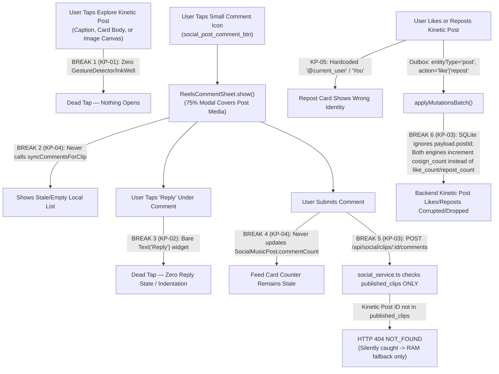

# Phase 69: Kinetic Post Focus Domain, Threaded Replies & Feed Card Refinement — Forensic Audit Report

**Document ID:** `AUDIT-EXPLORE-KPOST-069`  
**Date:** 2026-11-18  
**Branch:** `fix/studio-cockpit-bugs-vh001-vh006`  
**Audit Scope:** Read-only static & cross-stack wire/schema forensic audit across `apps/vhunambi_client/lib/features/explore/`, `apps/vhunambi_client/lib/features/social/`, `apps/vhunambi_client/lib/core/`, `apps/vhunambi_api/src/routes/`, `apps/vhunambi_api/src/modules/social/`, `apps/vhunambi_api/src/db/`, and `supabase/migrations/`.  
**Related Audits & Specs:**  
- [`docs/audits/PHASE68_HOME_DASHBOARD_OVERHAUL_AUDIT.md`](file:///c:/Users/Ndugelo/VHUNAMBI/monorepo/docs/audits/PHASE68_HOME_DASHBOARD_OVERHAUL_AUDIT.md)  
- [`docs/audits/PHASE67_NOTIFICATIONS_CENTER_OVERHAUL_AUDIT.md`](file:///c:/Users/Ndugelo/VHUNAMBI/monorepo/docs/audits/PHASE67_NOTIFICATIONS_CENTER_OVERHAUL_AUDIT.md)  
- [`docs/AGENT_HANDOFF_BIBLE.md`](file:///c:/Users/Ndugelo/VHUNAMBI/monorepo/docs/AGENT_HANDOFF_BIBLE.md)

---

## 1. Executive Summary & Headline Verdict

Side-by-side inspection of Vhunambi's Explore Kinetic Posts (`video_1.mp4` at `00:00–00:18` and `00:58–01:19`) against Facebook's Post & Post Focus benchmark (`video_1.mp4` at `00:19–00:57`) exposes **8 concrete architectural, UX, and wire-persistence defects (`KP-01` – `KP-08`)** explaining why Vhunambi Kinetic Posts feel like cramped, flat feed cards rather than complete social/music destinations:

1. **Zero Card-to-Focus Navigation (`KP-01`, `P0`):** [`ExploreSocialPostCard`](file:///c:/Users/Ndugelo/VHUNAMBI/monorepo/apps/vhunambi_client/lib/features/explore/presentation/widgets/explore_social_post_card.dart#L337-L785) has **no card-level, caption-level, or image-canvas tap handler**. Tapping the post caption (`"I'm new to vhunambi..."`, `00:13–00:18`), card surface, or artwork (`00:34–00:37`) is a dead tap. Only the small chat icon (`social_post_comment_btn_${post.id}` at `#L734-L744`) opens a cramped 75%-height bottom sheet ([`ReelsCommentSheet`](file:///c:/Users/Ndugelo/VHUNAMBI/monorepo/apps/vhunambi_client/lib/features/social/presentation/widgets/reels_comment_sheet.dart#L86-L91)) that covers the post media while typing.
2. **Dead `Reply` Button & Flat Unthreaded Comment Model (`KP-02`, `P0`):** At `01:14–01:19`, tapping `Reply` under `@ndugelo`'s comments does nothing because [`reels_comment_sheet.dart#L247-L249`](file:///c:/Users/Ndugelo/VHUNAMBI/monorepo/apps/vhunambi_client/lib/features/social/presentation/widgets/reels_comment_sheet.dart#L247-L249) renders a **bare, non-interactive `Text('Reply')`** with no `GestureDetector`/`InkWell`, no active `"Replying to @handle"` banner, and no reply state. [`ReelComment`](file:///c:/Users/Ndugelo/VHUNAMBI/monorepo/apps/vhunambi_client/lib/features/social/domain/models/reel_comment.dart#L9-L48) lacks `parentCommentId` / `replyToHandle`, and [`ReelsCommentsNotifier`](file:///c:/Users/Ndugelo/VHUNAMBI/monorepo/apps/vhunambi_client/lib/features/social/presentation/providers/reels_comments_provider.dart#L36-L188) lacks thread grouping, `View N replies` expansion, `Most Relevant` / `Newest` sorting, and `isCreator` (`Author`) auto-tagging.
3. **Silent 404 Black Hole on Backend Comment & Sync Persistence (`KP-03`, `P0`):** [`ExploreSocialPostCard`](file:///c:/Users/Ndugelo/VHUNAMBI/monorepo/apps/vhunambi_client/lib/features/explore/presentation/widgets/explore_social_post_card.dart#L740-L743) delegates comments to `POST /api/social/clips/:id/comments`, where [`social_service.ts#L308-L309`](file:///c:/Users/Ndugelo/VHUNAMBI/monorepo/apps/vhunambi_api/src/modules/social/social_service.ts#L308-L309) queries `published_clips` instead of `kinetic_posts`—returning **HTTP `404 NOT_FOUND` for every Kinetic Post** (silently swallowed by [`HttpSocialRepository.addComment`](file:///c:/Users/Ndugelo/VHUNAMBI/monorepo/apps/vhunambi_client/lib/features/social/data/repositories/http_social_repository.dart#L310-L312)). Meanwhile, [`explore_routes.ts`](file:///c:/Users/Ndugelo/VHUNAMBI/monorepo/apps/vhunambi_api/src/routes/explore_routes.ts#L1-L116) exposes zero post comment/like/create routes, and `applyMutationsBatch` in both [`vhunambi_db.ts#L1322-L1337`](file:///c:/Users/Ndugelo/VHUNAMBI/monorepo/apps/vhunambi_api/src/db/vhunambi_db.ts#L1322-L1337) and [`edge_persistence_bridge.ts#L1705-L1717`](file:///c:/Users/Ndugelo/VHUNAMBI/monorepo/apps/vhunambi_api/src/db/edge_persistence_bridge.ts#L1705-L1717) misroutes `post` `like`/`repost` mutations into `cosign_count` (and misses `payload.postId` in SQLite).
4. **Comment Count Desync & Wrong Notification Route (`KP-04`, `P1`):** Posting a comment in [`ReelsCommentsNotifier.addComment`](file:///c:/Users/Ndugelo/VHUNAMBI/monorepo/apps/vhunambi_client/lib/features/social/presentation/providers/reels_comments_provider.dart#L93-L164) never increments `SocialMusicPost.commentCount` in `socialFeedPostsProvider`, never calls `syncCommentsForClip` on sheet open, and emits notifications claiming `'Commented on Kinetic Reel'` with `targetRoute: '/reel/$clipId'` even for Kinetic Posts. Seeded posts (`post_001`–`post_005`) also declare `commentCount: 96..19` while `_seedComments()` only seeds `clip_seed_01`/`clip_seed_02`.
5. **Hardcoded Repost Identity `You / @current_user` (`KP-05`, `P1`):** [`RepostKineticPostSheet._submitRepost`](file:///c:/Users/Ndugelo/VHUNAMBI/monorepo/apps/vhunambi_client/lib/features/explore/presentation/widgets/repost_kinetic_post_sheet.dart#L54-L69) hardcodes `creatorId: 'current_user'`, `creatorName: 'You'`, `creatorHandle: '@current_user'` instead of reading `ownerProfileProvider` / `authSessionProvider` (and [`KineticPostComposerBar`](file:///c:/Users/Ndugelo/VHUNAMBI/monorepo/apps/vhunambi_client/lib/features/explore/presentation/widgets/kinetic_post_composer_bar.dart#L43-L45) hardcodes `'CE'`).
6. **Feed Card Metadata Clutter & Missing Engagement Summary Strip (`KP-06`, `P2`):** Between the author header and media (`00:00, 00:08`), [`ExploreSocialPostCard`](file:///c:/Users/Ndugelo/VHUNAMBI/monorepo/apps/vhunambi_client/lib/features/explore/presentation/widgets/explore_social_post_card.dart#L517-L590) stacks multiple colored/bordered pills (`Hybrid Co-Creation`, `Open Stems · 0 Remixes`, `🔥 Co-Sign · 0/25`), squeezing vertical rhythm, while Zone 4 (`#L711-L780`) mixes unequal icon buttons and a `Remix` pill without an overview engagement summary strip (`Likes · Comments · Remixes · Co-Signs`).
7. **`STD-UIUX-001` Raw Unicode Emojis & Stock Material Icons (`KP-07`, `P2`):** Raw Unicode emojis (`'🔥'`, `'👑'`, `'🇿🇦'`, `'🎹'`, `'🐐'`, `'❤️'`, `'🌅'`, `'🚀'`) and stock `Icons.*` (`Icons.close_rounded`, `Icons.favorite_rounded`, `Icons.arrow_upward_rounded`, `Icons.explore_rounded`, `Icons.radio_rounded`, `Icons.rocket_launch_rounded`, `Icons.leaderboard_rounded`) appear across `ReelsCommentSheet`, `ExploreSocialPostCard` (`'🔥 Co-Sign · ...'`), and `ExploreView`.
8. **Static Theme Token Drift & Un-normalized Post Artwork (`KP-08`, `P2`):** [`ExploreSocialPostCard`](file:///c:/Users/Ndugelo/VHUNAMBI/monorepo/apps/vhunambi_client/lib/features/explore/presentation/widgets/explore_social_post_card.dart#L344-L346) uses static dark-biased `AppColors.surfaceElevated` / `textPrimary` / `textSecondary` instead of `*Of(context)` adapters, and bypasses [`VhunambiTrackArtwork`](file:///c:/Users/Ndugelo/VHUNAMBI/monorepo/apps/vhunambi_client/lib/core/widgets/vhunambi_track_artwork.dart#L14) / `AppConstants.normalizeCloudMediaUrl` on post images (`#L611, #L620`).

---

### 1.1 Video-Correlated Defect Matrix (`KP-01` – `KP-08`)

| ID | Sev | `video_1.mp4` Symptom & Timestamp | Primary Root Cause | Exact File & Line Evidence |
| :--- | :---: | :--- | :--- | :--- |
| **`KP-01`** | `P0` | **Dead Tap on Post Card, Caption (`00:13–00:18`), & Media (`00:34–00:37`);** only tiny comment icon opens cramped 75% modal (`00:03`) | `ExploreSocialPostCard` root `Container`, caption `Text`, and `AspectRatio` canvas have zero `GestureDetector`/`InkWell`; no `KineticPostFocusView` screen or `/post/:id` route exists | [`explore_social_post_card.dart#L337-L351`](file:///c:/Users/Ndugelo/VHUNAMBI/monorepo/apps/vhunambi_client/lib/features/explore/presentation/widgets/explore_social_post_card.dart#L337-L351), [`#L523-L532`](file:///c:/Users/Ndugelo/VHUNAMBI/monorepo/apps/vhunambi_client/lib/features/explore/presentation/widgets/explore_social_post_card.dart#L523-L532), [`#L596-L702`](file:///c:/Users/Ndugelo/VHUNAMBI/monorepo/apps/vhunambi_client/lib/features/explore/presentation/widgets/explore_social_post_card.dart#L596-L702), [`notification_deep_link_router.dart#L74-L85`](file:///c:/Users/Ndugelo/VHUNAMBI/monorepo/apps/vhunambi_client/lib/features/notifications/presentation/utils/notification_deep_link_router.dart#L74-L85) |
| **`KP-02`** | `P0` | **Dead `Reply` Tap (`01:14–01:19`);** flat comment list with no indentation, `View N replies`, `Author` badge sync, or `Most Relevant` sort | `_CommentTile` renders inert `Text('Reply')` with zero tap handler; `ReelComment` & `ReelsCommentsNotifier` lack `parentCommentId`, `replyToHandle`, reply tree grouping, and sort modes; `isCreator` never auto-set on post author replies | [`reels_comment_sheet.dart#L225-L250`](file:///c:/Users/Ndugelo/VHUNAMBI/monorepo/apps/vhunambi_client/lib/features/social/presentation/widgets/reels_comment_sheet.dart#L225-L250), [`reel_comment.dart#L9-L48`](file:///c:/Users/Ndugelo/VHUNAMBI/monorepo/apps/vhunambi_client/lib/features/social/domain/models/reel_comment.dart#L9-L48), [`reels_comments_provider.dart#L93-L128`](file:///c:/Users/Ndugelo/VHUNAMBI/monorepo/apps/vhunambi_client/lib/features/social/presentation/providers/reels_comments_provider.dart#L93-L128) |
| **`KP-03`** | `P0` | **Kinetic Post Comments, Likes & Reposts Never Persist to Backend/Cloud** | `POST /api/social/clips/:id/comments` queries `published_clips` (returns `404` for `kinetic_posts`); `explore_routes.ts` has no post comments/likes/create routes; SQLite/Postgres `reel_comments` lack `parent_comment_id` & `reply_to_handle`; `applyMutationsBatch` maps `post.like` & `post.repost` to `cosign_count` | [`social_service.ts#L303-L336`](file:///c:/Users/Ndugelo/VHUNAMBI/monorepo/apps/vhunambi_api/src/modules/social/social_service.ts#L303-L336), [`explore_routes.ts#L84-L116`](file:///c:/Users/Ndugelo/VHUNAMBI/monorepo/apps/vhunambi_api/src/routes/explore_routes.ts#L84-L116), [`vhunambi_db.ts#L259-L305`](file:///c:/Users/Ndugelo/VHUNAMBI/monorepo/apps/vhunambi_api/src/db/vhunambi_db.ts#L259-L305), [`#L1322-L1337`](file:///c:/Users/Ndugelo/VHUNAMBI/monorepo/apps/vhunambi_api/src/db/vhunambi_db.ts#L1322-L1337), [`edge_persistence_bridge.ts#L1705-L1717`](file:///c:/Users/Ndugelo/VHUNAMBI/monorepo/apps/vhunambi_api/src/db/edge_persistence_bridge.ts#L1705-L1717) |
| **`KP-04`** | `P1` | **Stale Comment Counts (`0` or `96` vs empty sheet) & Wrong `"Kinetic Reel"` Notification** | `ReelsCommentsNotifier.addComment` never updates `SocialMusicPost.commentCount`; `ReelsCommentSheet` never calls `syncCommentsForClip`; `seedSocialPosts` counts (`96`, `48`, `31`, `27`, `19`) have 0 matching rows in `_seedComments`; notification hardcodes `/reel/$clipId` | [`reels_comments_provider.dart#L130-L149`](file:///c:/Users/Ndugelo/VHUNAMBI/monorepo/apps/vhunambi_client/lib/features/social/presentation/providers/reels_comments_provider.dart#L130-L149), [`#L189-L267`](file:///c:/Users/Ndugelo/VHUNAMBI/monorepo/apps/vhunambi_client/lib/features/social/presentation/providers/reels_comments_provider.dart#L189-L267), [`social_music_post.dart#L570`](file:///c:/Users/Ndugelo/VHUNAMBI/monorepo/apps/vhunambi_client/lib/features/explore/domain/models/social_music_post.dart#L570) |
| **`KP-05`** | `P1` | **Reposts Render `You / @current_user` Instead of Active Creator Profile (`00:58–01:02`)** | `RepostKineticPostSheet._submitRepost` hardcodes `'current_user'`, `'You'`, `'@current_user'`; `KineticPostComposerBar` hardcodes `'CE'` avatar text | [`repost_kinetic_post_sheet.dart#L54-L69`](file:///c:/Users/Ndugelo/VHUNAMBI/monorepo/apps/vhunambi_client/lib/features/explore/presentation/widgets/repost_kinetic_post_sheet.dart#L54-L69), [`explore_social_post_card.dart#L327-L332`](file:///c:/Users/Ndugelo/VHUNAMBI/monorepo/apps/vhunambi_client/lib/features/explore/presentation/widgets/explore_social_post_card.dart#L327-L332), [`kinetic_post_composer_bar.dart#L40-L50`](file:///c:/Users/Ndugelo/VHUNAMBI/monorepo/apps/vhunambi_client/lib/features/explore/presentation/widgets/kinetic_post_composer_bar.dart#L40-L50) |
| **`KP-06`** | `P2` | **Stacked Badge Clutter (`00:00, 00:08`) & No Engagement Summary Strip** | `Hybrid Co-Creation`, `Open Stems · 0 Remixes`, and `🔥 Co-Sign · 0/25` stack between header and media; Zone 4 lacks clean summary strip above equal-width action buttons | [`explore_social_post_card.dart#L517-L590`](file:///c:/Users/Ndugelo/VHUNAMBI/monorepo/apps/vhunambi_client/lib/features/explore/presentation/widgets/explore_social_post_card.dart#L517-L590), [`#L710-L780`](file:///c:/Users/Ndugelo/VHUNAMBI/monorepo/apps/vhunambi_client/lib/features/explore/presentation/widgets/explore_social_post_card.dart#L710-L780) |
| **`KP-07`** | `P2` | **`STD-UIUX-001` Raw Unicode Emojis (`🔥👏🇿🇦🏛️🛒❤️`, `00:03, 01:07`) & Stock Material Icons** | Literal emojis in `ReelsCommentSheet` quick bar, supporter banner, love badge, `ExploreSocialPostCard` Co-Sign pill (`'🔥 Co-Sign...'`), and `ExploreView`; stock `Icons.*` in sheet & Explore carousels | [`reels_comment_sheet.dart#L38-L44`](file:///c:/Users/Ndugelo/VHUNAMBI/monorepo/apps/vhunambi_client/lib/features/social/presentation/widgets/reels_comment_sheet.dart#L38-L44), [`#L115,L185,L189,L237,L263-L264,L419`](file:///c:/Users/Ndugelo/VHUNAMBI/monorepo/apps/vhunambi_client/lib/features/social/presentation/widgets/reels_comment_sheet.dart#L115), [`explore_social_post_card.dart#L248-L250`](file:///c:/Users/Ndugelo/VHUNAMBI/monorepo/apps/vhunambi_client/lib/features/explore/presentation/widgets/explore_social_post_card.dart#L248-L250), [`explore_view.dart#L166,L292,L402,L459,L466,L502`](file:///c:/Users/Ndugelo/VHUNAMBI/monorepo/apps/vhunambi_client/lib/features/explore/presentation/views/explore_view.dart#L166) |
| **`KP-08`** | `P2` | **Theme Adapter Drift & Un-normalized Post Artwork** | Static `AppColors.surfaceElevated` / `textPrimary` / `textSecondary` used in `ExploreSocialPostCard` & `KineticPostSonicPill` instead of `*Of(context)`; `Image.network` skips `normalizeCloudMediaUrl` | [`explore_social_post_card.dart#L344-L346,L413,L528,L611,L620`](file:///c:/Users/Ndugelo/VHUNAMBI/monorepo/apps/vhunambi_client/lib/features/explore/presentation/widgets/explore_social_post_card.dart#L344-L346), [`kinetic_post_sonic_pill.dart#L141,L187,L249`](file:///c:/Users/Ndugelo/VHUNAMBI/monorepo/apps/vhunambi_client/lib/features/explore/presentation/widgets/kinetic_post_sonic_pill.dart#L141) |

---

### 1.2 End-to-End Breakpoint Topology Map



---

## 2. Dimension-by-Dimension Forensic Findings

### 2.1 Dimension 1 — Kinetic Post Card, Tap Navigation & Repost Identity (`apps/vhunambi_client/lib/features/explore/`)

#### A. File Inventory & Ownership
| File | Lines | Responsibility |
| :--- | :---: | :--- |
| [`explore_view.dart`](file:///c:/Users/Ndugelo/VHUNAMBI/monorepo/apps/vhunambi_client/lib/features/explore/presentation/views/explore_view.dart) | 564 | Tab 1 (`RootShell`) container with `TrendingReelsShelf`, feed switcher (`For You`, `Following`, `All Songs`, Stage Tiers), `KineticPostComposerBar`, and 5-slot interleaved `ExploreSocialPostCard` feed (`#L344-L376`). |
| [`explore_social_post_card.dart`](file:///c:/Users/Ndugelo/VHUNAMBI/monorepo/apps/vhunambi_client/lib/features/explore/presentation/widgets/explore_social_post_card.dart) | 842 | Renders each `SocialMusicPost` across 4 zones (repost banner, header, badges + caption + lineage/co-sign pills, visual canvas + sonic pill, 6-item action row). |
| [`kinetic_post_sonic_pill.dart`](file:///c:/Users/Ndugelo/VHUNAMBI/monorepo/apps/vhunambi_client/lib/features/explore/presentation/widgets/kinetic_post_sonic_pill.dart) | 309 | Floating frosted audio pill (`40dp` overlay on image canvas, `44dp` capsule on text-only posts) wired to `playExploreTrack(ref, post.track)`. |
| [`repost_kinetic_post_sheet.dart`](file:///c:/Users/Ndugelo/VHUNAMBI/monorepo/apps/vhunambi_client/lib/features/explore/presentation/widgets/repost_kinetic_post_sheet.dart) | 317 | Quote-repost bottom sheet that locks original audio attribution and dispatches `socialFeedPostsProvider.notifier.repostPost(...)`. |
| [`create_kinetic_post_sheet.dart`](file:///c:/Users/Ndugelo/VHUNAMBI/monorepo/apps/vhunambi_client/lib/features/explore/presentation/widgets/create_kinetic_post_sheet.dart) | 956 | Full authoring sheet supporting 1–4 static images, Vhunambi Vision AI artwork (`POST /v1/vision/generate`), aspect ratios (`1:1`, `4:5`, `16:9`), and trimmed audio attachments. |
| [`kinetic_post_composer_bar.dart`](file:///c:/Users/Ndugelo/VHUNAMBI/monorepo/apps/vhunambi_client/lib/features/explore/presentation/widgets/kinetic_post_composer_bar.dart) | 107 | Inline feed composer bar launching `CreateKineticPostSheet`. |
| [`social_music_post.dart`](file:///c:/Users/Ndugelo/VHUNAMBI/monorepo/apps/vhunambi_client/lib/features/explore/domain/models/social_music_post.dart) | 804 | `SocialMusicPost`, `KineticPostImageAttachment`, `KineticPostAudioAttachment`, `toPublishedClip`, and `seedSocialPosts()` (`post_001`, `post_001_remix_fifi`, `post_002`–`post_005`). |
| [`explore_providers.dart`](file:///c:/Users/Ndugelo/VHUNAMBI/monorepo/apps/vhunambi_client/lib/features/explore/presentation/providers/explore_providers.dart) | 1,057 | `SocialFeedPostsNotifier` (`socialFeedPostsProvider`), `ExploreTracksNotifier`, `FollowingCreatorsNotifier`, `refreshFromCloud()`, `toggleLike()`, `addPost()`, `repostPost()`, `cosignPost()`. |
| [`http_explore_repository.dart`](file:///c:/Users/Ndugelo/VHUNAMBI/monorepo/apps/vhunambi_client/lib/features/explore/data/repositories/http_explore_repository.dart) | 239 | HTTP client for `GET /api/explore`, `GET /api/explore/tracks`, `POST /api/explore/tracks`, `GET /api/explore/radio/:genre`. |

#### B. Card Tap Census (`ExploreSocialPostCard`)
Every interactive tap target inside [`explore_social_post_card.dart`](file:///c:/Users/Ndugelo/VHUNAMBI/monorepo/apps/vhunambi_client/lib/features/explore/presentation/widgets/explore_social_post_card.dart):
- `post_cosign_btn_${post.id}` (`#L216`) $\to$ `cosignPost(post.id)`
- `social_post_creator_${post.id}` (`#L382`) $\to$ `ArtistProfileView(artistId: post.creatorId)`
- `social_post_follow_${post.id}` (`#L475`) $\to$ `followingCreatorIdsProvider.notifier.toggleFollow(post.creatorId)`
- `post_remix_tree_btn_${post.id}` (`#L543`) $\to$ `RemixLineageTreeSheet.show(...)`
- `social_post_play_btn_${post.id}` ([`kinetic_post_sonic_pill.dart#L98`](file:///c:/Users/Ndugelo/VHUNAMBI/monorepo/apps/vhunambi_client/lib/features/explore/presentation/widgets/kinetic_post_sonic_pill.dart#L98)) $\to$ `playExploreTrack` / `pause`
- `social_post_like_btn_${post.id}` (`#L716`) $\to$ `toggleLike(post.id)`
- `social_post_comment_btn_${post.id}` (`#L736`) $\to$ `ReelsCommentSheet.show(...)`
- `social_post_repost_btn_${post.id}` (`#L750`) $\to$ `RepostKineticPostSheet.show(...)`
- `social_post_remix_btn_${post.id}` (`#L173`) $\to$ `OpenVerseRemixCockpitSheet.show(...)`
- `social_post_tip_btn_${post.id}` (`#L766`) $\to$ `CreatorTippingSheet.show(...)`
- `social_post_share_btn_${post.id}` (`#L306`) $\to$ clipboard copy + notification + snackbar

**Exact Proof of Dead Card/Caption/Image Taps:**
- Root card (`#L337-L349`): bare `Container`, no `GestureDetector` or `InkWell`.
- Zone 2 Caption (`#L523-L532`): bare `Text(post.caption, ...)`.
- Zone 3 Media Canvas (`#L596-L702`): `ClipRRect > AspectRatio > Stack` with `PageView.builder` / `Image.network`—zero tap handler on image pages!

#### C. Repost Identity & Author Resolution Bug (`KP-05`)
In [`repost_kinetic_post_sheet.dart#L54-L60`](file:///c:/Users/Ndugelo/VHUNAMBI/monorepo/apps/vhunambi_client/lib/features/explore/presentation/widgets/repost_kinetic_post_sheet.dart#L54-L60):
```dart
    final repost = SocialMusicPost(
      id: 'kpost_repost_${now.millisecondsSinceEpoch}',
      creatorId: 'current_user',
      creatorName: 'You',
      creatorHandle: '@current_user',
      publishedAt: now,
```
Compare with [`create_kinetic_post_sheet.dart#L251-L256`](file:///c:/Users/Ndugelo/VHUNAMBI/monorepo/apps/vhunambi_client/lib/features/explore/presentation/widgets/create_kinetic_post_sheet.dart#L251-L256) which resolves the authenticated creator from `ownerProfileProvider` (`owner.displayName`, `owner.handle`, `owner.id`). Because `RepostKineticPostSheet` ignores `ownerProfileProvider` and `authSessionProvider`, every repost card renders `You` / `@current_user • just now` (`video_1.mp4 00:58–01:02`), requiring a brittle special case (`post.creatorHandle == '@current_user'`) in [`explore_social_post_card.dart#L328-L332`](file:///c:/Users/Ndugelo/VHUNAMBI/monorepo/apps/vhunambi_client/lib/features/explore/presentation/widgets/explore_social_post_card.dart#L328-L332). Similarly, [`kinetic_post_composer_bar.dart#L40-L50`](file:///c:/Users/Ndugelo/VHUNAMBI/monorepo/apps/vhunambi_client/lib/features/explore/presentation/widgets/kinetic_post_composer_bar.dart#L40-L50) is a `StatelessWidget` that hardcodes `'CE'` in `CircleAvatar` instead of watching `ownerProfileProvider`.

#### D. Visual Hierarchy & Clutter Audit (`KP-06`, `KP-08`)
- Between the creator row (`#L378-L514`) and visual canvas (`#L595`), the card stacks a standalone `_buildProvenanceBadge` row (`#L517-L520`), caption (`#L523-L532`), and a `Wrap` containing both `Open Stems · 0 Remixes` (`#L542-L587`) and `🔥 Co-Sign · 0/25` (`#L588`).
- `ExploreSocialPostCard` uses static `AppColors.surfaceElevated` (`#L344`), `AppColors.borderSubtle` (`#L346`), `AppColors.textPrimary` (`#L413`, `#L528`), and `AppColors.textSecondary` (`#L361`, `#L367`, `#L722`, `#L738`, `#L754`), bypassing `*Of(context)` light/dark adapters.
- Zone 3 `Image.network` (`#L611`, `#L620`) does not pass URLs through `AppConstants.normalizeCloudMediaUrl` or [`VhunambiTrackArtwork`](file:///c:/Users/Ndugelo/VHUNAMBI/monorepo/apps/vhunambi_client/lib/core/widgets/vhunambi_track_artwork.dart#L14), and Zone 4 (`#L711-L780`) has no engagement summary strip (`11 Likes · 6 Comments · 2 Remixes · 14 Co-Signs`) above the action rail.

---

### 2.2 Dimension 2 — Comment Sheet, Dead `Reply` Tap, Threading & `STD-UIUX-001` (`apps/vhunambi_client/lib/features/social/`)

#### A. Dead `Reply` Tap & Missing Threading Model (`KP-02`)
1. **Exact Non-Interactive `Reply` Widget:** [`reels_comment_sheet.dart#L246-L250`](file:///c:/Users/Ndugelo/VHUNAMBI/monorepo/apps/vhunambi_client/lib/features/social/presentation/widgets/reels_comment_sheet.dart#L246-L250):
   ```dart
              const SizedBox(height: 3),
              Text('Reply',
                  style: AppTypography.caption
                      .copyWith(color: AppColors.textTertiary)),
   ```
   Zero `GestureDetector`/`InkWell`, zero `onReply` callback, zero `44x44dp` hit target, zero active `"Replying to @username"` bar above the composer, and zero `FocusNode` request to open the keyboard.
2. **Flat `ReelComment` Entity ([`reel_comment.dart#L9-L130`](file:///c:/Users/Ndugelo/VHUNAMBI/monorepo/apps/vhunambi_client/lib/features/social/domain/models/reel_comment.dart#L9-L130)):**
   - Has `id`, `clipId`, `userId`, `username`, `displayName`, `avatarUrl`, `isCreator`, `text`, `likeCount`, `isLikedByMe`, `userReelLoves`, `giftEmoji`, `giftName`, `createdAt`.
   - **Missing:** `parentCommentId` (`String?`), `replyToHandle` (`String?`), `replyToUserId` (`String?`).
3. **Flat `ReelsCommentsNotifier` ([`reels_comments_provider.dart#L36-L285`](file:///c:/Users/Ndugelo/VHUNAMBI/monorepo/apps/vhunambi_client/lib/features/social/presentation/providers/reels_comments_provider.dart#L36-L285)):**
   - `addComment` (`#L93-L164`) prepends `[newComment, ...currentList]` with no `parentCommentId` / `replyToHandle` parameters and never passes `isCreator` (even when the post/clip creator posts a comment!).
   - No `CommentSortMode` (`mostRelevant` vs `newest`), no parent-to-child tree projection, and no expanded-thread ID tracking (`View N replies`).
4. **Count Desync & Missing Cloud Sync (`KP-04`):**
   - `ReelsCommentSheet` (`reels_comment_sheet.dart#L35-L85`) never calls `ref.read(reelsCommentsProvider.notifier).syncCommentsForClip(widget.clip.id)` in `initState`.
   - `ReelsCommentsNotifier.addComment` (`#L123-L149`) does not increment `SocialMusicPost.commentCount` in `socialFeedPostsProvider` (or `PublishedClip.commentCount` in `socialFeedProvider`), and hardcodes `'Commented on Kinetic Reel'` / `'/reel/$clipId'` in notifications.
   - `seedSocialPosts()` ([`social_music_post.dart#L570,L633,L675,L717,L756,L797`](file:///c:/Users/Ndugelo/VHUNAMBI/monorepo/apps/vhunambi_client/lib/features/explore/domain/models/social_music_post.dart#L570)) displays `96`, `28`, `48`, `31`, `27`, `19` comments, whereas [`ReelsCommentsNotifier._seedComments()`](file:///c:/Users/Ndugelo/VHUNAMBI/monorepo/apps/vhunambi_client/lib/features/social/presentation/providers/reels_comments_provider.dart#L189-L267) only seeds `clip_seed_01` and `clip_seed_02`—leaving every Kinetic Post thread empty when opened.

#### B. Exhaustive `STD-UIUX-001` Iconography & Emoji Census (`KP-07`)

| File & Line(s) | Violation Type | Exact Offending Code | Required `STD-UIUX-001` Replacement |
| :--- | :--- | :--- | :--- |
| [`reels_comment_sheet.dart#L38`](file:///c:/Users/Ndugelo/VHUNAMBI/monorepo/apps/vhunambi_client/lib/features/social/presentation/widgets/reels_comment_sheet.dart#L38) | Raw Unicode Emojis | `_emojis = ['🔥', '👑', '🇿🇦', '🎹', '🐐', '❤️']` | Studio reaction chip specs (`IconData` from `AppIcons` / `PhosphorIconsFill.*` + short label: `Fire` / `AppIcons.flame`, `Crown` / `AppIcons.crown`, `Log Drum` / `AppIcons.piano`, `Soul` / `AppIcons.heart`, `Remix` / `AppIcons.remix`, `SA Heritage` / `PhosphorIconsFill.globeHemisphereEast`) |
| [`reels_comment_sheet.dart#L39-L44`](file:///c:/Users/Ndugelo/VHUNAMBI/monorepo/apps/vhunambi_client/lib/features/social/presentation/widgets/reels_comment_sheet.dart#L39-L44) | Raw Unicode Emojis | `'Hits different! 🎹'`, `'Makhado sunrise 🌅'`, `'Top tier production 🔥'`, `'Proudly SA 🇿🇦'` | Clean studio phrase chips paired with `PhosphorIcon` (`'Hits different'`, `'Makhado sunrise'`, `'Top tier mix'`, `'Proudly SA'`) |
| [`reels_comment_sheet.dart#L115`](file:///c:/Users/Ndugelo/VHUNAMBI/monorepo/apps/vhunambi_client/lib/features/social/presentation/widgets/reels_comment_sheet.dart#L115) | Stock Material Icon | `Icon(Icons.close_rounded, ...)` | `PhosphorIcon(AppIcons.close, ...)` |
| [`reels_comment_sheet.dart#L185,L189`](file:///c:/Users/Ndugelo/VHUNAMBI/monorepo/apps/vhunambi_client/lib/features/social/presentation/widgets/reels_comment_sheet.dart#L185) | Raw Unicode Emojis | `const Text('🔥', ...)`, `'... ${comment.userReelLoves}x ❤️'` | `PhosphorIcon(AppIcons.flame, color: AppColors.coinGold)` + `'... loved ${comment.userReelLoves}x'` |
| [`reels_comment_sheet.dart#L237`](file:///c:/Users/Ndugelo/VHUNAMBI/monorepo/apps/vhunambi_client/lib/features/social/presentation/widgets/reels_comment_sheet.dart#L237) | Raw Unicode Emoji | `'Loved ${comment.userReelLoves}x ❤️'` | `PhosphorIcon(AppIcons.heart, size: 10)` + `'Loved ${comment.userReelLoves}x'` |
| [`reels_comment_sheet.dart#L261-L265`](file:///c:/Users/Ndugelo/VHUNAMBI/monorepo/apps/vhunambi_client/lib/features/social/presentation/widgets/reels_comment_sheet.dart#L261-L265) | Stock Material Icons | `Icons.favorite_rounded` / `Icons.favorite_border_rounded` | `PhosphorIcon(comment.isLikedByMe ? AppIcons.heart : AppIcons.heartOutline, ...)` |
| [`reels_comment_sheet.dart#L419`](file:///c:/Users/Ndugelo/VHUNAMBI/monorepo/apps/vhunambi_client/lib/features/social/presentation/widgets/reels_comment_sheet.dart#L419) | Stock Material Icon | `Icon(Icons.arrow_upward_rounded, ...)` | `PhosphorIcon(PhosphorIconsBold.arrowUp, ...)` |
| [`explore_social_post_card.dart#L248-L250`](file:///c:/Users/Ndugelo/VHUNAMBI/monorepo/apps/vhunambi_client/lib/features/explore/presentation/widgets/explore_social_post_card.dart#L248-L250) | Raw Unicode Emoji | `'🔥 Graduated · ${post.cosignCount}'` / `'🔥 Co-Sign · ${post.cosignCount}/25'` | Remove `'🔥 '` (the `PhosphorIcon(PhosphorIconsFill.fire)` already precedes it at `#L239-L245`!) |
| [`explore_view.dart#L166,L292,L402,L459,L466,L502`](file:///c:/Users/Ndugelo/VHUNAMBI/monorepo/apps/vhunambi_client/lib/features/explore/presentation/views/explore_view.dart#L166) | Stock Icons + Emoji | `Icons.person_search_rounded`, `Icons.explore_rounded`, `Icons.radio_rounded`, `Icons.rocket_launch_rounded`, `'Fastest Growing Tracks 🚀'`, `Icons.leaderboard_rounded` | `PhosphorIcon(PhosphorIconsRegular.userList / compass / radio / rocketLaunch / chartBar)` and remove `' 🚀'` |
| [`explore_discovery_drawer_sheet.dart#L50,L68,L83,L100,L113,L126,L139,L152,L200,L227`](file:///c:/Users/Ndugelo/VHUNAMBI/monorepo/apps/vhunambi_client/lib/features/explore/presentation/widgets/explore_discovery_drawer_sheet.dart#L50) | Stock Material Icons | `Icons.explore_rounded`, `Icons.close_rounded`, `Icons.person_rounded`, `Icons.leaderboard_rounded`, `Icons.radio_rounded`, `Icons.rocket_launch_rounded`, `Icons.local_fire_department_rounded`, `Icons.verified_user_rounded`, `Icons.chevron_right_rounded` | Migrate to `PhosphorIcon(AppIcons.* / PhosphorIconsRegular.*)` |

---

### 2.3 Dimension 3 — Backend Social Post, Comment & Sync Persistence (`apps/vhunambi_api/` & `supabase/migrations/`)

#### A. Cross-Boundary Wire & Route Gaps (`KP-03`)

| Operation | Flutter Client Expectation / Current Call | Backend Route Reality (`apps/vhunambi_api/src/routes/`) | Persistence Reality (`vhunambi_db.ts` / `edge_persistence_bridge.ts` / Supabase) |
| :--- | :--- | :--- | :--- |
| **Create Kinetic Post** | `explore_providers.dart#L920` enqueues `entityType: 'post', action: 'create'` to `/api/v1/sync/mutations` | No `POST /api/explore/posts` or `POST /api/v1/explore/posts` route exists in [`explore_routes.ts`](file:///c:/Users/Ndugelo/VHUNAMBI/monorepo/apps/vhunambi_api/src/routes/explore_routes.ts) | `applyMutationsBatch` inserts into `kinetic_posts` (`vhunambi_db.ts#L1338`, `edge_persistence_bridge.ts#L1718`), missing `like_count` & `comment_count` columns |
| **Fetch Single Post** | Needed for `/post/:id` deep links & `KineticPostFocusView` hydration | **MISSING:** No `GET /api/v1/explore/posts/:id` route | `getExploreFeed()` returns list only (`vhunambi_db.ts#L1723`, `edge_persistence_bridge.ts#L2071`) |
| **Like Kinetic Post** | `explore_providers.dart#L905` enqueues `entityType: 'post', action: 'like', payload: {'postId': postId}` | **MISSING:** No `POST /api/v1/explore/posts/:id/like` route | **BROKEN:** `vhunambi_db.ts#L1322` reads `payload.id`, not `payload.postId` (falls back to `'gen_...'`); both `vhunambi_db.ts#L1331` & `edge_persistence_bridge.ts#L1713` increment `cosign_count` instead of `like_count`; `kinetic_posts` table lacks `like_count` column in both SQLite (`#L260-L275`) & Postgres (`20261110000001#L133-L152`) |
| **Repost Kinetic Post** | `explore_providers.dart#L944` enqueues `entityType: 'post', action: 'repost', payload: {'originalPostId', 'repost'}` | `POST /api/explore/posts/:id/repost` (`explore_routes.ts#L108-L115`) ignores body and only increments `repost_count` | **BROKEN:** In `applyMutationsBatch`, `'repost'` hits `commutativeCounterActions` (`#L1308`, `#L1696`) and increments `cosign_count` on `'gen_...'` instead of incrementing `repost_count` and inserting the repost row |
| **List / Post Kinetic Post Comments** | `ReelsCommentSheet` calls `GET/POST /api/social/clips/:id/comments` (`http_social_repository.dart#L204,L279`) | **404 FOR EVERY POST:** `social_service.ts#L308` checks `getPublishedClipRow(clipId)` (`published_clips` only); `explore_routes.ts` has **zero** `/posts/:id/comments` routes | `reel_comments` table has schema drift between SQLite (`reel_id, creator_id, content`, `vhunambi_db.ts#L297-L305`) and Postgres (`clip_id, user_id, text, likes_count`, `20261110000001#L181-L197`); **neither** has `parent_comment_id` or `reply_to_handle` |
| **Like Comment** | `POST /api/social/comments/:id/like` (`social_routes.ts#L185`) | Only mounted under `/api/social/comments/:id/like`, not `/api/v1/explore/comments/:id/like` | `likeComment` (`social_service.ts#L339-L355`) works on `reel_comments` rows, using `social_interactions` (`comment_like`) |

#### B. SQLite (`vhunambi_db.ts`) $\leftrightarrow$ Edge (`edge_persistence_bridge.ts`) $\leftrightarrow$ Supabase (`20261110000001_phase62_hybrid_cloud_schema.sql`) Schema Diff

| Table | Column / Feature | SQLite (`vhunambi_db.ts`) | Edge Isolate (`edge_persistence_bridge.ts`) | Supabase Postgres (`20261110000001`) | Required Migration & Parity Fix |
| :--- | :--- | :--- | :--- | :--- | :--- |
| `kinetic_posts` | `like_count` | **Missing** (`#L260-L275`) | **Missing** (`#L1182-L1197`) | **Missing** (`#L133-L152`) | Add `like_count INTEGER NOT NULL DEFAULT 0` across SQLite `ALTER TABLE`, `EdgeIsolateDatabaseEngine`, and Phase 69 Postgres migration |
| `kinetic_posts` | `comment_count` | **Missing** (`#L260-L275`) | **Missing** (`#L1182-L1197`) | Present (`#L147`) | Add `comment_count INTEGER NOT NULL DEFAULT 0` to SQLite `kinetic_posts` & `EdgeIsolateDatabaseEngine` |
| `reel_comments` / `post_comments` | Target column (`clip_id` vs `reel_id` vs `post_id`) | `reel_id` (`#L299`) | `reel_id` (`#L5085`) | `clip_id` (`#L183`) | Keep `reel_comments` as unified comment store (or add `target_type TEXT DEFAULT 'clip'`), accept both `clipId`/`postId`, and expose `/api/v1/explore/posts/:id/comments` + `/api/v1/explore/comments/:id/like` |
| `reel_comments` | `parent_comment_id` | **Missing** | **Missing** | **Missing** | Add `parent_comment_id TEXT` + index `idx_reel_comments_parent` across SQLite, `EdgeIsolateDatabaseEngine`, `ReelCommentDto`, `CreateCommentSchema`, and Postgres migration |
| `reel_comments` | `reply_to_handle` | **Missing** | **Missing** | **Missing** | Add `reply_to_handle TEXT` across SQLite, `EdgeIsolateDatabaseEngine`, `ReelCommentDto`, `CreateCommentSchema`, and Postgres migration |

---

## 3. Facebook Post & Post Focus UX Translation Blueprint

### 3.1 Spatial Comparison: Current Vhunambi vs. Phase 69 Target Architecture

```
┌─────────────────────────────────────────────────────┬──────────────────────────────────────────────────────┐
│ CURRENT KINETIC POST & SHEET (video_1 00:00-01:19)  │ PHASE 69 FACEBOOK-BENCHMARK ARCHITECTURE              │
├─────────────────────────────────────────────────────┼──────────────────────────────────────────────────────┤
│ FEED CARD (ExploreSocialPostCard):                  │ REFINED FEED CARD (ExploreSocialPostCard):           │
│ 1. Repost: "Reposted from @ndugelo" -> "You" /      │ 1. Clean Single-Line Repost Header (if repost) using │
│    "@current_user" (hardcoded!)                     │    real ownerProfileProvider handle & avatar         │
│ 2. Header: Avatar + Name + @handle • time + Follow  │ 2. Author Header: Avatar + Name ✓ + Handle · Time +  │
│ 3. Cluttered Stack:                                 │    Subtle Provenance Chip + Follow / More (...)      │
│    [Hybrid Co-Creation]                             │ 3. Readable Full-Width Post Caption (tap -> Focus)   │
│    [Open Stems · 0 Remixes] [🔥 Co-Sign · 0/25]     │ 4. Edge-to-Edge Visual Canvas + Docked Sonic Pill    │
│ 4. Media Canvas (dead tap!) + Sonic Pill            │    (tap media/card -> KineticPostFocusView; tap Play │
│ 5. 6-item Uneven Action Rail (no summary row)       │    button inside pill -> inline audio playback)      │
│                                                     │ 5. Clean Engagement Summary Strip above Divider:     │
│                                                     │    "11 Likes · 6 Comments · 2 Remixes · Co-Sign 0/25"│
│                                                     │ 6. Balanced Action Rail (Like, Comment, Repost,      │
│                                                     │    Remix, Share) — tapping Comment -> Focus w/ input │
├─────────────────────────────────────────────────────┼──────────────────────────────────────────────────────┤
│ COMMENT INTERACTION:                                │ FULL-SCREEN POST FOCUS DOMAIN (KineticPostFocusView):│
│ • Only small comment icon opens 75% modal sheet     │ • Top Bar: [< Post]  @handle's Post  [Tip] [Share]   │
│ • Modal covers post media while typing              │ • Scrollable Focus Body:                             │
│ • Raw emojis [🔥 👑 🇿🇦 🎹 🐐 ❤️] in quick bar      │   1. Full Author Header, Provenance & Caption        │
│ • Flat comments list; bare Text('Reply') dead tap   │   2. Full Artwork/Carousel + Audio Transport Deck +  │
│ • No child replies, no sort toggle                  │      Lineage / Co-Sign Telemetry Strip               │
│                                                     │   3. Engagement Summary + Sort Header:               │
│                                                     │      "Most relevant ▾" / "Newest ▾"                  │
│                                                     │   4. Nested Threaded Comments (Parent + Indented     │
│                                                     │      Child Replies + "View N replies" + "Author"     │
│                                                     │      badge + interactive Reply + Comment Likes)      │
│                                                     │ • Sticky Bottom Composer (never covers post media!): │
│                                                     │   - Active "Replying to @user [x]" banner when set   │
│                                                     │   - Studio Phosphor Reaction Chips (zero raw emojis) │
│                                                     │   - TextField ("Write a comment...") + Send Button   │
└─────────────────────────────────────────────────────┴──────────────────────────────────────────────────────┘
```

### 3.2 `KineticPostFocusView` & Nested Comment Tree Contract

1. **Navigation Contract (`KineticPostFocusView`):**
   - Route/Constructor: `KineticPostFocusView(postId: post.id, initialPost: post, autofocusComposer: false)` pushed via `Navigator.of(context).push(...)` from:
     - Tapping anywhere on `ExploreSocialPostCard` background, caption, or media canvas (`autofocusComposer: false`).
     - Tapping the `Comment` action button or Engagement Summary comment count (`autofocusComposer: true`).
     - Tapping a Kinetic Post notification via `NotificationDeepLinkRouter` (`/post/:id`).
2. **Thread Model (`ReelComment` + `ReelsCommentsNotifier`):**
   - Add `final String? parentCommentId;` and `final String? replyToHandle;` to `ReelComment` (`toJson` / `fromJson` backward-compatible).
   - Add `enum CommentSortOrder { mostRelevant, newest }` (`mostRelevant` ranks by `likeCount + replyCount * 2 + (isCreator ? 5 : 0)` then recency; `newest` ranks by `createdAt DESC`).
   - Group top-level comments (`parentCommentId == null`) and replies (`repliesByParentId[parent.id]` sorted chronologically `ASC` like Facebook threads) with per-parent expansion state (`View N replies` / `Hide replies`).
   - Tapping `Reply` on any top-level comment or child reply sets `activeReplyTarget = (parentCommentId: topLevelParent.id, replyToHandle: '@${comment.username}')`, renders a dismissible `"Replying to @handle"` pill above the sticky composer, and focuses the `TextField` (`FocusNode.requestFocus()`).
   - Sync both `ReelsCommentsNotifier` and `socialFeedPostsProvider.notifier.incrementCommentCount(postId)` on submit, and emit post-aware notifications (`title: 'Commented on @${post.creatorHandle}\'s Post'`, `targetRoute: '/post/${post.id}'`).
3. **Backend Persistence Contract (`/api/v1/explore/posts*`):**
   - Add `GET /api/v1/explore/posts/:id`, `POST /api/v1/explore/posts`, `POST /api/v1/explore/posts/:id/like`, `GET /api/v1/explore/posts/:id/comments?sort=relevant|newest`, `POST /api/v1/explore/posts/:id/comments`, and `POST /api/v1/explore/comments/:id/like` in `explore_routes.ts` (mounted at both `/api/explore` and `/api/v1/explore`).
   - Upgrade `RepostKineticPostSheet` + `POST /api/v1/explore/posts/:id/repost` to resolve the authenticated creator identity (`ownerProfileProvider` / `authUser`) and persist the new repost row alongside incrementing `repost_count`.
   - Fix `applyMutationsBatch` in both `vhunambi_db.ts` and `edge_persistence_bridge.ts` to resolve `m.payload?.postId ?? m.payload?.id`, handle `post.like` $\to$ `like_count` (NOT `cosign_count`), `post.repost` $\to$ `repost_count` + repost record, and `comment.create` / `comment.like`.

---

## 4. Two-Pass Overhaul Implementation Roadmap (`M69.1` – `M69.4`)

### Overhaul Pass 1 (`M69.1` – `M69.2`): Feed Card Refinement, Repost Identity & Full-Screen `KineticPostFocusView`

- **`M69.1` — Kinetic Post Feed Card Visual Polish, Repost Identity & `STD-UIUX-001` Cleanup (`KP-05`, `KP-06`, `KP-07`, `KP-08`):**
  1. **Fix Repost & Composer Identity:** Update `RepostKineticPostSheet._submitRepost` (`repost_kinetic_post_sheet.dart#L54-L69`) to read `ownerProfileProvider` + `authSessionProvider` instead of hardcoding `'current_user'` / `'You'` / `'@current_user'`; update `KineticPostComposerBar` (`kinetic_post_composer_bar.dart#L40-L50`) to render the live user monogram/avatar from `ownerProfileProvider`.
  2. **Declutter `ExploreSocialPostCard`:** Replace stacked mid-card pills with a sleek single-line Author Header (subtle inline provenance pill + `Follow` / `Your Post` + `...` menu), full-width readable caption, edge-to-edge normalized media canvas (`VhunambiTrackArtwork` fallback + `normalizeCloudMediaUrl`) with `KineticPostSonicPill`, a subtle **Engagement Summary Strip** (`Likes · Comments · Remixes · Co-Sign X/25`), and a balanced Action Rail (`Like`, `Comment`, `Repost`, `Remix`, `Share`, with Tip accessible in Focus header/menu).
  3. **Purge `STD-UIUX-001` & Theme Drift:** Remove raw `'🔥'` in `_buildCosignButton` (`explore_social_post_card.dart#L248-L250`), replace static `AppColors.*` with `AppColors.*Of(context)` across `ExploreSocialPostCard` and `KineticPostSonicPill`, and migrate stock `Icons.*` / `' 🚀'` in `ExploreView` and `ExploreDiscoveryDrawerSheet` to `PhosphorIcon(AppIcons.*)`.

- **`M69.2` — Full-Screen `KineticPostFocusView` Domain & Card Tap Navigation (`KP-01`, `KP-04`):**
  1. **Create `KineticPostFocusView`** (`apps/vhunambi_client/lib/features/explore/presentation/views/kinetic_post_focus_view.dart`):
     - Dedicated full-screen `Scaffold` with `< Post` back header, `@handle's Post` title, Tip & Share header actions.
     - Scrollable body featuring full author header + follow toggle, full caption, interactive multi-image carousel / normalized artwork, embedded `KineticPostSonicPill` + quick `Remix` & `Co-Sign` telemetry strip, and inline threaded discussion section.
     - Sticky bottom composer dock (`Write a comment...`) anchored cleanly above `MediaQuery.viewInsetsOf(context).bottom` so post media & discussion scroll above it without ever being covered by a modal sheet.
  2. **Wire Universal Post Navigation:** Wrap `ExploreSocialPostCard` body, caption, and image canvas in clean tap regions opening `KineticPostFocusView` (while preserving separate `onTap` on creator link, Follow, Sonic Pill Play/Pause, Like, Repost, Remix, Co-Sign, and Share), wire the Comment button to open `KineticPostFocusView(autofocusComposer: true)`, and register `/post/:id` in `NotificationDeepLinkRouter`.

### Overhaul Pass 2 (`M69.3` – `M69.4`): Nested Comment Threading & Backend `/api/v1/explore/posts*` Persistence

- **`M69.3` — Nested Comment Threading, Reply State, Sort Toggle & Studio Reaction Chips (`KP-02`, `KP-04`, `KP-07`):**
  1. **Extend `ReelComment` & `ReelsCommentsNotifier`:** Add `parentCommentId`, `replyToHandle`, `CommentSortOrder` (`mostRelevant`, `newest`), `isCreator` auto-resolution against post/clip creator ID, deterministic reply-tree grouping, realistic seeded threaded conversations for `post_001`–`post_005`, and live `socialFeedPostsProvider.notifier.incrementCommentCount(postId)` + post-scoped notification routing (`/post/:id`).
  2. **Upgrade Comment UI & `ReelsCommentSheet`:** Build a shared, reusable `ThreadedCommentList` + `StudioReactionComposerBar` used by both `KineticPostFocusView` and `ReelsCommentSheet`:
     - Interactive `Reply` button (`44x44dp` hit target) setting `"Replying to @handle"` banner and focusing the composer.
     - Indented child reply tree (`28dp` avatar, vertical thread connector line, `View N replies` / `Hide replies` toggle), `Author` creator badge, `Most relevant ▾` / `Newest ▾` sort selector, and `PhosphorIcon(AppIcons.heart / heartOutline)` comment likes.
     - Replace all raw Unicode emojis (`🔥`, `👑`, `🇿🇦`, `🎹`, `🐐`, `❤️`, `🌅`) and stock `Icons.*` in `ReelsCommentSheet` with Phosphor studio reaction chips (`Fire`, `Log Drum`, `Crown`, `Soul`, `Mix`, `SA`) and `AppIcons.*`.

- **`M69.4` — Backend `/api/v1/explore/posts*` API, Schema Migration & Sync Fix (`KP-03`):**
  1. **Supabase & SQLite Migration (`20261118000001_phase69_kinetic_posts_and_threaded_comments.sql` + `vhunambi_db.ts` + `edge_persistence_bridge.ts`):**
     - Add `like_count` and `comment_count` to `kinetic_posts` across SQLite, `EdgeIsolateDatabaseEngine`, and PostgreSQL.
     - Add `parent_comment_id` and `reply_to_handle` (plus parent index) to `reel_comments` across SQLite, `EdgeIsolateDatabaseEngine`, and PostgreSQL, ensuring `insertReelComment` / `listReelCommentsByClip` / `ensureColdStartHydrated` preserve threading fields.
  2. **Explore Social REST Endpoints (`explore_routes.ts` & `HttpExploreRepository`):**
     - Implement `GET /posts/:id`, `POST /posts`, `POST /posts/:id/like`, `GET /posts/:id/comments`, `POST /posts/:id/comments`, `POST /comments/:id/like`, and upgrade `POST /posts/:id/repost` in `explore_routes.ts` (`vhunambiDb` + `EdgeIsolateDatabaseEngine` + Supabase write-through).
     - Wire `HttpExploreRepository` and `SocialFeedPostsNotifier` / `ReelsCommentsNotifier` to persist Kinetic Post creation, likes, reposts, and threaded comments directly to `/api/v1/explore/posts/*` (with offline outbox fallback), and fix `applyMutationsBatch` (`post.like`, `post.repost`, `comment.create`, `payload.postId`) across `vhunambi_db.ts` and `edge_persistence_bridge.ts`.

---

### 4.1 Planned Stage 4 Verification Gates (For Execution Phase Only — Not Run During Audit)

```powershell
# Client static analysis & bounded tests (Run in Stage 4 after implementation)
cd apps/vhunambi_client
flutter analyze lib/features/explore lib/features/social lib/features/notifications
flutter test test/features/explore/ test/features/social/ --timeout=60s

# Backend API TypeScript & test gates (Run in Stage 4 after implementation)
cd ../vhunambi_api
npx tsc --noEmit
npm test
```
