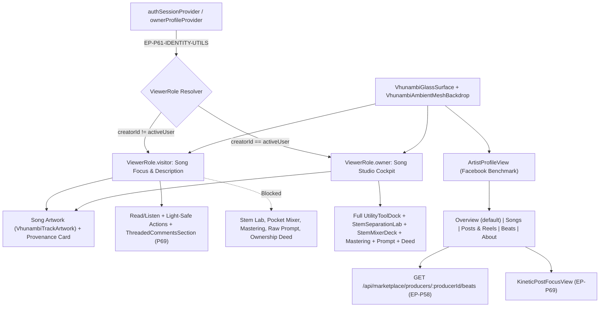

# Phase 70 Forensic Audit: Role-Aware Song Cockpit, Facebook-Benchmark Public Visitor Profile & Morning-Mist / Obsidian Glass Overhaul

- **Audit Date:** 2026-11-19
- **Auditor:** Antigravity Forensic Auditor (`/vhunambi-forensic-auditor`)
- **Mode:** Stage 1 Read-Only Forensic Code & Schema Audit (Zero source/config edits, zero builds/tests executed)
- **Correlated Field Evidence:** Device screen recordings (`video_1.mp4`, `video_2.mp4` `00:02–00:52` & `01:24–01:36` Facebook DW Africa benchmark, `video_3.mp4`) and glassmorphic UI reference (`fe152b56a44357bd9dd1ecf3e27e888e.jpg`)
- **Codebase Brain Wake:** `docs/memory/CORTEX_INDEX.md` (`#L1-L49`) + `query_connectome.mjs` (`23` endpoints resolved in `1.92 ms`: `8 OPEN`, `15 CONNECTED_EXTENSIBLE`)

---

## 1. Executive Summary, Connectome Wake Findings & Defect Matrices

### 1.1 Architectural Diagnosis
Device inspection (`video_2.mp4` signed in as `@cern` / `@ndugelo` viewing Afro Sunset / Lerato `@lerato`) reveals two structural product failures across [track_detail_view.dart](file:///c:/Users/Ndugelo/VHUNAMBI/monorepo/apps/vhunambi_client/lib/features/track/presentation/views/track_detail_view.dart#L1-L935) and [artist_profile_view.dart](file:///c:/Users/Ndugelo/VHUNAMBI/monorepo/apps/vhunambi_client/lib/features/profile/presentation/views/artist_profile_view.dart#L1-L802):

1. **Zero Viewer Role Isolation (`ViewerRole.owner` vs `ViewerRole.visitor`):**
   - `TrackDetailView` never checks whether the signed-in creator owns `track.creatorId` / `track.creatorHandle`. Outside listeners see `[ 🛡️ Personal Use ]` + *"This track is 100% royalty-free and owned by you"* ([track_hero_section.dart](file:///c:/Users/Ndugelo/VHUNAMBI/monorepo/apps/vhunambi_client/lib/features/track/presentation/widgets/track_hero_section.dart#L112-L151), [track_detail_models.dart](file:///c:/Users/Ndugelo/VHUNAMBI/monorepo/apps/vhunambi_client/lib/features/track/domain/models/track_detail_models.dart#L126-L176)), and can trigger paid studio tools (`UtilityToolDock` remix/download/reel, `StemSeparationLab`, `TrackLivingBiomePreviewCard`, `StemMixerDeck` including `List in Beatstore` at [stem_mixer_deck.dart](file:///c:/Users/Ndugelo/VHUNAMBI/monorepo/apps/vhunambi_client/lib/features/player/presentation/widgets/stem_mixer_deck.dart#L743), `Master Track (Studio Polisher)`, and raw `PromptAttributionCard`).
   - `ArtistProfileView` leaks internal studio identity widgets (`ArtistVoiceShowcaseCard` `'Sovereign Vocal Identity'` / `'Zero-Shot AI Clone'` and `CreatorDnaProfileCard` `'Open 3D DNA Lab'` button) on a visitor surface ([artist_profile_view.dart](file:///c:/Users/Ndugelo/VHUNAMBI/monorepo/apps/vhunambi_client/lib/features/profile/presentation/views/artist_profile_view.dart#L533-L542)), defaults to an empty `'Clips'` tab telling visitors to *"Publish a reel from the Content Studio!"* ([#L480-L485](file:///c:/Users/Ndugelo/VHUNAMBI/monorepo/apps/vhunambi_client/lib/features/profile/presentation/views/artist_profile_view.dart#L480-L485)), and renders static mocked songs (`'seed-01'`, `'Ndo Mufuna Matibe'`, `'Fifi'` play button at `#L405`).
2. **Light-Mode White-on-White Contrast Failures & Visual System Drift:**
   - Dynamic token `AppColors.surfaceElevated` resolves to `#FFFFFFFF` (`lightSurfaceElevated`) in Light Mode ([app_colors.dart](file:///c:/Users/Ndugelo/VHUNAMBI/monorepo/apps/vhunambi_client/lib/core/theme/app_colors.dart#L58-L81)). Both [track_actions_bar.dart](file:///c:/Users/Ndugelo/VHUNAMBI/monorepo/apps/vhunambi_client/lib/features/track/presentation/widgets/track_actions_bar.dart#L40-L68) and [profile_banner_header.dart](file:///c:/Users/Ndugelo/VHUNAMBI/monorepo/apps/vhunambi_client/lib/features/profile/presentation/widgets/profile_banner_header.dart#L272-L277) pair `AppColors.surfaceElevated` backgrounds with hardcoded `Colors.white` foregrounds — creating invisible ghost buttons in Daylight Mode.
   - Neither `TrackDetailView` nor `ArtistProfileView` consumes Phase 68's `VhunambiTrackArtwork` (`EP-P68-TRACK-ARTWORK`), Phase 69's `ThreadedCommentsSection` (`EP-P69-THREADED-COMMENTS`), or `EP-P58-MKT-VERIFY-PRODUCER` (`GET /api/marketplace/producers/:producerId/beats`), while pushed routes suffer mid-screen `MiniPlayerHost` overlap because `MiniPlayerHost` sits in `MaterialApp.builder` ([main.dart](file:///c:/Users/Ndugelo/VHUNAMBI/monorepo/apps/vhunambi_client/lib/main.dart#L130)) and never suppresses unnamed `MaterialPageRoute` destinations.

### 1.2 Topology & Breakpoint Diagram

```
[MaterialApp.builder @ main.dart#L130]
   ├── Always-on Overlay: MiniPlayerHost (auto-hides ONLY on tab==2, tab==0 inline, or named routes)
   │      └── BUG (SC-07 / VP-06): Unnamed MaterialPageRoute(TrackDetailView / ArtistProfileView) stays visible
   │           and assumes 56dp bottom nav exists -> floats / occludes mid-screen!
   │
   ├── Pushed Route A: TrackDetailView (track_detail_view.dart#L1-L935)
   │      ├── BREAK (SC-01): TrackHeroSection renders ownershipNotice & Commercial Badge unconditionally
   │      ├── BREAK (SC-02): UtilityToolDock + StemSeparationLab + StemMixerDeck('List in Beatstore') + Mastering + Prompt leaked
   │      ├── BREAK (SC-03): Flat AppGradients.forGenre container instead of VhunambiTrackArtwork (EP-P68-TRACK-ARTWORK)
   │      ├── BREAK (SC-04): TrackActionsBar paints Colors.white on AppColors.surfaceElevated (#FFFFFF light) -> Ghost Pill
   │      ├── BREAK (SC-05): TrackDetailEntity lacks description, createdAt, bpm, musicalKey, moodId, coverUrl
   │      └── BREAK (SC-06): Legacy CommentsSection (5 stock Icons.*, flat list) instead of EP-P69-THREADED-COMMENTS
   │
   └── Pushed Route B: ArtistProfileView (artist_profile_view.dart#L1-L802)
          ├── BREAK (VP-01): ProfileBannerHeader 'Following' = Colors.white on #FFFFFF + Blocking LoadingOverlay
          ├── BREAK (VP-02): ArtistVoiceShowcaseCard & CreatorDnaProfileCard('Open 3D DNA Lab') leaked
          ├── BREAK (VP-03): DefaultTabController(0='Clips') empty Studio copy + static 'Fifi'/'seed-01' catalog
          ├── BREAK (VP-04): _beatsCommunityTab ignores OPEN EP-P58-MKT-VERIFY-PRODUCER (marketplace_routes.ts#L202)
          └── BREAK (VP-05): 5 oversized stat boxes (exposes private Day Streak) + wrapping standalone Flag button
```



### 1.3 Song Cockpit Defect Matrix (`SC-01`–`SC-07`)

| ID | Sev | Video Evidence | Exact File & Line Root Cause | Required Phase 70 Remediation |
|---|---|---|---|---|
| **SC-01** | **P0** | `00:02–00:06` `[🛡️ Personal Use]` & *"owned by you"* shown on `@lerato`'s song | [track_hero_section.dart](file:///c:/Users/Ndugelo/VHUNAMBI/monorepo/apps/vhunambi_client/lib/features/track/presentation/widgets/track_hero_section.dart#L112-L151) renders `track.licenseBadge` and `TrackDetailEntity.ownershipNotice` ([track_detail_models.dart](file:///c:/Users/Ndugelo/VHUNAMBI/monorepo/apps/vhunambi_client/lib/features/track/domain/models/track_detail_models.dart#L126-L176)) without any owner check. | Compute `ViewerRole` (`owner` vs `visitor`). Visitors see Provenance & Licensing Info (`Created by @handle • All Rights Reserved` or `Open Stems Allowed`); only `owner` sees personal Ownership Deed. |
| **SC-02** | **P0** | `00:14–00:36` Stem Lab, `.wav` download, Pocket Mixer, Beatstore listing, Mastering, raw Prompt exposed | [track_detail_view.dart](file:///c:/Users/Ndugelo/VHUNAMBI/monorepo/apps/vhunambi_client/lib/features/track/presentation/views/track_detail_view.dart#L458-L685) unconditionally mounts `UtilityToolDock`, `StemSeparationLab`, `TrackLivingBiomePreviewCard`, `track_open_mixer_btn` (`StemMixerDeck` -> `List in Beatstore` at [stem_mixer_deck.dart](file:///c:/Users/Ndugelo/VHUNAMBI/monorepo/apps/vhunambi_client/lib/features/player/presentation/widgets/stem_mixer_deck.dart#L743)), `track_detail_open_mastering_btn`, and `PromptAttributionCard`. | Strict `ViewerRole.owner` gate around Stem Separation, Pocket Mixer, Mastering, `List in Beatstore`, Download Master/Stems, and Raw Prompt card (unless creator explicitly enabled open-stem remixing / public prompt). |
| **SC-03** | **P1** | `00:02` Flat orange square instead of real glassmorphic artwork | [track_hero_section.dart](file:///c:/Users/Ndugelo/VHUNAMBI/monorepo/apps/vhunambi_client/lib/features/track/presentation/widgets/track_hero_section.dart#L29-L80) renders static `AppGradients.forGenre(track.genre)` + centered icon; `TrackDetailEntity` ([track_detail_models.dart](file:///c:/Users/Ndugelo/VHUNAMBI/monorepo/apps/vhunambi_client/lib/features/track/domain/models/track_detail_models.dart#L129-L146)) lacks `coverUrl`; [more_like_this_shelf.dart](file:///c:/Users/Ndugelo/VHUNAMBI/monorepo/apps/vhunambi_client/lib/features/track/presentation/widgets/more_like_this_shelf.dart#L93-L107) also uses raw gradients + `Icons.music_note_rounded`. | Add `coverUrl` to `TrackDetailEntity` (`TrackDetailNotifier._lookupInitialTrack` maps it from `libraryTracksProvider` / `exploreTracksProvider`), replace hero & shelf art with `VhunambiTrackArtwork` (`EP-P68-TRACK-ARTWORK`). |
| **SC-04** | **P0** | `00:04` Empty ghost white pill above `[▷ 3100]` in Light Mode + emojis | [track_actions_bar.dart](file:///c:/Users/Ndugelo/VHUNAMBI/monorepo/apps/vhunambi_client/lib/features/track/presentation/widgets/track_actions_bar.dart#L40-L68) sets `color: AppColors.surfaceElevated` (`#FFFFFF` in light mode via [app_colors.dart](file:///c:/Users/Ndugelo/VHUNAMBI/monorepo/apps/vhunambi_client/lib/core/theme/app_colors.dart#L58-L81)) with hardcoded `Colors.white` icon (`#L56`) & text (`#L64`). Raw emojis persist in `reactionGlyphs` ([track_detail_models.dart](file:///c:/Users/Ndugelo/VHUNAMBI/monorepo/apps/vhunambi_client/lib/features/track/domain/models/track_detail_models.dart#L118-L124)), `'📋'`/`'✨'`/`'🔗'` ([track_detail_view.dart](file:///c:/Users/Ndugelo/VHUNAMBI/monorepo/apps/vhunambi_client/lib/features/track/presentation/views/track_detail_view.dart#L396,#L667,#L810)), `'✨'` ([prompt_attribution_card.dart](file:///c:/Users/Ndugelo/VHUNAMBI/monorepo/apps/vhunambi_client/lib/features/track/presentation/widgets/prompt_attribution_card.dart#L65,#L97)). | Replace hardcoded `Colors.white` with `AppColors.textPrimaryOf(context)` / `VhunambiGlassSurface`; replace all emojis with `PhosphorIcons*` / `AppIcons.*` glyphs. |
| **SC-05** | **P1** | `00:10` Sparse metadata line; `mood` inconsistent across Studio, Explore, Backend | `TrackDetailEntity` ([track_detail_models.dart](file:///c:/Users/Ndugelo/VHUNAMBI/monorepo/apps/vhunambi_client/lib/features/track/domain/models/track_detail_models.dart#L129-L146,#L178)) lacks `description`, `createdAt`, `bpm`, `musicalKey`, `moodId`, `moodLabel`, `allowOpenStemsRemix`. `Mood` is fragmented across `enum Mood` ([design_enums.dart](file:///c:/Users/Ndugelo/VHUNAMBI/monorepo/apps/vhunambi_client/lib/core/design_system/tokens/design_enums.dart#L33-L48)), `StudioFormState` ([studio_form_state.dart](file:///c:/Users/Ndugelo/VHUNAMBI/monorepo/apps/vhunambi_client/lib/features/studio/domain/models/studio_form_state.dart#L169)), [explore_providers.dart](file:///c:/Users/Ndugelo/VHUNAMBI/monorepo/apps/vhunambi_client/lib/features/explore/presentation/providers/explore_providers.dart#L43,#L487-L588), and [edge_persistence_bridge.ts](file:///c:/Users/Ndugelo/VHUNAMBI/monorepo/apps/vhunambi_api/src/db/edge_persistence_bridge.ts#L1220-L1502,#L2196). | Introduce canonical `VhunambiMood` (`moodId` slug + backward-compatible normalizer) and populate structured track metadata pills (`Genre`, `Language`, `Mood`, `BPM • Key`, `Duration`, `Created At`) + `Song Description` card. |
| **SC-06** | **P1** | `00:46` Unthreaded flat comments without `Reply`, `Author` badge, or sort | [track_detail_view.dart](file:///c:/Users/Ndugelo/VHUNAMBI/monorepo/apps/vhunambi_client/lib/features/track/presentation/views/track_detail_view.dart#L688-L701) mounts legacy [comments_section.dart](file:///c:/Users/Ndugelo/VHUNAMBI/monorepo/apps/vhunambi_client/lib/features/track/presentation/widgets/comments_section.dart#L1-L259) (flat list, 5 stock `Icons.*`, no reply nesting, no sorting) rather than Phase 69 `ThreadedCommentsSection`. | Wire `EP-P69-THREADED-COMMENTS` (`ThreadedCommentsSection` + `StudioReactionComposerBar`) directly into `TrackDetailView` with `Author` creator badge & sort toggle. |
| **SC-07** | **P1** | `video_2.mp4` Stock `Icons.*` & MiniPlayer floating on track screen | `features/track/` contains 16 stock `Icons.*` calls across 5 files; unnamed pushed `MaterialPageRoute` for `TrackDetailView` is not suppressed by [mini_player_host.dart](file:///c:/Users/Ndugelo/VHUNAMBI/monorepo/apps/vhunambi_client/lib/features/player/presentation/widgets/mini_player_host.dart#L168-L202). | Replace all 16 `Icons.*` with `AppIcons` / `PhosphorIcons*`; dock or suppress `MiniPlayerHost` on `TrackDetailView` via shared `modalSheetOpenCountProvider` / route-aware policy (`EP-P68-MINIPLAYER-SUPPRESS`). |

### 1.4 Public Visitor Creator Profile Defect Matrix (`VP-01`–`VP-07`)

| ID | Sev | Video / Visual Evidence | Exact File & Line Root Cause | Required Phase 70 Remediation |
|---|---|---|---|---|
| **VP-01** | **P0** | Light-mode invisible `'Following'` pill + screen-locking spinner | [profile_banner_header.dart](file:///c:/Users/Ndugelo/VHUNAMBI/monorepo/apps/vhunambi_client/lib/features/profile/presentation/widgets/profile_banner_header.dart#L272-L277) uses `AppColors.surfaceElevated` (`#FFFFFF` in Light Mode) + `Colors.white` text. [artist_profile_view.dart](file:///c:/Users/Ndugelo/VHUNAMBI/monorepo/apps/vhunambi_client/lib/features/profile/presentation/views/artist_profile_view.dart#L107-L112,#L161-L163) triggers blocking `LoadingOverlay` even though `ProfileOperationNotifier.toggleFollow()` ([profile_operation_notifier.dart](file:///c:/Users/Ndugelo/VHUNAMBI/monorepo/apps/vhunambi_client/lib/features/profile/presentation/providers/profile_operation_notifier.dart#L114-L144)) already updates optimistically. | Use theme-aware frosted/outline contrast (`AppColors.textPrimaryOf(context)` on `surfaceSecondary` / glass border) and instant optimistic toggle without locking the screen behind `LoadingOverlay`. |
| **VP-02** | **P0** | Private AI Voice Clone & `'Open 3D DNA Lab'` exposed on public visitor profile | [artist_profile_view.dart](file:///c:/Users/Ndugelo/VHUNAMBI/monorepo/apps/vhunambi_client/lib/features/profile/presentation/views/artist_profile_view.dart#L533-L542) renders [artist_voice_showcase_card.dart](file:///c:/Users/Ndugelo/VHUNAMBI/monorepo/apps/vhunambi_client/lib/features/profile/presentation/widgets/artist_voice_showcase_card.dart#L62-L86) (`'🎙️'`, `'Sovereign Vocal Identity'`, `'Zero-Shot AI Clone'`) and [creator_dna_profile_card.dart](file:///c:/Users/Ndugelo/VHUNAMBI/monorepo/apps/vhunambi_client/lib/features/creator_dna/presentation/widgets/creator_dna_profile_card.dart#L45,#L120-L125) (`'Open 3D DNA Lab'` ignores `isOwner: false`). | Remove private Voice Clone & `'Open 3D DNA Lab'` studio controls from public visitor view; move public Sonic Heritage / Provenance into the `About` tab. |
| **VP-03** | **P0** | Lands on empty `'Clips'` tab with creator copy + hardcoded mocked songs (`'Fifi'`, `'seed-01'`) | [artist_profile_view.dart](file:///c:/Users/Ndugelo/VHUNAMBI/monorepo/apps/vhunambi_client/lib/features/profile/presentation/views/artist_profile_view.dart#L121-L122,#L480-L485,#L552-L599) defaults `DefaultTabController(length: 3)` to `'Clips'` (`'Publish a reel from the Content Studio!'`), hardcodes `'seed-01'`, `'track_default_1'`, `'Ndo Mufuna Matibe'`, and `creatorName: 'Fifi'` (`#L405`). [profile_repository_impl.dart](file:///c:/Users/Ndugelo/VHUNAMBI/monorepo/apps/vhunambi_client/lib/features/profile/data/repositories/profile_repository_impl.dart#L18-L51) only returns seeded/generic local objects. | Upgrade to 5 Facebook-benchmark visitor tabs (`Overview`, `Songs`, `Posts & Reels`, `Beats`, `About`) defaulting to `Overview`; hydrate creator songs & posts dynamically by `creatorId`. |
| **VP-04** | **P1** | `GET /api/marketplace/producers/:producerId/beats` unused on `Beats` tab | [artist_profile_view.dart](file:///c:/Users/Ndugelo/VHUNAMBI/monorepo/apps/vhunambi_client/lib/features/profile/presentation/views/artist_profile_view.dart#L611) reads local `creatorBeatsFamilyProvider(profile.id)` while `OPEN` `EP-P58-MKT-VERIFY-PRODUCER` ([marketplace_routes.ts](file:///c:/Users/Ndugelo/VHUNAMBI/monorepo/apps/vhunambi_api/src/routes/marketplace_routes.ts#L202-L206)) sits idle on backend. | Consume `GET /api/marketplace/producers/:producerId/beats` inside the Visitor `Beats` tab provider so real producer beat listings load seamlessly. |
| **VP-05** | **P1** | 5 bulky stat cards (with private `Day Streak`) + lone Flag button wrap | [profile_stats_grid.dart](file:///c:/Users/Ndugelo/VHUNAMBI/monorepo/apps/vhunambi_client/lib/features/profile/presentation/widgets/profile_stats_grid.dart#L49-L136) exposes `Day Streak` in 5 elevated boxes; [profile_banner_header.dart](file:///c:/Users/Ndugelo/VHUNAMBI/monorepo/apps/vhunambi_client/lib/features/profile/presentation/widgets/profile_banner_header.dart#L326-L361) places standalone `shareNetwork` and `flag` icon buttons that wrap onto a lone row. | Replace 5 stat cards with compact inline Facebook-style summary row (`Followers • Songs • Plays`); consolidate Share & Report into a `[ ••• ]` overflow action sheet beside `Follow` / `Support`. |
| **VP-06** | **P1** | Floating `MiniPlayerHost` occludes middle of `ArtistProfileView` | [mini_player_controller.dart](file:///c:/Users/Ndugelo/VHUNAMBI/monorepo/apps/vhunambi_client/lib/features/player/presentation/providers/mini_player_controller.dart#L207-L246) assumes a `56dp` bottom dock (`defaultDockBottom = 56.0 + bottomSafeArea + 8.0`) or persisted `PlayerMode.manual` offset across pushed full-screen routes (`route.settings.name == null`). | Apply bottom-dock clearance awareness (check whether pushed route has `RootShell` bottom nav vs `0dp` pushed scaffold) or suppress during full-screen visitor profiles / track detail views. |
| **VP-07** | **P2** | Stock `Icons.*`, raw emoji medals/coins, flat elevated cards instead of glass | `artist_profile_view.dart` has 10 `Icons.*`, `profile_banner_header.dart` has 5 `Icons.*`, [top_supporters_leaderboard.dart](file:///c:/Users/Ndugelo/VHUNAMBI/monorepo/apps/vhunambi_client/lib/features/profile/presentation/widgets/top_supporters_leaderboard.dart#L59,#L118) has `Icons.military_tech_outlined` + raw `'🥇'`/`'🥈'`/`'🥉'`, [profile_models.dart](file:///c:/Users/Ndugelo/VHUNAMBI/monorepo/apps/vhunambi_client/lib/features/profile/domain/models/profile_models.dart#L24-L27,#L73,#L82,#L111) has `'🥇'`/`'🪙'`/`'⚡'`. | Sweep every `Icons.*` and UI emoji to `PhosphorIcons*` / `AppIcons.*`, adopt `VhunambiTrackArtwork`, and wrap cards/headers in `VhunambiGlassSurface`. |

---

## 2. Role-Aware Song Cockpit Architecture & Canonical `VhunambiMood` Registry

### 2.1 Deterministic `ViewerRole` Resolution (`EP-P61-IDENTITY-UTILS`)
Instead of reading a blind mock or assuming the active user owns the opened track, `TrackDetailView` resolves a typed `ViewerRole` using `EP-P61-IDENTITY-UTILS`:

```dart
enum ViewerRole { owner, visitor }
```

Resolution rules against the currently signed-in identity (`authSessionProvider` / `ownerProfileProvider`) normalized via `canonicalizeCreatorId` / `extractRawCreatorId`:
- `ViewerRole.owner` **iff** normalized `track.creatorId == activeCreatorId` OR normalized `@handle == activeHandle` (with explicit `'current_user'` legacy seed alias treated safely only for tracks actually created by the local session user, never `'lerato'`, `'fifi'`, `'makhadzi'`, etc.).
- Otherwise `ViewerRole.visitor`.

### 2.2 Role-Gated Surface Matrix (`TrackDetailView`)

| Component / Section | `ViewerRole.visitor` (Song Focus & Description Domain) | `ViewerRole.owner` (Full Studio Cockpit) |
|---|---|---|
| **Hero Artwork & Backdrop** | `VhunambiAmbientMeshBackdrop` + `VhunambiTrackArtwork` (no flat orange gradient square) | Same + subtle Owner badge (`Created by you`) |
| **Provenance / Licensing Pill** | Clean frosted pill: `Created by @handle • All Rights Reserved` (or `Open Stems Allowed` if enabled) — **NO** `[🛡️ Personal Use]` or *"owned by you"* | Personal License Deed (`Commercial License` / `Personal Use`, owner proof badge) |
| **Playback & Light-Safe Engagement** | `WaveformScrubber`, `TrackActionsBar` (high-contrast Like/Repost/Co-Sign/Share on `VhunambiGlassSurface`), `EmojiReactionDeck` (`PhosphorIcons*`) | Same |
| **Song Description & Metadata Card** | Structured `VhunambiGlassSurface` card: `Song Description` + pills (`Genre`, `Language`, `Mood` via `moodId`, `BPM`, `Musical Key`, `Duration`, `Released` date) | Same + quick Edit Metadata hook |
| **`UtilityToolDock` (Download / Reel / Variation)** | **Hidden** (only `Share`, `Add to Playlist`, and `Remix Stems` *strictly if* `track.allowOpenStemsRemix == true`) | **Full Dock** (`Download Master`, `Export Reel`, `Variation`, `Embed`, `Share`) |
| **`StemSeparationLab` & `TrackLivingBiomePreviewCard`** | **Hidden** (protects creator IP & compute credits) | **Visible** |
| **`StemMixerDeck` (`track_open_mixer_btn` + `List in Beatstore`)** | **Hidden** (`stem_mixer_deck.dart#L743` `'List in Beatstore'` never reachable by visitors) | **Visible** |
| **`Master Track (Studio Polisher)`** | **Hidden** | **Visible** |
| **`PromptAttributionCard` (Raw Prompt + `Remix Prompt ✨`)** | **Hidden** by default (shows abstract Genre/Mood DNA pill unless creator toggled prompt visibility public) | **Visible** |
| **Discussion Thread (`EP-P69-THREADED-COMMENTS`)** | `ThreadedCommentsSection` + `StudioReactionComposerBar` (Reply banner, nested threads, `Author` badge on creator comments, `Most relevant` / `Newest` sort) | Same (owner replies automatically receive the `Author` badge) |
| **Discovery Continuation** | `MoreLikeThisShelf` using `VhunambiTrackArtwork` + `PhosphorIcons*` | Same |

### 2.3 Canonical `VhunambiMood` (`moodId`) Registry & Schema Parity

**Verified 4-Way Fragmentation Today:**
1. [design_enums.dart](file:///c:/Users/Ndugelo/VHUNAMBI/monorepo/apps/vhunambi_client/lib/core/design_system/tokens/design_enums.dart#L33-L48): `enum Mood { joyful, melancholic, energetic, calm, romantic }` (`5` values).
2. [studio_form_state.dart](file:///c:/Users/Ndugelo/VHUNAMBI/monorepo/apps/vhunambi_client/lib/features/studio/domain/models/studio_form_state.dart#L169): free-text `mood = 'Uplifting'`.
3. [explore_providers.dart](file:///c:/Users/Ndugelo/VHUNAMBI/monorepo/apps/vhunambi_client/lib/features/explore/presentation/providers/explore_providers.dart#L43,#L487-L588): `exploreMoodFilterProvider` (`String?`) + seed values `'Uplifting'`, `'Nostalgic'`, `'Energetic'`, `'Dark'`, `'Party'`, `'Peaceful'`, `'Romantic'`.
4. [edge_persistence_bridge.ts](file:///c:/Users/Ndugelo/VHUNAMBI/monorepo/apps/vhunambi_api/src/db/edge_persistence_bridge.ts#L1220-L1502,#L2196): `mood` values `'Deep'`, `'Joyful'`, `'Hypnotic'`, `'Chill'`, `'Energetic'`, `'Party'`, `'Uplifting'`, `'Electrifying'`, `'Soulful'`, `'Nostalgic'`, `'Atmospheric'`, `'Warm'`, and default `'Vibrant'`.

**Canonical Resolution (`EP-P70-MOOD-TAXONOMY`):**
Define a single canonical `VhunambiMood` enum/registry in `core/design_system/tokens/vhunambi_mood.dart` (re-exporting backward-compatible aliases to `enum Mood` during migration) with immutable wire slug `moodId`, display `label`, `PhosphorIconData` icon, and color accent token, plus a lossless `VhunambiMood.normalize(String? raw)` mapper:

| Canonical `moodId` | Display `label` | Absorbed Legacy Strings / Enum Aliases | Semantic Role in Song Cockpit & Explore |
|---|---|---|---|
| `'uplifting'` | `Uplifting` | `'Uplifting'`, `'Vibrant'`, `'Joyful'`, `Mood.joyful` | Warm amber/solar celebration tracks |
| `'soulful'` | `Soulful` | `'Soulful'`, `'Soulful & Nostalgic'`, `'Nostalgic'`, `'Melancholic'`, `Mood.melancholic`, `'Warm'` | Deep vocal/Private School Amapiano |
| `'energetic'` | `Energetic` | `'Energetic'`, `'Electrifying'`, `'Party'`, `Mood.energetic` | High-tempo Gqom / 3-Step / Dance |
| `'chill'` | `Chill` | `'Chill'`, `'Peaceful'`, `'Calm'`, `Mood.calm` | Laid-back late-night / Afro-Lounge |
| `'hypnotic'` | `Hypnotic` | `'Hypnotic'`, `'Deep'`, `'Dark'`, `'Atmospheric'` | Minimal Afro-Tech / subterranean bass |
| `'romantic'` | `Romantic` | `'Romantic'`, `Mood.romantic` | R&B / Afro-Pop ballads |

**Database & API Metadata Gap Observed on Disk:**
- Supabase `public.explore_tracks` ([20261110000001_phase62_hybrid_cloud_schema.sql](file:///c:/Users/Ndugelo/VHUNAMBI/monorepo/supabase/migrations/20261110000001_phase62_hybrid_cloud_schema.sql#L110-L129)) already has `bpm`, `musical_key`, `duration_sec`, `cover_url`, while SQLite `explore_tracks` ([vhunambi_db.ts](file:///c:/Users/Ndugelo/VHUNAMBI/monorepo/apps/vhunambi_api/src/db/vhunambi_db.ts#L239-L254)) has `bpm` and stores `description`, `mood`, `musicalKey`, `coverUrl` inside `data_json` rather than indexed SQL columns.
- `TrackDetailEntity` ([track_detail_models.dart](file:///c:/Users/Ndugelo/VHUNAMBI/monorepo/apps/vhunambi_client/lib/features/track/domain/models/track_detail_models.dart#L129-L171)) lacks `coverUrl`, `description`, `createdAt`, `bpm`, `musicalKey`, `moodId`, and `allowOpenStemsRemix`. All of these can be mapped immediately in `_lookupInitialTrack` ([track_providers.dart](file:///c:/Users/Ndugelo/VHUNAMBI/monorepo/apps/vhunambi_client/lib/features/track/presentation/providers/track_providers.dart)) and persisted across SQLite + Supabase migrations in Pass 2.

---

## 3. Facebook-Benchmark Public Visitor Creator Profile Architecture

Benchmarking against the Facebook DW Africa creator screen (`video_2.mp4` `01:24–01:36`) transforms `ArtistProfileView` from a studio dashboard leak into a clean public creator destination:

### 3.1 Header & Instant Action Hierarchy
1. **Top Navigation (`VhunambiTopBarSurface`):** Back button + Creator Display Name (`@handle` subtitle on scroll collapse) + Quick Search / Share icon.
2. **Cover Banner & Overlapping Avatar (`ProfileBannerHeader`):** Edge-to-edge cover gradient/artwork + overlapping circular `CreatorAvatar` with verified crest (`PhosphorIconsFill.sealCheck`) + `1–2` line bio.
3. **Inline Social Summary Strip (No 5-Card Grid, No `Day Streak`):** Single crisp typographic line:
   `2.4K followers · 18 songs · 41.8K plays` (+ regional/genre tags). Removes [profile_stats_grid.dart](file:///c:/Users/Ndugelo/VHUNAMBI/monorepo/apps/vhunambi_client/lib/features/profile/presentation/widgets/profile_stats_grid.dart#L49-L95)'s private `Day Streak` metric.
4. **High-Contrast Action Bar (Optimistic Instant State, Zero `LoadingOverlay`):**
   - Primary CTA pill: `Follow` (brand fill `AppColors.brandPrimary` + `#000000` `brandContrast` text) <-> `Following` (`AppColors.surfaceSecondaryOf(context)` + `AppColors.borderActive` + `AppColors.textPrimaryOf(context)` text — crisp `#121216` charcoal in Light Mode, `#FFFFFF` in Dark Mode, eliminating `VP-01`).
   - Secondary CTA pill: `Support` / `Tip Creator` (when `tipsEnabled == true`).
   - Overflow CTA `[ ••• ]` pill: Opens a clean bottom sheet containing `Share Profile`, `Copy @handle`, and `Report Creator` — eliminating the lone wrapped flag row (`VP-05`).
   - Remove the full-screen `LoadingOverlay(isLoading: isMutating)` wrapper around `Follow` toggles ([artist_profile_view.dart](file:///c:/Users/Ndugelo/VHUNAMBI/monorepo/apps/vhunambi_client/lib/features/profile/presentation/views/artist_profile_view.dart#L107-L112,#L161-L163)); rely on `ProfileOperationNotifier.toggleFollow()`'s optimistic state (`#L114-L144`) with rollback + SnackBar only on network error.

### 3.2 5-Tab Visitor Navigation (Defaulting to `Overview`, Index `0`)

| Tab | Label | Data Source & Component Mapping | Eliminated Defect |
|---|---|---|---|
| **0 (Default)** | **Overview** | Bio card, Featured / Top Tracks (live creator tracks via `VhunambiTrackArtwork`), Latest Kinetic Post preview (tapping opens `KineticPostFocusView` `EP-P69-KPOST-FOCUS-ROUTE`), Genre & Mood DNA pills. | Fixes landing on empty `'Clips'` tab with owner copy (`VP-03`). |
| **1** | **Songs** | Live tracks belonging to `profile.id` / `profile.username` merged from `exploreTracksProvider`, `libraryTracksProvider`, and backend creator query — each tapping into role-gated `TrackDetailView`. | Removes hardcoded `'seed-01'`, `'Ndo Mufuna Matibe'`, `'Fifi'` (`VP-03`). |
| **2** | **Posts & Reels** | Creator's Kinetic Posts (`socialFeedPostsProvider` filtered by `creatorId`, opening `KineticPostFocusView`) + Published Clips (`GET /api/creators/:id/clips`). | Fixes owner `'Content Studio!'` empty state (`VP-03`). |
| **3** | **Beats** | Consumes `OPEN` `EP-P58-MKT-VERIFY-PRODUCER` (`GET /api/marketplace/producers/:producerId/beats`, [marketplace_routes.ts](file:///c:/Users/Ndugelo/VHUNAMBI/monorepo/apps/vhunambi_api/src/routes/marketplace_routes.ts#L202-L206)) + de-emojified `TopSupportersLeaderboard`. | Connects `OPEN` Beatstore endpoint (`VP-04`). |
| **4** | **About** | Creator heritage, primary genres, region, language tags, verification status, fan tipping info, member provenance. | Replaces leaked `ArtistVoiceShowcaseCard` & `'Open 3D DNA Lab'` (`VP-02`). |

---

## 4. `VhunambiGlassSurface` & `VhunambiAmbientMeshBackdrop` Design Token Specification

Adapted from the glassmorphic reference (`fe152b56a44357bd9dd1ecf3e27e888e.jpg`) cleanly into Vhunambi's verified **Warm African Daylight** and **Obsidian Studio** token architecture ([app_colors.dart](file:///c:/Users/Ndugelo/VHUNAMBI/monorepo/apps/vhunambi_client/lib/core/theme/app_colors.dart#L25-L160), [app_dimensions.dart](file:///c:/Users/Ndugelo/VHUNAMBI/monorepo/apps/vhunambi_client/lib/core/theme/app_dimensions.dart#L5-L23)):

### 4.1 Surface & Backdrop Token Matrix

| Token / Layer | Warm African Daylight ("Morning Mist" Light) | Obsidian Studio ("Obsidian Night" Dark) | Notes |
|---|---|---|---|
| **Canvas Base** | `lightSurfaceCanvas` (`#F7F5F0`) | `darkSurfaceCanvas` (`#0A0A0C`) | Existing canonical canvas base |
| **Ambient Mesh Glows (`VhunambiAmbientMeshBackdrop`)** | Subtle radial blooms (`alpha: 0.14–0.22`) derived from genre/artwork hues over `#F7F5F0` | Deep radial blooms (`alpha: 0.18–0.28`) over `#0A0A0C` | Wrapped in `RepaintBoundary` |
| **Glass Surface Fill (`VhunambiGlassSurface`)** | Linear top-left tint `#FFFFFF` at `0.78` alpha -> `#FAF8F5` at `0.62` alpha | Linear top-left tint `#1B1B22` at `0.74` alpha -> `#141418` at `0.58` alpha | Guarantees `>= 4.5:1` contrast with `textPrimaryOf(context)` |
| **Specular Stroke (`border`)** | `1.0px` `lightBorderSubtle` (`#DFDBD0`) blended with `#FFFFFF` top rim (`0.65` alpha) | `1.0px` `darkBorderSubtle` (`#2D2D38`) blended with `#FFFFFF` top rim (`0.12` alpha) | Gives crisp 2026 frosted edge without muddy gray |
| **Interactive Glass Pill Fill** | `lightSurfaceSecondary` (`#EDEAE2`) at `0.85` alpha + `#121216` text/icon | `darkSurfaceSecondary` (`#1B1B22`) at `0.85` alpha + `#FFFFFF` text/icon | Directly fixes `SC-04` and `VP-01` ghost pills |
| **Default Radius** | `AppRadius.cardBorder` (`16dp`) / `AppRadius.pillBorder` (`9999dp`) | Same | Reuses `AppRadius` constants |

### 4.2 60 FPS Android Impeller/Skia Blur Budget Guardrails
Audit of existing `BackdropFilter` usage across `apps/vhunambi_client/lib` shows blur is already safely bounded to persistent chrome ([vhunambi_top_bar_kit.dart](file:///c:/Users/Ndugelo/VHUNAMBI/monorepo/apps/vhunambi_client/lib/core/widgets/vhunambi_top_bar_kit.dart#L114-L115) `sigma: 16.0`, [vhunambi_bottom_dock_kit.dart](file:///c:/Users/Ndugelo/VHUNAMBI/monorepo/apps/vhunambi_client/lib/core/widgets/vhunambi_bottom_dock_kit.dart#L82-L83,#L120-L121) `sigma: 18.0`, [kinetic_post_sonic_pill.dart](file:///c:/Users/Ndugelo/VHUNAMBI/monorepo/apps/vhunambi_client/lib/features/explore/presentation/widgets/kinetic_post_sonic_pill.dart#L223-L224) `sigma: 14.0`, [track_detail_view.dart](file:///c:/Users/Ndugelo/VHUNAMBI/monorepo/apps/vhunambi_client/lib/features/track/presentation/views/track_detail_view.dart#L765-L766) `_FrostedStemMixerSheet` `sigma: 20.0`).

To prevent GPU offscreen render-target thrashing on mid-range Android devices:
1. **`enableLiveBlur: bool = false` Default on Repeating List/Grid Cards:** Cards inside `ListView` / `CustomScrollView` (`Songs`, `Posts & Reels`, `Beats`, `MoreLikeThisShelf`, `Comments`) render translucent layered gradients + specular borders (`VhunambiGlassSurface(enableLiveBlur: false)`) with **zero** `BackdropFilter` passes.
2. **Hard Viewport Blur Cap (`<= 2` active `BackdropFilter`s, `sigma <= 16.0`):** Reserve live `BackdropFilter(ImageFilter.blur(sigmaX: 14, sigmaY: 14))` strictly for sticky top chrome (`VhunambiTopBarSurface`), pinned composer docks (`StudioReactionComposerBar`), or single above-the-fold hero floating pill containers — each enclosed in `ClipRRect` / `ClipRect` + `RepaintBoundary`.
3. **Scroll-Performance Invariant:** `VhunambiAmbientMeshBackdrop` sits in a static background `Positioned.fill(child: RepaintBoundary(...))` beneath the scrollable foreground so scrolling never re-rasterizes ambient radial shaders.

---

## 5. Connectome Consumption, Icon/Emoji Census & `memory.md` Registration Plan

### 5.1 Connectome Consumption & Export Registry

| Connectome Hub / Endpoint ID | Current Status | Phase 70 Action | Exact Target / File |
|---|---|---|---|
| `EP-P58-MKT-VERIFY-PRODUCER` | `OPEN` | **CONSUME -> `CONNECTED_EXTENSIBLE`** | Wire `GET /api/marketplace/producers/:producerId/beats` ([marketplace_routes.ts](file:///c:/Users/Ndugelo/VHUNAMBI/monorepo/apps/vhunambi_api/src/routes/marketplace_routes.ts#L202-L206)) into Visitor `Beats` tab provider |
| `EP-P68-TRACK-ARTWORK` | `CONNECTED_EXTENSIBLE` | **CONSUME** | Replace flat gradients in `TrackHeroSection`, `MoreLikeThisShelf`, and `ArtistProfileView` song cards with [VhunambiTrackArtwork](file:///c:/Users/Ndugelo/VHUNAMBI/monorepo/apps/vhunambi_client/lib/core/widgets/vhunambi_track_artwork.dart#L14-L34) |
| `EP-P69-THREADED-COMMENTS` | `CONNECTED_EXTENSIBLE` | **CONSUME** | Replace legacy `CommentsSection` in `TrackDetailView` with `ThreadedCommentsSection` + `StudioReactionComposerBar` |
| `EP-P69-KPOST-FOCUS-ROUTE` | `CONNECTED_EXTENSIBLE` | **CONSUME** | Route creator Kinetic Post previews in `ArtistProfileView` (`Overview` / `Posts & Reels`) into `KineticPostFocusView` |
| `EP-P68-MINIPLAYER-SUPPRESS` | `CONNECTED_EXTENSIBLE` | **CONSUME & HARDEN** | Register pushed full-screen route clearance/suppression for `TrackDetailView` & `ArtistProfileView` in `MiniPlayerHost` / `MiniPlayerController` |
| `EP-P61-IDENTITY-UTILS` | `CONNECTED_EXTENSIBLE` | **CONSUME** | Compute `ViewerRole.owner` vs `ViewerRole.visitor` via canonical `creator_id_utils.dart` |
| `EP-P68-MOOD-FRAGMENTED` | `OPEN` / Fragmented | **CONSOLIDATE** | Replace 4 conflicting `Mood` models/strings with `EP-P70-MOOD-TAXONOMY` |
| `EP-P70-GLASS-SURFACE` | *New* | **REGISTER (`CONNECTED_EXTENSIBLE`)** | Export `VhunambiGlassSurface` & `VhunambiAmbientMeshBackdrop` in `core/widgets/` for app-wide reuse |
| `EP-P70-MOOD-TAXONOMY` | *New* | **REGISTER (`CONNECTED_EXTENSIBLE`)** | Export canonical `VhunambiMood` (`moodId` slug + `normalize()`) across Studio, Track, Explore, and API |
| `EP-P70-VIEWER-ROLE` | *New* | **REGISTER (`CONNECTED_EXTENSIBLE`)** | Export `ViewerRole` (`owner` / `visitor`) provenance & privacy gating policy for Track & Creator screens |

### 5.2 Exhaustive Stock Material `Icons.*` & Raw Emoji Census (Zero-Tolerance Cleanup Targets)

**`features/track/` — 16 Stock `Icons.*` + Raw Emojis:**
- [track_detail_view.dart](file:///c:/Users/Ndugelo/VHUNAMBI/monorepo/apps/vhunambi_client/lib/features/track/presentation/views/track_detail_view.dart#L281,#L304,#L343,#L663,#L798,#L835): 6 `Icons.*` (`chevron_left_rounded`, `graphic_eq_rounded`, `person_outline_rounded`, `auto_awesome_rounded`, `close_rounded`, `copy_rounded`) + raw emojis `'📋'` (`#L396`), `'✨'` (`#L667`), `'🔗'` (`#L810`)
- [comments_section.dart](file:///c:/Users/Ndugelo/VHUNAMBI/monorepo/apps/vhunambi_client/lib/features/track/presentation/widgets/comments_section.dart#L59,#L104,#L124,#L240,#L241): 5 `Icons.*` (entire widget replaced by `EP-P69-THREADED-COMMENTS`)
- [more_like_this_shelf.dart](file:///c:/Users/Ndugelo/VHUNAMBI/monorepo/apps/vhunambi_client/lib/features/track/presentation/widgets/more_like_this_shelf.dart#L102,#L140,#L163): 3 `Icons.*` (`music_note_rounded`, `play_arrow_rounded`, `chevron_right_rounded`)
- [prompt_attribution_card.dart](file:///c:/Users/Ndugelo/VHUNAMBI/monorepo/apps/vhunambi_client/lib/features/track/presentation/widgets/prompt_attribution_card.dart#L35,#L65,#L92,#L97): `Icons.auto_awesome_rounded`, `Icons.auto_fix_high_rounded`, `'✨'`
- [waveform_scrubber.dart](file:///c:/Users/Ndugelo/VHUNAMBI/monorepo/apps/vhunambi_client/lib/features/track/presentation/widgets/waveform_scrubber.dart#L50-L51): `Icons.pause_circle_filled_rounded`, `Icons.play_circle_fill_rounded`
- [track_detail_models.dart](file:///c:/Users/Ndugelo/VHUNAMBI/monorepo/apps/vhunambi_client/lib/features/track/domain/models/track_detail_models.dart#L118-L124,#L176): `reactionGlyphs` emojis (`🔥`, `🙌🏾`, `🎹`, `🪩`) & `'⚖️ Commercial Use'` / `'🛡️ Personal Use'`

**`features/profile/` — 16+ Stock `Icons.*` + Raw Emojis:**
- [artist_profile_view.dart](file:///c:/Users/Ndugelo/VHUNAMBI/monorepo/apps/vhunambi_client/lib/features/profile/presentation/views/artist_profile_view.dart#L133,#L331,#L362,#L375,#L395,#L440,#L482,#L628,#L662,#L773): 10 `Icons.*` + `'🔗'` (`#L155,#L203`)
- [profile_banner_header.dart](file:///c:/Users/Ndugelo/VHUNAMBI/monorepo/apps/vhunambi_client/lib/features/profile/presentation/widgets/profile_banner_header.dart#L58,#L63,#L68,#L150,#L318): 5 `Icons.*` (`piano_rounded`, `album_rounded`, `graphic_eq_rounded`, `verified_rounded`, `monetization_on_rounded`)
- [top_supporters_leaderboard.dart](file:///c:/Users/Ndugelo/VHUNAMBI/monorepo/apps/vhunambi_client/lib/features/profile/presentation/widgets/top_supporters_leaderboard.dart#L59,#L118): `Icons.military_tech_outlined` + `_getMedal` emojis
- [profile_models.dart](file:///c:/Users/Ndugelo/VHUNAMBI/monorepo/apps/vhunambi_client/lib/features/profile/domain/models/profile_models.dart#L24-L27,#L73,#L82,#L111): `'🥇'`, `'🥈'`, `'🥉'`, `'🪙'`, `'⚡'`

*(Note: `features/track` & `features/profile` share a zero-tolerance mandate with Phase 69: convert 100% of user-visible `Icons.*` and UI emojis above into `PhosphorIcons*` / `AppIcons.*`.)*

---

## 6. Two-Pass Overhaul Roadmap (`M70.1`–`M70.4`)

Clean compile-boundary split allowing physical Android verification after Pass 1 before backend/profile integration finishes in Pass 2:

### Overhaul Pass 1 — Design Foundation & Role-Aware Song Cockpit (`M70.1`–`M70.2`)
1. **`M70.1` Design Tokens, `ViewerRole`, `VhunambiMood`, & `MiniPlayerHost` Route Policy:**
   - Implement `VhunambiGlassSurface` (`enableLiveBlur: false` default, `sigma <= 16.0` opt-in for chrome) + `VhunambiAmbientMeshBackdrop` (`RepaintBoundary` protected) supporting both Warm African Daylight and Obsidian Studio palettes.
   - Implement `VhunambiMood` (`moodId`, `label`, `icon`, `normalize()`) unifying `design_enums.dart`, `StudioFormState`, and `exploreMoodFilterProvider`.
   - Implement `ViewerRole` (`owner` vs `visitor`) using `EP-P61-IDENTITY-UTILS`.
   - Fix `MiniPlayerHost` / `MiniPlayerController` route awareness so unnamed pushed `TrackDetailView` & `ArtistProfileView` routes never suffer false `56dp` bottom-nav assumptions or mid-screen occlusion.
2. **`M70.2` Role-Aware `TrackDetailView` Overhaul:**
   - Extend `TrackDetailEntity` (`coverUrl`, `description`, `createdAt`, `bpm`, `musicalKey`, `moodId`, `allowOpenStemsRemix`, `isTrackOwner`) and map real metadata in `TrackDetailNotifier._lookupInitialTrack`.
   - Gate `UtilityToolDock`, `StemSeparationLab`, `TrackLivingBiomePreviewCard`, `StemMixerDeck` (`List in Beatstore`), `Master Track`, `PromptAttributionCard`, and Ownership Deed behind `ViewerRole.owner` (visitors see Song Focus & Description View + Provenance Info).
   - Replace hero & `MoreLikeThisShelf` flat boxes with `VhunambiTrackArtwork`; fix Light-Mode white-on-white Like ghost pill in `TrackActionsBar`; swap legacy `CommentsSection` for `EP-P69-THREADED-COMMENTS` (`ThreadedCommentsSection` + `StudioReactionComposerBar`); replace all 16 `Icons.*` and raw emojis in `features/track/`.

### Overhaul Pass 2 — Facebook-Benchmark Visitor Profile & Backend Wiring (`M70.3`–`M70.4`)
3. **`M70.3` Facebook-Benchmark `ArtistProfileView` & Privacy Hardening:**
   - Upgrade `ArtistProfileView` to 5 tabs (`Overview`, `Songs`, `Posts & Reels`, `Beats`, `About`) defaulting to `Overview`.
   - Remove `ArtistVoiceShowcaseCard` & `CreatorDnaProfileCard('Open 3D DNA Lab')` from public visitor surfaces; replace `ProfileStatsGrid` (`Day Streak`) with clean inline metrics (`Followers • Songs • Plays`).
   - Fix `ProfileBannerHeader` Light-Mode `'Following'` white-on-white contrast, remove blocking `LoadingOverlay` on optimistic `toggleFollow()`, and consolidate Share/Report into `[ ••• ]` overflow bottom sheet.
   - Hydrate `Overview`, `Songs`, and `Posts & Reels` from real creator tracks & Kinetic Posts (`EP-P69-KPOST-FOCUS-ROUTE`), replacing `'seed-01'`, `'Ndo Mufuna Matibe'`, and `'Fifi'`. Sweep all 16+ `Icons.*` and medal/coin emojis to `PhosphorIcons*`.
4. **`M70.4` Backend Producer Beats (`EP-P58`), Schema Parity & Verification:**
   - Wire `EP-P58-MKT-VERIFY-PRODUCER` (`GET /api/marketplace/producers/:producerId/beats`) into the Visitor `Beats` tab provider.
   - Align `explore_tracks` / `user_library_sync` / `TrackDetailEntity` wire contracts for canonical `moodId`, `bpm`, `musicalKey`, `description`, and `coverUrl` across `vhunambi_api` (`explore_routes.ts`, `vhunambi_db.ts`, `edge_persistence_bridge.ts`) and Supabase migrations.
   - Run full `flutter analyze`, unit/widget/API verification suites, update `phase_70/memory.md` (`"status": "completed"`), and run `consolidate_memory.mjs` (`SLEEP`).
