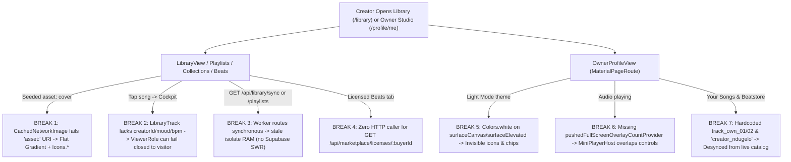

# Phase 72 — Asset Vault (`LibraryView`), Owner Studio Profile (`OwnerProfileView`) Glass Overhaul, `ViewerRole.owner` Parity & Library/Playlist Cloud SWR — Forensic Audit

**Document ID:** `AUDIT-P72-VAULT-OWNER-SWR-001`  
**Date:** 2026-11-20  
**Branch / Commit:** `fix/studio-cockpit-bugs-vh001-vh006` (`5a38431`)  
**Audit Scope:** Read-only static & cross-stack wire forensic audit across `apps/vhunambi_client/lib/features/{library,playlists,collections,beats,offline,profile}/`, `apps/vhunambi_client/lib/features/track/presentation/providers/track_providers.dart`, `apps/vhunambi_client/lib/core/widgets/vhunambi_top_bar_kit.dart`, and `apps/vhunambi_api/src/{routes,db,modules}/`.  
**Related Specs & Memory:**
- [`docs/memory/CORTEX_INDEX.md`](file:///c:/Users/Ndugelo/VHUNAMBI/monorepo/docs/memory/CORTEX_INDEX.md)
- [`docs/phases/phase_68_home_dashboard_main_room_overhaul/memory.md`](file:///c:/Users/Ndugelo/VHUNAMBI/monorepo/docs/phases/phase_68_home_dashboard_main_room_overhaul/memory.md)
- [`docs/phases/phase_70_song_cockpit_and_visitor_profile_glass_overhaul/memory.md`](file:///c:/Users/Ndugelo/VHUNAMBI/monorepo/docs/phases/phase_70_song_cockpit_and_visitor_profile_glass_overhaul/memory.md)
- [`docs/phases/phase_71_cloud_persistence_and_open_connectome_closure/memory.md`](file:///c:/Users/Ndugelo/VHUNAMBI/monorepo/docs/phases/phase_71_cloud_persistence_and_open_connectome_closure/memory.md)

---

## 1. Executive Summary & Headline Verdict

**Verdict: PARTIAL / VISUALLY & ARCHITECTURALLY FRAGMENTED — Ready for Two-Pass Overhaul (`M72.1`–`M72.4`).**

Phases 68–71 modernized **Home**, **Explore / Kinetic Posts**, **Track Detail Cockpit**, **Public Visitor Profile (`ArtistProfileView`)**, **Notifications**, and **Edge SWR Read-Through** for notifications/wallet/explore/generations. However, the final two primary creator surfaces — **Asset Vault (`LibraryView`)** and **Owner Studio Profile (`OwnerProfileView`)** — remain on pre-Phase-68 visuals and synchronous isolate-RAM backend routes:

1. **Asset Vault (`LibraryView` + Embedded Vault Sub-Views) Gaps:**
   - **Broken Seeded Artwork & Flat Gradient Boxes (`AV-01`):** [`LibraryCoverArt`](file:///c:/Users/Ndugelo/VHUNAMBI/monorepo/apps/vhunambi_client/lib/features/library/presentation/widgets/library_cover_art.dart#L28-L53) and [`PlaylistCoverArt`](file:///c:/Users/Ndugelo/VHUNAMBI/monorepo/apps/vhunambi_client/lib/features/playlists/presentation/widgets/playlist_cover_art.dart#L64-L79) feed `asset:assets/...` URIs directly into `CachedNetworkImage`, causing every seeded library track ([`library_providers.dart#L517-L555`](file:///c:/Users/Ndugelo/VHUNAMBI/monorepo/apps/vhunambi_client/lib/features/library/presentation/providers/library_providers.dart#L517-L555)) to fail HTTP load and fall back to flat `AppGradients.forGenre(...)` squares with stock Material `Icons.*` rather than [`VhunambiTrackArtwork`](file:///c:/Users/Ndugelo/VHUNAMBI/monorepo/apps/vhunambi_client/lib/core/widgets/vhunambi_track_artwork.dart#L14-L70) (`EP-P68-TRACK-ARTWORK`).
   - **`ViewerRole.owner` Fragility on Vaulted Tracks (`AV-02`):** [`LibraryTrack`](file:///c:/Users/Ndugelo/VHUNAMBI/monorepo/apps/vhunambi_client/lib/features/library/domain/models/library_models.dart#L52-L125) lacks `creatorId`, `creatorHandle`, `mood`, `moodId`, `bpm`, `description`, and `allowOpenStemsRemix`. Opening a vaulted song in `TrackDetailView` forces [`track_providers.dart#L285-L310`](file:///c:/Users/Ndugelo/VHUNAMBI/monorepo/apps/vhunambi_client/lib/features/track/presentation/providers/track_providers.dart#L285-L310) to synthesize `creatorId` from `lt.creatorName`, which fails closed to `ViewerRole.visitor` whenever display name differs from `currentCreatorIdProvider`.
   - **Orphaned Cloud Sync, Dead Quota Constant & Dead-End Sheet Action (`AV-03`, `AV-04`):** `LibraryTracksNotifier.syncWithCloud()` has **zero callers** inside `features/library/`. [`LibraryAppBar#L24`](file:///c:/Users/Ndugelo/VHUNAMBI/monorepo/apps/vhunambi_client/lib/features/library/presentation/widgets/library_app_bar.dart#L24) keeps unused `creditBalanceLabel = '10 songs left'` while showing Coins rather than live `creatorAllowanceProvider`. [`TrackActionsSheet#L97-L102`](file:///c:/Users/Ndugelo/VHUNAMBI/monorepo/apps/vhunambi_client/lib/features/library/presentation/widgets/track_actions_sheet.dart#L97-L102) has a pure `SnackBar` dead-end on **Stem Separation**.

2. **Owner Studio Profile (`OwnerProfileView` + Studio Sub-Cards) Gaps:**
   - **Light-Mode White-on-White Contrast Traps (`OP-01`):** [`owner_profile_view.dart#L120-L124`](file:///c:/Users/Ndugelo/VHUNAMBI/monorepo/apps/vhunambi_client/lib/features/profile/presentation/views/owner_profile_view.dart#L120-L124) (`ChoiceChip` `Colors.white` on `AppColors.surfaceElevated`), [`#L233, #L253`](file:///c:/Users/Ndugelo/VHUNAMBI/monorepo/apps/vhunambi_client/lib/features/profile/presentation/views/owner_profile_view.dart#L233-L253) (`VhunambiBackButton(color: Colors.white)`), [`#L281`](file:///c:/Users/Ndugelo/VHUNAMBI/monorepo/apps/vhunambi_client/lib/features/profile/presentation/views/owner_profile_view.dart#L281) (white settings icon), and [`#L943`](file:///c:/Users/Ndugelo/VHUNAMBI/monorepo/apps/vhunambi_client/lib/features/profile/presentation/widgets/../views/owner_profile_view.dart#L943) (`Colors.white70`) vanish in Light Mode.
   - **`MiniPlayerHost` Occlusion & Hardcoded Owner Catalog (`OP-02`, `OP-03`, `OP-04`, `OP-05`):** Unlike `ArtistProfileView`, `OwnerProfileView` does **not** increment `pushedFullScreenOverlayCountProvider`, allowing `MiniPlayerHost` to float over its pushed route. `"Your Songs"` (`#L573-L591`) renders two hardcoded tracks (`track_own_01` `'ZaYN'`, `track_own_02` `'Ndo Mufuna Matibe'`) with hardcoded `creatorName: 'cern'` (`#L1094`), ephemeral local `_trackVisibility` state, and zero `TrackDetailView` (`ViewerRole.owner`) or `KineticPostFocusView` navigation. [`PinnedSpotlightCard#L158`](file:///c:/Users/Ndugelo/VHUNAMBI/monorepo/apps/vhunambi_client/lib/features/profile/presentation/widgets/pinned_spotlight_card.dart#L158) fails on `asset:` covers (`Image.network`), and [`OwnerBeatstoreCockpit#L54`](file:///c:/Users/Ndugelo/VHUNAMBI/monorepo/apps/vhunambi_client/lib/features/profile/presentation/widgets/owner_beatstore_cockpit.dart#L54) hardcodes `'creator_ndugelo'`.

3. **Backend SWR Durability & Open Connectome Opportunities (`SWR-01`–`SWR-04`):**
   - [`library_routes.ts`](file:///c:/Users/Ndugelo/VHUNAMBI/monorepo/apps/vhunambi_api/src/routes/library_routes.ts#L14-L97), [`playlist_routes.ts`](file:///c:/Users/Ndugelo/VHUNAMBI/monorepo/apps/vhunambi_api/src/routes/playlist_routes.ts#L14-L195), and [`marketplace_routes.ts#L32-L206`](file:///c:/Users/Ndugelo/VHUNAMBI/monorepo/apps/vhunambi_api/src/routes/marketplace_routes.ts#L32-L206) execute synchronously against Worker isolate RAM with **zero** domain-scoped `sync*FromCloud` SWR calls.
   - `GET /api/marketplace/licenses/:buyerId` has **zero Dart client callers** across `lib/features/`, leaving `BeatsVaultView`'s `Licensed Beats` tab disconnected from cloud purchases across devices.

### Executive Root-Cause & Severity Matrix

| ID | Domain | Sev | Symptom | Primary Root Cause & Exact File/Line Evidence |
| :--- | :--- | :---: | :--- | :--- |
| **`OP-01`** | Owner Profile | **P0/P1** | Invisible back button, settings icon & release chips in Light Mode | Hardcoded `Colors.white` foregrounds on `surfaceCanvas` (`#F8FAFC`) / `surfaceElevated` (`#FFFFFF`) in [`owner_profile_view.dart#L120-L125`](file:///c:/Users/Ndugelo/VHUNAMBI/monorepo/apps/vhunambi_client/lib/features/profile/presentation/views/owner_profile_view.dart#L120-L125), [`#L233`](file:///c:/Users/Ndugelo/VHUNAMBI/monorepo/apps/vhunambi_client/lib/features/profile/presentation/views/owner_profile_view.dart#L233), [`#L253`](file:///c:/Users/Ndugelo/VHUNAMBI/monorepo/apps/vhunambi_client/lib/features/profile/presentation/views/owner_profile_view.dart#L253), [`#L281`](file:///c:/Users/Ndugelo/VHUNAMBI/monorepo/apps/vhunambi_client/lib/features/profile/presentation/views/owner_profile_view.dart#L281), [`#L943`](file:///c:/Users/Ndugelo/VHUNAMBI/monorepo/apps/vhunambi_client/lib/features/profile/presentation/views/owner_profile_view.dart#L943). |
| **`AV-01`** | Asset Vault | **P1** | Seeded songs & playlists fail cover image load (`asset:` treated as HTTPS) | [`library_cover_art.dart#L34-L42`](file:///c:/Users/Ndugelo/VHUNAMBI/monorepo/apps/vhunambi_client/lib/features/library/presentation/widgets/library_cover_art.dart#L34-L42) & [`playlist_cover_art.dart#L64-L79`](file:///c:/Users/Ndugelo/VHUNAMBI/monorepo/apps/vhunambi_client/lib/features/playlists/presentation/widgets/playlist_cover_art.dart#L64-L79) pass `asset:...` to `CachedNetworkImage`; `beats_vault_view.dart#L1086`, `vault_storage_modal.dart#L438`, `collection_artwork_placeholder.dart#L34` paint flat gradients/icons instead of `VhunambiTrackArtwork`. |
| **`AV-02`** | Asset Vault | **P1** | Vaulted tracks drop mood/BPM and risk `ViewerRole.visitor` lockout | [`LibraryTrack`](file:///c:/Users/Ndugelo/VHUNAMBI/monorepo/apps/vhunambi_client/lib/features/library/domain/models/library_models.dart#L52-L125) omits `creatorId`, `creatorHandle`, `mood`, `moodId`, `bpm`, `description`, `allowOpenStemsRemix`; [`track_providers.dart#L285-L310`](file:///c:/Users/Ndugelo/VHUNAMBI/monorepo/apps/vhunambi_client/lib/features/track/presentation/providers/track_providers.dart#L285-L310) guesses `creatorId` from `creatorName`. |
| **`OP-02`** | Owner Profile | **P1** | Floating `MiniPlayerHost` overlaps pushed `OwnerProfileView` | [`owner_profile_view.dart#L47-L54`](file:///c:/Users/Ndugelo/VHUNAMBI/monorepo/apps/vhunambi_client/lib/features/profile/presentation/views/owner_profile_view.dart#L47-L54) omits `pushedFullScreenOverlayCountProvider` ref-counting (unlike [`artist_profile_view.dart#L59-L80`](file:///c:/Users/Ndugelo/VHUNAMBI/monorepo/apps/vhunambi_client/lib/features/profile/presentation/views/artist_profile_view.dart#L59-L80)). |
| **`OP-03`** | Owner Profile | **P1** | `"Your Songs"` is hardcoded; visibility switch isn't saved; no Cockpit/Post routing | [`owner_profile_view.dart#L573-L591`](file:///c:/Users/Ndugelo/VHUNAMBI/monorepo/apps/vhunambi_client/lib/features/profile/presentation/views/owner_profile_view.dart#L573-L591) hardcodes `track_own_01`/`track_own_02` + `creatorName: 'cern'` (`#L1094`); `_trackVisibility` (`#L58`, `#L1047`) never persists; `_OwnerReelsShelf#L1113` hardcodes `'creator_me'`; zero `TrackDetailView`/`KineticPostFocusView` routing. |
| **`OP-04`** | Owner Profile | **P1** | `PinnedSpotlightCard` fails `asset:` artwork & falls back to dead `r2.vhunambi.com` | [`pinned_spotlight_card.dart#L158-L176`](file:///c:/Users/Ndugelo/VHUNAMBI/monorepo/apps/vhunambi_client/lib/features/profile/presentation/widgets/pinned_spotlight_card.dart#L158-L176) uses `Image.network` instead of `VhunambiTrackArtwork`; [`#L219`](file:///c:/Users/Ndugelo/VHUNAMBI/monorepo/apps/vhunambi_client/lib/features/profile/presentation/widgets/pinned_spotlight_card.dart#L219) falls back to `r2.vhunambi.com`. |
| **`OP-05`** | Owner Profile | **P1** | Beatstore tab hides owner's beats for non-`creator_ndugelo` accounts | [`owner_beatstore_cockpit.dart#L53-L55`](file:///c:/Users/Ndugelo/VHUNAMBI/monorepo/apps/vhunambi_client/lib/features/profile/presentation/widgets/owner_beatstore_cockpit.dart#L53-L55) hardcodes `'creator_ndugelo'` instead of `currentCreatorIdProvider`. |
| **`SWR-01..03`** | Backend API | **P1** | Warm Worker isolates return stale library, playlists & buyer licenses | [`library_routes.ts`](file:///c:/Users/Ndugelo/VHUNAMBI/monorepo/apps/vhunambi_api/src/routes/library_routes.ts#L14-L97), [`playlist_routes.ts`](file:///c:/Users/Ndugelo/VHUNAMBI/monorepo/apps/vhunambi_api/src/routes/playlist_routes.ts#L14-L195), and [`marketplace_routes.ts#L189-L206`](file:///c:/Users/Ndugelo/VHUNAMBI/monorepo/apps/vhunambi_api/src/routes/marketplace_routes.ts#L189-L206) lack `sync*FromCloud` SWR calls; zero client callers to `/api/marketplace/licenses/:buyerId`. |
| **`AV-03` / `AV-04`** | Asset Vault | **P1** | Stem Split SnackBar dead-end; cloud sync never triggered from Vault | [`track_actions_sheet.dart#L97-L102`](file:///c:/Users/Ndugelo/VHUNAMBI/monorepo/apps/vhunambi_client/lib/features/library/presentation/widgets/track_actions_sheet.dart#L97-L102) dead-end; `LibraryTracksNotifier.syncWithCloud()` uncalled in UI; [`library_app_bar.dart#L24`](file:///c:/Users/Ndugelo/VHUNAMBI/monorepo/apps/vhunambi_client/lib/features/library/presentation/widgets/library_app_bar.dart#L24) dead constant. |
| **`OP-06`** | Owner Profile | **P2** | `CreatorWalletDeck` omits live 10/10 song allowance (`EP-P68-CREATOR-ALLOWANCE`) | [`creator_wallet_deck.dart#L46-L126`](file:///c:/Users/Ndugelo/VHUNAMBI/monorepo/apps/vhunambi_client/lib/features/profile/presentation/widgets/creator_wallet_deck.dart#L46-L126) omits `creatorAllowanceProvider`; uses `Icons.account_balance_wallet_rounded` + raw emojis. |
| **`AV-05..07` / `OP-07`** | Cross-UI | **P2** | No Glass backdrop/cards, sub-44dp targets, hardcoded dock padding & `STD-UIUX-001` violations | Missing `VhunambiAmbientMeshBackdrop` / `VhunambiGlassSurface`; `Offstage` Cached Only on mobile (`library_view.dart#L326`); `32-34dp` buttons; 100+ stock `Icons.*`, raw emojis & static `AppColors.*` across `library/` & `profile/`. |

### End-to-End Breakpoint Topology Map



---

## 2. Step 0 Connectome Wake Findings (`vhunambi-memory`)

Running `query_connectome.mjs --open` and `--hubs media_artwork,ui_surface_std,identity_role,mood_taxonomy,quota_economy,sync_outbox,audio_transport` surfaced **8 existing `CONNECTED_EXTENSIBLE` primitives** plus **1 directly relevant `OPEN` endpoint** that Phase 72 must consume or extend rather than re-inventing:

| Connectome Endpoint ID | State | Anchor | Phase 72 Consumption / Extension Mandate |
| :--- | :---: | :--- | :--- |
| **`EP-P70-GLASS-SURFACE`** | `CONNECTED_EXTENSIBLE` | [`vhunambi_glass_surface.dart`](file:///c:/Users/Ndugelo/VHUNAMBI/monorepo/apps/vhunambi_client/lib/core/widgets/vhunambi_glass_surface.dart#L26-L70) | Adopt `VhunambiAmbientMeshBackdrop` + `VhunambiGlassSurface` across `LibraryView`, `OwnerProfileView`, and embedded vault cards with `enableLiveBlur: false` on repeating list/grid tiles (60 FPS Android invariant). |
| **`EP-P68-TRACK-ARTWORK`** | `CONNECTED_EXTENSIBLE` | [`vhunambi_track_artwork.dart`](file:///c:/Users/Ndugelo/VHUNAMBI/monorepo/apps/vhunambi_client/lib/core/widgets/vhunambi_track_artwork.dart#L14-L70) | Replace `LibraryCoverArt`, `PlaylistCoverArt`, `PinnedSpotlightCard` `Image.network`, `OwnerProfileView` track squares, `OwnerBeatstoreCockpit` thumbnails, `ReleasesManagerCard` squares, `BeatsVaultView` grid cover, and `VaultStorageModal` rows. |
| **`EP-P70-MOOD-TAXONOMY`** | `CONNECTED_EXTENSIBLE` | [`vhunambi_mood.dart`](file:///c:/Users/Ndugelo/VHUNAMBI/monorepo/apps/vhunambi_client/lib/core/design_system/tokens/vhunambi_mood.dart#L8-L84) | Add canonical `mood` / `moodId` onto `LibraryTrack` and vault sync JSON so studio/cockpit mood pills preserve identity between Studio -> Library -> TrackDetailView. |
| **`EP-P70-VIEWER-ROLE`** | `CONNECTED_EXTENSIBLE` | [`viewer_role.dart`](file:///c:/Users/Ndugelo/VHUNAMBI/monorepo/apps/vhunambi_client/lib/core/auth/viewer_role.dart#L27-L88) | Persist `creatorId` + `creatorHandle` on `LibraryTrack` and wire `OwnerProfileView` & `TrackActionsSheet` songs directly into `TrackDetailView` resolving cleanly to `ViewerRole.owner`. |
| **`EP-P68-CREATOR-ALLOWANCE`** | `CONNECTED_EXTENSIBLE` | [`creator_allowance_provider.dart`](file:///c:/Users/Ndugelo/VHUNAMBI/monorepo/apps/vhunambi_client/lib/features/home/presentation/providers/creator_allowance_provider.dart) | Replace dead `'10 songs left'` constant in `LibraryAppBar` with compact live allowance indicator or modal link and render live `10/10 Free Monthly Songs` card inside `CreatorWalletDeck` on `OwnerProfileView`. |
| **`EP-P69-KPOST-FOCUS-ROUTE`** | `CONNECTED_EXTENSIBLE` | [`kinetic_post_focus_view.dart`](file:///c:/Users/Ndugelo/VHUNAMBI/monorepo/apps/vhunambi_client/lib/features/explore/presentation/views/kinetic_post_focus_view.dart) | Surface owner Kinetic Posts / clips inside `OwnerProfileView` (`Your Songs` / `Reels & Posts`) with push navigation into `KineticPostFocusView`. |
| **`EP-P68-MINIPLAYER-SUPPRESS`** | `CONNECTED_EXTENSIBLE` | [`navigation_providers.dart`](file:///c:/Users/Ndugelo/VHUNAMBI/monorepo/apps/vhunambi_client/lib/core/navigation/navigation_providers.dart#L28-L31) | Wire `pushedFullScreenOverlayCountProvider` ref-counted increment/decrement in `OwnerProfileView` matching `ArtistProfileView` (`#L59-L80`), and replace hardcoded `110`/`16` scroll insets in `PlaylistsVaultView`, `CollectionsVaultView`, `BeatsVaultView` with `VhunambiBottomDockMetrics.scrollInset`. |
| **`EP-P71-EDGE-SWR-READTHROUGH`** | `CONNECTED_EXTENSIBLE` | [`edge_persistence_bridge.ts`](file:///c:/Users/Ndugelo/VHUNAMBI/monorepo/apps/vhunambi_api/src/db/edge_persistence_bridge.ts#L1255-L1450) | Add `syncUserLibraryFromCloud`, `syncPlaylistsFromCloud`, `syncBuyerLicensesFromCloud`, and `syncMarketplaceFromCloud` and await them in `library_routes.ts`, `playlist_routes.ts`, and `marketplace_routes.ts`. |
| **`EP-P41-WALLET-DIRECT`** | **`OPEN`** | [`wallet_routes.ts#L44-L86`](file:///c:/Users/Ndugelo/VHUNAMBI/monorepo/apps/vhunambi_api/src/routes/wallet_routes.ts#L44-L86) | Already SWR-backed in Phase 71 (`syncCreatorWalletFromCloud`); reconcile or declare status in Phase 72 `memory.md` alongside `GET /api/marketplace/licenses/:buyerId`. |

---

## 3. Pillar 1 Audit: Asset Vault (`LibraryView` + Embedded Vault Sub-Views)

### Architectural Comparison

```
┌─────────────────────────────────────────┬──────────────────────────────────────────────────────┐
│ CURRENT ASSET VAULT (Pre-P68 Visuals)   │ TARGET PHASE 72 GLASS ASSET VAULT                    │
├─────────────────────────────────────────┼──────────────────────────────────────────────────────┤
│ • Plain Scaffold(surfaceCanvas)         │ • VhunambiAmbientMeshBackdrop + VhunambiGlassSurface │
│ • LibraryCoverArt -> CachedNetworkImage │ • VhunambiTrackArtwork (EP-P68-TRACK-ARTWORK) handles│
│   fails 'asset:' -> flat gradient+Icons │   'asset:', 'http(s)://', and cultural PNG covers    │
│ • Cached Only hidden on mobile Offstage │ • Accessible filter pill + clearable search bar      │
│ • LibraryTrack lacks creatorId/mood/bpm │ • Carries creatorId, creatorHandle, mood/moodId, bpm │
│ • TrackActionsSheet Stems = SnackBar    │ • Opens TrackDetailView (ViewerRole.owner) & Stems   │
│ • syncWithCloud() never called by UI    │ • SWR sync on RefreshIndicator / mount + status pill │
│ • 32–34dp icon buttons; 110px hardcoded │ • ≥44x44dp tap bounds & VhunambiBottomDockMetrics    │
└─────────────────────────────────────────┴──────────────────────────────────────────────────────┘
```

### Exhaustive Findings (`AV-01` – `AV-07`)

| ID | Sev | File & Line(s) | Exact Defect | Concrete Remediation |
| :--- | :---: | :--- | :--- | :--- |
| **`AV-01`** | **P1** | [`library_cover_art.dart#L28-L53`](file:///c:/Users/Ndugelo/VHUNAMBI/monorepo/apps/vhunambi_client/lib/features/library/presentation/widgets/library_cover_art.dart#L28-L53), [`playlist_cover_art.dart#L64-L129`](file:///c:/Users/Ndugelo/VHUNAMBI/monorepo/apps/vhunambi_client/lib/features/playlists/presentation/widgets/playlist_cover_art.dart#L64-L129), [`collection_artwork_placeholder.dart#L30-L78`](file:///c:/Users/Ndugelo/VHUNAMBI/monorepo/apps/vhunambi_client/lib/features/collections/presentation/widgets/collection_artwork_placeholder.dart#L30-L78), [`beats_vault_view.dart#L1086-L1097`](file:///c:/Users/Ndugelo/VHUNAMBI/monorepo/apps/vhunambi_client/lib/features/beats/presentation/views/beats_vault_view.dart#L1086-L1097), [`vault_storage_modal.dart#L438-L443`](file:///c:/Users/Ndugelo/VHUNAMBI/monorepo/apps/vhunambi_client/lib/features/offline/presentation/widgets/vault_storage_modal.dart#L438-L443) | `LibraryCoverArt` & `PlaylistCoverArt` call `CachedNetworkImage(imageUrl: ...)` without handling `'asset:'` URIs (`library_providers.dart#L517-L555`), breaking cover rendering on all seeded tracks; `BeatsVaultView`, `CollectionArtworkPlaceholder`, and `VaultStorageModal` render flat gradients/surfaces with `Icons.*`. | Delegate cover rendering in `LibraryCoverArt`, `PlaylistCoverArt` (single/quad fallback), `BeatsVaultView` licensed beat cards, `CollectionArtworkPlaceholder`, and `VaultStorageModal` to `VhunambiTrackArtwork` (`EP-P68-TRACK-ARTWORK`). |
| **`AV-02`** | **P1** | [`library_models.dart#L52-L125, #L365-L377`](file:///c:/Users/Ndugelo/VHUNAMBI/monorepo/apps/vhunambi_client/lib/features/library/domain/models/library_models.dart#L52-L125), [`library_providers.dart#L508-L559`](file:///c:/Users/Ndugelo/VHUNAMBI/monorepo/apps/vhunambi_client/lib/features/library/presentation/providers/library_providers.dart#L508-L559), [`track_providers.dart#L285-L310`](file:///c:/Users/Ndugelo/VHUNAMBI/monorepo/apps/vhunambi_client/lib/features/track/presentation/providers/track_providers.dart#L285-L310) | `LibraryTrack` omits `creatorId`, `creatorHandle`, `mood`, `moodId`, `bpm`, `description`, `allowOpenStemsRemix`. `toTrack()` drops `creatorId`/`mood`/`bpm`. `track_providers.dart#L292` derives `creatorId` from `creatorName` — failing closed to `ViewerRole.visitor` if display name != `currentCreatorIdProvider`. | Add optional `creatorId`, `creatorHandle`, `mood`, `moodId`, `bpm`, `description`, `allowOpenStemsRemix` to `LibraryTrack` (`toJson`, `fromJson`, `copyWith`, `toTrack`); default seeded creator `'cern'` to `creatorId: 'creator_cern'`; read explicit fields directly in `track_providers.dart#L285-L310` with canonical `VhunambiMood.normalize(...)`. |
| **`AV-03`** | **P1** | [`track_actions_sheet.dart#L84-L102, #L198-L200`](file:///c:/Users/Ndugelo/VHUNAMBI/monorepo/apps/vhunambi_client/lib/features/library/presentation/widgets/track_actions_sheet.dart#L84-L102) | `handleStemSeparation` (`#L97-L102`) is a pure `SnackBar` dead-end; `handleSongDetails` (`#L84-L88`) only opens `TrackDetailsModal` with no route to `TrackDetailView`; `#L200` uses legacy dead URL `https://r2.vhunambi.com/visuals/default_9_16.png`. | Add **"Open Song Cockpit"** action (and route Stem Separation directly into `TrackDetailView(trackId: track.id)` where live `StemSeparationLab` runs under `ViewerRole.owner`); replace `r2.vhunambi.com` default with `AppConstants.defaultMediaOrigin` / `AppAssets.resolveGenreCoverAsset`. |
| **`AV-04`** | **P1** | [`library_view.dart#L41-L91`](file:///c:/Users/Ndugelo/VHUNAMBI/monorepo/apps/vhunambi_client/lib/features/library/presentation/views/library_view.dart#L41-L91), [`library_app_bar.dart#L24, #L166-L174`](file:///c:/Users/Ndugelo/VHUNAMBI/monorepo/apps/vhunambi_client/lib/features/library/presentation/widgets/library_app_bar.dart#L24), [`library_providers.dart#L216-L240`](file:///c:/Users/Ndugelo/VHUNAMBI/monorepo/apps/vhunambi_client/lib/features/library/presentation/providers/library_providers.dart#L216-L240) | `LibraryTracksNotifier.syncWithCloud()` has **0 callers** inside `features/library/`. `LibraryView` has no `RefreshIndicator` or mount cloud pull. `LibraryAppBar#L24` keeps dead constant `'10 songs left'` while showing Coins rather than live `creatorAllowanceProvider`. | Trigger non-blocking `syncWithCloud()` on Vault mount (for authenticated non-test sessions) + `RefreshIndicator` on list/grid; surface `libraryCloudSyncStatusProvider` compact badge; replace dead constant and link compact `creatorAllowanceProvider` (`freeMonthlySongsRemaining/limit`) pill beside Coins/Upgrade modal. |
| **`AV-05`** | **P2** | [`library_view.dart#L296-L341`](file:///c:/Users/Ndugelo/VHUNAMBI/monorepo/apps/vhunambi_client/lib/features/library/presentation/views/library_view.dart#L296-L341) | `_CachedOnlyFilterPill` (`#L325-L327`) is wrapped in `Offstage` on mobile (`< 768dp`), forcing extra menu steps; search `TextField` lacks clear icon and `onTapOutside` focus dismissal. | Expose a compact `Offline` filter toggle pill (`>=44dp` height) cleanly on mobile (or inside `Wrap`/compact row without overflow at `360dp`), add clear button when query non-empty, and dismiss keyboard on `onTapOutside`. |
| **`AV-06`** | **P2** | [`library_track_tile.dart#L96-L135`](file:///c:/Users/Ndugelo/VHUNAMBI/monorepo/apps/vhunambi_client/lib/features/library/presentation/widgets/library_track_tile.dart#L96-L135), [`library_track_grid_card.dart#L75-L88`](file:///c:/Users/Ndugelo/VHUNAMBI/monorepo/apps/vhunambi_client/lib/features/library/presentation/widgets/library_track_grid_card.dart#L75-L88), [`vhunambi_top_bar_kit.dart#L166`](file:///c:/Users/Ndugelo/VHUNAMBI/monorepo/apps/vhunambi_client/lib/core/widgets/vhunambi_top_bar_kit.dart#L166), [`playlists_vault_view.dart#L316, #L349`](file:///c:/Users/Ndugelo/VHUNAMBI/monorepo/apps/vhunambi_client/lib/features/playlists/presentation/views/playlists_vault_view.dart#L316), [`beats_vault_view.dart#L408, #L439`](file:///c:/Users/Ndugelo/VHUNAMBI/monorepo/apps/vhunambi_client/lib/features/beats/presentation/views/beats_vault_view.dart#L408) | Sub-44dp tap targets (`34x34` favorite/more on `LibraryTrackTile`, `32x32` more on `LibraryTrackGridCard`, `minHeight: 34` on `VhunambiUserCoinsChip`); `PlaylistsVaultView` hardcodes `bottom: 110`, `BeatsVaultView` uses `AppSpacing.md` (`16dp`), causing `MiniPlayerHost` bottom occlusion. | Enforce `BoxConstraints(minWidth: 44, minHeight: 44)` on all action buttons (`constraints` + `visualDensity` in `IconButton`), and apply `VhunambiBottomDockMetrics.scrollInset(hasActiveTrack: ...)` across `PlaylistsVaultView`, `CollectionsVaultView`, and `BeatsVaultView`. |
| **`AV-07`** | **P2** | All files in `features/library/` + vault tabs (see Section 6) | Plain `Scaffold(surfaceCanvas)` with static `AppColors.surfaceElevated`/`textPrimary`/`borderSubtle`, 40+ stock `Icons.*`, and raw emojis (`🎛️`, `🛍️`, `💰`). | Wrap `LibraryView` body in `VhunambiAmbientMeshBackdrop` + `VhunambiGlassSurface` (`enableLiveBlur: false` on tiles/cards), switch static getters to `*Of(context)`, and purge all stock `Icons.*` & raw emojis per `STD-UIUX-001`. |

---

## 4. Pillar 2 Audit: Owner Studio Profile (`OwnerProfileView` + Supporting Cards)

### Architectural Comparison

```
┌────────────────────────────────────────────┬──────────────────────────────────────────────────────┐
│ CURRENT OWNER STUDIO PROFILE               │ TARGET PHASE 72 GLASS OWNER STUDIO PROFILE           │
├────────────────────────────────────────────┼──────────────────────────────────────────────────────┤
│ • Light Mode broken: Colors.white on back  │ • Theme-adaptive *Of(context) + VhunambiAmbientMesh  │
│   btn, settings btn, ChoiceChips, edit btn │   Backdrop + VhunambiGlassSurface header & cards     │
│ • MiniPlayerHost floats over pushed route  │ • pushedFullScreenOverlayCountProvider suppresses dock│
│ • "Your Songs" hardcoded (track_own_01/02) │ • Live owner tracks + visibility mutation persisted  │
│ • Tapping song only calls playTrack()      │ • Tap card -> TrackDetailView (ViewerRole.owner!)    │
│ • Beatstore hardcoded 'creator_ndugelo'    │ • Scoped dynamically to currentCreatorIdProvider     │
│ • PinnedSpotlightCard fails 'asset:' image │ • VhunambiTrackArtwork + tap -> TrackDetailView      │
│ • Wallet Deck omits 10/10 song allowance   │ • Shows live creatorAllowanceProvider alongside ZAR  │
│ • Clips only ('creator_me'), no Posts view │ • Live owner clips + Kinetic Posts -> KineticPostFocus│
└────────────────────────────────────────────┴──────────────────────────────────────────────────────┘
```

### Exhaustive Findings (`OP-01` – `OP-07`)

| ID | Sev | File & Line(s) | Exact Defect | Concrete Remediation |
| :--- | :---: | :--- | :--- | :--- |
| **`OP-01`** | **P0/P1** | [`owner_profile_view.dart#L120-L125, #L233, #L253, #L281, #L943`](file:///c:/Users/Ndugelo/VHUNAMBI/monorepo/apps/vhunambi_client/lib/features/profile/presentation/views/owner_profile_view.dart#L120-L283) | `ChoiceChip` paints `Colors.white` text on `AppColors.surfaceElevated` (`#FFFFFF` in Light Mode!); back chevron (`#L233`, `#L253`) and header settings icon (`#L281`) hardcode `Colors.white` on `surfaceCanvas` (`#F8FAFC`); `#L943` hardcodes `Colors.white70`. | Replace all `Colors.white` / `Colors.white70` UI foregrounds and `AppColors.surfaceElevated`/`textPrimary`/`textSecondary`/`borderSubtle` with `AppColors.*Of(context)` and `VhunambiGlassSurface` variants; drop explicit `color: Colors.white` from `VhunambiBackButton()`. |
| **`OP-02`** | **P1** | [`owner_profile_view.dart#L47-L54, #L195-L197`](file:///c:/Users/Ndugelo/VHUNAMBI/monorepo/apps/vhunambi_client/lib/features/profile/presentation/views/owner_profile_view.dart#L47-L54) | Pushed via `Navigator.push` ([`vhunambi_top_bar_kit.dart#L229-L231`](file:///c:/Users/Ndugelo/VHUNAMBI/monorepo/apps/vhunambi_client/lib/core/widgets/vhunambi_top_bar_kit.dart#L229-L231)) **without** ref-counting `pushedFullScreenOverlayCountProvider` (`EP-P68-MINIPLAYER-SUPPRESS`), so `MiniPlayerHost` floats over `OwnerProfileView` tabs/cards. | Mirror [`artist_profile_view.dart#L59-L80`](file:///c:/Users/Ndugelo/VHUNAMBI/monorepo/apps/vhunambi_client/lib/features/profile/presentation/views/artist_profile_view.dart#L59-L80) post-frame increment & `dispose()` microtask decrement of `pushedFullScreenOverlayCountProvider`, and adjust `bottomInset` cleanly when overlay active. |
| **`OP-03`** | **P1** | [`owner_profile_view.dart#L58-L61, #L573-L593, #L1046-L1101, #L1113`](file:///c:/Users/Ndugelo/VHUNAMBI/monorepo/apps/vhunambi_client/lib/features/profile/presentation/views/owner_profile_view.dart#L573-L593) | `"Your Songs"` hardcodes `track_own_01` (`'ZaYN'`) & `track_own_02` (`'Ndo Mufuna Matibe'`) with hardcoded `creatorName: 'cern'` (`#L1094`); visibility toggle (`#L1046-L1051`) is widget-local RAM only (`ownerProfileOperationProvider` has `visibilityToggle` unused here); tapping song lacks `TrackDetailView` (`ViewerRole.owner`) push; `_OwnerReelsShelf` (`#L1113`) hardcodes `'creator_me'` and omits owner Kinetic Posts (`KineticPostFocusView`). | Derive owner tracks from `libraryTracksProvider` / owner releases (with fallback seeds carrying `creatorId: profile.id`), open `TrackDetailView(trackId: track.id)` on row tap (guaranteeing `ViewerRole.owner`), persist visibility toggle via `ownerProfileOperationProvider` / `libraryTracksProvider`, scope clips by canonical `profile.id`, and mount owner Kinetic Posts wired to `KineticPostFocusView`. |
| **`OP-04`** | **P1** | [`pinned_spotlight_card.dart#L158-L176, #L219`](file:///c:/Users/Ndugelo/VHUNAMBI/monorepo/apps/vhunambi_client/lib/features/profile/presentation/widgets/pinned_spotlight_card.dart#L158-L176) | Uses `Image.network(coverUrl)` instead of `VhunambiTrackArtwork` (fails on `asset:` URLs from `libraryTracksProvider`), falls back to dead domain `r2.vhunambi.com` (`#L219`), and has no card tap -> `TrackDetailView`. | Render artwork via `VhunambiTrackArtwork`, normalize fallback audio URL via `AppConstants.resolveMediaUrl`, wrap card in `VhunambiGlassSurface`, and push `TrackDetailView` on tap (`ViewerRole.owner` when owned). |
| **`OP-05`** | **P1** | [`owner_beatstore_cockpit.dart#L53-L55`](file:///c:/Users/Ndugelo/VHUNAMBI/monorepo/apps/vhunambi_client/lib/features/profile/presentation/widgets/owner_beatstore_cockpit.dart#L53-L55) | Hardcodes `creatorBeatsFamilyProvider('creator_ndugelo')`, ignoring `currentCreatorIdProvider`. | Watch `currentCreatorIdProvider` and pass canonical creator ID into `creatorBeatsFamilyProvider(...)`. |
| **`OP-06`** | **P2** | [`creator_wallet_deck.dart#L46-L126`](file:///c:/Users/Ndugelo/VHUNAMBI/monorepo/apps/vhunambi_client/lib/features/profile/presentation/widgets/creator_wallet_deck.dart#L46-L126) | Omits live `creatorAllowanceProvider` (`EP-P68-CREATOR-ALLOWANCE`: `10/10` free monthly songs, cycle reset, Upgrade button); uses `Icons.account_balance_wallet_rounded` and raw emojis (`🪙`, `🥇`, `🥈`, `🥉`, `🎖️`). | Mount a live **Monthly Creation Allowance** `VhunambiGlassSurface` bar inside `CreatorWalletDeck` watching `creatorAllowanceProvider`, linking to `SubscriptionUpgradeModal.show(context)`, and purge emojis / stock icons with Phosphor icons. |
| **`OP-07`** | **P2** | `owner_profile_view.dart` & 11 profile widgets (see Section 6) | `OwnerProfileView` uses plain `Scaffold` + flat `AppColors.surfaceElevated` containers (`creator_dna_profile_card`, `releases_manager_card`, `tip_history_ledger`, `profile_referral_card`, `owner_beatstore_cockpit`), `1079-1086` play `IconButton` has `constraints: BoxConstraints()` (< 44dp), and >55 `Icons.*`/raw emojis/raw hex colors exist across `profile/`. | Wrap `OwnerProfileView` in `VhunambiAmbientMeshBackdrop` + `VhunambiGlassSurface` (preserving 100% of private Studio powers: DNA Helix Lab, Voice Showcase, Melody Sketchpad, Edit Profile, Pin Song, Wallet/Payouts, Analytics, Settings, Cloud Diagnostics), enforce `>=44x44dp` targets, and replace all `Icons.*`/emojis/hex colors per `STD-UIUX-001`. |

---

## 5. Pillar 3 Audit: Backend SWR Durability & Open Endpoints (`apps/vhunambi_api/`)

### Multi-Isolate Divergence Analysis

```
Worker Isolate A (POST /api/library/sync or POST /api/playlists or POST /api/marketplace/beats/:id/license)
   ├── Updates RAM Map (libraryItems / playlists / beatLicenses)
   └── mirrorWriteThrough -> Supabase Postgres (user_library_sync / playlists / beat_licenses)

Worker Isolate B (GET /api/library/sync or GET /api/playlists or GET /api/marketplace/licenses/:buyerId)
   ├── domainHydratedAtMs has NO check here!
   ├── Reads STALE RAM Map in Isolate B synchronously -> Misses A's writes, updates & deletes!
   └── On DELETE /api/library/:id or PUT /api/playlists/:id -> Returns false 404 Not Found!
```

### Exhaustive Backend & Open Connectome Findings (`SWR-01` – `SWR-04`)

| ID | Sev | File & Line(s) | Exact Defect | Concrete Remediation |
| :--- | :---: | :--- | :--- | :--- |
| **`SWR-01`** | **P1** | [`library_routes.ts#L14-L97`](file:///c:/Users/Ndugelo/VHUNAMBI/monorepo/apps/vhunambi_api/src/routes/library_routes.ts#L14-L97), [`edge_persistence_bridge.ts#L3370-L3591`](file:///c:/Users/Ndugelo/VHUNAMBI/monorepo/apps/vhunambi_api/src/db/edge_persistence_bridge.ts#L3370-L3591) | `GET /`, `GET /sync`, `POST /sync`, and `DELETE /:id` are synchronous (`GET` & `DELETE` never pull `user_library_sync` from Supabase after cold start); `deleteLibraryItem` (`#L3408`) uses unlabeled `mirrorWriteThrough(async ...)`. Wait-through on `POST /sync` & `DELETE /:id` isn't awaited before response. | Add `syncUserLibraryFromCloud(creatorId, cOrEnv)` with 12s SWR TTL (`library:${cid}`, stamped ONLY on success), await it in `GET /`, `GET /sync`, `POST /sync`, `DELETE /:id`, add label `'user_library_sync.delete'` to `deleteLibraryItem`, and await critical delete/sync writes (`ctx.waitUntil` or bounded await) with telemetry. |
| **`SWR-02`** | **P1** | [`playlist_routes.ts#L14-L195`](file:///c:/Users/Ndugelo/VHUNAMBI/monorepo/apps/vhunambi_api/src/routes/playlist_routes.ts#L14-L195), [`edge_persistence_bridge.ts#L886-L908, #L3630-L3780`](file:///c:/Users/Ndugelo/VHUNAMBI/monorepo/apps/vhunambi_api/src/db/edge_persistence_bridge.ts#L3630-L3780) | All 6 routes (`GET /`, `GET /:id`, `POST /`, `PUT /:id`, `DELETE /:id`, `POST /:id/share`) are synchronous with zero `syncPlaylistsFromCloud(creatorId, c)` SWR read-through; `#L897` hydrates `creator_id` without `canonicalizeCreatorId` (risking `'usr_me'` vs `'creator_cern'` mismatch); `#L3714, #L3763` pass unlabeled `mirrorWriteThrough`. | Add `syncPlaylistsFromCloud(creatorId?, cOrEnv?)` (querying `creator_id=eq.${cid}` or `is_public=eq.true`), normalize `creator_id` via `canonicalizeCreatorId` on hydrate & `getPlaylists` filter, await critical playlist upserts/deletes/shares, and add explicit telemetry labels (`'playlists.upsert'`, `'playlists.delete'`). |
| **`SWR-03`** | **P1** | [`marketplace_routes.ts#L32-L206`](file:///c:/Users/Ndugelo/VHUNAMBI/monorepo/apps/vhunambi_api/src/routes/marketplace_routes.ts#L32-L206), [`edge_persistence_bridge.ts#L4831-L4933`](file:///c:/Users/Ndugelo/VHUNAMBI/monorepo/apps/vhunambi_api/src/db/edge_persistence_bridge.ts#L4831-L4933), [`http_marketplace_repository.dart`](file:///c:/Users/Ndugelo/VHUNAMBI/monorepo/apps/vhunambi_client/lib/features/marketplace/data/repositories/http_marketplace_repository.dart) | `GET /licenses/:buyerId`, `GET /licenses/verify/:certificateId`, `GET /beats`, `GET /beats/:id`, and `GET /producers/:producerId/beats` lack `syncBuyerLicensesFromCloud(buyerId, c)` / `syncMarketplaceFromCloud(c)`; `getBeatLicensesByBuyer` (`#L4904`) compares `r.buyer_id === buyerId` without canonicalizing stored IDs; Flutter has **0 callers** to `GET /api/marketplace/licenses/:buyerId`. | Add `syncBuyerLicensesFromCloud` & `syncMarketplaceFromCloud` (plus matching proxy methods on `VhunambiDatabase` in `vhunambi_db.ts`), canonicalize `r.buyer_id` in `getBeatLicensesByBuyer`, label `beat_licenses.record` write-through, add `getBuyerLicenses(buyerId)` in `IMarketplaceRepository`/`HttpMarketplaceRepository`, and wire it into `BeatsVaultView`'s `Licensed Beats` tab + `LibraryCategory.licensing`. |
| **`SWR-04`** | **P2** | [`wallet_routes.ts#L44-L86`](file:///c:/Users/Ndugelo/VHUNAMBI/monorepo/apps/vhunambi_api/src/routes/wallet_routes.ts#L44-L86) | `EP-P41-WALLET-DIRECT` (`GET /api/wallet/:creatorId`, `POST /api/wallet/topup`) already uses `syncCreatorWalletFromCloud` (Phase 71), and `topup` enforces strict signature (`#L62-L74`). Client wallet provider uses `/api/creators/:id/wallet`, leaving `EP-P41-WALLET-DIRECT` `OPEN` in `CONNECTOME_GRAPH.json`. | Either register a direct `CreatorWalletDeck` PayFast/wallet refresh consumer or mark `EP-P41-WALLET-DIRECT` cleanly reconciled with `/api/creators/:id/wallet` in Phase 72 `memory.md`. |

---

## 6. Exhaustive `STD-UIUX-001` Stock `Icons.*`, Raw Emoji & Static Token Census

Automated scan across all `.dart` files in `features/library/`, `features/profile/`, `playlists_vault_view.dart`, `playlist_cover_art.dart`, `collections_vault_view.dart`, `collection_artwork_placeholder.dart`, `beats_vault_view.dart`, and `vault_storage_modal.dart`:

### A. Stock Material `Icons.*` Call Sites (Prescribe `PhosphorIcons*` / `AppIcons.*`)

| File | Exact Line(s) & Stock Icon(s) | Phosphor Replacement |
| :--- | :--- | :--- |
| [`library_view.dart`](file:///c:/Users/Ndugelo/VHUNAMBI/monorepo/apps/vhunambi_client/lib/features/library/presentation/views/library_view.dart#L289-L579) | `#L289` `search_rounded`, `#L379` `download_done_rounded`, `#L447` `check_rounded`, `#L470` `tune_rounded`, `#L510` `grid_view_rounded`, `#L517` `view_list_rounded`, `#L577-579` `album_outlined`, `download_done_rounded`, `cloud_outlined` | `AppIcons.search`, `PhosphorIconsRegular.checkCircle`, `PhosphorIconsRegular.check`, `PhosphorIconsRegular.slidersHorizontal`, `PhosphorIconsRegular.squaresFour`, `PhosphorIconsRegular.listBullets`, `PhosphorIconsRegular.disc`, `PhosphorIconsRegular.cloud` |
| [`library_badges.dart`](file:///c:/Users/Ndugelo/VHUNAMBI/monorepo/apps/vhunambi_client/lib/features/library/presentation/widgets/library_badges.dart#L60-L61) | `#L60` `downloading_rounded`, `#L61` `download_done_rounded`, `cloud_outlined` | `PhosphorIconsRegular.arrowCircleDown`, `PhosphorIconsRegular.checkCircle`, `PhosphorIconsRegular.cloud` |
| [`library_category_rail.dart`](file:///c:/Users/Ndugelo/VHUNAMBI/monorepo/apps/vhunambi_client/lib/features/library/presentation/widgets/library_category_rail.dart#L21-L46) | `#L21` `music_note_rounded`, `#L26` `queue_music_rounded`, `#L31` `album_outlined`, `#L36` `shopping_bag_outlined`, `#L41` `balance_rounded`, `#L46` `delete_outline_rounded` | `AppIcons.songs`, `PhosphorIconsRegular.playlist`, `PhosphorIconsRegular.disc`, `PhosphorIconsRegular.bag`, `PhosphorIconsRegular.scales`, `AppIcons.trash` |
| [`library_cover_art.dart`](file:///c:/Users/Ndugelo/VHUNAMBI/monorepo/apps/vhunambi_client/lib/features/library/presentation/widgets/library_cover_art.dart#L47-L48) | `#L47` `piano_rounded`, `#L48` `music_note_rounded` | Replaced completely by `VhunambiTrackArtwork` (`PhosphorIconsFill.musicNotes`) |
| [`library_empty_state.dart`](file:///c:/Users/Ndugelo/VHUNAMBI/monorepo/apps/vhunambi_client/lib/features/library/presentation/widgets/library_empty_state.dart#L143-L199) | `#L143..199` `music_note_rounded`, `auto_awesome` (x5), `queue_music_rounded`, `album_outlined`, `shopping_bag_outlined`, `balance_rounded`, `delete_outline_rounded`, `arrow_back_rounded`, `search_off_rounded`, `close_rounded` | `AppIcons.songs`, `AppIcons.sparkle`, `PhosphorIconsRegular.playlist`, `PhosphorIconsRegular.disc`, `PhosphorIconsRegular.bag`, `PhosphorIconsRegular.scales`, `AppIcons.trash`, `AppIcons.caretLeft`, `AppIcons.search`, `AppIcons.close` |
| [`library_track_grid_card.dart`](file:///c:/Users/Ndugelo/VHUNAMBI/monorepo/apps/vhunambi_client/lib/features/library/presentation/widgets/library_track_grid_card.dart#L83-L141) | `#L83` `more_vert_rounded`, `#L102` `play_arrow_rounded`, `#L141` `headphones_rounded` | `PhosphorIconsRegular.dotsThreeVertical`, `AppIcons.play`, `PhosphorIconsRegular.headphones` |
| [`library_track_tile.dart`](file:///c:/Users/Ndugelo/VHUNAMBI/monorepo/apps/vhunambi_client/lib/features/library/presentation/widgets/library_track_tile.dart#L77-L129) | `#L77` `headphones_rounded`, `#L107` `favorite_rounded`, `#L108` `favorite_border_rounded`, `#L129` `more_vert_rounded` | `PhosphorIconsRegular.headphones`, `PhosphorIconsFill.heart`, `PhosphorIconsRegular.heart`, `PhosphorIconsRegular.dotsThreeVertical` |
| [`track_actions_sheet.dart`](file:///c:/Users/Ndugelo/VHUNAMBI/monorepo/apps/vhunambi_client/lib/features/library/presentation/widgets/track_actions_sheet.dart#L59, #L493) | `#L59` `check_circle_rounded`, `#L493` `chevron_right_rounded` | `PhosphorIconsFill.checkCircle`, `PhosphorIconsRegular.caretRight` |
| [`track_details_modal.dart`](file:///c:/Users/Ndugelo/VHUNAMBI/monorepo/apps/vhunambi_client/lib/features/library/presentation/widgets/track_details_modal.dart#L116-L126) | `#L116` `translate_rounded`, `#L120` `headphones_rounded`, `#L125-126` `favorite_rounded` / `favorite_border_rounded` | `PhosphorIconsRegular.translate`, `PhosphorIconsRegular.headphones`, `PhosphorIconsFill.heart` / `PhosphorIconsRegular.heart` |
| [`playlist_cover_art.dart`](file:///c:/Users/Ndugelo/VHUNAMBI/monorepo/apps/vhunambi_client/lib/features/playlists/presentation/widgets/playlist_cover_art.dart#L123) | `#L123` `music_note_rounded` | `VhunambiTrackArtwork` (`PhosphorIconsFill.musicNotes`) |
| [`collections_vault_view.dart`](file:///c:/Users/Ndugelo/VHUNAMBI/monorepo/apps/vhunambi_client/lib/features/collections/presentation/views/collections_vault_view.dart#L189-L476) & [`collection_artwork_placeholder.dart`](file:///c:/Users/Ndugelo/VHUNAMBI/monorepo/apps/vhunambi_client/lib/features/collections/presentation/widgets/collection_artwork_placeholder.dart#L73) | `search_rounded`, `clear_rounded`, `add_rounded`, `more_vert_rounded`, `edit_rounded`, `delete_outline_rounded`, `album_outlined` | `AppIcons.search`, `AppIcons.close`, `PhosphorIconsRegular.plus`, `PhosphorIconsRegular.dotsThreeVertical`, `AppIcons.edit`, `AppIcons.trash`, `PhosphorIconsRegular.disc` |
| [`beats_vault_view.dart`](file:///c:/Users/Ndugelo/VHUNAMBI/monorepo/apps/vhunambi_client/lib/features/beats/presentation/views/beats_vault_view.dart#L479-L1230) | `shopping_bag_outlined`, `search_rounded`, `add_rounded`, `swap_vert_rounded`, `grid_view_rounded`, `view_list_rounded`, `music_off_outlined`, `pause_circle_filled_rounded`, `play_circle_filled_rounded`, `mic_rounded`, `verified_rounded` | `PhosphorIconsRegular.bag`, `AppIcons.search`, `PhosphorIconsRegular.plus`, `PhosphorIconsRegular.arrowsDownUp`, `PhosphorIconsRegular.squaresFour`, `PhosphorIconsRegular.listBullets`, `PhosphorIconsRegular.musicNotes`, `AppIcons.pause`, `AppIcons.play`, `AppIcons.mic`, `PhosphorIconsFill.sealCheck` |
| [`vault_storage_modal.dart`](file:///c:/Users/Ndugelo/VHUNAMBI/monorepo/apps/vhunambi_client/lib/features/offline/presentation/widgets/vault_storage_modal.dart#L66-L472) | `storage_rounded`, `close_rounded`, `cloud_download_outlined`, `wifi_off_rounded`, `delete_sweep_rounded`, `music_note_rounded`, `delete_outline_rounded` | `PhosphorIconsRegular.hardDrives`, `AppIcons.close`, `AppIcons.download`, `PhosphorIconsRegular.wifiSlash`, `AppIcons.trash`, `AppIcons.songs` |
| [`owner_profile_view.dart`](file:///c:/Users/Ndugelo/VHUNAMBI/monorepo/apps/vhunambi_client/lib/features/profile/presentation/views/owner_profile_view.dart#L1018, #L1084, #L1121) | `#L1018` `music_note_rounded`, `#L1084` `play_circle_fill_rounded`, `#L1121` `movie_filter_rounded` | `VhunambiTrackArtwork`, `AppIcons.play`, `AppIcons.reels` |
| [`owner_beatstore_cockpit.dart`](file:///c:/Users/Ndugelo/VHUNAMBI/monorepo/apps/vhunambi_client/lib/features/profile/presentation/widgets/owner_beatstore_cockpit.dart#L104-L432) | `storefront_rounded`, `album_rounded`, `shopping_bag_rounded`, `payments_rounded`, `add_rounded`, `music_off_rounded`, `music_note_rounded` (x2) | `PhosphorIconsRegular.storefront`, `PhosphorIconsRegular.disc`, `PhosphorIconsRegular.bag`, `PhosphorIconsRegular.coins`, `PhosphorIconsRegular.plus`, `VhunambiTrackArtwork` |
| [`releases_manager_card.dart`](file:///c:/Users/Ndugelo/VHUNAMBI/monorepo/apps/vhunambi_client/lib/features/profile/presentation/widgets/releases_manager_card.dart#L36-L149) | `album_rounded` (x2), `add_rounded`, `library_music_outlined` | `PhosphorIconsRegular.disc`, `PhosphorIconsRegular.plus`, `VhunambiTrackArtwork` |
| [`creator_wallet_deck.dart`](file:///c:/Users/Ndugelo/VHUNAMBI/monorepo/apps/vhunambi_client/lib/features/profile/presentation/widgets/creator_wallet_deck.dart#L61), [`tip_history_ledger.dart`](file:///c:/Users/Ndugelo/VHUNAMBI/monorepo/apps/vhunambi_client/lib/features/profile/presentation/widgets/tip_history_ledger.dart#L52), [`profile_referral_card.dart`](file:///c:/Users/Ndugelo/VHUNAMBI/monorepo/apps/vhunambi_client/lib/features/profile/presentation/widgets/profile_referral_card.dart#L36, #L88) | `account_balance_wallet_rounded`, `monetization_on_rounded`, `link_rounded`, `copy_rounded` | `PhosphorIconsFill.wallet`, `AppIcons.coin`, `PhosphorIconsRegular.link`, `PhosphorIconsRegular.copy` |
| [`artist_voice_showcase_card.dart`](file:///c:/Users/Ndugelo/VHUNAMBI/monorepo/apps/vhunambi_client/lib/features/profile/presentation/widgets/artist_voice_showcase_card.dart#L175, #L218), [`avatar_customization_modal.dart`](file:///c:/Users/Ndugelo/VHUNAMBI/monorepo/apps/vhunambi_client/lib/features/profile/presentation/widgets/avatar_customization_modal.dart#L242-L597), [`creator_avatar.dart`](file:///c:/Users/Ndugelo/VHUNAMBI/monorepo/apps/vhunambi_client/lib/features/profile/presentation/widgets/creator_avatar.dart#L94, #L141) | `stop_rounded`, `volume_up_rounded`, `mic_rounded`, `close_rounded`, `check_circle_rounded`, `auto_awesome_rounded` (x2), `preview_rounded`, `person_rounded` | `AppIcons.stop`, `PhosphorIconsRegular.speakerHigh`, `AppIcons.mic`, `AppIcons.close`, `PhosphorIconsFill.checkCircle`, `AppIcons.sparkle`, `PhosphorIconsRegular.eye`, `PhosphorIconsRegular.user` |
| Profile `error/` & `loading/` & `offline/` widgets | [`error_boundary.dart#L18, #L48`](file:///c:/Users/Ndugelo/VHUNAMBI/monorepo/apps/vhunambi_client/lib/features/profile/presentation/widgets/error/error_boundary.dart#L18), [`progressive_list_loader.dart#L82`](file:///c:/Users/Ndugelo/VHUNAMBI/monorepo/apps/vhunambi_client/lib/features/profile/presentation/widgets/loading/progressive_list_loader.dart#L82), [`offline_indicator.dart#L48, #L68`](file:///c:/Users/Ndugelo/VHUNAMBI/monorepo/apps/vhunambi_client/lib/features/profile/presentation/widgets/offline/offline_indicator.dart#L48) | `PhosphorIconsRegular.warningCircle`, `PhosphorIconsRegular.arrowsClockwise`, `PhosphorIconsRegular.cloudSlash` |

### B. Raw Unicode Emojis in UI Strings (Purge per `STD-UIUX-001`)

| File | Line(s) & Raw Emoji(s) | Replacement |
| :--- | :--- | :--- |
| [`track_actions_sheet.dart`](file:///c:/Users/Ndugelo/VHUNAMBI/monorepo/apps/vhunambi_client/lib/features/library/presentation/widgets/track_actions_sheet.dart#L207, #L348) | `#L207` `'Listed ... 💰'`, `#L348` `'💰 List in Beatstore'` | Plain copy + existing `AppIcons.coin` icon |
| [`beats_vault_view.dart`](file:///c:/Users/Ndugelo/VHUNAMBI/monorepo/apps/vhunambi_client/lib/features/beats/presentation/views/beats_vault_view.dart#L272, #L300) | `#L272` `'🎛️ My Produced Beats'`, `#L300` `'🛍️ Licensed Beats'` | Plain text + `PhosphorIconsRegular.slidersHorizontal` / `PhosphorIconsRegular.bag` |
| [`owner_profile_view.dart`](file:///c:/Users/Ndugelo/VHUNAMBI/monorepo/apps/vhunambi_client/lib/features/profile/presentation/views/owner_profile_view.dart#L172, #L526-L528, #L1036, #L1067) | `#L172` `'💿'`, `#L526-528` `'🎵 House'`, `'🎹 Amapiano'`, `'🎸 Maskandi'`, `#L1036` `'▶ ... • ❤️ ...'`, `#L1067` `'🌐 Public'` / `'🔒 Private'` | `PhosphorIcon` badges (`disc`, `musicNotes`, `play`, `heart`, `globe`, `lock`) + plain text |
| [`owner_beatstore_cockpit.dart`](file:///c:/Users/Ndugelo/VHUNAMBI/monorepo/apps/vhunambi_client/lib/features/profile/presentation/widgets/owner_beatstore_cockpit.dart#L39) | `#L39` `'Beat ... added to your beatstore! 🎛️'` | Plain text + `PhosphorIconsFill.checkCircle` in SnackBar |
| [`creator_wallet_deck.dart`](file:///c:/Users/Ndugelo/VHUNAMBI/monorepo/apps/vhunambi_client/lib/features/profile/presentation/widgets/creator_wallet_deck.dart#L96, #L134, #L168, #L206) | `#L96` `'🪙'`, `#L134` `'🥇'`, `'🥈'`, `'🥉'`, `'🎖️'`, `#L168` `'🪙'`, `#L206` `tx.gift.emoji` | `PhosphorIconsFill.coins` & `PhosphorIconsFill.medal` / `trophy` |
| [`tip_history_ledger.dart`](file:///c:/Users/Ndugelo/VHUNAMBI/monorepo/apps/vhunambi_client/lib/features/profile/presentation/widgets/tip_history_ledger.dart#L116, #L163, #L191) | `#L116` `'⚡'`, `#L163` `'🪙'`, `#L191` `'⚡'` | `PhosphorIconsFill.coins` / `PhosphorIconsFill.lightning` |
| [`artist_voice_showcase_card.dart`](file:///c:/Users/Ndugelo/VHUNAMBI/monorepo/apps/vhunambi_client/lib/features/profile/presentation/widgets/artist_voice_showcase_card.dart#L62, #L107, #L202) | `#L62` `'🎙️'`, `#L107` `'👸'`/`'🤴'`, `#L202` `'🎤'` | `PhosphorIconsRegular.microphoneStage` / `PhosphorIconsFill.user` |
| [`avatar_customization_modal.dart`](file:///c:/Users/Ndugelo/VHUNAMBI/monorepo/apps/vhunambi_client/lib/features/profile/presentation/widgets/avatar_customization_modal.dart#L31-L71, #L137, #L269-L271, #L326, #L483-L486, #L515) | `'🎹'`, `'🎸'`, `'👑'`, `'🎙️'`, `'⚡'`, `'🐚'`, `'✨'`, `'🪄'`, `'📸'` | Typed `IconData` (`AppIcons.sparkle`, `AppIcons.mic`, `PhosphorIconsRegular.camera`, `PhosphorIconsRegular.crown`, etc.) |
| [`creator_dna_helix_lab_sheet.dart`](file:///c:/Users/Ndugelo/VHUNAMBI/monorepo/apps/vhunambi_client/lib/features/profile/presentation/widgets/creator_dna_helix_lab_sheet.dart#L514), [`profile_referral_card.dart`](file:///c:/Users/Ndugelo/VHUNAMBI/monorepo/apps/vhunambi_client/lib/features/profile/presentation/widgets/profile_referral_card.dart#L83), [`profile_settings_drawer.dart`](file:///c:/Users/Ndugelo/VHUNAMBI/monorepo/apps/vhunambi_client/lib/features/profile/presentation/widgets/profile_settings_drawer.dart#L273) | `'🔒 Quest: ...'`, `'Profile link copied ... 📋'`, `'Edge-Sync complete ... ⚡'` | `PhosphorIconsRegular.lock` + plain text |

*(Note: Hardcoded `Color(0x...)` in [`creator_dna_node.dart`](file:///c:/Users/Ndugelo/VHUNAMBI/monorepo/apps/vhunambi_client/lib/features/profile/domain/models/creator_dna_node.dart#L85-L295), [`profile_banner_header.dart`](file:///c:/Users/Ndugelo/VHUNAMBI/monorepo/apps/vhunambi_client/lib/features/profile/presentation/widgets/profile_banner_header.dart#L55-L175), [`releases_manager_card.dart#L110`](file:///c:/Users/Ndugelo/VHUNAMBI/monorepo/apps/vhunambi_client/lib/features/profile/presentation/widgets/releases_manager_card.dart#L110), [`profile_referral_card.dart#L66`](file:///c:/Users/Ndugelo/VHUNAMBI/monorepo/apps/vhunambi_client/lib/features/profile/presentation/widgets/profile_referral_card.dart#L66), and [`tip_history_ledger.dart#L219`](file:///c:/Users/Ndugelo/VHUNAMBI/monorepo/apps/vhunambi_client/lib/features/profile/presentation/widgets/tip_history_ledger.dart#L219) plus static `AppColors.surfaceElevated`/`textPrimary`/`textSecondary`/`borderSubtle` across 19 files must be migrated to `AppColors.*Of(context)` / semantic `AppColors` tokens.)*

---

## 7. Connectome Plan & Two-Pass Phase 72 Roadmap (`M72.1` – `M72.4`)

### Connectome Targets (`memory.md` Plan for Stage 2)
- **Consumes:** `EP-P70-GLASS-SURFACE`, `EP-P68-TRACK-ARTWORK`, `EP-P70-MOOD-TAXONOMY`, `EP-P70-VIEWER-ROLE`, `EP-P68-CREATOR-ALLOWANCE`, `EP-P69-KPOST-FOCUS-ROUTE`, `EP-P68-MINIPLAYER-SUPPRESS`, `EP-P71-EDGE-SWR-READTHROUGH`.
- **Registers / Extends:**
  - `EP-P72-VAULT-CLOUD-SWR` (`backend_persistence`, hubs: `sync_outbox`, `quota_economy`): `syncUserLibraryFromCloud`, `syncPlaylistsFromCloud`, `syncBuyerLicensesFromCloud`, `syncMarketplaceFromCloud` in `edge_persistence_bridge.ts` / `vhunambi_db.ts` + HTTP routes.
  - `EP-P72-BUYER-LICENSES-HTTP` (`client_repository`, hubs: `quota_economy`, `sync_outbox`): `IMarketplaceRepository.getBuyerLicenses(buyerId)` calling `GET /api/marketplace/licenses/:buyerId`, consumed by `BeatsVaultView` (`Licensed Beats`) & `LibraryCategory.licensing`.

### Ordered Two-Pass Execution Roadmap

1. **Pass 1 (`M72.1`–`M72.2`) — Backend Library/Playlist/License SWR Durability + Asset Vault Glass & Metadata Overhaul:**
   - **`M72.1` (Backend SWR — `apps/vhunambi_api/`):**
     - Implement `syncUserLibraryFromCloud`, `syncPlaylistsFromCloud`, `syncBuyerLicensesFromCloud`, and `syncMarketplaceFromCloud` on `EdgeIsolateDatabaseEngine` + matching proxy methods on `VhunambiDatabase`.
     - Wire them into `library_routes.ts` (`GET /`, `GET /sync`, `POST /sync`, `DELETE /:id`), `playlist_routes.ts` (`GET /`, `GET /:id`, `POST /`, `PUT /:id`, `DELETE /:id`, `POST /:id/share`), and `marketplace_routes.ts` (`GET /beats`, `GET /beats/:id`, `GET /producers/:producerId/beats`, `GET /licenses/:buyerId`, `GET /licenses/verify/:certificateId`).
     - Canonicalize `creator_id`/`buyer_id` on hydrate and queries; add telemetry labels to `deleteLibraryItem`, `upsertPlaylist`, `deletePlaylist`, and `beat_licenses`; verify `npx tsc --noEmit` & `npm test` + new Phase 72 cross-isolate SWR test suite.
   - **`M72.2` (Client Asset Vault — `features/library/`, `playlists_vault_view.dart`, `collections_vault_view.dart`, `beats_vault_view.dart`, `vault_storage_modal.dart`, `track_providers.dart`):**
     - Add `creatorId`, `creatorHandle`, `mood`, `moodId`, `bpm`, `description`, `allowOpenStemsRemix` to `LibraryTrack` and preserve them through `toTrack()` + `TrackDetailNotifier` (`ViewerRole.owner` fidelity).
     - Wrap `LibraryView` in `VhunambiAmbientMeshBackdrop` + `VhunambiGlassSurface` (`enableLiveBlur: false` on repeating cards), swap `LibraryCoverArt`, `PlaylistCoverArt`, `CollectionArtworkPlaceholder`, `BeatsVaultView`, and `VaultStorageModal` onto `VhunambiTrackArtwork`.
     - Trigger `syncWithCloud()` in `LibraryView` (`initState`/pull-to-refresh), wire `creatorAllowanceProvider` + clearable mobile `Cached Only` pill, turn Stem Separation / Song Details in `TrackActionsSheet` into `TrackDetailView` (`ViewerRole.owner`) navigation, wire `GET /api/marketplace/licenses/:buyerId` into `HttpMarketplaceRepository` & `BeatsVaultView`, enforce `>=44x44dp` touch targets & `VhunambiBottomDockMetrics.scrollInset`, and purge all stock `Icons.*`, raw emojis, and static tokens.

2. **Pass 2 (`M72.3`–`M72.4`) — Owner Studio Profile Glass Overhaul, Light-Mode Repair, `ViewerRole.owner` Parity & Full Verification Suite:**
   - **`M72.3` (`owner_profile_view.dart` & Profile Widgets):**
     - Add `pushedFullScreenOverlayCountProvider` suppression lifecycle to `OwnerProfileView` (closing `MiniPlayerHost` overlap).
     - Apply `VhunambiAmbientMeshBackdrop` + `VhunambiGlassSurface` across `OwnerProfileView` and its 11 studio cards while preserving 100% of private Studio tools (DNA Helix Lab, Voices & Melodies, Beatstore, Releases Manager, Payouts, Analytics, Settings, Cloud Diagnostics) and fixing all Light-Mode `Colors.white` / static token contrast traps.
     - Replace hardcoded `track_own_01`/`track_own_02` and `'creator_ndugelo'` with live `libraryTracksProvider` + `currentCreatorIdProvider` projection, persist track visibility via `ownerProfileOperationProvider`, wire `Your Songs` & `PinnedSpotlightCard` (using `VhunambiTrackArtwork`) to `TrackDetailView` (`ViewerRole.owner`), wire owner Kinetic Posts to `KineticPostFocusView`, mount live `creatorAllowanceProvider` (`10/10` free songs) inside `CreatorWalletDeck`, enforce `>=44dp` buttons, and purge all stock `Icons.*`/emojis/hex literals.
   - **`M72.4` (Verification & `vhunambi-memory` Sleep):**
     - Author Phase 72 backend SWR test suite and Phase 72 Flutter widget/unit tests covering Asset Vault glass/artwork/`ViewerRole.owner`/buyer licenses + Owner Studio Profile Light-Mode contrast/`MiniPlayerHost` suppression/allowance/nav parity (`pump()` bounded loops, `--timeout=60s`), run `flutter analyze --no-pub`, targeted suites, and run `consolidate_memory.mjs`.
