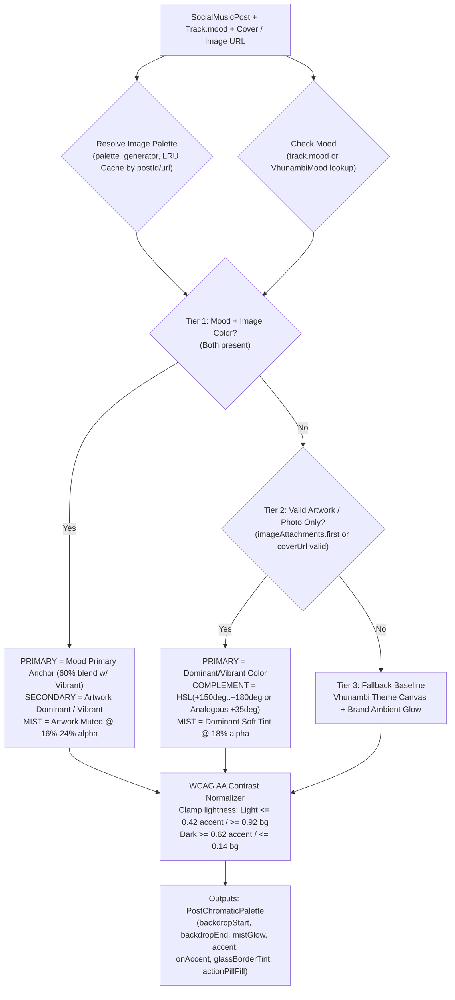
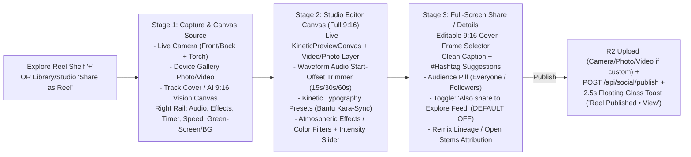

# 🔍 PHASE 73 & 74 FORENSIC AUDIT REPORT (`AUDIT-SOC-073_074`): SOCIAL DOMAIN OVERHAUL, CHROMATIC SYNTHESIS, MULTI-REACTIONS/GIFS & KINETIC REELS STUDIO ARCHITECTURE

**Audit ID:** `AUDIT-SOC-073_074`  
**Stage:** Stage 1 Memory-Aware Forensic Audit (**STRICTLY READ-ONLY — ZERO CODE/SCHEMA/MEMORY EDITS**)  
**Target Scopes:**
- **Part A -> Phase 73 Scope:** Kinetic Post Focus v2 (`SOC-01`), Global Input Focus Border Purge (`SOC-02`), 3-Tier Dynamic Chromatic Synthesis (`SOC-03`), Multi-Reaction Tray & GIF/Sticker Composer (`SOC-04`), Self-Profile `ViewerRole.owner` & `@current_user` Hygiene (`SOC-07`), Splash-to-Main MiniPlayer Suppression (`SOC-08`), `CreateKineticPostSheet` Visual/Aspect Fixes (`SOC-09`), and Explore Hive Recent Searches / Live "You May Like" (`SOC-10`).
- **Part B -> Phase 74 Scope:** Instagram-Benchmark Full-Screen Kinetic Reels Creation Studio (`SOC-05`, `video_1.mp4` 00:08–02:48), Reels Playback V4 & Shelf Defect Purge (`SOC-06`), Android Manifest & APK Footprint Budget (~43.25 MiB baseline), and Multi-Isolate Social/Clip Cloud SWR + Authenticated R2 Media Upload Contracts.
**Evidence Sources:** Physical device captures (`video_2.mp4` 00:00–05:26 & `video_1.mp4` 00:08–02:48), `vhunambi-memory` Cortex/Connectome query, static regex/AST sweeps, and line-by-line inspection across `apps/vhunambi_client/`, `apps/vhunambi_api/`, and `supabase/migrations/`.

---

## 0. Executive Verdict & Memory Connectome Wake (`vhunambi-memory`)

**Overall Diagnosis:** Vhunambi's audio engine, notifications surface, and Phase 69–72 Supabase Cloud SWR pipeline survive cold boot cleanly, yet the **Social Domain (`Explore`, `KineticPostFocusView`, `TrendingReelsShelf`, `KineticReelsModal`, and `ContentStudioDockView`) still exhibits pre-design-system "prototype seams"**: raw `#F97316` Material focus boxes, cramped `TextButton` rows causing mid-word wraps, flat cream/charcoal surfaces stripped of artwork mood identity, static Light-Mode text tokens inside dark modals, an un-mounted `MiniPlayerHost` overlay bleeding onto the `SplashView` fade transition, mock/missing artwork URLs, un-sanitized `[Intro]` lyric brackets in Reel teleprompters, and a broken Reels creation funnel that ignores existing `ContentStudioDockView` engines in favor of a tiny 2-field bottom sheet (`PublishClipModal`).

### 0.1 Existing Connectome Primitives Phase 73 & 74 MUST Reuse (Zero Re-Implementation)

Queried via `node .agents/skills/vhunambi-memory/scripts/query_connectome.mjs --hubs social_graph,media_artwork,mood_taxonomy,ui_surface_std,audio_transport,identity_role` and verified on disk:

| Connectome Endpoint / Hub | Verified On-Disk Implementation | Role in Phase 73 / Phase 74 |
| :--- | :--- | :--- |
| **`EP-P70-GLASS-SURFACE`** | [`vhunambi_glass_surface.dart`](file:///c:/Users/Ndugelo/VHUNAMBI/monorepo/apps/vhunambi_client/lib/core/widgets/vhunambi_glass_surface.dart) & [`vhunambi_ambient_mesh_backdrop.dart`](file:///c:/Users/Ndugelo/VHUNAMBI/monorepo/apps/vhunambi_client/lib/core/widgets/vhunambi_ambient_mesh_backdrop.dart) | Tier-1 frosted top/bottom bars & `VhunambiAmbientMeshBackdrop` behind `KineticPostFocusView` (`enableLiveBlur: false` on feed cards) |
| **`EP-P70-MOOD-TAXONOMY`** | [`vhunambi_mood.dart`](file:///c:/Users/Ndugelo/VHUNAMBI/monorepo/apps/vhunambi_client/lib/core/design_system/tokens/vhunambi_mood.dart) & [`mood_taxonomy.ts`](file:///c:/Users/Ndugelo/VHUNAMBI/monorepo/apps/vhunambi_api/src/utils/mood_taxonomy.ts) | Primary mood tier (`Tier 1`) in `PostChromaticPaletteResolver` + dynamic `"You May Like"` tags in `ExploreSearchView` |
| **`EP-P70-VIEWER-ROLE`** | [`viewer_role.dart`](file:///c:/Users/Ndugelo/VHUNAMBI/monorepo/apps/vhunambi_client/lib/core/auth/viewer_role.dart) | Replace raw `post.creatorHandle == '@current_user'` and unconditional `ArtistProfileView` pushes with canonical owner routing (`OwnerProfileView`) |
| **`EP-P68-TRACK-ARTWORK`** | [`vhunambi_track_artwork.dart`](file:///c:/Users/Ndugelo/VHUNAMBI/monorepo/apps/vhunambi_client/lib/core/widgets/vhunambi_track_artwork.dart) | Replace raw `Image.network` and `VHUNAMBI 9:16 COVER` fallbacks in `KineticPreviewCanvas`, `TrendingReelCard`, and `PublishClipModal` |
| **`EP-P68-MINIPLAYER-SUPPRESS`** | [`mini_player_host.dart`](file:///c:/Users/Ndugelo/VHUNAMBI/monorepo/apps/vhunambi_client/lib/features/player/presentation/widgets/mini_player_host.dart#L149-L217) | Fix root splash transition & `ModalRoute` blindspot causing the MiniPlayer pill to flash on cold launch (`SOC-08`) |
| **`EP-P69-KPOST-FOCUS-ROUTE`** | [`kinetic_post_focus_view.dart`](file:///c:/Users/Ndugelo/VHUNAMBI/monorepo/apps/vhunambi_client/lib/features/explore/presentation/views/kinetic_post_focus_view.dart#L33-L745) | Upgrade action bar, dynamic world synthesis, long-press multi-reactions & GIF/Sticker composer |
| **`EP-P69-THREADED-COMMENTS`** | [`threaded_comments_section.dart`](file:///c:/Users/Ndugelo/VHUNAMBI/monorepo/apps/vhunambi_client/lib/features/social/presentation/widgets/threaded_comments_section.dart) | Extend `ReelComment` & `StudioReactionComposerBar` with per-comment reactions & GIF/Sticker attachments |
| **`EP-P71-EDGE-SWR-READTHROUGH`** | [`edge_persistence_bridge.ts`](file:///c:/Users/Ndugelo/VHUNAMBI/monorepo/apps/vhunambi_api/src/db/edge_persistence_bridge.ts#L1275-L1339) | Close multi-isolate staleness on `published_clips` & `social_interactions` in `syncExploreFromCloud` / `syncSocialFromCloud` |

---

## 1. Master P0–P3 Severity Matrix

| ID | Target Phase | Sev | Defect Name & Hardware Symptom | Verified Primary Root Cause Location(s) |
| :--- | :---: | :---: | :--- | :--- |
| **`SOC-01`** | **P73** | **P0** | Broken mid-word wrap (`Com\nment`, `Repo\nst`, `Remi\nx`) & `0 Repos...` truncation on Focus bar | [`kinetic_post_focus_view.dart#L585-L715`](file:///c:/Users/Ndugelo/VHUNAMBI/monorepo/apps/vhunambi_client/lib/features/explore/presentation/views/kinetic_post_focus_view.dart#L585-L715) |
| **`SOC-02`** | **P73** | **P0** | Harsh bright `#F97316` orange rectangle around every focused `TextField` app-wide | [`app_theme.dart#L85-L91`](file:///c:/Users/Ndugelo/VHUNAMBI/monorepo/apps/vhunambi_client/lib/core/theme/app_theme.dart#L85-L91), [`app_theme.dart#L214-L220`](file:///c:/Users/Ndugelo/VHUNAMBI/monorepo/apps/vhunambi_client/lib/core/theme/app_theme.dart#L214-L220) + 11 widget overrides/leaks |
| **`SOC-03`** | **P73** | **P1** | Flat uniform `#F7F5F0` / charcoal canvas on `KineticPostFocusView` instead of dynamic song/art world | [`kinetic_post_focus_view.dart#L199-L265`](file:///c:/Users/Ndugelo/VHUNAMBI/monorepo/apps/vhunambi_client/lib/features/explore/presentation/views/kinetic_post_focus_view.dart#L199-L265); `palette_generator: 0.3.3+7` unused |
| **`SOC-04`** | **P73** | **P1** | Binary single-heart only; no long-press multi-reactions (`like`, `love`, `haha`, `fire`, `wow`, `angry`) or GIF/Sticker picker | [`reel_comment.dart#L1-L110`](file:///c:/Users/Ndugelo/VHUNAMBI/monorepo/apps/vhunambi_client/lib/features/social/domain/models/reel_comment.dart#L1-L110), [`social_music_post.dart#L447-L503`](file:///c:/Users/Ndugelo/VHUNAMBI/monorepo/apps/vhunambi_client/lib/features/explore/domain/models/social_music_post.dart#L447-L503), [`social_routes.ts`](file:///c:/Users/Ndugelo/VHUNAMBI/monorepo/apps/vhunambi_api/src/routes/social_routes.ts) |
| **`SOC-05`** | **P74** | **P0** | Fragmented/primitive Reel creation (`PublishClipModal` bottom sheet); zero Camera/Gallery/Audio Trimmer/Effects/Studio unification | [`trending_reels_shelf.dart#L275-L392`](file:///c:/Users/Ndugelo/VHUNAMBI/monorepo/apps/vhunambi_client/lib/features/social/presentation/widgets/trending_reels_shelf.dart#L275-L392), [`publish_clip_modal.dart#L1-L360`](file:///c:/Users/Ndugelo/VHUNAMBI/monorepo/apps/vhunambi_client/lib/features/content_studio/presentation/widgets/publish_clip_modal.dart#L1-L360) vs [`content_studio_dock_view.dart`](file:///c:/Users/Ndugelo/VHUNAMBI/monorepo/apps/vhunambi_client/lib/features/content_studio/presentation/views/content_studio_dock_view.dart) |
| **`SOC-06a`** | **P74** | **P0** | Publish `SnackBar` with `SnackBarAction('COPY')` stays frozen for ~65 seconds (`Material 3` a11y rule) | [`publish_clip_modal.dart#L132-L146`](file:///c:/Users/Ndugelo/VHUNAMBI/monorepo/apps/vhunambi_client/lib/features/content_studio/presentation/widgets/publish_clip_modal.dart#L132-L146) |
| **`SOC-06b`** | **P74** | **P0** | Light-Mode dark charcoal `Trending \| For You` tabs invisible over dark full-screen Reels modal | [`kinetic_reels_modal.dart#L174`](file:///c:/Users/Ndugelo/VHUNAMBI/monorepo/apps/vhunambi_client/lib/features/social/presentation/widgets/kinetic_reels_modal.dart#L174), [`kinetic_reels_modal.dart#L1173-L1175`](file:///c:/Users/Ndugelo/VHUNAMBI/monorepo/apps/vhunambi_client/lib/features/social/presentation/widgets/kinetic_reels_modal.dart#L1173-L1175) |
| **`SOC-06c`** | **P74** | **P1** | Blank `VHUNAMBI 9:16 COVER` box, broken shelf thumbs, forced `'New track drop 🔥'` Explore spam, & raw `[Intro]` lyrics in teleprompter | [`kinetic_preview_canvas.dart#L124-L130,L234`](file:///c:/Users/Ndugelo/VHUNAMBI/monorepo/apps/vhunambi_client/lib/features/content_studio/presentation/widgets/kinetic_preview_canvas.dart#L124-L130), [`trending_reels_shelf.dart#L58-L63`](file:///c:/Users/Ndugelo/VHUNAMBI/monorepo/apps/vhunambi_client/lib/features/social/presentation/widgets/trending_reels_shelf.dart#L58-L63), [`publish_clip_modal.dart#L93-L125`](file:///c:/Users/Ndugelo/VHUNAMBI/monorepo/apps/vhunambi_client/lib/features/content_studio/presentation/widgets/publish_clip_modal.dart#L93-L125), [`song_metadata_dna.dart#L94-L113`](file:///c:/Users/Ndugelo/VHUNAMBI/monorepo/apps/vhunambi_client/lib/features/content_studio/domain/models/song_metadata_dna.dart#L94-L113) |
| **`SOC-07`** | **P73** | **P1** | Tapping own avatar opens visitor `ArtistProfileView` instead of `OwnerProfileView`; legacy `@current_user` hardcoded in composer/DAW sheets | [`explore_social_post_card.dart#L326,L390`](file:///c:/Users/Ndugelo/VHUNAMBI/monorepo/apps/vhunambi_client/lib/features/explore/presentation/widgets/explore_social_post_card.dart#L386-L393), [`kinetic_post_focus_view.dart#L290-L297`](file:///c:/Users/Ndugelo/VHUNAMBI/monorepo/apps/vhunambi_client/lib/features/explore/presentation/views/kinetic_post_focus_view.dart#L290-L297), [`kinetic_reels_modal.dart#L680`](file:///c:/Users/Ndugelo/VHUNAMBI/monorepo/apps/vhunambi_client/lib/features/social/presentation/widgets/kinetic_reels_modal.dart#L680), [`direct_daw_vocal_upload_sheet.dart#L133-L194`](file:///c:/Users/Ndugelo/VHUNAMBI/monorepo/apps/vhunambi_client/lib/features/studio/presentation/widgets/direct_daw_vocal_upload_sheet.dart#L133-L194) |
| **`SOC-08`** | **P73** | **P1** | MiniPlayer pill (`Grateful in the Light`) bleeds onto `"A PRODUCT OF MADONI SOFTWARE"` during splash transition | [`splash_view.dart#L99-L120`](file:///c:/Users/Ndugelo/VHUNAMBI/monorepo/apps/vhunambi_client/lib/features/onboarding/presentation/views/splash_view.dart#L99-L120), [`main.dart#L118-L133`](file:///c:/Users/Ndugelo/VHUNAMBI/monorepo/apps/vhunambi_client/lib/main.dart#L118-L133), [`mini_player_host.dart#L205`](file:///c:/Users/Ndugelo/VHUNAMBI/monorepo/apps/vhunambi_client/lib/features/player/presentation/widgets/mini_player_host.dart#L205), [`player_provider.dart#L65-L157`](file:///c:/Users/Ndugelo/VHUNAMBI/monorepo/apps/vhunambi_client/lib/features/player/presentation/providers/player_provider.dart#L65-L157) |
| **`SOC-09`** | **P73** | **P1** | `CreateKineticPostSheet` ignores aspect toggle after image pick, Vision preview shows broken/duplicate crate box, 4-slot cap throws error snackbars | [`create_kinetic_post_sheet.dart#L113-L201,L418-L487,L560-L650`](file:///c:/Users/Ndugelo/VHUNAMBI/monorepo/apps/vhunambi_client/lib/features/explore/presentation/widgets/create_kinetic_post_sheet.dart#L418-L487) |
| **`SOC-10`** | **P73** | **P2** | Explore Search shows hardcoded `'Kabza de Small log drum'` etc. on clean install & static `kAfricanTrendingQueries` | [`explore_providers.dart#L1135-L1148`](file:///c:/Users/Ndugelo/VHUNAMBI/monorepo/apps/vhunambi_client/lib/features/explore/presentation/providers/explore_providers.dart#L1135-L1148), [`explore_search_view.dart#L15-L24`](file:///c:/Users/Ndugelo/VHUNAMBI/monorepo/apps/vhunambi_client/lib/features/explore/presentation/views/explore_search_view.dart#L15-L24) |
| **`BE-SOC-01`** | **P74** | **P1** | `GET /api/social/feed` & `POST /api/social/publish` run synchronously against Worker isolate RAM; `syncExploreFromCloud` omits `published_clips` & `social_interactions` | [`social_routes.ts#L87-L158`](file:///c:/Users/Ndugelo/VHUNAMBI/monorepo/apps/vhunambi_api/src/routes/social_routes.ts#L87-L158), [`edge_persistence_bridge.ts#L1297-L1325`](file:///c:/Users/Ndugelo/VHUNAMBI/monorepo/apps/vhunambi_api/src/db/edge_persistence_bridge.ts#L1297-L1325) |

---

## PART A — PHASE 73 FORENSIC AUDIT (`Kinetic Post Focus v2`, Global Focus Theme, 3-Tier Chromatic World, Multi-Reactions/GIFs & Social Hygiene)

---

## 2. `SOC-01`: Broken Focus Action Bar Wrap & Summary Truncation

### 2.1 Structural Root Cause (`kinetic_post_focus_view.dart#L585-L715`)
1. **Summary Strip Truncation (`L591-L610`):** Inside horizontal `AppSpacing.lg` padding (`360dp - 32dp = 328dp`), a single `Row` places a `likeCount` metric on the left, `const Spacer()`, and a single concatenated `Text('$effectiveCommentCount Comments · ${post.repostCount} Reposts · ${post.remixCount} Remixes')` wrapped inside `Flexible` with `TextOverflow.ellipsis`. On a 360dp screen this clips into `"0 Repos..."`.
2. **Action Bar Mid-Word Break (`L619-L714`):** Four `Expanded` children wrap `TextButton.icon(...)` (`Like`, `Comment`, `Repost`, `Remix`). Each `Expanded` receives `328 / 4 = 82dp` total width. Minus Material `TextButton` horizontal padding (`~16dp`) and the `18dp` Phosphor icon + `6dp` gap (`42dp` remaining for text), labels `'Comment'`, `'Repost'`, and `'Remix'` exceed `42dp` and force Flutter's `Text` layout to wrap mid-word (`Com\nment`, `Repo\nst`, `Remi\nx`).

### 2.2 Before vs. After Spatial Blueprint (360dp Viewport)

```text
BEFORE (Broken at 360dp in video_2.mp4 00:30, 05:15):
┌──────────────────────────────────────────────┐
│ ♥ 142 Likes              12 Comments · 0 Repo…│ <- Ellipsis clip
├──────────────────────────────────────────────┤
│  ♡      💬 Com    🔁 Repo   🎛 Remi          │ <- Mid-word wrap
│ Like      ment       st       x              │
└──────────────────────────────────────────────┘

AFTER (Phase 73 Focus Bar Standard — 360dp & Compact Viewports):
┌──────────────────────────────────────────────┐
│ 🔥 142   💬 12 Comments   🔁 3   🎛 2 Remixes│ <- Wrap / compact metric pills
├──────────────────────────────────────────────┤
│  ┌──────┐  ┌──────┐  ┌──────┐  ┌──────┐      │
│  │  🔥  │  │  💬  │  │  🔁  │  │  🎛  │      │ <- Vertical icon+label OR
│  │ React│  │Reply │  │Repost│  │Remix │      │    FittedBox(scaleDown, maxLines: 1)
│  └──────┘  └──────┘  └──────┘  └──────┘      │    w/ Tooltip + Long-Press Tray
└──────────────────────────────────────────────┘
```
*Contract Mandate:* All 4 action buttons use `maxLines: 1`, `softWrap: false`, tight internal padding (`EdgeInsets.symmetric(horizontal: 4, vertical: 8)`), and stacked vertical icon-over-label (`Column`) or `FittedBox(fit: BoxFit.scaleDown)` inside `ConstrainedBox(minHeight: 44)` touch targets. Engagement summary row uses `Wrap(spacing: 12, runSpacing: 4)` or compact localized counters (`12 Comments`, `0 Reposts`, `0 Remixes`) with multi-reaction stacked emoji badges (`🔥❤️😂 142`).

---

## 3. `SOC-02`: Global Bright Orange `#F97316` Focused Border & Complete Call-Site Census

### 3.1 Structural Root Cause (`app_theme.dart#L85-L91, #L214-L220`)
Both `AppTheme.darkTheme` (`L85-L91`) and `AppTheme.lightTheme` (`L214-L220`) globally configure `inputDecorationTheme.focusedBorder` to:
```dart
focusedBorder: OutlineInputBorder(
  borderRadius: AppRadius.inputBorder,
  borderSide: const BorderSide(color: AppColors.brandPrimary, width: 1.5), // #F97316 bright orange!
)
```
Critically, several compositing widgets only specify `border: InputBorder.none` inside their local `InputDecoration(...)` **without** specifying `focusedBorder: InputBorder.none` or `enabledBorder: InputBorder.none` — causing Flutter's `InputDecorator` to merge the global `Theme.of(context).inputDecorationTheme.focusedBorder` and paint a harsh `#F97316` orange box around glass pills and borderless composers!

### 3.2 Exhaustive Client `focusedBorder` / Border-Leak Census (All 15 Sites Observed)

| Category | Exact File & Line Citation | Current Behavior | Phase 73 Fix Rule |
| :--- | :--- | :--- | :--- |
| **Global Theme (Dark)** | [`app_theme.dart#L85-L91`](file:///c:/Users/Ndugelo/VHUNAMBI/monorepo/apps/vhunambi_client/lib/core/theme/app_theme.dart#L85-L91) | Hardcodes `AppColors.brandPrimary` (`1.5px` orange) | Replace with `AppColors.borderStrongOf(context).withValues(alpha: 0.45)` or `AppColors.brandPrimary.withValues(alpha: 0.28)` `1.0px` tonal hairline |
| **Global Theme (Light)** | [`app_theme.dart#L214-L220`](file:///c:/Users/Ndugelo/VHUNAMBI/monorepo/apps/vhunambi_client/lib/core/theme/app_theme.dart#L214-L220) | Hardcodes `AppColors.brandPrimary` (`1.5px` orange) | Same: soft subtle `1.0px` tonal/glass ring (`Colors.black.withValues(alpha: 0.16)`) |
| **Leak (No `focusedBorder`)** | [`threaded_comments_section.dart#L896`](file:///c:/Users/Ndugelo/VHUNAMBI/monorepo/apps/vhunambi_client/lib/features/social/presentation/widgets/threaded_comments_section.dart#L896) | Sets `border: InputBorder.none` only -> orange box in comments | Add `enabledBorder: InputBorder.none, focusedBorder: InputBorder.none, disabledBorder: InputBorder.none` inside glass outer container (`Container` animates subtle `1px` post-accent ring at 28% alpha) |
| **Leak (No `focusedBorder`)** | [`explore_search_view.dart#L145`](file:///c:/Users/Ndugelo/VHUNAMBI/monorepo/apps/vhunambi_client/lib/features/explore/presentation/views/explore_search_view.dart#L145) | Sets `border: InputBorder.none` only -> orange box on search | Explicitly set `enabledBorder: InputBorder.none, focusedBorder: InputBorder.none` and style outer glass pill border |
| **Leak (No `focusedBorder`)** | [`create_kinetic_post_sheet.dart#L402`](file:///c:/Users/Ndugelo/VHUNAMBI/monorepo/apps/vhunambi_client/lib/features/explore/presentation/widgets/create_kinetic_post_sheet.dart#L402) | Sets `border: InputBorder.none` only | Explicitly add `enabledBorder: InputBorder.none, focusedBorder: InputBorder.none` |
| **Explicit Orange Override** | [`publish_clip_modal.dart#L249`](file:///c:/Users/Ndugelo/VHUNAMBI/monorepo/apps/vhunambi_client/lib/features/content_studio/presentation/widgets/publish_clip_modal.dart#L249) | Explicit orange `focusedBorder` | Replace with subtle `1px` tonal outline (or retire with Phase 74 Studio) |
| **Explicit Orange Override** | [`repost_kinetic_post_sheet.dart#L212`](file:///c:/Users/Ndugelo/VHUNAMBI/monorepo/apps/vhunambi_client/lib/features/explore/presentation/widgets/repost_kinetic_post_sheet.dart#L212) | Explicit `OutlineInputBorder` | Align with subtle `1px` tonal hairline (`borderStrongOf` / `28%` accent) |
| **Explicit Orange Override** | [`direct_daw_vocal_upload_sheet.dart#L346`](file:///c:/Users/Ndugelo/VHUNAMBI/monorepo/apps/vhunambi_client/lib/features/studio/presentation/widgets/direct_daw_vocal_upload_sheet.dart#L346) | Explicit `const OutlineInputBorder(...)` | Align with global subtle focus ring |
| **Explicit Orange Override** | [`prompt_input_box.dart#L318`](file:///c:/Users/Ndugelo/VHUNAMBI/monorepo/apps/vhunambi_client/lib/features/studio/presentation/widgets/prompt_input_box.dart#L318) | Explicit `OutlineInputBorder` | Align with glass tonal focus ring |
| **Explicit Orange Override** | [`sovereign_auth_sheet.dart#L533`](file:///c:/Users/Ndugelo/VHUNAMBI/monorepo/apps/vhunambi_client/lib/features/auth/presentation/widgets/sovereign_auth_sheet.dart#L533) | Explicit `const OutlineInputBorder` | Align with subtle `1px` tonal hairline |
| **Explicit Orange Override** | [`playlists_vault_view.dart#L248`](file:///c:/Users/Ndugelo/VHUNAMBI/monorepo/apps/vhunambi_client/lib/features/playlists/presentation/views/playlists_vault_view.dart#L248) | Explicit `OutlineInputBorder` | Align with subtle `1px` tonal hairline |
| **Explicit Orange Override** | [`add_to_playlist_sheet.dart#L273`](file:///c:/Users/Ndugelo/VHUNAMBI/monorepo/apps/vhunambi_client/lib/features/playlists/presentation/widgets/add_to_playlist_sheet.dart#L273) | Explicit `OutlineInputBorder` | Align with subtle `1px` tonal hairline |
| **Explicit Orange Override** | [`avatar_customization_modal.dart#L490,#L593`](file:///c:/Users/Ndugelo/VHUNAMBI/monorepo/apps/vhunambi_client/lib/features/profile/presentation/widgets/avatar_customization_modal.dart#L490) | 2 explicit `OutlineInputBorder` sites | Align with subtle `1px` tonal hairline |
| **Already Clean (Reference)** | [`landing_hero_section.dart#L198`](file:///c:/Users/Ndugelo/VHUNAMBI/monorepo/apps/vhunambi_client/lib/features/landing/presentation/widgets/landing_hero_section.dart#L198), [`library_view.dart#L460`](file:///c:/Users/Ndugelo/VHUNAMBI/monorepo/apps/vhunambi_client/lib/features/library/presentation/views/library_view.dart#L460), [`marketplace_top_bar.dart#L165`](file:///c:/Users/Ndugelo/VHUNAMBI/monorepo/apps/vhunambi_client/lib/features/marketplace/presentation/widgets/marketplace_top_bar.dart#L165), [`notification_search_bar.dart#L105`](file:///c:/Users/Ndugelo/VHUNAMBI/monorepo/apps/vhunambi_client/lib/features/notifications/presentation/widgets/notification_search_bar.dart#L105) | Already pass `focusedBorder: InputBorder.none` | Preserve pattern as the gold standard for container-wrapped fields |

---

## 4. `SOC-03`: 3-Tier Dynamic Chromatic Synthesis Architecture (`PostChromaticPaletteResolver`)

### 4.1 Current Gap (`kinetic_post_focus_view.dart#L199-L265`)
`KineticPostFocusView` paints a static `AppColors.surfaceCanvasOf(context)` body and `AppColors.surfaceElevatedOf(context)` sticky composer/header regardless of track mood or cover art. Meanwhile:
- `palette_generator: 0.3.3+7` is **already bundled** in [`pubspec.yaml#L51`](file:///c:/Users/Ndugelo/VHUNAMBI/monorepo/apps/vhunambi_client/pubspec.yaml#L51).
- `Track.mood` already exists in [`track.dart#L51`](file:///c:/Users/Ndugelo/VHUNAMBI/monorepo/apps/vhunambi_client/lib/shared/models/track.dart#L51).
- `VhunambiMood` (`vhunambi_mood.dart`) and `VhunambiAmbientMeshBackdrop` (`vhunambi_ambient_mesh_backdrop.dart`) are **already implemented** from Phase 68/70.

### 4.2 3-Tier Chromatic Synthesis Decision Tree & Contrast Guardrails



**Image Provider Resolution Note:** Because seeded posts/tracks use `asset:assets/...` URIs, cloud R2 `/r2/...` relative paths, and local device paths (`file://`), `PostChromaticPaletteResolver` MUST resolve `ImageProvider` cleanly via `AssetImage` (for `asset:`), `FileImage` (for local files), and `CachedNetworkImageProvider(AppConstants.normalizeCloudMediaUrl(url))` (for HTTP/relative URLs) with a `120ms` isolate/timeout guard and LRU map keyed by normalized URL so entering a focused post never janks 60 FPS push transitions.

**Metadata Propagation Fix:** Currently `SocialMusicPost.fromJson` reads `track`, while Explore track enrichment (`Track.mood`) should be preserved when creating or hydrating a `SocialMusicPost` (or looked up by `post.track.id` against `exploreTracksProvider` / `libraryTracksProvider`) so songs whose `post.track.mood` was null still receive Tier-1 Mood synthesis if present in the catalog.

---

## 5. `SOC-04`: Long-Press Multi-Reaction Tray & GIF / Sticker Composer Architecture

### 5.1 Current Gaps Across Client & Backend
- [`social_music_post.dart#L447-L503`](file:///c:/Users/Ndugelo/VHUNAMBI/monorepo/apps/vhunambi_client/lib/features/explore/domain/models/social_music_post.dart#L447-L503): Only stores scalar `likeCount` + `isLikedByMe`.
- [`reel_comment.dart#L1-L110`](file:///c:/Users/Ndugelo/VHUNAMBI/monorepo/apps/vhunambi_client/lib/features/social/domain/models/reel_comment.dart#L1-L110): Stores `giftEmoji` / `giftName` (Cultural Gifts) and binary `likeCount` / `isLikedByMe`, with **zero** typed reaction map (`reactionCounts`, `myReaction`) or media fields (`gifUrl`, `stickerId`, `mediaAspectRatio`).
- [`threaded_comments_section.dart#L896`](file:///c:/Users/Ndugelo/VHUNAMBI/monorepo/apps/vhunambi_client/lib/features/social/presentation/widgets/threaded_comments_section.dart#L896): `StudioReactionComposerBar` has a Send button and reply chip, but **zero** GIF/Sticker picker trigger or rich attachment preview strip above the input.
- [`explore_routes.ts`](file:///c:/Users/Ndugelo/VHUNAMBI/monorepo/apps/vhunambi_api/src/routes/explore_routes.ts) & [`social_routes.ts`](file:///c:/Users/Ndugelo/VHUNAMBI/monorepo/apps/vhunambi_api/src/routes/social_routes.ts): Only expose `/like` booleans; no `POST /posts/:id/react`, `POST /comments/:id/react`, or `GET /api/social/gifs/search` endpoint exists.
- [`20261110000001_phase62_hybrid_cloud_schema.sql#L133-L197,L341-L348`](file:///c:/Users/Ndugelo/VHUNAMBI/monorepo/supabase/migrations/20261110000001_phase62_hybrid_cloud_schema.sql#L133-L197): `social_interactions` has `PRIMARY KEY (interaction_type, target_id, actor_creator_id)` with NO `reaction_type` / `payload_json` column, and `kinetic_posts` / `reel_comments` have no top-level reaction aggregates (though both have `data_json JSONB`).

### 5.2 Wire & Storage Contract for Phase 73 Multi-Reactions + GIFs/Stickers

1. **Canonical Enum (`KineticReactionType`):**
   - `like` (`👍`, `"Like"`)
   - `love` (`❤️`, `"Love"`)
   - `haha` (`😂`, `"Haha"`)
   - `fire` (`🔥`, `"Fire"` — signature music reaction)
   - `wow` (`😮`, `"Wow"`)
   - `angry` (`😡`, `"Angry"`)
2. **Tactile Gesture Interaction:**
   - **Tap** Like/React button -> quick-toggles `fire` or `like` (or removes `myReaction` if already set).
   - **Long-Press** (on Focus Action Bar button, Explore Post Card Like button, OR Comment `Like`/reaction chip) -> opens elevated frosted-glass **Floating Pill Reaction Tray** with spring scale-in, drag-to-scrub active magnification (`1.45x`) + `HapticFeedback.selectionClick()`, releasing on the selected reaction triggers burst particle + `reactionCounts` increment.
3. **5-Layer Persistence Contract:**
   - **Supabase Postgres Migration:** Add `reaction_counts_json JSONB NOT NULL DEFAULT '{}'::jsonb` to `public.kinetic_posts` & `public.reel_comments`; add `reaction_type TEXT` (nullable) to `public.social_interactions` (keying `interaction_type = 'post_react'` or `'comment_react'`, with unique `(interaction_type, target_id, actor_creator_id)`); add `gif_url TEXT`, `sticker_id TEXT`, `media_aspect_ratio DOUBLE PRECISION` to `public.reel_comments`.
   - **SQLite (`vhunambi_db.ts`) & `edge_persistence_bridge.ts`:** Mirror columns & hydrate `reactionCounts` + `myReaction` for current viewer (`canonicalizeCreatorId(viewerId)`).
   - **Hono Worker Routes:**
     - `POST /api/explore/posts/:id/react` & `POST /api/social/clips/:id/react` (body `{ reactionType: 'fire' | null }`) -> updates `social_interactions` + recomputes `reaction_counts_json` + backward-compatible `likeCount` (`sum of all reactions` or `like+love+fire` per spec) and writes-through to Supabase.
     - `POST /api/explore/comments/:id/react` & `POST /api/social/comments/:id/react` -> same atomic per-comment reaction upsert.
     - `GET /api/social/gifs/search?q=...` -> Cloudflare Worker proxy reading `TENOR_API_KEY` / `GIPHY_API_KEY` secret safely server-side (zero client API key leakage), returning clean `{ items: [{ id, previewUrl, gifUrl, width, height, title }] }` with a graceful offline/unconfigured **Vhunambi Sovereign Cultural Sticker Pack** (`Cowrie Crown`, `Log Drum`, `808 Fire`, `Amapiano Groove`, `Makhado Glow`, `Studio Cookin`) built into Flutter vector/asset UI (`GIF` + `Stickers` segmented sheet tabs).
     - `CreateCommentSchema` (`social_routes.ts#L50-L61` & `explore_routes.ts#L213-L242`): Allow `text` OR (`gifUrl` / `stickerId`) so a user can post a pure GIF/Sticker comment or reply without forcing dummy text!

---

## 6. `SOC-07`, `SOC-08`, `SOC-09`, `SOC-10`: Social Identity, Splash MiniPlayer, Post Sheet & Search Hygiene

### 6.1 `SOC-07`: Self-Profile Visitor Trap & `@current_user` Census
Every profile avatar/handle tap in Social & Explore currently blindly pushes `ArtistProfileView(artistId: ...)` even when the tapped creator is the signed-in owner:
1. [`explore_social_post_card.dart#L386-L393`](file:///c:/Users/Ndugelo/VHUNAMBI/monorepo/apps/vhunambi_client/lib/features/explore/presentation/widgets/explore_social_post_card.dart#L386-L393) -> Pushes `ArtistProfileView(artistId: post.creatorId)` unconditionally.
2. [`kinetic_post_focus_view.dart#L290-L297`](file:///c:/Users/Ndugelo/VHUNAMBI/monorepo/apps/vhunambi_client/lib/features/explore/presentation/views/kinetic_post_focus_view.dart#L290-L297) -> Pushes `ArtistProfileView(artistId: post.creatorId)` unconditionally.
3. [`kinetic_reels_modal.dart#L680`](file:///c:/Users/Ndugelo/VHUNAMBI/monorepo/apps/vhunambi_client/lib/features/social/presentation/widgets/kinetic_reels_modal.dart#L680) -> Pushes `ArtistProfileView(artistId: clip.creatorId)` unconditionally.
4. Additional navigation sites to standardize via a single helper `navigateToCreatorProfile(context, ref, creatorId: ..., creatorHandle: ...)`: [`track_detail_view.dart#L506`](file:///c:/Users/Ndugelo/VHUNAMBI/monorepo/apps/vhunambi_client/lib/features/track/presentation/views/track_detail_view.dart#L506), [`explore_search_view.dart#L599`](file:///c:/Users/Ndugelo/VHUNAMBI/monorepo/apps/vhunambi_client/lib/features/explore/presentation/views/explore_search_view.dart#L599), [`explore_discovery_drawer_sheet.dart#L464`](file:///c:/Users/Ndugelo/VHUNAMBI/monorepo/apps/vhunambi_client/lib/features/explore/presentation/widgets/explore_discovery_drawer_sheet.dart#L464), and [`notification_deep_link_router.dart#L115`](file:///c:/Users/Ndugelo/VHUNAMBI/monorepo/apps/vhunambi_client/lib/features/notifications/presentation/utils/notification_deep_link_router.dart#L115). When `resolveViewerRole(...) == ViewerRole.owner` (`ownerProfileProvider` or `authSessionProvider` canonical creator match), route directly to `const OwnerProfileView()`.
5. **`@current_user` Legacy Scrub:**
   - [`explore_social_post_card.dart#L326`](file:///c:/Users/Ndugelo/VHUNAMBI/monorepo/apps/vhunambi_client/lib/features/explore/presentation/widgets/explore_social_post_card.dart#L326): Replace `post.creatorHandle == '@current_user'` with canonical `resolveViewerRole` check against `post.creatorId`.
   - [`direct_daw_vocal_upload_sheet.dart#L133,L162,L175,L194`](file:///c:/Users/Ndugelo/VHUNAMBI/monorepo/apps/vhunambi_client/lib/features/studio/presentation/widgets/direct_daw_vocal_upload_sheet.dart#L133-L194): Replace all 4 hardcoded `'@current_user'` fields with resolved `ownerProfileProvider` / `authSessionProvider` handle & `creatorId`.

### 6.2 `SOC-08`: MiniPlayer Pill Over Splash Screen (`video_2.mp4` 01:55)
Three compounding defects cause `MiniPlayerHost` (`Grateful in the Light`) to overlay `"A PRODUCT OF MADONI SOFTWARE"` during cold boot:
1. **Race in `SplashView` (`splash_view.dart#L99-L120`):** `ref.read(isSplashActiveProvider.notifier).state = false;` runs **before** the `420ms` `PageRouteBuilder` fade-out completes, immediately revealing `MiniPlayerHost` over the fading `"A PRODUCT OF MADONI SOFTWARE"` footer!
2. **`ModalRoute.of(context)` Blindspot (`main.dart#L128-L133` vs `mini_player_host.dart#L205`):** In `MaterialApp.builder`, `MiniPlayerHost` is placed inside `Stack(children: [?child, const MiniPlayerHost()])` **above** the `Navigator`. Because `MiniPlayerHost`'s `BuildContext` sits outside the `Navigator`, `ModalRoute.of(context)` inside `_shouldHide` **always returns `null`** — it can never inspect `/splash` or `/onboarding` route names!
3. **Pre-Populated Paused Track on Cold Start (`player_provider.dart#L65-L83, L91-L157`):** `PlayerNotifier` constructor immediately seeds `currentTrack: Track(id: 'track_default_1', title: 'Grateful in the Light', ...)` in `PlaybackStatus.paused`, and `_hydratePersistedSession` restores any cached paused track. So `state.currentTrack != null` is already `true` on frame 1!
- **Phase 73 Fix:**
  1. Keep `isSplashActiveProvider` initialized to `true`, only setting it `false` **after** `pushReplacement` transition completes (e.g. post-navigation callback or `WidgetsBinding.instance.addPostFrameCallback` after route fade finishes, OR guard `MiniPlayerHost` via `RouteObserver` tracking top route + `isSplashActiveProvider`).
  2. Never paint `MiniPlayerHost` when `isSplashActiveProvider == true` OR `currentRoute` is Splash/Onboarding OR when user hasn't initiated playback in the current session (`playerUiHasStartedSessionProvider` / `status != PlaybackStatus.idle` — optional resume pill only once inside RootShell).

### 6.3 `SOC-09`: `CreateKineticPostSheet` Glitches (`create_kinetic_post_sheet.dart`)
1. **Aspect Ratio Toggle Ignored (`L270-L292`, `L418-L448`):** Changing `_selectedAspectRatio` (`1:1`, `4:5`, `16:9`) updates state only, while `L139` / `L187` stamped the previous `_selectedAspectRatio` into `_attachedImages[i]` at attach time. `SocialMusicPost.effectiveAspectRatio` reads `allImageAttachments.first.aspectRatio` (`social_music_post.dart#L226-L229`) -> existing photos ignore toggling the pill! Fix: apply `.copyWith(aspectRatio: ratio)` across all `_attachedImages` in `onSelected`, AND preview the stage dynamically in the selected aspect ratio.
2. **Vision AI Broken / Duplicate Box (`L147-L201`, `L560-L650`):** Mock/local worker Vision URLs or un-normalized paths fail `Image.network` and drop onto identical `AppAssets.heritageCrateCover` boxes. Fix: normalize via `AppConstants.normalizeCloudMediaUrl`, handle `asset:` / local R2 URLs via `VhunambiTrackArtwork`, and allow selecting real gallery images (shared `image_picker` helper if ready, or local file + normalized Vision render).
3. **4-Image Cap UX (`L127-L135`, `L460-L487`):** Clicking `+ Photo` or `AI Vision (9:16)` at 4/4 currently fires a red `AppColors.error` SnackBar instead of disabling buttons (`enabled: _attachedImages.length < 4`) with an inline `"4/4 Max images attached"` pill badge.

### 6.4 `SOC-10`: Explore Hardcoded Mock Recent Searches (`explore_providers.dart#L1135-L1148`)
1. `RecentSearchesNotifier._initialSearches()` injects 4 hardcoded mock queries (`'Kabza de Small log drum'`, `'Amapiano vocal pack'`, `'Makhado 113 BPM'`, `'Venda maskandi guitar'`) whenever Hive returns `null`. Clean installs immediately show fake search history!
2. `ExploreSearchView` (`L15-L24`) displays static `kAfricanTrendingQueries` below it.
- **Phase 73 Fix:** Clean installs start with `[]` in `RecentSearchesNotifier` (hiding the `"Recent Searches"` section completely when empty while keeping Hive persistence working across restarts). Power `"You May Like"` dynamically from live `exploreTracksProvider` + `VhunambiMood` values (top trending track titles/genres/moods) rather than a static 12-item array.

---

## PART B — PHASE 74 FORENSIC AUDIT (`KineticReelStudioView` Instagram Benchmark, Playback V4 & Backend Cloud SWR / R2)

---

## 7. `SOC-05`: Instagram Benchmark (`video_1.mp4`) vs. Current Vhunambi Reels Creation Gap

### 7.1 Current Disconnected Reality
Right now, pressing `+` / `Post Kinetic Reel` in [`trending_reels_shelf.dart#L275-L392`](file:///c:/Users/Ndugelo/VHUNAMBI/monorepo/apps/vhunambi_client/lib/features/social/presentation/widgets/trending_reels_shelf.dart#L275-L392) opens a simple track list sheet and then pushes the tiny [`publish_clip_modal.dart`](file:///c:/Users/Ndugelo/VHUNAMBI/monorepo/apps/vhunambi_client/lib/features/content_studio/presentation/widgets/publish_clip_modal.dart) bottom sheet (caption box + `Public/Followers` pill + 88px thumbnail + orange border). Meanwhile, an entire half-built studio suite sits un-routed inside `features/content_studio/presentation/`:
- [`content_studio_dock_view.dart`](file:///c:/Users/Ndugelo/VHUNAMBI/monorepo/apps/vhunambi_client/lib/features/content_studio/presentation/views/content_studio_dock_view.dart)
- [`kinetic_preview_canvas.dart`](file:///c:/Users/Ndugelo/VHUNAMBI/monorepo/apps/vhunambi_client/lib/features/content_studio/presentation/widgets/kinetic_preview_canvas.dart)
- [`duration_trim_scrubber.dart`](file:///c:/Users/Ndugelo/VHUNAMBI/monorepo/apps/vhunambi_client/lib/features/content_studio/presentation/widgets/duration_trim_scrubber.dart)
- [`atmospheric_effects_deck.dart`](file:///c:/Users/Ndugelo/VHUNAMBI/monorepo/apps/vhunambi_client/lib/features/content_studio/presentation/widgets/atmospheric_effects_deck.dart)
- [`typography_preset_picker.dart`](file:///c:/Users/Ndugelo/VHUNAMBI/monorepo/apps/vhunambi_client/lib/features/content_studio/presentation/widgets/typography_preset_picker.dart)

### 7.2 Instagram-Benchmark 4-Stage Full-Screen Pipeline (`KineticReelStudioView`)



```text
STAGE 1: CAMERA / STUDIO LAUNCH (video_1.mp4 00:08-01:25 parity)
┌─────────────────────────────────────────────┐
│ ✕               [♪ Pick Song]            ⚙ │ <- Frosted Glass Top Controls
│                                             │
│                                      [Aa]   │ <- Kinetic Lyrics Toggle
│                                      [✨]   │ <- Atmospheric Effects / Filters
│       9:16 Live Camera Preview       [1x]   │ <- Speed (0.5x, 1x, 1.5x, 2x)
│       OR Vault Song Visual Backdrop   [⏱]   │ <- Countdown Timer (3s / 10s)
│                                      [↺]    │ <- Flip Camera / Flash
│                                             │
│  ┌────┐      ╭───────────────╮              │
│  │Gal │      │  ◉ HOLD/TAP   │   [Skip ->]  │ <- Gallery Thumb + Shutter + Skip to Editor
│  └────┘      ╰───────────────╯              │
└─────────────────────────────────────────────┘

STAGE 2: AUDIO / WAVEFORM TRIMMER + EFFECTS + TYPOGRAPHY
┌─────────────────────────────────────────────┐
│ ‹ Back           Preview Sound        Next ›│
│  ┌───────────────────────────────────────┐  │
│  │      Full 9:16 Kinetic Canvas         │  │
│  │   (Artwork / Video + Live Lyrics)     │  │
│  └───────────────────────────────────────┘  │
│  [15s] [30s] [60s]   Audio: 00:42 -> 01:12  │
│  ▁▃▇█▇▃▁▅████▆▃▁  [██ SELECTED SLICE ██] ▁▃ │ <- Horizontal draggable waveform window
│  [Type Style] [Effects & Filters] [Volume]  │ <- Bottom studio tool switcher + slider
└─────────────────────────────────────────────┘
```

### 7.3 Android Manifest, Package Dependencies & APK Footprint Audit

| Asset / Config | Verified State on Disk (`pubspec.yaml` & `AndroidManifest.xml`) | Phase 74 Requirement & Footprint Impact |
| :--- | :--- | :--- |
| **Baseline APK Size** | `app-release.apk` = **`45,349,059` bytes (`43.25 MiB`)** (observed on disk) | Well below **200 MiB** hard ceiling (**~156.75 MiB** headroom) |
| **Android Permissions** | `AndroidManifest.xml#L1-L78`: declares `INTERNET`, `POST_NOTIFICATIONS`, `RECORD_AUDIO`, `WAKE_LOCK`, `FOREGROUND_SERVICE` | **Missing:** `CAMERA`, `READ_MEDIA_VIDEO`, `READ_MEDIA_IMAGES`, `READ_EXTERNAL_STORAGE` (`maxSdkVersion="32"` fallback) |
| **Already Installed** | `record: ^6.0.0`, `file_picker: ^8.0.7`, `just_audio: ^0.9.36`, `audio_service: ^0.18.12`, `palette_generator: ^0.3.3+7`, `phosphor_icons: ^3.0.1` | Reuse `just_audio` for synchronized Reel preview & trimmed start offset (`AudioPlayer.setClip`) |
| **New Packages Needed** | **Absent** in `pubspec.yaml` | Add `camera` (`~1.2 MiB`), `image_picker` or `photo_manager` (`~0.8 MiB` for gallery photo/video selection), `video_player` (`~4–6 MiB` ExoPlayer arm64 for recorded/picked MP4 clips). **Total projected arm64 APK: ~50–53 MiB** (<27% of 200 MiB cap). Avoid heavy native FFmpeg (`~25–40 MiB`) by keeping composited kinetic effects, captions & filters rendered natively in Flutter 60 FPS GPU shaders/canvas while uploading raw picked/recorded MP4 or cover PNG directly to R2! |

---

## 8. `SOC-06` & `BE-SOC-01`: Reels Playback V4, Lyric Bracket Sanitizer & Multi-Isolate R2/Supabase Durability

### 8.1 Exact Playback & UX Defects Observed (`video_2.mp4` 03:20–04:50)
1. **Stuck ~65s `SnackBar` (`publish_clip_modal.dart#L132-L146`):** Passing `SnackBarAction(label: 'COPY', ...)` without a hard manual dismiss timer triggers Flutter Material 3 / Accessibility persistence rules where SnackBars with actions remain indefinitely on screen! **Fix:** Replace with a sleek `2.5s` floating frosted glass overlay pill (`OverlayEntry` or auto-dismissed `ScaffoldMessenger` toast WITHOUT `SnackBarAction`) + inline copy icon in Share Sheet.
2. **Unwanted `'New track drop 🔥'` Explore Spam (`publish_clip_modal.dart#L93-L125`):** Publishing a Reel unconditionally injects a `SocialMusicPost` with literal `'New track drop 🔥'` into `socialFeedPostsProvider`. **Fix:** Add opt-in `"Also share to Explore Feed"` toggle (`false` by default) in Stage 3 Share Screen, using the creator's actual caption instead of hardcoded `'New track drop 🔥'`.
3. **Blank `VHUNAMBI 9:16 COVER` & Broken Shelf Thumbs (`kinetic_preview_canvas.dart#L124-L130, L234` & `trending_reels_shelf.dart#L58-L63`):** Both call raw `Image.network(coverUrl)` with **no** `asset:` handler, **no** `AppConstants.normalizeCloudMediaUrl`, and **no** `VhunambiTrackArtwork` fallback — causing every seeded/relative track cover to fail and display `'VHUNAMBI 9:16 COVER'` or `Icons.music_note`. **Fix:** Route all Reel canvas/card artwork through `VhunambiTrackArtwork` / `normalizeCloudMediaUrl`.
4. **Unreadable Black `Trending | For You` Top Tabs in Light Mode (`kinetic_reels_modal.dart#L174, L1173-L1175`):** Although `KineticReelsModal` wraps its body in `Theme(data: AppTheme.darkTheme)`, `_ReelTopFilterTab` reads static `AppColors.textPrimary` (`#121216`) and `AppColors.textSecondary` (static Light-Mode dark charcoal), making the tabs dark-on-black! **Fix:** Use explicit high-contrast dark-surface ink (`Colors.white`, `Colors.white70`) inside the full-screen Reel theatre header with a subtle frosted dark scrim.
5. **Raw `[Intro] [Crisp soft shakers, airy synth pads]` Lyrics (`song_metadata_dna.dart#L94-L113`):** `SongMetadataDna.fromTrackInfo` splits raw `lyrics` on `\s+`, emitting `[Intro]` and studio instrument bracket directions directly into `alignment`! **Fix:** Create a shared `cleanLyricTextForKaraoke(String lyrics)` utility that strips `[...]` bracket blocks and parenthetical stage/production annotations `(...)` before tokenizing `LyricWordTimestamp`, returning curated fallback karaoke tokens (`PublishedClip.effectiveLyrics`) if no vocal lyrics remain.
6. **Raw Emoji Buttons & `Icons.*` Drift (`kinetic_reels_modal.dart#L228, L279, L324, L748, L894`, `trending_reels_shelf.dart#L58-L63, L225-L243`):** Replace stock `Icons.*` and raw unicode strings `'❤️'` / `'🔥'` with Phosphor/AppIcons controls (`PhosphorIconsRegular.*`, `PhosphorIconsFill.*`) plus semantic reaction badges/long-press tray parity.
7. **Multi-Isolate Social SWR & Media Upload (`social_routes.ts#L87-L158`, `edge_persistence_bridge.ts#L1297-L1325`, `server.ts#L174-L200`):**
   - `GET /api/social/feed`, `GET /api/social/clips/:id/comments`, and `POST /api/social/publish` currently execute synchronously against single-isolate SQLite/RAM (`getFeed`, `publishClip`), and `syncExploreFromCloud` only queries `explore_tracks`, `kinetic_posts`, and `reel_comments` — completely skipping `published_clips` and `social_interactions` after cold start (`L672, L681` only run once on boot!).
   - **Fix:** Implement `await vhunambiDb.syncSocialFromCloud(false, c)` across all `social_routes.ts` handlers with 12s SWR TTL (fetching `published_clips`, `reel_comments`, `social_interactions`, and awaiting `flushWriteThroughs()` or persisting cleanly). Note `PUT /r2/:key` (`server.ts#L174-L200`) and `GET /r2/:key` (`server.ts#L202`) already handle binary upload & range streaming to `VHUNAMBI_VAULT` — gate `PUT /r2/social/*` behind `sovereignAuthMiddleware` (with max payload/mime validation for `.mp4`/`.jpg`/`.png`/`.m4a`) so `KineticReelStudioView` can upload real camera/gallery video & cover frames to Cloudflare R2 and store the normalized key on `published_clips.media_url` / `video_url` & `cover_url`.

---

## 9. Ordered Two-Phase Remediation Roadmap (Ready for `/vhunambi-spec-architect`)

### Phase 73 Milestones (`Kinetic Post Focus v2`, Chromatic Worlds, Multi-Reactions/GIFs & Hygiene)
1. **M73.1 — Global Theme & Input Focus Border Purge (`SOC-02`):** Update `AppTheme.darkTheme` / `lightTheme` `inputDecorationTheme.focusedBorder`, seal all 3 `InputBorder.none` leak sites, and harmonize all 8 explicit orange `OutlineInputBorder` call sites.
2. **M73.2 — 3-Tier Dynamic Chromatic Engine (`SOC-03`):** Build `PostChromaticPaletteResolver` (`VhunambiMood` + `palette_generator` dominant color + complementary hue + WCAG AA normalizer + LRU cache) + propagate `Track.mood` lookup into `KineticPostFocusView` & `VhunambiAmbientMeshBackdrop`.
3. **M73.3 — Focus Action Bar v2 & Multi-Reaction / GIF / Sticker Contracts (`SOC-01`, `SOC-04`):** Upgrade `SocialMusicPost` & `ReelComment` models, Supabase migration (`reaction_counts_json`, `social_interactions.reaction_type`, `reel_comments.gif_url/sticker_id`), Worker SQLite/SWR bridge + `POST .../react` + `GET /api/social/gifs/search`, tactile `ReactionTrayOverlay`, and non-wrapping Focus Bar + summary strip.
4. **M73.4 — Composer GIF/Sticker Picker Sheet (`SOC-04`):** Add Sovereign Cultural Sticker Pack + Tenor/GIPHY live GIF search tab and rich media preview chip inside `StudioReactionComposerBar` and `_ThreadedCommentTile`.
5. **M73.5 — Social Identity, `@current_user`, Splash MiniPlayer & Post Composer Hygiene (`SOC-07`, `SOC-08`, `SOC-09`, `SOC-10`):** Canonical `navigateToCreatorProfile` (`ViewerRole.owner` -> `OwnerProfileView`), `@current_user` removal, `SplashView` + `RouteObserver` `MiniPlayerHost` suppression, `CreateKineticPostSheet` aspect propagation/Vision normalization/4-cap disable, and clean Hive `RecentSearchesNotifier` + live catalog `"You May Like"`.
6. **M73.6 — Phase 73 Verification & Connectome Sleep:** Full `vitest` backend tests + Supabase migration + Flutter analyzer & widget tests for chromatic synthesis, action bar wrapping at 320/360dp, reactions/GIFs, splash suppression, and search clean state.

### Phase 74 Milestones (`KineticReelStudioView` Instagram Benchmark, Playback V4 & Cloud SWR)
1. **M74.1 — Android Permissions, Media Packages & Authenticated R2 Upload Endpoint (`SOC-05`, `BE-SOC-01`):** Declare `CAMERA`, `READ_MEDIA_VIDEO`, `READ_MEDIA_IMAGES` in `AndroidManifest.xml`, add `camera`, `image_picker`, `video_player` within APK budget, and add authenticated `POST /api/social/media/upload` (or gated `PUT /r2/social/...`) + `syncSocialFromCloud` across `social_routes.ts` & `edge_persistence_bridge.ts`.
2. **M74.2 — Shared Audio/Lyric Pipeline Hardening (`SOC-06`):** Clean `[Intro]` / `[instrument]` bracket stripping in `SongMetadataDna.fromTrackInfo` & `PublishedClip.effectiveLyrics`; upgrade `KineticPreviewCanvas` & `TrendingReelCard` to `VhunambiTrackArtwork` / normalized R2 + `asset:` support.
3. **M74.3 — Full-Screen 4-Stage `KineticReelStudioView` (`SOC-05`):** Build full-screen vertical Studio unifying Camera + Gallery + Vault Track + Waveform Start/Duration Audio Trimmer (`15s/30s/60s`) + existing `KineticPreviewCanvas`, `AtmosphericEffectsDeck`, `TypographyPresetPicker` + Speed/Timer controls.
4. **M74.4 — Full-Screen Share / Details & Clean Publish Flow (`SOC-05`, `SOC-06`):** Editable cover selector, clean caption/hashtags, Audience pill, opt-in `"Also share to Explore Feed"` (`false` default), and 2.5s auto-dismissing frosted glass toast (retiring `PublishClipModal` & its 65s stuck `SnackBarAction`).
5. **M74.5 — `KineticReelsModal` Playback V4 & Light-Mode Legibility (`SOC-06`):** Fix Light-Mode dark `Trending | For You` tabs to explicit white/frosted tokens, wire real `video_player` backing layer for video-backed reels alongside `KineticPreviewCanvas` overlay, unify icons (`PhosphorIcons`) & long-press multi-reactions + `ViewerRole.owner` profile routing.
6. **M74.6 — Phase 74 Verification, Cloud Push & Hardware Validation:** Worker/Supabase tests + Flutter analyzer/widget tests covering lyric sanitizer, Light-Mode tab legibility, multi-isolate Reel SWR, and APK size check (<70 MiB).
