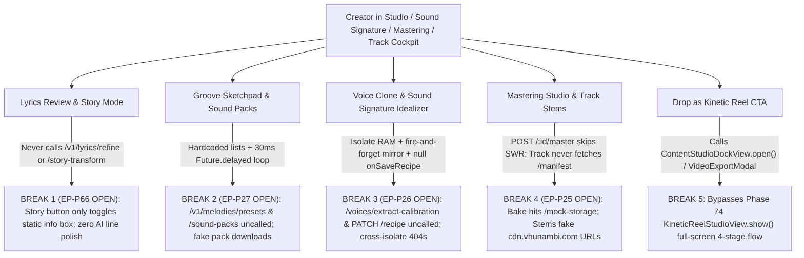

# Phase 75 — Studio Cockpit V5, 100% Connectome Closure (`EP-P66`/`P27`/`P26`/`P25`), Worker Voice/Mastering SWR & Direct-to-Reels Bridge — Forensic Audit

**Document ID:** `AUDIT-P75-STUDIO-CONNECTOME-001`  
**Date:** `2026-11-22`  
**Branch / Commit:** `fix/studio-cockpit-bugs-vh001-vh006` (`63441ff`)  
**Audit Scope:** Read-only static & cross-stack wire forensic audit across `apps/vhunambi_client/lib/features/{studio,sound_signature,mastering,track}/`, `apps/vhunambi_client/lib/features/home/presentation/widgets/cross_module_synergy_deck.dart`, `apps/vhunambi_client/lib/features/library/presentation/widgets/track_actions_sheet.dart`, `apps/vhunambi_client/lib/features/player/presentation/widgets/expanded_cockpit_modal.dart`, and `apps/vhunambi_api/src/{routes,db,modules}/`.  
**Related Specs & Memory:**
- [`docs/memory/CORTEX_INDEX.md`](file:///c:/Users/Ndugelo/VHUNAMBI/monorepo/docs/memory/CORTEX_INDEX.md)
- [`docs/audits/STUDIO_COCKPIT_AND_2D_SONG_CREATION_FLOW_AUDIT.md`](file:///c:/Users/Ndugelo/VHUNAMBI/monorepo/docs/audits/STUDIO_COCKPIT_AND_2D_SONG_CREATION_FLOW_AUDIT.md)
- [`docs/audits/MELODY_SKETCHPAD_AUDIO_ENGINE_AND_UI_AUDIT.md`](file:///c:/Users/Ndugelo/VHUNAMBI/monorepo/docs/audits/MELODY_SKETCHPAD_AUDIO_ENGINE_AND_UI_AUDIT.md)
- [`docs/audits/SOUND_SIGNATURE_INTAKE_AND_IDEALIZER_AUDIT.md`](file:///c:/Users/Ndugelo/VHUNAMBI/monorepo/docs/audits/SOUND_SIGNATURE_INTAKE_AND_IDEALIZER_AUDIT.md)
- [`docs/phases/phase_74_kinetic_reels_studio_and_playback_v4/memory.md`](file:///c:/Users/Ndugelo/VHUNAMBI/monorepo/docs/phases/phase_74_kinetic_reels_studio_and_playback_v4/memory.md)

---

## 1. Executive Summary & Headline Verdict

**Verdict: BACKEND CAPABILITIES BUILT, CLIENT & MULTI-ISOLATE WIRING SEVERED — 4/4 Open Connectome Endpoints Unconsumed + Cross-Isolate Mastering/Voice Split-Brain + Legacy Creation-to-Reels Links + Heavy `STD-UIUX-001` Drift.**

Phases 68–74 systematically modernized Home (`P68`), Kinetic Posts (`P69`, `P73`), Track Detail UI & Visitor Profile (`P70`), Asset Vault & Owner Profile (`P72`), and Instagram-Grade Kinetic Reels Studio (`P74`) — consolidating `13` phases into `43` Connectome endpoints (`36 CONNECTED_EXTENSIBLE`, `3 SEALED`, and **`4 OPEN`**).

All **`4` remaining `OPEN` endpoints** in Vhunambi live inside the flagship AI music creation spine (**Studio, Lyrics, Groove Sketchpad, Sound Signature / Voice Cloning, and Stem Mastering**):

1. **Zero-Consumer Connectome Gap (`OPEN` = 4 -> Target `0`):** Exhaustive search across `apps/vhunambi_client/lib/**/*.dart` confirms **0 callers** for all 8 routes behind `EP-P66-LYRICS-REFINE-STORY`, `EP-P27-MELODY-PRESETS-PACKS`, `EP-P26-VOICE-CALIBRATION-RECIPE`, and `EP-P25-GEN-MASTER-PRESETS`.
2. **Cloudflare Worker Isolate Split-Brain & `/mock-storage` Silent Fallbacks (`P0`/`P1`):**
   - [`generation_routes.ts#L374-425`](file:///c:/Users/Ndugelo/VHUNAMBI/monorepo/apps/vhunambi_api/src/routes/generation_routes.ts#L374-L425) (`POST /v1/generations/:id/master`) **never calls `syncGenerationJobFromCloud`**, causing cross-isolate mastering bakes to return `404 NOT_FOUND` so [`mastering_session_provider.dart#L486-515`](file:///c:/Users/Ndugelo/VHUNAMBI/monorepo/apps/vhunambi_client/lib/features/mastering/presentation/providers/mastering_session_provider.dart#L486-L515) silently records fake `/mock-storage/${trackId}_mastered.mp3` URLs as `hasBakedMaster = true`.
   - [`voice_routes.ts`](file:///c:/Users/Ndugelo/VHUNAMBI/monorepo/apps/vhunambi_api/src/routes/voice_routes.ts#L37-L316) and [`edge_persistence_bridge.ts#L7407-7470`](file:///c:/Users/Ndugelo/VHUNAMBI/monorepo/apps/vhunambi_api/src/db/edge_persistence_bridge.ts#L7407-L7470) have **zero `syncVoicesFromCloud` (12s SWR)**, use fire-and-forget `mirrorWriteThrough` instead of `awaitWriteThrough`, and are omitted from [`server.ts#L53-70`](file:///c:/Users/Ndugelo/VHUNAMBI/monorepo/apps/vhunambi_api/src/server.ts#L53-L70) `hasScopedReadThrough`. Meanwhile, client voice clone IDs (`vocal_identity_provider.dart#L428`) diverge from server-minted IDs (`voice_catalog.ts#L562`).
   - [`track_providers.dart#L101-149`](file:///c:/Users/Ndugelo/VHUNAMBI/monorepo/apps/vhunambi_client/lib/features/track/presentation/providers/track_providers.dart#L101-L149) `separateStems()` fabricates dead **`https://cdn.vhunambi.com/stems/...`** URLs instead of fetching `GET /v1/generations/:id/manifest`, while [`track_detail_view.dart#L392,421`](file:///c:/Users/Ndugelo/VHUNAMBI/monorepo/apps/vhunambi_client/lib/features/track/presentation/views/track_detail_view.dart#L392-L425) points downloads & video exports to **`https://cdn.vhunambi.com/...`** and leaves `onDownloadStem` ([`#L705-713`](file:///c:/Users/Ndugelo/VHUNAMBI/monorepo/apps/vhunambi_client/lib/features/track/presentation/views/track_detail_view.dart#L705-L713)) as a `SnackBar` dead-end.
3. **Severed Creation-to-Viral Bridge (`EP-P74-REELS-STUDIO-PIPELINE`):** Phase 74 shipped `KineticReelStudioView` and `LyricKaraokeSanitizer`, yet **4 creation entrypoints** ([`generation_pipeline_card.dart#L653-666`](file:///c:/Users/Ndugelo/VHUNAMBI/monorepo/apps/vhunambi_client/lib/features/studio/presentation/widgets/generation_pipeline_card.dart#L653-L666), [`track_actions_sheet.dart#L198-208`](file:///c:/Users/Ndugelo/VHUNAMBI/monorepo/apps/vhunambi_client/lib/features/library/presentation/widgets/track_actions_sheet.dart#L198-L208), [`expanded_cockpit_modal.dart#L961-967`](file:///c:/Users/Ndugelo/VHUNAMBI/monorepo/apps/vhunambi_client/lib/features/player/presentation/widgets/expanded_cockpit_modal.dart#L961-L967), and [`track_detail_view.dart#L415-425`](file:///c:/Users/Ndugelo/VHUNAMBI/monorepo/apps/vhunambi_client/lib/features/track/presentation/views/track_detail_view.dart#L415-L425)) still route creators into legacy `ContentStudioDockView.open(...)` or `VideoExportModal`.
4. **Heavy `STD-UIUX-001` & Pre-Phase-70 Surface Drift:** Studio (`15+` widgets), Mastering (`desktop_mastering_studio_view.dart`, `mobile_quick_master_sheet.dart`), and Sound Signature still contain **70+ stock `Icons.*`**, **90+ raw Unicode emojis** (`🎙️`, `🪵`, `🥁`, `🎹`, `🔥`, `🧬`, `🌐`, `🚀`, `🔒`), hardcoded hex colors outside painters, and non-glass canvases (`StudioView`, `DesktopMasteringStudioView`, `LyricsReviewModal`).

### Executive Root-Cause & Severity Matrix

| ID | Domain | Sev | Symptom | Primary Root Cause & Exact File/Line Evidence |
| :--- | :--- | :---: | :--- | :--- |
| **`MST-01`** | Mastering / API | **P0** | Cross-isolate Studio Bake fails `404` and silently saves fake `/mock-storage/` URLs | [`generation_routes.ts#L374-425`](file:///c:/Users/Ndugelo/VHUNAMBI/monorepo/apps/vhunambi_api/src/routes/generation_routes.ts#L374-L425) lacks `syncGenerationJobFromCloud(id, c)` & awaited persistence; [`mastering_session_provider.dart#L486-515`](file:///c:/Users/Ndugelo/VHUNAMBI/monorepo/apps/vhunambi_client/lib/features/mastering/presentation/providers/mastering_session_provider.dart#L486-L515) fakes success with `/mock-storage/`. |
| **`VOC-01`** | Voice / Worker | **P1** | Voice Clones & Sound Signatures vanish across Worker isolates; client ID != DB ID | [`edge_persistence_bridge.ts#L7407-7470`](file:///c:/Users/Ndugelo/VHUNAMBI/monorepo/apps/vhunambi_api/src/db/edge_persistence_bridge.ts#L7407-L7470) lacks `syncVoicesFromCloud` (12s SWR) & `awaitWriteThrough`; [`server.ts#L53-70`](file:///c:/Users/Ndugelo/VHUNAMBI/monorepo/apps/vhunambi_api/src/server.ts#L53-L70) omits `/v1/voices`; [`voice_catalog.ts#L562`](file:///c:/Users/Ndugelo/VHUNAMBI/monorepo/apps/vhunambi_api/src/modules/voices/voice_catalog.ts#L562) ignores client `id`. |
| **`VOC-02`** | Sound Signature | **P1** | Idealizer tweaks never sync to `PATCH /v1/voices/signatures/:id/recipe`; calibration offline-only | [`cross_module_synergy_deck.dart#L121-125`](file:///c:/Users/Ndugelo/VHUNAMBI/monorepo/apps/vhunambi_client/lib/features/home/presentation/widgets/cross_module_synergy_deck.dart#L121-L125) omits `onSaveRecipe` on `SoundSignatureIdealizerSheet`; [`vocal_identity_provider.dart#L388-398`](file:///c:/Users/Ndugelo/VHUNAMBI/monorepo/apps/vhunambi_client/lib/features/studio/presentation/providers/vocal_identity_provider.dart#L388-L398) ignores `POST /v1/voices/extract-calibration`. |
| **`LYR-01`** | Lyrics Review | **P1** | Story Mode toggle only shows an info banner; line-level AI refinement is absent | [`lyrics_review_modal.dart#L126,139-172`](file:///c:/Users/Ndugelo/VHUNAMBI/monorepo/apps/vhunambi_client/lib/features/studio/presentation/widgets/lyrics_review_modal.dart#L126-L172) never calls `POST /v1/lyrics/story-transform`; [`http_lyrics_generation_service.dart#L34-76`](file:///c:/Users/Ndugelo/VHUNAMBI/monorepo/apps/vhunambi_client/lib/features/studio/data/services/http_lyrics_generation_service.dart#L34-L76) never calls `/v1/lyrics/refine`. |
| **`SKP-01`** | Sketchpad / Packs | **P1** | Starter patterns hardcoded locally; Sound Pack Store fakes downloads with 30ms timers | [`melody_sketchpad_provider.dart#L28,139-153`](file:///c:/Users/Ndugelo/VHUNAMBI/monorepo/apps/vhunambi_client/lib/features/studio/presentation/providers/melody_sketchpad_provider.dart#L28-L153) never fetches `/v1/melodies/presets`; [`sound_pack_manager_provider.dart#L15,99-110`](file:///c:/Users/Ndugelo/VHUNAMBI/monorepo/apps/vhunambi_client/lib/features/studio/presentation/providers/sound_pack_manager_provider.dart#L15-L110) never calls `/v1/melodies/sound-packs` or downloads R2 bundles. |
| **`TRK-01`** | Track / Mastering | **P1** | `separateStems()` generates dead `cdn.vhunambi.com` URLs; `onDownloadStem` is a SnackBar stub | [`track_providers.dart#L101-149`](file:///c:/Users/Ndugelo/VHUNAMBI/monorepo/apps/vhunambi_client/lib/features/track/presentation/providers/track_providers.dart#L101-L149) ignores `GET /v1/generations/:id/manifest`; [`track_detail_view.dart#L392,421,705-713`](file:///c:/Users/Ndugelo/VHUNAMBI/monorepo/apps/vhunambi_client/lib/features/track/presentation/views/track_detail_view.dart#L392-L713) uses `cdn.vhunambi.com` & SnackBar dead-end. |
| **`REEL-01`** | Viral Bridge | **P1** | `"Create Reel"` in Studio, Track Cockpit, Vault & Player still opens legacy `ContentStudioDockView` | [`generation_pipeline_card.dart#L655`](file:///c:/Users/Ndugelo/VHUNAMBI/monorepo/apps/vhunambi_client/lib/features/studio/presentation/widgets/generation_pipeline_card.dart#L655), [`track_actions_sheet.dart#L200`](file:///c:/Users/Ndugelo/VHUNAMBI/monorepo/apps/vhunambi_client/lib/features/library/presentation/widgets/track_actions_sheet.dart#L200), [`expanded_cockpit_modal.dart#L961`](file:///c:/Users/Ndugelo/VHUNAMBI/monorepo/apps/vhunambi_client/lib/features/player/presentation/widgets/expanded_cockpit_modal.dart#L961), [`track_detail_view.dart#L424`](file:///c:/Users/Ndugelo/VHUNAMBI/monorepo/apps/vhunambi_client/lib/features/track/presentation/views/track_detail_view.dart#L424). |
| **`UI-01..03`** | Cross-UI / Teleprompter | **P2** | 70+ `Icons.*`, 90+ raw Unicode emojis, pre-Phase-70 non-Glass surfaces, unsanitized Teleprompter | [`desktop_mastering_studio_view.dart`](file:///c:/Users/Ndugelo/VHUNAMBI/monorepo/apps/vhunambi_client/lib/features/mastering/presentation/views/desktop_mastering_studio_view.dart), [`mobile_quick_master_sheet.dart`](file:///c:/Users/Ndugelo/VHUNAMBI/monorepo/apps/vhunambi_client/lib/features/mastering/presentation/widgets/mobile_quick_master_sheet.dart), `studio/widgets/`, [`lyrics_teleprompter.dart#L25`](file:///c:/Users/Ndugelo/VHUNAMBI/monorepo/apps/vhunambi_client/lib/features/track/presentation/widgets/lyrics_teleprompter.dart#L25). |

### End-to-End Breakpoint Topology Map



---

## 2. Step 0 Connectome Wake Findings (`vhunambi-memory`)

Running `query_connectome.mjs --open` and `--hubs ai_synthesis_gpu,audio_transport,identity_role,mood_taxonomy` identifies every `OPEN` backend contract and `CONNECTED_EXTENSIBLE` Phase 68–74 primitive involved in Phase 75:

| Connectome Endpoint ID | State | Code Anchor | Phase 75 Mandate |
| :--- | :---: | :--- | :--- |
| **`EP-P66-LYRICS-REFINE-STORY`** | `OPEN` (`0` consumers) | [`lyrics_routes.ts#L72-149`](file:///c:/Users/Ndugelo/VHUNAMBI/monorepo/apps/vhunambi_api/src/routes/lyrics_routes.ts#L72-L149) | Consume `POST /v1/lyrics/refine` & `POST /v1/lyrics/story-transform` inside `HttpLyricsGenerationService`, `LyricsReviewNotifier`, and `LyricsReviewModal` / `GuidedLyricsComposer`. Promote to `CONNECTED_EXTENSIBLE`. |
| **`EP-P27-MELODY-PRESETS-PACKS`** | `OPEN` (`0` consumers) | [`melody_routes.ts#L53-165`](file:///c:/Users/Ndugelo/VHUNAMBI/monorepo/apps/vhunambi_api/src/routes/melody_routes.ts#L53-L165) | Consume `GET /v1/melodies/presets` & `GET /v1/melodies/sound-packs` inside `MelodySketchpadNotifier` and `SoundPackManagerNotifier`. Promote to `CONNECTED_EXTENSIBLE`. |
| **`EP-P26-VOICE-CALIBRATION-RECIPE`** | `OPEN` (`0` consumers) | [`voice_routes.ts#L62-268`](file:///c:/Users/Ndugelo/VHUNAMBI/monorepo/apps/vhunambi_api/src/routes/voice_routes.ts#L62-L268) | Consume `POST /v1/voices/extract-calibration`, `GET /v1/voices/signatures/:id`, & `PATCH /v1/voices/signatures/:id/recipe` + add 12s `syncVoicesFromCloud` SWR in `edge_persistence_bridge.ts`. Promote to `CONNECTED_EXTENSIBLE`. |
| **`EP-P25-GEN-MASTER-PRESETS`** | `OPEN` (`0` consumers) | [`generation_routes.ts#L235-367`](file:///c:/Users/Ndugelo/VHUNAMBI/monorepo/apps/vhunambi_api/src/routes/generation_routes.ts#L235-L367) | Consume `GET /v1/generations/mastering/presets` in `MasteringSessionNotifier` and `GET /v1/generations/:id/manifest` in `TrackDetailNotifier` & Mastering Studio; add SWR to `POST /:id/master`. Promote to `CONNECTED_EXTENSIBLE`. |
| **`EP-P74-REELS-STUDIO-PIPELINE`** | `CONNECTED_EXTENSIBLE` | [`kinetic_reel_studio_view.dart#L48-72`](file:///c:/Users/Ndugelo/VHUNAMBI/monorepo/apps/vhunambi_client/lib/features/content_studio/presentation/views/kinetic_reel_studio_view.dart#L48-L72) | Route Studio `_ReadyTrackCard`, `TrackDetailView`, `TrackActionsSheet`, and `ExpandedCockpitModal` directly into `KineticReelStudioView.show(context, initialTrack: ...)`. |
| **`EP-P74-KARAOKE-LYRIC-SANITIZER`** | `CONNECTED_EXTENSIBLE` | [`lyric_karaoke_sanitizer.dart`](file:///c:/Users/Ndugelo/VHUNAMBI/monorepo/apps/vhunambi_client/lib/features/content_studio/domain/utils/lyric_karaoke_sanitizer.dart) | Apply in [`lyrics_teleprompter.dart#L25`](file:///c:/Users/Ndugelo/VHUNAMBI/monorepo/apps/vhunambi_client/lib/features/track/presentation/widgets/lyrics_teleprompter.dart#L25) and `BantuLyricTranslationService` so instrument cues never display as sung lyrics. |
| **`EP-P70-GLASS-SURFACE`** | `CONNECTED_EXTENSIBLE` | [`vhunambi_glass_surface.dart`](file:///c:/Users/Ndugelo/VHUNAMBI/monorepo/apps/vhunambi_client/lib/core/widgets/vhunambi_glass_surface.dart) | Adopt `VhunambiAmbientMeshBackdrop` / `VhunambiGlassSurface` (`enableLiveBlur: false` on scrollable cards) across `StudioView`, `DesktopMasteringStudioView`, `MobileQuickMasterSheet`, and `LyricsReviewModal`. |

---

## 3. Pillar-by-Pillar Forensic Findings

### Pillar 1: `EP-P66-LYRICS-REFINE-STORY` — Line Refinement & Story-to-Lyrics Wire Gap

Backend routes `POST /v1/lyrics/refine` ([`lyrics_routes.ts#L72-104`](file:///c:/Users/Ndugelo/VHUNAMBI/monorepo/apps/vhunambi_api/src/routes/lyrics_routes.ts#L72-L104)) and `POST /v1/lyrics/story-transform` ([`lyrics_routes.ts#L108-149`](file:///c:/Users/Ndugelo/VHUNAMBI/monorepo/apps/vhunambi_api/src/routes/lyrics_routes.ts#L108-L149)) are live, Zod-validated, and backed by `refineLyricsWithLLM` and `transformStoryToLyrics` ([`story_transform.ts`](file:///c:/Users/Ndugelo/VHUNAMBI/monorepo/apps/vhunambi_api/src/modules/lyrics/story_transform.ts)). On the client, however:

- [`ILyricsGenerationService`](file:///c:/Users/Ndugelo/VHUNAMBI/monorepo/apps/vhunambi_client/lib/features/studio/domain/services/i_lyrics_generation_service.dart) and [`HttpLyricsGenerationService`](file:///c:/Users/Ndugelo/VHUNAMBI/monorepo/apps/vhunambi_client/lib/features/studio/data/services/http_lyrics_generation_service.dart#L34-L82) only implement `generateLyrics(...)` (`POST /v1/lyrics/generate`) and `getCulturalIdioms(...)`.
- [`LyricsReviewModal`](file:///c:/Users/Ndugelo/VHUNAMBI/monorepo/apps/vhunambi_client/lib/features/studio/presentation/widgets/lyrics_review_modal.dart#L126,L139-L172) includes a header button `Key('lyrics_story_mode_toggle')` (`#L438`), but tapping it merely flips boolean `_storyMode` and displays a static info banner (`'Story-to-Lyrics Mode Active...'`) without any story text input or HTTP call to `/v1/lyrics/story-transform`.
- Neither [`LyricsReviewNotifier`](file:///c:/Users/Ndugelo/VHUNAMBI/monorepo/apps/vhunambi_client/lib/features/studio/presentation/providers/lyrics_review_provider.dart#L32-L185) nor `_LyricsSectionCard` ([`lyrics_review_modal.dart#L546-698`](file:///c:/Users/Ndugelo/VHUNAMBI/monorepo/apps/vhunambi_client/lib/features/studio/presentation/widgets/lyrics_review_modal.dart#L546-L698)) exposes stanza/line AI refinement against `POST /v1/lyrics/refine`.
- **Wire Nuance in `lyrics_routes.ts#L108-135`:** `StoryTransformSchema` requires `storyText` `>= 20` chars (`trim().min(20).max(3000)`), `genre` normalized via `normalizeGenre()` (lowercase), and `baseLanguage` as a 2-letter ISO code (`ve`, `zu`, `xh`, `st`, `tn`, `nso`, `ts`, `ss`, `nr`, `en`, etc.) — whereas Flutter `studioFormProvider` holds display names like `'Tshivenḓa'` and `'Amapiano'`. Client MUST normalize display language names to ISO codes before posting, or `POST /v1/lyrics/story-transform` will HTTP `400 UNSUPPORTED_LANGUAGE`!

| ID | Sev | File & Line(s) | Exact Defect | Concrete Remediation Pattern |
| :--- | :---: | :--- | :--- | :--- |
| **`LYR-01`** | **P1** | [`http_lyrics_generation_service.dart#L34-76`](file:///c:/Users/Ndugelo/VHUNAMBI/monorepo/apps/vhunambi_client/lib/features/studio/data/services/http_lyrics_generation_service.dart#L34-L76), [`lyrics_review_provider.dart#L59-180`](file:///c:/Users/Ndugelo/VHUNAMBI/monorepo/apps/vhunambi_client/lib/features/studio/presentation/providers/lyrics_review_provider.dart#L59-L180) | Only calls `/v1/lyrics/generate`; zero client methods for `/v1/lyrics/refine` or `/v1/lyrics/story-transform` | Add `refineLyrics(...)` and `transformStoryToLyrics(...)` to `ILyricsGenerationService`, `HttpLyricsGenerationService` (with ISO language normalization & local fallback), and `LyricsReviewNotifier`. |
| **`LYR-02`** | **P1** | [`lyrics_review_modal.dart#L126,139-172,546-698`](file:///c:/Users/Ndugelo/VHUNAMBI/monorepo/apps/vhunambi_client/lib/features/studio/presentation/widgets/lyrics_review_modal.dart#L126-L698) | `_storyMode` renders static info banner only; stanzas lack AI Refine action | Add Story Composer drawer inside `_storyMode` (`storyText` >= 20 chars -> `/v1/lyrics/story-transform`) and per-stanza / quick-preset "AI Polish" CTA calling `refineLyrics` (`POST /v1/lyrics/refine`). |
| **`LYR-03`** | **P2** | [`lyrics_section_scaffold.dart#L84-186`](file:///c:/Users/Ndugelo/VHUNAMBI/monorepo/apps/vhunambi_client/lib/features/studio/domain/models/lyrics_section_scaffold.dart#L84-L186) | `42` `AtmosphereDescriptor(..., emoji: '🥁')` raw Unicode emojis rendered in Guided Lyrics Composer | Map `AtmosphereDescriptor` to semantic `IconData` (`PhosphorIconsRegular.*`) tokens per `STD-UIUX-001`. |

---

### Pillar 2: `EP-P27-MELODY-PRESETS-PACKS` — Static Presets & Simulated Sound Pack Store

Backend routes `GET /v1/melodies/presets` ([`melody_routes.ts#L53-63`](file:///c:/Users/Ndugelo/VHUNAMBI/monorepo/apps/vhunambi_api/src/routes/melody_routes.ts#L53-L63)) and `GET /v1/melodies/sound-packs` ([`melody_routes.ts#L69-165`](file:///c:/Users/Ndugelo/VHUNAMBI/monorepo/apps/vhunambi_api/src/routes/melody_routes.ts#L69-L165)) return canonical R2-resolved starter patterns and 6 regional expansion packs (`pack_vhunambi_core_native`, `pack_private_school_vip`, etc.). Yet:

- [`melody_sketchpad_provider.dart#L28,139-153`](file:///c:/Users/Ndugelo/VHUNAMBI/monorepo/apps/vhunambi_client/lib/features/studio/presentation/providers/melody_sketchpad_provider.dart#L28-L153) initializes `starterPresets = kStarterMelodyPatterns` synchronously and **never calls `GET /v1/melodies/presets`**.
- [`sound_pack_manager_provider.dart#L15,37-126`](file:///c:/Users/Ndugelo/VHUNAMBI/monorepo/apps/vhunambi_client/lib/features/studio/presentation/providers/sound_pack_manager_provider.dart#L15-L126) initializes `packs = kOfficialSoundPacks` statically with **no HTTP fetch (`GET /v1/melodies/sound-packs`)**, and `downloadSoundPack()` (`#L99-110`) runs a pure 4-step `Future.delayed(Duration(milliseconds: 30))` loop without fetching `pack.downloadUrl` or validating non-empty remote bytes (while skipping network safely in `FLUTTER_TEST`).
- Note also [`server.ts#L53-78`](file:///c:/Users/Ndugelo/VHUNAMBI/monorepo/apps/vhunambi_api/src/server.ts#L53-L78): `/v1/melodies` is NOT in `hasScopedReadThrough`, forcing every cold-isolate `GET /v1/melodies/presets` or `sound-packs` request to run a full 21-table `ensureColdStartHydrated(c)` Supabase scan first even though those routes don't read SQLite!

| ID | Sev | File & Line(s) | Exact Defect | Concrete Remediation Pattern |
| :--- | :---: | :--- | :--- | :--- |
| **`SKP-01`** | **P1** | [`sound_pack_manager_provider.dart#L15,37-126`](file:///c:/Users/Ndugelo/VHUNAMBI/monorepo/apps/vhunambi_client/lib/features/studio/presentation/providers/sound_pack_manager_provider.dart#L15-L126) | Never fetches `GET /v1/melodies/sound-packs`; fakes downloads via `Future.delayed(30ms)` | Add `fetchSoundPacksCatalog()` hitting `/v1/melodies/sound-packs` (preserving bundled fallback offline/`FLUTTER_TEST`) and stream/verify `pack.downloadUrl` bytes in `downloadSoundPack()` before marking installed. |
| **`SKP-02`** | **P1** | [`melody_sketchpad_provider.dart#L28,139-153`](file:///c:/Users/Ndugelo/VHUNAMBI/monorepo/apps/vhunambi_client/lib/features/studio/presentation/providers/melody_sketchpad_provider.dart#L28-L153) | Static `kStarterMelodyPatterns` only; `GET /v1/melodies/presets` uncalled | Add `syncStarterPresetsFromCloud()` calling `/v1/melodies/presets` (deduped in-flight, parsing `presets[]` safely via `JsonSafe`, zero breaking change to default constructor state). |
| **`SKP-03`** | **P2** | [`melody_sketchpad_models.dart#L6-22`](file:///c:/Users/Ndugelo/VHUNAMBI/monorepo/apps/vhunambi_client/lib/features/studio/domain/models/melody_sketchpad_models.dart#L6-L22), [`heritage_crate_models.dart#L5-10`](file:///c:/Users/Ndugelo/VHUNAMBI/monorepo/apps/vhunambi_client/lib/features/studio/domain/models/heritage_crate_models.dart#L5-L10) | `14` instrument enum strings (`'🥁'`, `'🎹'`, `'🪵'`, `'🪈'`) and `6` crate filter emojis rendered in UI | Expose semantic `IconData` getter (`PhosphorIconsRegular.*`) on `SketchpadInstrument` & `HeritageCategory`; purge emoji UI rendering. |

---

### Pillar 3: `EP-P26-VOICE-CALIBRATION-RECIPE` — Worker Voice SWR Split-Brain & Unwired Calibration/Recipe Flow

Inspection of [`voice_routes.ts`](file:///c:/Users/Ndugelo/VHUNAMBI/monorepo/apps/vhunambi_api/src/routes/voice_routes.ts), [`voice_catalog.ts`](file:///c:/Users/Ndugelo/VHUNAMBI/monorepo/apps/vhunambi_api/src/modules/voices/voice_catalog.ts), [`edge_persistence_bridge.ts`](file:///c:/Users/Ndugelo/VHUNAMBI/monorepo/apps/vhunambi_api/src/db/edge_persistence_bridge.ts), [`sound_signature_repository.dart`](file:///c:/Users/Ndugelo/VHUNAMBI/monorepo/apps/vhunambi_client/lib/features/sound_signature/data/sound_signature_repository.dart), and [`vocal_identity_provider.dart`](file:///c:/Users/Ndugelo/VHUNAMBI/monorepo/apps/vhunambi_client/lib/features/studio/presentation/providers/vocal_identity_provider.dart) exposed **5 structural breaks**:

1. **Missing 12s SWR & Async Write-Through in `voice_routes.ts` / `edge_persistence_bridge.ts`:**
   - Although Supabase tables `public.sound_signatures` and `public.voice_clones` exist ([`20261110000001_phase62_hybrid_cloud_schema.sql#L245,327`](file:///c:/Users/Ndugelo/VHUNAMBI/monorepo/supabase/migrations/20261110000001_phase62_hybrid_cloud_schema.sql#L245-L338)), [`edge_persistence_bridge.ts#L7407-7470`](file:///c:/Users/Ndugelo/VHUNAMBI/monorepo/apps/vhunambi_api/src/db/edge_persistence_bridge.ts#L7407-L7470) only performs fire-and-forget `mirrorWriteThrough` on `upsertVoiceClone`, `upsertSoundSignature`, and `deleteSoundSignature` and has **zero `syncVoicesFromCloud` (12s SWR)** helper!
   - [`voice_routes.ts#L139-316`](file:///c:/Users/Ndugelo/VHUNAMBI/monorepo/apps/vhunambi_api/src/routes/voice_routes.ts#L139-L316) (`GET /clone/:id`, `PATCH /signatures/:id/recipe`, `GET /signatures/:id`, `DELETE /signatures/:id`) reads isolate RAM synchronously without refreshing from Supabase (`404 NOT_FOUND` across isolates!).
   - [`server.ts#L53-78`](file:///c:/Users/Ndugelo/VHUNAMBI/monorepo/apps/vhunambi_api/src/server.ts#L53-L78) omits `/v1/voices` from `hasScopedReadThrough`, triggering an expensive 21-table cold-start load once per isolate and then going permanently stale.
2. **Voice Clone ID Mismatch Between Client and Worker (`vocal_identity_provider.dart#L428` vs `voice_catalog.ts#L562`):**
   - Flutter generates `id: 'vclone_${DateTime.now().millisecondsSinceEpoch}'`, passes `profileId` into `PreGenR2UploadService.uploadVoiceCloneReference(...)` ([`#L117-153`](file:///c:/Users/Ndugelo/VHUNAMBI/monorepo/apps/vhunambi_client/lib/features/studio/data/services/pre_gen_r2_upload_service.dart#L117-L153)), uploads audio to `voice-clones/${profileId}_ref.wav`, and posts `POST /v1/voices/clone` **without sending `id` or `creatorId`**.
   - Server [`voice_catalog.ts#L562`](file:///c:/Users/Ndugelo/VHUNAMBI/monorepo/apps/vhunambi_api/src/modules/voices/voice_catalog.ts#L562) ignores any client ID and generates a *second* random ID (`vclone_${Date.now()}_${Math.random()...}`), storing a mismatched `voice_id` in `voice_clones` that `clonedVoiceProfileId` on `POST /v1/generations` can never resolve!
   - Worse still, [`voice_catalog.ts#L588`](file:///c:/Users/Ndugelo/VHUNAMBI/monorepo/apps/vhunambi_api/src/modules/voices/voice_catalog.ts#L588) falls back to dead `https://r2.vhunambi.com/voice-clones/...` and [`vocal_identity_models.dart#L293-638`](file:///c:/Users/Ndugelo/VHUNAMBI/monorepo/apps/vhunambi_client/lib/features/studio/domain/models/vocal_identity_models.dart#L293-L638) + [`voice_catalog.ts#L34-356`](file:///c:/Users/Ndugelo/VHUNAMBI/monorepo/apps/vhunambi_api/src/modules/voices/voice_catalog.ts#L34-L356) contain `24` `/mock-storage/vox_*.mp3` preview URLs.
3. **`POST /v1/voices/extract-calibration` (`EP-P26`) Unconsumed:** [`vocal_identity_provider.dart#L388-398`](file:///c:/Users/Ndugelo/VHUNAMBI/monorepo/apps/vhunambi_client/lib/features/studio/presentation/providers/vocal_identity_provider.dart#L388-L398) (`prepareCalibrationFromLyrics`) and [`voice_clone_recorder_sheet.dart#L60-70`](file:///c:/Users/Ndugelo/VHUNAMBI/monorepo/apps/vhunambi_client/lib/features/studio/presentation/widgets/voice_clone_recorder_sheet.dart#L60-L70) only invoke local `PhoneticCalibrationExtractor`, never calling `POST /v1/voices/extract-calibration`.
4. **`PATCH /v1/voices/signatures/:id/recipe` & `DELETE /v1/voices/signatures/:id` (`EP-P26`) Unconsumed:** [`cross_module_synergy_deck.dart#L121-125`](file:///c:/Users/Ndugelo/VHUNAMBI/monorepo/apps/vhunambi_client/lib/features/home/presentation/widgets/cross_module_synergy_deck.dart#L121-L125) instantiates `SoundSignatureIdealizerSheet` **without `onSaveRecipe`, `onApplyStem`, `onUseAsVoiceClone`, or `onDelete` callbacks**! Tapping `"Save Idealized Stem"` (`sound_signature_idealizer_sheet.dart#L84-112`) silently closes the modal with **zero Hive save and zero `PATCH /v1/voices/signatures/:id/recipe` HTTP sync**.
5. **Dual Voice/Signature `mounted` / Nullability Risk:** `sound_signature_dna.dart#L183-199` and `phonetic_articulation_profile.dart#L68-69` perform raw `as Map<String, dynamic>` / `as List<dynamic>` casts without `JsonSafe`.

| ID | Sev | File & Line(s) | Exact Defect | Concrete Remediation Pattern |
| :--- | :---: | :--- | :--- | :--- |
| **`VOC-01`** | **P1** | [`edge_persistence_bridge.ts#L7407-7470`](file:///c:/Users/Ndugelo/VHUNAMBI/monorepo/apps/vhunambi_api/src/db/edge_persistence_bridge.ts#L7407-L7470), [`voice_routes.ts#L139-316`](file:///c:/Users/Ndugelo/VHUNAMBI/monorepo/apps/vhunambi_api/src/routes/voice_routes.ts#L139-L316), [`server.ts#L53-70`](file:///c:/Users/Ndugelo/VHUNAMBI/monorepo/apps/vhunambi_api/src/server.ts#L53-L70) | Fire-and-forget writes, 0 `syncVoicesFromCloud` (12s SWR), `/v1/voices` missing from `hasScopedReadThrough`, and `voice_id` vs client `id` mismatch | Add `syncVoicesFromCloud` (12s SWR across `voice_clones` + `sound_signatures`) + `upsertVoiceCloneAsync` / `upsertSoundSignatureAsync` / `deleteSoundSignatureAsync` (`awaitWriteThrough`), add `/v1/voices` (+ `/v1/melodies`, `/v1/lyrics`) to `hasScopedReadThrough`, allow optional validated `id` in `CreateVoiceCloneRequestSchema`, and sync `creatorId` on client. |
| **`VOC-02`** | **P1** | [`cross_module_synergy_deck.dart#L121-125`](file:///c:/Users/Ndugelo/VHUNAMBI/monorepo/apps/vhunambi_client/lib/features/home/presentation/widgets/cross_module_synergy_deck.dart#L121-L125), [`sound_signature_repository.dart#L88-122`](file:///c:/Users/Ndugelo/VHUNAMBI/monorepo/apps/vhunambi_client/lib/features/sound_signature/data/sound_signature_repository.dart#L88-L122) | `SoundSignatureIdealizerSheet` mounted with no `onSaveRecipe`/`onUseAsVoiceClone`/`onDelete`; zero calls to `PATCH /v1/voices/signatures/:id/recipe` or `DELETE` | Add `updateRecipeInCloud(sigId, recipe)`, `syncSignatureFromCloud(sigId)`, and `deleteSignatureInCloud(sigId)` on `SoundSignatureRepository` and wire all callbacks in `CrossModuleSynergyDeck` (and `Studio` / `VoiceCloneRecorderSheet`). |
| **`VOC-03`** | **P1** | [`vocal_identity_provider.dart#L388-398,427-466`](file:///c:/Users/Ndugelo/VHUNAMBI/monorepo/apps/vhunambi_client/lib/features/studio/presentation/providers/vocal_identity_provider.dart#L388-L466), [`pre_gen_r2_upload_service.dart#L117-156`](file:///c:/Users/Ndugelo/VHUNAMBI/monorepo/apps/vhunambi_client/lib/features/studio/data/services/pre_gen_r2_upload_service.dart#L117-L156) | `POST /v1/voices/extract-calibration` uncalled; `POST /v1/voices/clone` returns server profile whose `id` is discarded; `GET /v1/voices/catalog` uncalled | Add `extractCalibrationFromCloud(lyrics, language)` + `syncCatalogFromCloud()` on `VocalIdentityNotifier` (with local fallback offline/`FLUTTER_TEST`) and forward client `voiceId` + canonical `creatorId` on `POST /v1/voices/clone`. |

---

### Pillar 4: `EP-P25-GEN-MASTER-PRESETS` — Cross-Isolate Mastering Split-Brain, Fake `/mock-storage` Fallback & Fake Stems

Tracing Studio Mastering & Track Cockpit from Flutter $\to$ Worker $\to$ Postgres reveals one **`P0` cloud persistence break** plus two **`P1` dead client links**:

1. **Cross-Isolate `404` & Silent `/mock-storage/` Poisoning in `POST /v1/generations/:id/master` (`P0`):**
   - Look at [`generation_routes.ts#L249-254`](file:///c:/Users/Ndugelo/VHUNAMBI/monorepo/apps/vhunambi_api/src/routes/generation_routes.ts#L249-L254) (`GET /:id`) and [`#L339-344`](file:///c:/Users/Ndugelo/VHUNAMBI/monorepo/apps/vhunambi_api/src/routes/generation_routes.ts#L339-L344) (`GET /:id/manifest`): both correctly hydrate cold Worker isolates via `await vhunambiDb.syncGenerationJobFromCloud(id, c)`.
   - Now look at [`generation_routes.ts#L374-425`](file:///c:/Users/Ndugelo/VHUNAMBI/monorepo/apps/vhunambi_api/src/routes/generation_routes.ts#L374-L425) (`POST /v1/generations/:id/master`): it calls only `const job = getJob(id);` in isolate RAM! Whenever a user opens Mastering Studio for a freshly generated song (`gen_...`) and Cloudflare routes `POST /:id/master` to a different Worker isolate, `getJob(id)` returns `undefined` $\to$ HTTP `404 NOT_FOUND` $\to$ Flutter [`mastering_session_provider.dart#L486-515`](file:///c:/Users/Ndugelo/VHUNAMBI/monorepo/apps/vhunambi_client/lib/features/mastering/presentation/providers/mastering_session_provider.dart#L486-L515) **catches non-2xx / errors, sets `hasBakedMaster: true`, and saves `/mock-storage/${state.trackId}_mastered.mp3` into Hive without surfacing any error!**
   - Furthermore, line `#L416` calls synchronous `completeJob(id, ...)` (`mirrorWriteThrough` only) instead of awaiting Postgres write-through (`awaitWriteThrough`), so the enriched manifest with `masteringRecipe` can be dropped if the isolate yields before `waitUntil` flushes.
   - And note `enrichManifestWithMasteringRecipe(...)` inside `generation_routes.ts#L413`: let's verify in execution whether `enrichedManifest.assets.masterMp3Url` preserves valid R2 URLs cleanly when `job.masterMp3Url` exists (when `syncGenerationJobFromCloud` hydrates `job` first, `baseManifest` preserves real R2 URLs instead of dummy defaults!).
2. **`GET /v1/generations/mastering/presets` Unconsumed:** [`desktop_mastering_studio_view.dart#L232-248`](file:///c:/Users/Ndugelo/VHUNAMBI/monorepo/apps/vhunambi_client/lib/features/mastering/presentation/views/desktop_mastering_studio_view.dart#L232-L248) and `mobile_quick_master_sheet.dart` read only static `kGenreMasterPresets` locally, never syncing server presets from `/v1/generations/mastering/presets`.
3. **Fake `cdn.vhunambi.com` Stems & Dead-End Stem Downloads in `TrackDetailView` (`P1`):**
   - [`track_providers.dart#L101-149`](file:///c:/Users/Ndugelo/VHUNAMBI/monorepo/apps/vhunambi_client/lib/features/track/presentation/providers/track_providers.dart#L101-L149) (`separateStems()`) runs a `40ms` simulated loop and emits 4 hardcoded **`https://cdn.vhunambi.com/stems/${trackId}_{vocals,drums,bass,inst}.wav`** URLs instead of fetching real RunPod/R2 4-stem URLs from `GET /v1/generations/:id/manifest`!
   - [`track_detail_view.dart#L392`](file:///c:/Users/Ndugelo/VHUNAMBI/monorepo/apps/vhunambi_client/lib/features/track/presentation/views/track_detail_view.dart#L392) (`_showDownloadDialog` WAV) hardcodes `'https://cdn.vhunambi.com/audio/${track.id}.wav'` instead of `track.audioUrl`, and `#L705-713` (`onDownloadStem`) **only calls `ScaffoldMessenger.of(context).showSnackBar(...)`** without calling `stemDownloadServiceProvider` / `downloadManagerProvider`!

| ID | Sev | File & Line(s) | Exact Defect | Concrete Remediation Pattern |
| :--- | :---: | :--- | :--- | :--- |
| **`MST-01`** | **P0** | [`generation_routes.ts#L374-425`](file:///c:/Users/Ndugelo/VHUNAMBI/monorepo/apps/vhunambi_api/src/routes/generation_routes.ts#L374-L425) | `POST /:id/master` omits `syncGenerationJobFromCloud(id, c)` and awaited write-through | Hydrate `job` via `await vhunambiDb.syncGenerationJobFromCloud(id, c)` when `!job`, enrich real manifest, and `await vhunambiDb.awaitWriteThrough(...)` before returning `200`. |
| **`MST-02`** | **P1** | [`mastering_session_provider.dart#L485-516`](file:///c:/Users/Ndugelo/VHUNAMBI/monorepo/apps/vhunambi_client/lib/features/mastering/presentation/providers/mastering_session_provider.dart#L485-L516) | Non-2xx HTTP `404`/`500` fakes `hasBakedMaster: true` with `/mock-storage/` URLs; `GET /v1/generations/mastering/presets` never called | Add `syncMasteringPresetsFromCloud({String? genre})`; surface real server error state on 4xx/5xx instead of `/mock-storage/` poisoning (restrict offline fallback strictly to `FLUTTER_TEST` / offline mode). |
| **`TRK-01`** | **P1** | [`track_providers.dart#L101-149,281-368`](file:///c:/Users/Ndugelo/VHUNAMBI/monorepo/apps/vhunambi_client/lib/features/track/presentation/providers/track_providers.dart#L101-L368), [`track_detail_view.dart#L392,705-713`](file:///c:/Users/Ndugelo/VHUNAMBI/monorepo/apps/vhunambi_client/lib/features/track/presentation/views/track_detail_view.dart#L392-L713) | `separateStems()` fakes `cdn.vhunambi.com` stems; `onDownloadStem` is a SnackBar dead-end; `_lookupInitialTrack` drops `remoteAudioUrl` | Fetch `GET /v1/generations/:id/manifest` inside `TrackDetailNotifier.hydrateManifestAndStems()` + `separateStems()` to populate real R2 stem URLs & MMO telemetry; wire `onDownloadStem` to `stemDownloadServiceProvider` / real URL download. |

---

### Pillar 5: Direct Creation-to-Viral Bridge (`EP-P74`), `LyricKaraokeSanitizer` & `STD-UIUX-001` Surface Census

#### 5.1 Severed Creation-to-Reels Call Sites (Must Route to `KineticReelStudioView.show`)
Phase 74 wired Card #0 in `TrendingReelsShelf` and the toolbar button in `ContentStudioDockView` into `KineticReelStudioView.show(context)`, leaving **4 core music surfaces** on the legacy dock or dead `cdn.vhunambi.com` URLs:

1. **Studio Completion (`_ReadyTrackCard`):** [`generation_pipeline_card.dart#L652-686`](file:///c:/Users/Ndugelo/VHUNAMBI/monorepo/apps/vhunambi_client/lib/features/studio/presentation/widgets/generation_pipeline_card.dart#L652-L686) (`Key('pipeline_create_reel_btn')`) calls `ContentStudioDockView.open(...)` with fallback `'https://r2.vhunambi.com/visuals/default_9_16.png'` instead of `KineticReelStudioView.show(context, initialTrack: LibraryTrack(...))`!
2. **Track Cockpit (`TrackDetailView`):** [`track_detail_view.dart#L415-425,L633`](file:///c:/Users/Ndugelo/VHUNAMBI/monorepo/apps/vhunambi_client/lib/features/track/presentation/views/track_detail_view.dart#L415-L633) (`UtilityToolDock` `'Export Reel'`) builds a `VideoExportJob` with dead `'https://cdn.vhunambi.com/audio/${track.id}.mp3'` and opens old `VideoExportModal` instead of `KineticReelStudioView.show(context, initialTrack: ...)` (preserving/updating `track_detail_test` cleanly).
3. **Asset Vault Sheet (`TrackActionsSheet`):** [`track_actions_sheet.dart#L198-208`](file:///c:/Users/Ndugelo/VHUNAMBI/monorepo/apps/vhunambi_client/lib/features/library/presentation/widgets/track_actions_sheet.dart#L198-L208) calls `ContentStudioDockView.open(...)` instead of `KineticReelStudioView.show(hostContext ?? context, initialTrack: track)`.
4. **Full-Screen Player (`ExpandedCockpitModal`):** [`expanded_cockpit_modal.dart#L945-968`](file:///c:/Users/Ndugelo/VHUNAMBI/monorepo/apps/vhunambi_client/lib/features/player/presentation/widgets/expanded_cockpit_modal.dart#L945-L968) calls `ContentStudioDockView.open(...)` with `https://r2.vhunambi.com/...` instead of `KineticReelStudioView.show(context, initialTrack: ...)`.

#### 5.2 `LyricsTeleprompter` Missing Karaoke Sanitizer (`EP-P74-KARAOKE-LYRIC-SANITIZER`)
[`lyrics_teleprompter.dart#L25,121-155`](file:///c:/Users/Ndugelo/VHUNAMBI/monorepo/apps/vhunambi_client/lib/features/track/presentation/widgets/lyrics_teleprompter.dart#L25-L155) renders raw AI output lines (only differentiating lines that *strictly* start with `[` and end with `]`), allowing inline metadata headers (`Title:`, `Genre:`), instrumental cues (`[Crisp soft shakers, airy synth pads]`), and parenthetical cues (`(x2)`) to leak into `TrackDetailView` lyrics and `BantuLyricTranslationService`. Integrating [`LyricKaraokeSanitizer`](file:///c:/Users/Ndugelo/VHUNAMBI/monorepo/apps/vhunambi_client/lib/features/content_studio/domain/utils/lyric_karaoke_sanitizer.dart) (`keepStructuralHeaders: true` mode for readable teleprompter stanzas) closes that leak permanently.

#### 5.3 Exhaustive `STD-UIUX-001` & Non-Glass Surface Census

| Surface / File | Violation Type | Exact Count & Line Citations |
| :--- | :--- | :--- |
| **`DesktopMasteringStudioView`** (`mastering/presentation/views/desktop_mastering_studio_view.dart`) | Stock `Icons.*`, Raw Emojis, Flat surface | `7` stock `Icons.*` (`#L90,190,196,364,755,801,850`); `4` raw emojis `'🎙️'`, `'🪵'`, `'🥁'`, `'🎹'` (`#L395,463,537,598`); plain `Scaffold` without `VhunambiAmbientMeshBackdrop` / `VhunambiGlassSurface` |
| **`MobileQuickMasterSheet`** (`mastering/presentation/widgets/mobile_quick_master_sheet.dart`) | Stock `Icons.*`, Raw Emojis, Flat modal | `5` stock `Icons.*` (`#L73,98,125,485,513`); `4` raw emojis `'🎙️'`, `'🪵'`, `'🥁'`, `'🎹'` (`#L261,279,297,315`) |
| **`LyricsReviewModal`** (`studio/presentation/widgets/lyrics_review_modal.dart`) | Stock `Icons.*`, Raw arrow glyph, TextField focus border | `11` stock `Icons.*` (`#L279,416,474,484,517,650,822,845,878,954,977`); literal `'➔'` (`#L883`); missing `focusedBorder: InputBorder.none` (`#L685,785` — Phase 73 focus trap!) |
| **`GenerationPipelineCard`** (`studio/presentation/widgets/generation_pipeline_card.dart`) | Stock `Icons.*`, Legacy Reel CTA | `5` stock `Icons.*` (`#L321,322,336,534,606,634,668,703` — 8 occurrences across 5 glyphs) |
| **Voice & Identity Sheets** (`bantu_voice_deck.dart`, `vocal_identity_picker_sheet.dart`, `voice_clone_recorder_sheet.dart`, `bantu_voice_profile.dart`) | Stock `Icons.*`, Raw Emojis, Unsafe `jsonDecode` cast | `15` stock `Icons.*`; `4` raw emojis `'🎤'`, `'👴'`, `'🌿'` (`bantu_voice_profile.dart#L47,67,79,103`, `studio_form_state.dart#L191`); `as List<dynamic>` (`vocal_identity_provider.dart#L181`) |
| **Studio Form & Selectors** (`crate_browser_deck.dart`, `mpc_slicer_deck.dart`, `guided_lyrics_composer.dart`, `prompt_input_box.dart`, `prompt_intelligence_overlay.dart`, `reference_audio_dropzone.dart`, `regional_genre_selector.dart`, `multilingual_language_selector.dart`, `bantu_language_switcher.dart`, `direct_daw_vocal_upload_sheet.dart`, `song_dna_node_tree_modal.dart`) | Stock `Icons.*`, Raw Emojis, Hardcoded hex UI panels | `30+` stock `Icons.*`; `80+` raw emojis (`lyrics_section_scaffold.dart` 42, `regional_genre_selector.dart` 16, `option_preview_descriptor.dart` 15, `melody_sketchpad_models.dart` 14, `heritage_crate_models.dart` 6, `mpc_slicer_deck.dart` 4, `song_dna_node_tree_modal.dart` 3, `bantu_language_switcher.dart` `'🌐'`, `prompt_input_box.dart` `'🧬'`, `direct_daw_vocal_upload_sheet.dart` `'🚀'`) |

*(Note: Intentional generative/3D canvas shader palettes inside `CustomPainter` classes such as `organic_mycelium_3d_painter.dart`, `song_dna_graph_models.dart`, and `biome_cluster_inspector_panel.dart` are data-visualization node colors and must remain deterministic rather than being turned into text theme tokens; non-painter UI chrome such as `StudioView` tabs/cards and `Mastering` panels should adopt `VhunambiGlassSurface` + `AppColors.*Of(context)`.)*

---

## 4. Target Two-Pass Remediation Architecture Blueprint

### Layer 1: Worker Isolation Closure & Postgres Durability (`apps/vhunambi_api`)
1. **Scoped SWR Route Isolation (`server.ts#L53-78`):** Append `/v1/voices`, `/v1/melodies`, and `/v1/lyrics` to `hasScopedReadThrough` so static preset/catalog/LLM endpoints skip unnecessary 21-table cold starts while `/v1/voices/*` uses dedicated `syncVoicesFromCloud`.
2. **Voice Clones & Sound Signatures 12s SWR (`edge_persistence_bridge.ts` & `vhunambi_db.ts` & `voice_routes.ts`):**
   - Implement `syncVoicesFromCloud(force = false, cOrEnv?)` querying `voice_clones` & `sound_signatures` with `DEFAULT_SWR_TTL_MS = 12_000` (`domainHydratedAtMs.set('voices:global', Date.now())` stamped ONLY when both succeed).
   - Add `upsertVoiceCloneAsync`, `upsertSoundSignatureAsync`, and `deleteSoundSignatureAsync` using `awaitWriteThrough(...)`.
   - Call `await vhunambiDb.syncVoicesFromCloud(false, c)` inside `GET /clone/:id`, `GET /signatures/:id`, `PATCH /signatures/:id/recipe`, and `DELETE /signatures/:id` (converting routes to `async`).
   - Allow optional validated `id` in `CreateVoiceCloneRequestSchema` (`voice_types.ts`) and reuse `resolveMediaUrl(..., c)` (eliminating `https://r2.vhunambi.com` / `/mock-storage/` strings when R2 URLs or empty safe defaults are appropriate).
3. **Mastering Cross-Isolate SWR (`generation_routes.ts#L374-439`):**
   - In `POST /v1/generations/:id/master`, hydrate `job` via `await vhunambiDb.syncGenerationJobFromCloud(id, c)` when `!job` before `404` check, enrich `manifest` with `masteringRecipe`, persist via awaited `vhunambiDb.updateGenerationJobAsync(...)` (`awaitWriteThrough`), and return real R2 URLs cleanly across isolates.

### Layer 2: Studio Client Connectome Engines (`apps/vhunambi_client`)
1. **Lyrics Engine (`EP-P66-LYRICS-REFINE-STORY`):**
   - Extend `ILyricsGenerationService` + `HttpLyricsGenerationService` + `FakeLyricsGenerationService` with `refineLyrics(...)` (`POST /v1/lyrics/refine`) and `transformStoryToLyrics(...)` (`POST /v1/lyrics/story-transform`) including a canonical Bantu language display-name -> ISO code mapper (`'Tshivenḓa' -> 've'`, `'isiZulu' -> 'zu'`, `'isiXhosa' -> 'xh'`, `'Sesotho' -> 'st'`, `'Setswana' -> 'tn'`, `'Sepedi' -> 'nso'`, `'Xitsonga' -> 'ts'`, `'siSwati' -> 'ss'`, `'isiNdebele' -> 'nr'`).
   - Upgrade `LyricsReviewNotifier` (`refineSection`, `refineFullDraft`, `transformStory`) and replace the stub `_storyMode` banner in `LyricsReviewModal` with a functional Story-to-Lyrics composer (`min 20 chars`) + Stanza AI Polish chip (`PhosphorIconsRegular.sparkle`).
2. **Melody Presets & Sound Packs (`EP-P27-MELODY-PRESETS-PACKS`):**
   - Wire `GET /v1/melodies/presets` into `MelodySketchpadNotifier.syncStarterPresetsFromCloud()` (updating `state.starterPresets` while preserving `kStarterMelodyPatterns` offline fallback).
   - Wire `GET /v1/melodies/sound-packs` into `SoundPackManagerNotifier.syncSoundPacksFromCloud()` and upgrade `downloadSoundPack()` to execute real HTTP download against `pack.downloadUrl` via injected `Dio` when non-empty (falling back cleanly in `FLUTTER_TEST` / empty test URLs).
3. **Voice Calibration & Signature Idealizer Sync (`EP-P26-VOICE-CALIBRATION-RECIPE`):**
   - Wire `POST /v1/voices/extract-calibration` (`VocalIdentityNotifier.prepareCalibrationFromLyricsAsync`) and `GET /v1/voices/catalog` (`syncCatalogFromCloud`) cleanly alongside local instant fallback.
   - Forward client `voiceId` + canonical `creatorId` on `PreGenR2UploadService.uploadVoiceCloneReference(...)` -> `POST /v1/voices/clone`.
   - Implement `SoundSignatureRepository.syncRecipeToCloud(...)` (`PATCH /v1/voices/signatures/:id/recipe`), `fetchSignatureFromCloud(...)` (`GET /v1/voices/signatures/:id`), and `deleteSignatureFromCloud(...)` (`DELETE /v1/voices/signatures/:id`), and wire `onSaveRecipe`, `onUseAsVoiceClone`, and `onDelete` in `CrossModuleSynergyDeck`!
4. **Mastering Presets & Real Track Stems (`EP-P25-GEN-MASTER-PRESETS`):**
   - Wire `GET /v1/generations/mastering/presets` in `MasteringSessionNotifier.syncMasteringPresetsFromCloud()` and remove silent `/mock-storage/` masking on HTTP `4xx`/`5xx` (surface real `errorMessage` cleanly outside `FLUTTER_TEST`).
   - Wire `GET /v1/generations/:id/manifest` into `TrackDetailNotifier.loadManifestFromCloud()` & `separateStems()`, replacing fake `https://cdn.vhunambi.com/stems/...` URLs with real manifest/R2 stem URLs and connecting `onDownloadStem` to `stemDownloadServiceProvider`.

### Layer 3: Direct Creation-to-Viral Bridge & `STD-UIUX-001` Convergence
1. **Unify Creation-to-Reel Entrypoints (`EP-P74-REELS-STUDIO-PIPELINE`):**
   - Replace `ContentStudioDockView.open(...)` / `VideoExportModal` inside [`generation_pipeline_card.dart#L653-666`](file:///c:/Users/Ndugelo/VHUNAMBI/monorepo/apps/vhunambi_client/lib/features/studio/presentation/widgets/generation_pipeline_card.dart#L653-L666), [`track_actions_sheet.dart#L198-208`](file:///c:/Users/Ndugelo/VHUNAMBI/monorepo/apps/vhunambi_client/lib/features/library/presentation/widgets/track_actions_sheet.dart#L198-L208), [`expanded_cockpit_modal.dart#L961-967`](file:///c:/Users/Ndugelo/VHUNAMBI/monorepo/apps/vhunambi_client/lib/features/player/presentation/widgets/expanded_cockpit_modal.dart#L961-L967), and [`track_detail_view.dart#L415-425`](file:///c:/Users/Ndugelo/VHUNAMBI/monorepo/apps/vhunambi_client/lib/features/track/presentation/views/track_detail_view.dart#L415-L425) with `KineticReelStudioView.show(context, initialTrack: ...)`.
2. **`LyricKaraokeSanitizer` in Teleprompter:** Sanitize raw cues in `LyricsTeleprompter` (preserving `[Intro]`/`[Chorus]` section labels while stripping bracketed instrument descriptions and parenthetical stage cues).
3. **Full `STD-UIUX-001` & Glass Polish:** Purge all `70+` stock `Icons.*` and `90+` raw emojis across `studio/`, `mastering/`, and `track/`, add `focusedBorder: InputBorder.none` in `LyricsReviewModal` inline editors, replace hardcoded hex/non-Glass surfaces on `StudioView` / `DesktopMasteringStudioView` / `MobileQuickMasterSheet` with `VhunambiGlassSurface` (`enableLiveBlur: false` in scrollables) + `AppColors.*Of(context)`, and use `JsonSafe.*` for Sound Signature deserialization.

---

## 5. Ordered Remediation Milestone Plan (`M75.1` – `M75.4`)

Ready for `/vhunambi-spec-architect` (5-doc suite under `docs/phases/phase_75_studio_cockpit_v5_and_connectome_closure/`):

### Pass 1 — Backend Voice/Mastering SWR + All 4 `OPEN` Client API Engines (`M75.1` – `M75.2`)
- **`M75.1` (Backend SWR & Route Hardening — `apps/vhunambi_api`):**
  - Add `syncVoicesFromCloud` (12s SWR), `upsertVoiceCloneAsync`, `upsertSoundSignatureAsync`, `deleteSoundSignatureAsync`, and `updateGenerationJobAsync` in `edge_persistence_bridge.ts` + 1:1 `vhunambi_db.ts` parity.
  - Wire `syncVoicesFromCloud` + async awaited writes into `voice_routes.ts`; accept optional validated `id` in `CreateVoiceCloneRequestSchema` (`voice_types.ts`); replace `/mock-storage/` & `r2.vhunambi.com` placeholders with `resolveMediaUrl`.
  - Wire `syncGenerationJobFromCloud` + awaited persistence into `POST /v1/generations/:id/master` (`generation_routes.ts`).
  - Add `/v1/voices`, `/v1/melodies`, `/v1/lyrics` to `server.ts` `hasScopedReadThrough`.
  - Add `test/phase75_studio_connectome_closure.test.ts` (`31/31` backend suites, also register `phase65_foundation_resilience.test.ts` if verified cleanly or keep clean test count explicit).
- **`M75.2` (Client Domain/HTTP Wiring for `EP-P66`, `EP-P27`, `EP-P26`, `EP-P25`):**
  - `EP-P66`: Wire `/v1/lyrics/refine` & `/v1/lyrics/story-transform` into `ILyricsGenerationService`, `HttpLyricsGenerationService`, `LyricsReviewNotifier`, and `LyricsReviewModal`.
  - `EP-P27`: Wire `/v1/melodies/presets` & `/v1/melodies/sound-packs` into `MelodySketchpadNotifier` and `SoundPackManagerNotifier` (replacing the `30ms` fake pack timer for remote R2 packs).
  - `EP-P26`: Wire `/v1/voices/extract-calibration`, `/v1/voices/catalog`, `POST /v1/voices/clone` (unified ID + `creatorId`), and `PATCH/GET/DELETE /v1/voices/signatures/:id*` into `VocalIdentityNotifier`, `SoundSignatureRepository`, and `CrossModuleSynergyDeck`.
  - `EP-P25`: Wire `/v1/generations/mastering/presets` (removing `/mock-storage/` silent masking on HTTP errors) and `/v1/generations/:id/manifest` into `MasteringSessionNotifier` and `TrackDetailNotifier` (`separateStems()` + `onDownloadStem`).

### Pass 2 — Direct Creation-to-Viral Bridge, `STD-UIUX-001` & Glass Polish, Verification & SLEEP (`M75.3` – `M75.4`)
- **`M75.3` (Direct Creation-to-Reels Bridge & Track Hygiene):**
  - Redirect `_ReadyTrackCard` (`generation_pipeline_card.dart`), `TrackDetailView`, `TrackActionsSheet`, and `ExpandedCockpitModal` to `KineticReelStudioView.show(context, initialTrack: ...)`.
  - Wire `LyricKaraokeSanitizer` into `LyricsTeleprompter` and fix dead `cdn.vhunambi.com` audio/stem URLs in `TrackDetailView`.
- **`M75.4` (`STD-UIUX-001` Purge, Glass Surfaces, Phase 75 Test Suite & SLEEP):**
  - Purge all stock `Icons.*` (`70+`) and raw Unicode emojis (`90+`) across `studio/`, `mastering/`, and `track/`.
  - Upgrade `StudioView`, `DesktopMasteringStudioView`, `MobileQuickMasterSheet`, and `LyricsReviewModal` (adding `focusedBorder: InputBorder.none`) to `VhunambiGlassSurface` + dynamic `AppColors.*Of(context)` tokens and `JsonSafe` parsing.
  - Create `test/features/phase75_studio_connectome_closure_test.dart`, verify existing `studio/` + `sound_signature/` + `mastering/` + `track/` test suites stay 100% green, mark `memory.md` completed, and run `consolidate_memory.mjs` (bringing Connectome `OPEN` endpoints from `4` to **`0`**).

---

## Verification Gate Targets (For Stage 4 Execution)
```powershell
# Backend TypeScript & Test Suite
Push-Location apps\vhunambi_api
.\node_modules\.bin\tsc.cmd --noEmit && npm test
Pop-Location

# Client Static Analysis & Regression Suites
Push-Location apps\vhunambi_client
dart analyze lib/features/studio lib/features/sound_signature lib/features/mastering lib/features/track lib/features/home lib/features/library lib/features/player
flutter test --no-pub --timeout=60s test/features/phase75_studio_connectome_closure_test.dart test/features/studio/ test/features/sound_signature/ test/features/mastering/ test/features/track/
Pop-Location
```
