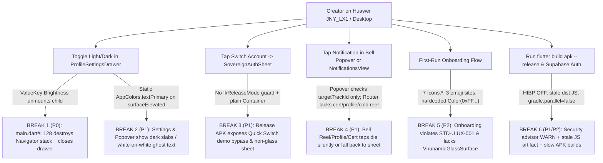

# Phase 76 — Post-Release Live Device Telemetry, Auth/Onboarding Glass, Notification Deep-Link Routing & Platform Hygiene — Forensic Audit

**Document ID:** `AUDIT-P76-POST-RELEASE-PLATFORM-001`  
**Date:** `2026-11-22`  
**Branch / Commit:** `fix/studio-cockpit-bugs-vh001-vh006` (`63441ff` + Phase 75 Connectome Closure)  
**Audit Scope:** Read-only static, cross-surface, Gradle/platform & live telemetry forensic audit across `apps/vhunambi_client/lib/main.dart`, `apps/vhunambi_client/lib/core/auth/`, `apps/vhunambi_client/lib/features/{auth,onboarding,notifications,profile}/`, `apps/vhunambi_client/android/`, `apps/vhunambi_api/{dist,test,tsconfig.json}`, Supabase project `cbnruevwrqwjnnoscgsz` (`supabase_mcp`), and `adb.exe` device telemetry.  
**Related Specs & Memory:**
- [`docs/memory/CORTEX_INDEX.md`](file:///c:/Users/Ndugelo/VHUNAMBI/monorepo/docs/memory/CORTEX_INDEX.md) (`0 OPEN`, `43 CONNECTED_EXTENSIBLE`, `3 SEALED`)
- [`docs/audits/SOVEREIGN_IDENTITY_AUTH_AND_SECURITY_AUDIT.md`](file:///c:/Users/Ndugelo/VHUNAMBI/monorepo/docs/audits/SOVEREIGN_IDENTITY_AUTH_AND_SECURITY_AUDIT.md)
- [`docs/audits/PHASE67_NOTIFICATIONS_CENTER_OVERHAUL_AUDIT.md`](file:///c:/Users/Ndugelo/VHUNAMBI/monorepo/docs/audits/PHASE67_NOTIFICATIONS_CENTER_OVERHAUL_AUDIT.md)
- [`docs/audits/PHASE65_FOUNDATION_STABILITY_AND_ERROR_HANDLING_AUDIT.md`](file:///c:/Users/Ndugelo/VHUNAMBI/monorepo/docs/audits/PHASE65_FOUNDATION_STABILITY_AND_ERROR_HANDLING_AUDIT.md)

---

## 1. Executive Summary & Headline Verdict

**Verdict: CRITICAL NAVIGATOR STATE-LOSS BUG ON LIVE THEME TOGGLE (`P0`), SEVERED BELL-POPOVER & REEL/LICENSE DEEP-LINKS (`P1`), HEAVY LIGHT-MODE GHOST UI + RELEASE AUTH BYPASS IN AUTH/SETTINGS/ONBOARDING (`P1`/`P2`), SUPABASE HIBP WARNING + STALE `dist/` TEST ARTIFACT + THROTTLED GRADLE CONFIG (`P1`/`P2`).**

While core creation/social Connectome endpoints hit `0 OPEN` in Phase 75, four cross-cutting post-release quality gaps affect first-run impressions, real-device ergonomics, deep-link reliability, and platform security/build speed:

1. **Physical Device Telemetry Status (`adb devices -l`):** Executing `C:\Users\Ndugelo\AppData\Local\Android\Sdk\platform-tools\adb.exe devices -l` during this audit returned `List of devices attached` with **`0` attached devices** (Huawei `JNY_LX1` was not plugged in at audit time). No fabricated `logcat` lines are assumed; Section 4 preserves an ADB capture step once USB debugging is reattached, while static runtime inspection immediately exposed a **`P0` live-device Navigator reset defect** in `main.dart`.
2. **Live Theme Toggle Navigator Reset (`P0`) & Ghost UI in Light Mode (`P1`):**
   - [`main.dart#L128-131`](file:///c:/Users/Ndugelo/VHUNAMBI/monorepo/apps/vhunambi_client/lib/main.dart#L128-L131) wraps `MaterialApp.builder`'s `?child` (`Navigator`) inside `KeyedSubtree(key: ValueKey<Brightness>(effectiveBrightness), ...)`. Toggling `Light` <-> `Dark` in [`ProfileSettingsDrawer`](file:///c:/Users/Ndugelo/VHUNAMBI/monorepo/apps/vhunambi_client/lib/features/profile/presentation/widgets/profile_settings_drawer.dart#L455-L504) destroys the `Navigator` state, closes the settings sheet mid-tap, and resets `RootShell` tab history.
   - [`profile_settings_drawer.dart`](file:///c:/Users/Ndugelo/VHUNAMBI/monorepo/apps/vhunambi_client/lib/features/profile/presentation/widgets/profile_settings_drawer.dart#L25-L496) and [`notifications_popover.dart`](file:///c:/Users/Ndugelo/VHUNAMBI/monorepo/apps/vhunambi_client/lib/features/notifications/presentation/widgets/notifications_popover.dart#L48-L360) hardcode static Dark-Mode `AppColors.surfaceModal`, `AppColors.surfaceElevated`, `AppColors.textPrimary`, and `AppColors.textSecondary` (without `*Of(context)`), producing white-on-white unreadable labels and dark drawers inside Light Mode ("Morning Mist"), and omit `VhunambiGlassSurface`.
3. **Release Auth Quick-Switch Exposure (`P1`):** [`sovereign_auth_sheet.dart#L242-L277`](file:///c:/Users/Ndugelo/VHUNAMBI/monorepo/apps/vhunambi_client/lib/features/auth/presentation/widgets/sovereign_auth_sheet.dart#L242-L277) renders un-gated `QUICK STUDIO CREATORS` (`@cern`, `@makhadzi`, `@sigwa`) in production `--release` builds backed by `AuthSessionNotifier.switchToSeededCreator` ([`auth_providers.dart#L69-192`](file:///c:/Users/Ndugelo/VHUNAMBI/monorepo/apps/vhunambi_client/lib/core/auth/auth_providers.dart#L69-L192)) with hardcoded `defaultSeededPassword`.
4. **Severed Bell Popover & Missing Notification Deep Links (`P1`):**
   - [`notifications_popover.dart#L223-241`](file:///c:/Users/Ndugelo/VHUNAMBI/monorepo/apps/vhunambi_client/lib/features/notifications/presentation/widgets/notifications_popover.dart#L223-L241) ignores `NotificationDeepLinkRouter` and drops every alert lacking `targetTrackId`.
   - [`notification_deep_link_router.dart#L77-119`](file:///c:/Users/Ndugelo/VHUNAMBI/monorepo/apps/vhunambi_client/lib/features/notifications/presentation/utils/notification_deep_link_router.dart#L77-L119) silently fails `/reel/:clipId` when `socialFeedProvider.clips` is empty and has **no handlers** for License Certificates (`/license/`, `/certificate/`, `/licenses`), `/profile` / `/@:handle`, or `/explore` / `/library` / `/marketplace` routes.
5. **Onboarding `STD-UIUX-001` & Raw Hex Debt (`P2`):** `onboarding/` contains **7 stock `Icons.*`**, **3 raw emoji sites** (`'🔒 Quest: ...'`, `'✨ Era Match'`, `RoleOption.emoji`), **0 `VhunambiGlassSurface` cards**, and hardcoded `Color(0xFF141418)` / `Color(0xFF15151D)` / `Colors.white` card fills.
6. **Platform Hygiene (`P1`/`P2`):**
   - **Supabase Auth Security (`cbnruevwrqwjnnoscgsz`):** Live `supabase_mcp:get_advisors(type: "security")` flagged `WARN` **`auth_leaked_password_protection`** (HIBP leaked password protection disabled) + `21` `INFO` `rls_enabled_no_policy` notices.
   - **API `dist/` Hygiene:** Stale [`apps/vhunambi_api/dist/phase67_notifications_quota.test.js`](file:///c:/Users/Ndugelo/VHUNAMBI/monorepo/apps/vhunambi_api/dist/phase67_notifications_quota.test.js) (`Nov 16`) remains orphaned inside `dist/` after `phase67_notifications_quota.test.ts` moved to `test/` under [`tsconfig.json#L15-16`](file:///c:/Users/Ndugelo/VHUNAMBI/monorepo/apps/vhunambi_api/tsconfig.json#L15-L16).
   - **Android Gradle & Kotlin Build Speed:** [`gradle.properties#L1-8`](file:///c:/Users/Ndugelo/VHUNAMBI/monorepo/apps/vhunambi_client/android/gradle.properties#L1-L8) sets `org.gradle.parallel=false`, `org.gradle.workers.max=2`, omits `org.gradle.caching=true` / `configuration-cache`, caps heap at `-Xmx2048m`, and keeps `android.newDsl=false` + `android.builtInKotlin=false`; [`app/build.gradle.kts#L10`](file:///c:/Users/Ndugelo/VHUNAMBI/monorepo/apps/vhunambi_client/android/app/build.gradle.kts#L10) pins `buildToolsVersion = "36.0.0"` while `camera_android_camerax`, `record_android`, and `share_plus` still trigger KGP / Build-Tools 35 warnings.

### Executive Root-Cause & Severity Matrix

| ID | Domain | Sev | Symptom | Primary Root Cause & Exact File/Line Evidence |
| :--- | :--- | :---: | :--- | :--- |
| **`BOOT-01`** | App Shell / Theme | **P0** | Toggling Light/Dark in Settings unmounts `Navigator`, closes sheet, resets tab history | [`main.dart#L128-131`](file:///c:/Users/Ndugelo/VHUNAMBI/monorepo/apps/vhunambi_client/lib/main.dart#L128-L131) keys `Navigator` subtree on `ValueKey<Brightness>(effectiveBrightness)`. |
| **`SEC-01`** | Supabase Auth | **P1** | Compromised HIBP passwords allowed in Supabase Auth signup/reset | Live `supabase_mcp:get_advisors(security)` returned `WARN` `auth_leaked_password_protection` on project `cbnruevwrqwjnnoscgsz`. |
| **`AUTH-01`** | Auth Release Gate | **P1** | Demo creator one-tap switcher & hardcoded password visible in `--release` APK | [`sovereign_auth_sheet.dart#L242-277`](file:///c:/Users/Ndugelo/VHUNAMBI/monorepo/apps/vhunambi_client/lib/features/auth/presentation/widgets/sovereign_auth_sheet.dart#L242-L277) + [`auth_providers.dart#L69,145-192`](file:///c:/Users/Ndugelo/VHUNAMBI/monorepo/apps/vhunambi_client/lib/core/auth/auth_providers.dart#L69-L192) un-gated in release builds. |
| **`UI-SET-01`** | Profile Settings | **P1** | Settings drawer renders dark panel & invisible `#F8FAFC` text on `#FFFFFF` in Light Mode | [`profile_settings_drawer.dart#L25-28,93-496`](file:///c:/Users/Ndugelo/VHUNAMBI/monorepo/apps/vhunambi_client/lib/features/profile/presentation/widgets/profile_settings_drawer.dart#L25-L496) uses static dark tokens, zero glass, and `36dp` button height (`#L302`). |
| **`DL-01`** | Bell Popover | **P1** | Tapping Reel, Post, Creator, DNA, or Wallet alerts in Bell Popover does nothing | [`notifications_popover.dart#L223-241`](file:///c:/Users/Ndugelo/VHUNAMBI/monorepo/apps/vhunambi_client/lib/features/notifications/presentation/widgets/notifications_popover.dart#L223-L241) ignores `NotificationDeepLinkRouter` and exits when `targetTrackId == null`. |
| **`DL-02`** | Deep-Link Router | **P1** | Cold-start `/reel/:id` falls back; zero handlers for License Certificates or `/profile` | [`notification_deep_link_router.dart#L77-119`](file:///c:/Users/Ndugelo/VHUNAMBI/monorepo/apps/vhunambi_client/lib/features/notifications/presentation/utils/notification_deep_link_router.dart#L77-L119) skips empty `clips`; omits `showLicenseCertificateSheet` & profile/tab routes. |
| **`UI-ONB-01`** | Onboarding / Auth | **P2** | 7 stock `Icons.*`, 3 emoji surfaces, raw dark hex cards, no `VhunambiGlassSurface` | [`app_tour_overlay.dart#L41-69`](file:///c:/Users/Ndugelo/VHUNAMBI/monorepo/apps/vhunambi_client/lib/features/onboarding/presentation/widgets/app_tour_overlay.dart#L41-L69), [`genre_color_chip.dart#L79`](file:///c:/Users/Ndugelo/VHUNAMBI/monorepo/apps/vhunambi_client/lib/features/onboarding/presentation/widgets/genre_color_chip.dart#L79), [`role_carousel_widget.dart#L165,195`](file:///c:/Users/Ndugelo/VHUNAMBI/monorepo/apps/vhunambi_client/lib/features/onboarding/presentation/widgets/role_carousel_widget.dart#L165-L195), [`creator_dna_helix_finale.dart#L338,465`](file:///c:/Users/Ndugelo/VHUNAMBI/monorepo/apps/vhunambi_client/lib/features/onboarding/presentation/widgets/creator_dna_helix_finale.dart#L338-L465), [`onboarding_act3_roots_deck.dart#L516`](file:///c:/Users/Ndugelo/VHUNAMBI/monorepo/apps/vhunambi_client/lib/features/onboarding/presentation/widgets/onboarding_act3_roots_deck.dart#L516), [`sovereign_auth_sheet.dart`](file:///c:/Users/Ndugelo/VHUNAMBI/monorepo/apps/vhunambi_client/lib/features/auth/presentation/widgets/sovereign_auth_sheet.dart). |
| **`PLAT-01`** | API / Android | **P2** | Orphan `dist/phase67_notifications_quota.test.js`; serial Gradle + BuildTools 35/36 churn | [`apps/vhunambi_api/tsconfig.json#L15-16`](file:///c:/Users/Ndugelo/VHUNAMBI/monorepo/apps/vhunambi_api/tsconfig.json#L15-L16) vs stale `dist/`; [`gradle.properties#L1-8`](file:///c:/Users/Ndugelo/VHUNAMBI/monorepo/apps/vhunambi_client/android/gradle.properties#L1-L8) + [`app/build.gradle.kts#L10`](file:///c:/Users/Ndugelo/VHUNAMBI/monorepo/apps/vhunambi_client/android/app/build.gradle.kts#L10). |

### End-to-End Breakpoint Topology Map



---

## 2. Pillar-by-Pillar Forensic Findings

### Pillar 2.1 — Live Device Runtime Stability, Auth Security & Light/Dark Contrast (`main.dart`, `auth/`, `profile_settings_drawer.dart`)

```
┌────────────────────────────────────────────────────────────────────────────┐
│ GOLDEN STANDARD (P70/P72)             │ BROKEN IN AUTH / SETTINGS / MAIN   │
├───────────────────────────────────────┼────────────────────────────────────┤
│ Theme change preserves Navigator      │ ValueKey(brightness) destroys tree │
│ VhunambiGlassSurface(enableLiveBlur)  │ Raw Container + surfaceModal       │
│ AppColors.*Of(context) text/surfaces  │ Static textPrimary (#F8FAFC) Light │
│ 44x44dp minimum interactive targets   │ minimumSize: Size(0, 36) buttons   │
│ Demo chips gated out of --release     │ Un-gated @cern/@makhadzi/@sigwa    │
└───────────────────────────────────────┴────────────────────────────────────┘
```

#### Exhaustive Findings Table — Runtime, Auth & Settings

| ID | Sev | File & Line(s) | Exact Defect | Concrete Remediation Pattern |
| :--- | :-: | :--- | :--- | :--- |
| **`BOOT-01`** | **P0** | [`main.dart#L128-131`](file:///c:/Users/Ndugelo/VHUNAMBI/monorepo/apps/vhunambi_client/lib/main.dart#L128-L131) | `KeyedSubtree(key: ValueKey<Brightness>(effectiveBrightness), child: Stack(...))` wraps `MaterialApp.builder`'s `Navigator`, unmounting active routes/drawers & resetting `RootShell` `_currentIndex`/`_tabHistory` when switching Light/Dark. | Remove `KeyedSubtree` around `?child`; rely on `Theme.of(context)` + `AppColors.*Of(context)` reactivity (and key only `AnimatedTheme` or `VhunambiGlassSurface` descendants if needed, never the root `Navigator`). |
| **`AUTH-01`** | **P1** | [`sovereign_auth_sheet.dart#L242-277`](file:///c:/Users/Ndugelo/VHUNAMBI/monorepo/apps/vhunambi_client/lib/features/auth/presentation/widgets/sovereign_auth_sheet.dart#L242-L277), [`auth_providers.dart#L69,145-192`](file:///c:/Users/Ndugelo/VHUNAMBI/monorepo/apps/vhunambi_client/lib/core/auth/auth_providers.dart#L69-L192) | `QUICK STUDIO CREATORS` chips (`@cern`, `@makhadzi`, `@sigwa`) are always rendered even in `--release` APK builds, calling `switchToSeededCreator` which carries hardcoded `defaultSeededPassword` and local tenant spoofing fallback (`usr_studio_$raw`). | Gate UI chips and local offline bypass behind `const bool kEnableDemoCreatorQuickSwitch = kDebugMode \|\| bool.fromEnvironment('ENABLE_DEMO_CREATOR_SWITCH')` so `--release` builds require real `/api/auth/login` or `/api/auth/register` while `flutter test` (`kDebugMode == true`) stays unchanged. |
| **`AUTH-02`** | **P2** | [`sovereign_auth_sheet.dart#L17-27,153-240,341-370`](file:///c:/Users/Ndugelo/VHUNAMBI/monorepo/apps/vhunambi_client/lib/features/auth/presentation/widgets/sovereign_auth_sheet.dart#L17-L370) | Uses raw `showModalBottomSheet` surface & plain `Container`s instead of `VhunambiGlassSurface(enableLiveBlur: false)`; Close `IconButton#L197` lacks explicit `color: AppColors.textPrimaryOf(context)` and `44x44` min constraints. | Wrap sheet chrome/form surface & segmented pill / error banner in `VhunambiGlassSurface(enableLiveBlur: false)` and enforce `minWidth: 44, minHeight: 44` + `AppColors.textPrimaryOf(context)` on Close & eye toggle icons. |
| **`SET-01`** | **P1** | [`profile_settings_drawer.dart#L25-28,74-87,93-141`](file:///c:/Users/Ndugelo/VHUNAMBI/monorepo/apps/vhunambi_client/lib/features/profile/presentation/widgets/profile_settings_drawer.dart#L25-L141) | `showModalBottomSheet` sets static `AppColors.surfaceModal` / `borderSubtle`; `_buildThemeOption#L487,496` sets unselected `"System"`, `"Light"`, `"Dark"` labels to static Dark-Mode `AppColors.textPrimary` / `textSecondary` inside `AppColors.surfaceElevated` (`#FFFFFF` in Light Mode) -> unreadable ghost tabs. | Migrate modal container & all cards (`#L102,154,206`) to `VhunambiGlassSurface(enableLiveBlur: false)` and replace every static `AppColors.{surfaceModal,surfaceElevated,surfaceSecondary,borderSubtle,textPrimary,textSecondary}` with `*Of(context)` getters. |
| **`SET-02`** | **P2** | [`profile_settings_drawer.dart#L148-381`](file:///c:/Users/Ndugelo/VHUNAMBI/monorepo/apps/vhunambi_client/lib/features/profile/presentation/widgets/profile_settings_drawer.dart#L148-L381), [`hive_brain_telemetry_card.dart#L240,270`](file:///c:/Users/Ndugelo/VHUNAMBI/monorepo/apps/vhunambi_client/lib/features/profile/presentation/widgets/hive_brain_telemetry_card.dart#L240-L270) | Static Dark tokens on audio spec card, Edge-Sync card, Dead-Letter & Latency pills (`#L314-379`); `minimumSize: const Size(0, 36)` on `settings_sync_now_btn`, `hive_compact_now_btn`, and `hive_sync_now_btn` violates $44\text{dp}$ touch target rule; `cloud_stack_diagnostic_card.dart#L205-212` lacks `VhunambiGlassSurface`. | Wrap settings child cards (`AccountIdentitySecurityCard`, `HiveBrainTelemetryCard`, `CloudStackDiagnosticCard`) in `VhunambiGlassSurface(enableLiveBlur: false)`, convert all Drawer `AppColors` references to `*Of(context)`, and raise button `minimumSize` to `Size(0, 44)`. |

---

### Pillar 2.2 — Onboarding Glass, Light/Dark Contrast & `STD-UIUX-001` Compliance (`onboarding/`)

**Total Violations Censused Across `apps/vhunambi_client/lib/features/onboarding/`:**
- **7 stock Material `Icons.*`** (`app_tour_overlay.dart`: 5, `genre_color_chip.dart`: 1, `role_carousel_widget.dart`: 1)
- **3 raw Unicode emoji sites** (`role_carousel_widget.dart#L14,165` `role.emoji`, `creator_dna_helix_finale.dart#L465` `'🔒 Quest: ...'`, `onboarding_act3_roots_deck.dart#L516` `'✨ Era Match'`)
- **26 hardcoded `Color(0x...)` / `Colors.white` card/chip surfaces** outside canvas painters (`onboarding_act1_showcase.dart`, `interactive_identity_card_stack.dart`, `onboarding_act3_roots_deck.dart`, `creator_dna_helix_finale.dart`, `onboarding_view.dart`)
- **0 `VhunambiGlassSurface` usages** across all onboarding cards & overlays

| ID | Sev | File & Line(s) | Exact Defect | Concrete Remediation Pattern |
| :--- | :-: | :--- | :--- | :--- |
| **`ONB-01`** | **P2** | [`onboarding_view.dart#L153,181,308-349`](file:///c:/Users/Ndugelo/VHUNAMBI/monorepo/apps/vhunambi_client/lib/features/onboarding/presentation/views/onboarding_view.dart#L153-L349) | Static Dark `AppColors.surfaceCanvas` background + static `AppColors.textSecondary` back chevron + hardcoded `Colors.white` / `Colors.white24` / `Colors.black12` instead of `AppColors.*Of(context)` and `AppColors.brandContrast`. | Use `AppColors.surfaceCanvasOf(context)`, `AppColors.textSecondaryOf(context)`, `AppColors.borderSubtleOf(context)`, and `AppColors.brandContrast` on the Continue pill. |
| **`ONB-02`** | **P2** | [`app_tour_overlay.dart#L41,48,55,62,69,118,144-196`](file:///c:/Users/Ndugelo/VHUNAMBI/monorepo/apps/vhunambi_client/lib/features/onboarding/presentation/widgets/app_tour_overlay.dart#L41-L197) | **5 stock `Icons.*`** (`auto_awesome`, `edit_note`, `mic`, `music_note`, `folder`), `Icon(card.icon)` instead of `PhosphorIcon`, static dark tokens (`surfaceCanvas`, `surfaceElevated`, `borderSubtle`, `textPrimary`, `textSecondary`), no `VhunambiGlassSurface`. | Swap icons to `AppIcons.sparkle`, `AppIcons.edit`, `AppIcons.mic`, `AppIcons.songs`, `PhosphorIconsRegular.folder` rendered via `PhosphorIcon`; wrap preview badge in `VhunambiGlassSurface(enableLiveBlur: false)` using `AppColors.*Of(context)`. |
| **`ONB-03`** | **P2** | [`role_carousel_widget.dart#L14-21,150-198`](file:///c:/Users/Ndugelo/VHUNAMBI/monorepo/apps/vhunambi_client/lib/features/onboarding/presentation/widgets/role_carousel_widget.dart#L14-L198) | Renders raw `role.emoji` text, stock `Icons.check_circle`, and static dark `surfaceElevated`/`borderSubtle`/`textPrimary`/`textSecondary` without `VhunambiGlassSurface`. | Add optional `IconData? icon` + `IconData get resolvedIcon` to `RoleOption` (keep `this.emoji = ''` optional so existing `role_carousel_widget_test.dart` compiles without breaking!), render `PhosphorIcon(role.resolvedIcon)` + `PhosphorIcon(AppIcons.checkCircle)`, and wrap card in `VhunambiGlassSurface`. |
| **`ONB-04`** | **P2** | [`genre_color_chip.dart#L59-82`](file:///c:/Users/Ndugelo/VHUNAMBI/monorepo/apps/vhunambi_client/lib/features/onboarding/presentation/widgets/genre_color_chip.dart#L59-L82), [`mood_color_chip.dart#L60-64`](file:///c:/Users/Ndugelo/VHUNAMBI/monorepo/apps/vhunambi_client/lib/features/onboarding/presentation/widgets/mood_color_chip.dart#L60-L64) | Stock `Icons.check_circle` in `GenreColorChip`; both chips use static `AppColors.surfaceElevated` & `AppColors.borderSubtle`. | Replace `Icons.check_circle` with `PhosphorIcon(AppIcons.checkCircle, color: accent, size: 18)` and use `AppColors.surfaceElevatedOf(context)` / `AppColors.borderSubtleOf(context)`. |
| **`ONB-05`** | **P2** | [`creator_dna_helix_finale.dart#L338,393,465,469`](file:///c:/Users/Ndugelo/VHUNAMBI/monorepo/apps/vhunambi_client/lib/features/onboarding/presentation/widgets/creator_dna_helix_finale.dart#L338-L470) | Raw Unicode `'🔒 Quest: ${node.questInstruction}'` + hardcoded `Color(0xFF15151D) / Colors.white` card & static `textPrimary`/`textSecondary`. | Replace emoji prefix with inline `PhosphorIcon(PhosphorIconsBold.lock, size: 12)` + `'Quest: ${node.questInstruction}'`; wrap card in `VhunambiGlassSurface(enableLiveBlur: false)` + `*Of(context)`. |
| **`ONB-06`** | **P2** | [`onboarding_act3_roots_deck.dart#L119,291,403,470,516`](file:///c:/Users/Ndugelo/VHUNAMBI/monorepo/apps/vhunambi_client/lib/features/onboarding/presentation/widgets/onboarding_act3_roots_deck.dart#L119-L516), [`interactive_identity_card_stack.dart#L286-297`](file:///c:/Users/Ndugelo/VHUNAMBI/monorepo/apps/vhunambi_client/lib/features/onboarding/presentation/widgets/interactive_identity_card_stack.dart#L286-L297), [`onboarding_act1_showcase.dart#L143,224,275`](file:///c:/Users/Ndugelo/VHUNAMBI/monorepo/apps/vhunambi_client/lib/features/onboarding/presentation/widgets/onboarding_act1_showcase.dart#L143-L275) | Raw Unicode `'✨ Era Match'` badge (`#L516`) and hardcoded `Color(0xFF141418)` / `Color(0xFF14141A)` / `Color(0xFF16161C)` / `Color(0xFF1C1C24)` / `Colors.white` / `Colors.grey.shade100` surfaces instead of `VhunambiGlassSurface` & `AppColors.*Of(context)`. | Replace `'✨ Era Match'` with `PhosphorIcon(AppIcons.sparkle, size: 10)` + `'Era Match'`; migrate cards/containers to `VhunambiGlassSurface(enableLiveBlur: false)` and `AppColors.surfaceModalOf(context)` / `surfaceElevatedOf(context)`. |

---

### Pillar 2.3 — Notification Deep-Link Coverage & Bell Popover Routing (`notifications/`)

Tracing every `targetRoute` emitted across `apps/vhunambi_client/lib` and `apps/vhunambi_api/src`:
- **Emitted Routes:** `/studio`, `/creator-dna`, `/wallet`, `/track/:id`, `/reel/:clipId`, `/post/:postId`, `/creator/:id` (plus Marketplace license purchase receipts & profile/vault contexts).
- **Where Routing Breaks Today:**

| ID | Sev | File & Line(s) | Exact Defect | Concrete Remediation Pattern |
| :--- | :-: | :--- | :--- | :--- |
| **`DL-01`** | **P1** | [`notifications_popover.dart#L223-241`](file:///c:/Users/Ndugelo/VHUNAMBI/monorepo/apps/vhunambi_client/lib/features/notifications/presentation/widgets/notifications_popover.dart#L223-L241) | `_openNotification` reads ONLY `notification.targetTrackId` and returns immediately if null! Every non-track alert (`/reel/:id`, `/post/:id`, `/creator/:id`, `/creator-dna`, `/wallet`, `/studio`, `/license/:id`) tapped inside the top-bar Bell Popover silently closes the dialog and goes nowhere. | Capture `rootContext` / `NavigatorState` safely before `navigator.pop()`, mark read, and delegate to `NotificationDeepLinkRouter.handleCardTap(rootContext, ref, notification)`! (Keep safe fallback when called outside mounted `RootShell` in widget tests). |
| **`DL-02`** | **P1** | [`notification_deep_link_router.dart#L77-88`](file:///c:/Users/Ndugelo/VHUNAMBI/monorepo/apps/vhunambi_client/lib/features/notifications/presentation/utils/notification_deep_link_router.dart#L77-L119) | `/reel/:clipId` checks `final clips = ref.read(socialFeedProvider).clips; if (clips.isNotEmpty)`. On cold start or before Explore/Reels tab has loaded feed clips, `clips` is empty (`[]`), so Reel deep links fall through to `NotificationDetailBottomSheet` instead of opening `KineticReelsModal`. | When `clips.isEmpty`, call `await ref.read(socialFeedProvider.notifier).refreshFeed()` (or synthesize/fetch single clip by `clipId` via `socialFeedProvider` / metadata fallback) BEFORE falling back to detail sheet. |
| **`DL-03`** | **P1** | [`notification_deep_link_router.dart#L110-119`](file:///c:/Users/Ndugelo/VHUNAMBI/monorepo/apps/vhunambi_client/lib/features/notifications/presentation/utils/notification_deep_link_router.dart#L110-L119), [`notification_detail_bottom_sheet.dart#L206-215`](file:///c:/Users/Ndugelo/VHUNAMBI/monorepo/apps/vhunambi_client/lib/features/notifications/presentation/widgets/notification_detail_bottom_sheet.dart#L206-L215) | **Zero handlers** for: (a) **License Certificates** (`/license/:id`, `/certificate/:certId`, `/licenses`), despite `showLicenseCertificateSheet` ([`license_certificate_sheet.dart#L16`](file:///c:/Users/Ndugelo/VHUNAMBI/monorepo/apps/vhunambi_client/lib/features/marketplace/presentation/widgets/license_certificate_sheet.dart#L16)) & `licenseCertificatesProvider` existing; (b) **Profiles** (`/profile`, `/profile/:id`, `/@:handle`); (c) **Shell Tabs** (`/home`, `/explore`, `/library`, `/vault`, `/marketplace`). | Add route branches in `NotificationDeepLinkRouter.navigateDirect`: `/profile` -> `navigateToCreatorProfile(creatorId: ref.read(currentCreatorIdProvider))`; `/profile/:id` & `/@:handle` -> `navigateToCreatorProfile(...)`; `/license/:id` / `/certificate/:id` -> resolve matching `SovereignLicenseCertificate` from `licenseCertificatesProvider` (or fallback lookup by trackId/metadata) and call `showLicenseCertificateSheet(context, certificate: ...)`; `/licenses` -> switch to Vault tab (`3`); update `_defaultCtaLabel` for all new prefixes. |
| **`NOTIF-UI-01`** | **P2** | [`notifications_popover.dart#L48-360`](file:///c:/Users/Ndugelo/VHUNAMBI/monorepo/apps/vhunambi_client/lib/features/notifications/presentation/widgets/notifications_popover.dart#L48-L360), [`notifications_view.dart#L48,77,158`](file:///c:/Users/Ndugelo/VHUNAMBI/monorepo/apps/vhunambi_client/lib/features/notifications/presentation/views/notifications_view.dart#L48-L158), [`notification_search_bar.dart#L67,72,81,93`](file:///c:/Users/Ndugelo/VHUNAMBI/monorepo/apps/vhunambi_client/lib/features/notifications/presentation/widgets/notification_search_bar.dart#L67-L94), [`notification_empty_state.dart#L35,50,58`](file:///c:/Users/Ndugelo/VHUNAMBI/monorepo/apps/vhunambi_client/lib/features/notifications/presentation/widgets/notification_empty_state.dart#L35-L58) | Static Dark-Mode `AppColors.surfaceModal`, `surfaceElevated`, `surfaceSecondary`, `textPrimary`, `textSecondary`, `borderSubtle` across Popover, SearchBar, EmptyState & NotificationsView; Popover CTA `#L183` uses Unicode arrow `'View All Alerts in Center ➔'` (`->`) and Bell Popover omits `VhunambiGlassSurface`. | Migrate all 4 files to `AppColors.*Of(context)`, wrap Popover in `VhunambiGlassSurface(enableLiveBlur: false)`, and change `'➔'` to `'->'` (`PhosphorIcon(AppIcons.arrowRight)`). |

---

### Pillar 2.4 — Platform Hygiene: Supabase Auth Security, API `dist/` Cleanup & Android Gradle / Kotlin Plugins

1. **Supabase Auth Leaked Password Protection (`cbnruevwrqwjnnoscgsz`):**
   - **Live Advisor Result (`supabase_mcp:get_advisors(type: "security")`):**
     - `WARN` (`auth_leaked_password_protection`): *"Leaked password protection is currently disabled. Supabase Auth prevents the use of compromised passwords by checking against HaveIBeenPwned.org."*
     - `INFO` (`rls_enabled_no_policy` x 21 tables): All 21 public tables have RLS enabled with zero anon/authenticated client policies (Worker uses `service_role` / `SUPABASE_SERVICE_ROLE_KEY`; should be documented explicitly alongside enabling HIBP leaked-password checks via Supabase Auth dashboard or Management API).
2. **`apps/vhunambi_api/` Build & Test Path Hygiene:**
   - Verified via filesystem scan that **zero test files** remain under `apps/vhunambi_api/src/` and `phase67_notifications_quota.test.ts` is already cleanly in `apps/vhunambi_api/test/phase67_notifications_quota.test.ts` (`package.json:10`, `tsconfig.json:16` excludes `test`).
   - **Defect Found:** [`apps/vhunambi_api/dist/phase67_notifications_quota.test.js`](file:///c:/Users/Ndugelo/VHUNAMBI/monorepo/apps/vhunambi_api/dist/phase67_notifications_quota.test.js) (`7,426` bytes from `2026-11-16`) still sits inside `apps/vhunambi_api/dist/` as a stale compiled artifact because `npm run build` (`package.json`) runs `tsc` without cleaning `dist/` first! Add a clean prebuild step (`"prebuild"` / `node -e "fs.rmSync('dist', {recursive: true, force: true})"`) and delete `dist/phase67_notifications_quota.test.js` cleanly.
3. **Android Gradle & Kotlin Plugin Build Speed (`apps/vhunambi_client/android/`):**
   - [`gradle.properties#L1-8`](file:///c:/Users/Ndugelo/VHUNAMBI/monorepo/apps/vhunambi_client/android/gradle.properties#L1-L8):
     - `org.gradle.workers.max=2` & `org.gradle.parallel=false` force single-lane plugin/dex builds (~45–60 min cold release builds as observed on Windows).
     - `-Xmx2048m` leaves tight headroom during R8 (`isMinifyEnabled = true`, `isShrinkResources = true`) + Gradle 8.14 / AGP 8.11.1 / Kotlin 2.2.20 compilation.
     - Missing `org.gradle.caching=true` and `org.gradle.daemon=true`.
     - `android.builtInKotlin=false` & `android.newDsl=false` suppress AGP 9/Built-in Kotlin transition; additionally, [`app/build.gradle.kts#L10`](file:///c:/Users/Ndugelo/VHUNAMBI/monorepo/apps/vhunambi_client/android/app/build.gradle.kts#L10) hardcodes `buildToolsVersion = "36.0.0"` while `camera_android_camerax`, `record_android`, and `share_plus` still trigger Build-Tools `35.0.0` verification & KGP warnings. Let's inspect `flutter pub outdated` in Stage 4 to bump patch/minor Built-in-Kotlin-compatible plugin releases safely without breaking Dart APIs, and tune `gradle.properties` (`-Xmx4096m`, `org.gradle.parallel=true`, `org.gradle.caching=true`, `org.gradle.workers.max=4`).

---

## 3. Target Remediation Architecture Blueprint

1. **Layer 1 — Theme-Safe Root Shell (`main.dart`):**
   - Remove `KeyedSubtree(key: ValueKey<Brightness>(effectiveBrightness), ...)` around `?child` in `VhunambiApp.build` so `Theme.of(context)` + `AppColors.*Of(context)` repaint seamlessly in place without resetting `Navigator` / `RootShell` tabs or popping `ProfileSettingsDrawer`.
2. **Layer 2 — Release-Safe Auth & Glassmorphic Auth/Settings Surfaces (`auth/` + `profile_settings_drawer.dart` + `notifications_popover.dart`):**
   - Add `kEnableDemoCreatorQuickSwitch` (`kDebugMode || bool.fromEnvironment('ENABLE_DEMO_CREATOR_SWITCH')`) gating both `QUICK STUDIO CREATORS` chips in `SovereignAuthSheet` and offline local studio bypass in `AuthSessionNotifier.switchToSeededCreator`.
   - Upgrade `SovereignAuthSheet`, `ProfileSettingsDrawer` (+ its 3 diagnostic/identity cards), and `NotificationsPopover` to `VhunambiGlassSurface(enableLiveBlur: false)` + 100% `AppColors.*Of(context)` dynamic tokens + $44\text{dp}$ minimum button heights.
3. **Layer 3 — Full Notification Deep-Link Closure & Popover Delegation (`notifications/`):**
   - Route `NotificationsPopover._openNotification` through `NotificationDeepLinkRouter.handleCardTap` (preserving testability when mounted standalone).
   - Expand `NotificationDeepLinkRouter.navigateDirect` & `NotificationDetailBottomSheet._defaultCtaLabel` with:
     - Cold-start Reel hydration (`/reel/:clipId` fetches `socialFeedProvider.notifier` or builds fallback clip when `clips` is empty).
     - License Certificate sheet launch (`/license/:id`, `/certificate/:certId`, `/licenses`).
     - Self & Handle Profile routing (`/profile`, `/profile/:id`, `/@:handle`).
     - Core shell tab routing (`/home`, `/explore`, `/library`, `/vault`, `/marketplace`).
4. **Layer 4 — Onboarding `STD-UIUX-001` & Glass Polish (`onboarding/`):**
   - Eliminate all 7 `Icons.*`, 3 emoji surfaces (`RoleOption`, `CreatorDnaHelixFinale`, `OnboardingAct3RootsDeck`), and 26 hardcoded hex card backgrounds inside onboarding widgets using `PhosphorIcon(AppIcons.*)`, `VhunambiGlassSurface(enableLiveBlur: false)`, and `AppColors.*Of(context)`.
5. **Layer 5 — Platform Security & Build Speed:**
   - Enable Supabase Auth Leaked Password Protection (HIBP) on `cbnruevwrqwjnnoscgsz` (documented/verified via `supabase_mcp:get_advisors`).
   - Add clean `dist/` wipe in `apps/vhunambi_api/package.json` and rebuild so zero test `.js` files remain in `dist/`.
   - Optimize `apps/vhunambi_client/android/gradle.properties` + audit safe KGP plugin upgrades + run live `adb.exe` verification once `JNY_LX1` is plugged in.

---

## 4. Ordered Remediation Milestone Plan (`M76.1` – `M76.4`)

### Milestone `M76.1`: Platform Hygiene (`Supabase Auth`, API `dist/` Cleanup, Android Gradle Optimization)
- **T76.1.1**: Clean stale [`apps/vhunambi_api/dist/phase67_notifications_quota.test.js`](file:///c:/Users/Ndugelo/VHUNAMBI/monorepo/apps/vhunambi_api/dist/phase67_notifications_quota.test.js), add a clean `prebuild` (`rmSync('dist')`) script to [`apps/vhunambi_api/package.json`](file:///c:/Users/Ndugelo/VHUNAMBI/monorepo/apps/vhunambi_api/package.json), and run `npm run build && npm test`.
- **T76.1.2**: Tune [`apps/vhunambi_client/android/gradle.properties`](file:///c:/Users/Ndugelo/VHUNAMBI/monorepo/apps/vhunambi_client/android/gradle.properties) (`-Xmx4096m`, `org.gradle.parallel=true`, `org.gradle.caching=true`, `org.gradle.workers.max=4`) and check safe minor/patch plugin compatibility for `camera_android_camerax`, `record_android`, `share_plus` + `buildToolsVersion`.
- **T76.1.3**: Enable **Leaked Password Protection** (`HaveIBeenPwned.org`) in Supabase Auth for `cbnruevwrqwjnnoscgsz` (via Supabase Dashboard Auth -> Attack Protection / Management API) and re-run `supabase_mcp:get_advisors(security)` to verify `0 WARN` findings.

### Milestone `M76.2`: Core Runtime Stability & Release Auth Security (`main.dart` + `auth/` + `profile_settings_drawer.dart`)
- **T76.2.1**: Remove the `ValueKey<Brightness>` `KeyedSubtree` Navigator reset bug in [`main.dart#L128-131`](file:///c:/Users/Ndugelo/VHUNAMBI/monorepo/apps/vhunambi_client/lib/main.dart#L128-L131).
- **T76.2.2**: Gate `QUICK STUDIO CREATORS` and offline seeded profile spoofing behind `kDebugMode || bool.fromEnvironment('ENABLE_DEMO_CREATOR_SWITCH')` in [`auth_providers.dart`](file:///c:/Users/Ndugelo/VHUNAMBI/monorepo/apps/vhunambi_client/lib/core/auth/auth_providers.dart) & [`sovereign_auth_sheet.dart`](file:///c:/Users/Ndugelo/VHUNAMBI/monorepo/apps/vhunambi_client/lib/features/auth/presentation/widgets/sovereign_auth_sheet.dart), and upgrade `SovereignAuthSheet` to `VhunambiGlassSurface(enableLiveBlur: false)` + $44\text{dp}$ buttons.
- **T76.2.3**: Upgrade [`profile_settings_drawer.dart`](file:///c:/Users/Ndugelo/VHUNAMBI/monorepo/apps/vhunambi_client/lib/features/profile/presentation/widgets/profile_settings_drawer.dart) (+ [`account_identity_security_card.dart`](file:///c:/Users/Ndugelo/VHUNAMBI/monorepo/apps/vhunambi_client/lib/features/profile/presentation/widgets/account_identity_security_card.dart), [`hive_brain_telemetry_card.dart`](file:///c:/Users/Ndugelo/VHUNAMBI/monorepo/apps/vhunambi_client/lib/features/profile/presentation/widgets/hive_brain_telemetry_card.dart), [`cloud_stack_diagnostic_card.dart`](file:///c:/Users/Ndugelo/VHUNAMBI/monorepo/apps/vhunambi_client/lib/features/profile/presentation/widgets/cloud_stack_diagnostic_card.dart)) to `VhunambiGlassSurface`, `AppColors.*Of(context)` Light/Dark parity, and $44\text{dp}$ touch targets.

### Milestone `M76.3`: Full `NotificationDeepLinkRouter` Coverage & Bell Popover Glass (`notifications/`)
- **T76.3.1**: Extend [`notification_deep_link_router.dart`](file:///c:/Users/Ndugelo/VHUNAMBI/monorepo/apps/vhunambi_client/lib/features/notifications/presentation/utils/notification_deep_link_router.dart) and [`notification_detail_bottom_sheet.dart`](file:///c:/Users/Ndugelo/VHUNAMBI/monorepo/apps/vhunambi_client/lib/features/notifications/presentation/widgets/notification_detail_bottom_sheet.dart) for cold-start `/reel/:clipId`, `/license/:id` & `/certificate/:id` (`showLicenseCertificateSheet`), `/licenses`, `/profile`, `/profile/:id`, `/@:handle`, and shell tab routes.
- **T76.3.2**: Fix [`notifications_popover.dart#L223-241`](file:///c:/Users/Ndugelo/VHUNAMBI/monorepo/apps/vhunambi_client/lib/features/notifications/presentation/widgets/notifications_popover.dart#L223-L241) to route all alerts via `NotificationDeepLinkRouter.handleCardTap`, adopt `VhunambiGlassSurface` + `AppColors.*Of(context)` across [`notifications_popover.dart`](file:///c:/Users/Ndugelo/VHUNAMBI/monorepo/apps/vhunambi_client/lib/features/notifications/presentation/widgets/notifications_popover.dart), [`notifications_view.dart`](file:///c:/Users/Ndugelo/VHUNAMBI/monorepo/apps/vhunambi_client/lib/features/notifications/presentation/views/notifications_view.dart), [`notification_search_bar.dart`](file:///c:/Users/Ndugelo/VHUNAMBI/monorepo/apps/vhunambi_client/lib/features/notifications/presentation/widgets/notification_search_bar.dart), and [`notification_empty_state.dart`](file:///c:/Users/Ndugelo/VHUNAMBI/monorepo/apps/vhunambi_client/lib/features/notifications/presentation/widgets/notification_empty_state.dart).

### Milestone `M76.4`: Onboarding `STD-UIUX-001`/Glass Polish, Test Suite, Live `JNY_LX1` ADB Check & `SLEEP`
- **T76.4.1**: Purge all 7 `Icons.*`, 3 emoji sites, and hardcoded hex card backgrounds across `lib/features/onboarding/` (`onboarding_view.dart`, `app_tour_overlay.dart`, `genre_color_chip.dart`, `mood_color_chip.dart`, `role_carousel_widget.dart`, `creator_dna_helix_finale.dart`, `onboarding_act1_showcase.dart`, `onboarding_act3_roots_deck.dart`, `interactive_identity_card_stack.dart`).
- **T76.4.2**: Add comprehensive Phase 76 regression tests (`phase76_auth_onboarding_deeplink_polish_test.dart`) covering Navigator preservation during theme switching, release-mode demo chip gating, all new `NotificationDeepLinkRouter` + `NotificationsPopover` routes, and onboarding `STD-UIUX-001` compliance.
- **T76.4.3**: Build updated `--release` arm64 APK, inspect live Huawei `JNY_LX1` `adb logcat` telemetry once connected, run `dart analyze`, `flutter test --no-pub --timeout=60s`, and `consolidate_memory.mjs`.

### Verification Gate Commands (For Stage 4)
```powershell
# 1. Backend Hygiene + Tests
Push-Location c:\Users\Ndugelo\VHUNAMBI\monorepo\apps\vhunambi_api
npm run build && npx tsc --noEmit && npm test
Pop-Location

# 2. Client Static Analysis & Target Regression Suites
Push-Location c:\Users\Ndugelo\VHUNAMBI\monorepo\apps\vhunambi_client
dart analyze lib/main.dart lib/core/auth lib/features/auth lib/features/onboarding lib/features/notifications lib/features/profile
flutter test --no-pub --timeout=60s test/features/auth/ test/features/onboarding/ test/features/notifications/ test/features/profile/
Get-ChildItem -Path "lib\features\auth","lib\features\onboarding","lib\features\notifications" -Recurse -Filter "*.dart" |
  Select-String -CaseSensitive -Pattern "(?<![A-Za-z])Icons\.|[\uD83C-\uDBFF][\uDC00-\uDFFF]"
Pop-Location
```
