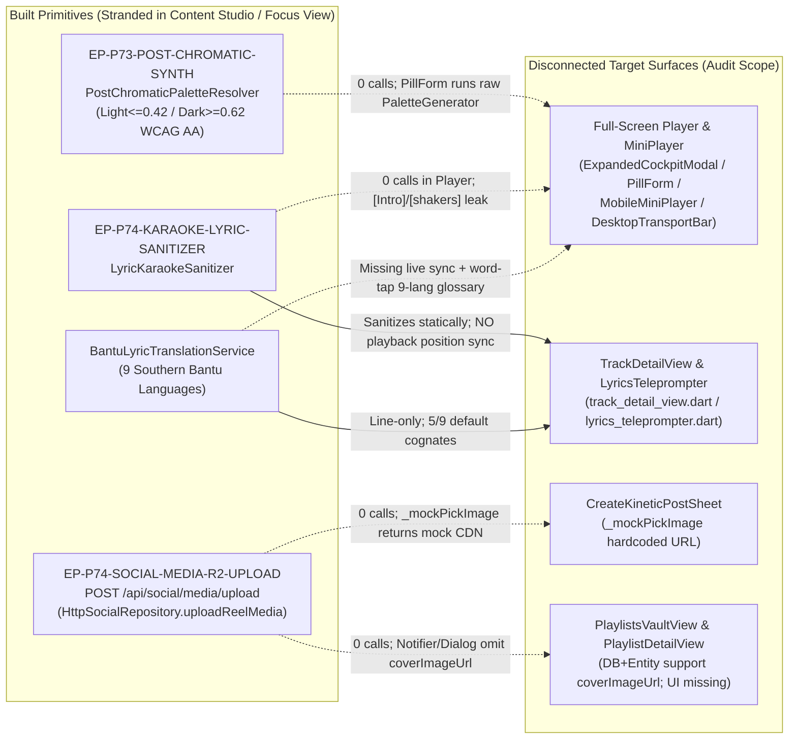

# Phase 77 Forensic Audit: Chromatic Full-Screen Player, Synced Sing-Along Lyrics & Unified R2 Media Uploads

**Audit Date:** 2026-11-23  
**Auditor:** Antigravity Forensic Auditor (`/vhunambi-forensic-auditor` + `/vhunambi-memory`)  
**Scope:** `apps/vhunambi_client/lib/features/{player,track,playlists,collections,explore}/`, `apps/vhunambi_client/lib/core/{theme/post_chromatic_palette_resolver.dart,widgets/vhunambi_bottom_dock_kit.dart}`, `apps/vhunambi_api/src/routes/{social_routes.ts,playlist_routes.ts,explore_routes.ts}`  
**Baseline Repo Pulse (`docs/memory/CORTEX_INDEX.md`):** Phase 76 completed, **0 OPEN** Connectome endpoints, **46 CONNECTED_EXTENSIBLE**, **3 SEALED**.  
**Audit Mode:** Pure Stage 1 Forensic Discovery — **ZERO** mutations to application source code (`apps/`, `tools/`, `supabase/`).

---

## 1. Executive Summary & P0–P3 Severity Matrix

Phases 73 and 74 delivered high-craft primitives (`PostChromaticPaletteResolver` / `EP-P73-POST-CHROMATIC-SYNTH`, `LyricKaraokeSanitizer` / `EP-P74-KARAOKE-LYRIC-SANITIZER`, `BantuLyricTranslationService`, and authenticated R2 uploads `POST /api/social/media/upload` / `EP-P74-SOCIAL-MEDIA-R2-UPLOAD`), yet a Connectome usage audit confirms those primitives remain **stranded in `content_studio/` and `kinetic_post_focus_view.dart`**. None of `player/`, `playlists/`, `collections/`, or `CreateKineticPostSheet` consume them today, leaving Vhunambi's daily listening, lyric sing-along, playlist curation, and social posting flows relying on static Dark-Mode tokens, placeholder gradients, raw cue-tag leaks, and hardcoded mock CDN URLs.

| Severity | Finding ID | Surface / Module | Exact Breakpoint & User Impact |
| :--- | :--- | :--- | :--- |
| **P0** | **F77-01** | `explore/` (`CreateKineticPostSheet`) | `_mockPickImage` (`create_kinetic_post_sheet.dart#L113-139`) attaches hardcoded `'https://cdn.vhunambi.com/covers/custom_post_art.jpg'` instead of `ImagePicker` + `uploadReelMedia` (`POST /api/social/media/upload`), plus duplicate dead ternary `#L117-119`. |
| **P0** | **F77-02** | `player/` (`ExpandedCockpitModal._buildLyricsCard`) | Renders `track.lyrics.split('\n')` verbatim (`expanded_cockpit_modal.dart#L829-944`), leaking raw `[Intro]` / `[Crisp soft shakers, airy synth pads]` tags, with **zero** `LyricKaraokeSanitizer`, **zero** playback position sync, and **zero** 9-language Bantu sing-along/word definitions. |
| **P1** | **F77-03** | `player/` (`ExpandedCockpitModal`, `MobileMiniPlayer`, `PillForm`, `DesktopTransportBar`, `VhunambiFloatingTransportSurface`) | **0 calls** to `PostChromaticPaletteResolver`. Player artwork slots render generic `AppIcons.piano` + `AppGradients.forGenre` boxes (`expanded_cockpit_modal.dart#L379-399`, `mobile_mini_player.dart#L159-178`, `desktop_transport_bar.dart#L82-90`) instead of `VhunambiTrackArtwork`; `PillForm#L106-127` runs an un-guarded `PaletteGenerator.fromImageProvider(NetworkImage(...))` without `FLUTTER_TEST` guard, 150ms fast timeout, or WCAG AA Light/Dark clamping. |
| **P1** | **F77-04** | `track/` (`LyricsTeleprompter`) | Sanitizes lines and translates whole lines (`lyrics_teleprompter.dart#L26,170`), but has **no** live `playerStateProvider` progress sync/auto-scroll/tap-to-seek, defaults to only 5 of 9 Bantu languages (`['zu','xh','nso','ve','ts']`), and lacks tappable per-word Bantu glossary popovers (`zu, xh, ss, nr, nso, tn, st, ve, ts`). |
| **P1** | **F77-05** | `playlists/` (`PlaylistsVaultView`, `PlaylistDetailView`, `PlaylistsNotifier`) | DB (`vhunambi_db.ts#L433,3129-3134`), `PlaylistEntity.coverImageUrl` (`#L12`), and `PlaylistCoverArt` (`#L29-40`) **already persist and render custom covers**, but client `PlaylistsNotifier` (`createPlaylist`/`updatePlaylist`) and dialogs (`_CreatePlaylistDialog`, `_RenamePlaylistDialog`) expose **no** `coverImageUrl` parameter or `ImagePicker` -> R2 upload UI. |
| **P1** | **F77-06** | `track/` (`TrackDetailView`, `TrackActionsBar`) | "Export Video / Promo" (`_openVideoExport` -> `KineticReelStudioView.show`) is trapped inside `if (isTrackOwner)` (`track_detail_view.dart#L649-654`). Public visitors (`ViewerRole.visitor`) have **no** one-tap "Share as Reel" action in `TrackActionsBar` (`track_actions_bar.dart`). |
| **P2** | **F77-07** | `player/`, `track/`, `playlists/`, `collections/`, `explore/`, `vhunambi_bottom_dock_kit.dart` | **368** static Dark-Mode/white token hits (`AppColors.surfaceModal`, `AppColors.textSecondary`, `Colors.white`, etc.) breaking Light Mode contrast parity, **68** stock Material `Icons.*` line hits, wrong icon (`AppIcons.edit` on Copy button `#L872`), and **19** raw emoji lines across target modules (`STD-UIUX-001`). |
| **P3** | **F77-08** | `collections/` (`CollectionsNotifier`, `CollectionFormDialog`, `CollectionsVaultView`) | `CollectionEntity.coverImageUrl` (`collection_entity.dart#L157`) exists in the Hive model, but `CollectionsNotifier` / `CollectionFormDialog` / `CollectionArtworkPlaceholder` lack custom cover upload support (secondary vs Playlists). |

---

## 2. System Breakpoint Topology



---

## 3. Forensic Investigation by Pillar

### Pillar 1 — Living Chromatic Full-Screen Player, Mini-Player & Light/Dark Parity

#### 3.1 Existing Primitive Contract (`PostChromaticPaletteResolver`)
Verified in [`post_chromatic_palette_resolver.dart`](file:///c:/Users/Ndugelo/VHUNAMBI/monorepo/apps/vhunambi_client/lib/core/theme/post_chromatic_palette_resolver.dart#L140-L248):
- `resolveSync({required Brightness brightness, String? rawMood, String? artworkUrl, bool hasAudioAttachment = false})` — deterministic instant mood/URI color resolution with zero async gaps.
- `resolveAsync({required Brightness brightness, String? rawMood, String? artworkUrl, bool hasAudioAttachment = false, Color? extractedArtColorOverride})` — artwork-first extraction with 64-entry LRU cache (`_artColorCache`), 150ms decode timeout, `FLUTTER_TEST` network-skip guard (`_isFlutterTestEnv()` `#L122-L133`), and strict WCAG AA lightness clamping (`Light <= 0.42`, `Dark >= 0.62`, `#L258-L296`).
- Currently consumed **only** in [`kinetic_reel_studio_view.dart`](file:///c:/Users/Ndugelo/VHUNAMBI/monorepo/apps/vhunambi_client/lib/features/content_studio/presentation/views/kinetic_reel_studio_view.dart#L357) and [`kinetic_post_focus_view.dart`](file:///c:/Users/Ndugelo/VHUNAMBI/monorepo/apps/vhunambi_client/lib/features/explore/presentation/views/kinetic_post_focus_view.dart#L126-L151).
- `Track` (`lib/shared/models/track.dart#L44,51`) **already carries** both `coverUrl` (`String?`) and `mood` (`String?`), making zero-friction hydration from `PlayerState.currentTrack` immediately viable.

#### 3.2 Exact Breakpoints Across All Player Chrome Widgets

| Widget / Surface | File & Exact Lines | Verified Defect |
| :--- | :--- | :--- |
| **`ExpandedCockpitModal`** | [`expanded_cockpit_modal.dart#L165,305`](file:///c:/Users/Ndugelo/VHUNAMBI/monorepo/apps/vhunambi_client/lib/features/player/presentation/widgets/expanded_cockpit_modal.dart#L165-L305) | Root container hardcodes static `AppColors.surfaceModal` (`#L165`) and `AppColors.darkSurfaceSecondary` (`#L305`); zero chromatic backdrop gradient, zero Light Mode theme adaptation. |
| **Full-Screen Artwork Slot** | [`expanded_cockpit_modal.dart#L379-399`](file:///c:/Users/Ndugelo/VHUNAMBI/monorepo/apps/vhunambi_client/lib/features/player/presentation/widgets/expanded_cockpit_modal.dart#L379-L399) | Renders static `AppGradients.forGenre(track.genre)` rounded box with raw `Icon(AppIcons.piano, color: Colors.white)` instead of `VhunambiTrackArtwork` displaying real `track.coverUrl` with adaptive chromatic aura shadow. |
| **`MobileMiniPlayer`** | [`mobile_mini_player.dart#L120,159-178,205,334-337`](file:///c:/Users/Ndugelo/VHUNAMBI/monorepo/apps/vhunambi_client/lib/features/player/presentation/widgets/mobile_mini_player.dart#L159-L178) | Uses genre extension color (`genreAccent`) instead of `PostChromaticPaletteResolver`; album art thumbnail renders `AppGradients.forGenre` + `AppIcons.piano` instead of `VhunambiTrackArtwork`; hardcodes `AppColors.surfaceModal`, `AppColors.borderSubtle`, `AppColors.textSecondary`. |
| **`VhunambiFloatingTransportSurface`** & **`VhunambiBottomDockSurface`** | [`vhunambi_bottom_dock_kit.dart#L85-89,116-125`](file:///c:/Users/Ndugelo/VHUNAMBI/monorepo/apps/vhunambi_client/lib/core/widgets/vhunambi_bottom_dock_kit.dart#L85-L89) | Hardcodes `AppColors.surfaceModal.withAlpha(210)`, `AppColors.surfaceCanvas.withAlpha(215)`, and `AppColors.borderSubtle` instead of `AppColors.surfaceModalOf(context)` / `surfaceCanvasOf(context)` / `borderSubtleOf(context)`, producing an un-adapted dark floating island inside Light Mode views. |
| **`PillForm`** | [`pill_form.dart#L106-127,196,216`](file:///c:/Users/Ndugelo/VHUNAMBI/monorepo/apps/vhunambi_client/lib/features/player/presentation/widgets/pill_form.dart#L106-L127) | Duplicate ad-hoc `PaletteGenerator.fromImageProvider(NetworkImage(...)).timeout(4s)` call with **no** `FLUTTER_TEST` guard, **no** mood fallback tier, **no** 150ms fast timeout, and **no** Light/Dark WCAG clamping. |
| **`DesktopTransportBar`** | [`desktop_transport_bar.dart#L45,82-90,216,320,332`](file:///c:/Users/Ndugelo/VHUNAMBI/monorepo/apps/vhunambi_client/lib/features/player/presentation/widgets/desktop_transport_bar.dart#L45-L90) | Hardcodes `AppColors.surfaceElevated`, `borderSubtle`, `textSecondary`, `Colors.white`; artwork box uses `AppGradients.forGenre` + `Icon(AppIcons.piano)` instead of `VhunambiTrackArtwork` + chromatic accent; **3** stock Material `Icons.*` (`speed_rounded`, `playlist_add_rounded`, `queue_music_rounded`). |
| **`QueueDrawer` & `_FrostedStemMixerSheet`** | [`queue_drawer.dart#L23-60,157-419`](file:///c:/Users/Ndugelo/VHUNAMBI/monorepo/apps/vhunambi_client/lib/features/player/presentation/widgets/queue_drawer.dart#L157-L419), [`track_detail_view.dart#L1077-1109`](file:///c:/Users/Ndugelo/VHUNAMBI/monorepo/apps/vhunambi_client/lib/features/track/presentation/views/track_detail_view.dart#L1077-L1109) | Static `AppColors.surfaceModal` / `AppColors.borderSubtle` / `AppColors.textPrimary` instead of `Of(context)`; `QueueDrawer` also carries **8** stock Material `Icons.*`. |

---

### Pillar 2 — Clean Karaoke Sanitizer, Playback-Synced Lyrics & 9-Language Bantu Word Definitions

#### 3.3 Full-Screen Player (`ExpandedCockpitModal._buildLyricsCard`) Regression
Verified in [`expanded_cockpit_modal.dart#L829-L944`](file:///c:/Users/Ndugelo/VHUNAMBI/monorepo/apps/vhunambi_client/lib/features/player/presentation/widgets/expanded_cockpit_modal.dart#L829-L944):
1. **No `LyricKaraokeSanitizer`:** Calls `track.lyrics.split('\n')` verbatim instead of `LyricKaraokeSanitizer.cleanLyricsForTeleprompter(track.lyrics)` ([`lyric_karaoke_sanitizer.dart#L34`](file:///c:/Users/Ndugelo/VHUNAMBI/monorepo/apps/vhunambi_client/lib/features/content_studio/domain/utils/lyric_karaoke_sanitizer.dart#L34)). All AI bracket tags (`[Intro]`, `[Verse 1]`, `[Crisp soft shakers, airy synth pads]`, `[Chorus - Call & Response]`) leak raw into the full-screen player card.
2. **No Playback Sync:** `playerStateProvider` exposes live `state.position` (`Duration`) and `state.duration` (`Duration`) ([`player_provider.dart#L65-82`](file:///c:/Users/Ndugelo/VHUNAMBI/monorepo/apps/vhunambi_client/lib/features/player/presentation/providers/player_provider.dart#L65-L82)), yet `_buildLyricsCard` renders an inert static `Column` of lines with zero active-line index calculation, zero auto-scroll, and zero tap-to-seek (`seek(...)`).
3. **No Bantu Sing-Along / Word Glossary:** Zero integration with `BantuLyricTranslationService`.
4. **Wrong Copy Icon (`#L872`):** Uses `Icon(AppIcons.edit)` (pencil) for the `'Copy'` lyrics button instead of `PhosphorIconsRegular.copy`!

#### 3.4 `TrackDetailView` (`LyricsTeleprompter`) Gaps
Verified in [`lyrics_teleprompter.dart#L1-L244`](file:///c:/Users/Ndugelo/VHUNAMBI/monorepo/apps/vhunambi_client/lib/features/track/presentation/widgets/lyrics_teleprompter.dart#L1-L244) and [`bantu_lyric_translation_service.dart#L664-L879`](file:///c:/Users/Ndugelo/VHUNAMBI/monorepo/apps/vhunambi_client/lib/features/studio/domain/services/bantu_lyric_translation_service.dart#L664-L879):
- **Already Present:** Calls `LyricKaraokeSanitizer.cleanLyricsForTeleprompter(widget.track.lyrics)` (`#L26`) and `BantuLyricTranslationService.translateLine(...)` (`#L170`), plus `buildStyledPhoneticGuide(...)` (`#L179`).
- **Missing Sync:** `LyricsTeleprompter` is a `StatefulWidget` (`#L10`) — not a `ConsumerStatefulWidget` — and never listens to `playerStateProvider` (`currentTrack?.id == widget.track.id`, `position`, `duration`). Therefore lines never highlight or scroll during playback, and users cannot tap a line to seek.
- **Missing Inline 9-Language Bantu Word Definitions:**
  - `BantuLanguage` enum ([`bantu_phonology.dart#L26-L51`](file:///c:/Users/Ndugelo/VHUNAMBI/monorepo/apps/vhunambi_client/lib/features/sound_signature/domain/dsp/bantu_phonology.dart#L26-L51)) defines all **9** Southern Bantu languages: `zu` (isiZulu), `xh` (isiXhosa), `ss` (siSwati), `nr` (isiNdebele), `nso` (Sepedi), `tn` (Setswana), `st` (Sesotho), `ve` (Tshivenda), `ts` (Xitsonga).
  - `translateLine` defaults `targetCognateLanguages` to only **5** (`const ['zu', 'xh', 'nso', 've', 'ts']`, `#L667`), omitting `ss`, `nr`, `tn`, `st` unless callers pass all 9 codes (`BantuLanguage.values.map((l) => l.code).toList()`).
  - Neither `LyricsTeleprompter` nor `BantuLyricTranslationService` exposes a dedicated `lookupWord(String word, {String? baseLanguageCode})` helper or interactive word-chip / `Text.rich` `TapGestureRecognizer` UI to inspect an individual word's meaning, branch (`Nguni` / `Sotho-Tswana` / `Tshivenda` / `Tswa-Ronga`), penultimate-stress syllabification (`splitBantuSyllables`), and cross-language cognates (`BantuSimilarity.compare`).
- **Theme & Icon Hygiene:** `lyrics_teleprompter.dart#L34-205` hardcodes `AppColors.surfaceElevated`, `borderSubtle`, `textSecondary`, `textPrimary`, `textTertiary`, and uses raw `Icon(PhosphorIcons...)` on `#L44, 71`.

---

### Pillar 3 — Unified R2 Media Uploads & One-Tap "Share as Reel"

#### 3.5 Verified Cloud Endpoint (`EP-P74-SOCIAL-MEDIA-R2-UPLOAD`)
- **Backend Route:** [`social_routes.ts#L126-L202`](file:///c:/Users/Ndugelo/VHUNAMBI/monorepo/apps/vhunambi_api/src/routes/social_routes.ts#L126-L202) — `POST /api/social/media/upload` accepts `multipart/form-data` (`file` field) or raw binary up to **25 MB** (`MAX_SOCIAL_MEDIA_BYTES`) across `image/jpeg`, `image/png`, `image/webp`, `video/mp4`, `video/quicktime`, `video/webm`, `audio/mpeg`, `audio/mp4`, stores bytes in R2 under `social/<creatorId>/<ts>_<nanoid>.<ext>`, and returns `201 { success: true, key, url: '/r2/...' }`.
- **Client Repository Method:** [`http_social_repository.dart#L233-L286`](file:///c:/Users/Ndugelo/VHUNAMBI/monorepo/apps/vhunambi_client/lib/features/social/data/repositories/http_social_repository.dart#L233-L286) — `uploadReelMedia({required Uint8List bytes, required String filename, required String mimeType})` handles `_shouldSkipNetwork` deterministic local `/r2/social/local/...` return in `FLUTTER_TEST`, normalizes cloud media URLs via `AppConstants.normalizeCloudMediaUrl`, and posts multipart form data in production.
- **Canonical Reference UI Pattern:** Already implemented in [`kinetic_reel_studio_view.dart#L266-L293`](file:///c:/Users/Ndugelo/VHUNAMBI/monorepo/apps/vhunambi_client/lib/features/content_studio/presentation/views/kinetic_reel_studio_view.dart#L266-L293) (`ImagePicker().pickMedia()`, guarded by `_isTestEnv`) + [`kinetic_reel_publish_view.dart#L94-L107`](file:///c:/Users/Ndugelo/VHUNAMBI/monorepo/apps/vhunambi_client/lib/features/content_studio/presentation/views/kinetic_reel_publish_view.dart#L94-L107) (`repo.uploadReelMedia(...)`).

#### 3.6 Broken Upload Paths & Visitor Reel Share Gaps

1. **`CreateKineticPostSheet` Mock Image Upload (`P0`):**
   - [`create_kinetic_post_sheet.dart#L113-L139`](file:///c:/Users/Ndugelo/VHUNAMBI/monorepo/apps/vhunambi_client/lib/features/explore/presentation/widgets/create_kinetic_post_sheet.dart#L113-L139): `_mockPickImage({String? mockUrl})` hardcodes `'https://cdn.vhunambi.com/covers/custom_post_art.jpg'` instead of picking real image bytes via `ImagePicker().pickImage(...)` and uploading via `socialRepositoryProvider` (`uploadReelMedia(...)`) -> `POST /api/social/media/upload`.
   - `#L117-119` contains an identical redundant ternary (`_attachedImages.isEmpty ? '...' : '...'`).
   - `#L271` hardcodes `location: 'Limpopo / Polokwane'` instead of user/profile location or optional tag; `#L201-606` and `#L956-969` hardcode Dark Mode tokens (`AppColors.surfaceElevated`, `AppColors.surfaceModal`, `AppColors.textSecondary`, `Colors.white`).
   - Note on persistence: [`explore_providers.dart#L1060-1081`](file:///c:/Users/Ndugelo/VHUNAMBI/monorepo/apps/vhunambi_client/lib/features/explore/presentation/providers/explore_providers.dart#L1060-L1081) (`addPost`) persists snapshot locally and calls `_syncAddPostToCloud` -> `POST /api/explore/posts` ([`explore_routes.ts#L165-183`](file:///c:/Users/Ndugelo/VHUNAMBI/monorepo/apps/vhunambi_api/src/routes/explore_routes.ts#L165-L183)), so once `_attachedImages` holds the uploaded `/r2/social/...` URL, end-to-end cloud persistence is automatic.

2. **`PlaylistsVaultView` / `PlaylistDetailView` Custom R2 Cover Upload (`P1`):**
   - **Already Ready:**
     - D1 schema & DB ([`vhunambi_db.ts#L433,1228,3066,3129-3134,3160-3166`](file:///c:/Users/Ndugelo/VHUNAMBI/monorepo/apps/vhunambi_api/src/db/vhunambi_db.ts#L3129-L3134)) and Worker routes ([`playlist_routes.ts#L63-149`](file:///c:/Users/Ndugelo/VHUNAMBI/monorepo/apps/vhunambi_api/src/routes/playlist_routes.ts#L63-L149)) already accept, persist, and return `cover_image_url` / `coverImageUrl`.
     - [`PlaylistEntity`](file:///c:/Users/Ndugelo/VHUNAMBI/monorepo/apps/vhunambi_client/lib/features/playlists/domain/models/playlist_entity.dart#L12,45,71,92) already stores and serializes `coverImageUrl`.
     - [`PlaylistCoverArt`](file:///c:/Users/Ndugelo/VHUNAMBI/monorepo/apps/vhunambi_client/lib/features/playlists/presentation/widgets/playlist_cover_art.dart#L29-L40) already renders `playlist.coverImageUrl` via `VhunambiTrackArtwork` when non-empty (falling back to 2x2 collage or single cover).
   - **Broken Client Wiring:**
     - [`PlaylistsNotifier.createPlaylist`](file:///c:/Users/Ndugelo/VHUNAMBI/monorepo/apps/vhunambi_client/lib/features/playlists/presentation/providers/playlists_provider.dart#L84-L102) and [`updatePlaylist`](file:///c:/Users/Ndugelo/VHUNAMBI/monorepo/apps/vhunambi_client/lib/features/playlists/presentation/providers/playlists_provider.dart#L105-L125) do **not** accept `coverImageUrl` (note: updating a cover also needs explicit `clearCoverImage` / nullable handling so `copyWith` works cleanly).
     - [`_CreatePlaylistDialog`](file:///c:/Users/Ndugelo/VHUNAMBI/monorepo/apps/vhunambi_client/lib/features/playlists/presentation/views/playlists_vault_view.dart#L633-L712), [`_RenamePlaylistDialog`](file:///c:/Users/Ndugelo/VHUNAMBI/monorepo/apps/vhunambi_client/lib/features/playlists/presentation/views/playlists_vault_view.dart#L714-L797), and [`PlaylistDetailView._showRenameDialog`](file:///c:/Users/Ndugelo/VHUNAMBI/monorepo/apps/vhunambi_client/lib/features/playlists/presentation/views/playlist_detail_view.dart#L24-L82) expose only Title and Description text fields — **zero** cover image picker, **zero** R2 upload (`uploadReelMedia`), and **zero** `'Edit Cover'` menu item on `PlaylistDetailView`.

3. **Adjacent `collections/` Custom Cover Gap (`P3`):**
   - [`CollectionEntity.coverImageUrl`](file:///c:/Users/Ndugelo/VHUNAMBI/monorepo/apps/vhunambi_client/lib/features/collections/domain/models/collection_entity.dart#L157) exists in the domain model, while [`CollectionsNotifier`](file:///c:/Users/Ndugelo/VHUNAMBI/monorepo/apps/vhunambi_client/lib/features/collections/presentation/providers/collections_provider.dart#L42-L95) (`Hive`-local, no Worker playlist-style cloud route observed) and `CollectionFormDialog` omit `coverImageUrl`. Recommend scoping Playlists R2 cover upload as P1 and deciding during spec authoring whether `Collections` gets an identical optional cover picker or defers.

4. **`TrackDetailView` One-Tap "Share as Reel" Visitor Gate (`P1`):**
   - [`ExpandedCockpitModal`](file:///c:/Users/Ndugelo/VHUNAMBI/monorepo/apps/vhunambi_client/lib/features/player/presentation/widgets/expanded_cockpit_modal.dart#L270,769) already opens `KineticReelStudioView.show(...)` from the player.
   - [`TrackDetailView`](file:///c:/Users/Ndugelo/VHUNAMBI/monorepo/apps/vhunambi_client/lib/features/track/presentation/views/track_detail_view.dart#L535-565,649-654) gates `UtilityToolDock(onExportVideo: () => _openVideoExport(track))` inside `if (isTrackOwner)` (`#L649`). Public visitors (`ViewerRole.visitor`) only see `Like`, `Plays`, `Save`, `Share` (link copy), `Remix` (if open-stems), and `Tip` in [`TrackActionsBar`](file:///c:/Users/Ndugelo/VHUNAMBI/monorepo/apps/vhunambi_client/lib/features/track/presentation/widgets/track_actions_bar.dart#L12-L266). Adding `onShareAsReel` (`AppIcons.reels` / `PhosphorIconsRegular.filmStrip`, label `'Reel'`) to `TrackActionsBar` unlocks 1-tap "Share as Reel" for every listener while keeping owner Studio/STEM/License controls properly gated.

---

## 4. `STD-UIUX-001` & Theme-Token Parity Census

Automated `Select-String` scans across `player/`, `track/`, `collections/`, `playlists/`, and `explore/` verified the following exact violation counts:

| Category | Verified Count | Breakdown by File / Module |
| :--- | :---: | :--- |
| **Static Dark / White Color Tokens** | **368 hits** (`player/track/collections/explore`) + playlists dialogs | `AppColors.surfaceModal`, `AppColors.surfaceElevated`, `AppColors.dark*`, `AppColors.textPrimary/Secondary`, `AppColors.borderSubtle`, `Colors.white` (`vhunambi_bottom_dock_kit.dart#L86,88,116,123`, `expanded_cockpit_modal.dart`, `mobile_mini_player.dart`, `desktop_transport_bar.dart`, `queue_drawer.dart`, `lyrics_teleprompter.dart`, `create_kinetic_post_sheet.dart`, `playlists_vault_view.dart`, `playlist_detail_view.dart`, `collection_detail_view.dart`) |
| **Stock Material `Icons.*`** | **68 line hits** | `player/`: `desktop_transport_bar.dart` (**3**: `#L216,320,332`), `queue_drawer.dart` (**8**: `#L157,191,202,227,276,369,383,419`)<br>`playlists/`: `playlist_detail_view.dart` (**7**: `#L183,194,204,285,309,384,430`), `add_to_playlist_sheet.dart` (**5**: `#L108,190,238,352,407`)<br>`collections/`: `collection_detail_view.dart` (**3**), `collection_form_dialog.dart` (**1**), `collection_type_badge.dart` (**4**), `add_to_collection_sheet.dart` (**1**)<br>`explore/`: `explore_search_view.dart` (**7**), `african_charts_banner.dart` (**1**), `catalog_filter_bar.dart` (**5**), `explore_empty_state.dart` (**3**), `genre_glyph.dart` (**14**), `track_card.dart` (**4**), `track_list_tile.dart` (**2**), plus raw `Icon(...)` wrappers in `expanded_cockpit_modal.dart#L593,638,673` & `lyrics_teleprompter.dart#L44,71` (`3` + `2` = 5 more wrapper fixes, and wrong icon `AppIcons.edit` on `#L872`). Note: grep on `track_card.dart` counted lines (`2` lines were a ternary `#L75-76`). |
| **Raw Emojis in Code/UI** | **19 line hits** | `stem_mix_bounce_service.dart` (**4**: `#L322-325`), `stem_mixer_state.dart` (**4**: `#L209-212`), `collection_detail_view.dart` (**2**: `#L311,413`), `split_sheet_modal.dart` (**1**: `#L100`), `explore_models.dart` (**8** mood option emojis `#L141-150`, check `VhunambiMood` icon mapping). |

---

## 5. Recommended Phase 77 Remediation Blueprint

### Architecture Decisions for Stage 2 (`requirements.md` / `design.md`)
1. **Shared Chromatic Controller / Mixin or Helper for Player (`EP-P73-POST-CHROMATIC-SYNTH`):**
   - Route **`ExpandedCockpitModal`**, **`MobileMiniPlayer`**, **`PillForm`**, and **`DesktopTransportBar`** through `PostChromaticPaletteResolver.resolveSync` + `resolveAsync` (`coverUrl` + `track.mood` + `Theme.of(context).brightness`).
   - Delete `PillForm`'s ad-hoc `PaletteGenerator.fromImageProvider(NetworkImage(...))` (`pill_form.dart#L106-127`) so headless tests never hit network timers and Light/Dark WCAG AA clamps apply uniformly.
   - Upgrade `VhunambiFloatingTransportSurface` (`vhunambi_bottom_dock_kit.dart`) to use `AppColors.surfaceModalOf(context)` / `borderSubtleOf(context)` and optional chromatic border/gradient tint.
   - Replace `AppGradients.forGenre` + `AppIcons.piano` placeholders in Player artwork slots with `VhunambiTrackArtwork` + adaptive chromatic glow.
2. **Synced Clean Karaoke + 9-Language Bantu Glossary Helper (`EP-P74-KARAOKE-LYRIC-SANITIZER`):**
   - Extract a shared synced-lyrics resolver/widget (or upgrade `LyricsTeleprompter` + share it between `TrackDetailView` and `ExpandedCockpitModal._buildLyricsCard`) that:
     1. Sanitizes every input via `LyricKaraokeSanitizer.cleanLyricsForTeleprompter(rawLyrics)`.
     2. Resolves active line index from `playerStateProvider` (`currentTrack?.id == trackId ? position / duration : -1`), auto-scrolls smoothly (`Scrollable.ensureVisible` when visible), and supports tap-to-seek (`playerStateProvider.notifier.seek(...)`).
     3. Passes all 9 `BantuLanguage` codes (`['zu','xh','ss','nr','nso','tn','st','ve','ts']`) and adds `BantuLyricTranslationService.lookupWord(word, baseLanguageCode: ...)` returning word meaning, branch, penultimate-stress syllables (`splitBantuSyllables`), and cross-language cognates (`BantuSimilarity`).
     4. Renders clickable Bantu lyric words in `Text.rich` / `Wrap` that open a compact glass glossary popover/sheet on tap, and fixes Copy icon `AppIcons.edit` -> `PhosphorIconsRegular.copy` on `expanded_cockpit_modal.dart#L872`.
3. **Unified R2 Media Upload Helper & "Share as Reel" Action (`EP-P74-SOCIAL-MEDIA-R2-UPLOAD` & `EP-P74-REELS-STUDIO-PIPELINE`):**
   - Extract or reuse a tiny shared image-pick + R2 upload service/helper (respecting `FLUTTER_TEST` deterministic bypass, MIME validation `image/jpeg|png|webp`, 25 MB limit matching `social_routes.ts#L126-136`) powered by `ImagePicker().pickImage(...)` and `socialRepositoryProvider.uploadReelMedia(...)`.
   - Wire it into **`CreateKineticPostSheet`** (removing `_mockPickImage` and duplicate ternary) AND **`PlaylistsVaultView` / `PlaylistDetailView`** (`PlaylistsNotifier.createPlaylist` / `updatePlaylist` accepting `coverImageUrl`, synced to `/api/playlists` + D1 `cover_image_url`, rendered automatically by `PlaylistCoverArt`). Optionally extend `CollectionsNotifier` / `CollectionFormDialog` if in Phase 77 scope.
   - Expose `onShareAsReel` on **`TrackActionsBar`** in `TrackDetailView` (visible to visitors & owners alike) launching `KineticReelStudioView.show(context, audio: KineticReelAudioContext.fromTrackDetail(track))`.
4. **Targeted `STD-UIUX-001` & Light/Dark Contrast Sweep:**
   - Convert priority `player/`, `playlists/`, `track/`, `collections/`, and `explore/` files from `AppColors.*` dark constants and `Icons.*` / raw emojis to `AppColors.*Of(context)` and `PhosphorIcon(PhosphorIconsRegular.*)` / `VhunambiMood` tokens.

### Proposed Milestone Plan (`M77.1` – `M77.4`)
- **Pass 1 (`M77.1` – `M77.2`):**
  - **`M77.1` — Living Chromatic Player & Surface Parity (`player/` + `vhunambi_bottom_dock_kit.dart`):** Wire `PostChromaticPaletteResolver` into `ExpandedCockpitModal`, `MobileMiniPlayer`, `PillForm` (removing duplicate `PaletteGenerator`), and `DesktopTransportBar`; swap placeholders to `VhunambiTrackArtwork`; adapt `VhunambiFloatingTransportSurface`, `QueueDrawer`, `_FrostedStemMixerSheet` for Light/Dark parity.
  - **`M77.2` — Clean Synced Karaoke & 9-Language Bantu Word Glossary (`player/` + `track/` + `studio/domain/`):** Add `BantuLyricTranslationService.lookupWord(...)` + 9-language default; upgrade `LyricsTeleprompter` and `ExpandedCockpitModal._buildLyricsCard` with `LyricKaraokeSanitizer`, live `playerStateProvider` sync + auto-scroll + tap-to-seek, tappable word-definition sheet/popover, and fix Copy icon.
- **Pass 2 (`M77.3` – `M77.4`):**
  - **`M77.3` — Unified R2 Image Uploads & Visitor "Share as Reel" (`explore/` + `playlists/` + `track/`):** Replace `CreateKineticPostSheet._mockPickImage` with real `ImagePicker` -> `uploadReelMedia` (`/api/social/media/upload`); add custom cover upload + `coverImageUrl` propagation in `PlaylistsNotifier`, `_CreatePlaylistDialog`, `_RenamePlaylistDialog`, and `PlaylistDetailView`; add visitor-accessible `'Reel'` button to `TrackActionsBar` -> `KineticReelStudioView.show`.
  - **`M77.4` — `STD-UIUX-001` Sweep, Light/Dark Verification & Connectome Consolidation:** Clear remaining stock `Icons.*`, raw emojis, and static dark tokens across the audited widgets; write/run targeted Flutter widget & API tests (`flutter analyze`, targeted `flutter test`, `STD-UIUX-001` check, TypeScript `tsc --noEmit` / `vitest`).

### Verification Baseline Gates
```powershell
# 1. Dart static analysis & targeted tests (apps/vhunambi_client)
cd apps/vhunambi_client && dart analyze && flutter test test/features/player test/features/track test/features/playlists test/features/explore

# 2. STD-UIUX-001 Icon & Dark Token Check across target features
Select-String -Path (Get-ChildItem -Recurse apps/vhunambi_client/lib/features/player,apps/vhunambi_client/lib/features/track,apps/vhunambi_client/lib/features/playlists -Filter *.dart) -Pattern "Icons\.|AppColors\.surfaceModal\b|AppColors\.textSecondary\b"

# 3. Worker Typecheck (apps/vhunambi_api) if playlist/social contracts touched
cd apps/vhunambi_api && npx tsc --noEmit
```
