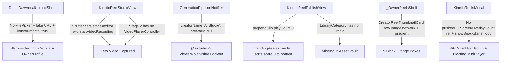

# Phase 78 — Vault, Explore, Profile Continuity, Uploads, Camera Capture & Unified Glass Tabs Forensic Audit

**Document ID:** `AUDIT-CLIENT-078`  
**Date:** 2026-11-23  
**Branch / Commit:** `fix/studio-cockpit-bugs-vh001-vh006` (`63441ff` + working-tree P77 completion)  
**Audit Scope:** Read-only cross-stack static & visual-correlation forensic audit across `apps/vhunambi_client/lib/` and `apps/vhunambi_api/src/routes/social_routes.ts` against hardware test sessions (`video_1.mp4` `00:00–00:36` and `video_2.mp4` `00:00–08:25`)  
**Phase Sequence Note:** Supersedes legacy "Phase 75" draft numbering referenced in the hardware visual capture notes. Since `P75` (Studio Cockpit V5), `P76` (Auth/Onboarding/Deep-Link Polish), and `P77` (Chromatic Player, Synced 9-Language Bantu Lyrics & Unified R2 Image Uploads) are now `completed`, this remediation scope is **Phase 78 (`P78` / `M78.1–M78.4`)**, forming Layer 1 of the 3-phase flagship roadmap (**Phase 78 -> Phase 79 -> Phase 80**).  
**Related Specs & Connectome Wake:**  
- [`docs/memory/CORTEX_INDEX.md`](file:///c:/Users/Ndugelo/VHUNAMBI/monorepo/docs/memory/CORTEX_INDEX.md) (`16` phases, `0` OPEN, `49` `CONNECTED_EXTENSIBLE`, `3` `SEALED`)  
- [`PHASE77_CHROMATIC_PLAYER_LYRICS_AND_R2_UPLOADS_AUDIT.md`](file:///c:/Users/Ndugelo/VHUNAMBI/monorepo/docs/audits/PHASE77_CHROMATIC_PLAYER_LYRICS_AND_R2_UPLOADS_AUDIT.md)  
- [`EP-P77-UNIFIED-R2-IMAGE-UPLOAD`](file:///c:/Users/Ndugelo/VHUNAMBI/monorepo/apps/vhunambi_client/lib/core/media/vhunambi_media_upload_service.dart)  
- [`EP-P74-REELS-STUDIO-PIPELINE`](file:///c:/Users/Ndugelo/VHUNAMBI/monorepo/apps/vhunambi_client/lib/features/content_studio/presentation/views/kinetic_reel_studio_view.dart)  
- [`EP-P74-SOCIAL-MEDIA-R2-UPLOAD`](file:///c:/Users/Ndugelo/VHUNAMBI/monorepo/apps/vhunambi_api/src/routes/social_routes.ts#L126-L180)

---

## 1. Executive Summary, Connectome Wake & Defect Matrix (`VA-01` – `VA-09`)

### 1.1 Headline Verdict
Inspecting the current `HEAD` codebase directly against every visual defect documented in `video_1.mp4` and `video_2.mp4` confirms that **all 6 P0 structural/pipeline defects (`VA-01`–`VA-06`) and the remaining UI/domain seams (`VA-09`) remain live and unpatched on `HEAD`**, with two important status updates from `P77`:
- **`P77` already resolved raw emojis in `ExploreMoodOption` (`explore_models.dart#L123-134`) and `Icons.*` in `explore/` widgets** (`genre_glyph.dart`, `track_card.dart`, `track_list_tile.dart`, `catalog_filter_bar.dart`), **meaning zero emojis leak in mood pills today**, **HOWEVER** `CatalogFilterBar` (`#L137-155`) still wraps 10 44dp chips into tall multi-row vertical stacks using static Dark tokens (`#L333-355`), and `Fastest Growing Tracks` (`TrackListTile#L51-64`) still paints orange `AppGradients.forGenre` glyph boxes instead of `VhunambiTrackArtwork`.
- **Two previously unflagged hardware failures** surfaced during cross-boundary diffing:
  1. `DirectDawVocalUploadSheet` (`#L176-177`) marks every `DAW Master` upload with `isInstrumental: true`, causing **both** `OwnerProfileView._resolveOwnerSongs` (`#L250`) and `LibraryCategory.songs` (`#L493`) to **hide the uploaded track**, while `BeatsVaultView` does not read `libraryTracksProvider` — doubly black-holing DAW uploads even beyond the missing `FilePicker`.
  2. `social_routes.ts#L127-136` rejects `.wav` (`audio/wav` / `audio/x-wav`), `.aac`, and `.ogg` uploads on `POST /api/social/media/upload` with HTTP `415 UNSUPPORTED_MEDIA_TYPE`.

### 1.2 Connectome Wake Findings (`vhunambi-memory`)
Querying `#social_graph, #media_artwork, #ui_surface_std, #identity_role, #audio_transport, #mood_taxonomy` returned `40` `CONNECTED_EXTENSIBLE` endpoints and `0` `OPEN` endpoints. Phase 78 should directly reuse:
- `EP-P77-UNIFIED-R2-IMAGE-UPLOAD` ([`vhunambi_media_upload_service.dart`](file:///c:/Users/Ndugelo/VHUNAMBI/monorepo/apps/vhunambi_client/lib/core/media/vhunambi_media_upload_service.dart)) — extend or generalize with `uploadAudioFile` / `uploadVideoFile` alongside local temp-file persistence when offline (`_shouldSkipNetwork`).
- `EP-P68-TRACK-ARTWORK` (`VhunambiTrackArtwork`) — missing in `CreatorReelThumbnailCard` (`VA-01`) and `TrackListTile` (`VA-04`).
- `EP-P70-VIEWER-ROLE` ([`viewer_role.dart`](file:///c:/Users/Ndugelo/VHUNAMBI/monorepo/apps/vhunambi_client/lib/core/auth/viewer_role.dart)) + `EP-P70-GLASS-SURFACE` (`VhunambiGlassSurface`).
- `EP-P75-CREATION-TO-REELS-BRIDGE` & `EP-P74-REELS-STUDIO-PIPELINE`.

### 1.3 Executive Root-Cause & Severity Matrix (`VA-01` – `VA-09`)

| ID | Sev | Head Status | Observed Symptom (Video + User Report) | Verified Primary Root Cause & Exact Line Proof | Phase Allocation |
| :--- | :---: | :--- | :--- | :--- | :---: |
| **`VA-01`** | **P0** | **LIVE BROKEN** | Publishing `"Love this one"` buries it below 8+ Reels on Explore; Library Vault has no `Reels` tab; Owner Profile shows 9 blank orange boxes under `My Clips & Reels` and duplicates shelves under `Songs`. | [`trending_reels_provider.dart#L31-L36`](file:///c:/Users/Ndugelo/VHUNAMBI/monorepo/apps/vhunambi_client/lib/features/social/presentation/providers/trending_reels_provider.dart#L31-L36) sorts all clips by `playCount + likeCount*3 + commentCount*5` (`0` score -> bottom); [`library_models.dart#L8`](file:///c:/Users/Ndugelo/VHUNAMBI/monorepo/apps/vhunambi_client/lib/features/library/domain/models/library_models.dart#L8) lacks `LibraryCategory.reels`; [`creator_reel_thumbnail_card.dart#L104-L127`](file:///c:/Users/Ndugelo/VHUNAMBI/monorepo/apps/vhunambi_client/lib/features/social/presentation/widgets/creator_reel_thumbnail_card.dart#L104-L127) uses `AppGradients.forGenre` + raw `Image.network` + `Icons.music_note_rounded`; [`owner_profile_view.dart#L720-L725`](file:///c:/Users/Ndugelo/VHUNAMBI/monorepo/apps/vhunambi_client/lib/features/profile/presentation/views/owner_profile_view.dart#L720-L725) mounts `_OwnerKineticPostsShelf` + `_OwnerReelsShelf` under `Songs` tab. | **P78 (`M78.3`)** |
| **`VA-02`** | **P0** | **LIVE BROKEN** | DAW/Vocal upload drops silently without picking or saving a real song; recorded Camera / picked Gallery videos vanish before Stage 2 Editor (`KineticPreviewCanvas` stays on static cover art); top-left Audio pill crushes to `[🎵 U...]`. | [`direct_daw_vocal_upload_sheet.dart#L67,L157,L176,L320-L356`](file:///c:/Users/Ndugelo/VHUNAMBI/monorepo/apps/vhunambi_client/lib/features/studio/presentation/widgets/direct_daw_vocal_upload_sheet.dart#L320-L356) has non-interactive dropzone, fake `cdn.vhunambi.com` URL, and sets `isInstrumental: true` (filtered out by [`owner_profile_view.dart#L250`](file:///c:/Users/Ndugelo/VHUNAMBI/monorepo/apps/vhunambi_client/lib/features/profile/presentation/views/owner_profile_view.dart#L250) & [`library_providers.dart#L493`](file:///c:/Users/Ndugelo/VHUNAMBI/monorepo/apps/vhunambi_client/lib/features/library/presentation/providers/library_providers.dart#L493)); [`kinetic_reel_studio_view.dart#L295-L318,L382-L414,L457-L552`](file:///c:/Users/Ndugelo/VHUNAMBI/monorepo/apps/vhunambi_client/lib/features/content_studio/presentation/views/kinetic_reel_studio_view.dart#L295-L318) lacks `startVideoRecording`/`stopVideoRecording`, lacks `VideoPlayerController` in Stage 2, and crowds 6 header buttons around `Key('reel_studio_audio_pill')`. Also [`social_routes.ts#L127-L136`](file:///c:/Users/Ndugelo/VHUNAMBI/monorepo/apps/vhunambi_api/src/routes/social_routes.ts#L127-L136) omits `audio/wav`. | **P78 (`M78.1`)** |
| **`VA-03`** | **P0** | **LIVE BROKEN** | Rapidly tapping heart on a Reel queues 39 separate orange SnackBars (`Loved 4x! -> Loved 39x!`) popping for 60+ seconds across tabs. | [`kinetic_reels_modal.dart#L928-L944`](file:///c:/Users/Ndugelo/VHUNAMBI/monorepo/apps/vhunambi_client/lib/features/social/presentation/widgets/kinetic_reels_modal.dart#L928-L944) calls `messenger.showSnackBar(...)` directly without hiding or replacing with an in-place ephemeral pill. | **P78 (`M78.2`)** |
| **`VA-04`** | **P0** | **PARTIAL (`P77` cleared emojis; tabs & tiles broken)** | Solid-orange rectangular tab strip on Owner Profile; flat Material 2 underline `TabBar` on Artist Profile; multi-row vertical mood chip block in Explore `All Songs` (`P77` already removed `'☁️'`/`'⚡'` emojis); orange piano squares in `Fastest Growing Tracks`. | [`owner_profile_view.dart#L785-L856`](file:///c:/Users/Ndugelo/VHUNAMBI/monorepo/apps/vhunambi_client/lib/features/profile/presentation/views/owner_profile_view.dart#L785-L856) custom orange selector; [`artist_profile_view.dart#L348-L367`](file:///c:/Users/Ndugelo/VHUNAMBI/monorepo/apps/vhunambi_client/lib/features/profile/presentation/views/artist_profile_view.dart#L348-L367) Material 2 `TabBar`; [`explore_view.dart#L212-L344`](file:///c:/Users/Ndugelo/VHUNAMBI/monorepo/apps/vhunambi_client/lib/features/explore/presentation/views/explore_view.dart#L212-L344) un-unified pills; [`catalog_filter_bar.dart#L137-L155,L323-L360`](file:///c:/Users/Ndugelo/VHUNAMBI/monorepo/apps/vhunambi_client/lib/features/explore/presentation/widgets/catalog_filter_bar.dart#L137-L155) uses vertical `Wrap` + static dark tokens; [`track_list_tile.dart#L51-L64`](file:///c:/Users/Ndugelo/VHUNAMBI/monorepo/apps/vhunambi_client/lib/features/explore/presentation/widgets/track_list_tile.dart#L51-L64) uses `AppGradients.forGenre` box instead of `VhunambiTrackArtwork`. | **P78 (`M78.4`)** |
| **`VA-05`** | **P0** | **LIVE BROKEN** | `MiniPlayerHost` floats across the middle of `KineticReelsModal`, Comments, and Library screens after drag, and persists mid-screen across tab switches. | [`kinetic_reels_modal.dart#L82-L115`](file:///c:/Users/Ndugelo/VHUNAMBI/monorepo/apps/vhunambi_client/lib/features/social/presentation/widgets/kinetic_reels_modal.dart#L82-L115) never increments `pushedFullScreenOverlayCountProvider`; [`main.dart#L176-L181`](file:///c:/Users/Ndugelo/VHUNAMBI/monorepo/apps/vhunambi_client/lib/main.dart#L176-L181) only resets `MiniPlayerController` when `mode == PlayerMode.auto`, leaving dragged `PlayerMode.manual` offsets stranded mid-screen across tabs. | **P78 (`M78.2`)** |
| **`VA-06`** | **P0** | **LIVE BROKEN** | User's own generated song (`"Underground Durban club banger"`) displays `Created by @aistudio • All Rights Reserved` and resolves as `ViewerRole.visitor`; `LYRICS` still renders raw `[INTRO]` and `KineticReelsModal` leaks unclosed `(Sacred drum;` / `(Li-ste-en...`. | [`generation_pipeline_providers.dart#L437-L452`](file:///c:/Users/Ndugelo/VHUNAMBI/monorepo/apps/vhunambi_client/lib/features/studio/presentation/providers/generation_pipeline_providers.dart#L437-L452) and [`track_entity.dart#L123-L136`](file:///c:/Users/Ndugelo/VHUNAMBI/monorepo/apps/vhunambi_client/lib/features/track/domain/models/track_entity.dart#L123-L136) stamp `creatorName: 'AI Studio'` with `null` `creatorId`/`creatorHandle` -> [`track_providers.dart#L405-L419`](file:///c:/Users/Ndugelo/VHUNAMBI/monorepo/apps/vhunambi_client/lib/features/track/presentation/providers/track_providers.dart#L405-L419) derives `@aistudio`; [`lyric_karaoke_sanitizer.dart#L12-L47`](file:///c:/Users/Ndugelo/VHUNAMBI/monorepo/apps/vhunambi_client/lib/features/content_studio/domain/utils/lyric_karaoke_sanitizer.dart#L12-L47) preserves `[INTRO]` in `_structuralHeaderOnly` and ignores unclosed `(` tokens. | **P78 (`M78.2`)** |
| **`VA-07`** | **P1** | **LIVE DEFECT** | Speed, Timer, and Length buttons cycle silently inline (`0s`, `1.0x`, `30s`) with zero pop-out option tray. | [`kinetic_reel_studio_view.dart#L514-L541,L614-L625`](file:///c:/Users/Ndugelo/VHUNAMBI/monorepo/apps/vhunambi_client/lib/features/content_studio/presentation/views/kinetic_reel_studio_view.dart#L514-L541) only increment `_speedIdx`, `_timerIdx`, `_lengthIdx`. | **P79** |
| **`VA-08`** | **P1** | **LIVE DEFECT** | Stickers render as static top-right rectangles (`96x74`); FX deck only has 3 toggles. | [`kinetic_reel_studio_view.dart#L425-L436,L888-L933`](file:///c:/Users/Ndugelo/VHUNAMBI/monorepo/apps/vhunambi_client/lib/features/content_studio/presentation/views/kinetic_reel_studio_view.dart#L425-L436) & [`kinetic_reels_modal.dart#L460-L472`](file:///c:/Users/Ndugelo/VHUNAMBI/monorepo/apps/vhunambi_client/lib/features/social/presentation/widgets/kinetic_reels_modal.dart#L460-L472) hardcode fixed `Positioned(top: 84, right: 76)`/`(top: 108, right: 16)`. | **P79** |
| **`VA-09`** | **P1** | **LIVE DEFECT** | Legacy reposts show `You (@current_user)`; `KineticPostFocusView` top-right Tip button is an unlabeled gold coin icon; Vision AI fallback uses static `cdn.vhunambi.com` URL that 404s identically; failed Reel videos show pure black canvas. | [`social_music_post.dart#L454-L513`](file:///c:/Users/Ndugelo/VHUNAMBI/monorepo/apps/vhunambi_client/lib/features/explore/domain/models/social_music_post.dart#L454-L513); [`kinetic_post_focus_view.dart#L292-L305`](file:///c:/Users/Ndugelo/VHUNAMBI/monorepo/apps/vhunambi_client/lib/features/explore/presentation/views/kinetic_post_focus_view.dart#L292-L305); [`create_kinetic_post_sheet.dart#L168-L171`](file:///c:/Users/Ndugelo/VHUNAMBI/monorepo/apps/vhunambi_client/lib/features/explore/presentation/widgets/create_kinetic_post_sheet.dart#L168-L171); [`kinetic_reels_modal.dart#L448-L450,L1627`](file:///c:/Users/Ndugelo/VHUNAMBI/monorepo/apps/vhunambi_client/lib/features/social/presentation/widgets/kinetic_reels_modal.dart#L1627). | **P78 (`M78.2` & `M78.4`)** |

### 1.4 End-to-End Breakpoint Topology Map



---

## 2. Pillar 1 — Broken Upload Song & Vanishing Camera Video Pipelines (`VA-02`)

### 2.1 `DirectDawVocalUploadSheet` 5-Layer Wire Break
Tracing [`direct_daw_vocal_upload_sheet.dart`](file:///c:/Users/Ndugelo/VHUNAMBI/monorepo/apps/vhunambi_client/lib/features/studio/presentation/widgets/direct_daw_vocal_upload_sheet.dart) from user tap on [`owner_profile_view.dart#L572`](file:///c:/Users/Ndugelo/VHUNAMBI/monorepo/apps/vhunambi_client/lib/features/profile/presentation/views/owner_profile_view.dart#L572) / [`inline_crate_mpc_workbench.dart#L572`](file:///c:/Users/Ndugelo/VHUNAMBI/monorepo/apps/vhunambi_client/lib/features/studio/presentation/widgets/inline_crate_mpc_workbench.dart#L572):

| Break | Exact File & Line(s) | Exact Defect Observed in Code | Required Fix Pattern |
| :---: | :--- | :--- | :--- |
| **B1** | [`direct_daw_vocal_upload_sheet.dart#L67,L105-L114`](file:///c:/Users/Ndugelo/VHUNAMBI/monorepo/apps/vhunambi_client/lib/features/studio/presentation/widgets/direct_daw_vocal_upload_sheet.dart#L67) | `_selectedFileName` is initialized to static placeholder `'limpopo_midnight_master.wav'` with **zero** `Uint8List? _selectedBytes`, zero `String? _selectedLocalPath`, and zero `FilePicker` dependency. | Store picked `Uint8List? _selectedAudioBytes`, `String? _selectedLocalPath`, `String? _selectedMimeType`, `int? _selectedDurationSec`, keeping `FLUTTER_TEST` deterministic stub support. |
| **B2** | [`direct_daw_vocal_upload_sheet.dart#L320-L356`](file:///c:/Users/Ndugelo/VHUNAMBI/monorepo/apps/vhunambi_client/lib/features/studio/presentation/widgets/direct_daw_vocal_upload_sheet.dart#L320-L356) | The "File Import Dropzone" `Container` has **no `InkWell` / `GestureDetector` / Pick File button** — tapping it on hardware does nothing. | Wrap dropzone in `InkWell(key: const Key('direct_upload_pick_file_btn'))` invoking `FilePicker.platform.pickFiles(type: FileType.custom, allowedExtensions: ['mp3', 'm4a', 'wav', 'aac', 'ogg'], withData: true)` (reusing the pattern verified in [`audio_import_service.dart#L45-L64`](file:///c:/Users/Ndugelo/VHUNAMBI/monorepo/apps/vhunambi_client/lib/features/sound_signature/domain/services/audio_import_service.dart#L45-L64) and [`reel_audio_picker_sheet.dart#L135-L166`](file:///c:/Users/Ndugelo/VHUNAMBI/monorepo/apps/vhunambi_client/lib/features/content_studio/presentation/widgets/reel_audio_picker_sheet.dart#L135-L166)), persisting picked bytes to an app-documents local file so offline playback works immediately. |
| **B3** | [`direct_daw_vocal_upload_sheet.dart#L157,L174`](file:///c:/Users/Ndugelo/VHUNAMBI/monorepo/apps/vhunambi_client/lib/features/studio/presentation/widgets/direct_daw_vocal_upload_sheet.dart#L157) | `_handleSubmit()` fabricates `audioUrl: 'https://cdn.vhunambi.com/uploads/$_selectedFileName'` (an unreachable non-R2 path) and never uploads picked bytes via `ISocialRepository.uploadReelMedia(...)` (`POST /api/social/media/upload`) or `localAudioFilePath`. | Make `_handleSubmit()` async with loading guard `_isSubmitting`: require an imported file (or surface clear validation), upload audio bytes to R2 via `ref.read(socialRepositoryProvider).uploadReelMedia(...)`, persist `localAudioFilePath`, and store `remoteAudioUrl` on `LibraryTrack`. |
| **B4** | [`direct_daw_vocal_upload_sheet.dart#L176-L177`](file:///c:/Users/Ndugelo/VHUNAMBI/monorepo/apps/vhunambi_client/lib/features/studio/presentation/widgets/direct_daw_vocal_upload_sheet.dart#L176-L177) & [`owner_profile_view.dart#L250`](file:///c:/Users/Ndugelo/VHUNAMBI/monorepo/apps/vhunambi_client/lib/features/profile/presentation/views/owner_profile_view.dart#L250) | Sets `isInstrumental: _provenanceType == AudioProvenanceType.humanDawMaster` (`true` on default DAW Master tab!), while **both** `_resolveOwnerSongs` (`owner_profile_view.dart#L250`) and `LibraryCategory.songs` (`library_providers.dart#L493`) reject `!track.isInstrumental`. And `LibraryCategory.beats` mounts `BeatsVaultView` (`library_view.dart#L96-L97`), which reads `marketplaceBeatsProvider`, NOT `libraryTracksProvider`! So uploaded DAW masters are invisible in **all three** places. | Stamp `isInstrumental: false` for full songs/masters uploaded in DAW Master & Vocal workflows (only marking pure instrumental beat-leases as instrumental, OR include creator-uploaded `humanDawMaster` assets inside `LibraryCategory.songs` and `OwnerProfileView._resolveOwnerSongs`). |
| **B5** | [`direct_daw_vocal_upload_sheet.dart#L122-L127`](file:///c:/Users/Ndugelo/VHUNAMBI/monorepo/apps/vhunambi_client/lib/features/studio/presentation/widgets/direct_daw_vocal_upload_sheet.dart#L122-L127) | Selecting the 3rd tab (`Dance Reel` / `'Open Camera Reel Recorder'`) calls `KineticReelsModal.show(context, clips: reels)` (the **viewer**!) instead of launching `KineticReelStudioView.show(context)` (the **recorder/creator**). | Launch `KineticReelStudioView.show(context, initialCameraMode: true)` instead of `KineticReelsModal`. |

**Backend Wire Gap Caught (`social_routes.ts`):**  
[`apps/vhunambi_api/src/routes/social_routes.ts#L127-L136`](file:///c:/Users/Ndugelo/VHUNAMBI/monorepo/apps/vhunambi_api/src/routes/social_routes.ts#L127-L136) defines `ALLOWED_SOCIAL_MEDIA_MIMES`:
```ts
const ALLOWED_SOCIAL_MEDIA_MIMES: Record<string, string> = {
  'video/mp4': 'mp4',
  'video/quicktime': 'mov',
  'video/webm': 'webm',
  'image/jpeg': 'jpg',
  'image/png': 'png',
  'image/webp': 'webp',
  'audio/mpeg': 'mp3',
  'audio/mp4': 'm4a',
};
```
Uploading `.wav` (`audio/wav`, `audio/x-wav`, `audio/wave`), `.aac` (`audio/aac`), or `.ogg` (`audio/ogg`) hits `415 UNSUPPORTED_MEDIA_TYPE` (`#L165-L173`). Extending `ALLOWED_SOCIAL_MEDIA_MIMES` in `social_routes.ts` with WAV/AAC/OGG enables full producer DAW compatibility at `POST /api/social/media/upload`.

---

### 2.2 `KineticReelStudioView` Camera Capture, Gallery Video Stage 2 Playback & Crushed Top Audio Pill
Inspecting all 988 lines of [`kinetic_reel_studio_view.dart`](file:///c:/Users/Ndugelo/VHUNAMBI/monorepo/apps/vhunambi_client/lib/features/content_studio/presentation/views/kinetic_reel_studio_view.dart):

| Defect ID | Exact Line(s) | Exact Code Defect | Concrete Remediation |
| :---: | :--- | :--- | :--- |
| **KRS-01** | [`#L295-L318`](file:///c:/Users/Ndugelo/VHUNAMBI/monorepo/apps/vhunambi_client/lib/features/content_studio/presentation/views/kinetic_reel_studio_view.dart#L295-L318), [`#L742-L754`](file:///c:/Users/Ndugelo/VHUNAMBI/monorepo/apps/vhunambi_client/lib/features/content_studio/presentation/views/kinetic_reel_studio_view.dart#L742-L754) | `_handleShutterTap()` **never** calls `_cameraController.startVideoRecording()` or `stopVideoRecording()`! Even after countdown, line `309`/`317` blindly jumps `_stage = _ReelStudioStage.editor` with `_customMediaBytes == null`, `_customMediaPath == null`, and `_mediaKind` still `'artwork'` (or `'camera_video'` with no video payload!). Also `#L142` defaults `_backdropMode = _BackdropMode.artwork` rather than auto-initializing camera when Camera mode is chosen, and `#L253` sets `enableAudio: false` without flash toggle binding (`setFlashMode`). | Implement real `_isRecordingVideo` toggle on `_handleShutterTap()` when `_cameraController?.value.isInitialized == true`: start recording -> show live recording progress ring + elapsed timer -> stop recording -> read `XFile captured = await ctrl.stopVideoRecording()`, store `_customMediaLocalPath = captured.path` & `await captured.readAsBytes()`, set `_mediaKind = 'camera_video'`, `_customMediaMime = 'video/mp4'`, initialize Stage 2 video preview, and transition to `_ReelStudioStage.editor`. (When no hardware camera is present / in headless tests, cleanly keep deterministic fallback). |
| **KRS-02** | [`#L381-L415`](file:///c:/Users/Ndugelo/VHUNAMBI/monorepo/apps/vhunambi_client/lib/features/content_studio/presentation/views/kinetic_reel_studio_view.dart#L381-L415), [`#L266-L293`](file:///c:/Users/Ndugelo/VHUNAMBI/monorepo/apps/vhunambi_client/lib/features/content_studio/presentation/views/kinetic_reel_studio_view.dart#L266-L293) | Stage 2 Editor has **zero `VideoPlayerController`** (`video_player` is not even imported!). Even when `_pickGalleryMedia()` succeeds with a `.mp4`/`.mov`/`.webm` (`_mediaKind = 'gallery_video'`), Stage 2 hits the `else` branch at `#L386-L414` and renders static `KineticPreviewCanvas` cover artwork, making gallery/camera videos appear lost! Similarly, Stage 2 ignores `gallery_photo` bytes on canvas preview. | Import `package:video_player/video_player.dart`. Persist picked `XFile.path` (`_customMediaLocalPath`) + initialize `VideoPlayerController.file(File(path))` (and `Image.memory` / `Image.file` for `gallery_photo`) in Stage 2 beneath transparent-background `KineticPreviewCanvas` (`transparentBackground: true`) so both Camera captures and Gallery videos/photos play visibly in Stage 2! Pass `localMediaPath` forward to `KineticReelPublishView` -> `PublishedClip` so local playback also succeeds offline. |
| **KRS-03** | [`#L240-L286`](file:///c:/Users/Ndugelo/VHUNAMBI/monorepo/apps/vhunambi_client/lib/features/social/data/repositories/http_social_repository.dart#L240-L286) | When offline or when `uploadReelMedia` catches an error, `HttpSocialRepository.uploadReelMedia` returns a synthetic relative string `'/r2/social/local/<ts>_<filename>'` that does **not** exist on R2 or disk! `KineticReelPublishView#L160` sets `videoUrl = '/r2/social/local/...'`, and `KineticReelsModal` [`_ReelVideoBackingLayer#L1573`](file:///c:/Users/Ndugelo/VHUNAMBI/monorepo/apps/vhunambi_client/lib/features/social/presentation/widgets/kinetic_reels_modal.dart#L1573) tries `VideoPlayerController.networkUrl(Uri.tryParse('/r2/social/local/...'))`, throws, and falls back to `ColoredBox(color: Colors.black)` (`VA-09`). | Check `isLocalFile` (`path` or `file://` URI) in Stage 2 and `_ReelVideoBackingLayer`, avoid overwriting local video playback with synthetic `/r2/social/local/...` URLs (store `localVideoPath` alongside `videoUrl` or return empty `remoteUrl` / enqueue upload outbox on network failure while preserving `file://` playback locally). |
| **KRS-04** | [`#L457-L552`](file:///c:/Users/Ndugelo/VHUNAMBI/monorepo/apps/vhunambi_client/lib/features/content_studio/presentation/views/kinetic_reel_studio_view.dart#L457-L552) | Top `Positioned(top: 10, left: 12, right: 12)` `Row` places 6 interactive controls on a single 336dp row: `Close (48dp)` + `Expanded(Audio Pill)` + `Flash (48dp)` + `Speed (~48dp)` + `Timer (~48dp)` + `FlipRail (48dp)` -> leaving `< 96dp` width for `Key('reel_studio_audio_pill')`, crushing `"Underground..."` into `[🎵 U...]` (`v2 04:46`). | Move Speed, Timer, Flash, and Flip-Rail off the top row onto the vertical tool rail (leaving ONLY `Close (left)` + `Centered Wide Audio Pill (ConstrainedBox minWidth: 168, maxWidth: 230)` + `Flip Rail / Next (right)`), restoring generous horizontal room for track titles + BPM/duration chip. |

---

## 3. Pillar 2 — Explore $\leftrightarrow$ Library $\leftrightarrow$ Owner Profile Continuity (`VA-01`)

### 3.1 Continuity Breakpoint Diagram

```text
  [KineticReelPublishView._submitPublish()]  (#L176: socialFeedProvider.notifier.prependClip(newClip))
           │                                         (playCount: 0, likeCount: 0, publishedAt: now)
           ├──► Explore: trendingReelsProvider (#L31-36) ──► SORTS BY (plays + likes*3 + comments*5) -> index LAST (0 score!)
           ├──► Library (Asset Vault): LibraryCategory      ──► Enum has ONLY {songs, playlists, collections, beats, licensing, trash} -> ZERO Reels tab!
           └──► OwnerProfileView:
                  ├── Songs tab (#L720-L722)  ──► Duplicates _OwnerKineticPostsShelf() + _OwnerReelsShelf() under Songs!
                  └── Reels tab (#L723-L724)  ──► _OwnerReelsShelf() -> CreatorReelThumbnailCard._CoverArt (#L104-127)
                                                     └─ Raw Image.network(clip.coverUrl) + AppGradients.forGenre + Icons.music_note_rounded
                                                        -> 9 BLANK ORANGE BOXES when seeded/relative `/r2/` URLs fail or coverUrl == ''!
```

### 3.2 Exhaustive `VA-01` Findings Table

| ID | Exact File & Line(s) | Exact Code Defect | Concrete Remediation Pattern |
| :---: | :--- | :--- | :--- |
| **`VA-01a`** | [`trending_reels_provider.dart#L18-L39`](file:///c:/Users/Ndugelo/VHUNAMBI/monorepo/apps/vhunambi_client/lib/features/social/presentation/providers/trending_reels_provider.dart#L18-L39) | `trendingReelsProvider` takes `feedState.clips` and unconditionally sorts **every** clip by `score = a.playCount + a.likeCount*3 + a.commentCount*5`. Any freshly published Reel (score `0`) lands at the **end** of Explore's `Kinetic Reels` horizontal rail behind every high-count seed clip (`v2 05:54–07:25`), even though `SocialFeedNotifier.prependClip` put it at index `0` (`social_feed_provider.dart#L153-L157`). | Introduce a recency pin window (e.g. clips created by active owner or published within recent `24h` / custom non-seed clips sorted newest-first at head indices `[0..k]`, followed by remaining trending clips by score) OR track `_sessionPublishedClipIds` so newly published Reels immediately appear at index `0` of `TrendingReelsShelf` (`All` & matching genre chip). Also sync `KineticReelsModal` (`#L133-L152`) so default tab (`For You`) preserves `clips` order without breaking existing `Trending` / `Newest` sorts. |
| **`VA-01b`** | [`library_models.dart#L8`](file:///c:/Users/Ndugelo/VHUNAMBI/monorepo/apps/vhunambi_client/lib/features/library/domain/models/library_models.dart#L8), [`library_category_rail.dart#L17-L48`](file:///c:/Users/Ndugelo/VHUNAMBI/monorepo/apps/vhunambi_client/lib/features/library/presentation/widgets/library_category_rail.dart#L17-L48), [`library_view.dart#L88-L98`](file:///c:/Users/Ndugelo/VHUNAMBI/monorepo/apps/vhunambi_client/lib/features/library/presentation/views/library_view.dart#L88-L98), [`library_providers.dart#L81-L89,L491-L503`](file:///c:/Users/Ndugelo/VHUNAMBI/monorepo/apps/vhunambi_client/lib/features/library/presentation/providers/library_providers.dart#L491-L503) | `LibraryCategory` enum has only 6 values (`songs, playlists, collections, beats, licensing, trash`). There is **zero Reels vault presence**, severing Explore Reel publishing from the creator's Asset Vault (`v2 06:10–06:35`). | Add `LibraryCategory.reels` (positioned cleanly after `songs` in `LibraryCategoryRail`, using `AppIcons.reels`), derive count from `socialFeedProvider` filtered by canonical active creator ID (`canonicalizeCreatorId(clip.creatorId)` + legacy `'creator_me'`), and render a new `ReelsVaultView` with `CreatorReelThumbnailCard` / `VhunambiTrackArtwork`, play count, tap-to-open `KineticReelsModal`, quick share, and `+ Create Reel` CTA to `KineticReelStudioView`. |
| **`VA-01c`** | [`creator_reel_thumbnail_card.dart#L59-L63,L104-L127,L145`](file:///c:/Users/Ndugelo/VHUNAMBI/monorepo/apps/vhunambi_client/lib/features/social/presentation/widgets/creator_reel_thumbnail_card.dart#L104-L127) | `_CoverArt` paints a flat orange `AppGradients.forGenre(clip.genre)` rectangle and raw `Image.network(clip.coverUrl)` (without `AppConstants.normalizeCloudMediaUrl` or `VhunambiTrackArtwork`), falling back to stock Material `Icons.music_note_rounded` (`#L114, L121`) + `Icons.play_arrow_rounded` (`#L60`). Because seeded clips in `social_feed_provider.dart` have relative/empty `coverUrl`s, `OwnerProfileView`'s `My Clips & Reels` displays **9 blank orange boxes** (`v1 00:04–00:34`, `v2 06:25`). Note also that `CreatorReelThumbnailCard` violates `STD-UIUX-001` (`3` stock `Icons.*` + static dark tokens `AppColors.textPrimary`/`surfaceCanvas` at `#L79,139,145,150`). | Replace `_CoverArt` completely with `VhunambiTrackArtwork(coverUrl: clip.coverUrl, genre: clip.genre, trackId: clip.trackId, borderRadius: BorderRadius.zero, showSubtleBorder: false)` (matching `TrendingReelCard#L51`), replace `Icons.play_arrow_rounded` with `PhosphorIconsFill.play`, and add lightweight `VhunambiTrackArtwork` + optional local video frame badge when `clip.videoUrl != null`. |
| **`VA-01d`** | [`owner_profile_view.dart#L719-L725`](file:///c:/Users/Ndugelo/VHUNAMBI/monorepo/apps/vhunambi_client/lib/features/profile/presentation/views/owner_profile_view.dart#L719-L725) | When `_activeTab == OwnerStudioTab.songs`, lines `720–722` mount **both** `_OwnerKineticPostsShelf()` and `_OwnerReelsShelf()` beneath `Your Songs`, and switching to `OwnerStudioTab.reels` (`#L723-L724`) mounts `_OwnerReelsShelf()` again. Meanwhile `OwnerStudioTab` has no dedicated `Posts` separation or renders both Shelves cleanly without duplicating Reels inside Songs. | Remove `_OwnerReelsShelf()` from `OwnerStudioTab.songs` (`#L721-L722`) and render clean single-responsibility tab bodies (keep `_OwnerKineticPostsShelf()` either under `Reels & Posts` or its own clean shelf without duplicating Reels across `Songs` and `Reels`). |

---

## 4. Pillar 3 — SnackBar Queue Bomb, MiniPlayerHost Occlusion & `@aistudio` Owner Lockout (`VA-03`, `VA-05`, `VA-06`)

### 4.1 `Loved 39x!` SnackBar Queue Bomb (`VA-03`)
- **Smoking Gun:** [`kinetic_reels_modal.dart#L928-L944`](file:///c:/Users/Ndugelo/VHUNAMBI/monorepo/apps/vhunambi_client/lib/features/social/presentation/widgets/kinetic_reels_modal.dart#L928-L944):
```dart
  void _recordLove(BuildContext context, WidgetRef ref) {
    HapticFeedback.mediumImpact();
    widget.onBurst(KineticReactionType.love);
    final count = ref
        .read(socialFeedProvider.notifier)
        .recordLove(widget.clip.id);
    _emitReelLoveNotification(ref, widget.clip, count);
    final messenger = ScaffoldMessenger.of(context);
    messenger.showSnackBar(
      SnackBar(
        key: ValueKey('love_toast_${widget.clip.id}'),
        content: Text('Loved ${count}x!'),
        backgroundColor: AppColors.brandPrimary,
        duration: const Duration(milliseconds: 900),
      ),
    );
  }
```
- **Why it spans 60+ seconds across tabs:** Flutter's `ScaffoldMessenger` appends every `showSnackBar()` call to an internal FIFO queue. Rapidly double-tapping or tapping Love 39 times queues `39 × 900ms` (+ enter/exit animation ~300ms each = **~47–60+ seconds**) on the root `ScaffoldMessenger`, popping `Loved 4x! ... Loved 39x!` even after closing `KineticReelsModal` and navigating across Explore, All Songs, and Library (`v2 08:05–08:25`).
- **Required Fix:** Remove `messenger.showSnackBar(...)` completely from `_recordLove`. Replace with an **in-place ephemeral floating counter pill** (`Key('reel_ephemeral_love_pill')`) anchored above the right-side heart rail inside `_SingleReelPage`, updating in place with a resettable 800ms fade-out `Timer` (zero `ScaffoldMessenger` involvement, zero queue buildup).

### 4.2 `MiniPlayerHost` Floating Mid-Screen & Over `KineticReelsModal` (`VA-05`)
Two distinct defects combine here:
1. **Un-suppressed Full-Screen Modal (`kinetic_reels_modal.dart`):**  
   [`mini_player_host.dart#L185-L186`](file:///c:/Users/Ndugelo/VHUNAMBI/monorepo/apps/vhunambi_client/lib/features/player/presentation/widgets/mini_player_host.dart#L185-L186) hides cleanly whenever `pushedFullScreenOverlayCountProvider > 0` (`artist_profile_view.dart#L61`, `owner_profile_view.dart#L76`, and `kinetic_reel_studio_view.dart#L196` all increment/decrement it safely). **`KineticReelsModal` (`kinetic_reels_modal.dart#L82-L115`) never increments `pushedFullScreenOverlayCountProvider`**, so `MiniPlayerHost` floats straight over full-screen Reels playback (`v2 06:40–08:00`) and Comments sheets (`v2 07:50`)! Also verify `ReelsCommentSheet` / `showModalBottomSheet` increments `modalSheetOpenCountProvider` cleanly.
2. **Stranded `PlayerMode.manual` Pill Across Tab Switches (`mini_player_controller.dart#L211-L213,L250,L306` + `main.dart#L176-L181`):**  
   Once the user drags `MiniPlayerHost` anywhere above the dock threshold, [`mini_player_controller.dart#L306`](file:///c:/Users/Ndugelo/VHUNAMBI/monorepo/apps/vhunambi_client/lib/features/player/presentation/providers/mini_player_controller.dart#L306) sets `_mode = PlayerMode.manual` and persists that mid-screen `Offset` to Hive (`#L315`). Then [`main.dart#L177-L181`](file:///c:/Users/Ndugelo/VHUNAMBI/monorepo/apps/vhunambi_client/lib/main.dart#L177-L181) checks:
   ```dart
   if (playerController.form == PlayerForm.pill &&
       playerController.mode == PlayerMode.auto) {
     ref.read(miniPlayerControllerProvider.notifier).setForm(PlayerForm.bar);
   }
   ```
   Because `mode == PlayerMode.manual`, switching tabs to Library (`v2 06:10`), Beats (`06:15`), Trash (`06:20`), or Licensing (`06:35`) **never resets or docks the pill**, leaving it floating dead-center over cards and buttons across every tab! Calling `resetToDock(MediaQuery.maybeSizeOf(context))` inside `_switchTab` when `mode == PlayerMode.manual` (plus clamping default manual positions away from center content or snapping dragged pills to left/right edge dock zones) eliminates mid-screen stranding permanently.

### 4.3 `@aistudio` Creator Lockout & Lyric Sanitizer Leaks (`VA-06`, `VA-09`)

#### Root Cause 1 — Generated Songs Stamped as `@aistudio` Visitor (`VA-06`)
1. [`generation_pipeline_providers.dart#L437-L452`](file:///c:/Users/Ndugelo/VHUNAMBI/monorepo/apps/vhunambi_client/lib/features/studio/presentation/providers/generation_pipeline_providers.dart#L437-L452): When a generation finishes, `GenerationPipelineNotifier` inserts a `LibraryTrack` into `libraryTracksProvider` with:
   ```dart
   final libraryTrack = LibraryTrack(
     id: normalizedTrack.id,
     title: effectiveTitle,
     creatorName: 'AI Studio',
     // BUG: creatorId == null AND creatorHandle == null!
   ```
   Similarly [`track_entity.dart#L123-L136`](file:///c:/Users/Ndugelo/VHUNAMBI/monorepo/apps/vhunambi_client/lib/features/track/domain/models/track_entity.dart#L123-L136) hardcodes `creatorName: 'AI Studio'` on `toTrack()`.
2. [`track_providers.dart#L405-L419`](file:///c:/Users/Ndugelo/VHUNAMBI/monorepo/apps/vhunambi_client/lib/features/track/presentation/providers/track_providers.dart#L405-L419): When `TrackDetailView` opens that generated track, `_lookupInitialTrack` finds `lt.creatorId == null`, computes `handleSlug = 'ai_studio'` from `lt.creatorName = 'AI Studio'`, falls back to `creator_ai_studio`, and derives `resolvedHandle = '@aistudio'`!
3. [`viewer_role.dart#L27-L88`](file:///c:/Users/Ndugelo/VHUNAMBI/monorepo/apps/vhunambi_client/lib/core/auth/viewer_role.dart#L27-L88): `resolveViewerRole` compares `'ai_studio'` against the user's `activeCreatorId` (`creator_cern` or signed-in UID), sees a mismatch, and returns **`ViewerRole.visitor`**, displaying `"Created by @aistudio • All Rights Reserved"` and hiding the user's own Stem Lab, Mastering, and Owner Cockpit (`v2 00:25–00:45`)!
- **Two-Sided Fix:**
  - Read active owner identity (`ownerProfileProvider` / `currentCreatorIdProvider` / `currentCreatorHandleProvider`) in `GenerationPipelineNotifier` (and pass owner attribution cleanly) so every newly generated track stores `creatorId`, `creatorHandle`, and `creatorName` of the authenticated creator.
  - Add legacy migration/rescue in **both** `track_providers.dart#L409-L419` and `viewer_role.dart#L13-L19`: any local library song still stamped with legacy `creatorName == 'AI Studio'` / `creator_ai_studio` / `@aistudio` resolves to the active creator's ID/handle and `ViewerRole.owner`! Also verify `OwnerProfileView._resolveOwnerSongs` (`owner_profile_view.dart#L241-L262`) treats legacy `'AI Studio'` tracks in the owner's local library as owned!

#### Root Cause 2 — Raw `[INTRO]` & Unclosed Parenthetical Lyric Leaks (`VA-06`, `VA-09`)
Inspecting [`lyric_karaoke_sanitizer.dart#L11-L54`](file:///c:/Users/Ndugelo/VHUNAMBI/monorepo/apps/vhunambi_client/lib/features/content_studio/domain/utils/lyric_karaoke_sanitizer.dart#L11-L54) and [`lyrics_teleprompter.dart#L73-L76`](file:///c:/Users/Ndugelo/VHUNAMBI/monorepo/apps/vhunambi_client/lib/features/track/presentation/widgets/lyrics_teleprompter.dart#L73-L76):
1. **`[INTRO]` Leak (`TrackDetailView` `v2 00:40`):** `LyricsTeleprompter` calls `cleanLyricsForTeleprompter`, whose `_structuralHeaderOnly` regex (`#L21-L24`) **explicitly preserves `[INTRO]`, `[Verse 1]`, `[Chorus]`, `[Outro]`**! (Note: existing Phase 74/75 unit tests at [`phase75_studio_connectome_closure_test.dart#L554-L555`](file:///c:/Users/Ndugelo/VHUNAMBI/monorepo/apps/vhunambi_client/test/features/phase75_studio_connectome_closure_test.dart#L554-L555) and [`expanded_cockpit_modal_test.dart#L83`](file:///c:/Users/Ndugelo/VHUNAMBI/monorepo/apps/vhunambi_client/test/features/player/widgets/expanded_cockpit_modal_test.dart#L83) explicitly assert `[Verse 1]` / `[Chorus]` in `cleanLyricsForTeleprompter`!). Therefore: keep `cleanLyricsForTeleprompter` API backwards-compatible (or add optional `stripAllBrackets: true` flag used by `LyricsTeleprompter` / `ExpandedCockpitModal` playback mode, or strip non-sung `[INTRO]`/`[OUTRO]`/`[Chorus]` cue tokens inside `SyncedLyricTimeline` playback highlighting so sing-along lines never highlight raw `[INTRO]`)!
2. **Unclosed Parenthetical Leak (`(Sacred drum;` / `(Li-ste-en...` `v2 07:05–07:10`):** `_parenCueBlock` (`#L12-L15`) only matches **complete balanced** `(...)` pairs containing a small allowlist of English keywords. Unclosed multi-line or truncated ad-libs / instrument notes like `(Sacred drum;` or `(Li-ste-en` (`(` without matching `)` on that token/line, or standalone `(` / `)`) survive `cleanLyricTextForKaraoke` (`#L68-L71`) because `#L69` only strips `[\[\]+*#]`, NOT stray `(` or `)` or unclosed `(cue...` blocks! Hardening `cleanLyricTextForKaraoke` + `sanitizeAlignment` to strip parenthetical/bracketed cues (both balanced `(cue ...)` and unclosed leading `(` cue fragments before punctuation) closes `VA-09` cleanly without breaking Phase 75 assertions.

---

## 5. Pillar 4 — Unified `VhunambiGlassTabBar` (`EP-P78-GLASS-TAB-BAR`), Explore Visual Fragmentation & Polish Seams (`VA-04`, `VA-09`)

### 5.1 Tab Bar Design Divergence Census (`VA-04`)

| Surface | File & Line(s) | Current Implementation | Target (`VhunambiGlassTabBar`) |
| :--- | :--- | :--- | :--- |
| **`OwnerProfileView`** | [`owner_profile_view.dart#L785-L856`](file:///c:/Users/Ndugelo/VHUNAMBI/monorepo/apps/vhunambi_client/lib/features/profile/presentation/views/owner_profile_view.dart#L785-L856) | Solid orange `AppColors.brandPrimary` pill blocks inside a single row (`AnimatedContainer`, zero specular rim, solid flat fill). | Unified frosted `VhunambiGlassTabBar` with sliding translucent active glass indicator + specular rim + `HapticsService().selectionClick()`. |
| **`ArtistProfileView`** | [`artist_profile_view.dart#L348-L367,L1053-L1076`](file:///c:/Users/Ndugelo/VHUNAMBI/monorepo/apps/vhunambi_client/lib/features/profile/presentation/views/artist_profile_view.dart#L348-L367) | Stock Material 2 `TabBar` inside `SliverPersistentHeader` with thin orange bottom underline (`indicatorColor: AppColors.brandPrimary`). | Replace `TabBar` header delegate with `VhunambiGlassTabBar` synced cleanly to `DefaultTabController` / `TabController`. |
| **`ExploreView` Switcher** | [`explore_view.dart#L212-L344`](file:///c:/Users/Ndugelo/VHUNAMBI/monorepo/apps/vhunambi_client/lib/features/explore/presentation/views/explore_view.dart#L212-L344) | Inline `_buildFilterPill` (`AppColors.surfaceElevated` static Dark token, `AppColors.borderSubtle`) mixing primary feed tabs (`For You`, `Following`, `All Songs`) with tier pills (`DiscoveryStageTier`). | Separate primary views into a crisp `VhunambiGlassTabBar` (`For You`, `Following`, `All Songs`) above compact frosted filter/tier pills migrated to `AppColors.*Of(context)`. |
| **`LibraryCategoryRail`** | [`library_category_rail.dart#L14-L181`](file:///c:/Users/Ndugelo/VHUNAMBI/monorepo/apps/vhunambi_client/lib/features/library/presentation/widgets/library_category_rail.dart#L14-L181) | Separate standalone pill builder; can align visually with `VhunambiGlassTabBar` tokens (or embed `VhunambiGlassTabBar` supporting optional count badges!) while preserving existing `LibraryCategory` keys & `Reels` tab. | Standardize active frosted pill styling + Light/Dark contrast across all 4 surfaces. |

### 5.2 Explore Visual Fragmentation (`CatalogFilterBar` & `Fastest Growing Tracks`)
1. **`CatalogFilterBar` Mood Stack & Static Dark Tokens:** [`catalog_filter_bar.dart#L137-L155`](file:///c:/Users/Ndugelo/VHUNAMBI/monorepo/apps/vhunambi_client/lib/features/explore/presentation/widgets/catalog_filter_bar.dart#L137-L155) renders all `10` items of `exploreMoodCatalog` plus `_LanguageDropdown` inside a vertical `Wrap` with `minHeight: 44` (`#L325`), expanding to 3–4 rows (`~200dp` height) and pushing track results off-screen. Also `_FilterPill` (`#L146, L333-L355`) and `ExploreView`'s Load-More / `_buildFilterPill` (`#L147-148, L327-338`) still use static Dark tokens (`AppColors.surfaceSecondary`, `AppColors.surfaceElevated`, `AppColors.borderSubtle`, `AppColors.textSecondary`, `AppColors.textPrimary`) which fail Light-theme contrast. Replace the mood `Wrap` with a single-row **horizontal frosted `VhunambiMood` pill rail** (`PhosphorIcon(mood.icon, size: 14)` + label, height `44dp`, horizontal scroll alongside language selector) using `*Of(context)` tokens!
2. **`Fastest Growing Tracks` Orange Piano Boxes:** [`track_list_tile.dart#L51-L64`](file:///c:/Users/Ndugelo/VHUNAMBI/monorepo/apps/vhunambi_client/lib/features/explore/presentation/widgets/track_list_tile.dart#L51-L64) inside [`explore_view.dart#L478-L481`](file:///c:/Users/Ndugelo/VHUNAMBI/monorepo/apps/vhunambi_client/lib/features/explore/presentation/views/explore_view.dart#L478-L481) still paints a `48x48` `AppGradients.forGenre` gradient square + `PhosphorIcon(exploreGenreGlyph(track.genre))` (identical visual regression to `VA-01c`!), plus static Dark tokens at `#L43-46, L90-128`. Swap the thumbnail cleanly to `VhunambiTrackArtwork(coverUrl: track.coverUrl, genre: track.genre, trackId: track.id, width: 48, height: 48, borderRadius: BorderRadius.circular(AppRadius.input))` + `*Of(context)` tokens.

### 5.3 Remaining Polish Seams (`VA-09`)
1. **Unlabeled Tip Coin Icon (`kinetic_post_focus_view.dart#L292-L305`):** Top-right `AppBar` action renders a bare `PhosphorIcon(AppIcons.coin, color: AppColors.coinGold, size: 20)` inside an `IconButton`, looking visually ambiguous (`v1 00:20`, `v2 04:10`). Wrap into a compact frosted `VhunambiGlassSurface` pill combining `AppIcons.coin` + `'Tip'` label (`minHeight: 44` hit target).
2. **Legacy `You (@current_user)` Repost Normalizer (`social_music_post.dart#L454-L513` & `viewer_role.dart`):** Cached Hive/outbox JSON from earlier builds still deserializes raw `'@current_user'` / `'current_user'` in `creatorId`, `creatorHandle`, and `repostedFromCreatorHandle` (`v2 08:15`). Normalize legacy `'current_user'` / `'@current_user'` handles and `'You'` names at `SocialMusicPost.fromJson` read time cleanly (`creatorHandle.toLowerCase() == '@current_user'` -> canonical `@cern` / active handle), and normalize in UI renderers (`explore_social_post_card.dart#L366`, `kinetic_post_focus_view.dart#L356`).
3. **Vision AI Fallback Duplication (`create_kinetic_post_sheet.dart#L168-L197`):** Offline / error fallback produces `'https://cdn.vhunambi.com/vision/generated_<ts>.jpg'`, which returns 404 -> `VhunambiTrackArtwork` renders the identical genre cover for every prompt. Route offline / fallback previews through distinct deterministic genre/mood asset variations (`AppAssets.resolveGenreCoverAsset`) or local generated gradient artwork metadata so prompts look distinct even offline.
4. **Blank Black Reel Canvas (`kinetic_reels_modal.dart#L433-L458,L1627`):** `KineticPreviewCanvas` receives `transparentBackground: clip.videoUrl != null && clip.videoUrl!.isNotEmpty` (`#L448-L449`), while `_ReelVideoBackingLayer` (`#L1627`) renders `ColoredBox(color: Colors.black)` whenever video initialization fails, is loading, or hits `/r2/social/local/...` in offline mode (`VA-09`: `My Clips & Reels / U ga` `v2 06:40`). Keep `VhunambiTrackArtwork` + chromatic backdrop rendered **beneath** `_ReelVideoBackingLayer` (hiding `_ReelVideoBackingLayer` until `_initialized == true`) so a Reel never degrades to a black slab!

---

## 6. Clean 3-Phase Roadmap (Phases 78–80) & Phase 78 Remediation Blueprint

### 6.1 Layered Roadmap Framing (Superseding Draft `75–77` Labels)
- **Phase 78 (`M78.1`–`M78.4` — This Audit Target):** Foundation & Flow Continuity — Fix Song Upload & Camera/Gallery Video Capture (`VA-02`), Explore $\leftrightarrow$ Library (`Reels` tab) $\leftrightarrow$ Owner Profile Continuity & Artwork (`VA-01`), `@aistudio` Ownership & Lyric Sanitizer Hardening (`VA-06`), SnackBar Bomb + `MiniPlayerHost` Dock Discipline (`VA-03`, `VA-05`), Unified `VhunambiGlassTabBar` (`EP-P78-GLASS-TAB-BAR`), Explore Mood Rail & `TrackListTile` Artwork (`VA-04`), and Polish Seams (`VA-09`).
- **Phase 79 (Next Layer):** Intentional Pop-Out Glass Studio Controls (`VA-07`), App-Wide Hold-to-Function Gesture Grammar (Hold-to-Preview 10s Hook, Hold-to-Record + Zoom, Hold-for-2x Reel Playback, Hold-for-Quick-Actions), and Die-Cut Draggable/Scalable/Rotatable Stickers + 8+ Pro GPU FX (`VA-08`).
- **Phase 80 (Smart Layer):** `VhunambiVisualDnaMatcher` — On-device Visual Chromatic/Energy DNA analyzer + `CreatorDnaProfile` + `VhunambiMood` + BPM auto-scoring song & chorus cue matcher (plus optional Workers AI scene enrichment).

### 6.2 Phase 78 Shared Primitive Blueprint (`EP-P78-GLASS-TAB-BAR`)
Create `apps/vhunambi_client/lib/core/widgets/vhunambi_glass_tab_bar.dart` providing:
- Frosted outer glass track (`VhunambiGlassSurface` variant `.pill`, `enableLiveBlur: false`) with Light/Dark specular rim (`AppColors.borderSubtleOf(context)`).
- Smooth animated active translucent capsule with optional count badge, active icon/label contrast (`AppColors.textPrimaryOf(context)` / `AppColors.brandPrimary`), `44dp` minimum touch targets, `HapticsService().selectionClick()`, and horizontal scroll + `TabController` / callback compatibility so all 4 screens (`OwnerProfileView`, `ArtistProfileView`, `LibraryCategoryRail`, `ExploreView`) adopt one unified design language.

### 6.3 Ordered Two-Pass Execution Plan for Phase 78 (`M78.1` – `M78.4`)

#### Pass 1 (`M78.1` – `M78.2`): Broken Pipelines, Ownership, Lyric Sanitizer & Overlay Containment
- **`M78.1` — Real Audio Upload & Camera/Gallery Video Capture Repairs (`VA-02`):**
  1. Repair `DirectDawVocalUploadSheet`: bind interactive `FilePicker` dropzone, persist local audio file path + bytes + R2 upload via `ISocialRepository.uploadReelMedia`, fix `isInstrumental: false` for DAW/Vocal song uploads so tracks appear immediately in `LibraryView` (`Songs`) and `OwnerProfileView` (`Your Songs`), and wire `Dance Reel` tab to `KineticReelStudioView.show(context)`.
  2. Extend `apps/vhunambi_api/src/routes/social_routes.ts` `ALLOWED_SOCIAL_MEDIA_MIMES` with `audio/wav`, `audio/x-wav`, `audio/aac`, `audio/ogg` (+ API test).
  3. Repair `KineticReelStudioView`: implement real `CameraController` video recording (`startVideoRecording`/`stopVideoRecording`, audio enabled on real devices, live recording timer/stop), add `VideoPlayerController` Stage 2 Editor playback for camera & gallery videos (and `Image` preview for gallery photos) with `localMediaPath` fallback across `KineticReelPublishView` -> `PublishedClip` -> `KineticReelsModal`, and declutter the top chrome so `Key('reel_studio_audio_pill')` has `>= 168dp` breathing room.
- **`M78.2` — SnackBar Bomb, MiniPlayerHost Dock, `@aistudio` Ownership & Sanitizer Hardening (`VA-03`, `VA-05`, `VA-06`, `VA-09`):**
  1. Replace `ScaffoldMessenger.showSnackBar` in `KineticReelsModal._recordLove` (`#L935-943`) with an in-place ephemeral floating love counter pill (`800ms` resettable timer).
  2. Ref-count `pushedFullScreenOverlayCountProvider` in `KineticReelsModal` (`initState`/`dispose`) and call `miniPlayerControllerProvider.notifier.resetToDock(...)` in `RootShell._switchTab` (`main.dart`) whenever `mode == PlayerMode.manual`.
  3. Fix `@aistudio` creator lockout across `GenerationPipelineNotifier` (`#L437-452`), `TrackEntity.toTrack()` (`#L123-136`), `track_providers.dart#L405-419`, and `viewer_role.dart` (rescue legacy `'AI Studio'` / `@aistudio` / `@current_user` tracks to active owner -> `ViewerRole.owner`).
  4. Harden `LyricKaraokeSanitizer` (`stripParentheticalCues` including unclosed `(cue...` fragments) and strip non-sung `[INTRO]`/`[OUTRO]` cue tags in playback `LyricsTeleprompter` / `SyncedLyricTimeline` without regressing Phase 75 `[Verse 1]`/`[Chorus]` unit tests.
  5. Normalize legacy `@current_user` in `SocialMusicPost.fromJson` and ensure `KineticReelsModal` renders `VhunambiTrackArtwork` beneath `_ReelVideoBackingLayer` until initialized (never blank black).
  - *Pass 1 Gate:* `dart analyze` (`0` issues), `npx tsc --noEmit` + API `social_routes` test, Pass 1 Flutter unit/widget tests (`studio`, `content_studio`, `social`, `player`, `track`).

#### Pass 2 (`M78.3` – `M78.4`): Continuity Hub, Unified `VhunambiGlassTabBar` & Explore/Profile Visual Overhaul
- **`M78.3` — Explore $\leftrightarrow$ Library $\leftrightarrow$ Owner Profile Reels Continuity (`VA-01`):**
  1. Update `trendingReelsProvider` so newly published / current-session owner Reels pin cleanly to index `0` of Explore's `Kinetic Reels` shelf (`All` & matching genre).
  2. Add `LibraryCategory.reels` (`LibraryModels`, `LibraryCategoryRail`, `libraryCategoryCountsProvider`, `LibraryView`, `ReelsVaultView`) displaying the active owner's published Reels with artwork/video thumbnails, quick playback into `KineticReelsModal`, and `+ Create Reel`.
  3. Replace `CreatorReelThumbnailCard`'s `AppGradients.forGenre` + raw `Image.network` + stock `Icons.*` with `VhunambiTrackArtwork` + `PhosphorIcon` (`VA-01c`), eliminating all 9 blank orange boxes on `OwnerProfileView` and deduplicating `_OwnerReelsShelf` out of `OwnerStudioTab.songs`.
- **`M78.4` — Unified `VhunambiGlassTabBar`, Explore Mood Rail, `TrackListTile` Artwork & Polish (`VA-04`, `VA-09`):**
  1. Build shared `VhunambiGlassTabBar` (`EP-P78-GLASS-TAB-BAR`) and adopt across `OwnerProfileView`, `ArtistProfileView`, `ExploreView`, and `LibraryCategoryRail` with Light/Dark contrast parity.
  2. Convert `CatalogFilterBar` mood `Wrap` into a compact single-row horizontal `VhunambiMood` glass pill rail + migrate all static Dark tokens in `CatalogFilterBar` & `ExploreView` to `*Of(context)`, and migrate `TrackListTile` (`Fastest Growing Tracks`) from orange glyph square to `VhunambiTrackArtwork`.
  3. Upgrade `KineticPostFocusView`'s bare gold coin button to a clear frosted `'Tip'` glass pill and diversify offline `CreateKineticPostSheet` Vision AI fallbacks.
  - *Pass 2 Gate:* Full `dart analyze`, `STD-UIUX-001` zero-`Icons.` / zero-emoji scan across `studio`, `content_studio`, `social`, `library`, `profile`, `explore`, `player`, `track`; bounded `flutter test --no-pub --timeout=60s`; `memory.md` `"completed"` + `consolidate_memory.mjs` (`SLEEP`).

---

## 7. Verification Commands for Stage 4 Execution

```powershell
# 1. Client Static Analysis
Set-Location apps/vhunambi_client
dart analyze

# 2. STD-UIUX-001 Icon & Raw Emoji Scan
$dirs = @('lib/core/widgets', 'lib/features/studio', 'lib/features/content_studio', 'lib/features/social', 'lib/features/library', 'lib/features/profile', 'lib/features/explore', 'lib/features/player', 'lib/features/track')
Select-String -Path (Get-ChildItem -Recurse $dirs -Filter *.dart) -Pattern "\bIcons\." -CaseSensitive
Select-String -Path (Get-ChildItem -Recurse $dirs -Filter *.dart) -Pattern "[\u2600-\u27BF]|[\uD83C-\uDBFF][\uDC00-\uDFFF]" | Where-Object { $_.Line -notmatch "^\s*//" }

# 3. Bounded Headless Flutter Test Gates
flutter test test/features/phase78_* test/features/studio test/features/content_studio test/features/social test/features/library test/features/profile test/features/explore test/features/player test/features/track --no-pub --timeout=60s

# 4. Backend MIME Gate Check (social_routes.ts)
Set-Location ../vhunambi_api
npx tsc --noEmit
npm test
```
