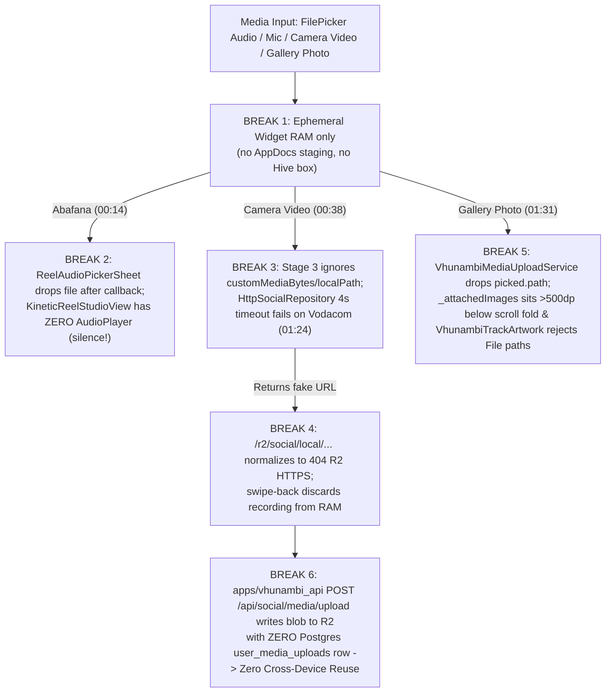

# Phase 79 Forensic Audit: Sovereign Media Upload & Reuse Engine (`VhunambiMediaVault`), Local-First R2 Sync Queue, `CreateKineticPostSheet` Glass Cockpit v2 & Reels Studio Layout Repairs

**Document ID:** `AUDIT-CLIENT-079`  
**Date:** 2026-11-24  
**Branch / Commit:** `fix/studio-cockpit-bugs-vh001-vh006` (`a061947`)  
**Audit Scope:** Strictly read-only cross-stack forensic audit across `apps/vhunambi_client/lib/`, `apps/vhunambi_api/src/`, and `supabase/migrations/` correlated against hardware capture `video_1.mp4` (`00:00–01:42`)  
**Related Specs & Memory:** [`CORTEX_INDEX.md`](file:///c:/Users/Ndugelo/VHUNAMBI/monorepo/docs/memory/CORTEX_INDEX.md), [`PHASE78_VAULT_EXPLORE_CONTINUITY_UPLOADS_AND_GLASS_TABS_AUDIT.md`](file:///c:/Users/Ndugelo/VHUNAMBI/monorepo/docs/audits/PHASE78_VAULT_EXPLORE_CONTINUITY_UPLOADS_AND_GLASS_TABS_AUDIT.md)

---

## 1. Executive Summary & Headline Verdict

Watching `video_1.mp4` (`00:00–01:42`) and tracing every frame against the codebase exposes why media uploads across Vhunambi currently feel unreliable even though Cloudflare R2 (`/api/social/media/upload`) works on happy-path Wi-Fi tests: **three separate modals (`DirectDawVocalUploadSheet`, `ReelAudioPickerSheet`, `KineticReelStudioView`/`KineticReelPublishView`, and `CreateKineticPostSheet`) treat media files as ephemeral byte arrays (`Uint8List?`) in widget state RAM**, blocked behind synchronous network calls with short timeouts, zero local-first vault persistence, zero metadata/preview indexing, and zero cross-picker reuse.

### Headline Verdict
- **Pipeline Readiness:** Broken end-to-end under real Android file picking (`content://` URIs), camera capture, and flaky mobile cellular (`Vodacom` drop at `01:24`).
- **Critical Blockers (`P0`):** `3` architectural & layout blockers (`UPL-01`, `UPL-02`, `UPL-03`).
- **Major Defects (`P1`):** `3` visual & UX regressions (`UPL-04`, `UPL-05`, `UPL-06`).
- **Required Architectural Cure:** One local-first **`VhunambiMediaVault` (`EP-P79-MEDIA-UPLOAD-ENGINE`)** combining persistent app-sandbox file storage (`ApplicationDocumentsDirectory/vhunambi_media/{audio,video,images}/`), Hive metadata (`vhunambi_uploads_v1`), a resilient background **`MediaUploadQueue`** with `Dio` `onSendProgress` (`0% → 100%`) and auto-retry, plus durable Supabase/R2 metadata persistence (`public.user_media_uploads` + `/api/media/uploads`).

### Connectome Memory Wake Summary (`vhunambi-memory`)
Queried hubs: `media_artwork, sync_outbox, social_graph, audio_transport, ui_surface_std, identity_role` (`47` `CONNECTED_EXTENSIBLE` endpoints, `0 OPEN`). Phase 79 directly extends and consumes:
- **`EP-P74-SOCIAL-MEDIA-R2-UPLOAD`** ([`social_routes.ts#L143-L207`](file:///c:/Users/Ndugelo/VHUNAMBI/monorepo/apps/vhunambi_api/src/routes/social_routes.ts#L143-L207)) — existing Cloudflare R2 binary writer (`VHUNAMBI_VAULT`), currently stateless (no Postgres record, no list/delete API).
- **`EP-P77-UNIFIED-R2-IMAGE-UPLOAD`** ([`vhunambi_media_upload_service.dart#L25-L108`](file:///c:/Users/Ndugelo/VHUNAMBI/monorepo/apps/vhunambi_client/lib/core/media/vhunambi_media_upload_service.dart#L25-L108)) — drops `picked.path`, lacks progress/local fallback, and returns `/r2/social/local/...` 404 stubs on error.
- **`EP-P78-REAL-AUDIO-VIDEO-INGEST`** ([`direct_daw_vocal_upload_sheet.dart`](file:///c:/Users/Ndugelo/VHUNAMBI/monorepo/apps/vhunambi_client/lib/features/studio/presentation/widgets/direct_daw_vocal_upload_sheet.dart) & [`kinetic_reel_studio_view.dart`](file:///c:/Users/Ndugelo/VHUNAMBI/monorepo/apps/vhunambi_client/lib/features/content_studio/presentation/views/kinetic_reel_studio_view.dart)) — handles local picking & camera recording, but lacks persistent cross-screen upload storage and studio audio playback.
- **`EP-P78-GLASS-TAB-BAR`** ([`vhunambi_glass_tab_bar.dart`](file:///c:/Users/Ndugelo/VHUNAMBI/monorepo/apps/vhunambi_client/lib/core/widgets/vhunambi_glass_tab_bar.dart)) — ready-to-adopt across `ReelAudioPickerSheet` (`UPL-05`) and `CreateKineticPostSheet` (`UPL-02`).
- **`EP-P78-CREATOR-REELS-HUB`** ([`reels_vault_view.dart`](file:///c:/Users/Ndugelo/VHUNAMBI/monorepo/apps/vhunambi_client/lib/features/library/presentation/views/reels_vault_view.dart)) — pairs with a new `Uploads` vault section inside `LibraryView`.
- **`EP-P68-TRACK-ARTWORK`** ([`vhunambi_track_artwork.dart`](file:///c:/Users/Ndugelo/VHUNAMBI/monorepo/apps/vhunambi_client/lib/core/widgets/vhunambi_track_artwork.dart)) — currently supports only `asset:`, `assets/`, and `http(s)://`, failing to render local `FileImage` paths!
- **`EP-P70-GLASS-SURFACE`** ([`vhunambi_glass_surface.dart`](file:///c:/Users/Ndugelo/VHUNAMBI/monorepo/apps/vhunambi_client/lib/core/widgets/vhunambi_glass_surface.dart)) — needed by `_PostKineticReelCard`, `CreateKineticPostSheet`, and Stage 2 floating drawer.

---

### Executive Root-Cause & Severity Matrix (`UPL-01` – `UPL-06`)

| ID | Sev | `video_1.mp4` Timestamp | Exact Hardware Symptom Observed | Primary Root Cause (File & Line Evidence) |
| :--- | :---: | :--- | :--- | :--- |
| **`UPL-01`** | **P0** | `00:10–00:22` `01:10–01:28` `01:30–01:42` | **No Real Media Upload, Storage, Playback, or Reuse Engine:** Imported *Abafana* plays zero sound and vanishes; Stage 3 shows generic art and hangs `14+s` with `0%` progress until swipe-back loses the Reel; Kinetic Post shows `Add Photo (1/4)` with zero preview. | 1. `KineticReelStudioView` has **zero `AudioPlayer`** (`isPlaying: false` everywhere: [`kinetic_reel_studio_view.dart#L588,L758`](file:///c:/Users/Ndugelo/VHUNAMBI/monorepo/apps/vhunambi_client/lib/features/content_studio/presentation/views/kinetic_reel_studio_view.dart#L588)). 2. [`reel_audio_picker_sheet.dart#L133-L171`](file:///c:/Users/Ndugelo/VHUNAMBI/monorepo/apps/vhunambi_client/lib/features/content_studio/presentation/widgets/reel_audio_picker_sheet.dart#L133-L171) only allows `['mp3','m4a']`, drops bytes/path into widget RAM, never copies to `AppDocs`, never writes `LibraryTracks`/`MediaVault`. 3. [`http_social_repository.dart#L58-L62,L258-L285`](file:///c:/Users/Ndugelo/VHUNAMBI/monorepo/apps/vhunambi_client/lib/features/social/data/repositories/http_social_repository.dart#L58-L62) sets a `4s` timeout with no `sendTimeout`, no `onSendProgress`, and masks failures into fake 404 `/r2/social/local/...` URLs. 4. [`kinetic_reel_publish_view.dart#L259-L264`](file:///c:/Users/Ndugelo/VHUNAMBI/monorepo/apps/vhunambi_client/lib/features/content_studio/presentation/views/kinetic_reel_publish_view.dart#L259-L264) ignores custom video/photo media on Stage 3. 5. [`create_kinetic_post_sheet.dart#L653-L685`](file:///c:/Users/Ndugelo/VHUNAMBI/monorepo/apps/vhunambi_client/lib/features/explore/presentation/widgets/create_kinetic_post_sheet.dart#L653-L685) places `_attachedImages` below the scroll fold (~500dp down) and [`vhunambi_track_artwork.dart#L47-L98`](file:///c:/Users/Ndugelo/VHUNAMBI/monorepo/apps/vhunambi_client/lib/core/widgets/vhunambi_track_artwork.dart#L47-L98) lacks local `FileImage` rendering. |
| **`UPL-02`** | **P0** | `01:30–01:42` | **Dated & Blind Kinetic Post Composer:** Flat opaque sheet, loud solid-orange buttons, no live visual carousel above the fold, bare text `PopupMenuButton` dropdown with zero cover art, zero playback auditioning, and no user upload attachment. | Legacy pre-glass tokens (`AppColors.surfaceSecondary`, `AppColors.textPrimary` at [`create_kinetic_post_sheet.dart#L717-L1014`](file:///c:/Users/Ndugelo/VHUNAMBI/monorepo/apps/vhunambi_client/lib/features/explore/presentation/widgets/create_kinetic_post_sheet.dart#L717-L1014)), raw `ChoiceChip` + `PopupMenuButton` dropdown (`#L748,L807`), no `VhunambiTrackArtwork`, no audio preview player. |
| **`UPL-03`** | **P0** | `00:02–00:42` `01:02–01:06` | **Reels Studio & Trimmer Clipped Controls:** Right tool rail's `30s` button overlaps bottom preset orbs/`Edit`; `Use Hook Segment` clips half off bottom of screen without draggable range handles. | [`kinetic_reel_studio_view.dart#L815-L927`](file:///c:/Users/Ndugelo/VHUNAMBI/monorepo/apps/vhunambi_client/lib/features/content_studio/presentation/views/kinetic_reel_studio_view.dart#L815-L927) positions 8 buttons (~528dp) at `top: 96` with no `bottom` clearance or scroll view. [`reel_audio_trimmer_sheet.dart#L31-L40,L81-L183`](file:///c:/Users/Ndugelo/VHUNAMBI/monorepo/apps/vhunambi_client/lib/features/content_studio/presentation/widgets/reel_audio_trimmer_sheet.dart#L31-L40) lacks `isScrollControlled: true`, `SafeArea`, `SingleChildScrollView`, and renders a single `Slider` instead of dual range handles. |
| **`UPL-04`** | **P1** | `00:00` `01:28–01:29` | **Stark White `Post Reel` Card in Dark Mode:** Card #0 in Explore `Kinetic Reels` paints bright light surface colors inside Dark Mode. | [`trending_reels_shelf.dart#L208-L212,L226,L236,L258,L266`](file:///c:/Users/Ndugelo/VHUNAMBI/monorepo/apps/vhunambi_client/lib/features/social/presentation/widgets/trending_reels_shelf.dart#L208-L212) reads global static `AppColors.surfaceElevated`/`surfaceCanvas` ([`app_colors.dart#L76-L88`](file:///c:/Users/Ndugelo/VHUNAMBI/monorepo/apps/vhunambi_client/lib/core/theme/app_colors.dart#L76-L88)) instead of `VhunambiGlassSurface` and `AppColors.*Of(context)`. |
| **`UPL-05`** | **P1** | `00:04–00:08` | **Audio Picker Truncation, Generic Art & `AI Studio` Leftover:** `Trendin...` clips horizontally; Trending rows lack distinct artwork polish; `Underground Durban club...` still says `Amapiano • AI Studio`. | [`reel_audio_picker_sheet.dart#L264-L275`](file:///c:/Users/Ndugelo/VHUNAMBI/monorepo/apps/vhunambi_client/lib/features/content_studio/presentation/widgets/reel_audio_picker_sheet.dart#L264-L275) uses non-scrollable 4-tab `TabBar`; [`reel_audio_picker_sheet.dart#L49-L63`](file:///c:/Users/Ndugelo/VHUNAMBI/monorepo/apps/vhunambi_client/lib/features/content_studio/presentation/widgets/reel_audio_picker_sheet.dart#L49-L63) & `LibraryTracksNotifier.hydrateFromLocalBox` ([`library_providers.dart#L227-L237`](file:///c:/Users/Ndugelo/VHUNAMBI/monorepo/apps/vhunambi_client/lib/features/library/presentation/providers/library_providers.dart#L227-L237)) do not sanitize legacy `'AI Studio'` / `'@aistudio'` handles (only [`track_providers.dart#L410-L414`](file:///c:/Users/Ndugelo/VHUNAMBI/monorepo/apps/vhunambi_client/lib/features/track/presentation/providers/track_providers.dart#L410-L414) did). |
| **`UPL-06`** | **P1** | `00:44–01:08` | **Stage 2 Tray Buries Lyrics & Rigid Top-Right Sticker:** Bottom `Lyrics`/`FX` panel exceeds `55%` height, occluding the center lyric canvas; stickers sit fixed at top-right. | [`kinetic_reel_studio_view.dart#L1055-L1219`](file:///c:/Users/Ndugelo/VHUNAMBI/monorepo/apps/vhunambi_client/lib/features/content_studio/presentation/views/kinetic_reel_studio_view.dart#L1055-L1219) + tall vertical `Wrap`/`Column` inside [`typography_preset_picker.dart#L42-L95`](file:///c:/Users/Ndugelo/VHUNAMBI/monorepo/apps/vhunambi_client/lib/features/content_studio/presentation/widgets/typography_preset_picker.dart#L42-L95) & [`atmospheric_effects_deck.dart#L44-L120`](file:///c:/Users/Ndugelo/VHUNAMBI/monorepo/apps/vhunambi_client/lib/features/content_studio/presentation/widgets/atmospheric_effects_deck.dart#L44-L120); static `Positioned(top: 84, right: 76)` sticker at `#L668-L678`. |

---

### End-to-End Breakpoint Topology Map

---

## 2. Detailed Forensic Analysis by Checklist Dimension

### 2.1 Why Media Uploads Fail, Vanish, or Stay Silent (`UPL-01`)

#### A. Imported Audio (`ReelAudioPickerSheet`, `DirectDawVocalUploadSheet`, `AudioSourceResolver`)
1. **`ReelAudioPickerSheet._importLocalAudio`** ([`reel_audio_picker_sheet.dart#L133-L171`](file:///c:/Users/Ndugelo/VHUNAMBI/monorepo/apps/vhunambi_client/lib/features/content_studio/presentation/widgets/reel_audio_picker_sheet.dart#L133-L171)):
   - Calls `FilePicker.platform.pickFiles(type: FileType.custom, allowedExtensions: const ['mp3', 'm4a'], withData: true)`, excluding `.wav`, `.aac`, and `.ogg`.
   - Passes `audioUrl: file.path ?? ''` directly from Android `FilePicker` cache without copying into `getApplicationDocumentsDirectory()/vhunambi_media/audio/`.
   - Invokes `widget.onSelected(...)` and exits — never writing to `libraryTracksProvider` (`My Vault`) or `vhunambi_uploads_v1`, and never enqueueing an upload to R2 until Stage 3 `Publish`!
2. **`KineticReelStudioView` Zero Playback Engine** ([`kinetic_reel_studio_view.dart#L170-L188,L752-L760,L588`](file:///c:/Users/Ndugelo/VHUNAMBI/monorepo/apps/vhunambi_client/lib/features/content_studio/presentation/views/kinetic_reel_studio_view.dart#L170-L188)):
   - `grep` across `kinetic_reel_studio_view.dart` confirms **zero imports or instances** of `just_audio` or `playerStateProvider`. Picking *Abafana* updates `_audio.title` on the top pill and leaves `KineticPreviewCanvas` permanently at `isPlaying: false`.
3. **`AudioSourceResolver` Local File Blind Spot** ([`audio_source_resolver.dart#L112-L150`](file:///c:/Users/Ndugelo/VHUNAMBI/monorepo/apps/vhunambi_client/lib/features/player/data/services/audio_source_resolver.dart#L112-L150)):
   - Checks `offlineStorage.isTrackCachedLocally(track.id)` (encrypted `.vmf` only), then jumps straight to `AppConstants.normalizeCloudMediaUrl(rawUrl)` -> `Uri.parse(resolvedUrl)`.
   - Unencrypted plain local audio files saved cleanly in `ApplicationDocumentsDirectory` (e.g., `/data/user/0/.../vhunambi_media/audio/...mp3` or `file://...`) on `Track.audioUrl` / `LibraryTrack.localAudioFilePath` must resolve to `ResolvedAudioSource(uri: Uri.file(localPath), isLocalFile: true, localFilePath: localPath)` *before* remote HTTP fallback so imported songs play **instantly offline and even if R2 upload hasn't finished**.
4. **`DirectDawVocalUploadSheet` Blocking Flow** ([`direct_daw_vocal_upload_sheet.dart#L180-L249,L292-L439`](file:///c:/Users/Ndugelo/VHUNAMBI/monorepo/apps/vhunambi_client/lib/features/studio/presentation/widgets/direct_daw_vocal_upload_sheet.dart#L180-L249)):
   - Only copies the picked audio into `docs.path` on pick (`#L240-L248`), but on submit awaits `repo.uploadReelMedia(...)` synchronously. If R2 upload fails or times out, `HttpSocialRepository` returns fake `/r2/social/local/...` (`#L281`), which `normalizeCloudMediaUrl` converts into a broken `https://pub-...r2.dev/social/local/...` URL inside both `LibraryTrack.remoteAudioUrl` and `BeatListingEntity.previewAudioUrl` (`#L405`).

#### B. Recorded Video & Cellular Drop Resilience (`KineticReelStudioView`, `KineticReelPublishView`, `HttpSocialRepository`)
1. **Stage 3 Cover Artwork Ignores Captured Video/Photo** ([`kinetic_reel_publish_view.dart#L253-L287`](file:///c:/Users/Ndugelo/VHUNAMBI/monorepo/apps/vhunambi_client/lib/features/content_studio/presentation/views/kinetic_reel_publish_view.dart#L253-L287)):
   - Renders `VhunambiTrackArtwork(coverUrl: widget.audio.coverUrl, ...)` exclusively. Even when `widget.customMediaLocalPath` points to a real recorded `.mp4` or `widget.customMediaBytes` contains a gallery photo, Stage 3 paints song cover art instead of the captured video poster frame / photo.
2. **4-Second Timeout & Missing Progress/Queue** ([`http_social_repository.dart#L58-L62,L258-L286`](file:///c:/Users/Ndugelo/VHUNAMBI/monorepo/apps/vhunambi_client/lib/features/social/data/repositories/http_social_repository.dart#L58-L62)):
   - `Dio` uses `connectTimeout: 4s`, `receiveTimeout: 4s`, zero `sendTimeout`, and zero `onSendProgress`. Real phone video (`5–25 MB`) takes `10–40s` on cellular; timing out at `4s` throws inside `uploadReelMedia`, silently falls back to 404 `/r2/social/local/...` (`#L280-L285`), and freezes/drops the UX with zero percentage telemetry or retry queue.
3. **No Heavy FFmpeg Bloat Needed:** [`pubspec.yaml#L46-L70`](file:///c:/Users/Ndugelo/VHUNAMBI/monorepo/apps/vhunambi_client/pubspec.yaml#L46-L70) already ships `path_provider: ^2.1.2`, `dio: ^5.4.1`, `hive_flutter: ^1.1.0`, `video_player: ^2.9.2`, `image_picker: ^1.1.2`, and `file_picker: ^8.0.7`. For real video poster thumbnails on Stage 3 without native FFmpeg bloat, Android can capture a keyframe via a tiny `MethodChannel` (`MediaMetadataRetriever.getFrameAtTime(0)` JPEG bytes in `MainActivity.kt` — zero external native `.so` weight!) OR render an in-place paused `VideoPlayerController` first-frame texture when a local video file is present.

#### C. `CreateKineticPostSheet` Invisible Photo Attachment (`01:31–01:42`)
1. [`vhunambi_media_upload_service.dart#L69-L107`](file:///c:/Users/Ndugelo/VHUNAMBI/monorepo/apps/vhunambi_client/lib/core/media/vhunambi_media_upload_service.dart#L69-L107) reads bytes via `ImagePicker().pickImage`, uploads immediately, and discards `picked.path`!
2. [`create_kinetic_post_sheet.dart#L653-L685`](file:///c:/Users/Ndugelo/VHUNAMBI/monorepo/apps/vhunambi_client/lib/features/explore/presentation/widgets/create_kinetic_post_sheet.dart#L653-L685) renders `_attachedImages` (`height: 90`) *below* 4-line Caption + Aspect Ratio selector + Photo/Vision buttons + `Prompt Vhunambi Vision` input — pushing it off the visible screen without scrolling!
3. Worse, passing any local filesystem path OR `/r2/social/local/...` fallback URL into `VhunambiTrackArtwork` ([`vhunambi_track_artwork.dart#L47-L98`](file:///c:/Users/Ndugelo/VHUNAMBI/monorepo/apps/vhunambi_client/lib/core/widgets/vhunambi_track_artwork.dart#L47-L98) & [`app_assets.dart#L151-L166`](file:///c:/Users/Ndugelo/VHUNAMBI/monorepo/apps/vhunambi_client/lib/core/constants/app_assets.dart#L151-L166)) fails to paint a local photo because `VhunambiTrackArtwork` lacks a local `File(path).existsSync()` -> `Image.file(...)` branch!

---

### 2.2 Backend & Supabase Media Registry Gap (`apps/vhunambi_api/` & `supabase/migrations/`)

- **Current State:** [`social_routes.ts#L143-L207`](file:///c:/Users/Ndugelo/VHUNAMBI/monorepo/apps/vhunambi_api/src/routes/social_routes.ts#L143-L207) uploads bytes to Cloudflare R2 (`uploadBytesToR2`) and returns `{ success, key, url, contentType, size }`, storing **nothing** in `vhunambiDb` (SQLite) or Supabase Postgres (`supabase/migrations/` latest is `20261121000002_phase74_reels_studio_and_rpc_hardening.sql`).
- **Missing Contract:** Neither `library_routes.ts` ([`library_routes.ts#L1-L101`](file:///c:/Users/Ndugelo/VHUNAMBI/monorepo/apps/vhunambi_api/src/routes/library_routes.ts#L1-L101)) nor `social_routes.ts` tracks uploaded user assets (`audio`, `video`, `image`), MIME, byte size, duration, dimensions, poster thumbnail URL, or soft/hard delete across devices.

---

### 2.3 Exhaustive Census of UI/UX & Layout Defects (`UPL-02` – `UPL-06`)

| ID | File & Exact Line(s) | Exact Code Defect | Concrete Remediation Pattern |
| :--- | :--- | :--- | :--- |
| **`UPL-02`** | [`create_kinetic_post_sheet.dart#L378-L399`](file:///c:/Users/Ndugelo/VHUNAMBI/monorepo/apps/vhunambi_client/lib/features/explore/presentation/widgets/create_kinetic_post_sheet.dart#L378-L399) [`#L439-L496`](file:///c:/Users/Ndugelo/VHUNAMBI/monorepo/apps/vhunambi_client/lib/features/explore/presentation/widgets/create_kinetic_post_sheet.dart#L439-L496) [`#L652-L1015`](file:///c:/Users/Ndugelo/VHUNAMBI/monorepo/apps/vhunambi_client/lib/features/explore/presentation/widgets/create_kinetic_post_sheet.dart#L652-L1015) | Pre-glass flat grey sheet tokens (`AppColors.surfaceSecondary`, `AppColors.textPrimary`, `AppColors.borderSubtle`), solid-orange `ChoiceChip`s (`#L748`), no visual preview above the fold (`#L653` sits below Vision prompt), bare `PopupMenuButton` audio dropdown (`#L807`) with zero `VhunambiTrackArtwork`, zero audition play button, and zero `My Uploads` reuse. | Rebuild body into **Glass Cockpit v2**: place Live Visual Media Stage carousel *immediately* below caption (rendering instant `Image.file` / video poster + byte progress badge + `From My Uploads` + `×` remove), adopt `VhunambiGlassTabBar` for sound source tabs (`My Uploads \| My Vault \| Trending \| Grooves`), and render an interactive frosted `VhunambiGlassSurface` audio card with `VhunambiTrackArtwork`, live `AudioPlayer` play/pause auditioning, and compact hook range badge. |
| **`UPL-03a`** | [`kinetic_reel_studio_view.dart#L815-L927`](file:///c:/Users/Ndugelo/VHUNAMBI/monorepo/apps/vhunambi_client/lib/features/content_studio/presentation/views/kinetic_reel_studio_view.dart#L815-L927) | `Positioned(top: 96, ...)` stacks 8 `_RailToolButton`s (~528dp height + optional 120dp slider) without bottom constraint or scrollability -> collides with `_buildCaptureBottomDeck` (`30s` button overlaps orbs/`Edit`). | Constrain `Positioned(top: 76, bottom: 156, right: ..., left: ...)` wrapping the rail in a `SingleChildScrollView(physics: BouncingScrollPhysics())` with compact `38dp` buttons (`bottom: 8`). |
| **`UPL-03b`** | [`reel_audio_trimmer_sheet.dart#L31-L40`](file:///c:/Users/Ndugelo/VHUNAMBI/monorepo/apps/vhunambi_client/lib/features/content_studio/presentation/widgets/reel_audio_trimmer_sheet.dart#L31-L40) [`#L81-L183`](file:///c:/Users/Ndugelo/VHUNAMBI/monorepo/apps/vhunambi_client/lib/features/content_studio/presentation/widgets/reel_audio_trimmer_sheet.dart#L81-L183) | `showModalBottomSheet` omits `isScrollControlled: true`; container omits `SafeArea(top: false)` and `SingleChildScrollView` -> clips `Use Hook Segment` off bottom; single-thumb `Slider` lacks start/end handles on the 48-bar waveform. | Pass `isScrollControlled: true`, wrap in `SafeArea(top: false)` + `SingleChildScrollView`, and overlay interactive draggable start/end window handles (`GestureDetector` drag thumbs / `RangeSlider`) directly onto the glowing 48-bar waveform + keep `Key('reel_audio_trimmer_done_btn')` inside `44dp` min height. |
| **`UPL-04`** | [`trending_reels_shelf.dart#L200-L273`](file:///c:/Users/Ndugelo/VHUNAMBI/monorepo/apps/vhunambi_client/lib/features/social/presentation/widgets/trending_reels_shelf.dart#L200-L273) [`#L44,L84,L105,L122,L128,L404-L413`](file:///c:/Users/Ndugelo/VHUNAMBI/monorepo/apps/vhunambi_client/lib/features/social/presentation/widgets/trending_reels_shelf.dart#L44) | `_PostKineticReelCard` uses global `AppColors.surfaceElevated`/`surfaceCanvas`/`surfaceSecondary` (governed by static `_currentBrightness` in `app_colors.dart#L8`), rendering a stark white slab in Dark Mode. | Replace `_PostKineticReelCard` container with `VhunambiGlassSurface(variant: VhunambiGlassVariant.card, enableLiveBlur: false, tintAccent: AppColors.brandPrimary)` and migrate every `AppColors.*` lookup in `trending_reels_shelf.dart` to `*Of(context)`. |
| **`UPL-05`** | [`reel_audio_picker_sheet.dart#L49-L63`](file:///c:/Users/Ndugelo/VHUNAMBI/monorepo/apps/vhunambi_client/lib/features/content_studio/presentation/widgets/reel_audio_picker_sheet.dart#L49-L63) [`#L264-L275`](file:///c:/Users/Ndugelo/VHUNAMBI/monorepo/apps/vhunambi_client/lib/features/content_studio/presentation/widgets/reel_audio_picker_sheet.dart#L264-L275) [`library_providers.dart#L227-L237`](file:///c:/Users/Ndugelo/VHUNAMBI/monorepo/apps/vhunambi_client/lib/features/library/presentation/providers/library_providers.dart#L227-L237) | 4-tab `TabBar` truncates `'Trendin...'`, omits `'My Uploads'`, and `fromLibraryTrack` + Hive hydration never normalize persisted `'AI Studio'` / `'@aistudio'` attribution (causing `Underground Durban club...` to keep displaying `Amapiano • AI Studio`). Also Trending/Library picks lack `'wav','aac','ogg'` support and audio auditioning. | Adopt scrollable `VhunambiGlassTabBar` (`My Vault \| My Uploads \| Trending \| Saved \| Vibes`), sanitize legacy `'AI Studio'` / `'@aistudio'` inside `LibraryTracksNotifier.hydrateFromLocalBox` and `ReelStudioAudioSelection.fromLibraryTrack` using active owner handle, and route `[Import]` through `VhunambiMediaVault`. |
| **`UPL-06`** | [`kinetic_reel_studio_view.dart#L668-L678`](file:///c:/Users/Ndugelo/VHUNAMBI/monorepo/apps/vhunambi_client/lib/features/content_studio/presentation/views/kinetic_reel_studio_view.dart#L668-L678) [`#L1055-L1219`](file:///c:/Users/Ndugelo/VHUNAMBI/monorepo/apps/vhunambi_client/lib/features/content_studio/presentation/views/kinetic_reel_studio_view.dart#L1055-L1219) [`typography_preset_picker.dart#L42-L95`](file:///c:/Users/Ndugelo/VHUNAMBI/monorepo/apps/vhunambi_client/lib/features/content_studio/presentation/widgets/typography_preset_picker.dart#L42-L95) [`atmospheric_effects_deck.dart#L44-L120`](file:///c:/Users/Ndugelo/VHUNAMBI/monorepo/apps/vhunambi_client/lib/features/content_studio/presentation/widgets/atmospheric_effects_deck.dart#L44-L120) | Stage 2 bottom tray grows >55% viewport height with multi-line vertical `Wrap`/`Column`, burying the center lyrics banner (`KineticPreviewCanvas`); sticker sits locked top-right at static coordinates. | Replace opaque bottom container with a compact frosted `VhunambiGlassSurface` floating drawer (`maxHeight <= MediaQuery.sizeOf(context).height * 0.34`, horizontal pill scroll for `TypographyPresetPicker` & compact toggles for `AtmosphericEffectsDeck`) + draggable `GestureDetector` (`Offset _stickerOffset`) for the canvas sticker. |

---

## 3. Target Architecture Blueprint (`EP-P79-MEDIA-UPLOAD-ENGINE` — `VhunambiMediaVault`)

### Layer 1: Persistent Local-First Staging & File Store (`SovereignMediaStorageService`)
- File: `apps/vhunambi_client/lib/core/media/sovereign_media_storage_service.dart`
- Persists any user input (`FilePicker` `.mp3`/`.wav`/`.m4a`/`.aac`/`.ogg`, mic recording, `CameraController` `.mp4`, `ImagePicker` photo/video) into durable sandbox storage:
  `getApplicationDocumentsDirectory()/vhunambi_media/{audio,video,images}/<assetId>.<ext>`
- Extracts immediate local metadata: `id`, `kind` (`audio` | `video` | `image`), `localFilePath`, `thumbnailLocalPath` (for video, captured via lightweight `MediaMetadataRetriever` channel / fallback without FFmpeg), `mimeType`, `sizeBytes`, `durationMs` (optional), `width`/`height` (for images via `decodeImageFromList`), `creatorId`, `status` (`queued` | `uploading` | `synced` | `failed`), `progress` (`0.0–1.0`), `remoteUrl`, `remoteKey`, `createdAt`.
- Persists index in Hive box `vhunambi_uploads_v1` (registered in Tier 1 of [`sovereign_hive_bootstrap_service.dart`](file:///c:/Users/Ndugelo/VHUNAMBI/monorepo/apps/vhunambi_client/lib/core/storage/sovereign_hive_bootstrap_service.dart) and [`app_constants.dart`](file:///c:/Users/Ndugelo/VHUNAMBI/monorepo/apps/vhunambi_client/lib/core/constants/app_constants.dart)).

### Layer 2: Resumable Upload Queue with Byte Progress & Auto-Retry (`mediaUploadQueueProvider`)
- File: `apps/vhunambi_client/lib/features/media/presentation/providers/media_upload_queue_provider.dart`
- Replaces ephemeral `Future` awaits in sheets with a `StateNotifier<List<UploadedMediaAsset>>`:
  1. Stages locally in `SovereignMediaStorageService` in `< 50ms`, returning the playable/renderable `UploadedMediaAsset` **immediately** (`localFilePath` ready for `AudioPlayer` and `Image.file`).
  2. Streams `POST /api/media/upload` via `Dio` using real `sendTimeout: Duration(seconds: 90)`, `receiveTimeout: Duration(seconds: 30)`, and `onSendProgress: (sent, total)` updating `asset.progress` (`0% -> 100%`).
  3. On network drop / offline timeout: marks `status = failed` (never fabricating a fake `/r2/social/local/...` 404 URL!), keeps the file safely in `vhunambi_uploads_v1`, shows clean Retry/Queue badge, and automatically flushes `queued`/`failed` items on queue retry or app resume/reconnect.
- Fix [`VhunambiTrackArtwork`](file:///c:/Users/Ndugelo/VHUNAMBI/monorepo/apps/vhunambi_client/lib/core/widgets/vhunambi_track_artwork.dart) + [`AudioSourceResolver`](file:///c:/Users/Ndugelo/VHUNAMBI/monorepo/apps/vhunambi_client/lib/features/player/data/services/audio_source_resolver.dart) so local filesystem paths (`file://` or existing `File(path)`) always take zero-latency precedence over remote HTTP URLs!

### Layer 3: Supabase `public.user_media_uploads` + Worker `/api/media/*` SWR Contract
- **Migration:** `supabase/migrations/20261124000001_phase79_user_media_uploads.sql`
  - Table `public.user_media_uploads` (`id TEXT PRIMARY KEY`, `creator_id TEXT NOT NULL`, `media_kind TEXT CHECK (media_kind IN ('audio','video','image'))`, `title TEXT NOT NULL`, `filename TEXT NOT NULL`, `mime_type TEXT NOT NULL`, `size_bytes BIGINT NOT NULL`, `duration_ms INTEGER`, `r2_key TEXT NOT NULL`, `remote_url TEXT NOT NULL`, `thumbnail_url TEXT`, `source_surface TEXT NOT NULL DEFAULT 'vault'`, `created_at TIMESTAMPTZ NOT NULL DEFAULT NOW()`, `deleted_at TIMESTAMPTZ`).
  - Indexes on `(creator_id, created_at DESC)` + RLS policies scoping owner access cleanly.
- **Worker & DB Layer:**
  - `apps/vhunambi_api/src/routes/media_routes.ts` mounted at `/api/media/*`:
    - `POST /api/media/upload` — streams to R2 `VHUNAMBI_VAULT`, writes `user_media_uploads` via `vhunambiDb.recordUserMediaUploadAsync(...)`, returns `UploadedMediaAssetDto` (`201`). (Shared helper keeps `POST /api/social/media/upload` backward-compatible.)
    - `GET /api/media/uploads?creatorId=...&kind=...` — triggers `vhunambiDb.syncUserMediaUploadsFromCloud(creatorId, c)` (`12s` SWR window) and returns active user uploads (`200`).
    - `DELETE /api/media/uploads/:id` — enforces tenant ownership (`assertTenantCreatorAccess` / `403 TENANT_FORBIDDEN`) and marks deleted in DB + R2 (`200`).

### Layer 4: Cross-App Reuse, Real Audio Playback & Surface Polish
- **Real Studio Audio Playback:** Add a lightweight `just_audio` `AudioPlayer` inside `KineticReelStudioView` (`AudioSourceResolver` / `setFilePath` for local files + `setUrl` for R2 streams, looping `[audioStartMs, audioEndMs]` and syncing live `playbackPositionSec` to `KineticPreviewCanvas`!). Also add a compact play/pause audition button inside `CreateKineticPostSheet`.
- **`My Uploads` Universal Reuse:** Expose uploaded songs, vocals, beats, photos, and videos in:
  1. `LibraryView` (`Uploads` / `Songs` / `Reels`),
  2. `ReelAudioPickerSheet` (`My Vault | My Uploads | Trending | Saved | Vibes` via `VhunambiGlassTabBar` + normalized `@cern` / owner attribution stripping stale `'AI Studio'`),
  3. `CreateKineticPostSheet` Glass Cockpit v2 (`From My Uploads` photo + sound tabs + live visual preview carousel above the fold).
- **Reels Studio & Dark-Mode Polish:** Fix `_PostKineticReelCard` dark glass card (`UPL-04`), bound/scroll right tool rail (`UPL-03a`), fix `ReelAudioTrimmerSheet` `isScrollControlled` + `SafeArea` + dual range handles (`UPL-03b`), render custom video thumbnail/photo preview on Stage 3 `KineticReelPublishView`, shrink Stage 2 drawer `<= 34%` height + make sticker draggable (`UPL-06`).

---

## 4. Two-Pass Remediation Milestone Plan (`M79.1` – `M79.4`)

| Pass | Milestone | Scope & Key Deliverables | Verification Gate |
| :--- | :---: | :--- | :--- |
| **Pass 1** | **`M79.1`** | **Backend Durable Media Registry:** Add `20261124000001_phase79_user_media_uploads.sql`, extend `vhunambi_db.ts` + `edge_persistence_bridge.ts` (`12s` SWR), ship `media_routes.ts` (`POST /api/media/upload`, `GET /api/media/uploads`, `DELETE /api/media/uploads/:id`), preserve `/api/social/media/upload` compatibility, add API tests. | `npx tsc --noEmit && npm test` (100% pass) |
| **Pass 1** | **`M79.2`** | **Client `VhunambiMediaVault`, Sync Queue, Local Playback & `VhunambiTrackArtwork` Local File Support:** Add `UploadedMediaAsset`, Hive box `vhunambi_uploads_v1`, `SovereignMediaStorageService`, `mediaUploadQueueProvider` (`Dio` `onSendProgress` + `90s` sendTimeout + real Retry, zero fake `/r2/social/local/` masking), update `VhunambiTrackArtwork` + `AudioSourceResolver` for local files, wire real `AudioPlayer` into `KineticReelStudioView` + `ReelAudioPickerSheet` + `DirectDawVocalUploadSheet` + `KineticReelPublishView` Stage 3 video/photo thumbnail. | `dart analyze` + Pass 1 Flutter upload/queue/playback tests |
| **Pass 2** | **`M79.3`** | **`CreateKineticPostSheet` Glass Cockpit v2 & `Library` `My Uploads` Reuse Hub:** Upgrade `CreateKineticPostSheet` with instant top-of-sheet `Image.file` carousel (`1/4 → 4/4` + progress ring + `From My Uploads`), `VhunambiGlassTabBar` sound tabs (`My Uploads \| My Vault \| Trending \| Grooves`), interactive audition card with `VhunambiTrackArtwork`; surface `Uploads` reuse across `LibraryView` and `ReelAudioPickerSheet` (`My Uploads`, zero `Trendin...` truncation, normalized `'AI Studio'`). | `dart analyze` + `STD-UIUX-001` (`0` `Icons.*`/emojis) + Post Cockpit/Library tests |
| **Pass 2** | **`M79.4`** | **Reels Studio & Dark-Mode Polish + Full Regression & Memory SLEEP:** Fix `_PostKineticReelCard` Dark Mode glass card, right tool rail `bottom: 156dp` scroll clearance, `ReelAudioTrimmerSheet` `SafeArea` + dual range handles, Stage 2 `<= 34%` compact floating glass drawer + draggable sticker, full Phase 79 regression test suite, promote `memory.md` to `"completed"`, run `consolidate_memory.mjs` (`0 OPEN`). | Full `dart analyze`, `STD-UIUX-001`, API tests, bounded `flutter test --timeout=60s`, `consolidate_memory.mjs` |
