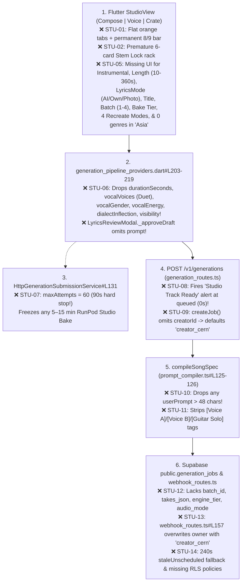

# 🎛️ Phase 80 — Studio Cockpit V6 Glass Overhaul, `vhunambi.com` Production Parity & `StudioGenerationContractV6` Comprehensive Forensic Audit

**Document ID:** `AUDIT-STUDIO-080`  
**Date:** `2026-11-24`  
**Branch / Commit:** `fix/studio-cockpit-bugs-vh001-vh006` (`1125003`)  
**Audit Scope:** Read-only static & cross-stack wire forensic audit across `apps/vhunambi_client/lib/features/studio/`, `apps/vhunambi_api/src/{routes,modules,db}/`, `supabase/migrations/`, and `tools/zr-studio-gpu/`  
**Related Specs & Trackers:**
- [PHASE_80_PLUS_STUDIO_AND_RUNPOD_MASTER_TRACKER.md](file:///c:/Users/Ndugelo/VHUNAMBI/monorepo/docs/phases/PHASE_80_PLUS_STUDIO_AND_RUNPOD_MASTER_TRACKER.md)
- [Phase 79 Memory (`MEM-P79-SOVEREIGN-MEDIA-UPLOAD-ENGINE`)](file:///c:/Users/Ndugelo/VHUNAMBI/monorepo/docs/phases/phase_79_sovereign_media_upload_engine_and_post_cockpit/memory.md)
- [Phase 78 Memory (`MEM-P78-VAULT-EXPLORE-CONTINUITY-UPLOADS-GLASS-TABS`)](file:///c:/Users/Ndugelo/VHUNAMBI/monorepo/docs/phases/phase_78_vault_explore_continuity_uploads_and_glass_tabs/memory.md)
- [Phase 75 Memory (`MEM-P75-STUDIO-COCKPIT-V5-CONNECTOME-CLOSURE`)](file:///c:/Users/Ndugelo/VHUNAMBI/monorepo/docs/phases/phase_75_studio_cockpit_v5_and_connectome_closure/memory.md)

---

## 1. Executive Summary, Connectome Wake & Headline Verdict

### 1.1 Connectome Wake Summary (`vhunambi-memory`)
- **Cortex Index ([CORTEX_INDEX.md](file:///c:/Users/Ndugelo/VHUNAMBI/monorepo/docs/memory/CORTEX_INDEX.md)):** `18` completed phases indexed through **`P79`**, `58` total endpoints (`0 OPEN`, `55 CONNECTED_EXTENSIBLE`, `3 SEALED`).
- **2-Hop Hub Query (`#ai_synthesis_gpu, #audio_transport, #mood_taxonomy, #ui_surface_std, #media_artwork, #quota_economy`):** Surfaced `46` `CONNECTED_EXTENSIBLE` primitives ready for direct reuse in Phase 80:
  - **`EP-P79-MEDIA-UPLOAD-ENGINE`** & **`EP-P79-USER-MEDIA-REGISTRY-API`**: Local-first `SovereignMediaStorageService` + `mediaUploadQueueProvider` + `GET /api/media/uploads` + `SafeAudioOrchestrator` (`AudioEngineSlot.studioPreview`) — ready to power Studio `Reference Audio` (`From My Uploads`), `Lyrics From Photo`, and `3-Line Cloned Voice` WAV intake.
  - **`EP-P78-GLASS-TAB-BAR`** ([vhunambi_glass_tab_bar.dart](file:///c:/Users/Ndugelo/VHUNAMBI/monorepo/apps/vhunambi_client/lib/core/widgets/vhunambi_glass_tab_bar.dart#L29-L45)): Explicitly flagged an open synergy opportunity to replace `StudioView`'s legacy solid-orange tab switcher and `InlineCrateMpcWorkbench`'s cramped 4-pill switcher.
  - **`EP-P70-GLASS-SURFACE`** ([vhunambi_glass_surface.dart](file:///c:/Users/Ndugelo/VHUNAMBI/monorepo/apps/vhunambi_client/lib/core/widgets/vhunambi_glass_surface.dart)): Translucent specular glass card primitive (`tintAccent`, `borderColorOverride`, `enableLiveBlur: false` inside scrollables).
  - **`EP-P75-STUDIO-CONNECTOME-CLIENTS`** & **`EP-P75-VOICES-CLOUD-SWR`**: Live HTTP lyrics refine/story-transform (`POST /v1/lyrics/refine`, `POST /v1/lyrics/story-transform`), 12s SWR `voice_clones` cloud sync, and 1-tap `Create Reel` handoff (`EP-P75-CREATION-TO-REELS-BRIDGE`).

### 1.2 Architectural Headline Verdict
Side-by-side forensic inspection of the mobile Studio Cockpit (`video_1.mp4` `00:00–02:23`) against `vhunambi.com/create` (`video_2.mp4` `00:10–04:05`) and the live monorepo code proves **two compounding failure planes**:

1. **Presentation & Ergonomic Drift (`STU-01` – `STU-05`):**
   - `StudioView` was skipped during the Phase 70–79 Glassmorphic Overhaul: it still renders solid orange M2 pills, a permanent `8/9 | Song DNA 83%` top bar, premature `2D <-> 3D Quantum Stem Authority` (`6` cramped `Lock | Inpaint | Resynth` cards before a song even exists!), severe mobile `360dp` text clipping across all 3 tabs, **zero** UI controls for `isInstrumental`, `durationSeconds`, `lyricsMode`, or `customTitle` (even though all four fields already exist on `StudioFormState`!), an `18`-genre catalog whose `'Asia'` region filter renders **0 items**, and `11` Studio files hardcoding static dark `AppColors.*` tokens that break Light Mode ("Morning Mist").
2. **Silent Wire Truncation & Async Bake Fragility (`STU-06` – `STU-14`):**
   - Even when a creator configures Studio state, **`generation_pipeline_providers.dart` drops `durationSeconds`, `vocalVoices` (`Solo`/`Duet`/`Choir`), `vocalGender`, `vocalMode`, `vocalEnergy`, `songStructure`, `era`, `dialectInflection`, and `visibility` before calling `POST /v1/generations`**.
   - Downstream, **`prompt_compiler.ts` silently drops any user prompt longer than `48` characters**, **`lyrics_sanitizer.ts` / `model_utils.py` strip `[Voice A]` / `[Voice B]` duet tags**, **`http_generation_submission_service.dart` stops polling after `90` seconds (`maxAttempts = 60`)**, **`generation_routes.ts` fires `"Studio Track Ready"` immediately while `status == 'queued'`**, **`webhook_routes.ts` hardcodes `'creator_cern'` on completion**, and **`public.generation_jobs` has no `takes_json` / `batch_id` column** for `1–4` multi-take bakes.

### 1.3 End-to-End Breakpoint Topology Map



### 1.4 Executive Defect & Severity Matrix (`STU-01` – `STU-14`)

| ID | Sev | Video / Layer | Exact Defect Observed | Root File & Line Evidence |
| :--- | :---: | :--- | :--- | :--- |
| **`STU-01`** | **P0** | `video_1.mp4` `00:00, 00:48, 01:28` | Flat solid-orange `Compose \| Voice \| Crate & MPC` tabs bypass `VhunambiGlassTabBar`, and `ProgressTrackerWidget` (`8/9 \| Song DNA 83%`) permanently consumes vertical viewport height across all 3 tabs. | [studio_view.dart#L69-L128](file:///c:/Users/Ndugelo/VHUNAMBI/monorepo/apps/vhunambi_client/lib/features/studio/presentation/views/studio_view.dart#L69-L128), [studio_view.dart#L181-L183](file:///c:/Users/Ndugelo/VHUNAMBI/monorepo/apps/vhunambi_client/lib/features/studio/presentation/views/studio_view.dart#L181-L183), [progress_tracker.dart#L21-L76](file:///c:/Users/Ndugelo/VHUNAMBI/monorepo/apps/vhunambi_client/lib/features/studio/presentation/widgets/progress_tracker.dart#L21-L76) |
| **`STU-02`** | **P0** | `video_1.mp4` `00:00, 00:44` | Premature `2D <-> 3D Quantum Stem Authority` (`CockpitQuantumEntanglementRack` with 6 cramped `Lock \| Inpaint \| Resynth` cards) crowds pre-generation `Compose` before any audio/stems exist. | [studio_view.dart#L199](file:///c:/Users/Ndugelo/VHUNAMBI/monorepo/apps/vhunambi_client/lib/features/studio/presentation/views/studio_view.dart#L199), [cockpit_quantum_entanglement_rack.dart#L35-L158](file:///c:/Users/Ndugelo/VHUNAMBI/monorepo/apps/vhunambi_client/lib/features/studio/presentation/widgets/cockpit_quantum_entanglement_rack.dart#L35-L158) |
| **`STU-03`** | **P0** | `video_1.mp4` `00:16–01:44` | Severe text truncation & clipping across all 3 tabs (`Advanced Opti...`, `24 Regional Vol...`, left-clipped timbre cards, `8-Pad... \| 5-Ch... \| DAW...` 4-pill squeeze, `112 BPMStretch: 1.0x`, bottom-clipped `PAD 7`/`PAD 8`, `< 44dp` language/mood chips). | [advanced_options_accordion.dart#L64-L120](file:///c:/Users/Ndugelo/VHUNAMBI/monorepo/apps/vhunambi_client/lib/features/studio/presentation/widgets/advanced_options_accordion.dart#L64-L120), [bantu_voice_deck.dart#L155-L248](file:///c:/Users/Ndugelo/VHUNAMBI/monorepo/apps/vhunambi_client/lib/features/studio/presentation/widgets/bantu_voice_deck.dart#L155-L248), [inline_crate_mpc_workbench.dart#L168-L217](file:///c:/Users/Ndugelo/VHUNAMBI/monorepo/apps/vhunambi_client/lib/features/studio/presentation/widgets/inline_crate_mpc_workbench.dart#L168-L217), [inline_crate_mpc_workbench.dart#L375-L448](file:///c:/Users/Ndugelo/VHUNAMBI/monorepo/apps/vhunambi_client/lib/features/studio/presentation/widgets/inline_crate_mpc_workbench.dart#L375-L448) |
| **`STU-04`** | **P1** | `video_1.mp4` `00:36, 00:48–01:24` | Split/disconnected Voice state: `StudioFormState.selectedVoiceProfile` (`5` static profiles) and `vocalIdentityProvider` (`24` regional archetypes + clones) are separate states; no multi-voice duet casting (`up to 6` + `Quick Duet`); `DialectInflectionConfig` sliders are never sent to the backend! | [bantu_voice_deck.dart#L26-L33](file:///c:/Users/Ndugelo/VHUNAMBI/monorepo/apps/vhunambi_client/lib/features/studio/presentation/widgets/bantu_voice_deck.dart#L26-L33), [studio_form_state.dart#L151-L155](file:///c:/Users/Ndugelo/VHUNAMBI/monorepo/apps/vhunambi_client/lib/features/studio/domain/models/studio_form_state.dart#L151-L155), [generation_pipeline_providers.dart#L157-L161](file:///c:/Users/Ndugelo/VHUNAMBI/monorepo/apps/vhunambi_client/lib/features/studio/presentation/providers/generation_pipeline_providers.dart#L157-L161) |
| **`STU-05`** | **P0** | `video_2.mp4` `00:15–03:10` | Missing `vhunambi.com/create` production controls in UI: **zero** widget in `Compose` exposes `isInstrumental`, `durationSeconds` (`10s–360s`), `lyricsMode` (`AI` / `My Own` / `From Photo`), `isAutoTitle` / `customTitle`, `Improve with AI`, `4 Recreate Modes` (`remix`/`cover`/`reference`/`inspiration`), `From My Uploads`, `Number of songs (1–4)`, `Bake Tier`, or `Remix a past song`; `'Asia'` genre tab is completely empty (`0` items)! | [studio_view.dart#L187-L204](file:///c:/Users/Ndugelo/VHUNAMBI/monorepo/apps/vhunambi_client/lib/features/studio/presentation/views/studio_view.dart#L187-L204), [regional_genre_selector.dart#L27-L54](file:///c:/Users/Ndugelo/VHUNAMBI/monorepo/apps/vhunambi_client/lib/features/studio/presentation/widgets/regional_genre_selector.dart#L27-L54), [reference_audio_dropzone.dart#L202-L234](file:///c:/Users/Ndugelo/VHUNAMBI/monorepo/apps/vhunambi_client/lib/features/studio/presentation/widgets/reference_audio_dropzone.dart#L202-L234) |
| **`STU-06`** | **P0** | Client → API Wire | `submitAndStartGeneration` & `HttpGenerationSubmissionService.submitGeneration` omit `durationSec`, `vocalVoices`, `vocalGender`, `vocalMode`, `vocalEnergy`, `songStructure`, `era`, `dialectInflection`, `visibility`, `audioMode`, `batchCount`, and `engineTier`; `LyricsReviewModal._approveDraft` also omits `prompt`! | [generation_pipeline_providers.dart#L203-L219](file:///c:/Users/Ndugelo/VHUNAMBI/monorepo/apps/vhunambi_client/lib/features/studio/presentation/providers/generation_pipeline_providers.dart#L203-L219), [http_generation_submission_service.dart#L49-L105](file:///c:/Users/Ndugelo/VHUNAMBI/monorepo/apps/vhunambi_client/lib/features/studio/data/services/http_generation_submission_service.dart#L49-L105), [lyrics_review_modal.dart#L1058-L1070](file:///c:/Users/Ndugelo/VHUNAMBI/monorepo/apps/vhunambi_client/lib/features/studio/presentation/widgets/lyrics_review_modal.dart#L1058-L1070) |
| **`STU-07`** | **P0** | Client Polling | `pollGenerationProgress` hard-caps at `maxAttempts = 60` (`60 * 1.5s = 90s`) and silently exits without terminal state — stranding any 5–15 min Studio Bake in infinite spinner state if WebSocket drops! | [http_generation_submission_service.dart#L131-L136](file:///c:/Users/Ndugelo/VHUNAMBI/monorepo/apps/vhunambi_client/lib/features/studio/data/services/http_generation_submission_service.dart#L131-L136) |
| **`STU-08`** | **P0** | Worker Notifications | `POST /v1/generations` inserts `"Studio Track Ready: <title>"` into `notifications` **immediately upon submission** (`status: 'queued'`), lying to the user 5–15 minutes before the song exists! | [generation_routes.ts#L135-L156](file:///c:/Users/Ndugelo/VHUNAMBI/monorepo/apps/vhunambi_api/src/routes/generation_routes.ts#L135-L156) |
| **`STU-09`** | **P0** | Worker + Webhook Ownership | `generation_routes.ts#L110` calls `createJob(...)` without `creatorId` (defaulting to `'creator_cern'` in [job_store.ts#L34](file:///c:/Users/Ndugelo/VHUNAMBI/monorepo/apps/vhunambi_api/src/modules/jobs/job_store.ts#L34) and synchronous SQLite-only `upsertGenerationJob`), and `webhook_routes.ts#L157` hardcodes `'creator_cern'` when persisting completed RunPod jobs! | [generation_routes.ts#L110-L117](file:///c:/Users/Ndugelo/VHUNAMBI/monorepo/apps/vhunambi_api/src/routes/generation_routes.ts#L110-L117), [job_store.ts#L34-L35](file:///c:/Users/Ndugelo/VHUNAMBI/monorepo/apps/vhunambi_api/src/modules/jobs/job_store.ts#L34-L35), [webhook_routes.ts#L155-L160](file:///c:/Users/Ndugelo/VHUNAMBI/monorepo/apps/vhunambi_api/src/routes/webhook_routes.ts#L155-L160) |
| **`STU-10`** | **P0** | Prompt Compiler | `buildAceStepStyleTags` drops `opts.prompt` whenever `userPrompt.length > 48`, discarding all rich `Inspire Me` (`80–120` chars!), `Vibe Dice`, and `Improve with AI` descriptions! | [prompt_compiler.ts#L125-L126](file:///c:/Users/Ndugelo/VHUNAMBI/monorepo/apps/vhunambi_api/src/modules/synthesis/prompt_compiler.ts#L125-L126) |
| **`STU-11`** | **P1** | Duet Lyrics Pipeline | `lyrics_routes.ts` (`GenerateLyricsSchema`) accepts neither `vocalVoices` (`duet`/`choir`) nor `voiceCast`, and `sanitizeLyricsForAceStep` strips `[Voice A]`, `[Voice B]`, `[Duet]`, `[Choir]`, and `[Guitar Solo]`. | [lyrics_routes.ts#L13-L21](file:///c:/Users/Ndugelo/VHUNAMBI/monorepo/apps/vhunambi_api/src/routes/lyrics_routes.ts#L13-L21), [prompt_compiler.ts#L159](file:///c:/Users/Ndugelo/VHUNAMBI/monorepo/apps/vhunambi_api/src/modules/synthesis/prompt_compiler.ts#L159), [model_utils.py#L70-L115](file:///c:/Users/Ndugelo/VHUNAMBI/monorepo/tools/zr-studio-gpu/model_utils.py#L70-L115) |
| **`STU-12`** | **P0** | Supabase + SQLite Schema | `public.generation_jobs` lacks `batch_id`, `takes_json`, `engine_tier`, `audio_mode`, `batch_count`, `voice_cast_json`, `generation_spec_json`, and `attribution_tag`, blocking multi-take (`1–4`) persistence and `"MiniMax-Music3"` UI attribution. | [20261110000001_phase62_hybrid_cloud_schema.sql#L303-L324](file:///c:/Users/Ndugelo/VHUNAMBI/monorepo/supabase/migrations/20261110000001_phase62_hybrid_cloud_schema.sql#L303-L324), [vhunambi_db.ts#L574-L596](file:///c:/Users/Ndugelo/VHUNAMBI/monorepo/apps/vhunambi_api/src/db/vhunambi_db.ts#L574-L596), [job_types.ts#L6-L27](file:///c:/Users/Ndugelo/VHUNAMBI/monorepo/apps/vhunambi_api/src/modules/jobs/job_types.ts#L6-L27) |
| **`STU-13`** | **P1** | Long-Bake Worker Guard | `GET /v1/generations/:id` triggers `simulateSynthesisPipeline` after `240000ms` (`4 min`) if `IN_QUEUE` with `0` running workers (which can collide with cold-starting `L40S 48GB` containers), and collapses all RunPod stages into `'synthesizing'` (`60%`). | [generation_routes.ts#L276-L303](file:///c:/Users/Ndugelo/VHUNAMBI/monorepo/apps/vhunambi_api/src/routes/generation_routes.ts#L276-L303), [webhook_routes.ts#L95-L127](file:///c:/Users/Ndugelo/VHUNAMBI/monorepo/apps/vhunambi_api/src/routes/webhook_routes.ts#L95-L127) |
| **`STU-14`** | **P2** | `STD-UIUX-001` & Light/Dark Parity | `3` raw Unicode symbol/emoji literals (`✦`, `➔`, `⚡`), `1` `Icon(PhosphorIcons.treeStructure(...))` wrapper violation, and `11` Studio widgets hardcoding dark-only `AppColors.surfaceElevated` / `textPrimary` instead of `VhunambiGlassSurface` + `AppColors.*Of(context)`. | [guided_lyrics_composer.dart#L436](file:///c:/Users/Ndugelo/VHUNAMBI/monorepo/apps/vhunambi_client/lib/features/studio/presentation/widgets/guided_lyrics_composer.dart#L436), [guided_lyrics_composer.dart#L537](file:///c:/Users/Ndugelo/VHUNAMBI/monorepo/apps/vhunambi_client/lib/features/studio/presentation/widgets/guided_lyrics_composer.dart#L537), [song_dna_node_tree_modal.dart#L1702](file:///c:/Users/Ndugelo/VHUNAMBI/monorepo/apps/vhunambi_client/lib/features/studio/presentation/widgets/song_dna_node_tree_modal.dart#L1702), [lyrics_review_modal.dart#L382](file:///c:/Users/Ndugelo/VHUNAMBI/monorepo/apps/vhunambi_client/lib/features/studio/presentation/widgets/lyrics_review_modal.dart#L382) |

---

## 2. Dimension 1: Studio Cockpit UI/UX, Glass Synergy & Truncation Census (`STU-01` – `STU-04`, `STU-14`)

### 2.1 Visual Architecture Contrast: Current Studio V5 vs. Target Studio Cockpit V6

```
┌──────────────────────────────────────────────┬──────────────────────────────────────────────┐
│ ❌ CURRENT STUDIO V5 (video_1.mp4)           │ ✅ TARGET STUDIO COCKPIT V6 (Phase 80)       │
├──────────────────────────────────────────────┼──────────────────────────────────────────────┤
│ • Solid orange flat Row pills (`#FF7A00`)    │ • Frosted `VhunambiGlassTabBar` (`scrollable:│
│ • Permanent `8/9 | Song DNA 83%` bar on all  │   false` for 3 main tabs, `true` for 4-tab   │
│   3 tabs eating ~48dp vertical height        │   Crate/MPC strip) with specular active pill │
│ • 6-card `2D <-> 3D Quantum Stem Authority`  │ • Zero pre-gen Stem Lock clutter (relocated  │
│   cluttering Compose before a song exists    │   to post-gen Track/Remix mode for Phase 83) │
│ • `Advanced Opti...`, `24 Regional Vol...`,  │ • Full labels, `Wrap`/scrollable pills,      │
│   `8-Pad... | 5-Ch... | DAW...` truncated    │   `>= 44dp` touch bounds, zero clipping      │
│ • Static dark `AppColors.surfaceElevated`    │ • `VhunambiGlassSurface` + `AppColors.*Of()` │
│   breaking Light Mode ("Morning Mist")       │   with 100% Light & Dark contrast parity     │
└──────────────────────────────────────────────┴──────────────────────────────────────────────┘
```

### 2.2 Exhaustive UI/UX, Truncation & Token Defect Census

| File | Exact Lines | Observed Hardware / Code Defect | Phase 80 Remediation |
| :--- | :--- | :--- | :--- |
| [studio_view.dart](file:///c:/Users/Ndugelo/VHUNAMBI/monorepo/apps/vhunambi_client/lib/features/studio/presentation/views/studio_view.dart#L69-L128) | `L69–L128`, `L172`, `L182`, `L199`, `L218–L223` | `_modeSwitcher` uses solid `AppColors.brandPrimary` / `AppColors.surfaceSecondary` containers; `ProgressTrackerWidget` (`L182`) sits outside `IndexedStack` so it renders permanently on `Voice` and `Crate & MPC`; `CockpitQuantumEntanglementRack` (`L199`) sits in pre-gen `Compose`; `Scaffold` & bottom bar use static `AppColors.surfaceCanvas` / `AppColors.surfaceElevated`. | Replace `_modeSwitcher` with `VhunambiGlassTabBar(scrollable: false, items: [...])` preserving `Key('studio_tab_compose')`, `Key('studio_tab_voice')`, `Key('studio_tab_crate_mpc')`. Demote `SongDnaHoverPill` into a compact header action inside `Compose` only. Remove `CockpitQuantumEntanglementRack` from pre-gen `Compose`. Switch shell to `AppColors.*Of(context)` + frosted `StudioActionBar` dock. |
| [advanced_options_accordion.dart](file:///c:/Users/Ndugelo/VHUNAMBI/monorepo/apps/vhunambi_client/lib/features/studio/presentation/widgets/advanced_options_accordion.dart#L64-L120) | `L64–L120`, `L280` | Dual competing `Flexible` rows in `MainAxisAlignment.spaceBetween` crush `'Advanced Options'` into `'Advanced Opti...'` on `360dp` when mood/tempo text is long (`'Soulful & Nostalgic • Medium'`); `_buildCompactWrapChip` uses `minHeight: 32` (`< 44dp` HIG touch target). | Give `'Advanced Options'` non-shrinking priority (`Row` with `Expanded` summary badge aligned right) so title never truncates; wrap in `VhunambiGlassSurface`; upgrade interactive chip hit bounds to `minHeight: 44`. |
| [bantu_voice_deck.dart](file:///c:/Users/Ndugelo/VHUNAMBI/monorepo/apps/vhunambi_client/lib/features/studio/presentation/widgets/bantu_voice_deck.dart#L34-L42) | `L34–L42`, `L155–L223`, `L230–L248`, `L374`, `L438` | Static `AppColors.surfaceElevated`/`surfaceSecondary`; 2-button `Row` (`'24 Regional Voices'` + `'Clone My Voice'`) with `minimumSize: Size(0, 38)` truncates to `'24 Regional Vol...'` at `360dp` text-scale; horizontal `ListView` (`L232`) has zero `padding` and clips card shadows/left edges (`Maskandi Acoustic Bard`); `_buildCompactSegmentRow` height is `~28dp` (`< 44dp`). | Wrap in `VhunambiGlassSurface`; use `Wrap` or full-width stacked/scrollable action pills (`minHeight: 44`); add `clipBehavior: Clip.none` + horizontal padding on voice cards; enforce `minHeight: 44` on `Solo \| Duet \| Choir` / `Gender` / `Energy` segments. |
| [inline_crate_mpc_workbench.dart](file:///c:/Users/Ndugelo/VHUNAMBI/monorepo/apps/vhunambi_client/lib/features/studio/presentation/widgets/inline_crate_mpc_workbench.dart#L168-L217) | `L168–L217`, `L375–L449` | 4 `Expanded` tabs (`Crate \| 8-Pad MPC \| 5-Ch Groove \| DAW Upload`) squeezed into `328dp` inner width truncate 3 of 4 labels (`8-Pad...`, `5-Ch...`, `DAW...`); `Wrap` of fixed `width: 72, height: 54` MPC pads clips `PAD 7` / `PAD 8` at bottom on compact viewports. | Replace the 4-pill `Row` with `VhunambiGlassTabBar(scrollable: true, ...)` preserving `Key('workbench_mode_crate')`, `Key('workbench_mode_mpc')`, `Key('workbench_mode_sketchpad')`, `Key('workbench_mode_daw_upload')`. Replace fixed `72x54` `Wrap` with a responsive 4-column `LayoutBuilder` grid (`minHeight: 56`) + clean `'${mpcState.bpm} BPM · Stretch ${...}x'` separator. |
| [mpc_slicer_deck.dart](file:///c:/Users/Ndugelo/VHUNAMBI/monorepo/apps/vhunambi_client/lib/features/studio/presentation/widgets/mpc_slicer_deck.dart#L23-L157) | `L23–L157`, `L132–L141` | Static dark `AppColors.surfaceCanvas` / `surfaceElevated`; `'Record into Studio'` button (`L134–L141`) is a **SnackBar Dead-End** (`Law 5` violation — shows `'Chop kit routed into Studio prompt context'` without writing anything to `studioFormProvider`!). | Convert to `AppColors.*Of(context)` + wire `mpc_send_to_studio` to actually attach bounced chop kit audio / BPM / prompt context into `studioFormProvider` and switch to `CockpitWorkspaceTab.compose`! |
| [multilingual_language_selector.dart](file:///c:/Users/Ndugelo/VHUNAMBI/monorepo/apps/vhunambi_client/lib/features/studio/presentation/widgets/multilingual_language_selector.dart#L65-L70) | `L65–L70`, `L183` | Static `AppColors.surfaceElevated` + language chips use `minHeight: 34` (`< 44dp`). | Convert to `VhunambiGlassSurface` + `AppColors.*Of(context)` and `minHeight: 44` touch targets. |
| [guided_lyrics_composer.dart](file:///c:/Users/Ndugelo/VHUNAMBI/monorepo/apps/vhunambi_client/lib/features/studio/presentation/widgets/guided_lyrics_composer.dart#L436) | `L436`, `L502`, `L537` | Raw Unicode symbols `'✦ Atmosphere...'` and `'Finish & Apply ➔'` (`STD-UIUX-001`). | Replace with `Row` + `PhosphorIcon(AppIcons.sparkle)` and `PhosphorIcon(AppIcons.arrowRight)`. |
| [song_dna_node_tree_modal.dart](file:///c:/Users/Ndugelo/VHUNAMBI/monorepo/apps/vhunambi_client/lib/features/studio/presentation/widgets/song_dna_node_tree_modal.dart#L1702) | `L1702` | Raw `'⚡ Synthesize Song from 3D DNA'` emoji literal right next to an existing `PhosphorIconsBold.sparkle` (`STD-UIUX-001`). | Remove `'⚡ '` from string literal (`'Synthesize Song from 3D DNA'`). |
| [lyrics_review_modal.dart](file:///c:/Users/Ndugelo/VHUNAMBI/monorepo/apps/vhunambi_client/lib/features/studio/presentation/widgets/lyrics_review_modal.dart#L382-L386) | `L44`, `L62`, `L382–L386` | Uses `Icon(PhosphorIcons.treeStructure(...))` instead of `PhosphorIcon(PhosphorIconsRegular.treeStructure)` and static `AppColors.surfaceModal` / `surfaceElevated`. | Replace with `PhosphorIcon` and theme-adaptive `AppColors.*Of(context)`. |

### 2.3 Existing Studio Test Pin Census (Zero-Regression Contract)

Inspecting all `27` test files in `apps/vhunambi_client/test/features/studio/` surfaced the exact widget keys and text pins Phase 80 MUST preserve (or explicitly migrate in Pass 2):

- **Must Keep Unchanged on `StudioView` & Children:**
  - Tab keys: `Key('studio_tab_compose')`, `Key('studio_tab_voice')`, `Key('studio_tab_crate_mpc')` ([phase56_studio_cockpit_and_mobile_biome_overhaul_test.dart#L90-L129](file:///c:/Users/Ndugelo/VHUNAMBI/monorepo/apps/vhunambi_client/test/features/studio/phase56_studio_cockpit_and_mobile_biome_overhaul_test.dart#L90-L129))
  - Compose text/keys: `'Studio'`, `'Describe your song'`, `'Inspire Me'`, `Key('studio_preset_chip_0')`..`2`, `'Reference Audio (optional)'`, `Key('dropzone_upload_audio_btn')`, `'Genre'`, `'Amapiano'`, `'Language'`, `'Advanced Options'`, `'Write Lyrics First'` (when AI lyrics mode is active), `'Public'` ([studio_view_test.dart#L25-L45](file:///c:/Users/Ndugelo/VHUNAMBI/monorepo/apps/vhunambi_client/test/features/studio/studio_view_test.dart#L25-L45))
  - Voice keys: `Key('bantu_voice_deck')`, `Key('voice_ensemble_header_card')`, `Key('voice_config_choir')`, `Key('voice_dialect_grid_card')`, `Key('open_vocal_identity_catalog_btn')`, `Key('open_voice_clone_recorder_btn')` ([phase56_studio_cockpit_and_mobile_biome_overhaul_test.dart#L94-L102](file:///c:/Users/Ndugelo/VHUNAMBI/monorepo/apps/vhunambi_client/test/features/studio/phase56_studio_cockpit_and_mobile_biome_overhaul_test.dart#L94-L102))
  - Crate/MPC keys: `Key('cockpit_inline_crate_mpc_workbench')`, `Key('workbench_lock_beat_btn')`, `Key('studio_open_crate_btn')`, `Key('workbench_mode_crate')`, `Key('workbench_mode_mpc')`, `Key('workbench_mode_sketchpad')`, `Key('workbench_mode_daw_upload')`, `Key('workbench_mpc_pad_0')`..`7` ([phase54_cockpit_biome_quantum_entanglement_test.dart#L329-L357](file:///c:/Users/Ndugelo/VHUNAMBI/monorepo/apps/vhunambi_client/test/features/studio/phase54_cockpit_biome_quantum_entanglement_test.dart#L329-L357))
- **Single Test Update Required for `STU-02`:**
  - Keep `CockpitQuantumEntanglementRack` widget class intact (tested standalone in [phase54_cockpit_biome_quantum_entanglement_test.dart#L181-L227](file:///c:/Users/Ndugelo/VHUNAMBI/monorepo/apps/vhunambi_client/test/features/studio/phase54_cockpit_biome_quantum_entanglement_test.dart#L181-L227) and reused post-generation in Phase 83), and update **Test #1** in [phase56_studio_cockpit_and_mobile_biome_overhaul_test.dart#L20-L67](file:///c:/Users/Ndugelo/VHUNAMBI/monorepo/apps/vhunambi_client/test/features/studio/phase56_studio_cockpit_and_mobile_biome_overhaul_test.dart#L20-L67) to assert that pre-generation `StudioView` does **not** mount `cockpit_quantum_entanglement_rack` on `Compose` (`STU-02`).

---

## 3. Dimension 2: Mobile Studio vs. `vhunambi.com/create` Feature Parity & Wireframe Architecture (`STU-05`)

### 3.1 Exhaustive Production Controls Parity Matrix (`video_2.mp4` Benchmark)

| Capability (`vhunambi.com/create`) | Current State in `apps/vhunambi_client` | Current State in `apps/vhunambi_api` | Phase 80 Required Upgrade |
| :--- | :--- | :--- | :--- |
| **1. Prompt Starters + `Inspire Me` + `Improve with AI`** | Has 3 DNA preset chips + local random `Inspire Me` ([prompt_input_box.dart#L355-L430](file:///c:/Users/Ndugelo/VHUNAMBI/monorepo/apps/vhunambi_client/lib/features/studio/presentation/widgets/prompt_input_box.dart#L355-L430)) + local regex `StudioPromptIntelligence`. **Missing `Improve with AI` button** calling cloud LLM to expand 5-word ideas into rich instrumentation/vocal prompts. | Has `llm_handler.ts` (Gemini / LLM) for lyrics, **no `POST /v1/studio/improve-prompt` route**. | Add `Improve with AI` glass pill on `PromptInputBox` calling `POST /v1/studio/improve-prompt` (genre + language + mood + voice-cast aware expansion, with offline fallback to `StudioPromptIntelligence`). |
| **2. Reference Audio + 4 Explicit Recreate Modes + `From My Uploads`** | `ReferenceAudioDropzone` ([reference_audio_dropzone.dart#L202-L234](file:///c:/Users/Ndugelo/VHUNAMBI/monorepo/apps/vhunambi_client/lib/features/studio/presentation/widgets/reference_audio_dropzone.dart#L202-L234)) uses legacy `AudioImportService` + `PreGenR2UploadService` (silently falling back to fake `'amapiano_logdrum_ref_01.wav'` on cancel/error!), has **no `From My Uploads`**, **no mic hum/tune recorder**, **no audition player**, and **zero `audioMode` selector** (`remix`, `cover`, `reference`, `inspiration`). | Accepts `referenceAudioUrl` string only; **no `audioMode` enum** (`remix` \| `cover` \| `reference` \| `inspiration`). | Wire `ReferenceAudioDropzone` into Phase 79's `VhunambiMediaVault` (`Upload Audio`, `Record Sound/Tune`, `From My Uploads`, `My Beats`, `Sketchpad`), remove fake `'amapiano_logdrum_ref_01.wav'` fallback on cancel, add `SafeAudioOrchestrator` preview play/pause, and render the **4 Recreate Mode glass tiles** (`Remix`, `Cover`, `Reference`, `Inspiration`) whenever reference audio is attached. |
| **3. 35+ Authentic African & Global Genre Catalog** | `RegionalGenreSelector._allGenres` ([regional_genre_selector.dart#L35-L54](file:///c:/Users/Ndugelo/VHUNAMBI/monorepo/apps/vhunambi_client/lib/features/studio/presentation/widgets/regional_genre_selector.dart#L35-L54)) has **only `18` genres total**: `8` South Africa, `6` Africa, `2` Americas (`Reggae`, `Dancehall`), `2` Global (`Hip Hop`, `R&B`), and **`0` under `Asia`** (tapping `'Asia'` renders a blank grid!). Missing `Private School Amapiano`, `Bacardi`, `Sgija`, `Gospel`, `Afro Fusion`, `Malende / Tshikona`, `Isicathamiya`, `Mbube`, `Lekompo`, `Rumba`, `Soukous`, `Chimurenga`, `Kuduro`, `Kizomba`, `Gengetone`, `Ethio-Jazz`, `Afro Drill`, `Jùjú`, `Fuji`, `Afro-Cuban`, `Samba`, `Gospel Soul`, `Pop`, `Electronic`, `Afro-Asian Lo-Fi`, `K-Pop`, `Bollywood Fusion`, etc. | `constants.ts` has a small preset map and falls back to Amapiano for unmapped genres. | Expand shared genre catalog to **40+ genres across all 5 regions** (including non-empty `Asia`, `Americas`, `Global`, `Africa`, and `South Africa` with Phosphor icons — zero raw emojis) and expand `constants.ts` acoustic style presets to match. |
| **4. `Instrumental Only` Toggle + `Song Length` (`10s – 360s`)** | `StudioFormState` **already defines** `isInstrumental` (`false`) and `durationSeconds` (`30`) ([studio_form_state.dart#L129-L130](file:///c:/Users/Ndugelo/VHUNAMBI/monorepo/apps/vhunambi_client/lib/features/studio/domain/models/studio_form_state.dart#L129-L130)), **but zero UI widget renders either control in `Compose`!** | `SubmitGenerationSchema` defaults `durationSec: 90`; `model_utils.py#L327` clamps at `240s`. | Render an explicit `Instrumental Only` glass toggle + `Song Length` slider (`10s` – `360s`, default `180s`, with `30s`, `1m`, `3m`, `5m Sweet Spot`, `6m Max` quick pills) directly in `Compose`. |
| **5. 3-Mode Lyrics (`AI writes` \| `My own` \| `From photo`) + Duet `[Voice A]` / `[Voice B]`** | `LyricsMode` enum **already defines** `aiWrite, myOwn, fromPhoto, instrumental` ([studio_form_state.dart#L6](file:///c:/Users/Ndugelo/VHUNAMBI/monorepo/apps/vhunambi_client/lib/features/studio/domain/models/studio_form_state.dart#L6)), **but zero UI selector exists in `Compose`** (users cannot paste their own lyrics or pick a photo!). | Has `/v1/lyrics/generate`, `/refine`, `/story-transform`, **no `/v1/lyrics/from-photo`** and no duet `[Voice A]` / `[Voice B]` generation mode. | Add 3-mode `VhunambiGlassTabBar` (`AI writes lyrics` \| `My own lyrics` \| `From photo`) when `!isInstrumental`: inline custom lyrics box with `[Voice A]`/`[Voice B]`/`[Chorus]` tag pills for `My own`, Phase 79 `VhunambiMediaVault` photo picker + `POST /v1/lyrics/from-photo` for `From photo`, and duet-aware generation in `LyricsReviewModal` when `vocalVoices == VocalVoices.duet`. |
| **6. Custom Song Title + Batch Count (`1–4` takes)** | `isAutoTitle` & `customTitle` exist in `StudioFormState` ([L141-L142](file:///c:/Users/Ndugelo/VHUNAMBI/monorepo/apps/vhunambi_client/lib/features/studio/domain/models/studio_form_state.dart#L141-L142)) with **zero UI widget**; `batchCount` does **not** exist at all. | Single-track `trackTitle` only; no `batchCount`, `batchId`, or `takes` array. | Add `Song Title` (`AI picks title` \| `I'll name it`) + `Number of songs` (`1` \| `2` \| `3` \| `4` takes) selector in `Compose`, backed by `batchCount` + `takes_json` in Supabase `generation_jobs`. |
| **7. Production Engine / Bake Tier Selector (New for Phases 81+)** | Missing completely. | Hardcoded single ACE-Step dispatch. | Add 3-tier glass selector (`StudioEngineTier`):<br>• **`Fast Draft`** (`ace_step_xl_turbo` — ~20s preview)<br>• **`Studio Bake`** (`minimax_music_3` flagship vocal soul + broadcast mastering; auto-routes `isInstrumental` to `ace_step_xl_sft`)<br>• **`Sovereign Custom`** (`ace_step_xl_base` — Reference Audio, Regional LoRA, Seed-VC Voice Clone) |
| **8. Multi-Voice Duet Casting (`up to 6` + `Quick Duet` + `My Cloned Voices`)** | Single `selectedVoiceProfile` (`5` profiles) disconnected from `vocalIdentityProvider` (`24` catalog + clones). | Only single `selectedVoiceId` & `clonedVoiceProfileId`. | Add `selectedVoiceIds: List<String>` (up to `6`), `Quick Duet: Female + Male` 1-tap preset, unified `My Cloned Voices` (`VhunambiMediaVault` WAV sync), and `DialectInflectionConfig` prompt directives. |
| **9. Cinematic 4-Stage Baking Card & `Remix or reuse a past song` Shelf** | `GenerationPipelineCard` shows generic `'Starting up...' / 'Writing lyrics...' / 'Producing the beat...' / 'Your song is ready!'` ([L271-L297](file:///c:/Users/Ndugelo/VHUNAMBI/monorepo/apps/vhunambi_client/lib/features/studio/presentation/widgets/generation_pipeline_card.dart#L271-L297)), has no background-safe notice, no multi-take switcher, no `"MiniMax-Music3"` attribution pill, and **no `Remix or reuse a past song` shelf** below Compose. | Collapses all GPU progress into `'synthesizing'`. | Upgrade `GenerationPipelineCard` to a glassmorphic 4-stage monitor (`1. Planning Lyrics & Arrangement` ➔ `2. Synthesizing Multi-Model Audio` ➔ `3. Isolating & Cloning Vocals` ➔ `4. Broadcast Mastering (-14 LUFS)`) + safe-to-explore banner + multi-take selector + `"MiniMax-Music3"` attribution badge (when `engineUsed == 'minimax_music_3'`), and add a searchable `Remix or reuse a past song` shelf (`libraryTracksProvider`) at the bottom of `Compose`. |

### 3.2 Studio Cockpit V6 Target Wireframe Architecture (`360dp` Mobile & `1280dp` Desktop Safe)

```
┌──────────────────────────────────────────────────────────────────────┐
│ VhunambiAppBar ("Studio" · Live Free Song Quota Pill · DNA Pill)     │
├──────────────────────────────────────────────────────────────────────┤
│ VhunambiGlassTabBar (scrollable: false, 44dp minHeight)              │
│  [ ✦ Compose ]        [ 🎙 Voice ]        [ 🎛 Crate & MPC ]         │
├──────────────────────────────────────────────────────────────────────┤
│ TAB 0: COMPOSE (Clean Glass Stack — ZERO Pre-Gen Stem Lock Clutter)  │
│  1. [If Active/Ready] Cinematic 4-Stage Baking Card + Take Switcher  │
│  2. Describe Your Song (Glass Card)                                  │
│     • Multiline Prompt Input                                         │
│     • [✨ Improve with AI] [🎲 Inspire Me] [🧬 Use My DNA] + Starters │
│  3. Reference Audio & Recreate Mode (Glass Card — Phase 79 Vault)    │
│     • [+ Upload] [🎙 Record Tune] [📁 My Uploads] [💿 Beats] [🎹 Pad]│
│     • [When Attached] Audition Player + 4 Mode Tiles:                │
│       [ Remix ]  [ Cover ]  [ Reference ]  [ Inspiration ]           │
│  4. Genre & Region (40+ Genres across SA | Africa | Americas |       │
│     Global | Asia — non-empty in every region, Phosphor icons)       │
│  5. Language & Lyrics Deck (Glass Card)                              │
│     • Language Selector (11 SA + 12 Continental + Global, 44dp)      │
│     • [Instrumental Only] Switch                                     │
│     • [If Vocal] VhunambiGlassTabBar:                                │
│       [ AI writes lyrics ] [ My own lyrics ] [ From photo (Vault) ]  │
│  6. Production & Bake Settings (Glass Card)                          │
│     • Engine Tier: [⚡ Fast Draft] [🔥 Studio Bake] [👑 Sovereign]   │
│     • Song Length Slider: 10s ────────●── 5:00★ ── 6:00 (180s def)   │
│     • Song Title: [AI picks title | Custom] · Takes: [1] [2] [3] [4] │
│     • Collapsible Musical Nuance (Mood, Tempo, Era, Structure,       │
│       Voice Cast Summary Chip -> jumps to Voice tab)                 │
│  7. Remix or Reuse a Past Song Shelf (Searchable Vault Tracks ->     │
│     1-tap pre-fills Reference Audio + Remix mode + Genre/BPM)        │
├──────────────────────────────────────────────────────────────────────┤
│ Frosted Sticky StudioActionBar (Dock-Aware Inset)                    │
│  [🌐 Public ▾]   [ ✦ Write Lyrics First / Bake Studio Song (2 Takes)]│
└──────────────────────────────────────────────────────────────────────┘
```

---

## 4. Dimension 3: `StudioGenerationContractV6` Full-Stack Payload, Worker & Supabase Audit (`STU-06` – `STU-13`)

### 4.1 Control-by-Control Full-Stack Wire Audit (Current Loss vs. V6 Contract)

| UI Control / Field | `StudioFormState` | `generation_pipeline_providers` | `POST /v1/generations` (`Zod`) | `prompt_compiler.ts` | `runpod_adapter.ts` & `generation_jobs` |
| :--- | :---: | :---: | :---: | :---: | :---: |
| `trackTitle` / `isAutoTitle` | ✅ Exists (no UI) | ✅ Sent (`resolvedTitle`) | ✅ `trackTitle` | ✅ `metadata.title` | ✅ Persisted |
| `prompt` (> 48 chars) | ✅ Exists | ⚠️ Omitted in `_approveDraft`! | ✅ `prompt` | ❌ **Dropped if `> 48` chars (`L126`)!** | ❌ Truncated in `caption` |
| `genre` & `region` | ✅ Exists (`18` only) | ⚠️ `region` dropped | ⚠️ `region` missing | ⚠️ Unknown genres -> Amapiano | ✅ `genre` persisted |
| `language` | ✅ Exists | ✅ Sent | ✅ `language` | ✅ `metadata.language` | ✅ Persisted |
| `isInstrumental` | ✅ Exists (no UI) | ✅ Sent | ✅ `isInstrumental` | ✅ Sets `lyrics = ''` | ⚠️ Must route away from MiniMax `sglang-omni`! |
| `durationSeconds` (`10..360`) | ✅ Exists (`30s`, no UI) | ❌ **NEVER PASSED (`L203`)!** | ⚠️ Defaults to `90s` | ⚠️ Defaults to `180s` | ❌ GPU clamps to `240s` (`model_utils.py#L327`)! |
| `lyricsMode` (`ai`\|`own`\|`photo`) | ✅ Exists (no UI) | ❌ Dropped | ❌ Missing | ❌ Missing | ❌ Missing |
| `lyrics` (`[Voice A]`/`[Voice B]`) | ✅ `customLyrics` | ✅ Sent | ✅ `lyrics` | ❌ **Sanitizer strips `[Voice A]/[Voice B]`!** | ❌ Stripped before GPU |
| `referenceAudioUrl` + `audioMode` | ⚠️ Path only, no `audioMode` | ⚠️ Only `referenceAudioUrl` | ❌ **`audioMode` missing** | ❌ **`audioMode` missing** | ❌ `audio_mode` missing |
| `engineTier` (`fast`\|`studio`\|`sovereign`) | ❌ Missing | ❌ Missing | ❌ Missing | ❌ Missing | ❌ Missing |
| `batchCount` (`1..4`) + `takes` | ❌ Missing | ❌ Missing | ❌ Missing | ❌ Missing | ❌ **`takes_json` & `batch_id` missing!** |
| `vocalVoices` (`solo`\|`duet`\|`choir`) | ✅ Exists | ❌ **Dropped!** | ❌ Missing | ❌ Missing | ❌ Missing |
| `vocalGender` / `vocalMode` / `vocalEnergy` | ✅ Exists | ❌ **Dropped!** | ❌ Missing | ❌ Missing | ❌ Missing |
| `selectedVoiceIds` (up to `6`) | ❌ Single only | ⚠️ Single `selectedVoiceId` | ⚠️ Single `selectedVoiceId` | ⚠️ Single `svcConfig` | ❌ `voice_cast_json` missing |
| `clonedVoiceProfileId` + WAV URL | ✅ `vocalIdentityProvider` | ✅ `clonedVoiceProfileId` | ⚠️ Looks up Worker RAM/DB | ✅ `svcConfig.r2ReferenceUrl` | ✅ Ready when client sends URL fallback |
| `dialectInflection` (4 sliders) | ✅ Exists | ❌ **Dropped!** | ❌ Missing | ❌ Missing | ❌ Never reaches LLM or GPU! |
| `mood` / `era` / `songStructure` | ✅ Exists | ⚠️ Only `mood` sent | ⚠️ `era` & `structure` missing | ⚠️ `era` & `structure` missing | ❌ Missing in `generation_spec_json` |
| `visibility` (`public`\|`private`) | ✅ Exists | ❌ **Dropped!** | ❌ Missing | ❌ Missing | ❌ Missing |

### 4.2 Canonical `StudioGenerationContractV6` Schema (`POST /v1/generations`)

Phase 80 establishes `StudioGenerationContractV6` in `apps/vhunambi_api/src/routes/generation_routes.ts` (fully backward-compatible with legacy callers via `.default(...)` / `.optional()`):

```typescript
export const StudioEngineTierSchema = z.enum([
  'fast_draft',       // ACE-Step 1.5 XL-Turbo (~20s rapid ideation)
  'studio_bake',      // MiniMax Music 3.0 flagship (vocal/duet) or ACE-Step 1.5 XL-SFT (instrumental) + Mastering
  'sovereign_custom', // ACE-Step 1.5 XL-Base + Reference Audio / Regional LoRA / Seed-VC Clone
]);

export const ReferenceAudioModeSchema = z.enum([
  'none',
  'remix',
  'cover',
  'reference',
  'inspiration',
]);

export const LyricsSourceModeSchema = z.enum([
  'ai_writes',
  'my_own',
  'from_photo',
  'instrumental',
]);

export const VoiceCastPayloadSchema = z.object({
  ensemble: z.enum(['solo', 'duet', 'choir']).default('solo'),
  gender: z.enum(['male', 'female', 'mixed']).default('male'),
  deliveryMode: z.enum(['auto', 'melodic', 'rap', 'spokenWord', 'choir']).default('auto'),
  energy: z.enum(['soft', 'mid', 'intense']).default('mid'),
  selectedVoiceIds: z.array(z.string()).max(6).default([]),
  clonedVoiceProfileId: z.string().optional(),
  clonedVoiceReferenceUrl: z.string().optional(),
  dialectInflection: z
    .object({
      vowelElongation: z.number().min(0).max(1).default(0.5),
      vibratoDepth: z.number().min(0).max(1).default(0.4),
      callAndResponseIntensity: z.number().min(0).max(1).default(0.6),
      adLibFrequency: z.number().min(0).max(1).default(0.5),
    })
    .optional(),
});

export const SubmitGenerationV6Schema = z.object({
  contractVersion: z.literal('v6').default('v6'),
  trackTitle: z.string().default('Untitled Track'),
  isAutoTitle: z.boolean().default(true),
  prompt: z.string().max(4000).optional(),
  genre: z.string().default('Amapiano'),
  region: z.string().default('South Africa'),
  language: z.string().default('ve'),
  lyricsMode: LyricsSourceModeSchema.default('ai_writes'),
  lyrics: z.string().max(12000).optional(),
  sourcePhotoUrl: z.string().optional(),
  isInstrumental: z.boolean().default(false),
  durationSec: z.number().int().min(10).max(360).default(180),
  tempoBpm: z.number().int().min(50).max(220).optional(),
  bpm: z.number().optional(),
  musicalKey: z.string().optional(),
  mood: z.string().optional(),
  era: z.string().optional(),
  songStructure: z.enum(['standard', 'extended', 'freestyle', 'loop']).default('standard'),
  visibility: z.enum(['public', 'private']).default('public'),
  engineTier: StudioEngineTierSchema.default('studio_bake'),
  batchCount: z.number().int().min(1).max(4).default(1),
  audioMode: ReferenceAudioModeSchema.default('none'),
  referenceAudioUrl: z.string().optional(),
  sourceTrackId: z.string().optional(),
  voiceCast: VoiceCastPayloadSchema.optional(),
  // Legacy flat fields preserved 100% for backward compatibility:
  userId: z.string().optional(),
  selectedVoiceId: z.string().optional(),
  clonedVoiceProfileId: z.string().optional(),
  melodyPattern: MelodyPatternManifestSchema.optional(),
  melodyReferenceId: z.string().optional(),
  pregenStemLocks: z
    .record(z.string(), z.enum(['lockedPure44k', 'harmonicInpaint', 'elasticResynth']))
    .optional(),
  lockedStemsPayload: z.record(z.string(), z.string()).optional(),
});
```

### 4.3 Multi-Model Routing, Seed & Attribution Pre-Computation (`prompt_compiler.ts` & `runpod_adapter.ts`)

Even before Phase 81 swaps the RunPod Docker container, Phase 80's `compileSongSpec` and `dispatchSynthesisJob` will compute and attach the exact deterministic routing plan so Phase 81's Python `handler.py` consumes it 1-to-1:

1. **Target Engine Resolution (`resolvedEngine`):**
   - If `engineTier == 'fast_draft'` ➔ `'ace_step_xl_turbo'` (`attributionTag = null`).
   - If `engineTier == 'studio_bake'`:
     - If `isInstrumental == true` OR `(referenceAudioUrl && audioMode != 'none')` OR `voiceCast?.clonedVoiceProfileId` ➔ **`'ace_step_xl_sft'`** (or `'ace_step_xl_base'` when `referenceAudioUrl` is present) so Phase 81's `sglang-omni` `/v1/audio/speech` **never** hits HTTP `400` on empty lyrics or reference audio!
     - Otherwise (vocal/duet prompt + lyrics) ➔ **`'minimax_music_3'`** with **`attributionTag = 'MiniMax-Music3'`**.
   - If `engineTier == 'sovereign_custom'` ➔ **`'ace_step_xl_base'`** (`attributionTag = null`).
2. **Per-Take Cryptographic 64-Bit Seeds (`takeSeeds`):**
   - Generate `batchCount` (`1..4`) unique non-zero positive 53/64-bit integer seeds (`crypto.getRandomValues`) in Worker before dispatch so `MiniMax Music 3.0` (`sglang-omni` default `seed = 0` trap) and `ACE-Step 1.5 XL` produce genuinely distinct A/B takes!
3. **Full Prompt & Duet Tag Preservation:**
   - Store full `richPrompt` (`<= 4000` chars) alongside comma-separated `aceStepCaption` (lifting the `48`-char truncation in `buildAceStepStyleTags` to extract key sonic phrases up to `320` chars while passing full `richPrompt` for `Qwen3` / `MiniMax 3.0`).
   - Update `lyrics_sanitizer.ts` to preserve `[Voice A]`, `[Voice B]`, `[Duet]`, `[Choir]`, `[Call]`, `[Response]`, `[Guitar Solo]`, `[Log Drum Drop]`, and `[Sax Solo]` section headers!

### 4.4 Additive Supabase Migration (`public.generation_jobs`) & RLS Compliance

Inspecting [20261110000001_phase62_hybrid_cloud_schema.sql#L303-L324](file:///c:/Users/Ndugelo/VHUNAMBI/monorepo/supabase/migrations/20261110000001_phase62_hybrid_cloud_schema.sql#L303-L324) confirms `public.generation_jobs` currently has **only 20 single-take columns**. Phase 80 (`20261124000002_phase80_generation_jobs_v6_multitake.sql`) must add:

```sql
ALTER TABLE public.generation_jobs
  ADD COLUMN IF NOT EXISTS batch_id TEXT,
  ADD COLUMN IF NOT EXISTS batch_count INTEGER NOT NULL DEFAULT 1,
  ADD COLUMN IF NOT EXISTS engine_tier TEXT NOT NULL DEFAULT 'studio_bake',
  ADD COLUMN IF NOT EXISTS resolved_engine TEXT NOT NULL DEFAULT 'minimax_music_3',
  ADD COLUMN IF NOT EXISTS audio_mode TEXT NOT NULL DEFAULT 'none',
  ADD COLUMN IF NOT EXISTS reference_audio_url TEXT,
  ADD COLUMN IF NOT EXISTS visibility TEXT NOT NULL DEFAULT 'public',
  ADD COLUMN IF NOT EXISTS attribution_tag TEXT,
  ADD COLUMN IF NOT EXISTS lyrics_text TEXT,
  ADD COLUMN IF NOT EXISTS cover_url TEXT,
  ADD COLUMN IF NOT EXISTS voice_cast_json JSONB NOT NULL DEFAULT '{}'::jsonb,
  ADD COLUMN IF NOT EXISTS generation_spec_json JSONB NOT NULL DEFAULT '{}'::jsonb,
  ADD COLUMN IF NOT EXISTS takes_json JSONB NOT NULL DEFAULT '[]'::jsonb;

CREATE INDEX IF NOT EXISTS idx_generation_jobs_batch_id
  ON public.generation_jobs (batch_id)
  WHERE batch_id IS NOT NULL;
```

- **`takes_json` Canonical Element Shape:**
  `[{ "takeIndex": 0, "seed": 84920193841, "engineUsed": "minimax_music_3", "audioUrl": "https://...", "durationSec": 195, "score": 0.94, "attribution": "MiniMax-Music3" }]`
- **1:1 SQLite & Edge Isolate Parity:** Mirror every new column in `apps/vhunambi_api/src/db/vhunambi_db.ts` (`ALTER TABLE` safe column additions + `upsertGenerationJob` / `rowToGenerationJob`) and `apps/vhunambi_api/src/db/edge_persistence_bridge.ts` (`upsertGenerationJobAsync` / `syncGenerationJobFromCloud`).
- **Supabase Advisor Zero-Warning Rule (Phase 79 Gotcha):** Any RLS policy created/updated on `public.generation_jobs` MUST wrap **only** `auth.jwt()` in `SELECT`:
  `((SELECT auth.jwt()) ->> 'creator_id') = creator_id` (so `0003_auth_rls_initplan` reports `0` warnings).

### 4.5 Fixing Premature Notifications, `'creator_cern'` Ownership & 90s Client Timeout

1. **Persist Real `creatorId` on Job Creation (`generation_routes.ts` & `job_store.ts`):**
   - Resolve `creatorId` **before** `createJob(...)`, store `creatorId` directly on `GenerationJob`, and call `await vhunambiDb.upsertGenerationJobAsync(job, creatorId, 'audio_synthesis', c)` on submission so Edge Workers persist the queued job to Supabase immediately!
2. **Preserve Real `creatorId` in `webhook_routes.ts` (`L140–L160`):**
   - Hydrate `existingJob = getJob(generationId) ?? await vhunambiDb.syncGenerationJobFromCloud(generationId, c)` first, use `existingJob?.creatorId ?? 'creator_cern'`, and merge `takes` / `attributionTag` / `durationSec`.
3. **Fire `"Studio Track Ready"` ONLY Upon Completion:**
   - Remove the premature `"Studio Track Ready"` `upsertNotificationAsync` from `POST /v1/generations` (`generation_routes.ts#L135-L156` — keep only the low-quota warning there!), and trigger `"Studio Track Ready: \"<trackTitle>\""` inside a shared `notifyGenerationCompletedOnce(job, c)` helper called when `webhook_routes.ts` (`status == 'completed'`), `GET /v1/generations/:id` RunPod completion sync, or `mock_worker.ts` finishes!
4. **Extend Client Polling & Stage Mapping for 5–15 Minute Bakes:**
   - In `HttpGenerationSubmissionService.pollGenerationProgress` ([http_generation_submission_service.dart#L131-L135](file:///c:/Users/Ndugelo/VHUNAMBI/monorepo/apps/vhunambi_client/lib/features/studio/data/services/http_generation_submission_service.dart#L131-L135)), replace the `60`-attempt (`90s`) hard stop with an adaptive `18`-minute ceiling (`2s` interval for first `60s`, `3s` interval up to `18 min` = `380` ticks) and emit explicit 4-stage `BakeStage` telemetry (`planningLyrics`, `composingArrangement`, `cloningAndPolishingVocals`, `broadcastMastering`, `ready`, `failed`).

---

## 5. Two-Pass Execution Roadmap (`M80.1` – `M80.4`)

### Pass 1 (`M80.1` – `M80.2`): Full-Stack `StudioGenerationContractV6`, New Studio AI Routes, `generation_jobs` Multi-Take Migration & Client Glass Shell

- **`M80.1` — Supabase Migration & Cloudflare Worker Studio V6 Backend (`supabase/` + `apps/vhunambi_api/`):**
  1. Author `supabase/migrations/20261124000002_phase80_generation_jobs_v6_multitake.sql` (`batch_id`, `batch_count`, `engine_tier`, `resolved_engine`, `audio_mode`, `reference_audio_url`, `visibility`, `attribution_tag`, `lyrics_text`, `cover_url`, `voice_cast_json`, `generation_spec_json`, `takes_json` + initplan-clean RLS).
  2. Mirror 1:1 on `GenerationJob` (`job_types.ts`), `job_store.ts`, `vhunambi_db.ts`, and `edge_persistence_bridge.ts`.
  3. Upgrade `SubmitGenerationSchema` (`generation_routes.ts`), `compileSongSpec` (`prompt_compiler.ts` — lift 48-char cap, compute `resolvedEngine`, `attributionTag`, and per-take 64-bit `takeSeeds`, expand 40+ genre style presets in `constants.ts`), `lyrics_sanitizer.ts` (preserve `[Voice A]` / `[Voice B]` / `[Choir]` / `[Guitar Solo]`), `runpod_adapter.ts`, and `webhook_routes.ts` (fix `'creator_cern'` owner + fire `"Studio Track Ready"` notification on completion, not queue time; raise stale queue guard to respect cold-start `workersInitializing > 0` and 15-min bakes).
  4. Add Studio AI Assist endpoints:
     - `POST /v1/studio/improve-prompt` (expands short ideas into rich instrumentation, groove & vocal phrasing prompts).
     - `POST /v1/lyrics/from-photo` (accepts `photoUrl` / `captionHint` + `genre` + `language` + `voiceCast` to draft structured lyrics from a Phase 79 uploaded photo).
     - Upgrade `POST /v1/lyrics/generate` to accept `ensemble` (`solo` | `duet` | `choir`) & `voiceCast` to emit structured `[Voice A]` / `[Voice B]` duet stanzas.
  5. Add backend test suite `apps/vhunambi_api/test/phase80_studio_contract_v6.test.ts`.

- **`M80.2` — Client `StudioFormState` V6, Lossless Submission, 18-Min Polling & Glass Cockpit Shell (`apps/vhunambi_client/`):**
  1. Extend `StudioFormState` & `StudioFormNotifier` with `StudioEngineTier` (`fastDraft`, `studioBake`, `sovereignCustom`), `ReferenceAudioMode` (`none`, `remix`, `cover`, `reference`, `inspiration`), `batchCount` (`1..4`), `sourcePhotoUrl`, `sourceTrackId`, `selectedVoiceIds` (`<= 6`), and `clonedVoiceReferenceUrl`.
  2. Upgrade `HttpGenerationSubmissionService` & `GenerationPipelineNotifier` so **100% of `StudioFormState` V6** serializes to `POST /v1/generations`, `_approveDraft` in `LyricsReviewModal` passes full state, and `pollGenerationProgress` supports 18-minute bakes + `takes` + `attributionTag`.
  3. Overhaul `StudioView` onto `VhunambiGlassTabBar` (`STU-01`), collapse permanent `ProgressTrackerWidget` into a contextual pill inside `Compose`, and remove `CockpitQuantumEntanglementRack` from pre-gen `Compose` (`STU-02`).

### Pass 2 (`M80.3` – `M80.4`): Full `vhunambi.com` Production Controls, Zero-Truncation Sweep, Cinematic Baking Card & Verification Gates

- **`M80.3` — `vhunambi.com/create` Parity Widgets, Multi-Voice Duet Casting & Truncation/Theme Sweep:**
  1. `PromptInputBox`: Glass surface + `Improve with AI` pill + starter chips + `Inspire Me` + `Use My DNA`.
  2. `ReferenceAudioDropzone`: Wire Phase 79 `VhunambiMediaVault` (`Upload`, `Record Tune`, `From My Uploads`, `My Beats`, `Sketchpad`), `SafeAudioOrchestrator` preview, remove fake `'amapiano_logdrum_ref_01.wav'` cancel fallback, and render the 4 `ReferenceAudioMode` glass tiles (`Remix`, `Cover`, `Reference`, `Inspiration`).
  3. `RegionalGenreSelector`: Expand to **40+ genres across all 5 regions** (populating `Asia`, `Americas`, `Global`, `Africa`, and `South Africa` with Phosphor icons) + `VhunambiGlassSurface`.
  4. New `StudioLyricsAndLengthCard` & `StudioBakeSettingsCard` (or clean modular sections in `Compose`): `Instrumental Only` switch, 3-mode `VhunambiGlassTabBar` (`AI writes lyrics` | `My own lyrics` | `From photo` via `VhunambiMediaVault`), `Engine / Bake Tier` 3-card selector (`Fast Draft` | `Studio Bake` | `Sovereign Custom`), `Song Length` slider (`10s–360s` with `5:00` sweet-spot marker), `Song Title` (`AI` | `Custom`), `Number of songs` (`1–4`), and non-truncated `AdvancedOptionsAccordion` (`STU-03`).
  5. `BantuVoiceDeck` & `VocalIdentityPickerSheet` (`STU-03`, `STU-04`): Fix all truncations/clipping, unify multi-select `Curated AI Voices` (up to `6` + `Quick Duet: Female + Male`) + `My Cloned Voices` (`VhunambiMediaVault` sync) + `[Voice A]`/`[Voice B]` chips in `LyricsReviewModal`.
  6. `InlineCrateMpcWorkbench` & `MpcSlicerDeck` (`STU-03`): Adopt scrollable `VhunambiGlassTabBar` for the 4 workbench modes, fix `BPM · Stretch` spacing and 4x2 responsive pad bounds (`>= 44dp`), wire `mpc_send_to_studio` to real Studio state, and eliminate all `STD-UIUX-001` symbol/icon/static-dark violations (`STU-14`).

- **`M80.4` — Cinematic 4-Stage Baking Card, Past-Song Remix Shelf & Full Regression Verification:**
  1. Upgrade `GenerationPipelineCard` into the 4-stage Cinematic Baking Monitor (`Planning Lyrics` ➔ `Composing Arrangement` ➔ `Cloning & Polishing Vocals` ➔ `Broadcast Mastering`) + multi-take selector (`Take 1`..`Take 4`) + `"MiniMax-Music3"` attribution pill + safe background-explore notice.
  2. Add `StudioPastSongsRemixShelf` at the bottom of `Compose` (searchable `libraryTracksProvider` list with 1-tap `Remix` / `Reuse` hydration).
  3. Update `phase56` test #1 (`STU-02`) and add comprehensive `test/features/studio/phase80_studio_cockpit_v6_test.dart`.
  4. Run all verification gates:
     - `apps/vhunambi_api`: `.\node_modules\.bin\tsc.cmd --noEmit && npm test`
     - `apps/vhunambi_client`: `flutter analyze --no-pub` (`0` issues), `STD-UIUX-001` scan (`0` violations), and full Studio + domain Flutter test suites (`--timeout=60s`).
