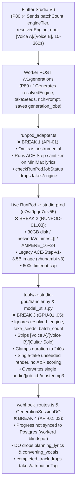

# Phase 81: RunPod Multi-Model Audio Engine (`MiniMax Music 3.0` + `ACE-Step 1.5 XL`) & Webhook Pipeline — Forensic Audit

**Document ID:** `AUDIT-P81-RUNPOD-MULTIMODEL-001`  
**Date:** 2026-11-24  
**Branch / Commit:** `fix/studio-cockpit-bugs-vh001-vh006` (`5811dd0`)  
**Audit Scope:** Read-only end-to-end static & live-infrastructure forensic audit across `tools/zr-studio-gpu/*`, `apps/vhunambi_api/src/*`, `apps/vhunambi_client/lib/features/studio/*`, and live RunPod Serverless Endpoint `e7wt9pgo7djv55` (`zr-studio-prod`)  
**Related Specs & Trackers:** [`PHASE_80_PLUS_STUDIO_AND_RUNPOD_MASTER_TRACKER.md`](file:///c:/Users/Ndugelo/VHUNAMBI/monorepo/docs/phases/PHASE_80_PLUS_STUDIO_AND_RUNPOD_MASTER_TRACKER.md) | [`Phase 80 Spec Suite`](file:///c:/Users/Ndugelo/VHUNAMBI/monorepo/docs/phases/phase_80_studio_cockpit_v6_and_production_contract/design.md)

---

## 1. Executive Summary & Headline Verdict

**Verdict:** **NOT READY FOR MULTI-MODEL PRODUCTION — 9 P0/P1 PIPELINE BREAKS BLOCK `MiniMax Music 3.0`, `ACE-Step 1.5 XL`, AND MULTI-TAKE BAKING.**

Phase 80 successfully landed the full lossless `StudioGenerationContractV6` UI, Cloudflare Worker schema (`POST /v1/generations`), `prompt_compiler.ts` routing (`resolveTargetAudioEngine`, `generateUniqueTakeSeeds`), `GenerationSessionDO` dual-dialect frames, and Supabase Postgres columns (`batch_id`, `takes_json`, `resolved_engine`, `attribution_tag`). However, auditing the downstream RunPod GPU worker (`tools/zr-studio-gpu/`), Cloudflare Worker callback/polling handlers (`apps/vhunambi_api/`), and live RunPod endpoint `e7wt9pgo7djv55` proves that **Phase 80's multi-model and multi-take payload is currently truncated, ignored, or OOM-blocked downstream**:

1. **Live RunPod Infra Cannot Host the Models (`e7wt9pgo7djv55`):** Live RunPod MCP inspection confirms `zr-studio-prod` (version `7`) runs legacy `ndugelo/zr-studio-gpu:vhunambi-v3` on a **`30 GB` ephemeral container disk**, **`networkVolumes: []`** (zero RunPod Network Volumes provisioned on account), `timeout: 600000 ms`, and small VRAM pools (`AMPERE_16`, `ADA_24`, `AMPERE_24`). `MiniMaxAI/MiniMax-Music3` (~22 GB in `bf16`) + `ACE-Step 1.5 XL` (~16 GB) + Demucs cannot fit on 30 GB disk or 16/24 GB VRAM.
2. **GPU Worker Ignores Phase 80 Contract (`handler.py` & `model_utils.py`):** `handler.py` discards `engine_tier`, `resolved_engine`, `attribution_tag`, `batch_count`, `take_seeds`, `rich_prompt`, and `voice_cast`; `model_utils.py` only loads legacy `ACE-Step-v1-3.5B`, hardcodes a `240s` cap (`#L327`), strips `[Voice A]` / `[Voice B]` / `[Choir]` / `[Guitar Solo]` duet tags (`#L70-L72`), and generates a single unseeded WAV without multi-take A&R scoring.
3. **Worker Isolate Eviction & Polling Data Loss (`webhook_routes.ts`, `runpod_adapter.ts`, `generation_session_do.ts`):** Stage webhooks call sync `updateJobProgress` without persisting progress to Supabase Postgres (invisible to cold Worker HTTP pollers), `checkRunPodJobStatus()` discards `takes`, `resolved_engine`, and `attribution_tag` on active polling, `runpod_adapter.ts` omits `is_instrumental` from the RunPod input payload, and `GenerationSessionDO` fails to map `planning_lyrics` and `converting_vocals`.

### Executive Root-Cause & Severity Matrix

| ID | Sev | Component / Symptom | Primary Root Cause | Exact File & Line Evidence |
| :--- | :---: | :--- | :--- | :--- |
| **`RUNPOD-01`** | **P0** | Cannot store `MiniMax-Music3` + `ACE-Step 1.5 XL` weights on `zr-studio-prod` | `30 GB` container disk, `networkVolumes: []`, `HF_HOME=/tmp/hf_cache` | Live `get-endpoint("e7wt9pgo7djv55")`, `list-network-volumes()`, [`Dockerfile#L9-L10`](file:///c:/Users/Ndugelo/VHUNAMBI/monorepo/tools/zr-studio-gpu/Dockerfile#L9-L10) |
| **`RUNPOD-02`** | **P0** | CUDA OOM risk & 10-min abort on long multi-take Studio Bakes | GPU pools include `AMPERE_16` / `ADA_24` / `AMPERE_24`; `timeout: 600000` | Live `get-endpoint("e7wt9pgo7djv55")`, `list-gpu-types` (`L40S 48GB` `$1.89/hr`) |
| **`RUNPOD-03`** | **P0** | Container ships only legacy `ACE-Step-v1-3.5B`, zero `MiniMax-Music3` / `ACE-Step 1.5 XL` | `Dockerfile` installs `ACE-Step` v1 and lacks `sglang-omni` / `ACE-Step 1.5 XL` / `soxr` | [`Dockerfile#L43`](file:///c:/Users/Ndugelo/VHUNAMBI/monorepo/tools/zr-studio-gpu/Dockerfile#L43), [`requirements.txt#L1-L12`](file:///c:/Users/Ndugelo/VHUNAMBI/monorepo/tools/zr-studio-gpu/requirements.txt#L1-L12) |
| **`GPU-01`** | **P0** | `handler.py` silently ignores V6 engine, batch, seeds, rich prompt, and voice cast | Reads only legacy `song_spec`, `caption`, `infer_steps`; runs 1 unseeded take | [`handler.py#L72-L137`](file:///c:/Users/Ndugelo/VHUNAMBI/monorepo/tools/zr-studio-gpu/handler.py#L72-L137), [`handler.py#L363-L376`](file:///c:/Users/Ndugelo/VHUNAMBI/monorepo/tools/zr-studio-gpu/handler.py#L363-L376) |
| **`GPU-02`** | **P0** | No `ZRModelRouter`, zero `seed` forwarding, and deterministic `seed = 0` hazard | `model_utils.py` loads `ACE-Step-v1-3.5B` only; `generate_audio` takes no `seed` / `engine` | [`model_utils.py#L223-L256`](file:///c:/Users/Ndugelo/VHUNAMBI/monorepo/tools/zr-studio-gpu/model_utils.py#L223-L256), [`model_utils.py#L319-L356`](file:///c:/Users/Ndugelo/VHUNAMBI/monorepo/tools/zr-studio-gpu/model_utils.py#L319-L356) |
| **`GPU-03`** | **P0** | GPU Python strips `[Voice A]` / `[Voice B]` / `[Choir]` tags & clamps duration to `240s` | `_ALLOWED_SECTION_RE` lags TS sanitizer; `min(240, ...)` cuts `300s`/`360s` songs | [`model_utils.py#L70-L72`](file:///c:/Users/Ndugelo/VHUNAMBI/monorepo/tools/zr-studio-gpu/model_utils.py#L70-L72), [`model_utils.py#L327`](file:///c:/Users/Ndugelo/VHUNAMBI/monorepo/tools/zr-studio-gpu/model_utils.py#L327) |
| **`API-01`** | **P0** | `runpod_adapter.ts` omits `is_instrumental` & pre-strips tags on `MiniMax-Music3` | `song_spec` lacks `is_instrumental`; `sanitizeLyricsForAceStep` runs for all engines | [`runpod_adapter.ts#L242-L270`](file:///c:/Users/Ndugelo/VHUNAMBI/monorepo/apps/vhunambi_api/src/modules/synthesis/runpod_adapter.ts#L242-L270) |
| **`API-02`** | **P0** | Active RunPod polling drops `takes`, `resolved_engine`, `attribution_tag`, `stage` | `checkRunPodJobStatus` parses only single `audio_url` / `stem_urls`; `GET /:id` fakes 1 take | [`runpod_adapter.ts#L317-L404`](file:///c:/Users/Ndugelo/VHUNAMBI/monorepo/apps/vhunambi_api/src/modules/synthesis/runpod_adapter.ts#L317-L404), [`generation_routes.ts#L361-L392`](file:///c:/Users/Ndugelo/VHUNAMBI/monorepo/apps/vhunambi_api/src/routes/generation_routes.ts#L361-L392) |
| **`API-03`** | **P1** | Intermediate `planning_lyrics` & `converting_vocals` stages drop on DO WebSocket & cold HTTP poll | `GenerationSessionDO` lacks those switch cases; `webhook_routes.ts` omits `updateGenerationJobAsync` on progress | [`generation_session_do.ts#L48-L62`](file:///c:/Users/Ndugelo/VHUNAMBI/monorepo/apps/vhunambi_api/src/modules/realtime/generation_session_do.ts#L48-L62), [`webhook_routes.ts#L158-L170`](file:///c:/Users/Ndugelo/VHUNAMBI/monorepo/apps/vhunambi_api/src/routes/webhook_routes.ts#L158-L170) |
| **`GPU-04`** | **P1** | `mmo_extractor.py` R2 upload overwrites `master.mp3` & skips per-take keys / A&R scoring | Fixed `audio/{job_id}/master.mp3` key, zero A&R take ranking, zero `32 kHz` normalization | [`mmo_extractor.py#L254-L337`](file:///c:/Users/Ndugelo/VHUNAMBI/monorepo/tools/zr-studio-gpu/mmo_extractor.py#L254-L337), [`handler.py#L292-L314`](file:///c:/Users/Ndugelo/VHUNAMBI/monorepo/tools/zr-studio-gpu/handler.py#L292-L314) |
| **`GPU-05`** | **P1** | LoRA cache in ephemeral `/tmp/zr_lora_cache` & single-LoRA 8s fail-silent load | Misses `/runpod-volume/lora_cache`; 8s `requests.get` timeout | [`model_utils.py#L210`](file:///c:/Users/Ndugelo/VHUNAMBI/monorepo/tools/zr-studio-gpu/model_utils.py#L210), [`model_utils.py#L284-L318`](file:///c:/Users/Ndugelo/VHUNAMBI/monorepo/tools/zr-studio-gpu/model_utils.py#L284-L318) |
| **`CLIENT-01`** | **P2** | Multi-take selection in `GenerationPipelineNotifier` only plays active URL without caching full `takes` metadata | `activeCompletedTrack` swaps playback URL only; completed UI badge lacks A&R score tag | [`generation_pipeline_providers.dart#L429-L441`](file:///c:/Users/Ndugelo/VHUNAMBI/monorepo/apps/vhunambi_client/lib/features/studio/presentation/providers/generation_pipeline_providers.dart#L429-L441), [`generation_pipeline_state.dart#L71-L104`](file:///c:/Users/Ndugelo/VHUNAMBI/monorepo/apps/vhunambi_client/lib/features/studio/domain/models/generation_pipeline_state.dart#L71-L104) |

### End-to-End Phase 80 ➔ Phase 81 Breakpoint Topology



---

## 2. Pillar-by-Pillar Forensic Findings

### Pillar A: Live RunPod Infrastructure, GPU Memory & Network Volume Audit (`RUNPOD-01` .. `RUNPOD-03`)

Direct read-only queries against RunPod MCP (`get-endpoint("e7wt9pgo7djv55")`, `endpoint-health("e7wt9pgo7djv55")`, `list-network-volumes()`, `list-gpu-types(product=["SERVERLESS"], include=["AVAILABILITY"])`) reveal exact hardware mismatches against Phase 81 requirements:

```text
┌──────────────────────────────────┬───────────────────────────────────┬───────────────────────────────────────┐
│ RunPod Dimension                 │ Live Endpoint e7wt9pgo7djv55 (v7) │ Phase 81 Target Requirement           │
├──────────────────────────────────┼───────────────────────────────────┼───────────────────────────────────────┤
│ Container Image                  │ ndugelo/zr-studio-gpu:vhunambi-v3 │ :vhunambi-v4 (MiniMax3 + ACE-Step XL) │
│ Container Disk                   │ 30 GB (ephemeral)                 │ 40-50 GB + Persistent Network Volume  │
│ Attached Network Volumes         │ [] (NONE on account)              │ 100 GB RunPod Volume (/runpod-volume) │
│ HF Cache Path                    │ /tmp/hf_cache (re-downloads)      │ /runpod-volume/hf_cache               │
│ GPU Pools Allowed                │ ADA_24, AMPERE_24, AMPERE_16, ... │ ADA_48_PRO (L40S / RTX 6000 Ada) etc. │
│ Endpoint Timeout                 │ 600000 ms (10 min)                │ 1200000 ms (20 min for 4-take bake)   │
│ Current Worker State             │ idle:0 running:0 throttled:1      │ L40S 48GB available ($1.89/hr sls)    │
└──────────────────────────────────┴───────────────────────────────────┴───────────────────────────────────────┘
```

#### Exhaustive Infrastructure Findings

| ID | Sev | Evidence | Exact Defect | Concrete Remediation Pattern |
| :--- | :---: | :--- | :--- | :--- |
| `RUNPOD-01` | **P0** | `get-endpoint("e7wt9pgo7djv55")` (`disk: 30`, `networkVolumes: []`), `Dockerfile#L9-L10` | Zero persistent Network Volumes exist on the RunPod account; `Dockerfile` defaults `HF_HOME=/tmp/hf_cache` on a `30 GB` disk. Downloading `MiniMaxAI/MiniMax-Music3` (~22 GB) + `ACE-Step 1.5 XL` (~16 GB) + `htdemucs` overflows disk space and breaks cold starts. | Provision a `100 GB` RunPod Network Volume in an `L40S`-enabled DC (e.g. `US-MO-1` / available `ADA_48_PRO` zone), pre-populate `/runpod-volume/hf_cache` with `MiniMaxAI/MiniMax-Music3` & `ACE-Step-1.5-XL`, attach to `e7wt9pgo7djv55`, and default `HF_HOME=/runpod-volume/hf_cache`. |
| `RUNPOD-02` | **P0** | `get-endpoint("e7wt9pgo7djv55")` (`pools: ["ADA_24","AMPERE_24","AMPERE_16","AMPERE_48","ADA_48_PRO"]`, `timeout: 600000`), `list-gpu-types` | Including `16 GB` (`AMPERE_16`) and `24 GB` (`ADA_24`/`AMPERE_24`) causes CUDA OOM for `MiniMax-Music3` (`8B Qwen3 Global + 0.6B Local + 2.4B Flow + 123M Flow-VAE` in `bf16`/`fp16`). `10 min` endpoint timeout risks killing 4-take `300s` Studio Bakes mid-run. | Restrict Studio Bake endpoint pools to **`ADA_48_PRO`** (`NVIDIA L40S 48GB`, `RTX 6000 Ada 48GB`, `$1.89/hr` serverless / `$1.09/hr` secure / `$0.79/hr` community) and **`AMPERE_48`** / **`AMPERE_80`**, raise `timeout` to `1200000 ms`, or split fast 24 GB draft endpoint if desired. |
| `RUNPOD-03` | **P0** | `Dockerfile#L24-L47`, `requirements.txt#L1-L12` | Only legacy `ACE-Step` (`v1-3.5B`) is installed (`pip install git+https://github.com/ace-step/ACE-Step.git`). Zero `sglang-omni` runtime for `MiniMax-Music3`, zero `ACE-Step 1.5 XL` weights/code (`xl-sft`, `xl-base`, `xl-turbo`), zero `libsoxr` / `scipy.signal.resample_poly` high-precision resampler. Strictly verify **zero `YuE2` (`CC BY-NC 4.0`)** packages or checkpoints. | Upgrade `Dockerfile` / `:vhunambi-v4` base layers to install `sglang-omni` (`MiniMaxAI/MiniMax-Music3` runner), `ACE-Step 1.5 XL` (`xl-sft` / `xl-base` / `xl-turbo`), `soxr>=0.4.0`, and build-time tokenizer + router import smoke tests. |

---

### Pillar B: GPU Worker Router, Seeds, Lyrics & Multi-Take Pipeline (`GPU-01` .. `GPU-05`)

Tracing `tools/zr-studio-gpu/handler.py`, `model_utils.py`, and `mmo_extractor.py` against `StudioGenerationContractV6`:

| ID | Sev | File & Line(s) | Exact Defect | Concrete Remediation Pattern |
| :--- | :---: | :--- | :--- | :--- |
| `GPU-01` | **P0** | [`handler.py#L72-L137`](file:///c:/Users/Ndugelo/VHUNAMBI/monorepo/tools/zr-studio-gpu/handler.py#L72-L137), [`#L363-L376`](file:///c:/Users/Ndugelo/VHUNAMBI/monorepo/tools/zr-studio-gpu/handler.py#L363-L376) | `runpod_handler()` never reads `engine_tier`, `resolved_engine`, `attribution_tag`, `batch_count`, `take_seeds`, `audio_mode`, `is_instrumental`, `song_spec["rich_prompt"]`, or `song_spec["voice_cast"]`. It runs only a single unseeded synthesis pass and returns `final_payload` without `takes`, `resolved_engine`, or `attribution_tag`. | Parse all V6 input fields in `handler.py`; execute loop over `take_seeds[:batch_count]` (generating fresh crypto 64-bit integers when omitted); emit granular stage webhooks (`planning_lyrics`, `synthesizing`, `separating_stems`, `converting_vocals`, `mastering`, `uploading`) and return scored `takes`, `resolved_engine`, and `attribution_tag`. |
| `GPU-02` | **P0** | [`model_utils.py#L196-L256`](file:///c:/Users/Ndugelo/VHUNAMBI/monorepo/tools/zr-studio-gpu/model_utils.py#L196-L256), [`#L319-L358`](file:///c:/Users/Ndugelo/VHUNAMBI/monorepo/tools/zr-studio-gpu/model_utils.py#L319-L358) | Loads only `ACE-Step-v1-3.5B`. Has no `MiniMax-Music3` runner (`sglang-omni` / Diffusers), no `ACE-Step 1.5 XL` variant selector (`xl-turbo` / `xl-sft` / `xl-base`), and passes zero `seed` into synthesis. Additionally lacks safety fallback routing when `is_instrumental=True` or `reference_audio_url` is set (`sglang-omni` rejects those with HTTP `400`). | Introduce `ZRMultiModelRouter` inside `model_router.py` / `model_utils.py`: enforce `engine == "minimax_music_3"` only when `not is_instrumental and not reference_audio_url` (with non-zero 64-bit `seed`, `<= 300s` sweet spot / `360s` hard cap, `"MiniMax-Music3"` attribution), otherwise dispatch to `acestep-v15-xl-{turbo,sft,base}` with explicit `seed`. Keep `_install_latin_language_guard()` and **ban `YuE2`**. |
| `GPU-03` | **P0** | [`model_utils.py#L70-L115`](file:///c:/Users/Ndugelo/VHUNAMBI/monorepo/tools/zr-studio-gpu/model_utils.py#L70-L115), [`#L327`](file:///c:/Users/Ndugelo/VHUNAMBI/monorepo/tools/zr-studio-gpu/model_utils.py#L327) | (1) `_ALLOWED_SECTION_RE` on line 71 omits `voice [a-d]`, `duet`, `choir`, `call`, `response`, `guitar solo`, `sax solo`, `drop`, `breakdown` — stripping all Phase 80 duet/choir/solo cues before generation. (2) Line 327 clamps `duration_sec = max(4, min(240, ...))`, truncating 5–6 minute tracks (`300s–360s`). | Align `_ALLOWED_SECTION_RE` 1:1 with `lyrics_sanitizer.ts#L12`, add engine-specific lyric formatter (MiniMax preserves `[Voice A]`/`[Voice B]` natural duet cues cleanly; ACE-Step XL uses normalized brackets), and lift duration ceiling from `240` to **`360`** (`max(10, min(360, ...))`). |
| `GPU-04` | **P1** | [`mmo_extractor.py#L254-L337`](file:///c:/Users/Ndugelo/VHUNAMBI/monorepo/tools/zr-studio-gpu/mmo_extractor.py#L254-L337), [`handler.py#L292-L314`](file:///c:/Users/Ndugelo/VHUNAMBI/monorepo/tools/zr-studio-gpu/handler.py#L292-L314) | (1) `MiniMax Music 3.0` outputs native `32 kHz` 16-bit stereo WAV, whereas Demucs `htdemucs` outputs `44.1 kHz` stems; when `svc_executed` is true (`handler.py#L295-L307`), mismatched sample rates alter duration/pitch or clip. (2) `upload_artifacts_to_r2` always writes `audio/{job_id}/master.mp3`, overwriting takes if called for `batchCount > 1`. (3) Zero A&R scoring function exists to pick top take. | Normalize MiniMax `32 kHz` WAV to `44.1 kHz` float32 (`soxr` / polyphase) cleanly before Demucs / R2 upload; parameterize `upload_artifacts_to_r2(..., artifact_prefix=f"{job_id}/take_{idx}")` for secondary takes while writing winning A&R take to `audio/{job_id}/master.mp3`; implement `score_take_ar_quality()` (vocal RMS ratio, dynamic range / crest factor, non-silence coverage, anti-clipping). |
| `GPU-05` | **P1** | [`model_utils.py#L210`](file:///c:/Users/Ndugelo/VHUNAMBI/monorepo/tools/zr-studio-gpu/model_utils.py#L210), [`#L284-L318`](file:///c:/Users/Ndugelo/VHUNAMBI/monorepo/tools/zr-studio-gpu/model_utils.py#L284-L318) | LoRA cache writes to ephemeral `/tmp/zr_lora_cache`, uses an `8s` HTTP timeout, fails silently when an R2 key returns 404, and ignores secondary LoRAs (`resolved_loras[0]` only). Also `GENRE_LORA_REGISTRY` covers 9 of the 42 V6 genres without explicit mapping note. | Prefer `/runpod-volume/lora_cache` when `/runpod-volume` is mounted, raise download timeout to `20s`, validate file magic bytes (`safetensors` header length), and log structured LoRA status in `stage_metrics`. |

Exact Python trap snippets observed in [`model_utils.py`](file:///c:/Users/Ndugelo/VHUNAMBI/monorepo/tools/zr-studio-gpu/model_utils.py):
```python
# model_utils.py#L70-L72 — strips [Voice A], [Voice B], [Duet], [Choir], [Guitar Solo]!
_ALLOWED_SECTION_RE = re.compile(
    r"^(intro|verse(?:\s*\d+)?|pre-?chorus|chorus(?:\s*\d+)?|bridge|outro|instrumental|hook)$"
)

# model_utils.py#L224 — legacy ACE-Step v1 only:
default_ckpt = os.path.join(self.hf_home, "ACE-Step-v1-3.5B")

# model_utils.py#L327 — clips 300s/360s songs down to 240s:
duration_sec = max(4, min(240, int(song_spec.get("duration", 30))))
```

---

### Pillar C: Worker API Wire, Polling, Webhooks & Realtime DO (`API-01` .. `API-03`, `CLIENT-01`)

Tracing from `generation_routes.ts` $\to$ `runpod_adapter.ts` $\to$ `webhook_routes.ts` $\to$ `generation_session_do.ts` $\to$ `GenerationPipelineNotifier`:

| ID | Sev | File & Line(s) | Exact Defect | Concrete Remediation Pattern |
| :--- | :---: | :--- | :--- | :--- |
| `API-01` | **P0** | [`runpod_adapter.ts#L242-L270`](file:///c:/Users/Ndugelo/VHUNAMBI/monorepo/apps/vhunambi_api/src/modules/synthesis/runpod_adapter.ts#L242-L270), [`prompt_compiler.ts#L326-L333`](file:///c:/Users/Ndugelo/VHUNAMBI/monorepo/apps/vhunambi_api/src/modules/synthesis/prompt_compiler.ts#L326-L333) | `dispatchSynthesisJob` never includes `is_instrumental` in `input` or `song_spec`, AND unconditionally runs `sanitizeLyricsForAceStep(prompt.lyrics)` (lowercasing `[Voice A]` $\to$ `[voice a]`) even when `prompt.resolvedEngine === 'minimax_music_3'`. | Carry `isInstrumental: Boolean(input.isInstrumental)` on `CompiledSynthesisPrompt`, send `is_instrumental: prompt.isInstrumental` in `input` and `song_spec`, and use MiniMax casing (`[Voice A]`, `[Voice B]`, `[Choir]`, `[Guitar Solo]`) when `resolvedEngine === 'minimax_music_3'`. |
| `API-02` | **P0** | [`runpod_adapter.ts#L317-L404`](file:///c:/Users/Ndugelo/VHUNAMBI/monorepo/apps/vhunambi_api/src/modules/synthesis/runpod_adapter.ts#L317-L404), [`generation_routes.ts#L361-L392`](file:///c:/Users/Ndugelo/VHUNAMBI/monorepo/apps/vhunambi_api/src/routes/generation_routes.ts#L361-L392) | `checkRunPodJobStatus` only extracts single `audio_url`, `master_wav_url`, `stems_zip_url`, `stem_urls`, `manifest_url`, dropping `data.output.takes`, `data.output.resolved_engine`, and `data.output.attribution_tag`. Consequently `GET /v1/generations/:id` overwrites multi-take outputs with a single fake `seed: 1` take when polling settles a job instead of a webhook. | Extend `RunPodJobStatusResult` to parse `takes`, `resolvedEngine`, `attributionTag`, and `stage` / `progress` from RunPod `/status/:id`, and persist them in `generation_routes.ts#L363-L392` via `completeJob()` + `upsertGenerationJobAsync()`. |
| `API-03` | **P1** | [`webhook_routes.ts#L158-L170`](file:///c:/Users/Ndugelo/VHUNAMBI/monorepo/apps/vhunambi_api/src/routes/webhook_routes.ts#L158-L170), [`generation_session_do.ts#L48-L98`](file:///c:/Users/Ndugelo/VHUNAMBI/monorepo/apps/vhunambi_api/src/modules/realtime/generation_session_do.ts#L48-L98) | (1) `webhook_routes.ts#L158` only updates local SQLite/RAM `updateJobProgress(...)` during intermediate stages without persisting `step` & `progress_pct` to Supabase (`vhunambiDb.updateGenerationJobAsync`), so cold Cloudflare Worker isolates serving HTTP pollers (`GET /:id`) stay blind to `synthesizing` / `separating_stems` / `converting_vocals` / `mastering` transitions. (2) `GenerationSessionDO.buildDualDialectPipelineEventFrame` does not handle `'planning_lyrics'` (`stepIndex` falls to `1`) or `'converting_vocals'` (`stepIndex` falls to `1`), and `completed_track` omits `resolvedEngine`, `attributionTag`, and `takes`. | Call `c.executionCtx.waitUntil(vhunambiDb.updateGenerationJobAsync(generationId, { status: 'running', step, progressPct }, c))` safely (guarded for Node tests without `executionCtx`), map `planning_lyrics` $\to$ `stepIndex: 2` and `converting_vocals` $\to$ `stepIndex: 3` in `generation_session_do.ts`, and include `resolved_engine` / `attribution_tag` in `completed_track`. |
| `CLIENT-01` | **P2** | [`generation_pipeline_providers.dart#L429-L441`](file:///c:/Users/Ndugelo/VHUNAMBI/monorepo/apps/vhunambi_client/lib/features/studio/presentation/providers/generation_pipeline_providers.dart#L429-L441), [`generation_pipeline_state.dart#L71-L104`](file:///c:/Users/Ndugelo/VHUNAMBI/monorepo/apps/vhunambi_client/lib/features/studio/domain/models/generation_pipeline_state.dart#L71-L104) | `GenerationTake` lacks `engineUsed`, `attribution`, and A&R `score` fields even though backend `GenerationTakeRecord` (`job_types.ts#L28-L36`) emits them; selecting a non-0 take does not update the vaulted `LibraryTrack.remoteAudioUrl` if user prefers Take 2/3/4. | Parse optional `engineUsed`, `score`, and `attribution` on `GenerationTake` and update `LibraryTrack` URL when user promotes an alternate take in `selectActiveTake()`. |

---

## 3. Target Remediation Architecture Blueprint

### Layer 1: RunPod Serverless Infrastructure & Persistent Model Cache (`L40S 48GB`)
1. Provision a **`100 GB` RunPod Network Volume** in an `ADA_48_PRO`-stocked datacenter (`L40S 48GB` / `RTX 6000 Ada 48GB`) mounted at `/runpod-volume`.
2. Pre-stage HuggingFace weights on `/runpod-volume/hf_cache`:
   - `MiniMaxAI/MiniMax-Music3` (`8B Qwen3 Global + 0.6B Local + 2.4B Flow + 123M Flow-VAE`, commercial up to \$20M USD with `"MiniMax-Music3"` UI attribution)
   - `ACE-Step 1.5 XL` (`acestep-v15-xl-sft`, `acestep-v15-xl-base`, `acestep-v15-xl-turbo` + `4B Qwen3 Planner`, 100% MIT)
   - **Zero `YuE2`** anywhere in image layers, caches, or routing tables (`CC BY-NC 4.0` strictly excluded).
3. Update `zr-studio-prod` (`e7wt9pgo7djv55`) to target `ndugelo/zr-studio-gpu:vhunambi-v4`, GPU pools `["ADA_48_PRO", "AMPERE_48", "AMPERE_80"]`, `timeout: 1200000`, `HF_HOME=/runpod-volume/hf_cache`, and `ZR_LORA_CACHE_DIR=/runpod-volume/lora_cache`.

### Layer 2: Multi-Model Router & Guardrails (`tools/zr-studio-gpu/model_router.py` + `model_utils.py`)
```text
┌────────────────────────────────────────────────────────────────────────────┐
│                   ZRMultiModelRouter.route(job_input)                      │
├─────────────────────────────────┬────────────────────┬─────────────────────┤
│ Condition                       │ Target Engine      │ Seed / Caps         │
├─────────────────────────────────┼────────────────────┼─────────────────────┤
│ fast_draft                      │ ace_step_xl_turbo  │ 12 steps, 10–360s   │
│ sovereign_custom                │ ace_step_xl_base   │ 60 steps + LoRA     │
│ OR reference_audio_url != None  │ (MIT, zero cap)    │ 64-bit unique seed  │
│ studio_bake + is_instrumental   │ ace_step_xl_sft    │ Avoids MiniMax 400! │
│ studio_bake + vocal (no ref)    │ minimax_music_3    │ Unique 64-bit seed! │
│                                 │ (attribution req.) │ <=300s sweet (360s) │
└─────────────────────────────────┴────────────────────┴─────────────────────┘
```
- Enforce `duration_sec = max(10, min(360, duration))`, pass explicit `seed` per take, preserve `[Voice A]` / `[Voice B]` / `[Duet]` / `[Choir]` / `[Guitar Solo]` / `[Log Drum Drop]` in `_ALLOWED_SECTION_RE`, and resample `32 kHz` MiniMax WAV cleanly to `44.1 kHz` float32 prior to Demucs / mastering (`Phase 82` upgrades that step to `soxr` VHQ + `BS-RoFormer` + neural `Seed-VC` + `Matchering 2.0`).

### Layer 3: Multi-Take A&R Baking, Granular Webhooks & Cloud Sync (`handler.py` + `vhunambi_api`)
1. `handler.py` iterates `1..batch_count` using `take_seeds[i]` (or cryptographic `secrets.randbits(63)` fallback), generates/saves each candidate WAV, scores every take with `score_take_ar_quality()` (vocal RMS presence, crest factor, non-silence ratio, clipping penalty), uploads alternate takes under `audio/{job_id}/take_{idx}.mp3`, and promotes the top-scoring take to Demucs 4-stem separation + mastering + R2 `audio/{job_id}/master.mp3`.
2. Streams signed HMAC-SHA256 webhooks across **exact Phase 80/81 stages**: `planning_lyrics` (18%) $\to$ `synthesizing` (42%) $\to$ `separating_stems` (60%) $\to$ `converting_vocals` (72%) $\to$ `mastering` (84%) $\to$ `uploading` (92%) $\to$ `completed` (100% with `takes`, `resolved_engine`, `attribution_tag`, `seed`).
3. `webhook_routes.ts` persists intermediate stage progress to Postgres via guarded `waitUntil`, `GenerationSessionDO` aligns `stepIndex` for `planning_lyrics` and `converting_vocals`, and `runpod_adapter.ts` forwards `is_instrumental` + parses multi-take fields from `/status/:id`.

---

## 4. Ordered Remediation Milestone Plan (`M81.1` – `M81.4`)

| Milestone | Scope | Key Files Targeted | Verification Gate |
| :--- | :--- | :--- | :--- |
| **`M81.1` (Pass 1 — Worker & Edge Sync Contract)** | Forward `is_instrumental`, preserve MiniMax duet casing, parse `takes` / `resolved_engine` / `attribution_tag` in `checkRunPodJobStatus` + `GET /:id`, map `planning_lyrics` & `converting_vocals` in `GenerationSessionDO`, persist webhook progress via `waitUntil`. | `runpod_adapter.ts`, `prompt_compiler.ts`, `generation_routes.ts`, `webhook_routes.ts`, `generation_session_do.ts`, tests | `cd apps/vhunambi_api && ./node_modules/.bin/tsc --noEmit && npm test` (`33+` suites pass) |
| **`M81.2` (Pass 1 — GPU Router, Duet Sanitizer, 360s Ceiling & Multi-Take A&R)** | Implement `ZRMultiModelRouter` (`MiniMax-Music3` vs `ACE-Step 1.5 XL` `{turbo,sft,base}` + zero `YuE2`), unique 64-bit `seed`, `_ALLOWED_SECTION_RE` duet tags, `10–360s` clamp, `32 kHz` $\to$ `44.1 kHz` normalization, `take_{idx}` R2 uploads, and A&R scoring + `score`/`attribution` in `GenerationTake` Dart model. | `tools/zr-studio-gpu/model_router.py`, `model_utils.py`, `handler.py`, `mmo_extractor.py`, `tools/zr-studio-gpu/test_*.py`, `generation_pipeline_state.dart` / `_providers.dart` | `pytest tools/zr-studio-gpu/` + `python -m py_compile` + `flutter test test/features/studio/` |
| **`M81.3` (Container & RunPod Infra Upgrade)** | Update `Dockerfile` & `requirements.txt` for `:vhunambi-v4` (`MiniMax-Music3` + `ACE-Step 1.5 XL`, zero `YuE2`), create `100 GB` RunPod Network Volume, pre-stage `/runpod-volume/hf_cache`, and update `zr-studio-prod` (`e7wt9pgo7djv55`) to `48 GB` pools (`ADA_48_PRO` / `AMPERE_48`) + `1200000 ms` timeout. | `tools/zr-studio-gpu/Dockerfile`, `requirements.txt`, `README.md`, RunPod MCP (`create-network-volume`, `update-endpoint`) | Docker build/compile smoke check + RunPod `get-endpoint` & `endpoint-health` check + Worker deploy |
| **`M81.4` (Live E2E Multi-Take Verification & Sleep Consolidation)** | Execute live vocal duet Studio Bake (`MiniMax-Music3`) + instrumental (`ACE-Step 1.5 XL-SFT`) E2E job checks, finalize `memory.md` (`"status": "completed"`), update Master Tracker checkboxes, and run `consolidate_memory.mjs`. | `docs/phases/phase_81_runpod_multimodel_audio_engine/memory.md`, `PHASE_80_PLUS_STUDIO_AND_RUNPOD_MASTER_TRACKER.md` | Live R2 MP3 + 4 stems + MMO manifest + `takes_json` DB verification |
