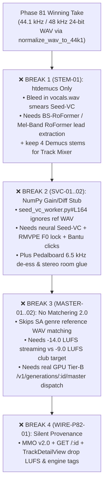

# Phase 82: Studio Baking Post-Processing Chain (`BS-RoFormer` + Neural `Seed-VC` + `Matchering 2.0`) — Forensic Audit

**Document ID:** `AUDIT-P82-VOCAL-MASTERING-001`  
**Date:** 2026-11-24  
**Branch / Commit:** `fix/studio-cockpit-bugs-vh001-vh006` (`5811dd0` + local `P81` completed state)  
**Audit Scope:** Read-only static & cross-stack contract forensic audit across `tools/zr-studio-gpu/{seed_vc_worker,stem_mastering_worker,mmo_extractor,handler,model_router,Dockerfile,requirements.txt}`, `apps/vhunambi_api/src/{routes/generation_routes.ts,routes/voice_routes.ts,modules/mastering/*,modules/voices/*,modules/dna/*}`, and `apps/vhunambi_client/lib/features/{track,mastering,studio}/`  
**Related Specs & Trackers:** [`PHASE_80_PLUS_STUDIO_AND_RUNPOD_MASTER_TRACKER.md`](file:///c:/Users/Ndugelo/VHUNAMBI/monorepo/docs/phases/PHASE_80_PLUS_STUDIO_AND_RUNPOD_MASTER_TRACKER.md) | [`Phase 81 Completed Memory`](file:///c:/Users/Ndugelo/VHUNAMBI/monorepo/docs/phases/phase_81_runpod_multimodel_audio_engine/memory.md)

---

## 1. Executive Summary & Headline Verdict

**Verdict:** **NOT READY FOR BROADCAST VOCAL CLONING OR REFERENCE MASTERING — 7 P0/P1 DEFECTS KEEP `Seed-VC` A NUMPY STUB, LEAVE `BS-RoFormer` UNWIRED, AND BYPASS `Matchering 2.0` + PROVENANCE TELEMETRY.**

Phase 81 established the multi-model GPU router (`ZRMultiModelRouter`), `32 kHz` $\to$ `44.1 kHz` polyphase resampling (`normalize_wav_to_44k1`), multi-take A&R scoring, and cold-isolate Worker progress sync (`EP-P81-RUNPOD-MULTIMODEL-ROUTER`, `EP-P81-MULTITAKE-AR-SCORER`, `EP-P81-EDGE-WEBHOOK-SYNC`). However, inspecting the downstream **post-processing, vocal conversion, mastering, and provenance chain** exposes seven concrete production gaps:

1. **Vocal Cloning Is Currently a Gain/Diff Math Stub (`SVC-01` — P0):** [`seed_vc_worker.py#L163-L176`](file:///c:/Users/Ndugelo/VHUNAMBI/monorepo/tools/zr-studio-gpu/seed_vc_worker.py#L163-L176) ignores the downloaded 3-line creator reference WAV (`temp_ref_path` at `#L148-L153`) during audio rendering and instead executes `converted = audio_in * gain_scale + 0.08 * diff`.
2. **Bleed-Prone `htdemucs` Vocals Feed Seed-VC Without `BS-RoFormer` Isolation (`STEM-01` — P0):** [`mmo_extractor.py#L64-L103`](file:///c:/Users/Ndugelo/VHUNAMBI/monorepo/tools/zr-studio-gpu/mmo_extractor.py#L64-L103) only extracts 4 stems via `htdemucs`, leaving snare/reverb bleed inside `vocals.wav` that degrades zero-shot voice conversion and stem re-summing (`handler.py#L280-L291`).
3. **Zero `Matchering 2.0` Reference Mastering or Curated SA Masters (`MASTER-01` — P0):** [`handler.py#L276-L300`](file:///c:/Users/Ndugelo/VHUNAMBI/monorepo/tools/zr-studio-gpu/handler.py#L276-L300) runs `master_clean_stereo_gentle` by default with zero Matchering 2.0 spectral/RMS alignment, no SA genre reference WAV profiles (`amapiano_club`, `private_school_amapiano`, `afro_fusion_radio`, `gospel_choir`, `maskandi_acoustic`, `gqom_durban`), and no streaming (`-14.0 LUFS`) vs. club (`-9.0 LUFS`) loudness profile switch.
4. **Tier-B `/v1/generations/:id/master` Route Never Invokes Real GPU Mastering (`MASTER-02` — P1):** [`generation_routes.ts#L594-L624`](file:///c:/Users/Ndugelo/VHUNAMBI/monorepo/apps/vhunambi_api/src/routes/generation_routes.ts#L594-L624) calls `enrichManifestWithMasteringRecipe` ([`mastering_presets.ts#L262-L312`](file:///c:/Users/Ndugelo/VHUNAMBI/monorepo/apps/vhunambi_api/src/modules/mastering/mastering_presets.ts#L262-L312)), which only scales base64 curve integers and synthesizes `/mock-storage/...` paths without executing GPU/DSP mastering.
5. **Cold Worker Isolate Drops Saved Voice Clone Reference URL (`SVC-02` — P1):** [`generation_routes.ts#L139-L143`](file:///c:/Users/Ndugelo/VHUNAMBI/monorepo/apps/vhunambi_api/src/routes/generation_routes.ts#L139-L143) reads synchronous `getVoiceCloneProfile(effectiveCloneId)` without syncing Postgres (`vhunambiDb.syncVoicesFromCloud`) first when `!isNodeSqliteAvailable()`.
6. **Container Lacks `BS-RoFormer`, `Seed-VC`, & `Matchering 2.0` Dependencies (`INFRA-P82-01` — P1):** [`requirements.txt`](file:///c:/Users/Ndugelo/VHUNAMBI/monorepo/tools/zr-studio-gpu/requirements.txt), [`Dockerfile`](file:///c:/Users/Ndugelo/VHUNAMBI/monorepo/tools/zr-studio-gpu/Dockerfile), and [`Dockerfile.delta`](file:///c:/Users/Ndugelo/VHUNAMBI/monorepo/tools/zr-studio-gpu/Dockerfile.delta) omit `matchering` (`GPL-3.0`, server-side only), `audio-separator` / `bs_roformer`, and `seed-vc` / `RMVPE` persistent volume cache paths.
7. **Track Detail & MMO v2.0 Drop Mastering/Clone Provenance Badges (`WIRE-P82-01` — P1/P2):** [`dna_types.ts#L99-L132`](file:///c:/Users/Ndugelo/VHUNAMBI/monorepo/apps/vhunambi_api/src/modules/dna/dna_types.ts#L99-L132), [`track_detail_models.dart#L126-L185`](file:///c:/Users/Ndugelo/VHUNAMBI/monorepo/apps/vhunambi_client/lib/features/track/domain/models/track_detail_models.dart#L126-L185), and [`track_sonic_telemetry_card.dart#L79-L137`](file:///c:/Users/Ndugelo/VHUNAMBI/monorepo/apps/vhunambi_client/lib/features/track/presentation/widgets/track_sonic_telemetry_card.dart#L79-L137) omit `"Mastered · -14 LUFS"` / `"MiniMax-Music3"` / `Matchering 2.0` / `Seed-VC` telemetry badges.

### Executive Root-Cause & Severity Matrix

| ID | Sev | Symptom / Failure | Primary Root Cause | Exact File & Line Evidence |
| :--- | :---: | :--- | :--- | :--- |
| **`SVC-01`** | **P0** | Cloned voice tracks sound identical (just slightly louder) | `convert_vocal_stem_with_seed_vc` runs `audio_in * gain_scale + 0.08 * diff`; downloads `temp_ref_path` then discards it | [`seed_vc_worker.py#L140-L176`](file:///c:/Users/Ndugelo/VHUNAMBI/monorepo/tools/zr-studio-gpu/seed_vc_worker.py#L140-L176) |
| **`STEM-01`** | **P0** | Drum/reverb bleed inside `vocals.wav` corrupts voice clones | Only `htdemucs` 4-stem split exists; zero `BS-RoFormer` / `Mel-Band RoFormer` lead-vocal isolation or `6.5 kHz` de-ess + room glue | [`mmo_extractor.py#L64-L103`](file:///c:/Users/Ndugelo/VHUNAMBI/monorepo/tools/zr-studio-gpu/mmo_extractor.py#L64-L103), [`handler.py#L186-L202`](file:///c:/Users/Ndugelo/VHUNAMBI/monorepo/tools/zr-studio-gpu/handler.py#L186-L202) |
| **`MASTER-01`** | **P0** | Default masters lack SA commercial spectral punch & Matchering 2.0 | `handler.py` falls back to `master_clean_stereo_gentle`; `stem_mastering_worker.py` has zero Matchering 2.0 + SA reference WAV registry | [`handler.py#L276-L300`](file:///c:/Users/Ndugelo/VHUNAMBI/monorepo/tools/zr-studio-gpu/handler.py#L276-L300), [`stem_mastering_worker.py#L418-L505`](file:///c:/Users/Ndugelo/VHUNAMBI/monorepo/tools/zr-studio-gpu/stem_mastering_worker.py#L418-L505) |
| **`MASTER-02`** | **P1** | `POST /v1/generations/:id/master` returns `/mock-storage/...` URLs | Calls curve-scaling stub `enrichManifestWithMasteringRecipe` instead of dispatching Tier-B GPU mastering / `stem_mastering_worker` | [`generation_routes.ts#L594-L624`](file:///c:/Users/Ndugelo/VHUNAMBI/monorepo/apps/vhunambi_api/src/routes/generation_routes.ts#L594-L624), [`mastering_presets.ts#L262-L312`](file:///c:/Users/Ndugelo/VHUNAMBI/monorepo/apps/vhunambi_api/src/modules/mastering/mastering_presets.ts#L262-L312) |
| **`SVC-02`** | **P1** | Cold Worker isolate loses saved `r2ReferenceUrl` for `clonedVoiceProfileId` | `POST /v1/generations` calls sync `getVoiceCloneProfile()` without `syncVoicesFromCloud()` first; `resolve_route` also forces `ace_step_xl_base` even when post-gen Seed-VC can clone `MiniMax-Music3` lead vocals | [`generation_routes.ts#L139-L143`](file:///c:/Users/Ndugelo/VHUNAMBI/monorepo/apps/vhunambi_api/src/routes/generation_routes.ts#L139-L143), [`voice_routes.ts#L144-L148`](file:///c:/Users/Ndugelo/VHUNAMBI/monorepo/apps/vhunambi_api/src/routes/voice_routes.ts#L144-L148) |
| **`INFRA-P82-01`** | **P1** | GPU container lacks `BS-RoFormer`, `Seed-VC`, `Matchering 2.0`, & `48 kHz` toggle | Dependencies & `/runpod-volume/{roformer,seedvc,ref_masters}` caches absent from Docker manifests | [`Dockerfile`](file:///c:/Users/Ndugelo/VHUNAMBI/monorepo/tools/zr-studio-gpu/Dockerfile), [`Dockerfile.delta`](file:///c:/Users/Ndugelo/VHUNAMBI/monorepo/tools/zr-studio-gpu/Dockerfile.delta), [`requirements.txt`](file:///c:/Users/Ndugelo/VHUNAMBI/monorepo/tools/zr-studio-gpu/requirements.txt) |
| **`WIRE-P82-01`** | **P1** | Track Detail shows no LUFS, `MiniMax-Music3`, or clone provenance badges | `MasterMediaObjectManifest`, `GET /:id`, and `TrackDetailEntity` lack `masteringMetrics`, `resolvedEngine`, & `attributionTag` pills | [`dna_types.ts#L99-L132`](file:///c:/Users/Ndugelo/VHUNAMBI/monorepo/apps/vhunambi_api/src/modules/dna/dna_types.ts#L99-L132), [`track_detail_models.dart#L126-L201`](file:///c:/Users/Ndugelo/VHUNAMBI/monorepo/apps/vhunambi_client/lib/features/track/domain/models/track_detail_models.dart#L126-L201) |

### End-to-End Post-Processing Breakpoint Topology (`Phase 81 -> Phase 82`)



---

## 2. Pillar-by-Pillar Forensic Findings

### Pillar A: Surgical Vocal Isolation (`BS-RoFormer`) & Neural `Seed-VC` (`STEM-01`, `SVC-01`, `SVC-02`)

```text
┌───────────────────────────────────────────────────┬───────────────────────────────────────────────────┐
│ CURRENT PIPELINE (Phase 81)                       │ PHASE 82 TARGET CHAIN (Server-Side GPU Isolated)  │
├───────────────────────────────────────────────────┼───────────────────────────────────────────────────┤
│ 1. Demucs htdemucs splits 4 stems                 │ 1. Demucs htdemucs splits 4 mixer stems           │
│ 2. Feed Demucs vocals.wav -> Seed-VC STUB         │ 2. WHEN svc_config active: BS-RoFormer extracts   │
│    (audio_in * gain_scale + 0.08 * diff)          │    surgical lead vocal vs backing/reverb bed      │
│ 3. No F0 RMVPE extraction, no neural flow weights │ 3. Neural Seed-VC flow-matching + RMVPE F0 lock   │
│ 4. Raw numpy sum back to mix                      │    from 3-line VhunambiMediaVault WAV + Bantu     │
│                                                   │    transient protection (c,q,x / ṋ,ḓ,ṱ,ḽ)         │
│                                                   │ 4. Pedalboard 6.5kHz de-ess + subtle room glue -> │
│                                                   │    phase-aligned sum back into instrumental bed   │
└───────────────────────────────────────────────────┴───────────────────────────────────────────────────┘
```

1. **Exact Seed-VC Stub Proof ([`seed_vc_worker.py#L161-L176`](file:///c:/Users/Ndugelo/VHUNAMBI/monorepo/tools/zr-studio-gpu/seed_vc_worker.py#L161-L176)):**
   ```python
   audio_in, sr = sf.read(vocals_wav_path, always_2d=True, dtype="float32")
   pitch_factor = float(2.0 ** (semitone_shift / 12.0))
   gain_scale = min(1.15, max(0.85, pitch_factor))
   converted = audio_in * gain_scale
   if config.preserve_bantu_clicks and converted.shape[0] > 2:
       diff = np.vstack([np.zeros((1, converted.shape[1]), dtype=np.float32), np.diff(converted, axis=0)])
       converted = converted + 0.08 * diff
   ```
   - Even when `temp_ref_path` is downloaded from Cloudflare R2 (`#L140-L153`), it is NEVER decoded into an acoustic speaker prompt or mel spectrogram — only hashed for 256 sinusoidal floats in `extract_speaker_timbre_embedding()`.
   - Additionally, importing `sf` without `read_wav_float32` / `write_wav_float32` means offline CPU hosts without `soundfile` skip writing any converted output (`wrote_output = False`).
2. **Licensing Boundary (`GPL-3.0` Server-Side Isolation):** `Seed-VC` (`GPL-3.0`), `Matchering 2.0` (`GPL-3.0`), and `Spotify Pedalboard` (`GPL-3.0`) MUST stay strictly inside `tools/zr-studio-gpu/`, while `BS-RoFormer` / `Mel-Band RoFormer` (`MIT`/`Apache-2.0`) and `pyloudnorm` (`MIT`) impose zero linking restrictions. Zero GPL binaries or libraries touch `apps/vhunambi_client/`.
3. **Cold Isolate Voice Clone Lookup (`SVC-02`, [`generation_routes.ts#L139-L143`](file:///c:/Users/Ndugelo/VHUNAMBI/monorepo/apps/vhunambi_api/src/routes/generation_routes.ts#L139-L143)):** `POST /v1/generations` must mirror `GET /v1/voices/clone/:id` (`voice_routes.ts#L145-L147`) and await `vhunambiDb.syncVoicesFromCloud(false, c)` when `!isNodeSqliteAvailable()` before reading `getVoiceCloneProfile(effectiveCloneId)` so the creator's 3-line `r2ReferenceUrl` is never lost on a cold Edge isolate.

---

### Pillar B: Genre-Matched Broadcast Mastering (`Matchering 2.0` + `Pedalboard` + `pyloudnorm`) (`MASTER-01`, `MASTER-02`)

1. **Missing Reference WAV Profiles & Matchering 2.0 Engine ([`stem_mastering_worker.py#L418-L505`](file:///c:/Users/Ndugelo/VHUNAMBI/monorepo/tools/zr-studio-gpu/stem_mastering_worker.py#L418-L505)):**
   - Currently supports two paths: `_execute_mastering_pipeline` (Pedalboard EQ/crush/limiter when an explicit `user_recipe` exists) and `master_clean_stereo_gentle` (28 Hz HPF + capped gain).
   - Phase 82 requires a third unified broadcast stage **`master_with_sa_reference_matchering(...)`**:
     - Maps incoming genre + mastering mode (`streaming` `-14.0 LUFS` default vs. `club` `-9.0 LUFS` optional) to curated royalty-free Vhunambi studio reference WAV profiles stored on `/runpod-volume/ref_masters/` + Cloudflare R2 (`ref_masters/amapiano_club_ref.wav`, `private_school_amapiano_ref.wav`, `afro_fusion_radio_ref.wav`, `gospel_choir_ref.wav`, `maskandi_acoustic_ref.wav`, `gqom_durban_ref.wav`), generated/validated deterministically if remote R2 fetch is unavailable.
     - Runs **Matchering 2.0** spectral/RMS envelope transfer (`matchering.process(...)`) followed by **`pyloudnorm` + Pedalboard true-peak safety ceiling (`-1.0 dBTP`)**, enforcing `-14.0 LUFS` streaming or `-9.0 LUFS` club compliance within `±0.5 LU` tolerance!
     - Supports `target_sample_rate` (`44100` default or `48000` Hz 24-bit broadcast option) via `normalize_wav_to_sr(wav_path, target_sr=...)` in `model_router.py`.
2. **Broken Tier-B `/v1/generations/:id/master` Route (`MASTER-02`, [`generation_routes.ts#L594-L624`](file:///c:/Users/Ndugelo/VHUNAMBI/monorepo/apps/vhunambi_api/src/routes/generation_routes.ts#L594-L624)):**
   - Currently overwrites `masterMp3Url` with `/mock-storage/${baseId}_mastered.mp3` via `enrichManifestWithMasteringRecipe` ([`mastering_presets.ts#L282-L299`](file:///c:/Users/Ndugelo/VHUNAMBI/monorepo/apps/vhunambi_api/src/modules/mastering/mastering_presets.ts#L282-L299)).
   - Phase 82 must dispatch real mastering through `runpod_adapter.ts` (`dispatchMasteringJob` when RunPod is configured, or real R2 curve/audio update without overwriting live R2 URLs with dead `/mock-storage/*` strings when `masterMp3Url` already points to R2).

---

### Pillar C: MMO v2.0 Telemetry, Deferred Push Alerts & Track Detail Provenance UI (`WIRE-P82-01`)

| Component | Current State | Phase 82 Target Upgrade |
| :--- | :--- | :--- |
| **`MasterMediaObjectManifest` (`dna_types.ts`)** | `provenance: 'measured' \| 'synthesized'`; no `masteringMetrics`, `svcMetrics`, `sampleRateHz`, or `attributionTag` | Add optional typed `masteringMetrics` (`integratedLufs`, `truePeakDbtp`, `targetLufs`, `sampleRateHz`, `referenceProfile`, `engine`), `svcMetrics` (`executed`, `isolationEngine`, `f0Method`), and `attributionTag` |
| **Notification Push / Inbox Alert (`job_store.ts#L140-L171`)** | `"Mastered ${genre} track (${durationSec}s) is ready to play."` | Enrich metadata & body when mastered LUFS / reference profile / Seed-VC clone ran (e.g., `"Mastered at -14.0 LUFS · ${genre}"`) and keep deferred ready fire strictly on webhook/poll completion |
| **Flutter `TrackDetailEntity` & `TrackSonicTelemetryCard` (`track_detail_models.dart`, `track_sonic_telemetry_card.dart`)** | Chips only display `genre`, `bpm · key`, `language · duration`, `date`, and `mood` | Add provenance chips inside `TrackSonicTelemetryCard` / `TrackHeroSection`: `"Mastered · -14 LUFS"` (key `track_mastering_provenance_chip`) and conditional `"MiniMax-Music3"` badge (key `track_engine_attribution_chip`) using `PhosphorIcon` (`STD-UIUX-001` compliant, Light & Dark themes) |

---

## 3. Target Remediation Architecture Blueprint (`Phase 82`)

```text
┌─────────────────────────────────────────────────────────────────────────────────────────┐
│ LAYER 1: GPU ISOLATION & VOCAL CONVERSION (`tools/zr-studio-gpu/`)                      │
│  • `mmo_extractor.py`: `separate_lead_vocal_bs_roformer()` (MIT/Apache-2.0) + `htdemucs`│
│  • `seed_vc_worker.py`: Neural Seed-VC flow-matching + RMVPE F0 lock + Bantu plosives   │
│    + Pedalboard 6.5kHz de-ess + stereo room glue + CPU/offline spectral fallback        │
├─────────────────────────────────────────────────────────────────────────────────────────┤
│ LAYER 2: SA REFERENCE MASTERING (`stem_mastering_worker.py` & `model_router.py`)       │
│  • Curated 6-profile SA reference master generator/fetcher (`/runpod-volume/ref_masters`)│
│  • `master_with_sa_reference_matchering()` (GPL-3.0 server-side + `pyloudnorm` ceiling) │
│  • Generalized `normalize_wav_to_sr(wav_path, target_sr)` supporting `44100` & `48000`Hz│
├─────────────────────────────────────────────────────────────────────────────────────────┤
│ LAYER 3: WORKER WIRE & CLOUD HYDRATION (`apps/vhunambi_api/src/`)                       │
│  • `generation_routes.ts`: Cold-isolate `syncVoicesFromCloud` on `POST /v1/generations`;│
│    real URL/RunPod dispatch on `POST /v1/generations/:id/master`; `masteringMetrics` out│
│  • `dna_types.ts`, `webhook_routes.ts`, `job_store.ts`: LUFS/SVC provenance persistence  │
├─────────────────────────────────────────────────────────────────────────────────────────┤
│ LAYER 4: FLUTTER PROVENANCE & TELEMETRY (`apps/vhunambi_client/`)                       │
│  • `TrackDetailEntity` & `TrackSonicTelemetryCard` (`track_mastering_provenance_chip`,  │
│    `track_engine_attribution_chip`) + `PipelineSocketEvent` / `GenerationTake` LUFS/SVC │
└─────────────────────────────────────────────────────────────────────────────────────────┘
```

---

## 4. Ordered Milestone Plan (`M82.1` – `M82.4`)

1. **`M82.1` — `BS-RoFormer` Lead Vocal Isolation & Neural `Seed-VC` (`tools/zr-studio-gpu/`)**
   - Upgrade `seed_vc_worker.py` with neural `Seed-VC` + RMVPE F0 inference pipeline (plus clean NumPy spectral/formant fallback on offline CPU dev hosts), add `separate_lead_vocal_bs_roformer()` to `mmo_extractor.py`, apply `6.5 kHz` de-esser + room glue before re-summing in `handler.py`.
2. **`M82.2` — `Matchering 2.0` SA Reference Mastering, `44.1/48 kHz` Toggle & Unified Docker (`tools/zr-studio-gpu/`)**
   - Add 6 SA genre reference profiles (`amapiano_club`, `private_school_amapiano`, `afro_fusion_radio`, `gospel_choir`, `maskandi_acoustic`, `gqom_durban`), implement `master_with_sa_reference_matchering()` (`-14.0 LUFS` streaming / `-9.0 LUFS` club), support `44100` & `48000` Hz PCM-24, update `Dockerfile` / `Dockerfile.delta` / `requirements.txt` + full Python test suite (`test_phase82_vocal_mastering.py`).
3. **`M82.3` — Worker Cold-Isolate Voice Clone Hydration, Tier-B Mastering Dispatch & MMO v2.0 Provenance (`apps/vhunambi_api/`)**
   - Fix `syncVoicesFromCloud` in `POST /v1/generations`, stop overwriting R2 URLs with `/mock-storage/...` in `POST /v1/generations/:id/master`, add `masteringMetrics` / `svcMetrics` across `dna_types.ts`, `webhook_routes.ts`, `generation_routes.ts`, and `notification` ready alerts + API tests (`phase82_vocal_mastering_provenance.test.ts`).
4. **`M82.4` — Flutter Track Detail Provenance Badges (`"Mastered · -14 LUFS"` + `"MiniMax-Music3"`), Full Verification & Consolidated Cloud/RunPod Push**
   - Update `TrackDetailEntity`, `TrackSonicTelemetryCard`, `GenerationPipelineCard`, widget tests, verify zero stock `Icons.*` / emojis (`STD-UIUX-001`), consolidate `memory.md` (`SLEEP`), and ready single combined Docker `:vhunambi-v4` / `:vhunambi-v5` build.
