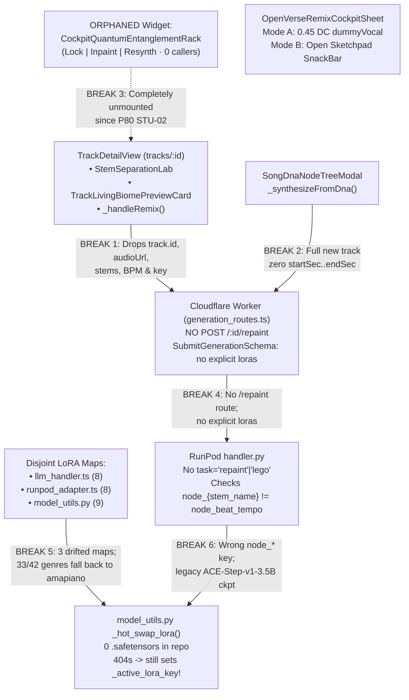

# Phase 83: Post-Generation Stem Repaint, Section Inpainting & Sovereign African LoRA Activation — Comprehensive Forensic Audit

**Document ID:** `AUDIT-P83-REPAINT-LORA-083`  
**Date:** `2026-11-25`  
**Branch / Commit:** `fix/studio-cockpit-bugs-vh001-vh006` (`5811dd0` + `P80/P81/P82` Stage 4 changes & Worker `0a02bd7d-ffba-45e7-9dc1-f2272af33a38`)  
**Audit Mode:** Read-only static codebase inspection across `apps/vhunambi_client/lib`, `apps/vhunambi_api/src`, `tools/zr-studio-gpu`, and `.github/workflows` (**zero application source modifications**).  
**Related Phases & Predecessor Memories:**  
- [`PHASE_80_PLUS_STUDIO_AND_RUNPOD_MASTER_TRACKER.md`](file:///c:/Users/Ndugelo/VHUNAMBI/monorepo/docs/phases/PHASE_80_PLUS_STUDIO_AND_RUNPOD_MASTER_TRACKER.md#L166-L177) (`Phase 83 Capstone`)  
- [`docs/phases/phase_80_studio_cockpit_v6_and_production_contract/`](file:///c:/Users/Ndugelo/VHUNAMBI/monorepo/docs/phases/phase_80_studio_cockpit_v6_and_production_contract/tasks.md) (`STU-02` Relocation Origin)  
- [`docs/phases/phase_81_runpod_multimodel_audio_engine/memory.md`](file:///c:/Users/Ndugelo/VHUNAMBI/monorepo/docs/phases/phase_81_runpod_multimodel_audio_engine/memory.md) (`EP-P81-RUNPOD-MULTIMODEL-ROUTER`, `EP-P81-MULTITAKE-AR-SCORER`)  
- [`docs/phases/phase_82_vocal_cloning_and_broadcast_mastering/memory.md`](file:///c:/Users/Ndugelo/VHUNAMBI/monorepo/docs/phases/phase_82_vocal_cloning_and_broadcast_mastering/memory.md) (`EP-P82-BS-ROFORMER-SEED-VC`, `EP-P82-SA-MATCHERING-ENGINE`, `EP-P82-TRACK-PROVENANCE-TELEMETRY`)

---

## 1. Executive Summary & Headline Verdict

With **Phases 80–82** complete (Studio V6 lossless creation contract, Multi-Model Router `MiniMax Music 3.0` + `ACE-Step 1.5 XL` + A&R multi-take scoring, and `BS-RoFormer` + neural `Seed-VC` + 6-genre SA `Matchering 2.0` mastering), Vhunambi's **first-pass creation pipeline** is production-engineered end to end.  

However, **Phase 83 (post-generation surgical section repaint, bar-range stem inpainting, and Sovereign African LoRA pack activation)** is currently **non-functional (~22% readiness)**. An exhaustive cross-stack trace reveals **11 concrete engineering breaks** (`3 P0`, `5 P1`, `3 P2`) preventing creators from repainting generated bars/stems or reliably applying/customizing African `.safetensors` LoRA adapters:

| Dimension | Current Completion | Verdict |
| :--- | :---: | :--- |
| **Post-Gen Repaint UI (`TrackDetailView` / Remix Cockpit)** | **15%** | **BROKEN (`P1`):** `CockpitQuantumEntanglementRack` was removed from `StudioView` in `P80` (`STU-02`) and left completely orphaned; `TrackDetailView` has zero bar-range selector, zero repaint drawer, and `_handleRemix` discards `track.id`, stems, BPM, key, and audio. |
| **Worker Repaint API (`POST /v1/generations/:id/repaint`)** | **0%** | **MISSING (`P0`):** No `/repaint` route or Zod schema exists in `generation_routes.ts`; `TrackDetailEntity` omits `takes[]` and `repaintHistory[]`. |
| **RunPod `ACE-Step XL-Base` Repaint / `lego` / `complete` Engine** | **10%** | **BROKEN (`P0`):** `handler.py` & `model_utils.py` lack `task="repaint"|"lego"|"complete"` & `[start_sec, end_sec]` bar slicing, and `handler.py#L385` checks `node_{stem_name}` (`node_drums`) instead of canonical `node_beat_tempo` / `node_harmony_chords` / `node_vocal_persona`. |
| **Sovereign African LoRA Pack & Hot-Swap Provenance** | **25%** | **BROKEN (`P0`/`P1`):** `0` `.safetensors` files exist locally; `_hot_swap_lora` stamps `_active_lora_key` as loaded **even on HTTP 404 failure** (false provenance); 3 LoRA maps (`llm_handler.ts`, `runpod_adapter.ts`, `model_utils.py`) are out of sync and cover only 8–9 of 42 genres; only `resolved_loras[0]` is loaded. |
| **`STD-UIUX-001` & Night-Data `:vhunambi-v4` Deployment Bridge** | **55%** | **PARTIAL (`P2`):** Orphaned quantum/DNA widgets use hardcoded `0xFF0A1422`/`0xFF0D1B2A` hex colors and `< 24dp` hit targets; `push_gpu_worker.yml` + `Dockerfile.delta` + RunPod `/runpod-volume` LoRA/checkpoint caching must ship together cleanly. |

### 1.1 Executive Root-Cause & Severity Matrix

| ID | Sev | Component / Layer | Primary Root Cause | Exact File & Line Evidence |
| :--- | :---: | :--- | :--- | :--- |
| **`REPAINT-01`** | **`P0`** | Worker + RunPod GPU | No `POST /v1/generations/:id/repaint` endpoint, no `repaint`/`lego`/`complete` mode in `handler.py`, and `model_utils.py` invokes `self._pipeline(...)` without `task`, `repaint_start`, `repaint_end`, or `src_audio_path`. | [`generation_routes.ts#L514-L627`](file:///c:/Users/Ndugelo/VHUNAMBI/monorepo/apps/vhunambi_api/src/routes/generation_routes.ts#L514-L627), [`handler.py#L105-L573`](file:///c:/Users/Ndugelo/VHUNAMBI/monorepo/tools/zr-studio-gpu/handler.py#L105-L573), [`model_utils.py#L404-L420`](file:///c:/Users/Ndugelo/VHUNAMBI/monorepo/tools/zr-studio-gpu/model_utils.py#L404-L420) |
| **`REPAINT-02`** | **`P0`** | Flutter ➔ RunPod Wire | Client `StemLockMode` emits keys `node_beat_tempo`, `node_harmony_chords`, `node_vocal_persona`, whereas `handler.py` checks `pregen_stem_locks.get(f"node_{stem_name}")` (`node_drums`, `node_bass`, `node_vocals`, `node_melodic`) — **100% mismatch** so locks never match. | [`studio_form_state.dart#L292-L301`](file:///c:/Users/Ndugelo/VHUNAMBI/monorepo/apps/vhunambi_client/lib/features/studio/domain/models/studio_form_state.dart#L292-L301), [`handler.py#L380-L393`](file:///c:/Users/Ndugelo/VHUNAMBI/monorepo/tools/zr-studio-gpu/handler.py#L380-L393) |
| **`LORA-01`** | **`P0`** | RunPod GPU LoRA Loader | **False-positive LoRA provenance:** `_hot_swap_lora()` assigns `self._active_lora_key = r2_key` and `self._active_lora_weight = weight` *after* HTTP 404/network error cleanly fails — reporting unverified/missing `.safetensors` as active (`0` `.safetensors` exist in repo). | [`model_utils.py#L335-L368`](file:///c:/Users/Ndugelo/VHUNAMBI/monorepo/tools/zr-studio-gpu/model_utils.py#L335-L368), [`model_utils.py#L421-L449`](file:///c:/Users/Ndugelo/VHUNAMBI/monorepo/tools/zr-studio-gpu/model_utils.py#L421-L449) |
| **`REPAINT-03`** | **`P1`** | Flutter Track & Studio | `CockpitQuantumEntanglementRack` (`Lock \| Inpaint \| Resynth`) has **zero production callers** after `P80` (`STU-02`); `TrackDetailView._handleRemix()` drops `track.id`, audio URL, stems, BPM & key; `SongDnaNodeTreeModal._synthesizeFromDna()` starts a full new track with zero bar selection. | [`cockpit_quantum_entanglement_rack.dart#L17-L359`](file:///c:/Users/Ndugelo/VHUNAMBI/monorepo/apps/vhunambi_client/lib/features/studio/presentation/widgets/cockpit_quantum_entanglement_rack.dart#L17-L359), [`track_detail_view.dart#L132-L147`](file:///c:/Users/Ndugelo/VHUNAMBI/monorepo/apps/vhunambi_client/lib/features/track/presentation/views/track_detail_view.dart#L132-L147), [`song_dna_node_tree_modal.dart#L324-L366`](file:///c:/Users/Ndugelo/VHUNAMBI/monorepo/apps/vhunambi_client/lib/features/studio/presentation/widgets/song_dna_node_tree_modal.dart#L324-L366) |
| **`REPAINT-04`** | **`P1`** | Flutter Social Remix Sheet | `OpenVerseRemixCockpitSheet` Mode A sends a flat `0.45` DC array (`dummyVocal`), and Mode B `"Open Sketchpad"` button is a **SnackBar Dead-End** that does not open Sketchpad or perform stem remixing. | [`open_verse_remix_cockpit_sheet.dart#L162-L176`](file:///c:/Users/Ndugelo/VHUNAMBI/monorepo/apps/vhunambi_client/lib/features/social/presentation/widgets/open_verse_remix_cockpit_sheet.dart#L162-L176), [`open_verse_remix_cockpit_sheet.dart#L772-L783`](file:///c:/Users/Ndugelo/VHUNAMBI/monorepo/apps/vhunambi_client/lib/features/social/presentation/widgets/open_verse_remix_cockpit_sheet.dart#L772-L783) |
| **`REPAINT-05`** | **`P1`** | Flutter Multi-Take Track UI | `TrackDetailEntity` and `TrackDetailNotifier` do not parse or expose `takes[]` or `repaintHistory[]` returned by `GET /v1/generations/:id`, leaving secondary A&R takes unreachable from `TrackDetailView`. | [`track_detail_models.dart#L149-L190`](file:///c:/Users/Ndugelo/VHUNAMBI/monorepo/apps/vhunambi_client/lib/features/track/domain/models/track_detail_models.dart#L149-L190), [`track_providers.dart#L117-L204`](file:///c:/Users/Ndugelo/VHUNAMBI/monorepo/apps/vhunambi_client/lib/features/track/presentation/providers/track_providers.dart#L117-L204) |
| **`LORA-02`** | **`P1`** | Cross-Stack LoRA Registries | **3 drifted LoRA maps:** `llm_handler.ts` (8 keys; collapses `privateschoolamapiano` ➔ `amapiano_logdrum_v1`), `runpod_adapter.ts` (8 keys), and `model_utils.py` (9 keys; `amapiano_private_school_v1`), leaving 33+ of 42 `GENRE_PRESETS` unmapped and zero `/v1/studio/loras` catalog endpoint. | [`llm_handler.ts#L333-L389`](file:///c:/Users/Ndugelo/VHUNAMBI/monorepo/apps/vhunambi_api/src/modules/lyrics/llm_handler.ts#L333-L389), [`runpod_adapter.ts#L30-L97`](file:///c:/Users/Ndugelo/VHUNAMBI/monorepo/apps/vhunambi_api/src/modules/synthesis/runpod_adapter.ts#L30-L97), [`model_utils.py#L26-L72`](file:///c:/Users/Ndugelo/VHUNAMBI/monorepo/tools/zr-studio-gpu/model_utils.py#L26-L72), [`constants.ts#L14-L366`](file:///c:/Users/Ndugelo/VHUNAMBI/monorepo/apps/vhunambi_api/src/modules/synthesis/constants.ts#L14-L366) |
| **`LORA-03`** | **`P1`** | GPU Single-LoRA & Ckpt Drift | `model_utils.py#L392` loads only `resolved_loras[0]`, defaults to legacy `ACE-Step-v1-3.5B` (`#L266`), and hardcodes public `r2.dev` URL (`#L345`) without authenticated R2 S3 fallback; Flutter drops `loraScale`/LoRA picks before `POST /v1/generations`. | [`model_utils.py#L266`](file:///c:/Users/Ndugelo/VHUNAMBI/monorepo/tools/zr-studio-gpu/model_utils.py#L266), [`model_utils.py#L345`](file:///c:/Users/Ndugelo/VHUNAMBI/monorepo/tools/zr-studio-gpu/model_utils.py#L345), [`model_utils.py#L391-L393`](file:///c:/Users/Ndugelo/VHUNAMBI/monorepo/tools/zr-studio-gpu/model_utils.py#L391-L393), [`http_generation_submission_service.dart#L91-L131`](file:///c:/Users/Ndugelo/VHUNAMBI/monorepo/apps/vhunambi_client/lib/features/studio/data/services/http_generation_submission_service.dart#L91-L131) |
| **`UI-P83-01`** | **`P2`** | Flutter UI / `STD-UIUX-001` | Hardcoded hex colors (`0xFF0A1422`, `0xFF0D1B2A`, `0xFF3A2508`) and `~20dp` micro-chips (`padding: vertical: 3`) inside `CockpitQuantumEntanglementRack`, `SongDnaNodeTreeModal` stem-lock pills, and `StemSeparationLab` button. | [`cockpit_quantum_entanglement_rack.dart#L177-L355`](file:///c:/Users/Ndugelo/VHUNAMBI/monorepo/apps/vhunambi_client/lib/features/studio/presentation/widgets/cockpit_quantum_entanglement_rack.dart#L177-L355), [`song_dna_node_tree_modal.dart#L1271-L1296`](file:///c:/Users/Ndugelo/VHUNAMBI/monorepo/apps/vhunambi_client/lib/features/studio/presentation/widgets/song_dna_node_tree_modal.dart#L1271-L1296), [`stem_separation_lab.dart#L86`](file:///c:/Users/Ndugelo/VHUNAMBI/monorepo/apps/vhunambi_client/lib/features/track/presentation/widgets/stem_separation_lab.dart#L86) |
| **`LORA-04`** | **`P2`** | Studio / Worker Contract | `SubmitGenerationSchema` lacks explicit `loras` array validation so creators cannot override or blend regional LoRA packs + weights from Flutter `StudioFormState`. | [`generation_routes.ts#L75-L122`](file:///c:/Users/Ndugelo/VHUNAMBI/monorepo/apps/vhunambi_api/src/routes/generation_routes.ts#L75-L122), [`studio_form_state.dart#L404-L410`](file:///c:/Users/Ndugelo/VHUNAMBI/monorepo/apps/vhunambi_client/lib/features/studio/domain/models/studio_form_state.dart#L404-L410) |
| **`INFRA-P83-01`** | **`P2`** | CI/CD + RunPod Volume | `.github/workflows/push_gpu_worker.yml` + `Dockerfile.delta` are ready for `:vhunambi-v4`, but `/runpod-volume/lora_cache` & `/runpod-volume/hf_cache` (`ACE-Step 1.5 XL-Base` + `.safetensors` LoRA pack) still need an idempotent preflight manifest check & bootstrap helper. | [`push_gpu_worker.yml#L1-L42`](file:///c:/Users/Ndugelo/VHUNAMBI/monorepo/.github/workflows/push_gpu_worker.yml#L1-L42), [`Dockerfile.delta#L1-L27`](file:///c:/Users/Ndugelo/VHUNAMBI/monorepo/tools/zr-studio-gpu/Dockerfile.delta#L1-L27) |

### 1.2 End-to-End Phase 83 Breakpoint Topology Map



---

## 2. Pillar-by-Pillar Forensic Findings

### 2.1 Pillar 1 — Post-Generation Section Repaint & Stem Inpainting (`REPAINT-01..05`)

#### What Exists vs. What Is Missing

```text
┌───────────────────────────────────────┬──────────────────────────────────────────────┐
│ EXISTING (P52-P56 / P80-P82 Foundation) │ MISSING / BROKEN FOR PHASE 83 CAPTURE        │
├───────────────────────────────────────┼──────────────────────────────────────────────┤
│ • TrackDetailView + StemSeparationLab │ • Zero UI for selecting [startSec..endSec]   │
│   ([track_detail_view.dart#L697-L760])│   bars or picking target stem (vocals/drums/ │
│ • Pocket Stem Mixer Modal             │   bass/melodic) to Lock | Inpaint | Resynth  │
│   ([stem_mixer_deck.dart#L26-L140])   │ • CockpitQuantumEntanglementRack is orphaned │
│ • StudioPastSongsRemixShelf (P80)     │   after P80 STU-02 removed it from Compose   │
│   ([studio_past_songs_remix_shelf.dart])│ • No POST /v1/generations/:id/repaint route  │
│ • BS-RoFormer clean lead-vocal vs bed │ • handler.py & model_utils.py lack           │
│   ([mmo_extractor.py] in P82)         │   task='repaint'|'lego', bar masks & splice  │
│ • Multi-take takes_json + ArTakeScore │ • TrackDetailEntity omits takes & repaint    │
│   ([handler.py#L523-L541] in P81)     │   revision history                           │
└───────────────────────────────────────┴──────────────────────────────────────────────┘
```

#### Exhaustive Findings Table — Pillar 1

| ID | Sev | File & Line(s) | Exact Defect | Concrete Remediation Pattern |
| :--- | :---: | :--- | :--- | :--- |
| **`REPAINT-01`** | **`P0`** | [`generation_routes.ts#L514-L627`](file:///c:/Users/Ndugelo/VHUNAMBI/monorepo/apps/vhunambi_api/src/routes/generation_routes.ts#L514-L627), [`handler.py#L105-L573`](file:///c:/Users/Ndugelo/VHUNAMBI/monorepo/tools/zr-studio-gpu/handler.py#L105-L573), [`model_utils.py#L404-L420`](file:///c:/Users/Ndugelo/VHUNAMBI/monorepo/tools/zr-studio-gpu/model_utils.py#L404-L420) | No `/v1/generations/:id/repaint` route exists. On GPU, `handler.py` only runs full generation; `model_utils.py` never passes `task`, `repaint_start`, `repaint_end`, `src_audio_path`, or `retake_variance` into `ACEStepPipeline`. | Add `POST /v1/generations/:id/repaint` (`RepaintGenerationSchema`: `startSec`, `endSec`, `stemLocks`, `targetStem`, `editPrompt`, `editLyrics`, `loras`, `masteringMode`) dispatching to `ace_step_xl_base` (`task='repaint'` or stem `'lego'`); implement time-aligned crossfaded section splice + `BS-RoFormer` vocal/bed preservation in `handler.py`. |
| **`REPAINT-02`** | **`P0`** | [`studio_form_state.dart#L292-L301`](file:///c:/Users/Ndugelo/VHUNAMBI/monorepo/apps/vhunambi_client/lib/features/studio/domain/models/studio_form_state.dart#L292-L301), [`handler.py#L380-L393`](file:///c:/Users/Ndugelo/VHUNAMBI/monorepo/tools/zr-studio-gpu/handler.py#L380-L393) | Client sends keys `node_beat_tempo`, `node_branch_beat`, `node_harmony_chords`, `node_vocal_persona`. `handler.py#L385` checks `pregen_stem_locks.get(f"node_{stem_name}") == "lockedPure44k"`, which constructs `node_drums`, `node_bass`, `node_vocals`, `node_melodic` — **zero keys ever match**. | Normalize canonical stem role keys (`vocals`, `drums`, `bass`, `melodic`) alongside legacy `node_beat_tempo` / `node_harmony_chords` / `node_vocal_persona` mapping in both Worker `prompt_compiler.ts` and GPU `handler.py`. |
| **`REPAINT-03`** | **`P1`** | [`cockpit_quantum_entanglement_rack.dart#L17-L359`](file:///c:/Users/Ndugelo/VHUNAMBI/monorepo/apps/vhunambi_client/lib/features/studio/presentation/widgets/cockpit_quantum_entanglement_rack.dart#L17-L359), [`track_detail_view.dart#L132-L147`](file:///c:/Users/Ndugelo/VHUNAMBI/monorepo/apps/vhunambi_client/lib/features/track/presentation/views/track_detail_view.dart#L132-L147), [`song_dna_node_tree_modal.dart#L324-L366`](file:///c:/Users/Ndugelo/VHUNAMBI/monorepo/apps/vhunambi_client/lib/features/studio/presentation/widgets/song_dna_node_tree_modal.dart#L324-L366) | `CockpitQuantumEntanglementRack` is orphaned (`0` non-test imports). `TrackDetailView._handleRemix` drops `track.id`, `audioUrl`, `stemUrls`, `bpm`, `musicalKey`. `SongDnaNodeTreeModal` only triggers brand-new generation without bar range or source track audio. | Mount a post-gen `TrackSectionRepaintSheet` (incorporating refactored `CockpitQuantumEntanglementRack` stem authority chips `Lock \| Inpaint \| Resynth` + bar-range `RangeSlider` + lyric/prompt edit + LoRA selector) directly from `TrackDetailView` (`"Section Repaint & Inpaint"` button) and upgrade `_handleRemix` to call `applyPastTrackRemix(...)`. |
| **`REPAINT-04`** | **`P1`** | [`open_verse_remix_cockpit_sheet.dart#L162-L176`](file:///c:/Users/Ndugelo/VHUNAMBI/monorepo/apps/vhunambi_client/lib/features/social/presentation/widgets/open_verse_remix_cockpit_sheet.dart#L162-L176), [`open_verse_remix_cockpit_sheet.dart#L772-L783`](file:///c:/Users/Ndugelo/VHUNAMBI/monorepo/apps/vhunambi_client/lib/features/social/presentation/widgets/open_verse_remix_cockpit_sheet.dart#L772-L783) | Mode A constructs `dummyVocal = Float32List(44100 * 3)` filled with constant `0.45` (DC offset!). Mode B `remix_open_sketchpad_btn` only shows a `SnackBar` dead-end. Mode C drops target bar range / stem lock config on handoff. | Replace `0.45` DC array with captured mic WAV path or sine-envelope fallback cleanly, wire `"Open Sketchpad"` to the real `MelodySketchpadDrawer` / Studio Crate tab, and offer `"Repaint Verse Bars (ACE-Step XL-Base)"` in Mode C. |
| **`REPAINT-05`** | **`P1`** | [`track_detail_models.dart#L149-L190`](file:///c:/Users/Ndugelo/VHUNAMBI/monorepo/apps/vhunambi_client/lib/features/track/domain/models/track_detail_models.dart#L149-L190), [`track_providers.dart#L117-L204`](file:///c:/Users/Ndugelo/VHUNAMBI/monorepo/apps/vhunambi_client/lib/features/track/presentation/providers/track_providers.dart#L117-L204) | `TrackDetailEntity` stores no `takes[]` or `repaintHistory[]` and `loadManifestFromCloud` ignores them. Users cannot A/B alternate multi-take outputs inside `TrackDetailView` or pick a specific take for bar-range repaint. | Add optional `takes` & `repaintHistory` fields to `TrackDetailEntity`, hydrate them from `/v1/generations/:id` + `/manifest`, and allow take selection when opening Section Repaint or Stem Mixer. |

---

### 2.2 Pillar 2 — Sovereign African LoRA Pack & Hot-Swap Activation (`LORA-01..04`)

#### Exact Proof of False-Positive LoRA Provenance (`model_utils.py#L335-L368`)

```python
    def _hot_swap_lora(self, lora_spec: Dict[str, Any]) -> Optional[str]:
        ...
        if not os.path.exists(local_path):
            public_base = os.environ.get(
                "R2_PUBLIC_BASE_URL",
                "https://pub-d22409017abb4dd999327a092c5f06d3.r2.dev",
            ).rstrip("/")
            try:
                import requests
                resp = requests.get(f"{public_base}/{r2_key}", timeout=20)
                if resp.status_code == 200 and len(resp.content) > 64:
                    ...
            except Exception as exc:
                print(f"[ZR-WARN] LoRA download failed ({r2_key}): {exc}", flush=True)

        self._active_lora_key = r2_key       # <--- BUG: Set unconditionally even on 404!
        self._active_lora_weight = weight    # <--- generate_audio() lies that this LoRA ran!
        if (
            self._pipeline is not None
            and hasattr(self._pipeline, "load_lora")
            and os.path.exists(local_path)
        ):
```

#### Cross-Stack LoRA Registry Drift Comparison

| Genre Key | `llm_handler.ts#L337-L381` | `runpod_adapter.ts#L30-L73` | `model_utils.py#L26-L72` | Drift / Gap |
| :--- | :--- | :--- | :--- | :--- |
| `amapiano` | `amapiano_logdrum_v1` | `amapiano_logdrum_v1` | `amapiano_logdrum_v1` | Aligned |
| `privateschoolamapiano` | `amapiano_logdrum_v1` | *(missing -> `amapiano`)* | `amapiano_private_school_v1` | **Mismatched ID & R2 key (`P1`)** |
| `sgija` / `bacardi` / `lekompo` / `malende` / `mbaqanga` | *(missing -> fallback `amapiano`)* | *(missing -> `amapiano`)* | *(missing -> fallback `amapiano`; only `venda` has `venda_malende_v1`)* | **All SA subgenres collapsed into `amapiano_logdrum_v1` (`P1`)** |
| `gqom` / `maskandi` / `venda` / `afrobeats` / `kwaito` / `gospel` / `afrohouse` | 7 keys | 7 keys | 7 keys | Covered in TS/Py, **0 real `.safetensors` files exist on disk (`P0`)** |

#### Exhaustive Findings Table — Pillar 2

| ID | Sev | File & Line(s) | Exact Defect | Concrete Remediation Pattern |
| :--- | :---: | :--- | :--- | :--- |
| **`LORA-01`** | **`P0`** | [`model_utils.py#L335-L368`](file:///c:/Users/Ndugelo/VHUNAMBI/monorepo/tools/zr-studio-gpu/model_utils.py#L335-L368), [`model_utils.py#L421-L449`](file:///c:/Users/Ndugelo/VHUNAMBI/monorepo/tools/zr-studio-gpu/model_utils.py#L421-L449) | `0` `.safetensors` files exist in the repo, and `_hot_swap_lora()` marks `self._active_lora_key` & `self._active_lora_weight` even when the R2 fetch returns 404 or `local_path` does not exist or `load_lora` fails — emitting false LoRA attribution. | Track `self._active_lora_loaded = False` and `self._active_lora_sha256 = None`; set `active_lora` ONLY after `os.path.exists(local_path)` passes SafeTensors header/size verification and `load_lora(...)` (when pipeline is mounted) succeeds; clear attribution cleanly on fallback. |
| **`LORA-02`** | **`P1`** | [`llm_handler.ts#L333-L389`](file:///c:/Users/Ndugelo/VHUNAMBI/monorepo/apps/vhunambi_api/src/modules/lyrics/llm_handler.ts#L333-L389), [`runpod_adapter.ts#L30-L97`](file:///c:/Users/Ndugelo/VHUNAMBI/monorepo/apps/vhunambi_api/src/modules/synthesis/runpod_adapter.ts#L30-L97), [`model_utils.py#L26-L72`](file:///c:/Users/Ndugelo/VHUNAMBI/monorepo/tools/zr-studio-gpu/model_utils.py#L26-L72), [`constants.ts#L14-L366`](file:///c:/Users/Ndugelo/VHUNAMBI/monorepo/apps/vhunambi_api/src/modules/synthesis/constants.ts#L14-L366) | 3 duplicated LoRA lookup maps disagree (`privateschoolamapiano` -> `amapiano_logdrum_v1` in TS vs `amapiano_private_school_v1` in Py; `malende`/`lekompo`/`sgija`/`bacardi`/`afrofusion`/`isicathamiya` all fall back blindly to `amapiano`), and no `GET /v1/studio/loras` endpoint exposes available LoRAs to Flutter. | Consolidate into a single canonical `LORA_PACK_CATALOG` module in `apps/vhunambi_api/src/modules/synthesis/lora_catalog.ts` imported by `llm_handler.ts`, `runpod_adapter.ts`, and `studio_routes.ts` (`GET /v1/studio/loras`), synced 1:1 with `model_utils.py` (`GENRE_LORA_REGISTRY` + fuzzy subgenre aliases). |
| **`LORA-03`** | **`P1`** | [`model_utils.py#L266`](file:///c:/Users/Ndugelo/VHUNAMBI/monorepo/tools/zr-studio-gpu/model_utils.py#L266), [`model_utils.py#L345`](file:///c:/Users/Ndugelo/VHUNAMBI/monorepo/tools/zr-studio-gpu/model_utils.py#L345), [`model_utils.py#L391-L393`](file:///c:/Users/Ndugelo/VHUNAMBI/monorepo/tools/zr-studio-gpu/model_utils.py#L391-L393), [`model_router.py#L451`](file:///c:/Users/Ndugelo/VHUNAMBI/monorepo/tools/zr-studio-gpu/model_router.py#L451) | `ZRModelManager` still checks legacy `ACE-Step-v1-3.5B` first (`#L266`), hardcodes dev `pub-d2240901...r2.dev` URL (`#L345`), and `_hot_swap_lora` only activates `resolved_loras[0]` (`#L393`) while `synthesize_take` strips `loras` on non-`ace_step_xl_base` variants (`model_router.py#L451`). | Support `ACE-Step-1.5-XL-Base` checkpoint resolution (`ACE_STEP_XL_BASE_DIR` / `HF_HOME`), authenticated `boto3` R2 fallback download (`loras/<key>`) + `/runpod-volume/lora_cache` lookup before HTTP, and sequential multi-LoRA activation (`resolved_loras[:3]`, capped weights). |
| **`LORA-04`** | **`P2`** | [`generation_routes.ts#L75-L122`](file:///c:/Users/Ndugelo/VHUNAMBI/monorepo/apps/vhunambi_api/src/routes/generation_routes.ts#L75-L122), [`generation_pipeline_providers.dart#L238-L267`](file:///c:/Users/Ndugelo/VHUNAMBI/monorepo/apps/vhunambi_client/lib/features/studio/presentation/providers/generation_pipeline_providers.dart#L238-L267), [`http_generation_submission_service.dart#L91-L131`](file:///c:/Users/Ndugelo/VHUNAMBI/monorepo/apps/vhunambi_client/lib/features/studio/data/services/http_generation_submission_service.dart#L91-L131) | Neither `SubmitGenerationSchema` nor `HttpGenerationSubmissionService` carries creator-selected African Style LoRA IDs/weights (`loras`), forcing server-only auto-selection even in `Sovereign Custom` tier. | Add optional `loras: Array<{ loraId, weight }>` to `SubmitGenerationSchema`, `StudioFormState`, `GenerationPipelineNotifier`, and `StudioView` (`Sovereign Custom` / `Section Repaint` LoRA Pack Drawer). |

---

### 2.3 Pillar 3 — `STD-UIUX-001`, Touch Targets & Night-Data Infrastructure (`UI-P83-01`, `INFRA-P83-01`)

| ID | Sev | File & Line(s) | Exact Defect | Concrete Remediation Pattern |
| :--- | :---: | :--- | :--- | :--- |
| **`UI-P83-01`** | **`P2`** | [`cockpit_quantum_entanglement_rack.dart#L177-L355`](file:///c:/Users/Ndugelo/VHUNAMBI/monorepo/apps/vhunambi_client/lib/features/studio/presentation/widgets/cockpit_quantum_entanglement_rack.dart#L177-L355), [`song_dna_node_tree_modal.dart#L1271-L1296`](file:///c:/Users/Ndugelo/VHUNAMBI/monorepo/apps/vhunambi_client/lib/features/studio/presentation/widgets/song_dna_node_tree_modal.dart#L1271-L1296), [`stem_separation_lab.dart#L86`](file:///c:/Users/Ndugelo/VHUNAMBI/monorepo/apps/vhunambi_client/lib/features/track/presentation/widgets/stem_separation_lab.dart#L86) | Uses hardcoded dark hex colors (`Color(0xFF0A1422)`, `Color(0xFF0D1B2A)`, `Color(0xFF3A2508)`, `Colors.white60`) that wash out or clash under `AppTheme.lightTheme`, and `_buildMicroModeChip` (`padding: vertical: 3`) yields `< 24dp` hit height (< `44dp` target rule). | Refactor relocated stem-lock & repaint widgets onto `VhunambiGlassSurface` + `AppColors.*Of(context)` semantic tokens + `AppTypography.*` and `minHeight: 44` `InkWell`/`ConstrainedBox` targets tested in Light & Dark `360x800`. |
| **`INFRA-P83-01`** | **`P2`** | [`push_gpu_worker.yml#L1-L42`](file:///c:/Users/Ndugelo/VHUNAMBI/monorepo/.github/workflows/push_gpu_worker.yml#L1-L42), [`Dockerfile.delta#L1-L27`](file:///c:/Users/Ndugelo/VHUNAMBI/monorepo/tools/zr-studio-gpu/Dockerfile.delta#L1-L27) | `:vhunambi-v4` GitHub Actions workflow only copies Python modules cleanly once pushed, while `/runpod-volume/lora_cache` & `/runpod-volume/hf_cache` lack a zero-cost R2 LoRA validator / bootstrap script (`tools/zr-studio-gpu/lora_pack_manifest.py` or `bootstrap_volume.py`) for night-data deployment. | Add a RunPod volume preflight/inventory helper in `tools/zr-studio-gpu/` so `:vhunambi-v4` reports exact cached models & `.safetensors` readiness (`lora_cache` + `hf_cache` + `ref_masters`) on worker boot. |

---

## 3. Target Phase 83 Remediation Architecture Blueprint

```text
┌──────────────────────────────────────────────────────────────────────────────┐
│ PHASE 83 CLOSED-LOOP ARCHITECTURE (4-LAYER SURGICAL UPGRADE)                 │
├──────────────────────────────────────────────────────────────────────────────┤
│ LAYER 1 · RunPod GPU Repaint & Truthful LoRA Engine (tools/zr-studio-gpu/)   │
│  • `model_utils.py`: Dual checkpoint resolution (`ACE-Step-1.5-XL-Base` +    │
│    fallback), truthful `_hot_swap_lora()` (`lora_loaded: bool` + SHA-256 +   │
│    boto3 R2 download + multi-LoRA fusion), `repaint_audio_section()`         │
│    (`task="repaint" | "lego" | "complete"`, `repaint_start`, `repaint_end`,  │
│    `src_audio_path`, raised-cosine crossfade splice in CPU/NumPy fallback)   │
│  • `handler.py`: Detect `job_type == "section_repaint"` -> download source   │
│    master/stem WAV from R2 -> normalize stem locks (`vocals|drums|bass|       │
│    melodic` AND `node_beat_tempo|node_harmony_chords|node_vocal_persona`) -> │
│    BS-RoFormer + XL-Base repaint -> re-extract MMO 60Hz -> Matchering 2.0    │
├──────────────────────────────────────────────────────────────────────────────┤
│ LAYER 2 · Cloudflare Worker LoRA Catalog & /repaint Route (apps/vhunambi_api)│
│  • `src/modules/synthesis/lora_catalog.ts`: Single source of truth covering  │
│    SA & Pan-African styles mapped across all 42 `GENRE_PRESETS`              │
│  • `GET /v1/studio/loras`: Exposes curated African LoRA packs (`loraId`,     │
│    `label`, `genre`, `region`, `r2Key`, `defaultWeight`, `tier`)             │
│  • `POST /v1/generations`: Accept optional `loras` array override            │
│  • `POST /v1/generations/:id/repaint`: Validates `[startSec, endSec]`,       │
│    `targetStem`, `stemLocks`, `editPrompt`, `editLyrics`, `loras`, dispatches│
│    RunPod job preserving `parentGenerationId` + updates `repaintHistory[]`   │
├──────────────────────────────────────────────────────────────────────────────┤
│ LAYER 3 · Flutter Post-Gen Repaint Sheet & LoRA Picker (apps/vhunambi_client)│
│  • Relocate & upgrade orphaned `CockpitQuantumEntanglementRack` (`Lock |     │
│    Inpaint | Resynth`, `>= 44dp` targets, Light/Dark tokens) inside new      │
│    `TrackSectionRepaintSheet` accessible from `TrackDetailView`              │
│  • Bar-range timeline scrubber (`startSec..endSec`), stem selector,          │
│    lyric/prompt patch input, African LoRA pack & blend weight selector, and  │
│    A/B multi-take switcher (`takes[]`) + `repaintHistory[]` badge on Track   │
│  • Repair `_handleRemix()` + `OpenVerseRemixCockpitSheet` Sketchpad link     │
├──────────────────────────────────────────────────────────────────────────────┤
│ LAYER 4 · Night-Data Container Push & Volume Hydration (Separate Gate)       │
│  • Trigger `.github/workflows/push_gpu_worker.yml` (`:vhunambi-v4`) once P83 │
│    Python changes are finalized so P81 + P82 + P83 ship in 1 Docker build!   │
└──────────────────────────────────────────────────────────────────────────────┘
```

---

## 4. Ordered Remediation Milestone Plan (`M83.1` – `M83.4`)

| Milestone | Scope | Primary Files | Gate |
| :--- | :--- | :--- | :--- |
| **`M83.1` (Pass 1 — GPU)** | Truthful `_hot_swap_lora()` + multi-LoRA fusion, expanded `GENRE_LORA_REGISTRY` across all 42 genre aliases, `ACE-Step 1.5 XL-Base` `repaint`/`lego`/`complete` section splice + canonical `node_*` stem-lock normalizer in `handler.py` & `model_utils.py`. | `tools/zr-studio-gpu/model_utils.py`, `model_router.py`, `handler.py`, `test_phase83_repaint_lora.py` | **`G83-01`:** `py_compile` + `unittest` (`0 MB` local `pip install`) |
| **`M83.2` (Pass 1 — Worker)** | Canonical `lora_catalog.ts`, `GET /v1/studio/loras`, explicit `loras` in `SubmitGenerationSchema`, `POST /v1/generations/:id/repaint` + `repaintHistory` in MMO manifest & Supabase `generation_jobs` read-through. | `apps/vhunambi_api/src/modules/synthesis/{lora_catalog.ts,prompt_compiler.ts,runpod_adapter.ts}`, `src/routes/{studio_routes.ts,generation_routes.ts,webhook_routes.ts}`, `test/phase83_repaint_lora_routes.test.ts` | **`G83-02`:** `tsc.cmd --noEmit && npm test` (`36/36` suites) |
| **`M83.3` (Pass 2 — Flutter)** | Mount refactored `CockpitQuantumEntanglementRack` (`>= 44dp`, Light/Dark tokens) inside `TrackDetailView` (`TrackSectionRepaintSheet`), add `takes` + `repaintHistory` + bar scrubber + African LoRA Picker (Studio + Repaint), fix `_handleRemix` & `OpenVerseRemixCockpitSheet` dead-ends. | `apps/vhunambi_client/lib/features/track/...`, `lib/features/studio/...`, `lib/features/social/...`, `test/features/track/phase83_repaint_lora_test.dart` | **`G83-03`:** `flutter test --no-pub --timeout=60s` + `STD-UIUX-001` (`0` `Icons.*`) |
| **`M83.4` (Deploy & `SLEEP`)** | Deploy updated `vhunambi-api` Worker, kick off combined `P81+P82+P83` `:vhunambi-v4` GitHub Actions push & volume hydration verification, mark `memory.md` `"completed"`, update Master Tracker, run `consolidate_memory.mjs`. | `docs/phases/phase_83_postgen_stem_repaint_and_lora_studio/`, `PHASE_80_PLUS_STUDIO_AND_RUNPOD_MASTER_TRACKER.md`, `docs/memory/*` | **`G83-04`–`G83-05`:** Live `/health` `200`, Clean Connectome |
