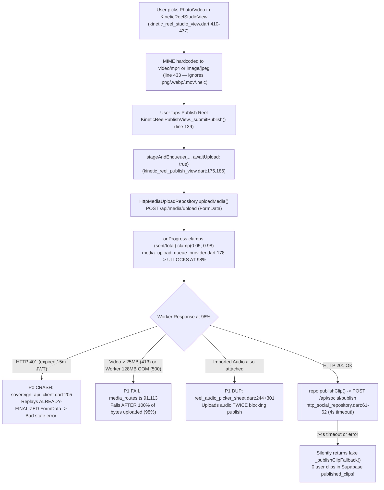

# Forensic Exploration & Bug Audit Report — Zania Music LoRA Flywheel, Embedded ID3 Cover Extraction, Kinetic Reels 98% Failure & Kinetic Post Mock-Asset Defects

> **Audit ID:** `AUDIT-P84-ZANIA-ID3-REELS98-KPOST`  
> **Date:** `2026-11-25`  
> **Scope:** Zero source edits — forensic inventory of `C:\Users\Ndugelo\Music\ZANIA MUSIC`, Zania Explore prior-art specs/code (`C:\Users\Ndugelo\Zania-Explore-v2.5\Zania-Explore`), live Supabase production tables (`cbnruevwrqwjnnoscgsz`), and Vhunambi Flutter + Cloudflare Worker upload/publish pipelines.  
> **Connectome Wake Hubs:** `media_artwork`, `ai_synthesis_gpu`, `sync_outbox` (`45` endpoints inspected, `0 OPEN`).

---

## 1. Executive Summary & P0–P3 Severity Matrix

### Strategic Discovery (Zania Music + ID3 + Creator Distribution Flywheel)
1. **Ready-Made Audio Library (`189` local MP3s + `zania-storage` R2 bucket):** `C:\Users\Ndugelo\Music\ZANIA MUSIC\READY` holds **189 MP3 tracks** across 13 genre folders (led by **Afro: 52**, **Pop: 35**, **Rock: 23**, **house: 20**, **Extras: 20**, **Wave: 10**), plus `48` `.webp` covers, `44` `.png` covers, and `20` `.txt` lyric sheets. Every single sampled MP3 (**40/40 = 100%**) carries an embedded **ID3v2 `APIC` cover photo** inside its first 256 KB.
2. **Production-Ready Edge ID3 Extractor Already Built in Zania Explore:** `C:\Users\Ndugelo\Zania-Explore-v2.5\Zania-Explore\scripts\lib\id3v2-parser.ts` is a **zero-dependency, Cloudflare Workers–compatible (`Uint8Array` + `TextDecoder`) ID3v2.3/v2.4 `APIC` parser**. Porting it into Vhunambi's `POST /api/media/upload` (`apps/vhunambi_api/src/routes/media_routes.ts`) immediately unlocks **automatic cover art extraction on every Suno/DAW MP3 upload** (saving the extracted image to R2 `covers/<uploadId>.<ext>` and setting `thumbnail_url` with zero extra mobile bandwidth on playback).
3. **Zania Explore LoRA Trainer Reality Check:** While Zania Explore's `ace-step-finetuning` spec (`ZR-FINETUNE-001`) already defined the R2 dataset layout (`training-data/{genre}/`), JSON metadata schema, and YAML configs (`amapiano.yaml`, `gqom.yaml`, `maskandi.yaml`, `bantu-vocals.yaml`), its `runpod-zr-studio/training/train_lora.py` lines 169–199 is a **mock simulation stub** (`time.sleep(5)` + fake converging loss). Real cloud training requires replacing that loop with the real ACE-Step 1.5 LoRA/LoKr trainer running on RunPod ephemeral pods (~$0.15–$0.50/pack out of your `$13.57` balance) or free Kaggle/Colab T4 GPUs ($0) — **0% laptop load**.

### Production Bug Root-Cause Matrix (Live Supabase Confirmed)
Live query against Supabase project `cbnruevwrqwjnnoscgsz`:
- `user_media_uploads`: **`0` rows** (even though local uploads appear to succeed in My Uploads!)
- `kinetic_posts`: **`0` rows**
- `published_clips`: **`9` rows** (all 9 are legacy seeded `creator_makhadzi` artwork clips — **0** user-published reels!)

| ID | Severity | Surface | Exact File & Line Citation | Root Cause |
| :--- | :---: | :--- | :--- | :--- |
| **`REEL98-01`** | **P0** | Kinetic Reels Publish (`98%` failure) | `media_upload_queue_provider.dart:178` `sovereign_api_client.dart:195-206` | Progress clamps at `0.98` (`98%`) once Dio finishes streaming bytes to `POST /api/media/upload`. On `401` token refresh, `buildDioInterceptor()` replays `client.fetch(opts)` using the **already-finalized `FormData`**, crashing with Dio `Bad state: The FormData has already been finalized`. |
| **`REEL98-02`** | **P0** | Uploads Vault vs. Reels Publish mismatch | `uploads_vault_view.dart:105` `kinetic_reel_publish_view.dart:168-197` | `UploadsVaultView` passes `awaitUpload: false` (stages locally to Hive/AppDocs so files *look* uploaded locally even when cloud upload fails — hence `0` rows in Supabase `user_media_uploads`). `KineticReelPublishView` passes `awaitUpload: true` and hard-throws on upload failure right at `98%`. |
| **`REEL98-03`** | **P1** | Worker 25 MB cap, isolate RAM & hardcoded MIME | `media_routes.ts:15,68,91,113` `kinetic_reel_studio_view.dart:433` | Mobile videos >25 MB stream to `98%` before hitting `413 Payload Too Large` (or Cloudflare Worker 128 MB isolate RAM OOM during `fileBlob.arrayBuffer()` + `new Uint8Array(...)`). `_pickGalleryMedia()` also hardcodes `'video/mp4'` / `'image/jpeg'` regardless of actual file MIME. |
| **`REEL98-04`** | **P1** | Duplicate audio re-upload in Reels | `reel_audio_picker_sheet.dart:244,301` `kinetic_reel_publish_view.dart:206-244` | Importing audio in `ReelAudioPickerSheet` stages & uploads it immediately AND still passes `importedAudioBytes` to `KineticReelPublishView`, forcing a second blocking upload during publish. |
| **`REEL98-05`** | **P1** | 4s timeout & silent fake Reel publish | `http_social_repository.dart:61-62,1139-1142` | `HttpSocialRepository` configures `receiveTimeout: 4s` for `POST /api/social/publish` and silently falls back to `_publishClipFallback()` on error/timeout instead of surfacing failure or retrying cleanly. |
| **`KPOST-01`** | **P0** | Kinetic Post missing audio upload & mock defaults | `create_kinetic_post_sheet.dart:68,80-105,117-120,537-547` | Defaults `_audioSourceTabIndex = 2` (`Trending`), pre-attaches seeded catalog track `initialTracks.first`, hardcodes 3 mock `_grooveSeeds` (`sk_01..03` with `null` audioUrl), falls back to `'Vhunambi Sonic Groove'`, and has **no audio upload CTA** inside the sheet (plus rejects videos via dialog). |
| **`KPOST-02`** | **P1** | Kinetic Post Vision AI mock assets | `create_kinetic_post_sheet.dart:404-433` `vision_routes.ts:162-172` | `_generateVisionAiArtwork()` silently attaches bundled mock Vhunambi artwork (`asset:assets/images/artwork/...`) on any error, and `vision_routes.ts` returns deterministic mock PNGs (`visuals/mock/...`) when ComfyUI is unconfigured. |
| **`KPOST-03`** | **P0** | Unawaited photo upload + Cloud hydration drops media | `create_kinetic_post_sheet.dart:253` `explore_providers.dart:870-898` `edge_persistence_bridge.ts:3855` | Photo upload uses `awaitUpload: false` (so posting immediately sends device-only `localFilePath`); `SocialFeedPostsNotifier.refreshFromCloud()` reconstructs `SocialMusicPost` **without reading `imageAttachment`, `imageAttachments`, `audioAttachment`, `audioUrl`, or `coverUrl`**; `upsertKineticPost()` uses fire-and-forget `mirrorWriteThrough` (`kinetic_posts` = `0` rows in Supabase). |

---

## 2. Pillar 1 — Zania Music Local & R2 Catalog Inventory

### 2.1 Local Catalog (`C:\Users\Ndugelo\Music\ZANIA MUSIC`)
Scanned `C:\Users\Ndugelo\Music\ZANIA MUSIC` recursively:
- **Total Audio Files:** `189` `.mp3` files (`188` under `READY/`, `1` under `COVERS/`)
- **Companion Assets:** `48` `.webp` covers, `44` `.png` covers, `20` `.txt` lyric files, `6` `.zip` archives, `20` `.lnk` shortcuts
- **Embedded ID3v2 Cover Art Check:** **`40 / 40` (`100%`)** sampled MP3s contain an ID3v2 header (`ID3`) with an embedded `APIC` cover frame within the first `256 KB`.

| Folder under `READY/` | MP3 Count | `.txt` Lyrics | Direct Mapping to Vhunambi LoRA Packs (`lora_catalog.ts`) |
| :--- | :---: | :---: | :--- |
| **`Afro`** | **52** | 3 | Ready right now (`>= 8` tracks) to split into **`amapiano_logdrum_v1`**, **`amapiano_private_school_v1`**, **`afrobeats_lagos_v1`**, **`afrohouse_ancestral_v1`**, **`venda_malende_v1`** |
| **`house`** | **20** | 0 | Ready right now (`20 >= 8`) for **`afrohouse_ancestral_v1`** / **`amapiano_private_school_v1`** |
| **`Pop`** | **35** | 10 | Ready for global Pop / Afro-Pop / vocal phrasing conditioning |
| **`Rock`** | **23** | 4 | Ready for Alternative / Rock guitar texture packs |
| **`Extras`** | **20** | 0 | Audit & sort into regional packs (`Sgija`, `Gqom`, `Maskandi`, `Kwaito`, `Gospel`) |
| **`Wave`** | **10** | 0 | Ready (`10 >= 8`) for `Sepedi Wave` / ambient synth wave pack |
| **`Instrumental`** | 6 | 0 | Needs `+2..6` tracks to cross 8-track LoRA minimum |
| **`Jazz`** | 5 | 0 | Blend with Private School Rhodes (`amapiano_private_school_v1`) |
| **`Phonk`** | 5 | 0 | Needs `+3..5` tracks |
| **`Epic orchestration`** | 4 | 0 | Needs `+4..6` tracks |
| **`Trap`** | 4 | 1 | Needs `+4..6` tracks |
| **`Celestial`** | 3 | 1 | Needs `+5` tracks |
| **`Rap`** | 1 | 1 | Needs `+7` tracks |

### 2.2 Existing Zania Explore Cloud Storage (`wrangler.jsonc`)
- **R2 Bucket:** `zania-storage` (bound as `STORAGE` in `C:\Users\Ndugelo\Zania-Explore-v2.5\Zania-Explore\wrangler.jsonc:43-48`)
- **D1 Database:** `zania-db` (`9f1481e7-71e5-47b2-a9d5-f0b7ce6a5a05`), `music_tracks` table (`id`, `title`, `artist`, `album`, `genre_slug`, `duration`, `cover_url`, `audio_url`)
- **Key Insight:** Your cloud-hosted Zania Music tracks are **already inside Cloudflare R2 (`zania-storage`)** — meaning an ephemeral RunPod training pod (or a Cloudflare Worker R2-to-R2 bridge) can pull them directly over Cloudflare's backbone with **zero upload bandwidth from your laptop**.

---

## 3. Pillar 2 — Zania Explore Prior-Art Census & Porting Plan

| Zania Explore Artifact | Status in Zania Explore | Reusable in Vhunambi? | Architectural Value |
| :--- | :--- | :---: | :--- |
| `scripts/lib/id3v2-parser.ts` (273 lines) | **Production-ready** pure-TS (`Uint8Array` + `TextDecoder`) ID3v2.3/v2.4 `APIC` frame extractor | **YES — Drop-in port** | Runs natively inside `apps/vhunambi_api` Cloudflare Worker during `POST /api/media/upload`. Extracts JPEG/PNG/WebP cover bytes from uploaded MP3s on ingest, writes to `covers/<uploadId>.<ext>`, sets `thumbnail_url` automatically! |
| `scripts/extract-cover-art.ts` (306 lines) | **Production-ready** batch R2 backfill script with round-trip MIME + byte-length verification | **YES — Port as backfill** | Can backfill covers for any already-uploaded MP3s in `zr-studio-audio` or `zania-storage`. |
| `docs/id3-exctractor.md` & `embedded-id3-cover-extraction/` | Hybrid Server-Primary + Client-Range-256KB fallback with viewport guard | **Server-Primary is sufficient for Vhunambi** | Extracting on upload in `media_routes.ts` means Flutter clients receive a normal `thumbnailUrl` (`<40 KB` JPEG/WebP) and **never** spend 256 KB per card fetching MP3 headers on mobile data. |
| `genre-cover-art-proxy-fix/design.md` | `rewriteToAudioProxy()` routing R2 keys through same-origin `/api/audio/...` | **Already mirrored** | Vhunambi already routes all R2 objects via `GET /r2/:key` (`server.ts:212-278`) with `Accept-Ranges: bytes` + immutable cache headers. |
| `local-zania-music-integration/design.md` | Folder layout (`Genre/Song/mp3 + webp + txt`) + ID3 metadata extraction (`title`, `artist`, `album`, `genre`, `duration`, `lyrics`) | **Port metadata parsing** | Extending `id3v2-parser.ts` to also parse `TIT2` (Title), `TPE1` (Artist), `TCON` (Genre), `TBPM` (BPM) lets any Suno/DAW creator upload an MP3 and get a rich, fully populated Track Card (title, genre, BPM, embedded cover art) automatically. |
| `ace-step-finetuning/` (`train_lora.py`, YAML configs, `validate_dataset.py`) | **Specs + YAML + validator ready; `train_lora.py:169-199` is a MOCK STUB (`time.sleep(5)`)** | **Reuse schema/configs; replace training loop** | Replace lines 169–199 with the real ACE-Step 1.5 LoRA/LoKr trainer (e.g. `acestep` / Side-Step CLI) + auto-captioning (BPM/key/Whisper lyrics) on an ephemeral RunPod GPU pod or free Kaggle/Colab notebook. |

### Strategic & IP / Licensing Note on the Suno-Seeded Flywheel
- **Creator Distribution Unlock (Clear Win):** Suno's Pro/Premier plans grant subscribers ownership and commercial distribution rights over tracks generated while subscribed. Giving Suno/Udio/DAW creators **1-tap MP3 upload with automatic ID3 cover art + metadata extraction** turns Vhunambi into the distribution, social discovery, stem-remix, and monetization home that Suno lacks.
- **Model-Training Nuance to Keep in Mind:** Before training commercial production LoRAs exclusively on raw AI-platform outputs, verify the latest Suno Terms of Service regarding *AI model training / competitive distillation* clauses (many AI audio platforms separate "commercial distribution rights" from "training competing AI models"). Mixing in **DAW-refined tracks, original stems/recordings, royalty-free sample packs, and opt-in Vhunambi producer stems** protects the long-term sovereign IP of Vhunambi's regional LoRA weights.

---

## 4. Pillar 3 — Forensic Diagnosis: Why Kinetic Reels Fails at `98%`

### 4.1 End-to-End Breakpoint Topology

### 4.2 Why `UploadsVaultView` Looked Like It Worked While Reels Failed
- **`UploadsVaultView._pickAndEnqueueMedia()` (`uploads_vault_view.dart:105-111`)** calls `stageAndEnqueue(..., awaitUpload: false)`. That writes the bytes into local AppDocs (`SovereignMediaStorageService.stageMediaBytes`) and Hive immediately (`<50ms`), so the asset renders and plays right away from `localFilePath`. When the background upload to `POST /api/media/upload` fails, the local file remains playable and the failure is easy to miss — confirmed by **live Supabase `user_media_uploads` having `0` rows**.
- **`KineticReelPublishView._submitPublish()` (`kinetic_reel_publish_view.dart:168-197`)** sets **`awaitUpload: true`** and explicitly throws `StateError` if `uploadResult.status == MediaUploadStatus.failed` or `uploadResult.remoteUrl == null`. Because Dio clamps `onSendProgress` at **`0.98` (`media_upload_queue_provider.dart:178`)**, every failure from `POST /api/media/upload` happens visually at **98%**!

### 4.3 Concrete Defects to Fix (`REEL98-01..05`)
1. **Rebuild `FormData` (or upload raw bytes / presigned R2 PUT) on `401` retry (`sovereign_api_client.dart:195-206` & `http_media_upload_repository.dart:50-68`):** Never replay a finalized `FormData` object on `401`; either use raw binary body (`POST /api/media/upload` already supports raw bytes with `x-media-*` headers at `media_routes.ts:50-56,93-94`!) OR clone/recreate `FormData` before retry, and always call `resolveHeaders(proactiveRefresh: true)` cleanly.
2. **Direct-to-R2 Presigned PUT for Videos > 10 MB (`media_routes.ts`):** Stop buffering 25–100 MB video files through Cloudflare Worker RAM (`await fileBlob.arrayBuffer()` + `new Uint8Array(...)`). Add `POST /api/media/presign` (using existing `getPresignedPutUrl` in `r2_storage.ts:37-74`) + `POST /api/media/complete` so large videos upload directly to R2 with real 0–100% progress and no 25 MB Worker RAM cap.
3. **True MIME Detection (`kinetic_reel_studio_view.dart:433`):** Infer real MIME from `media.mimeType` / file extension (`.png`, `.webp`, `.jpg`, `.mov`, `.webm`, `.mp4`) instead of hardcoding `'image/jpeg'` / `'video/mp4'`.
4. **Eliminate Duplicate Audio Upload (`reel_audio_picker_sheet.dart:244-303`):** Once `stageAndEnqueue` starts in `ReelAudioPickerSheet`, pass `stagedAudioAssetId` (not raw `importedAudioBytes`) and await/reuse that existing upload in `KineticReelPublishView`.
5. **Raise `publishClip` Timeout & Surface Real Errors (`http_social_repository.dart:61-62,1117-1143`):** Increase `receiveTimeout` from `4s` to `20s` for `POST /api/social/publish` and stop silently swallowing publish errors into `_publishClipFallback()` in production mode.

---

## 5. Pillar 4 — Forensic Diagnosis: Kinetic Post Missing Uploads & Mock Assets

### 5.1 Audited Call Sites (`CreateKineticPostSheet` + `ExploreProviders` + `EdgePersistenceBridge`)
1. **Mock Tracks & Missing Audio Upload (`create_kinetic_post_sheet.dart`):**
   - Line `68`: `_audioSourceTabIndex = 2;` opens on **`Trending`** (seeded mock catalog) instead of **`My Uploads`**.
   - Lines `117-120`: `_selectedTrack = initialTracks.first;` immediately attaches a seeded Vhunambi catalog track before the user picks anything.
   - Lines `80-105`: `_grooveSeeds` are 3 hardcoded mock tracks (`sk_01`, `sk_02`, `sk_03`) with `audioUrl: null`.
   - Lines `537-547`: If no track is selected, injects fake `id: 'kpost_track_default'`, `title: 'Vhunambi Sonic Groove'`.
   - Lines `1132-1340`: The "Attach Sound / Snippet" deck has **no "Upload Audio" button** at all — users must leave Explore, go to Library → My Uploads, upload there, then come back to Kinetic Post.
   - Lines `453-489`: Video attachments are explicitly blocked with `Video Media Detected` dialog.
2. **Mock Artwork Fallback in Vision AI (`create_kinetic_post_sheet.dart:404-433` & `vision_routes.ts:162-172`):**
   - `_generateVisionAiArtwork()` pre-populates `resolvedImageUrl = 'asset:${AppAssets.allBundledArtworkAssets[fallbackIndex]}'` and swallows all network/API exceptions inside `catch (_) {}`, silently attaching bundled Vhunambi mock assets.
   - Even when `/v1/vision/generate` succeeds on the Worker, if ComfyUI is unconfigured it uploads a deterministic procedural mock PNG (`visuals/mock/<jobId>_9_16.png`).
3. **Broken Cloud Persistence & Hydration (`create_kinetic_post_sheet.dart:253`, `explore_providers.dart:870-898`, `edge_persistence_bridge.ts:3855`):**
   - `_pickAndUploadPhoto()` passes `awaitUpload: _detectTestMode()` (`false` in production). Tapping **Post** before upload finishes (or when upload fails) attaches a device-local path (`localFilePath`) instead of an R2 URL.
   - `SocialFeedPostsNotifier.refreshFromCloud()` (`explore_providers.dart:870-898`) ignores `imageAttachment`, `imageAttachments`, `audioAttachment`, `audioUrl`, and `coverUrl` when hydrating `SocialMusicPost` from `GET /api/explore`, wiping real uploaded photos/audio on refresh!
   - `EdgePersistenceBridge.upsertKineticPost()` (`edge_persistence_bridge.ts:3855`) uses non-awaited `mirrorWriteThrough(...)` rather than `awaitWriteThrough(...)`, and live Supabase `kinetic_posts` currently holds **`0` rows**.

---

## 6. Recommended Next Phases (Ready for `/vhunambi-spec-architect`)

1. **Phase 84 — Media Upload & Social Publishing Hardening + Auto ID3 Cover Extraction (`P0` Bugs + Creator Distribution Unlock):**
   - Fix `REEL98-01..05` (`FormData` 401 retry crash, raw-bytes / presigned R2 PUT for large videos, MIME inference, duplicate audio upload removal, `publishClip` 20s timeout + real error surfacing).
   - Fix `KPOST-01..03` (add direct Audio & Image upload CTAs inside `CreateKineticPostSheet`, await image/audio R2 URLs before `POST /api/explore/posts`, remove silent mock asset fallbacks, fix `refreshFromCloud()` image/audio hydration, switch `upsertKineticPost` to `awaitWriteThrough`).
   - Port Zania Explore's `id3v2-parser.ts` (extended with `TIT2`/`TPE1`/`TCON`/`TBPM` frames) directly into `POST /api/media/upload` so every uploaded Suno/DAW MP3 automatically extracts its embedded cover photo into R2 `covers/<id>.<ext>` and populates track metadata.
2. **Phase 85 — Zero-Laptop Cloud LoRA Training Pipeline (`Zania Music` → RunPod Ephemeral Pod / Free Kaggle T4 → R2 `loras/`):**
   - Build a clean dataset organizer + auto-captioner (`BPM`, `key`, `Whisper` lyrics, genre tags) that ingests tracks directly from R2 `zania-storage` / `zr-studio-audio/training-data/`.
   - Replace Zania Explore's mock `train_lora.py` with real `ACE-Step 1.5` LoRA/LoKr training that uploads SHA-256 verified `.safetensors` straight into `zr-studio-audio/loras/<loraId>.safetensors` and auto-terminates the RunPod GPU pod on completion.
