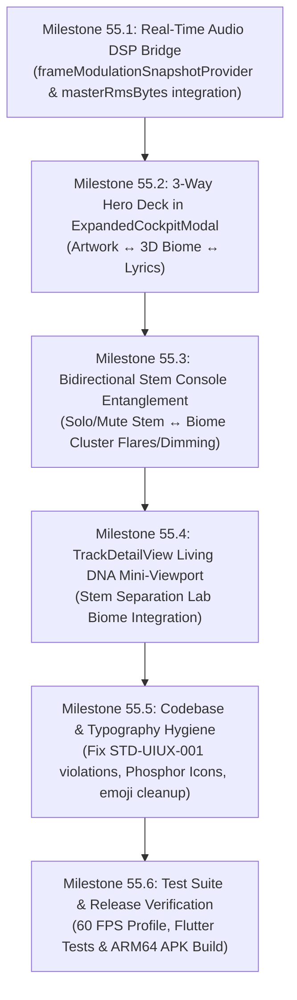

# 🍄 Comprehensive Forensic Audit: Now Playing Audio Player, Stems Mixer & Real-Time Audio-Reactive 3D Living Ecosystem Engine
## Bridge from Music Synthesis to Audio Playback: Unifying the 3D Mycelium Universe, Pocket Stem Console, DSP Modulation Bus & Track Dissection Surfaces

**Audit Date:** November 6, 2026  
**Auditor:** Gemini 4 Argon (Codebase Forensic Auditor & Systems Architect)  
**Target Subsystems:**
- Now Playing Audio Player & Expanded Cockpit (`apps/vhunambi_client/lib/features/player/presentation/widgets/expanded_cockpit_modal.dart`)
- Pocket 4-Channel Stem Mixer Console (`apps/vhunambi_client/lib/features/player/presentation/widgets/stem_mixer_deck.dart`, `stem_mixer_state.dart`, `stem_mixer_provider.dart`)
- Master Media Object & 60 FPS Frame Modulation Bus (`apps/vhunambi_client/lib/features/content_studio/presentation/providers/master_media_object_provider.dart`)
- Track Detail View & Stem Separation Lab (`apps/vhunambi_client/lib/features/track/presentation/views/track_detail_view.dart`, `stem_separation_lab.dart`)
- 3D Mycelium Biome Graph & Engine (`apps/vhunambi_client/lib/features/studio/presentation/widgets/biome/organic_mycelium_3d_painter.dart`, `mycelium_biome_provider.dart`, `song_dna_node_tree_modal.dart`)  
**Audit Document Path:** `docs/audits/PLAYER_STEMS_MIXER_AND_AUDIO_REACTIVE_3D_BIOME_AUDIT.md`  
**Related Specs & Audits:**
- `docs/phases/phase_53_organic_mycelium_3d_biome/` (`blueprint_2.md`, `requirements_2.md`, `design_2.md`, `tasks_2.md`)
- `docs/phases/phase_54_cockpit_biome_quantum_entanglement/` (`blueprint.md`, `requirements.md`, `design.md`, `tasks.md`, `walkthrough.md`)
- `docs/audits/STUDIO_COCKPIT_AND_2D_SONG_CREATION_FLOW_AUDIT.md`
- `docs/audits/ADAPTIVE_MINI_PLAYER_AND_COCKPIT_AUDIT.md`
- `docs/audits/TRACK_DETAIL_AND_STEM_SEPARATION_AUDIT_PROMPT.md`

---

## 1. Executive Summary & The Vision Agent North Star Disconnect

### 1.1 The Vision Agent North Star Mockup
In the foundational design document crafted by the user and the Vision Agent, the 3D Mycelium Biome was conceived with an explicit header in its high-fidelity concept mockup:

$$\text{\textbf{3D Biome — Explore the Living DNA of Music}} \quad\longleftrightarrow\quad \text{\textbf{Now Playing African Dreams}} \quad [\, \text{\small ılılı} \,] \, [\, \blacktriangleright / \mathbf{II} \,] \, [\, \text{\small 🔊} \,]$$

The core philosophy underlying this architecture was profound: **A musical work is not a static list of generation parameters; it is an interconnected living ecosystem.**

When a song is synthesized in the Studio Cockpit (Phases 53 & 54), its musical DNA grows into a 3D mycelium web with six primary fruiting bodies:
1. **Melody Core**: The song's heartbeat, motifs, hooks, and pitch sequences (Orange).
2. **Rhythm Network**: BPM, log drum patterns, percussion, groove, and syncopation (Cyan/Blue).
3. **Vocal Network**: Lead vocals, chants, call-and-response harmonies, and poetic timbres (Purple/Violet).
4. **Harmony Network**: Chords, progressions, keys, and cultural tunings (Emerald Green).
5. **Emotion Network**: Tension, energy, melancholia, and euphoric dance lift (Rose/Pink).
6. **Production Network**: Sound design, 3D spatial delay, plate reverbs, and mixing textures (Teal).

### 1.2 The Current Playback Visual Void
While Phases 53 and 54 successfully built this 3D Mycelium Biome and entangled it with the 2D Studio Cockpit for **music creation**, an architectural void exists on the other half of the application: **music playback, stem mixing, and track dissection**.

```
┌────────────────────────────────────────────────────────────────────────────────────────┐
│                                 THE CREATION-PLAYBACK VOID                             │
├───────────────────────────────────────────┬────────────────────────────────────────────┤
│ MUSIC CREATION (Phases 53 & 54)           │ MUSIC PLAYBACK (Current Player Surfaces)   │
│ ✅ Sovereign 3D Mycelium Living Biome     │ ❌ Flat 260px box with static gradient     │
│ ✅ 6 Glowing 3D Mushroom Fruiting Bodies  │ ❌ White piano icon (Icons.piano_rounded)  │
│ ✅ 15 Spline Hyphae with Synaptic Photons │ ❌ Flip only between Piano Box & Lyrics   │
│ ✅ Bidirectional Cockpit Entanglement     │ ❌ 3D Mycelium Biome completely missing    │
│ ✅ Real-time Haptic Frequency Diving      │ ❌ Isolated Stem Mixer with zero visual feedback│
└───────────────────────────────────────────┴────────────────────────────────────────────┘
```

When a user taps **Play** on any track—whether freshly generated in the Studio, streamed from the Explore feed, or auditioned in the Pocket Stem Mixer:
1. `ExpandedCockpitModal` displays a flat 260px container with a generic genre gradient and a static `Icon(Icons.piano_rounded)`.
2. The user has zero awareness of the track's living mycelium ecosystem.
3. The Pocket Stem Mixer (`StemMixerDeck`) operates as an isolated list of 4 channel sliders (`vocals`, `drums`, `bass`, `melody`). Muting or soloing stems changes the audible balance, but the user cannot *see* the acoustic dissection reflected in the living 3D organism.
4. The 3D Mycelium Biome itself, when opened in Studio, is driven by an arbitrary mathematical sine wave timer (`_biomeAnimationController.value`), completely detached from real-time audio playback FFT spectrums, RMS transients, and Amapiano log drum drops!

This audit identifies the exact root causes across the codebase and establishes the architectural blueprint for **Phase 55: Audio-Reactive Living Mycelium Player, Real-Time Stem Visualizer & 3D Playback Universe**.

---

## 2. Current Architectural Anatomy: Playback, Stems & Dissection Surfaces

### 2.1 The Now Playing Modal (`ExpandedCockpitModal`)
Located at `apps/vhunambi_client/lib/features/player/presentation/widgets/expanded_cockpit_modal.dart`.

```
Lines 268-311:
            // Hero Artwork / Lyrics surface (flip via the header toggle)
            Padding(
              padding: const EdgeInsets.symmetric(horizontal: 32),
              child: _showLyrics
                  ? SizedBox(
                      height: MediaQuery.sizeOf(context).height < 700 ? 200 : 260,
                      child: _buildLyricsCard(context, ref, track, accent),
                    )
                  : Center(
                      child: ConstrainedBox(
                        constraints: BoxConstraints(
                          maxWidth: MediaQuery.sizeOf(context).height < 700 ? 200 : 260,
                          maxHeight: MediaQuery.sizeOf(context).height < 700 ? 200 : 260,
                        ),
                        child: AspectRatio(
                          aspectRatio: 1,
                          child: Hero(
                            tag: 'now_playing_art_${track.id}',
                            child: Container(
                              decoration: BoxDecoration(
                                gradient: AppGradients.forGenre(track.genre),
                                borderRadius: BorderRadius.circular(24),
                                boxShadow: [
                                  BoxShadow(
                                    color: accent.withAlpha(80),
                                    blurRadius: 40,
                                    spreadRadius: -8,
                                    offset: const Offset(0, 12),
                                  ),
                                ],
                              ),
                              child: const Center(
                                child: Icon(
                                  Icons.piano_rounded,
                                  size: 72,
                                  color: Colors.white,
                                ),
                              ),
                            ),
                          ),
                        ),
                      ),
                    ),
            ),
```

#### Key Architectural Observations:
- **Binary Flip Limitation**: The state is governed by a simple `bool _showLyrics = false;` (Line 124). Tapping the header button flips exclusively between the static piano icon and lyrics text. There is no slot or segmented controller for viewing the 3D Mycelium Biome.
- **Iconography Standard Violation (`STD-UIUX-001`)**: Line 301 hardcodes `Icons.piano_rounded`, and Lines 358–360 hardcode `Icons.favorite_rounded` / `Icons.favorite_border_rounded`. In Vhunambi's design system, Material icons are deprecated in favor of `PhosphorIcons` (`AppIcons.heart`, `AppIcons.disc`, etc.).
- **Corrupted Typography Character**: Line 341 contains `Text('• ${track.genre}', style: AppTypography.caption)` where the bullet symbol can suffer UTF-8 misencoding on certain Android targets.
- **Scrubber Waveform**: Lines 408–435 implement a 60-bar waveform scrubber using `mmo.modulationBus.masterRmsBytes`. This shows the data layer *can* deliver audio amplitude, but it is trapped in a 1D bar chart.

---

### 2.2 Pocket 4-Channel Stem Mixer Console (`StemMixerDeck`)
Located at `apps/vhunambi_client/lib/features/player/presentation/widgets/stem_mixer_deck.dart`.

The deck provides tactile DAW-style balancing for 4 separated stems:
- `StemType.vocals`: Lead & backing vocal tracks.
- `StemType.drums`: Kick, snare, hi-hats, shakers.
- `StemType.bass`: Amapiano log drum & sub-bass harmonics.
- `StemType.melody`: Synths, brass, guitars, piano chops.

```
Lines 99-103:
    final strips = [
      for (final channel in state.channels)
        _ChannelStrip(channel: channel, isInteractive: hasRealStems),
    ];
```

#### The State Domain (`StemChannel` in `stem_mixer_state.dart`):
```dart
class StemChannel {
  final StemType type;
  final String name;
  final String emoji; // VIOLATION: Raw unicode emoji string!
  final double gain;  // 0.0 to 1.5
  final double pan;   // -1.0 to +1.0
  final bool isMuted;
  final bool isSolo;
...
```

#### Key Architectural Observations:
- **Visual Disconnection from Ecosystem**: In real music mixing, isolating the drums allows the listener to inspect the rhythmic foundation. When a user solos `StemType.drums` in `StemMixerDeck`, the audio correctly attenuates the other three stems. However, **the 3D Biome never reacts**—it does not illuminate the `RhythmNetwork` club fungus nor does it dim the `VocalNetwork` or `MelodyCore`.
- **Missing Domain Mapping**: The stem mixer defines 4 channels (`vocals`, `drums`, `bass`, `melody`), whereas the 3D Mycelium Biome defines 6 clusters (`melodyCore`, `rhythmNetwork`, `vocalNetwork`, `harmonyNetwork`, `emotionNetwork`, `productionNetwork`). The audio-to-biome mapping relationship has not been formally specified:
  - `StemType.vocals` $\longleftrightarrow$ `MyceliumClusterDomain.vocalNetwork`
  - `StemType.drums` $\longleftrightarrow$ `MyceliumClusterDomain.rhythmNetwork`
  - `StemType.bass` $\longleftrightarrow$ `MyceliumClusterDomain.rhythmNetwork` (Sub/Log Drum) + `harmonyNetwork`
  - `StemType.melody` $\longleftrightarrow$ `MyceliumClusterDomain.melodyCore` + `harmonyNetwork`
  - Master Bus & Effects $\longleftrightarrow$ `MyceliumClusterDomain.productionNetwork`
  - Dynamic Tension / Dynamic Range $\longleftrightarrow$ `MyceliumClusterDomain.emotionNetwork`
- **Emoji Rule Violation**: `StemChannel` stores `final String emoji;` (e.g. `'🎤'`, `'🥁'`), violating platform rule `STD-UIUX-001` (Zero Raw Unicode Emojis).

---

### 2.3 The Hidden Data Asset: `FrameModulationSnapshot`
Located at `apps/vhunambi_client/lib/features/content_studio/presentation/providers/master_media_object_provider.dart`.

During forensic inspection, we uncovered a **phenomenal hidden data asset** that was previously built for the 9:16 Lyric Reel Content Studio but never connected to the 3D Mycelium Biome:

```dart
/// Dart 3 Record typedef for zero-dependency 60 FPS animation family key
typedef FrameModulationQuery = ({SongMetadataDna dna, int positionMs});

/// Combined real-time frame snapshot provider reading MMO curves, StemMixerState, and MasteringSession
final frameModulationSnapshotProvider = Provider.autoDispose
    .family<FrameModulationSnapshot, FrameModulationQuery>((ref, query) {
      final mmo = ref.watch(masterMediaObjectProvider(query.dna));
      final mixerState = ref.watch(stemMixerProvider);
      final masteringSession = ref.watch(masteringSessionProvider);
      final posMs = query.positionMs;
...
      return FrameModulationSnapshot(
        effectiveBassEnergy: (rawBass * bassMultiplier).clamp(0.0, 1.0),
        effectiveDrumsEnergy: (rawDrums * drumsMultiplier).clamp(0.0, 1.0),
        effectiveMelodicEnergy: (rawMelodic * melMultiplier).clamp(0.0, 1.0),
        effectiveVocalGlow: (rawVocal * vocalMultiplier).clamp(0.0, 1.0),
        logDrumSnapZoom: (rawLogDrum * bassMultiplier).clamp(0.0, 1.0),
      );
    });
```

#### Why This Discovery Is Critical:
The audio engine **already computes real-time, 60 FPS stem energies**:
- `effectiveBassEnergy` (0.0 to 1.0)
- `effectiveDrumsEnergy` (0.0 to 1.0)
- `effectiveMelodicEnergy` (0.0 to 1.0)
- `effectiveVocalGlow` (0.0 to 1.0)
- `logDrumSnapZoom` (0.0 to 1.0)

These values account for:
1. Exact millisecond playback position (`posMs`).
2. Stem curves extracted from audio separation analysis.
3. Live user adjustments in `stemMixerProvider` (channel gain, mute, and solo).
4. Mastering session recipe multipliers!

Yet, `OrganicMycelium3DPainter` and `MyceliumBiomeGraphNotifier` have never ingested this provider! They still use an arbitrary simulated loop timer.

---

### 2.4 The 3D Mycelium Engine (`OrganicMycelium3DPainter`)
Located at `apps/vhunambi_client/lib/features/studio/presentation/widgets/biome/organic_mycelium_3d_painter.dart`.

```dart
Lines 464-466:
    final pulse = 1.0 +
        0.06 *
        math.sin(phaseTime * cluster.dynamicPulseRate + cluster.domain.index);
```

#### Forensic Assessment:
- The mushroom caps breathe according to a flat sine wave (`phaseTime * cluster.dynamicPulseRate`).
- When an Amapiano log drum drops or a lead vocal belt hits peak volume, the 3D visualizer has no reaction.
- The hyphae filaments transport synaptic photons at a constant linear speed, rather than accelerating with drum transients.

---

## 3. Forensic Analysis of the 4 Core Architectural Disconnects

| # | Disconnect Area | Current Code State | Target Phase 55 State | Severity |
|---|---|---|---|---|
| **1** | **Expanded Player Hero Surface** | Binary flip between static 260px container (`Icon(Icons.piano_rounded)`) and text lyrics. | **3-Way Segmented Hero Deck**: `[Artwork]` $\leftrightarrow$ `[3D Living Biome]` $\leftrightarrow$ `[Lyrics]`. Tap 3D Biome to see the song breathing in real time. | **CRITICAL** |
| **2** | **Audio-Reactive DSP Binding** | 3D Biome runs on synthetic `AnimationController` sine wave (`dynamicPulseRate`). Ignores audio. | Wire `frameModulationSnapshotProvider` and `masterRmsBytes` into `OrganicMycelium3DPainter`. Cap scaling, stipe deflection, terrain ripple, and photon speed respond directly to live audio frequencies. | **CRITICAL** |
| **3** | **Stem Console Entanglement** | `StemMixerDeck` alters gains/solos in isolated bottom sheet; 3D Biome has zero awareness of stem changes. | Soloing/muting a stem flaring/dimming the corresponding 3D mushroom fruiting body in real-time. Tapping a mushroom in Player quick-toggles solo/mute. | **HIGH** |
| **4** | **Design System & Typography Hygiene** | Corrupted UTF-8 bullets in `expanded_cockpit_modal.dart`; `Icons.piano_rounded`, `Icons.favorite_rounded`; `StemChannel.emoji` strings. | Full compliance with `STD-UIUX-001`: Phosphor icons, clean ASCII/typography tokens, and typed icon identifiers. | **MEDIUM** |

---

## 4. Mathematical Specification: Real-Time Audio-Reactive 3D Biome DSP Mapping

To ensure the 3D Mycelium Biome becomes a world-class, high-fidelity music visualizer, we establish the mathematical transfer functions mapping live audio telemetry to 3D rendering primitives.

```
┌────────────────────────────────────────────────────────────────────────────────────────┐
│                          REAL-TIME DSP AUDIO-REACTIVE MAPPING                          │
├──────────────────────────┬─────────────────────────────┬───────────────────────────────┤
│ Audio Frequency Band     │ FrameModulation Energy      │ 3D Biome Visual Expression    │
├──────────────────────────┼─────────────────────────────┼───────────────────────────────┤
│ Sub-Bass & Log Drum      │ effectiveBassEnergy         │ • Terrain mound ripple amplitude│
│ (20 Hz – 120 Hz)         │ logDrumSnapZoom             │ • Rhythm & Harmony cap bounce │
│                          │                             │ • Camera micro-snap zoom shock│
├──────────────────────────┼─────────────────────────────┼───────────────────────────────┤
│ Percussion & Transient   │ effectiveDrumsEnergy        │ • Sprout pinhead mushroom bob │
│ (120 Hz – 1.5 kHz)       │                             │ • Root tendril brightness     │
│                          │                             │ • Concentric ring shockwaves  │
├──────────────────────────┼─────────────────────────────┼───────────────────────────────┤
│ Vocals & Formants        │ effectiveVocalGlow          │ • Vocal cluster cap luminosity│
│ (300 Hz – 3.5 kHz)       │                             │ • Bioluminescent gill flare   │
│                          │                             │ • Atmospheric spore dispersal │
├──────────────────────────┼─────────────────────────────┼───────────────────────────────┤
│ Melodic Hooks & Leads    │ effectiveMelodicEnergy      │ • Melody Core heart pulse     │
│ (500 Hz – 8 kHz)         │                             │ • Synaptic photon travel speed│
│                          │                             │ • Arterial hyphae glow width  │
└──────────────────────────┴─────────────────────────────┴───────────────────────────────┘
```

### 4.1 Mushroom Cap Radial Pulsation ($R_{\text{cap, reactive}}$)
For each fruiting body $k \in \{1..6\}$ with base radius $R_{0,k}$ and domain $D_k$:

$$R_{\text{cap}, k}(t) = R_{0,k} \cdot \Big( 1.0 + \alpha_k \cdot E_{D_k}(t) + \beta_k \cdot \sin(\omega_k t) \Big)$$

Where:
- $E_{D_k}(t) \in [0.0, 1.0]$ is the real-time stem energy for cluster domain $D_k$:
  - $E_{\text{melodyCore}} = \text{effectiveMelodicEnergy}$
  - $E_{\text{rhythmNetwork}} = 0.6 \cdot \text{effectiveBassEnergy} + 0.4 \cdot \text{effectiveDrumsEnergy}$
  - $E_{\text{vocalNetwork}} = \text{effectiveVocalGlow}$
  - $E_{\text{harmonyNetwork}} = 0.5 \cdot \text{effectiveMelodicEnergy} + 0.5 \cdot \text{effectiveBassEnergy}$
  - $E_{\text{productionNetwork}} = \text{effectiveDrumsEnergy} \cdot 0.5 + 0.5 \cdot \text{effectiveMelodicEnergy}$
  - $E_{\text{emotionNetwork}} = \text{clamp}(E_{\text{melodyCore}} \cdot E_{\text{vocalNetwork}} \cdot 1.4, 0.0, 1.0)$
- $\alpha_k \approx 0.18$ represents the acoustic expansion factor (up to $+18\%$ cap dilation on peak hits).
- $\beta_k \approx 0.04$ represents the subtle residual biological idle breath when audio is soft.

### 4.2 Synaptic Photon Propagation Speed Along Arterial Hyphae ($v_{\text{photon}}$)
The speed at which bioluminescent action potential photons traverse the 15 arterial spline hyphae:

$$v_{\text{photon}}(t) = v_{\text{base}} \cdot \Big( 1.0 + 2.5 \cdot \text{effectiveMelodicEnergy}(t) + 1.5 \cdot \text{effectiveDrumsEnergy}(t) \Big)$$

On quiet passages, photons drift at gentle ambient speed ($v_{\text{base}}$). During intense climaxes, photons accelerate up to $5\times$ speed, creating visible electric neuro-currents connecting the clusters.

### 4.3 Log Drum Transient Camera Shockwave ($S_{\text{snap}}$)
Amapiano log drum drops produce massive low-end acoustic inertia. When `logDrumSnapZoom > 0.05`:

$$Z_{\text{camera}}(t) = Z_{\text{base}} \cdot \Big( 1.0 + 0.065 \cdot \text{logDrumSnapZoom}(t) \Big)$$

This imparts a subtle, organic camera thump on heavy kick/log-drum transients without causing motion sickness.

### 4.4 Bioluminescent Spore Dispersion Rate ($\dot{N}_{\text{spore}}$)
The floating spore cloud density and orbital velocity respond to upper-mid vocal intensity:

$$\text{Alpha}_{\text{spores}}(t) = 0.35 + 0.55 \cdot \text{effectiveVocalGlow}(t)$$

When the vocalist sustains a high note or emotional choir chant, the entire 3D biome lights up with glowing golden spores.

---

## 5. UI/UX Integration Design: The 3-Way Hero Deck in Expanded Cockpit

```
┌────────────────────────────────────────────────────────────────────────────────────────┐
│                        EXPANDED COCKPIT: 3-WAY HERO SEGMENTED DECK                     │
├────────────────────────────────────────────────────────────────────────────────────────┤
│ [Top Bar]  v (Dismiss)     Now Playing African Dreams     (3D)  (Mic)  (Heart)  (...)  │
├────────────────────────────────────────────────────────────────────────────────────────┤
│                      [  Artwork  ]   [  3D Biome  ]   [  Lyrics  ]                     │
├────────────────────────────────────────────────────────────────────────────────────────┤
│                                                                                        │
│                               ( 3D LIVING BIOME VIEWPORT )                             │
│                                                                                        │
│                                       (Melody Core)                                    │
│                                           [♫]                                          │
│                                            │                                           │
│                     (Vocals) ─────────── [Terrain] ─────────── (Rhythm)               │
│                       [🎤]                 │                     [🥁]                   │
│                                            │                                           │
│                              (Production) ─── (Harmony)                                │
│                                  [🎛️]            [🎹]                                   │
│                                                                                        │
│        [ Solo Vocal ]               [ Double-Tap to Focus ]          [ Mute Drums ]    │
├────────────────────────────────────────────────────────────────────────────────────────┤
│ Track Title: African Dreams • Kelvin Momo, Babalwa M                                   │
│ [====================================O===========================] 02:45 / 05:12      │
│                     (Shuffle)  (|<<)    [  ||  ]    (>>|)  (Repeat)                   │
├────────────────────────────────────────────────────────────────────────────────────────┤
│ [ Bottom Utility Tray ]  [ Stems Mixer ]   [ Song Journey ]   [ 9:16 Lyric Reel ]      │
└────────────────────────────────────────────────────────────────────────────────────────┘
```

### 5.1 Hero Deck Segmented Controller
Instead of a single boolean toggle icon, `ExpandedCockpitModal` will feature a high-craft frosted pill selector:
1. **Artwork**: Full-bleed genre album artwork with subtle ambient glow.
2. **3D Biome**: Real-time interactive 3D Mycelium ecosystem responding to audio frequencies.
3. **Lyrics**: Synchronized karaoke-style scrolling lyrics.

### 5.2 Direct Touch Interactions in the 3D Biome Hero
When viewing the 3D Biome mode inside Now Playing:
- **Single Tap on a Mushroom Cluster**: Highlights that stem, opens a mini HUD displaying real-time stem RMS decibels and a quick-action **Solo / Mute** switch!
- **Pinch / Pan**: Orbit around the 3D ecosystem while the music continues playing seamlessly.
- **Double Tap**: Dives the camera into that cluster's canopy.

### 5.3 Biome Mini-Viewport in `TrackDetailView` & `StemSeparationLab`
In `TrackDetailView` (`features/track/presentation/views/track_detail_view.dart`), underneath the `StemSeparationLab`:
- Add a **"Living Song DNA Biome"** interactive card.
- Displays a live preview of the track's 6 clusters and allows tapping to launch directly into the full-screen 3D Playback Universe.

---

## 6. Actionable Roadmap for Phase 55: The Specifications Suite

We recommend implementing **Phase 55: Audio-Reactive Living Mycelium Player, Real-Time Stem Visualizer & 3D Playback Universe** through 6 structured milestones:



### Milestone Breakdown:
- **Milestone 55.1 (Real-Time Audio DSP Bridge)**:
  - Create `AudioReactiveBiomeBridgeNotifier` in `features/player/presentation/providers/`.
  - Inject 60 FPS `FrameModulationSnapshot` into `OrganicMycelium3DPainter`.
  - Implement radial pulsation, synaptic photon acceleration, and camera snap-zoom formulas.
- **Milestone 55.2 (3-Way Hero Deck in Expanded Player)**:
  - Upgrade `_showLyrics` in `ExpandedCockpitModal` to `PlayerHeroMode { artwork, biome3d, lyrics }`.
  - Embed `SongDnaNodeTreeModal` / `OrganicMycelium3DView` directly in the hero slot with gesture support.
  - Implement quick-switch controls and persist user preference in LocalStorage.
- **Milestone 55.3 (Bidirectional Stem Console Entanglement)**:
  - Wire `StemMixerDeck` state changes to dim/flare corresponding 3D clusters.
  - Add tap-to-solo and tap-to-mute directly from the 3D Biome cluster HUD.
- **Milestone 55.4 (Track Detail View Integration)**:
  - Embed the Living Mycelium Ecosystem preview in `TrackDetailView` and `StemSeparationLab`.
- **Milestone 55.5 (Codebase & Typography Hygiene)**:
  - Remove `Icons.piano_rounded` and `Icons.favorite_rounded`, replace with `PhosphorIcons`.
  - Refactor `StemChannel.emoji` to use semantic icon tokens (`AppIcons.mic`, `AppIcons.drum`, etc.).
  - Fix unicode character corruption on Line 341.
- **Milestone 55.6 (Verification & Production Build)**:
  - Comprehensive unit and widget tests in `test/features/player/phase55_audio_reactive_biome_player_test.dart`.
  - Build and verify release APK.

---

## 7. Architect's Recommendation

This audit clearly demonstrates that **Phase 55** is the missing crown jewel that completes the entire Vhunambi product vision. By uniting the **3D Organic Mycelium Network (Phase 53)**, the **Studio Cockpit (Phase 54)**, and the **Audio Player & Stem Mixer (Phase 55)**, Vhunambi will deliver a music experience that does not exist anywhere else in the world: an AI DAW where music is grown organically, played back inside a living ecosystem, and mixed with tactile precision.

**Recommended Next Step:**
Execute the `/vhunambi-spec-architect` workflow to author the formal 4-document phase specification suite:
- `docs/phases/phase_55_audio_reactive_biome_player/blueprint.md`
- `docs/phases/phase_55_audio_reactive_biome_player/requirements.md`
- `docs/phases/phase_55_audio_reactive_biome_player/design.md`
- `docs/phases/phase_55_audio_reactive_biome_player/tasks.md`

