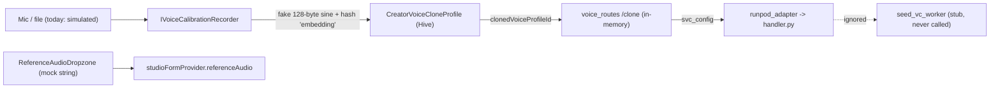

# AUDIT-SOUNDSIG-001: Sound Intake, Voice Identity & Idealizer Readiness Audit

**Document Version:** 1.0.0
**Status:** Final - input to Phase 35 (`docs/phases/phase_35_sound_signature_dna_engine/`)
**Method:** Static read of the files listed in §2 plus targeted `grep` probes. Every claim below cites a file/line or a probe. Nothing here was inferred from earlier phase documentation alone - several earlier docs describe behaviour the code does not yet have.

---

## 1. Executive Verdict

> [!WARNING]
> **The "Sound Signature" idea is sound, but the foundation under it is not there yet.** Today Vhunambi captures **no real audio**, computes **no real voice embedding**, uploads **no voice reference**, and its **cloud voice-conversion stage is never executed**. Phase 35 therefore cannot start at "extract the signature" - it must first make intake, storage and the cloud stage real. The spec suite is sequenced accordingly (Track A before B, F0 before F).

| Area | Documented behaviour (Phases 3/25/26/27) | Actual behaviour found | Severity |
| :--- | :--- | :--- | :--- |
| Microphone capture | "3-line zero-shot voice calibration recording" | Simulated. No recorder package in `pubspec.yaml`. | **P0** |
| Timbre embedding | "256-D speaker timbre vector" | Hash/sine of text or bytes. Not derived from a voice. | **P0** |
| Reference upload | `r2ReferenceUrl` stored per clone | URL is a template string; no upload step found. | **P0** |
| Clone persistence (API) | `registerVoiceCloneProfile` | In-memory `Map`, lost on restart. | **P0** |
| Seed-VC conversion | "F0-locked zero-shot SVC on vocals stem" | Stub returning a status dict; never called. | **P0** |
| GPU pipeline wiring | `svc_config` forwarded to RunPod | `handler.py` never reads it. Phase 25 mastering worker also never imported. | **P0** |
| Reference-audio intake | "Upload a song as melody reference" | Mock: sets the string `'user_sample_stem_vocal.wav'`. | **P1** |
| Pitch / formant / rhythm analysis | n/a | None exists anywhere in the client. | gap (this phase) |

---

## 2. Files Audited

| Layer | File | Lines |
| :--- | :--- | :--- |
| Client - recorder | `lib/features/studio/domain/services/i_voice_calibration_recorder.dart` | 181 |
| Client - sheet | `lib/features/studio/presentation/widgets/voice_clone_recorder_sheet.dart` | 408 |
| Client - models | `lib/features/studio/domain/models/vocal_identity_models.dart` | 576 |
| Client - provider | `lib/features/studio/presentation/providers/vocal_identity_provider.dart` | 380 |
| Client - reference intake | `lib/features/studio/presentation/widgets/reference_audio_dropzone.dart` | 526 |
| Client - sketchpad | `melody_sketchpad_provider.dart` (644), `melody_wav_synthesizer.dart` (856), `melody_sketchpad_models.dart` | - |
| Client - profile vault | `lib/features/profile/presentation/views/owner_profile_view.dart` (`voicesAndMelodies` tab) | - |
| API | `apps/vhunambi_api/src/routes/voice_routes.ts` (119), `melody_routes.ts` (150), `generation_routes.ts` (246), `modules/voices/voice_catalog.ts`, `voice_types.ts`, `modules/synthesis/prompt_compiler.ts`, `runpod_adapter.ts` | - |
| GPU | `tools/zr-studio-gpu/handler.py`, `seed_vc_worker.py` (119), `stem_mastering_worker.py` (227), `mmo_extractor.py` | - |

---

## 3. Findings

### SIG-F01 (P0) - There is no microphone capture
- `pubspec.yaml` audio dependencies are **only** `just_audio`, `audio_service`, `audio_session` (playback). A probe for `record|file_picker|permission|fft|pitch|onnx|tflite` found nothing relevant.
- `DeterministicVoiceCalibrationRecorder.stopRecording()` (`i_voice_calibration_recorder.dart:84-131`) returns `_buildValidMinimalWavHeader(seed)`: **64 samples of a sine wave (128 data bytes)** seeded from the script text. The user's voice is never sampled.
- The interface (`IVoiceCalibrationRecorder`) is well-shaped for injection and tests - that part is reusable. The implementation behind it is a placeholder.
- `AndroidManifest.xml` `RECORD_AUDIO` permission and a runtime permission flow are therefore also unverified/absent (to confirm in task T-A1).

### SIG-F02 (P0) - The "timbre embedding" is not a voice measurement
Three independent fakes, all deterministic from non-audio input:
1. **Client:** `timbrePreview = sin((seed + i*17) * 0.31) * 0.85`, where `seed` is the sum of the calibration *text's* UTF-16 code units (`i_voice_calibration_recorder.dart:99-105`). Two different people reading the same script get identical "timbre".
2. **API:** `registerVoiceCloneProfile` builds the same 8-float "preview" deterministically (`voice_catalog.ts:557-558`). `timbreEmbeddingPreview` is validated as exactly 8 numbers (`voice_types.ts:72`).
3. **GPU worker:** `extract_speaker_timbre_embedding` projects a **SHA-256 of the PCM bytes** through sin/cos (`seed_vc_worker.py:43-53`). Its docstring admits this is the no-Torch fallback. Any change to a single byte yields an unrelated vector; similar voices do not yield similar vectors.

Consequence: `clarityScore: 0.96` (hard-coded, `:129`) and `cadenceWpm` (clamped 92-148 from text length / nominal duration) are also not measurements. The UI shows these as if they were.

### SIG-F03 (P0) - Voice reference is never uploaded
- `r2ReferenceUrl` defaults to `` `https://r2.vhunambi.com/voice-clones/${id}_ref.wav` `` (`voice_catalog.ts:577-578`). `audioBase64` is optional in the schema (`voice_types.ts:63`).
- This audit found no step that writes the reference to R2. The URL points at an object that does not exist. To be re-verified by T-A0 before design lock.

### SIG-F04 (P0) - Clone registry is volatile
- `const clonedVoiceStore = new Map<string, CreatorVoiceCloneProfile>()` (`voice_catalog.ts:549`). A restart, deploy or scale-out loses every registered clone. A client holding `clonedVoiceProfileId` then references a profile the server no longer knows.

### SIG-F05 (P0) - The cloud voice stage never runs
- `convert_vocal_stem_with_seed_vc` (`seed_vc_worker.py:82-118`) validates a config and **returns a dict with `"status": "converted"`**. It reads no audio and writes no `output_wav_path`.
- Probe over every `tools/zr-studio-gpu/*.py` for `svc_config|svcConfig|stem_mastering|seed_vc` returned hits **only inside `seed_vc_worker.py`** (its own definition) plus a header comment in `stem_mastering_worker.py`. **`handler.py` references none of them.**
- Meanwhile the API does forward the config: `prompt_compiler.ts:72-118` builds `svcConfig`; `runpod_adapter.ts:72` sends it as `svc_config`; `generation_routes.ts:93` reports `svcMode: 'zero_shot_clone'`.
- **Net effect: selecting a cloned or archetype voice currently changes the label and the request payload, not the audio.** The Phase 26 and Phase 25 (stem mastering) GPU stages are dead code. The same holds for `resemble-enhance` / `pedalboard`: no reference found in the `.py` files or any requirements/Dockerfile matched by the probe.

### SIG-F06 (P1) - Reference-audio intake is a mock
- `ReferenceAudioDropzone` upload target calls `setReferenceAudio('user_sample_stem_vocal.wav')` under the comment `// Mock simulated reference audio selection` (`reference_audio_dropzone.dart:~302-307`). No file picker, no decode, no waveform, no duration/format validation.

### SIG-F07 (P1) - Performance flaws pass through by construction
Because nothing is analysed, none of these can currently be detected, reported or corrected: off-key notes, pitch jitter/tremor, unstable vibrato, weak projection/low level, rushed/dragging timing, room reverb/boxiness, mic band-limiting, clipping, background noise. There is also no input-quality gate - a 3-second whisper in a noisy room would be accepted identically to a clean take.

### SIG-F08 (info) - What is genuinely reusable
| Asset | Why it matters to Phase 35 |
| :--- | :--- |
| `IVoiceCalibrationRecorder` abstraction + deterministic fake | Keep the fake for headless tests; add a real implementation behind the same seam. |
| `MelodyWavSynthesizer` (44.1 kHz master, `kMasterSampleRate = 44100`) | Real DSP host: resynthesis, preview and sampler playback can share the master rate and WAV writer. |
| `MelodyStepNote {stepIndex 0-15, scaleRow 0-7, velocity, hasGlide, durationSteps 1-4}` | Exact target schema for Hum-to-Sketchpad. |
| `AfricanScaleMode` (4 modes, 8 semitone offsets each) | Pitch Scale Lock target set. Offsets are root-relative; a **root key is required** and is not stored today. |
| `VocalIdentityNotifier` + Hive `voiceProfilesBoxKey` | Persistence pattern (JSON string in a dynamic box). Binary signature blobs need a new box. |
| `VoiceCatalog` (24 `RegionalVoiceArchetype`, `loraScale`, `formantShiftSemitones ±4`) | Source of hybrid-blend targets and sane formant-shift bounds. |
| `PhoneticCalibrationScript` / `extract-calibration` endpoint | Random phrase reading doubles as a liveness/consent signal (see §5). |
| `mmo_extractor.py` (librosa onset/RMS) | Cloud-side onset logic already exists for parity checks against on-device onsets. |
| `vault_storage_modal` | Natural home for signature/audio quota management. |

---

## 4. Where Raw Performance Flaws Enter Today (and Where Phase 35 Intercepts)

Phase 35 inserts, between `Rec`/`Drop` and persistence, a real **intake -> analysis -> SoundSignatureDna -> idealizer** chain, and makes the right-hand branch real (upload, durable registry, GPU stage).

---

## 5. Product & Safety Observations (shape the design)

1. **Where the user's *performance* matters vs. where only their *timbre* matters.** In the current product the song's vocal melody is generated by ACE-Step 1.5; the user's recording is only a **timbre reference** for SVC. For that path, off-key singing in the reference is mostly harmless - what hurts is *noise, reverb, band-limiting and level*, which degrade the speaker embedding. Pitch correction only matters for paths where the user's **own performance becomes audio**: (a) a new **"Sing it yourself" take** that is idealized into a finished vocal stem, and (b) **Hum-to-Sketchpad**. Phase 35 specifies both, and keeps *reference hygiene* (enhance + normalise) as the always-on benefit.
2. **Voice is biometric data.** Vhunambi's privacy doc claims on-device sovereignty. A cloned-voice feature enables impersonation. Phase 35 requires: explicit consent copy, upload only on explicit "apply to song" action, a delete-everywhere endpoint, and **imported (non-live) audio may not be registered as a voice *identity* clone** without a live calibration read (`source: live | imported` flag). South African POPIA applies.
3. **Honest expectations.** DSP pitch/timing/tone correction (±~4-5 semitones, PSOLA) is robust. It cannot create breath support, range or a different timbre by itself. Timbre transformation and hybrid blending are neural (cloud). The UI must label the on-device hybrid preview as an **approximation**.
4. **Size/performance budget.** APK is 41.8 MB (budget 42-45 MB). All on-device DSP must be pure Dart (no ML model bundle); only a small recorder plugin may be added. Analysis must run in an isolate.

---

## 6. Gap Matrix -> Phase 35 Tracks

| Gap | Phase 35 track |
| :--- | :--- |
| F01, F06 real capture/import, permissions, input-quality gate | **A** |
| F02 real, voice-derived descriptors | **B** |
| F07 detect + correct performance flaws on device | **C** |
| Idealizer UI, A/B, vault | **D** |
| Hum -> notes, custom instrument | **E** |
| F03, F04, F05 durable registry, real upload, real SVC + enhance wired into `handler.py`, privacy | **F** |

---

## 7. Open Questions for Sign-off (also in `blueprint.md` §9)
1. Confirm inclusion of the **"Sing it yourself -> idealized vocal stem"** workflow (new capability, not just a better clone).
2. Approve adding the `record` plugin (+ `RECORD_AUDIO` permission, +~0.1-0.3 MB).
3. Accept **Track F** being gated by two cloud spikes (F0-conditioned Seed-VC and hybrid blending) with documented fallbacks.
4. Folder naming: `phase_35_mini_player_drag_dismiss` already exists. This suite keeps the requested name `phase_35_sound_signature_dna_engine`; confirm or renumber.
