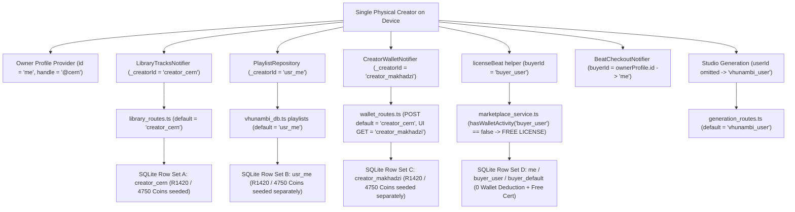
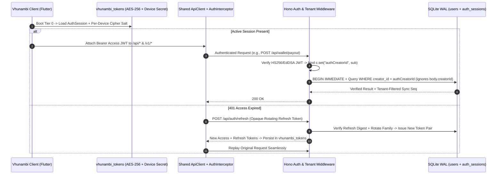

# Sovereign Forensic Audit: Multi-Tenant Identity, Authentication & Pre-Production Security Convergence (Phase 61 Selection)

**Audit Date:** November 10, 2026  
**Selected Next Phase:** **Phase 61 — Sovereign Identity, Authentication & Multi-Tenant Security Convergence**  
**Sequenced Subsequent Phase:** Phase 62 — Full-Stack Cloud Convergence Part II, Volatile-RAM Elimination & Live Media Pipeline  
**Target Subsystems:** API Gateway, SQLite WAL & Financial Ledger ([`apps/vhunambi_api/src/`](file:///c:/Users/Ndugelo/VHUNAMBI/monorepo/apps/vhunambi_api/src/server.ts)) + Sovereign Client Session, HTTP Transport & 26-Box Hive Encryption ([`apps/vhunambi_client/lib/`](file:///c:/Users/Ndugelo/VHUNAMBI/monorepo/apps/vhunambi_client/lib/main.dart))  
**Audit Document Path:** [`docs/audits/SOVEREIGN_IDENTITY_AUTH_AND_SECURITY_AUDIT.md`](file:///c:/Users/Ndugelo/VHUNAMBI/monorepo/docs/audits/SOVEREIGN_IDENTITY_AUTH_AND_SECURITY_AUDIT.md)  
**Predecessor Baseline:**
- Phase 58: Cryptographic Beatstore Licensing & Royalties ([`marketplace_service.ts`](file:///c:/Users/Ndugelo/VHUNAMBI/monorepo/apps/vhunambi_api/src/modules/marketplace/marketplace_service.ts), [`beat_checkout_provider.dart`](file:///c:/Users/Ndugelo/VHUNAMBI/monorepo/apps/vhunambi_client/lib/features/marketplace/presentation/providers/beat_checkout_provider.dart))
- Phase 59: Full-Stack Backend API Convergence Part I ([`explore_routes.ts`](file:///c:/Users/Ndugelo/VHUNAMBI/monorepo/apps/vhunambi_api/src/routes/explore_routes.ts), [`library_routes.ts`](file:///c:/Users/Ndugelo/VHUNAMBI/monorepo/apps/vhunambi_api/src/routes/library_routes.ts), [`playlist_routes.ts`](file:///c:/Users/Ndugelo/VHUNAMBI/monorepo/apps/vhunambi_api/src/routes/playlist_routes.ts), [`wallet_routes.ts`](file:///c:/Users/Ndugelo/VHUNAMBI/monorepo/apps/vhunambi_api/src/routes/wallet_routes.ts))
- Phase 60: Sovereign Hive Brain Activation & Persistence Convergence ([`phase_60.../blueprint.md`](file:///c:/Users/Ndugelo/VHUNAMBI/monorepo/docs/phases/phase_60_sovereign_hive_brain_and_persistence_convergence/blueprint.md), [`HIVE_PERSISTENCE_ENGINE_COMPREHENSIVE_AUDIT.md`](file:///c:/Users/Ndugelo/VHUNAMBI/monorepo/docs/audits/HIVE_PERSISTENCE_ENGINE_COMPREHENSIVE_AUDIT.md))

---

## 1. Executive Summary & Phase 61 Selection Verdict

### 1.1 Why Phase 61 MUST Be Identity, Auth & Multi-Tenant Security Convergence
Following the completion of **Phase 58** (commercial beat licensing + SHA-256 certificates + 85% royalty splits), **Phase 59** (SQLite persistence + Library/Playlist cloud sync + South African banking payout rails via Capitec Pay / Ozow / PayFast), and **Phase 60** (the 26-Box AES-256 Sovereign Hive Brain), Vhunambi has transitioned architecturally from a single-user prototype into a persistent, cloud-synced commercial music platform with real ZAR financial state.

However, full-monorepo forensic auditing reveals a critical pre-production paradox across both halves of the stack:

> **Vhunambi now persists real wallets, South African bank payout receipts, commercial beat licenses, offline vault tracks, and bi-directional cloud sync logs—yet has 0% user authentication, 0% tenant ownership enforcement, a 6-way identity split-brain for the same active user, an infinite-royalty / free-license exploit, and a globally static hardcoded AES-256 cipher key across every device.**

Even more tellingly, Phase 60 explicitly elevated and encrypted [`AppConstants.tokenBoxKey`](file:///c:/Users/Ndugelo/VHUNAMBI/monorepo/apps/vhunambi_client/lib/core/constants/app_constants.dart#L52-L53) (`'vhunambi_tokens'`) into Tier 0 of the Sovereign Hive Brain as `"Encrypted Auth & Onboarding Genesis"`, yet today that box only stores a single unauthenticated key (`'onboarding_state_v1'`) in [`SovereignPrefsRepository`](file:///c:/Users/Ndugelo/VHUNAMBI/monorepo/apps/vhunambi_client/lib/core/storage/sovereign_domain_repositories.dart#L1164-L1202).

### 1.2 Candidate Next-Phase Selection Matrix

| Candidate Phase | Scope Summary | Dependency & Risk Analysis | Verdict |
| :--- | :--- | :--- | :--- |
| **Candidate A: Sovereign Identity, Auth & Security Convergence** | `users`/`auth_sessions` in SQLite, Hono bearer/tenant middleware, closing financial IDOR/TOCTOU/free-license exploits, unifying the 6-way creator ID split-brain, per-device entropy for `HiveAesVaultCipher`, `vhunambi_tokens` auth session + Dio `401` refresh interceptor, Login/Signup/Switch/Sign-Out UX & Hive multi-user sanitization. | **Zero external hardware blockers.** Fixes active financial, PII, and cross-tenant corruption vulnerabilities **before** adding new synced SQLite tables (`notifications`, `collections`, `generation_jobs`, `published_clips`). Completes the dormant `vhunambi_tokens` Tier-0 nucleus from Phase 60. | **SELECTED -> Phase 61** |
| **Candidate B: Full-Stack Convergence Part II & Live Media Pipeline** | Replacing remaining volatile backend `Map`s (`social_service`, `marketplace_service`, `voice_catalog`, `job_store`), adding SQLite tables for Notifications/Collections/Clips/Jobs, mounting WebSocket server, live video rendering & audio bytes for `/mock-storage`. | **Blocked architecturally by Candidate A.** Adding 5+ new SQLite multi-user tables (`notifications`, `collections`, `generation_jobs`, `published_clips`) without an authenticated `creator_id` and unified HTTP base URL would hardcode `'usr_me'`/`'creator_cern'` into even more schemas that later require breaking migrations. | **SEQUENCED -> Phase 62** |
| **Candidate C: UI Iconography & Media Polish** | Sweeping remaining `Icons.*` / `ScaffoldMessenger` placeholders and polishing remaining secondary modals. | Low architectural leverage compared to unauthenticated wallet payout drains and multi-identity ledger corruption. Can run alongside Phase 61/62 feature work. | **FOLDED / DEFERRED** |

### 1.3 Headline Forensic Risk Snapshot

| Forensic Dimension | Verified Audit Finding | Severity | Primary Evidence |
| :--- | :--- | :---: | :--- |
| **API Authentication Middleware** | **0 auth middlewares / 0 JWT or session libraries** across 14 mounted route modules (`app.use('*', cors())` only; only `/v1/webhooks/ace-step` checks HMAC). | **Critical** | [`server.ts`](file:///c:/Users/Ndugelo/VHUNAMBI/monorepo/apps/vhunambi_api/src/server.ts#L26-L81), [`package.json`](file:///c:/Users/Ndugelo/VHUNAMBI/monorepo/apps/vhunambi_api/package.json#L23-L30) |
| **Wallet Payout IDOR & TOCTOU** | `POST /api/wallet/payout` & `POST /api/creators/:id/wallet/payout` accept arbitrary caller `creatorId` + execute `getWallet()` -> `INSERT` without SQLite transaction lock (concurrent double-spend). | **Critical** | [`wallet_routes.ts`](file:///c:/Users/Ndugelo/VHUNAMBI/monorepo/apps/vhunambi_api/src/routes/wallet_routes.ts#L40-L65), [`vhunambi_db.ts`](file:///c:/Users/Ndugelo/VHUNAMBI/monorepo/apps/vhunambi_api/src/db/vhunambi_db.ts#L2342-L2433) |
| **Free Beat License & Infinite Royalty Exploit** | Unseeded `buyerId` (`'buyer_user'`/`'buyer_default'`/arbitrary string) triggers `hasWalletActivity(buyerId) == false` -> skips coin balance check & buyer debit while crediting 85% real royalties to producer; `POST /api/sync/mutations` (`beat_license`) hardcodes `enforceBuyerWallet: false`. | **Critical** | [`marketplace_service.ts`](file:///c:/Users/Ndugelo/VHUNAMBI/monorepo/apps/vhunambi_api/src/modules/marketplace/marketplace_service.ts#L385-L483), [`vhunambi_db.ts`](file:///c:/Users/Ndugelo/VHUNAMBI/monorepo/apps/vhunambi_api/src/db/vhunambi_db.ts#L1123-L1166), [`vhunambi_db.ts`](file:///c:/Users/Ndugelo/VHUNAMBI/monorepo/apps/vhunambi_api/src/db/vhunambi_db.ts#L2556-L2641) |
| **Global Cross-Tenant Delta Leak** | `GET /api/sync/delta?since_seq=0` returns **all** rows from `sync_mutation_log` across every creator globally, leaking private library deletes, playlist edits, and payout receipts (`bankName`, `maskedAccount`, `gatewayRef`). | **Critical** | [`sync_routes.ts`](file:///c:/Users/Ndugelo/VHUNAMBI/monorepo/apps/vhunambi_api/src/routes/sync_routes.ts#L18-L52), [`vhunambi_db.ts`](file:///c:/Users/Ndugelo/VHUNAMBI/monorepo/apps/vhunambi_api/src/db/vhunambi_db.ts#L1273-L1312) |
| **6-Way Creator Identity Split-Brain** | Active single-session user acts simultaneously as **`'me'`**, **`'creator_cern'`**, **`'usr_me'`**, **`'creator_makhadzi'`**, **`'buyer_user'`**/**`'buyer_default'`**, and **`'vhunambi_user'`** across SQLite and Flutter providers. | **High** | See Section 3 & Domain II Table |
| **Static Global AES-256 Encryption Key** | [`HiveAesVaultCipher`](file:///c:/Users/Ndugelo/VHUNAMBI/monorepo/apps/vhunambi_client/lib/core/storage/hive_aes_vault_cipher.dart#L12-L17) derives the key from compile-time constants (`_defaultSovereignIkm` + `_defaultDeviceSalt`) identical across every device globally. | **High** | [`hive_aes_vault_cipher.dart`](file:///c:/Users/Ndugelo/VHUNAMBI/monorepo/apps/vhunambi_client/lib/core/storage/hive_aes_vault_cipher.dart#L12-L86), [`sovereign_hive_bootstrap_service.dart`](file:///c:/Users/Ndugelo/VHUNAMBI/monorepo/apps/vhunambi_client/lib/core/storage/sovereign_hive_bootstrap_service.dart#L139-L140) |
| **Multi-User Hive Data Leakage** | All 7 sensitive Hive boxes store un-scoped singleton keys (`'wallet_snapshot_v1'`, `'dna_profile'`, `'profile_me'`), leaking prior user data upon account switch. | **High** | [`sovereign_domain_repositories.dart`](file:///c:/Users/Ndugelo/VHUNAMBI/monorepo/apps/vhunambi_client/lib/core/storage/sovereign_domain_repositories.dart#L90-L120), [`creator_dna_repository.dart`](file:///c:/Users/Ndugelo/VHUNAMBI/monorepo/apps/vhunambi_client/lib/features/creator_dna/data/repositories/creator_dna_repository.dart#L12-L16) |
| **Client Base-URL Split & Unwired 401 Handler** | [`AppConstants.apiBaseUrl`](file:///c:/Users/Ndugelo/VHUNAMBI/monorepo/apps/vhunambi_client/lib/core/constants/app_constants.dart#L7-L10) targets remote `/v1` (`vhunambi-api.zaniaexplore.co.za`), Phase 59 repos target `:3000/api`, Vision/WS target `api.vhunambi.com`; [`NetworkErrorHandler`](file:///c:/Users/Ndugelo/VHUNAMBI/monorepo/apps/vhunambi_client/lib/core/network/error_handler.dart#L52) classifies `401`/`403` with zero interceptor. | **High** | [`app_constants.dart`](file:///c:/Users/Ndugelo/VHUNAMBI/monorepo/apps/vhunambi_client/lib/core/constants/app_constants.dart#L7-L10), [`error_handler.dart`](file:///c:/Users/Ndugelo/VHUNAMBI/monorepo/apps/vhunambi_client/lib/core/network/error_handler.dart#L50-L82) |

---

## 2. Current State Analysis: Blueprint vs. Reality

### 2.1 The 6-Way Creator Identity Split-Brain Across Stack Boundaries
In a single interactive session today, different client providers and backend routes assign **six incompatible identities** to the exact same signed-in creator, causing cross-feature state divergence in SQLite (`creators`, `wallet_ledger`, `user_library_sync`, `playlists`, `beat_licenses`):



### 2.2 Critical Exploit Sequence: Unauthenticated Financial Drain, Free License Minting & Cross-Tenant Delta Leak

```text
Attacker / Anonymous HTTP Client                     Hono API Gateway (:3000)                     SQLite WAL (vhunambi_api.sqlite3)
================================                     ========================                     ================================
  |                                                              |                                               |
  |--[1] GET /api/sync/delta?since_seq=0 ----------------------->| (NO Auth Middleware)                          |
  |                                                              |---> SELECT * FROM sync_mutation_log --------->|
  |<-- 200 OK: ALL creators' library_track, playlist & ----------|<--- Returns global rows (no creator filter) --|
  |    payout receipts (bankName, maskedAccount, gatewayRef)     |                                               |
  |                                                              |                                               |
  |--[2] 2x Concurrent POST /api/wallet/payout ----------------->| (NO Auth + NO BEGIN IMMEDIATE Lock)           |
  |      { creatorId: "creator_makhadzi", amountZar: 1420 }      |---> 2x getWallet() BOTH read balanceZar=1420->|
  |<-- 200 OK x2: R2,840 total drained from R1,420 wallet! ------|<--- 2x INSERT payout rows (negative balance)-|
  |                                                              |                                               |
  |--[3] POST /api/marketplace/beats/beat_seed_001/license ----->| (trusts arbitrary req.buyerId)                |
  |      { buyerId: "fresh_acct_01", tier: "exclusive_stem" }    |---> hasWalletActivity("fresh_acct_01")=false->|
  |                                                              |---> Skips balance check & buyer debit!        |
  |                                                              |---> Credits 85% real Coins+ZAR to producer!   |
  |<-- 201 Created: Free Exclusive SHA-256 Cert + Stems + Royalty|<--- Marks is_exclusive_sold=1 globally -------|
  |                                                              |                                               |
  |--[4] DELETE /api/library/<victimTrackId> ------------------->| (NO ownership check if query omitted)         |
  |--[5] PUT /api/playlists/<victimPlaylistId> ----------------->|---> Overwrites victim row directly! --------->|
```

---

## 3. Exhaustive Forensic Findings Inventory

### 3.1 Domain I — Backend Zero-Auth, Financial Exploits & Cross-Tenant IDOR Surface (`apps/vhunambi_api`)

1. **Zero Authentication Layer Across All Public & Private HTTP Routes (`F-01`)**
   - [`apps/vhunambi_api/src/server.ts`](file:///c:/Users/Ndugelo/VHUNAMBI/monorepo/apps/vhunambi_api/src/server.ts#L29-L81) configures only wide-open `app.use('*', cors())` and mounts `/v1/*` and `/api/*` with **zero authentication or authorization middleware**. Only the GPU webhook [`webhook_routes.ts`](file:///c:/Users/Ndugelo/VHUNAMBI/monorepo/apps/vhunambi_api/src/routes/webhook_routes.ts#L29-L42) verifies `x-zrs-signature`.
   - [`apps/vhunambi_api/package.json`](file:///c:/Users/Ndugelo/VHUNAMBI/monorepo/apps/vhunambi_api/package.json#L23-L30) installs zero password-hashing, JWT, OAuth, or session-management dependencies.
   - [`apps/vhunambi_api/src/db/vhunambi_db.ts`](file:///c:/Users/Ndugelo/VHUNAMBI/monorepo/apps/vhunambi_api/src/db/vhunambi_db.ts#L222-L442) defines 13 SQLite tables (`sync_mutation_log`, `creators`, `explore_tracks`, `kinetic_posts`, `published_clips`, `reel_comments`, `marketplace_assets`, `beat_licenses`, `sound_signatures`, `user_library_sync`, `wallet_ledger`, `bank_accounts`, `playlists`) with **zero `users`, `auth_accounts`, `auth_sessions`, `refresh_tokens`, email/phone, or credential columns**.

2. **Unauthenticated Wallet IDOR + Non-Atomic `requestPayout()` Double-Spend Race (`F-02`)**
   - [`wallet_routes.ts`](file:///c:/Users/Ndugelo/VHUNAMBI/monorepo/apps/vhunambi_api/src/routes/wallet_routes.ts#L22-L65) exposes `GET /api/wallet/:creatorId`, `POST /api/wallet/topup`, and `POST /api/wallet/payout` accepting caller-supplied `body.creatorId || 'creator_cern'` with zero proof of identity.
   - [`social_routes.ts`](file:///c:/Users/Ndugelo/VHUNAMBI/monorepo/apps/vhunambi_api/src/routes/social_routes.ts#L238-L300) identically allows unauthenticated requests to `GET/POST /api/creators/:id/wallet/payout`.
   - **Concurrency Bug (TOCTOU)**: Unlike `recordBeatLicenseAtomic()` (`BEGIN IMMEDIATE`), [`VhunambiDatabase.requestPayout()`](file:///c:/Users/Ndugelo/VHUNAMBI/monorepo/apps/vhunambi_api/src/db/vhunambi_db.ts#L2342-L2455) reads `this.getWallet(req.creatorId)` (`#L2342`) and performs `INSERT INTO wallet_ledger` (`#L2420`) without a SQLite `BEGIN IMMEDIATE` transaction—allowing concurrent/retried payout requests to bypass balance enforcement before the first debit commits. Meanwhile, unauthenticated `POST /api/wallet/topup` (`#L2275-L2285`) mints arbitrary ZAR and Coins into any account with zero payment gateway verification.

3. **Free Beat License & Infinite Producer Royalty Printer Exploit (`F-03`)**
   - [`marketplace_routes.ts`](file:///c:/Users/Ndugelo/VHUNAMBI/monorepo/apps/vhunambi_api/src/routes/marketplace_routes.ts#L84-L107) passes unauthenticated `body.buyerId` straight to [`licenseBeat()`](file:///c:/Users/Ndugelo/VHUNAMBI/monorepo/apps/vhunambi_api/src/modules/marketplace/marketplace_service.ts#L364-L490).
   - At [`marketplace_service.ts`](file:///c:/Users/Ndugelo/VHUNAMBI/monorepo/apps/vhunambi_api/src/modules/marketplace/marketplace_service.ts#L424-L425):
     ```ts
     const enforceWallet = req.enforceWalletBalance ?? vhunambiDb.hasWalletActivity(buyerId);
     ```
     Whenever `buyerId` has no prior `wallet_ledger` activity (true for client purchases using `'buyer_user'`/`'me'`, omitted `buyerId` defaulting to `'buyer_default'`, or any newly supplied attacker ID), `enforceBuyerWallet` evaluates to **`false`**.
   - Inside [`_executeBeatLicenseInsert()`](file:///c:/Users/Ndugelo/VHUNAMBI/monorepo/apps/vhunambi_api/src/db/vhunambi_db.ts#L2556-L2641), `enforceBuyerWallet == false` skips both the coin balance check (`#L2556-L2561`) AND buyer debit (`#L2607-L2622`), **while unconditionally crediting 85% real ZAR + Coins royalties (`#L2624-L2641`) to `producerId`**, issuing a valid SHA-256 certificate (`#L2585-L2605`), and locking `is_exclusive_sold = 1` (`#L2643-L2668`).
   - Worse still, [`applyMutationsBatch()`](file:///c:/Users/Ndugelo/VHUNAMBI/monorepo/apps/vhunambi_api/src/db/vhunambi_db.ts#L1123-L1166) processes unauthenticated `entityType: 'beat_license'` sync outbox mutations with hardcoded `enforceBuyerWallet: false` (`#L1164`), letting any anonymous client forge exclusive licenses and credit producer wallets via `POST /api/sync/mutations`.

4. **Global Cross-Tenant Delta Log Leakage (`F-04`)**
   - `sync_mutation_log` ([`vhunambi_db.ts`](file:///c:/Users/Ndugelo/VHUNAMBI/monorepo/apps/vhunambi_api/src/db/vhunambi_db.ts#L224-L234)) has **no `tenant_id` / `creator_id` column**.
   - [`GET /api/sync/delta`](file:///c:/Users/Ndugelo/VHUNAMBI/monorepo/apps/vhunambi_api/src/routes/sync_routes.ts#L19-L52) calls [`vhunambiDb.getDelta(since, limit)`](file:///c:/Users/Ndugelo/VHUNAMBI/monorepo/apps/vhunambi_api/src/db/vhunambi_db.ts#L1273-L1312) which executes `SELECT ... FROM sync_mutation_log WHERE seq > ?` globally—streaming every creator's private library deletions (`#L1804-L1817`), private playlist edits (`#L2107-L2123`), and South African banking payout receipts (`#L2435-L2455`: `bankName`, `maskedAccount`, `branchCode`, `gatewayRef`) to every unauthenticated caller.

5. **Unauthenticated Cross-Tenant Library & Playlist Overwrite/Deletion (`F-05`)**
   - [`library_routes.ts`](file:///c:/Users/Ndugelo/VHUNAMBI/monorepo/apps/vhunambi_api/src/routes/library_routes.ts#L7-L61): Any caller can read `GET /api/library/sync?creatorId=<victim>`, inject/overwrite tracks via `POST /api/library/sync`, or hard-delete via `DELETE /api/library/:id` (note [`deleteLibraryItem()`](file:///c:/Users/Ndugelo/VHUNAMBI/monorepo/apps/vhunambi_api/src/db/vhunambi_db.ts#L1796-L1801) deletes without owner filtering whenever `creatorId` query param is omitted).
   - [`playlist_routes.ts`](file:///c:/Users/Ndugelo/VHUNAMBI/monorepo/apps/vhunambi_api/src/routes/playlist_routes.ts#L45-L85): `PUT /api/playlists/:id`, `DELETE /api/playlists/:id`, and `POST /api/playlists/:id/share` never verify that the caller owns `playlist.creator_id`. Note also that [`upsertPlaylist()`](file:///c:/Users/Ndugelo/VHUNAMBI/monorepo/apps/vhunambi_api/src/db/vhunambi_db.ts#L2075-L2091) updates `title`, `track_ids_json`, `is_public` even when an attacker supplies a `creatorId` that does not match `existing.creator_id`.

---

### 3.2 Domain II — Exhaustive Map of the 6-Way Creator Identity Split-Brain

All identities below were verified directly via repository grep across [`apps/vhunambi_client/lib`](file:///c:/Users/Ndugelo/VHUNAMBI/monorepo/apps/vhunambi_client/lib/main.dart) and [`apps/vhunambi_api/src`](file:///c:/Users/Ndugelo/VHUNAMBI/monorepo/apps/vhunambi_api/src/server.ts) for the **same local user**:

| Identity Token | Client Call Sites | Backend Call Sites / SQLite Seed | Functional Breakage Caused |
| :--- | :--- | :--- | :--- |
| **`'me'`** (seeded handle `'@cern'` / username `'cern'`) | [`ownerProfileProvider`](file:///c:/Users/Ndugelo/VHUNAMBI/monorepo/apps/vhunambi_client/lib/features/profile/presentation/providers/profile_providers.dart#L24-L27), [`ArtistProfileEntity`](file:///c:/Users/Ndugelo/VHUNAMBI/monorepo/apps/vhunambi_client/lib/features/profile/presentation/providers/profile_providers.dart#L328-L331), [`BeatCheckoutNotifier`](file:///c:/Users/Ndugelo/VHUNAMBI/monorepo/apps/vhunambi_client/lib/features/marketplace/presentation/providers/beat_checkout_provider.dart#L207) | [`vhunambi_db.ts`](file:///c:/Users/Ndugelo/VHUNAMBI/monorepo/apps/vhunambi_api/src/db/vhunambi_db.ts#L1149) (`beat_license` sync fallback `'me'`) | Owner profile ID `'me'` does not match SQLite `'creator_cern'` or `'usr_me'`; checkout `buyerId: 'me'` fails wallet enforcement (`hasWalletActivity('me') == false`). |
| **`'creator_cern'`** | [`LibraryTracksNotifier`](file:///c:/Users/Ndugelo/VHUNAMBI/monorepo/apps/vhunambi_client/lib/features/library/presentation/providers/library_providers.dart#L170), [`explore_providers.dart`](file:///c:/Users/Ndugelo/VHUNAMBI/monorepo/apps/vhunambi_client/lib/features/explore/presentation/providers/explore_providers.dart#L757), [`create_kinetic_post_sheet.dart`](file:///c:/Users/Ndugelo/VHUNAMBI/monorepo/apps/vhunambi_client/lib/features/explore/presentation/widgets/create_kinetic_post_sheet.dart#L188) | [`library_routes.ts`](file:///c:/Users/Ndugelo/VHUNAMBI/monorepo/apps/vhunambi_api/src/routes/library_routes.ts#L8-L35), [`wallet_routes.ts`](file:///c:/Users/Ndugelo/VHUNAMBI/monorepo/apps/vhunambi_api/src/routes/wallet_routes.ts#L31-L42), [`vhunambi_db.ts`](file:///c:/Users/Ndugelo/VHUNAMBI/monorepo/apps/vhunambi_api/src/db/vhunambi_db.ts#L454-L543) | Vault tracks & `wallet_routes.ts` POST default live here—completely disconnected from `CreatorWalletNotifier`'s `'creator_makhadzi'` wallet and `PlaylistRepository`'s `'usr_me'` playlists. |
| **`'usr_me'`** | [`PlaylistRepository`](file:///c:/Users/Ndugelo/VHUNAMBI/monorepo/apps/vhunambi_client/lib/features/playlists/data/repositories/playlist_repository.dart#L23), [`in_memory_playlist_repository.dart`](file:///c:/Users/Ndugelo/VHUNAMBI/monorepo/apps/vhunambi_client/lib/features/playlists/data/repositories/in_memory_playlist_repository.dart#L86), [`playlists_provider.dart`](file:///c:/Users/Ndugelo/VHUNAMBI/monorepo/apps/vhunambi_client/lib/features/playlists/presentation/providers/playlists_provider.dart#L47) | [`vhunambi_db.ts`](file:///c:/Users/Ndugelo/VHUNAMBI/monorepo/apps/vhunambi_api/src/db/vhunambi_db.ts#L429-L490) (`playlists` default, `explore_tracks` seeded, separate seeded `tx_seed_usr_me` wallet at `#L581`) | Playlists and seeded Explore tracks belong to `'usr_me'`, invisible when filtering by `'creator_cern'` or `'creator_makhadzi'`. |
| **`'creator_makhadzi'`** | [`CreatorWalletNotifier`](file:///c:/Users/Ndugelo/VHUNAMBI/monorepo/apps/vhunambi_client/lib/features/social/presentation/providers/creator_wallet_provider.dart#L86), [`social_feed_provider.dart`](file:///c:/Users/Ndugelo/VHUNAMBI/monorepo/apps/vhunambi_client/lib/features/social/presentation/providers/social_feed_provider.dart#L401-L434), [`reels_comments_provider.dart`](file:///c:/Users/Ndugelo/VHUNAMBI/monorepo/apps/vhunambi_client/lib/features/social/presentation/providers/reels_comments_provider.dart#L187), [`http_social_repository.dart`](file:///c:/Users/Ndugelo/VHUNAMBI/monorepo/apps/vhunambi_client/lib/features/social/data/repositories/http_social_repository.dart#L428), [`content_studio_provider.dart`](file:///c:/Users/Ndugelo/VHUNAMBI/monorepo/apps/vhunambi_client/lib/features/content_studio/presentation/providers/content_studio_provider.dart#L378) | [`social_service.ts`](file:///c:/Users/Ndugelo/VHUNAMBI/monorepo/apps/vhunambi_api/src/modules/social/social_service.ts#L40-L46), [`vhunambi_db.ts`](file:///c:/Users/Ndugelo/VHUNAMBI/monorepo/apps/vhunambi_api/src/db/vhunambi_db.ts#L493-L591) | Wallet topup in `wallet_routes.ts` credits `'creator_cern'`, while `CreatorWalletNotifier` displays `'creator_makhadzi'`—two separate SQLite ledgers both seeded with R1,420 / 4,750 Coins (`#L535`, `#L581`). |
| **`'buyer_user'` / `'buyer_default'`** | [`marketplace_providers.dart`](file:///c:/Users/Ndugelo/VHUNAMBI/monorepo/apps/vhunambi_client/lib/features/marketplace/presentation/providers/marketplace_providers.dart#L124-L224) | [`marketplace_service.ts`](file:///c:/Users/Ndugelo/VHUNAMBI/monorepo/apps/vhunambi_api/src/modules/marketplace/marketplace_service.ts#L385) | Certificates minted under `'buyer_user'` / `'buyer_default'` cannot be looked up under `'me'` or `'creator_cern'` via `GET /api/marketplace/licenses/:buyerId`. |
| **`'vhunambi_user'`** | TopBar UI keys (`vhunambi_user_*`) | [`generation_routes.ts`](file:///c:/Users/Ndugelo/VHUNAMBI/monorepo/apps/vhunambi_api/src/routes/generation_routes.ts#L74), [`social_service.ts`](file:///c:/Users/Ndugelo/VHUNAMBI/monorepo/apps/vhunambi_api/src/modules/social/social_service.ts#L37) (`const ME`) | Follow graph and RunPod GPU synthesis jobs run under a 6th distinct alias. |

Notice also [`creator_id_utils.dart`](file:///c:/Users/Ndugelo/VHUNAMBI/monorepo/apps/vhunambi_client/lib/core/utils/creator_id_utils.dart#L11-L29) only strips/normalizes repeated `'creator_'` prefixes (`normalizeCreatorId('cern') -> 'creator_cern'`), so it cannot reconcile `'usr_me'`, `'me'`, `'creator_makhadzi'`, `'buyer_user'`, or `'vhunambi_user'`.

---

### 3.3 Domain III — Client Auth Vacuum, Weak Key Derivation & Multi-User Hive Leakage (`apps/vhunambi_client`)

1. **Dormant Tier-0 Encrypted Auth Box & Absent Auth Gate (`F-06`)**
   - Phase 60 placed [`AppConstants.tokenBoxKey`](file:///c:/Users/Ndugelo/VHUNAMBI/monorepo/apps/vhunambi_client/lib/core/constants/app_constants.dart#L52-L53) (`'vhunambi_tokens'`) in [`SovereignHiveBootstrapService.tier0BoxKeys`](file:///c:/Users/Ndugelo/VHUNAMBI/monorepo/apps/vhunambi_client/lib/core/storage/sovereign_hive_bootstrap_service.dart#L48) and [`encryptedBoxKeys`](file:///c:/Users/Ndugelo/VHUNAMBI/monorepo/apps/vhunambi_client/lib/core/storage/sovereign_hive_bootstrap_service.dart#L93). Today, its sole key is `'onboarding_state_v1'` ([`SovereignPrefsRepository`](file:///c:/Users/Ndugelo/VHUNAMBI/monorepo/apps/vhunambi_client/lib/core/storage/sovereign_domain_repositories.dart#L1164-L1202), read by [`OnboardingNotifier`](file:///c:/Users/Ndugelo/VHUNAMBI/monorepo/apps/vhunambi_client/lib/features/onboarding/presentation/providers/onboarding_providers.dart#L15-L24))—with **zero** `accessToken`, `refreshToken`, `userId`, or `sessionExpiry` persistence.
   - [`SplashView._onSplashComplete()`](file:///c:/Users/Ndugelo/VHUNAMBI/monorepo/apps/vhunambi_client/lib/features/onboarding/presentation/views/splash_view.dart#L74-L87) routes unconditionally to `RootShell` or `OnboardingView` with no session check.
   - [`ProfileSettingsDrawer`](file:///c:/Users/Ndugelo/VHUNAMBI/monorepo/apps/vhunambi_client/lib/features/profile/presentation/widgets/profile_settings_drawer.dart#L32-L442) offers Theme Mode, Sync Now, `HiveBrainTelemetryCard`, and Replay Onboarding—with **zero Account Identity card, Sign In, Switch Account, Session Expiry, or Sign Out control**.

2. **Global Hardcoded Static AES-256 Key Derivation (`F-07`)**
   - [`HiveAesVaultCipher`](file:///c:/Users/Ndugelo/VHUNAMBI/monorepo/apps/vhunambi_client/lib/core/storage/hive_aes_vault_cipher.dart#L12-L86) derives the AES-256 key for all 7 sensitive Hive boxes using two compile-time string constants:
     - `_defaultSovereignIkm = 'vhunambi_sovereign_brain_hkdf_ikm_v60_2026'` (`#L12-L13`)
     - `_defaultDeviceSalt = 'vhunambi_default_device_genesis_salt_v1'` (`#L14-L15`)
   - [`SovereignHiveBootstrapService.openAllBoxes()`](file:///c:/Users/Ndugelo/VHUNAMBI/monorepo/apps/vhunambi_client/lib/core/storage/sovereign_hive_bootstrap_service.dart#L139-L140) invokes `HiveAesVaultCipher.createCipher()` with **no `deviceSalt` argument**. Consequently, **every Vhunambi installation worldwide encrypts all 7 sensitive boxes with the exact same hardcoded 256-bit key**, trivially extractable from client binaries or `.dart` source once `vhunambi_tokens` stores real bearer tokens and user credentials.
   - [`pubspec.yaml`](file:///c:/Users/Ndugelo/VHUNAMBI/monorepo/apps/vhunambi_client/pubspec.yaml#L30-L68) does not yet include OS hardware-backed secure storage (`flutter_secure_storage`) or cryptographic CSPRNG salt generation persisted into OS Keychain/Keystore/DPAPI.

3. **Un-Scoped Singleton Hive Keys Leak Data Across Account Switches (`F-08`)**
   - When multiple users share a device or a creator logs out and signs into a second creator account, existing repositories read/write global singleton keys rather than user-namespaced keys (`<creatorId>::...`) or wiping user-owned boxes on logout:
     - [`WalletLedgerRepository`](file:///c:/Users/Ndugelo/VHUNAMBI/monorepo/apps/vhunambi_client/lib/core/storage/sovereign_domain_repositories.dart#L90-L92): `'wallet_snapshot_v1'`, `'saved_sa_bank_details_v1'`, `'tx_*'` in `vhunambi_wallet_ledger_box`.
     - [`SovereignPrefsRepository`](file:///c:/Users/Ndugelo/VHUNAMBI/monorepo/apps/vhunambi_client/lib/core/storage/sovereign_domain_repositories.dart#L1164-L1167): `'onboarding_state_v1'`, `'edge_sync_last_seq'`, `'profile_me'` in `vhunambi_tokens` / `vhunambi_prefs` / `vhunambi_profiles`.
     - [`CreatorDnaRepository`](file:///c:/Users/Ndugelo/VHUNAMBI/monorepo/apps/vhunambi_client/lib/features/creator_dna/data/repositories/creator_dna_repository.dart#L12-L16): `'dna_profile'`, `'dna_evt_0..499'` in `vhunambi_creator_dna`.
     - Plus [`HttpLibrarySyncRepository`](file:///c:/Users/Ndugelo/VHUNAMBI/monorepo/apps/vhunambi_client/lib/features/library/data/repositories/http_library_sync_repository.dart#L10-L40), [`PlaylistRepository`](file:///c:/Users/Ndugelo/VHUNAMBI/monorepo/apps/vhunambi_client/lib/features/playlists/data/repositories/playlist_repository.dart#L90-L129), [`LicenseCertificateRepository`](file:///c:/Users/Ndugelo/VHUNAMBI/monorepo/apps/vhunambi_client/lib/features/marketplace/presentation/providers/beat_checkout_provider.dart#L35-L40), and `SyncOutboxService`—meaning User B inherits User A's unsynced mutations, wallet transactions, saved SA bank details, and commercial certificates!

4. **Fragmented Base URLs & Unwired `401`/`403` Auth Interceptors (`F-09`)**
   - [`NetworkErrorHandler`](file:///c:/Users/Ndugelo/VHUNAMBI/monorepo/apps/vhunambi_client/lib/core/network/error_handler.dart#L23-L82) already classifies HTTP `401` (`ErrorType.unauthorized`) and `403` (`ErrorType.forbidden`), yet every HTTP service instantiates its own bare `Dio()` or `http.Client()` with **no shared `AuthInterceptor`** and **four divergent base URLs**:
     - [`AppConstants.apiBaseUrl`](file:///c:/Users/Ndugelo/VHUNAMBI/monorepo/apps/vhunambi_client/lib/core/constants/app_constants.dart#L7-L10) -> `'https://vhunambi-api.zaniaexplore.co.za/v1'` (used by [`HttpGenerationSubmissionService`](file:///c:/Users/Ndugelo/VHUNAMBI/monorepo/apps/vhunambi_client/lib/features/studio/data/services/http_generation_submission_service.dart#L23) and [`HttpLyricsGenerationService`](file:///c:/Users/Ndugelo/VHUNAMBI/monorepo/apps/vhunambi_client/lib/features/studio/data/services/http_lyrics_generation_service.dart#L25)).
     - [`HttpLibrarySyncRepository`](file:///c:/Users/Ndugelo/VHUNAMBI/monorepo/apps/vhunambi_client/lib/features/library/data/repositories/http_library_sync_repository.dart#L75-L81), [`PlaylistRepository`](file:///c:/Users/Ndugelo/VHUNAMBI/monorepo/apps/vhunambi_client/lib/features/playlists/data/repositories/playlist_repository.dart#L63-L69), [`HttpSocialRepository`](file:///c:/Users/Ndugelo/VHUNAMBI/monorepo/apps/vhunambi_client/lib/features/social/data/repositories/http_social_repository.dart#L58-L64), [`HttpMarketplaceRepository`](file:///c:/Users/Ndugelo/VHUNAMBI/monorepo/apps/vhunambi_client/lib/features/marketplace/data/repositories/http_marketplace_repository.dart#L52-L58), and [`EdgeSyncCoordinator`](file:///c:/Users/Ndugelo/VHUNAMBI/monorepo/apps/vhunambi_client/lib/core/sync/edge_sync_coordinator.dart#L128-L134) -> `'http://localhost:3000'` / `'http://10.0.2.2:3000'`.
     - [`GenerationSocketService`](file:///c:/Users/Ndugelo/VHUNAMBI/monorepo/apps/vhunambi_client/lib/features/studio/data/services/generation_socket_service.dart#L20) -> `'wss://api.vhunambi.com/ws/generation'`.
     - [`CloudVideoExportService`](file:///c:/Users/Ndugelo/VHUNAMBI/monorepo/apps/vhunambi_client/lib/features/content_studio/data/services/cloud_video_export_service.dart#L17) -> `'https://api.vhunambi.com'`.

---

### 3.4 Domain IV — Secondary Findings Preserved & Sequenced for Phase 62

To avoid polluting Phase 62 database migrations with Phase 61's missing `creator_id` identity contract, the following verified gaps were isolated as the **Phase 62: Full-Stack Convergence Part II & Live Media Pipeline** backlog:

| Subsystem | Verified Non-Converged / Volatile State | Why Sequenced After Phase 61 |
| :--- | :--- | :--- |
| **Backend Volatile RAM Stores (`Map`)** | [`social_service.ts`](file:///c:/Users/Ndugelo/VHUNAMBI/monorepo/apps/vhunambi_api/src/modules/social/social_service.ts#L19-L37) (`clips`, `followerCounts`, `commentsByClip`, `creatorWallets`, `following`), [`marketplace_service.ts`](file:///c:/Users/Ndugelo/VHUNAMBI/monorepo/apps/vhunambi_api/src/modules/marketplace/marketplace_service.ts#L14-L15) (`marketplaceBeats`, `userLicenses`), [`voice_catalog.ts`](file:///c:/Users/Ndugelo/VHUNAMBI/monorepo/apps/vhunambi_api/src/modules/voices/voice_catalog.ts#L549-L592) (`clonedVoiceStore`, `soundSignatureStore`), [`job_store.ts`](file:///c:/Users/Ndugelo/VHUNAMBI/monorepo/apps/vhunambi_api/src/modules/jobs/job_store.ts#L4) (`jobs`). Note that SQLite tables `published_clips`, `reel_comments`, and `sound_signatures` already exist at [`vhunambi_db.ts`](file:///c:/Users/Ndugelo/VHUNAMBI/monorepo/apps/vhunambi_api/src/db/vhunambi_db.ts#L296-L379) with **0 SQL statements referencing them**. | Persisting `clips`, `comments`, `follows`, `generation_jobs`, `sound_signatures`, `notifications`, and `collections` into SQLite requires an authenticated `creator_id` schema from Phase 61 so rows aren't written under `'usr_me'` / `'creator_makhadzi'`. |
| **Client Offline/Mock-Only Features** | [`ProfileRepositoryImpl`](file:///c:/Users/Ndugelo/VHUNAMBI/monorepo/apps/vhunambi_client/lib/features/profile/data/repositories/profile_repository_impl.dart#L8-L107) (50ms mock profiles), [`TrackDetailNotifier.separateStems()`](file:///c:/Users/Ndugelo/VHUNAMBI/monorepo/apps/vhunambi_client/lib/features/track/presentation/providers/track_providers.dart#L65-L119) (40ms simulated stems), [`CollectionRepository`](file:///c:/Users/Ndugelo/VHUNAMBI/monorepo/apps/vhunambi_client/lib/features/collections/data/repositories/collection_repository.dart#L15-L100) (Hive-only), [`NotificationsNotifier`](file:///c:/Users/Ndugelo/VHUNAMBI/monorepo/apps/vhunambi_client/lib/features/notifications/presentation/providers/notifications_provider.dart#L1-L120) (Hive-only). | Requires Phase 61's unified authenticated `Dio` gateway and `AuthInterceptor` before wiring HTTP repositories for profiles, notifications, collections, and stems. |
| **Dead Media & WebSocket Transports** | [`CloudVideoExportService`](file:///c:/Users/Ndugelo/VHUNAMBI/monorepo/apps/vhunambi_client/lib/features/content_studio/data/services/cloud_video_export_service.dart#L21-L41) sleeps 90ms and never calls `POST /v1/vision/render-video` ([`vision_routes.ts`](file:///c:/Users/Ndugelo/VHUNAMBI/monorepo/apps/vhunambi_api/src/routes/vision_routes.ts#L103-L135)); [`GenerationSocketService`](file:///c:/Users/Ndugelo/VHUNAMBI/monorepo/apps/vhunambi_client/lib/features/studio/data/services/generation_socket_service.dart#L20) has no mounted WS server in `server.ts`; `/mock-storage/:filename` ([`server.ts`](file:///c:/Users/Ndugelo/VHUNAMBI/monorepo/apps/vhunambi_api/src/server.ts#L49-L55)) returns ASCII text labeled `audio/mpeg`. | Authenticated WebSocket upgrades (`?token=` / header auth) and signed media URLs depend on Phase 61's token infrastructure. |
| **Route Hygiene Debt** | [`social_routes.ts`](file:///c:/Users/Ndugelo/VHUNAMBI/monorepo/apps/vhunambi_api/src/routes/social_routes.ts#L134-L223) registers `GET /api/social/clips/:id/remixes` **4 duplicate times** (`#L134`, `#L183`, `#L212`, `#L219`). | Non-blocking hygiene cleanup during Phase 62 router refactor. |

---

## 4. Phase 61 Target Architecture & Scoped Milestone Plan



### 4.1 Phase 61 Scoped Milestones (`M61.1` – `M61.6`)

| Milestone | Scope & Key Deliverables | Primary Target Files |
| :--- | :--- | :--- |
| **`M61.1`** **SQLite Identity Schema & Deterministic Account Migration** | Add `users` (`id`, `handle` UNIQUE, `email` UNIQUE, `phone`, `password_hash` via Node built-in `crypto.scryptSync` + per-user random salt, `display_name`, `role`, `is_verified`, `created_at`) and `auth_sessions` (`id`, `user_id`, `refresh_token_hash`, `family_id`, `device_id`, `expires_at`, `revoked_at`) tables; add `creator_id` column + index on `sync_mutation_log` (default `'creator_cern'`). Write idempotent migration consolidating seeded demo owner `'usr_me'`/`'creator_cern'` into canonical authenticated creator account(s) without losing existing Phase 58–60 seed data. | [`vhunambi_db.ts`](file:///c:/Users/Ndugelo/VHUNAMBI/monorepo/apps/vhunambi_api/src/db/vhunambi_db.ts), `apps/vhunambi_api/src/modules/auth/auth_service.ts` |
| **`M61.2`** **Auth Endpoints, Hono Tenant Middleware & Financial Exploit Closure** | Implement `POST /api/auth/register`, `POST /api/auth/login`, `POST /api/auth/refresh`, `POST /api/auth/logout`, `GET /api/auth/me`, plus `POST /api/auth/guest` (explicit zero-wallet guest session for trial studio browsing). Mount `requireAuth` & `optionalAuth` middleware in [`server.ts`](file:///c:/Users/Ndugelo/VHUNAMBI/monorepo/apps/vhunambi_api/src/server.ts). Enforce `c.get('authUser').creatorId` (ignoring body/query spoofing!) on `wallet_routes`, `library_routes`, `playlist_routes`, `marketplace_routes` (`/license`, `/beats` POST/DELETE, buyer certificates), `social_routes` (`/payout`, `/publish`, `/follow`), and tenant-scope `GET /api/sync/delta`. Fix **TOCTOU** by wrapping `requestPayout()` in `BEGIN IMMEDIATE` and **remove** the `hasWalletActivity == false` free-license bypass by always enforcing coin balances in production (keeping an explicit test-only flag gated by `NODE_ENV === 'test'`). | [`server.ts`](file:///c:/Users/Ndugelo/VHUNAMBI/monorepo/apps/vhunambi_api/src/server.ts), [`wallet_routes.ts`](file:///c:/Users/Ndugelo/VHUNAMBI/monorepo/apps/vhunambi_api/src/routes/wallet_routes.ts), [`marketplace_routes.ts`](file:///c:/Users/Ndugelo/VHUNAMBI/monorepo/apps/vhunambi_api/src/routes/marketplace_routes.ts), [`library_routes.ts`](file:///c:/Users/Ndugelo/VHUNAMBI/monorepo/apps/vhunambi_api/src/routes/library_routes.ts), [`playlist_routes.ts`](file:///c:/Users/Ndugelo/VHUNAMBI/monorepo/apps/vhunambi_api/src/routes/playlist_routes.ts), [`sync_routes.ts`](file:///c:/Users/Ndugelo/VHUNAMBI/monorepo/apps/vhunambi_api/src/routes/sync_routes.ts) |
| **`M61.3`** **Unified Client `ApiClient`, `AuthSessionNotifier` & Per-Device Hive Key Entropy** | Create canonical URL resolver in [`AppConstants`](file:///c:/Users/Ndugelo/VHUNAMBI/monorepo/apps/vhunambi_client/lib/core/constants/app_constants.dart) (`http://localhost:3000` / `10.0.2.2:3000` dev + `API_BASE_URL` override) shared across `Dio` and `EdgeSyncCoordinator`. Build `AuthRepository` + `AuthSessionNotifier` storing `accessToken`, `refreshToken`, `creatorId`, `handle`, `displayName`, and `authMode` inside AES-256 `vhunambi_tokens` (`AppConstants.tokenBoxKey`), wired with a single-flight `AuthInterceptor` (auto-inject `Authorization: Bearer`, handle `401` token refresh + replay, notify [`NetworkErrorHandler`](file:///c:/Users/Ndugelo/VHUNAMBI/monorepo/apps/vhunambi_client/lib/core/network/error_handler.dart) on revocation). Upgrade [`HiveAesVaultCipher`](file:///c:/Users/Ndugelo/VHUNAMBI/monorepo/apps/vhunambi_client/lib/core/storage/hive_aes_vault_cipher.dart) to source high-entropy per-installation secret via OS secure storage / `Random.secure()` genesis key rather than a globally static constant. | [`app_constants.dart`](file:///c:/Users/Ndugelo/VHUNAMBI/monorepo/apps/vhunambi_client/lib/core/constants/app_constants.dart), [`hive_aes_vault_cipher.dart`](file:///c:/Users/Ndugelo/VHUNAMBI/monorepo/apps/vhunambi_client/lib/core/storage/hive_aes_vault_cipher.dart), [`edge_sync_coordinator.dart`](file:///c:/Users/Ndugelo/VHUNAMBI/monorepo/apps/vhunambi_client/lib/core/sync/edge_sync_coordinator.dart), HTTP repositories |
| **`M61.4`** **Eliminate 6-Way Identity Split-Brain Across All Client Notifiers** | Bind `LibraryTracksNotifier`, `PlaylistRepository` / `PlaylistsNotifier`, `CreatorWalletNotifier`, `BeatCheckoutNotifier`, `licenseBeat()`, `SocialFeedNotifier`, `ReelsCommentsNotifier`, `ContentStudioNotifier`, `ExploreTracksNotifier`, and `ownerProfileProvider` dynamically to `ref.watch(currentCreatorIdProvider)` instead of hardcoded `'me'`, `'creator_cern'`, `'usr_me'`, `'creator_makhadzi'`, or `'buyer_user'`. Ensure [`creator_id_utils.dart`](file:///c:/Users/Ndugelo/VHUNAMBI/monorepo/apps/vhunambi_client/lib/core/utils/creator_id_utils.dart) cleanly handles canonical user/creator IDs. | [`library_providers.dart`](file:///c:/Users/Ndugelo/VHUNAMBI/monorepo/apps/vhunambi_client/lib/features/library/presentation/providers/library_providers.dart), [`playlists_provider.dart`](file:///c:/Users/Ndugelo/VHUNAMBI/monorepo/apps/vhunambi_client/lib/features/playlists/presentation/providers/playlists_provider.dart), [`creator_wallet_provider.dart`](file:///c:/Users/Ndugelo/VHUNAMBI/monorepo/apps/vhunambi_client/lib/features/social/presentation/providers/creator_wallet_provider.dart), [`marketplace_providers.dart`](file:///c:/Users/Ndugelo/VHUNAMBI/monorepo/apps/vhunambi_client/lib/features/marketplace/presentation/providers/marketplace_providers.dart), [`profile_providers.dart`](file:///c:/Users/Ndugelo/VHUNAMBI/monorepo/apps/vhunambi_client/lib/features/profile/presentation/providers/profile_providers.dart) |
| **`M61.5`** **Auth Gate UX, Account Switch & Multi-User Sovereign Hive Sanitization** | Update [`SplashView`](file:///c:/Users/Ndugelo/VHUNAMBI/monorepo/apps/vhunambi_client/lib/features/onboarding/presentation/views/splash_view.dart#L74-L87) to evaluate both `onboardingStateProvider` and `authSessionProvider`, presenting a native Vhunambi Sign-In / Create Creator Account modal/screen (plus optional Guest Explorer entry upgraded seamlessly on checkout/payout) styled with `PhosphorIcons` (`STD-UIUX-001`) and `AppColors` tokens. Add an **Account & Session Security** section to [`ProfileSettingsDrawer`](file:///c:/Users/Ndugelo/VHUNAMBI/monorepo/apps/vhunambi_client/lib/features/profile/presentation/widgets/profile_settings_drawer.dart) with Sign Out / Switch Creator actions that flush pending authenticated outbox items or safely quarantine/wipe user-private boxes (`vhunambi_wallet_ledger_box`, `vhunambi_library_tracks_v1`, `vhunambi_playlists`, `vhunambi_sync_outbox_box`, `vhunambi_license_certificates`, `vhunambi_creator_dna`, `vhunambi_profiles` `'profile_me'`, `edge_sync_last_seq`) while preserving public catalog caches (`vhunambi_tracks`, `vhunambi_marketplace_catalog_box`, `vhunambi_sound_packs_box`). | [`splash_view.dart`](file:///c:/Users/Ndugelo/VHUNAMBI/monorepo/apps/vhunambi_client/lib/features/onboarding/presentation/views/splash_view.dart), [`profile_settings_drawer.dart`](file:///c:/Users/Ndugelo/VHUNAMBI/monorepo/apps/vhunambi_client/lib/features/profile/presentation/widgets/profile_settings_drawer.dart), [`sovereign_hive_bootstrap_service.dart`](file:///c:/Users/Ndugelo/VHUNAMBI/monorepo/apps/vhunambi_client/lib/core/storage/sovereign_hive_bootstrap_service.dart) |
| **`M61.6`** **Security & Multi-Tenant Verification Suite** | Negative security tests proving: (1) unauthenticated protected routes fail closed (`401`); (2) Tenant B cannot drain Tenant A wallet, overwrite Tenant A playlist/library, mint free licenses (`402`/`403`), or read Tenant A rows in `/api/sync/delta`; (3) parallel payout requests cannot double-spend (`400` Insufficient Balance on second concurrent call); (4) client token refresh replays failed `401` calls without UI failure; (5) switching User A -> User B leaves **0** User A wallet/bank/DNA/certificate records in Hive. | `apps/vhunambi_api/test/phase61_auth_security.test.ts`, `apps/vhunambi_client/test/features/auth/` |

---

## 5. Verification Gates (`G-61-01` – `G-61-07`)

| Gate ID | Verification Criteria | Target Assertion |
| :--- | :--- | :--- |
| **`G-61-01`** | **Fail-Closed Auth Gateway** | Every private mutation & wallet/library/sync endpoint returns `401` without a valid bearer JWT; public browse endpoints (`GET /api/explore`, `GET /api/marketplace/beats`, `GET /api/marketplace/licenses/verify/:certificateId`, `GET /health`) remain accessible in guest mode. |
| **`G-61-02`** | **Cross-Tenant IDOR & Delta Isolation** | Supplying a forged `creatorId` or `buyerId` in body/query is ignored server-side in favor of `authUser.creatorId`; `GET /api/sync/delta` yields zero rows owned by other creators; playlist/library deletes by non-owners fail with `403`/`404`. |
| **`G-61-03`** | **Financial Atomicity & Free-License Patch** | Concurrent `POST /api/wallet/payout` requests under `BEGIN IMMEDIATE` never drive `balanceZar < 0`; zero-balance accounts attempting `POST /api/marketplace/beats/:id/license` receive `402 INSUFFICIENT_FUNDS`; `POST /api/sync/mutations` (`beat_license`) cannot bypass wallet settlement. |
| **`G-61-04`** | **Single Canonical Client Creator Identity** | Across Profile, Library, Playlists, Wallet, Beat Checkout, and Edge Sync in one session, `currentCreatorIdProvider` resolves to **one** authenticated `creatorId` (`0` mismatches in HTTP headers/payloads or SQLite ledger rows). |
| **`G-61-05`** | **Per-Device Cipher Entropy & Token Storage** | Two fresh installs derive distinct 256-bit AES keys (`HiveAesVaultCipher`); access & refresh tokens persist encrypted in `vhunambi_tokens` across cold restarts and never appear in plaintext boxes or logs. |
| **`G-61-06`** | **Multi-User Hive Switch Zero-Leakage** | Signing out of Creator A and signing into Creator B wipes/rotates Creator A's private Hive domains (`wallet`, `library`, `playlists`, `certificates`, `dna`, `outbox`, `sync_seq`) with zero cross-account residue. |
| **`G-61-07`** | **Zero Analyzer / Regression Suite Pass** | `npm test` (including new Phase 61 negative security tests), `flutter analyze` (0 errors), and full `flutter test` pass cleanly. |

---

**Document End**

