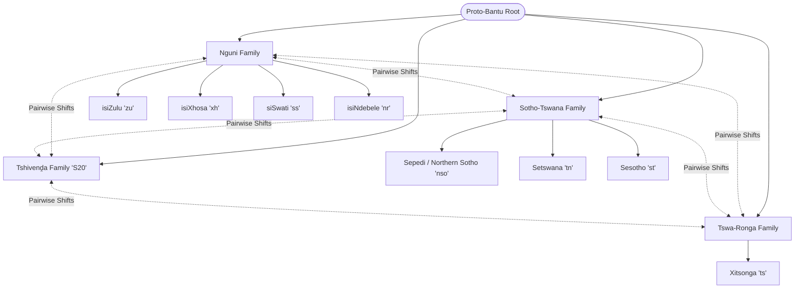
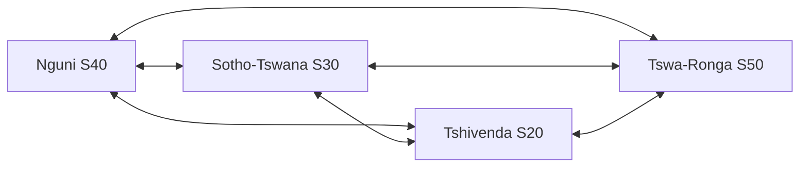

# Bantu Linguistic Phonology, Tonal Prosody & Cognate Deep Dive
## Complete Acoustic and Morpho-Syntactic Foundations for African Vocal Synthesis

> **Document ID:** `BANTU-SUITE-DOC-02`  
> **Source Repository:** `C:\Users\Ndugelo\Zania-Explore-v2.5\Zania-Explore`  
> **Target Platform:** `Vhunambi Sovereign Audio Platform`  
> **Auditor:** Antigravity (Lead Architect & QA)  
> **Date:** November 2026  
> **Classification:** Production Linguistic Science Reference  

---

### 1. The Bantu Language Family Continuum

South African Bantu languages belong to the Southern Bantu branch of the Niger-Congo family. They form a linguistic continuum characterized by:
1. **Agglutinative Morphology:** Words are built by attaching prefixes, infixes, and suffixes to verbal and nominal roots.
2. **Noun Class Systems (Classes 1–15):** Every noun belongs to a class governed by a semantic domain, dictating an alliterative concordial agreement across the entire sentence.
3. **Tonal Prosody:** Pitch (High, Low, Falling) distinguishes lexical meaning and grammatical tense.
4. **Penultimate Syllable Lengthening:** In many Bantu languages (commonly reported; must be verified per language), the second-to-last syllable of a word or phrase is phonologically lengthened, creating a natural metric pulse.



---

### 2. Phonological Inventories & Special Articulations

#### 2.1 Tshivenḓa Phonology & The Sacred Diacritics
Tshivenḓa has a distinctive consonant inventory, featuring dental consonants, breathy-voiced fricatives, and alveolar flaps.

| Symbol | IPA | Description | Acoustic Characteristics | Example | Translation |
| :--- | :--- | :--- | :--- | :--- | :--- |
| **ḓ** | `/d̪/` | Voiced interdental plosive | Tongue tip touches upper teeth. Dental place of articulation (burst frequency must be measured on Vhunambi data). | *ḓuvha* | "day / sun" |
| **ṱ** | `/t̪/` | Voiceless interdental plosive | Sharp acoustic transient without aspiration. | *ṱoho* | "head" |
| **ṋ** | `/n̪/` | Interdental nasal | Nasal resonance with dental place (values to be measured). | *ṋama* | "meat" |
| **ḽ** | `/ɺ/` | Alveolar lateral flap | Brief lateral closure (duration to be measured). Distinctive to Tshivenḓa. | *ḽa* | "that" |
| **ṅ** | `/ŋ/` | Velar nasal | Velar nasal. Written with a superscript dot. | *ṅwana* | "child" |
| **vh** | `/v̤/` or `/β/` | Breathy voiced bilabial/labiodental fricative | Continuous low-frequency voicing mixed with turbulent friction noise. | *vhana* | "children" |
| **fh** | `/ɸ/` | Voiceless bilabial fricative | Pure frication noise without teeth involvement. Corresponds to Zulu *q* or Sotho *f*. | *fhela* | "finish / end" |
| **sw** | `/ʂʷ/` | Labialized retroflex fricative | Whistled sibilant sound found in northern dialects. | *swina* | "enemy" |

#### 2.2 Nguni Consonant System & Clicks
The Nguni group (isiZulu, isiXhosa, siSwati, isiNdebele) incorporated suction clicks from Khoisan languages. In vocal synthesis, clicks are high-amplitude impulsive transients that must be protected during time-stretching or pitch-shifting.

| Click Type | Radical | Aspirated | Voiced | Nasalized | IPA | Acoustic Signature |
| :--- | :--- | :--- | :--- | :--- | :--- | :--- |
| **Dental Click** | **c** (*cela*) | **ch** (*chaza*) | **gc** (*gcoba*) | **nc** (*ncela*) | `/ǀ/` | High-frequency burst, crisp transient (commonly reported; band edges must be measured). |
| **Post-Alveolar Click** | **q** (*qala*) | **qh** (*qhuba*) | **gq** (*gqoka*) | **nq** (*nquma*) | `/ǃ/` | Low-frequency resonant pop, strong energy spike (band to be measured). |
| **Lateral Click** | **x** (*xoxa*) | **xh** (*xhuma*) | **gx** (*gxeka*) | **nx** (*nxusa*) | `/ǁ/` | Broad spectral noise burst, suction release on side teeth (band to be measured). |

#### 2.3 Depressor Consonants & Glottal Pitch Depression
In Nguni and Tshivenḓa, voiced obstruents (`b`, `d`, `g`, `v`, `z`, `j`, `gc`, `gq`, `gx`) act as **depressor consonants**. 
- When a syllable begins with a depressor consonant, the fundamental frequency ($F_0$) of the following vowel is commonly reported to be lowered in natural speech and singing; the magnitude varies by speaker, language, and tone context and **must be measured on Vhunambi data** (Zania cited 15–35 Hz, *Zania-reported, unverified in Vhunambi*).
- **Design principle (hypothesis to validate):** An auto-tuner or pitch quantizer that blindly snaps depressed vowel onsets to strict pitch-center can degrade the natural phonetic quality of the singer. Pitch correction algorithms must allow for depressor onset inflection.

---

### 3. Tonal Prosody & Musical Scale Interaction

#### 3.1 The 3-Tier Tone System
Bantu languages are tonal languages. In Tshivenḓa and isiZulu, words that have identical spelling can have completely different meanings based on pitch contour:

| Tone Category | Notation | Pitch Movement | Example | Meaning |
| :--- | :--- | :--- | :--- | :--- |
| **High Tone (H)** | `´` (acute) | Raised pitch plateau (relative height varies; to be measured) | *mutú* | "person" |
| **Low Tone (L)** | unmarked | Resting pitch baseline | *mutu* | "head / headgear" |
| **Falling Tone (F)** | `ˆ` (circumflex) | Dynamic glide from High to Low within a single syllable | *ndâa* | "respectful male greeting" |

**Grammatical Tonal Contrasts:**
- *ḓá* (High) = "eat!" (Imperative Command)
- *ḓa* (Low) = "to eat" (Infinitive Action)
- *vháná* (High-High) = "children!" (Emphatic vocative)
- *vhana* (Low-Low) = "children" (Neutral noun)

#### 3.2 The Harmony Law: Aligning Pitch Correction with Lexical Tone
In Western pop music, pitch correction snaps a singer to equal temperament scale degrees without regard to word meaning. In Bantu vocal music:
$$\Delta f_{\text{autotune}} \times \text{ToneSign} \ge 0$$
If an aggressive pitch corrector forces a High-tone syllable downward to snap to a lower chord tone, the listener may perceive a different word.
Vhunambi's **Neural Vocal Idealizer** leverages the `ToneContour` extracted from the take to ensure that scale quantization preserves the relative pitch relationships ($f_{H} > f_{L}$) of adjacent syllables.

#### 3.3 Penultimate Syllable Lengthening ($V \to V\colon$)
In natural Bantu speech and musical phrasing, the penultimate (second-to-last) syllable is commonly reported to be longer than preceding syllables (Zania cited 1.6×–2.2×, *Zania-reported, unverified in Vhunambi*); the ratio must be measured on Vhunambi data and is not a universal law.
- In Amapiano (112–115 BPM), lyrics naturally align such that the lengthened penultimate vowel falls squarely on **Beat 3 or Beat 4** of the bar, resolving into the downbeat.
- In Maskandi, the picking pattern (*ukupika*) accents the cadence simultaneously with the penultimate vowel elongation.

---

### 4. The BantuSimilarity Cognate Algorithm

Zania Explore's proprietary `BantuSimilarity` algorithm evaluates linguistic affinity across three weighted vectors:

```
┌─────────────────────────────────────────────────────────────────────────────┐
│                       BantuSimilarity Architecture                          │
├─────────────────────────────────────────────────────────────────────────────┤
│                                                                             │
│   Source Word (e.g. 'amanzi')                Target Word (e.g. 'maḓi')      │
│            │                                          │                     │
│            ▼                                          ▼                     │
│   Prefix Stripping (Class 6: 'ama-')         Prefix Stripping (Class 6: 'ma-')│
│            │                                          │                     │
│            ├────────► Levenshtein Distance (40%) ─────┤                     │
│            │                                          │                     │
│            ├────────► Phonetic Shift Rules (30%) ─────┤                     │
│            │                                          │                     │
│            └────────► Noun Class Concord (30%) ───────┘                     │
│                               │                                             │
│                               ▼                                             │
│                 Composite Similarity Score (0-100%)                         │
│                                                                             │
└─────────────────────────────────────────────────────────────────────────────┘
```

#### 4.1 Phonetic Shift Rules Matrix
> [!WARNING]
> **STARTER SET - requires native-speaker / linguist validation before being treated as authoritative.** The shift-rule table below and the noun-class prefix table in §4.2 were inherited from Zania and have not been validated by Vhunambi linguists. Example pairs are **illustrative only**; several are semantic equivalents rather than verified cognate pairs (for example `cela`/`kopa`, `kakhulu`/`haholo`, `tlala`/`gcwala`). Rules are directional between **peer branches** (`sourceBranch → targetBranch`); none involves a hub language.

Sound transformations proposed between the four peer Southern Bantu branches:

| Rule ID | Transformation | Source Family | Target Family | Position | Historical Linguistics Context | Example Pair (illustrative, unverified) |
| :--- | :--- | :--- | :--- | :--- | :--- | :--- |
| **PSR-01** | `th` $\to$ `r` | Nguni | Tshivenḓa | Medial/Initial | Proto-Bantu $*t \to$ Venda $r$ / Zulu $th$ | *injalo* $\leftrightarrow$ *iralo* ("like so") |
| **PSR-02** | `l` $\to$ `h` | Nguni | Tshivenḓa | Initial | Voiced lateral frication to glottal fricative | *lapha* $\leftrightarrow$ *hafha* ("here") |
| **PSR-03** | `f` $\to$ `p` | Sotho-Tswana | Nguni | Initial | Labial spirantization reversal | *feta* $\leftrightarrow$ *phela* ("pass/live") |
| **PSR-04** | `k` $\to$ `g` | Nguni | Sotho-Tswana | Medial | Voicing lenition | *kakhulu* $\leftrightarrow$ *haholo* ("very much") |
| **PSR-05** | `b` $\to$ `p` | Nguni | Sotho-Tswana | Final | Final consonant devoicing | *(no verified example pair; the previous `hamba`/`tsamaya` pair is not a cognate pair and was removed)* |
| **PSR-06** | `ny` $\to$ `n` | Tshivenḓa | Nguni | Medial | Palatal nasal de-palatalization | *ṋama* $\leftrightarrow$ *inyama* ("meat") |
| **PSR-07** | `dz` $\to$ `z` | Tshivenḓa | Nguni / Sotho | Initial | Affricate de-affrication | *dzhena* $\leftrightarrow$ *ngena* ("enter") |
| **PSR-08** | `q` $\to$ `fh` | Nguni | Tshivenḓa | Initial | Click replacement by bilabial fricative | *qeda* $\leftrightarrow$ *fhela* ("finish") |
| **PSR-09** | `c` $\to$ `ts` | Nguni | Sotho-Tswana | Initial | Dental click to dental affricate | *cela* $\leftrightarrow$ *kopa* ("ask") |
| **PSR-10** | `tl` $\to$ `kl` | Sotho-Tswana | Nguni | Initial | Lateral affricate borrowing | *tlala* $\leftrightarrow$ *gcwala* ("full") |

#### 4.2 Bantu Noun Class Prefix Reference (Classes 1–15) - STARTER SET, needs linguist validation

The Bantu noun class system defines semantic ontology and concordial agreement:

| Class | Semantic Domain | isiZulu Prefix | Tshivenḓa Prefix | Sepedi Prefix | Sesotho Prefix | Setswana Prefix |
| :--- | :--- | :--- | :--- | :--- | :--- | :--- |
| **1** | Humans (singular) | *um(u)-* | *mu-* | *mo-* | *mo-* | *mo-* |
| **2** | Humans (plural) | *aba- / abe-* | *vha-* | *ba-* | *ba-* | *ba-* |
| **3** | Trees, natural forces (sg) | *um(u)-* | *mu-* | *mo-* | *mo-* | *mo-* |
| **4** | Trees, natural forces (pl) | *imi-* | *mi-* | *me-* | *me-* | *me-* |
| **5** | Body parts, paired items (sg) | *i(li)-* | *li-* / *ḽi-* | *le-* | *le-* | *le-* |
| **6** | Liquids, collectives, Class 5 pl | *ama-* | *ma-* | *ma-* | *ma-* | *ma-* |
| **7** | Tools, instruments, language (sg) | *isi-* | *tshi-* | *se-* | *se-* | *se-* |
| **8** | Tools, instruments (pl) | *izi-* | *zwi-* | *di-* | *di-* | *di-* |
| **9** | Animals, common objects (sg) | *i(n)-* | *n-* / *ṋ-* | *n-* | *n-* | *n-* |
| **10** | Animals, common objects (pl) | *izi(n)-* | *dzin-* | *din-* | *din-* | *din-* |
| **11** | Long thin objects, abstractions | *u(lu)-* | *lu-* | — | — | *lo-* |
| **14** | Abstract qualities, collectives | *ubu-* | *vhu-* | *bo-* | *bo-* | *bo-* |
| **15** | Infinitives / verbal nouns ("to...") | *uku-* | *u-* | *go-* | *ho-* | *go-* |

---

### 5. Peer-Branch Cladistic Topology + Pairwise Shift Matrix (replaces "Tshivenḓa as the Acoustic Pivot Bridge")

Zania's audit proposed Tshivenḓa as a central pivot for translation and cross-lingual vocal modelling. **That hypothesis is rejected.** Tshivenḓa (S20) is a peer branch. The four peer branches of Southern Bantu link directly and bidirectionally; there is no hub:

```
   Nguni (S40)  <──────────────>  Sotho-Tswana (S30)
   zu xh ss nr                     nso tn st
      ▲  ╲                          ╱  ▲
      │    ╲                      ╱    │
      │      ╲                  ╱      │
      ▼        ╲              ╱        ▼
  Tswa-Ronga (S50)  <───────>  Tshivenḓa (S20)
   ts                            ve
  (six direct bidirectional branch pairs; zero intermediary nodes)
```



#### Why a Venda hub fails
1. **Intra-branch information loss.** Routing `zu → ve → xh` turns the Nguni click `q` (*qeda*) into Venda `fh` (*fhela*). Venda has no clicks, so on the return trip `fh` cannot be resolved as click or labial, destroying a direct Nguni–Nguni match. The same applies to Sotho-Tswana routing: the shared lateral affricates `tl`/`tlh`/`kg` and 7-vowel height harmony are lost.
2. **Acoustic formant fallacy.** The claim that Venda vowel formants "reside directly in the centroid of the Southern African vowel triangle" was an unsupported assertion. Each branch has its own articulatory posture (Sotho-Tswana close-mid/open-mid contrasts `e, ɛ, o, ɔ`; Nguni depressor lowering on voiced stops `b, d, g, gc, gq, gx`; Xitsonga whistled sibilants `sw/zv`; Tshivenḓa interdental plosives `ḓ, ṱ, ṋ, ḽ` and breathy `vh/fh`). Forcing a Zulu or Pedi singer through a Venda formant centroid flattens native vowel timbre (see doc 04).

#### Routing rules
- **Rule 1 – Intra-branch direct path:** `zu↔xh↔ss↔nr` and `nso↔tn↔st` map directly; never through an external pivot.
- **Rule 2 – Cross-branch pairwise matrix:** crossing branches (Nguni↔Sotho-Tswana, Tshivenḓa↔Nguni, etc.) applies pairwise `sourceBranch→targetBranch` shift rules plus 15-class noun prefix alignment (Class 6 *ama-*↔*ma-*, Class 7 *isi-*↔*se-*↔*tshi-*).
- **Rule 3 – Branch-specific DSP guards:** the Phase 35 vocal idealizer loads the phonological protection profile of the singer's selected branch (Nguni: clicks + depressor onsets; Tshivenḓa: dental plosives + breathy `vh`; Sotho-Tswana: 7-vowel spacing; Tswa-Ronga: whistled sibilants).

#### What remains true about Tshivenḓa
Venda glossary/lesson depth in Zania was low (0 lessons, 43 glossary terms). Treat that as an **underserved peer branch** content gap to close, not as a missing pivot. Near-synonym variants (*lala* vs *edela*, *muthu* vs *munna*) remain useful for rhyme and meter choice but are unvalidated; confirm with a native speaker.

---

## Errata & Correction Log

**2026-11-03**
- **Replaced §5 "Tshivenḓa as the Acoustic Pivot Bridge"** and the mermaid `Venda -.-> Sound Shifts` edges with the Peer-Branch Cladistic Topology + Pairwise Shift Matrix. Reason: Tshivenḓa is a peer branch (S20); a Venda hub loses information within branches (click `q` → `fh` is irreversible; Sotho-Tswana loses `tl/tlh/kg` and 7-vowel harmony) and the "formant centroid" claim was unsupported.
- **PSR table:** the `hamba` ↔ `tsamaya` example under PSR-05 is not a cognate pair and was removed; all example pairs are now marked illustrative/unverified; added the "STARTER SET" warning to the shift-rule table and the noun-class table.
- **Removed unsupported numeric precision** presented as fact (burst/nasal Hz values, click-band Hz ranges, 15-25 ms lateral closure, +3 to +5 st high tone, 15-35 Hz depressor depression, 1.6x-2.2x penultimate lengthening). They are now "commonly reported; must be measured on Vhunambi data" (Zania figures kept only where labelled Zania-reported, unverified).
- Softened "almost all Bantu languages" penultimate lengthening to "many (verify per language)".