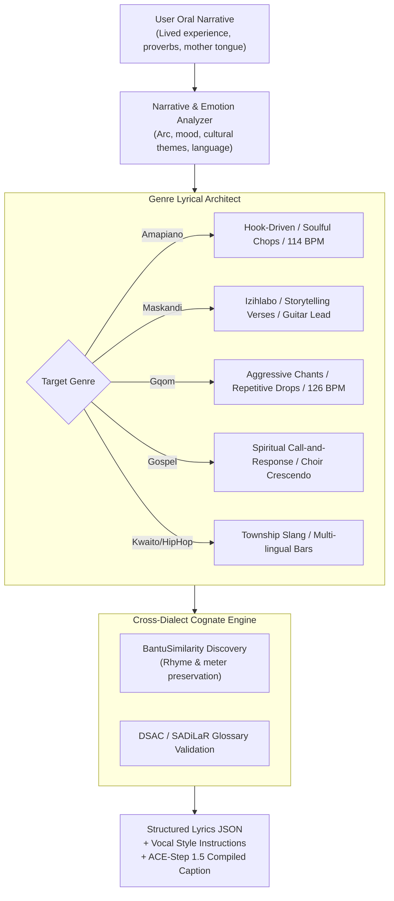

# Story-to-Lyrics & Genre Vocal Prosody Engine
## Narrative Transformation, Cultural Song Forms & Multi-Dialect Lyric Architecture

> **Document ID:** `BANTU-SUITE-DOC-03`  
> **Source Repository:** `C:\Users\Ndugelo\Zania-Explore-v2.5\Zania-Explore`  
> **Target Platform:** `Vhunambi Sovereign Audio Platform`  
> **Auditor:** Antigravity (Lead Architect & QA)  
> **Date:** November 2026  
> **Classification:** Production Generative Music & Lyrics Reference  

---

### 1. The Story-Based Lyric Revolution (`ZR-STORYLYRICS-001`)

Traditional music creation tools force creators to write in rigid Western song templates (`[VERSE 1]`, `[CHORUS]`, `[BRIDGE]`). In African musical heritage, songs originate from **oral storytelling, lived experiences, clan praises (*izithakazelo*), historical narratives, and communal proverbs**.

Zania Explore's `ZR-STORYLYRICS-001` introduced a generative pipeline that allows creators to input free-form stories in their mother tongue, transforming them into genre-structured, culturally authentic lyrics and compiling optimal prompts for ACE-Step 1.5.



---

### 2. South African Genre Song Structures & System Prompts

#### 2.1 Private School Amapiano (Jazzy, Soulful, Uplifting)
* **BPM Range:** 112–118 BPM (typically 114 BPM).
* **Musical Markers:** Soft Rhodes chords, warm sub-bass, syncopated rolling percussion, prominent log drum (*isgubu*) drops, soulful vocal chops.
* **Song Structure:**
  1. `[INTRO]` (2–4 lines): Soft vocal ad-libs ("*Yebo*", "*Shisa*"), atmospheric mood-setting.
  2. `[VERSE 1]` (4–8 lines): Personal narrative, gentle melodic delivery.
  3. `[PRE-CHORUS]` (2–4 lines): Building harmonic tension before log drum entry.
  4. `[CHORUS]` (4–6 lines): The core hook—repetitive, emotionally resonant, memorable.
  5. `[VERSE 2]` (4–8 lines): Narrative development, township life reflections.
  6. `[CHORUS]` (repeat).
  7. `[BRIDGE]` (2–4 lines): Stripped-back Rhodes breakdown or vocal chop solo.
  8. `[OUTRO]` (2–4 lines): Fading ad-libs, resolving groove.
* **Lyrical Style:** Fluid code-switching between English, isiZulu, Sepedi, or Tshivenḓa. Syllable flow matches medium-tempo syncopation. Rhyme scheme prefers AABB or ABAB with natural slant rhymes.

#### 2.2 Maskandi (Traditional Travelling Storyteller Tradition)
* **BPM Range:** 122–132 BPM.
* **Musical Markers:** Acoustic guitar fingerpicking (*ukupika*), German concertina (*inkositini*), walking basslines, fast 4/4 stamping rhythm.
* **Song Structure:**
  1. `[IZIHLABO / INTRO]` (2–4 lines): Spoken greeting, guitar riff showcase, clan praise.
  2. `[VERSE 1]` (8–16 lines): Extended storytelling verse—recounting a journey, hardship, migration, or ancestral message.
  3. `[INTERLUDE]` (1–2 lines): Call-and-response vocal cues with backing harmonies.
  4. `[VERSE 2]` (8–16 lines): Plot advancement, moral crisis, emotional depth.
  5. `[CHORUS / REFRAIN]` (2–4 lines): A universal proverb or ancestral truth.
  6. `[VERSE 3]` (8–12 lines): Moral resolution, life lesson.
  7. `[OUTRO]` (2–4 lines): Blessing, farewell (*Sala kahle / Ndi a livhuwa*).
* **Lyrical Style:** Pure poetic reverie in the creator's mother tongue. No artificial pop autotuning. The lyrics follow the melodic movement of the guitar lead. Proverbs are mandatory.

#### 2.3 Durban Gqom (Raw, Heavy, Minimalist)
* **BPM Range:** 125–128 BPM.
* **Musical Markers:** Heavy distorted kick drums, dark ambient drone synths, syncopated tom-toms, frantic shaker patterns.
* **Song Structure:**
  1. `[DROP / CHANT 1]` (2–4 lines): Aggressive, commanding vocal battle cry, repeated with intensity.
  2. `[BUILD-UP]` (1–2 lines): Rapid rhythmic chanting driving dancefloor anticipation.
  3. `[DROP 2]` (2–4 lines): Heavy kick release, call-and-response vocal hook.
  4. `[BREAKDOWN]` (2 lines): Minimal bass hum with vocal ad-lib.
  5. `[FINAL DROP]` (4 lines): Maximum energy, shouting vocals, frantic repeating hook.
* **Lyrical Style:** Minimal text, high rhythmic impact. Heavy use of street battle cries (*"Asambeni!"*, *"Woza!"*, *"Gqom is here"*).

#### 2.4 South African Gospel (Praise & Spiritual Crescendo)
* **BPM Range:** 88–104 BPM.
* **Musical Markers:** Hammond B3 organ, grand piano, brass accents, full choral four-part harmonies (SATB), syncopated bass.
* **Song Structure:**
  1. `[INTRO]` (2–4 lines): Solo reverent invocation, gentle organ accompaniment.
  2. `[SOLO VERSE 1]` (4–8 lines): Testimony of struggle and faith.
  3. `[CHORUS]` (4–8 lines): Full choir entry with massive harmonic richness.
  4. `[CALL AND RESPONSE 1]` (4–8 lines): Soloist calls out verses; choir responds in harmonic unison.
  5. `[CRESCENDO / MODULATION]` (4 lines): Key change (+1 semitone), driving drum fills.
  6. `[OUTRO / VAMP]` (4–8 lines): Ecstatic repetition of praise refrain, resolving on organ chord.
* **Lyrical Style:** Solemn, uplifting, scriptural, and ancestral praise. Rich multisyllabic Bantu verbs of adoration (*"Re a go boka"*, *"Siyakudumisa"*, *"Ndi a u renda"*).

---

### 3. Separation of Genre DNA and Language Context

In `lib/bantu-engine/music/language-context.ts`, Zania Explore established a strict architectural rule enforced by `CulturalValidation.validateLanguageNeutrality()`:

```typescript
// Architectural Rule: Language-Neutral Genre DNA
export const AMAPIANO_GENRE_DNA = {
  name: "Private School Amapiano",
  bpm: 114,
  promptTemplate: "Private School Amapiano, 114 BPM, heavy log drum bass, jazzy piano chords, rolling percussion, soulful vocal chops, deep sub bass"
};
```

**Why this rule is mandatory:**
1. **Cultural Equity:** South African music genres are national innovations. Amapiano was shaped in Gauteng townships by Zulu, Sotho, Pedi, Tsonga, and Venda youths alike. Locking Amapiano prompts to isiZulu alone erases the contributions of Pedi and Venda creators.
2. **Combinatorial Freedom:** In Vhunambi, a creator can pick:
   - Genre DNA: `Private School Amapiano (114 BPM)`
   - Language Context: `Tshivenḓa (ve)`
   - Vocal Style: `Soulful Female Vocal Chops`
   The engine dynamically synthesizes:
   `"Private School Amapiano, 114 BPM, heavy log drum bass, jazzy piano chords, rolling percussion, soulful vocal chops in Tshivenḓa, culturally authentic South African production"`

---

### 4. Cognate-Enhanced Lyric Generation & Meter Preservation

When a creator writes a song intended for multi-provincial broadcast, Zania's `generateCognateEnhancedLyrics` analyzes the lyrical lines and identifies **cognate replacement opportunities**:

```typescript
interface CognateEnhancedLyricsInput {
  storyTheme: string;
  baseLanguage: SALanguage;        // e.g. 'zu' (isiZulu)
  targetLanguages: SALanguage[];   // e.g. ['ve', 'st'] (Tshivenḓa, Sesotho)
  preserveRhymeScheme: boolean;
  culturalContext?: string;
}
```

#### How the Algorithm Operates:
1. **Meter & Syllable Count Preservation:**
   If a base line has 8 syllables (`In-dlu ya-mi i-nha-hle`), any proposed cognate substitution in the target dialect must preserve the exact syllable count:
   - Target Tshivenḓa: `N-dlu ya-nga yo-na-ka` (8 syllables, exact rhythmic match!).
2. **Rhyme Scheme Alignment:**
   Because Southern Bantu languages almost universally end words in vowels (open syllables), words belonging to the same noun class prefix share matching vowel harmonies and terminal rhymes across dialects.
3. **Lexical Validation via GlossaryService:**
   Every proposed cognate is checked against verified terminology datasets (SADiLaR, DSAC) to ensure it is not an archaic or derogatory false friend.

---

### 5. ACE-Step 1.5 Compiled Caption Architecture

The final stage of the story transform pipeline is `buildCompiledCaption`. ACE-Step 1.5 produces its highest fidelity music when the text prompt follows a clean, hierarchical token structure:

```
[GENRE DNA], [BPM] BPM, [INSTRUMENTATION], [VOCAL INSTRUCTIONS], [CULTURE TAGS], [EMOTION DESCRIPTORS]
```

**Concrete Example:**
```text
Private School Amapiano, 114 BPM, heavy log drum bass, jazzy Rhodes chords, rolling percussion, deep sub bass, soulful female lead vocal chops in Tshivenḓa with emotional backing harmonies, ubuntu, township youth culture, warm and reflective mood, high-end South African studio production
```

This compiled caption is passed directly to the RunPod GPU cluster, while the structured lyrics are fed into the lyrics synchronizer and vocal idealizer.
