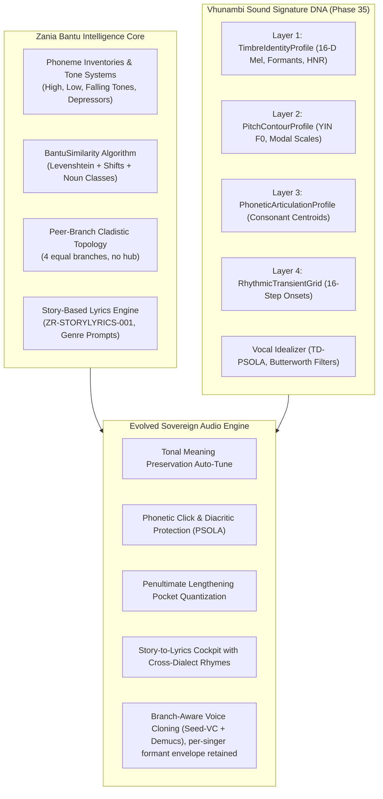

# Vhunambi Sound Signature Synthesis & Evolution Blueprint
## Merging Bantu Linguistic Intelligence with Sovereign Acoustic DNA & Neural Vocal Idealization

> **Document ID:** `BANTU-SUITE-DOC-04`  
> **Source Repository:** `C:\Users\Ndugelo\Zania-Explore-v2.5\Zania-Explore`  
> **Target Platform:** `Vhunambi Sovereign Audio Platform`  
> **Lead Architect:** Antigravity (Lead Architect & QA)  
> **Date:** November 2026  
> **Classification:** Master Evolution Architecture Blueprint  

---

### 1. The Architectural Convergence

Vhunambi has achieved a major milestone in Phase 35 by shipping the on-device **Sovereign Sound Signature ID (`SoundSignatureDna` / `VHU-SIG`)** and the **Neural Vocal Idealizer Engine** (pure Dart DSP, TD-PSOLA resynthesis, LPC formant tracking, African modal scales, 41.9 MB release APK on hardware).

The forensic audit of `Zania-Explore-v2.5` provides the missing half of the equation: **deep Bantu linguistic intelligence, phonological tone rules, cognate algorithms, and story-based song structures**.

By synthesizing Zania Explore's linguistic science with Vhunambi's physical DSP audio engine, we aim to build a **Linguistically-Aware Sovereign Vocal Synthesis & Acoustic DNA Engine**.



---

### 2. Layer-by-Layer DNA Integration

#### Layer 1: TimbreIdentityProfile $\oplus$ Bantu Phonology
In Phase 35, `TimbreIdentityProfile` extracts:
- 16-D DCT-II mel-frequency cepstral coefficients.
- Linear Predictive Coding (LPC) formants ($F_1, F_2, F_3, F_4$).
- Harmonic-to-Noise Ratio (HNR) and $H_1-H_2$ glottal warmth proxy.

**The Linguistic Evolution:**
- **Branch-specific formant envelope retained per singer; never normalised to another language.** Bantu branches have distinct vowel articulation (e.g. Sotho-Tswana 7-vowel close-mid/open-mid contrasts). `TimbreIdentityProfile` keeps the singer's own measured formant envelope and records the selected `BantuLanguageBranch` as metadata so DSP guards can load that branch's protection profile. The earlier proposal of a single "Vocal Tract Resonance Centroid" (normalising every singer to a Tshivenḓa centroid) is withdrawn: it would flatten native vowel timbre. Any cross-branch comparison is done pairwise, not through a shared centroid.
- **Glottal Warmth Calibration:** Breathy voiced fricatives in Tshivenḓa (`vh` / [v̤]) and depressor-induced breathiness in isiZulu naturally depress HNR and elevate $H_1-H_2$. The engine now recognizes this as authentic Bantu phonation rather than mic noise or vocal weakness!

#### Layer 2: PitchContourProfile $\oplus$ Bantu Tone Laws
In Phase 35, `PitchContourProfile` segments notes and snaps pitch to four African modal scales (`AfricanScaleMode.pentatonic`, `hexatonic`, `heptatonic`, `heptatonicBantu`).

**The Linguistic Evolution:**
- **Tone-Preserving Auto-Tune:** A standard pitch-shifter snaps a High-tone syllable downward if the closest chord tone is below it, inadvertently changing the word's meaning (e.g. turning *mutú* "person" into *mutu* "head"). 
- With Zania's tonal inventory, the `PitchTrajectoryEditor` enforces the **Bantu Lexical Tone Guard**:
  $$\text{sign}\bigl(f_{\text{target}}(t) - f_{\text{target}}(t-1)\bigr) = \text{sign}\bigl(T_n - T_{n-1}\bigr)$$
  Pitch quantization snaps pitch to the modal scale *within the tonal bracket* dictated by the word's linguistic tone category.

#### Layer 3: PhoneticArticulationProfile $\oplus$ Click & Diacritic Protection
In Phase 35, `PhoneticArticulationProfile` computes unvoiced consonant energy and spectral centroid.

**The Linguistic Evolution:**
- **Extend/verify branch-specific click windows:** Nguni clicks (`c`, `q`, `x`) and Tshivenḓa dental plosives (`ḓ`, `ṱ`) are commonly reported to be short, impulsive, high-frequency transients; their exact duration and band must be measured on Vhunambi data. Note: Phase 35 PSOLA already leaves unvoiced consonants bit-exact (unvoiced/transient regions bypass pitch processing), so this is **not a new PSOLA feature**.
- Risk to verify: voiced click-accompaniments (`gc`, `gq`, `gx`, nasalised clicks) and voiced dental plosives may fall inside voiced runs where grain overlap-add could smear the transient.
- Proposed work: extend the existing guard with branch-specific click/dental-plosive windows (loaded from the singer's branch profile) and add tests verifying pass-through is sample-identical for those windows, while pitch-shifting surrounding vowels.

#### Layer 4: RhythmicTransientGrid $\oplus$ Penultimate Syllable Lengthening
In Phase 35, `RhythmicTransientGrid` quantizes vocal takes to 16-step musical beats.

**The Linguistic Evolution:**
- **The Penultimate Cadence Anchor:** Penultimate lengthening ($V \to V\colon$) is commonly reported in many Bantu languages (Zania cited ~1.8×, *Zania-reported, unverified in Vhunambi*); it is not a universal law and the ratio must be measured on Vhunambi data.
- The `PocketQuantizer` now recognizes this elongated syllable as the metric phrase cadence. Instead of forcing all syllables to equal 16th-note durations, it should preserve the interval between a clearly lengthened penultimate syllable and the final onset (a hypothesis to validate on real takes), so the cadence keeps its natural relation to the groove.

#### Layer 5: SoundIdealizerRecipe $\oplus$ African Acoustic Master Chain
In Phase 35, `SoundIdealizerRecipe` provides 6 sculpting parameters:
- Scale Lock (0.0 to 1.0)
- Vibrato Polish (0.0 to 1.0 at 5.5 Hz)
- Formant Depth Shift (-3.0 to +3.0 semitones)
- Pocket Quantize (0.0 to 1.0)
- Tone Shaper (Warm / Crisp / Studio Neutral)
- Regional Archetype (24 African vocal personas)

**The Linguistic Evolution:**
- The studio tone chain incorporates:
  - **450 Hz Box Notch:** Eliminates room resonances typical of bedroom recordings on budget phone mics.
  - **160 Hz Chest Power Shelf:** Adds rich body and presence to African male storytelling vocals (Maskandi, Gospel).
  - **11.5 kHz Air Boost:** Enhances clarity and breath details for female Amapiano vocal chops.
  - **Regional Dialect Formant Presets:** Formant shift ratios ($\alpha = F_{\text{target}} / F_{\text{source}}$) remain within the Phase 35 +-3 st bound and are relative to the **singer's own** envelope; the singer's peer branch (Nguni, Sotho-Tswana, Tshivenḓa, Tswa-Ronga) selects the protection profile, never a normalisation target.

---

### 3. Peer-Branch Voice Architecture (replaces "Venda-Pivot Rosetta Stone")

The earlier draft normalised every singer to a "Tshivenḓa acoustic centroid" before routing to Nguni / Sotho / Tsonga vocals. **This is withdrawn** (acoustic formant fallacy). Each branch has its own articulatory posture:

| Branch | Characteristic articulation to protect (commonly reported; verify on Vhunambi data) |
| :--- | :--- |
| Nguni (S40) | Clicks `c/q/x` families; depressor lowering on voiced stops `b, d, g, gc, gq, gx` |
| Sotho-Tswana (S30) | 7-vowel system with close-mid/open-mid contrasts `e, ɛ, o, ɔ`; lateral affricates `tl/tlh/kg` |
| Tshivenḓa (S20) | Interdental plosives/nasal/lateral `ḓ, ṱ, ṋ, ḽ`; breathy `vh`/`fh` |
| Tswa-Ronga (S50) | Whistled sibilants `sw/zv` |

```
                     ┌─────────────────────────┐
                     │  Raw Audio Take / Hum   │
                     └────────────┬────────────┘
                                  ▼
                     ┌─────────────────────────┐
                     │ SoundSignatureDna       │  singer's own formant envelope RETAINED
                     │ + selected branch       │  (never normalised to another language)
                     └────────────┬────────────┘
                                  ▼
          ┌──────────────┬────────┴───────┬──────────────┐
          ▼              ▼                ▼              ▼
   Nguni profile   Sotho-Tswana     Tshivenḓa      Tswa-Ronga
   clicks +        profile          profile        profile
   depressors      7-vowel spacing  dentals + vh   whistled sibilants
   (each profile guards the take; branches relate to each other only
    through direct/pairwise rules, with no central hub)
```

Processing rules:
1. The on-device engine extracts the `SoundSignatureDna` and keeps the singer's **branch-specific formant envelope** untouched.
2. The Phase 35 vocal idealizer loads the protection profile for the singer's selected branch (Rule 3).
3. Lyric/cognate mapping within a branch is direct (Rule 1); across branches it uses the pairwise shift matrix plus noun-prefix alignment (Rule 2). No hub is ever inserted.
4. If a user picks a different regional archetype, the Phase 35 formant-shift bound (±3 st) applies relative to the singer's own envelope; the target branch's profile is applied to the output guards.

---
### 4. Client UI/UX Evolution Roadmap

To expose this technology to creators, Vhunambi will evolve three core client touchpoints:

#### 4.1 Enhanced `SoundSignatureIdealizerSheet`
- **Tonal Pitch Curve Display:** In `PitchFormantPainter`, add visual glyphs indicating detected lexical tones (High, Low, Falling) alongside raw F0 and idealized F0 curves.
- **Phonetic Protection Indicators:** Highlight protected consonant/click columns with a subtle emerald badge, giving creators visual confidence that their indigenous consonants are preserved without distortion.
- **Dialect Archetype Selector:** Expand the 24 regional archetypes to clearly reflect the four peer branches (Nguni, Sotho-Tswana, Tshivenḓa, Tswa-Ronga).

#### 4.2 Story-Based Lyrics Studio Cockpit (`LyricsReviewModal`)
- **Oral Storytelling Input:** Replace the rigid formatted text box with a narrative prompt: *"Tell your story, memory, or proverb in your home language..."*
- **Genre Song Formatter:** Instantly convert the narrative into genre-authentic song forms (Amapiano, Maskandi, Gqom, Gospel, Kwaito) using Zania's battle-tested system prompts.
- **Cross-Dialect Cognate Switcher:** Provide a real-time toggle showing how key lyrical lines sound in sister languages using direct intra-branch maps and pairwise cross-branch rules (e.g. Zulu $\leftrightarrow$ Xhosa direct; Zulu $\leftrightarrow$ Sesotho pairwise), never routed through a hub language, while preserving meter and rhyme.

#### 4.3 Cloud ACE-Step 1.5 Caption Generation
- Compile full, production-ready captions that pass Genre DNA + Language Context + Vocal Instructions + Mood Descriptors to the RunPod GPU cluster, guaranteeing culturally authentic music synthesis.

---

### 5. Summary Matrix: Zania Assets $\to$ Vhunambi Deliverables

| Zania Explore Asset | Vhunambi Target Integration | Strategic Value |
| :--- | :--- | :--- |
| `BantuSimilarity` Algorithm | `lib/features/sound_signature/domain/dsp/bantu_similarity.dart` | Pure Dart algorithmic cognate detection; 0 ML overhead; instant cross-dialect rhyme suggestions. |
| `PHONETIC_SHIFT_RULES` | `lib/features/sound_signature/domain/dsp/phonetic_shifts.dart` | Pairwise `sourceBranch→targetBranch` shift rules across the four peer branches (starter set; needs linguist validation). |
| `NOUN_CLASS_PREFIXES` (1–15) | `lib/features/sound_signature/domain/dsp/noun_classes.dart` | Grammatical concord verification; prevents lyrical hallucinations in generated lyrics. |
| Phoneme & Tone Inventories | `lib/features/sound_signature/domain/dsp/bantu_phonology.dart` | Per-branch protection profiles: tonal meaning guard in auto-tune; extend/verify click (`c`, `q`, `x`) and diacritic (`ḓ`, `ṱ`, `ṋ`, `ḽ`, `vh`) windows. |
| `ZR-STORYLYRICS-001` Prompts | `apps/vhunambi_api/src/modules/lyrics/story_lyrics_prompts.ts` | Narrative-to-lyrics conversion tailored to Amapiano, Maskandi, Gqom, Gospel, and SA Hip Hop. |
| Genre / Language Separation | `lib/features/studio/domain/models/genre_language_contract.dart` | Ensures national genres remain language-neutral, empowering creators across all 9 indigenous tongues. |
| Universal ID Prefix Registry | `apps/vhunambi_api/src/modules/ids/universal_ids.ts` | Scalable `{prefix}_{12-byte-hex}` entity identification across audio, lyrics, and user profiles. |

---

## Errata & Correction Log

**2026-11-03**
- **Removed the Venda pivot / centroid design.** Replaced the mermaid `Pivot` node, "Venda-Pivot Voice Cloning", §3 "Venda-Pivot Rosetta Stone", the "Vocal Tract Resonance Centroid" normalisation, and the summary-table wording with the Peer-Branch Cladistic Topology + Pairwise Shift Matrix and the rule "branch-specific formant envelope retained per singer; never normalised to another language". Reason: Tshivenḓa (S20) is a peer of Nguni (S40), Sotho-Tswana (S30) and Tswa-Ronga (S50); normalising singers to a Venda formant centroid flattens native vowel timbre (Sotho-Tswana close-mid/open-mid vowels, Nguni depressor lowering, Xitsonga whistled sibilants); a Venda hub also loses intra-branch information (click `q` → `fh` is irreversible).
- **Click protection is not a new PSOLA feature.** Phase 35 PSOLA already leaves unvoiced consonants bit-exact; the work is reworded to "extend/verify with branch-specific click windows".
- **Unsupported precision removed:** "60%+ cognate intelligibility" removed from the diagram; ">3.5 kHz, 10-30 ms" click figures, "universal ~1.8x penultimate lengthening" and the "dotted 8th" rule are now "commonly reported / hypothesis to validate on Vhunambi data". The "world's first" claim was softened.