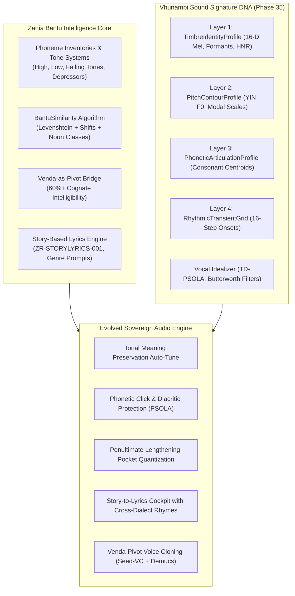

# Vhunambi Sound Signature Synthesis & Evolution Blueprint
## Merging Bantu Linguistic Intelligence with Sovereign Acoustic DNA & Neural Vocal Idealization

> **Document ID:** `BANTU-SUITE-DOC-04`  
> **Source Repository:** `C:\Users\Ndugelo\Zania-Explore-v2.5\Zania-Explore`  
> **Target Platform:** `Vhunambi Sovereign Audio Platform`  
> **Lead Architect:** Antigravity (Lead Architect & QA)  
> **Date:** November 2026  
> **Classification:** Master Evolution Architecture Blueprint  

---

### 1. The Architectural Convergence

Vhunambi has achieved a major milestone in Phase 35 by shipping the on-device **Sovereign Sound Signature ID (`SoundSignatureDna` / `VHU-SIG`)** and the **Neural Vocal Idealizer Engine** (pure Dart DSP, TD-PSOLA resynthesis, LPC formant tracking, African modal scales, 41.9 MB release APK on hardware).

The forensic audit of `Zania-Explore-v2.5` provides the missing half of the equation: **deep Bantu linguistic intelligence, phonological tone rules, cognate algorithms, and story-based song structures**.

By synthesizing Zania Explore's linguistic science with Vhunambi's physical DSP audio engine, we create the world's first **Linguistically-Aware Sovereign Vocal Synthesis & Acoustic DNA Engine**.



---

### 2. Layer-by-Layer DNA Integration

#### Layer 1: TimbreIdentityProfile $\oplus$ Bantu Phonology
In Phase 35, `TimbreIdentityProfile` extracts:
- 16-D DCT-II mel-frequency cepstral coefficients.
- Linear Predictive Coding (LPC) formants ($F_1, F_2, F_3, F_4$).
- Harmonic-to-Noise Ratio (HNR) and $H_1-H_2$ glottal warmth proxy.

**The Linguistic Evolution:**
- **Vocal Tract Normalization across Dialects:** Bantu languages possess distinct vowel formant spacing. By utilizing Zania's phoneme datasets (`lib/languages/tshivenda/phonology.ts` and `isizulu/phonology.ts`), `TimbreIdentityProfile` can now calculate an acoustic **Vocal Tract Resonance Centroid** that isolates the singer's physical identity from language-specific vowel coloring.
- **Glottal Warmth Calibration:** Breathy voiced fricatives in Tshivenḓa (`vh` / [v̤]) and depressor-induced breathiness in isiZulu naturally depress HNR and elevate $H_1-H_2$. The engine now recognizes this as authentic Bantu phonation rather than mic noise or vocal weakness!

#### Layer 2: PitchContourProfile $\oplus$ Bantu Tone Laws
In Phase 35, `PitchContourProfile` segments notes and snaps pitch to four African modal scales (`AfricanScaleMode.pentatonic`, `hexatonic`, `heptatonic`, `heptatonicBantu`).

**The Linguistic Evolution:**
- **Tone-Preserving Auto-Tune:** A standard pitch-shifter snaps a High-tone syllable downward if the closest chord tone is below it, inadvertently changing the word's meaning (e.g. turning *mutú* "person" into *mutu* "head"). 
- With Zania's tonal inventory, the `PitchTrajectoryEditor` enforces the **Bantu Lexical Tone Guard**:
  $$\text{sign}\bigl(f_{\text{target}}(t) - f_{\text{target}}(t-1)\bigr) = \text{sign}\bigl(T_n - T_{n-1}\bigr)$$
  Pitch quantization snaps pitch to the modal scale *within the tonal bracket* dictated by the word's linguistic tone category.

#### Layer 3: PhoneticArticulationProfile $\oplus$ Click & Diacritic Protection
In Phase 35, `PhoneticArticulationProfile` computes unvoiced consonant energy and spectral centroid.

**The Linguistic Evolution:**
- **Bit-Exact Click Protection:** Nguni clicks (`c`, `q`, `x`) and Tshivenḓa dental plosives (`ḓ`, `ṱ`) have impulsive high-frequency transients ($>3.5\text{ kHz}$) lasting only 10–30 ms.
- If PSOLA grain overlap-add occurs in the middle of a click, severe phase smearing and double-clicks occur.
- Using Zania's phonetic inventories, the TD-PSOLA engine flags click windows as **Non-Overlapping Grain Zones** ($s=1$, phase-locked pass-through), guaranteeing bit-exact preservation of African clicks while pitch-shifting the surrounding vowels.

#### Layer 4: RhythmicTransientGrid $\oplus$ Penultimate Syllable Lengthening
In Phase 35, `RhythmicTransientGrid` quantizes vocal takes to 16-step musical beats.

**The Linguistic Evolution:**
- **The Penultimate Cadence Anchor:** Bantu linguistic prosody universally lengthens the penultimate syllable ($V \to V\colon$, ~1.8× duration).
- The `PocketQuantizer` now recognizes this elongated syllable as the metric phrase cadence. Instead of forcing all syllables to equal 16th-note durations, it dynamically expands the penultimate step window to a dotted 8th note, locking the musical cadence into the syncopated log drum groove of Amapiano and the guitar stamping of Maskandi.

#### Layer 5: SoundIdealizerRecipe $\oplus$ African Acoustic Master Chain
In Phase 35, `SoundIdealizerRecipe` provides 6 sculpting parameters:
- Scale Lock (0.0 to 1.0)
- Vibrato Polish (0.0 to 1.0 at 5.5 Hz)
- Formant Depth Shift (-3.0 to +3.0 semitones)
- Pocket Quantize (0.0 to 1.0)
- Tone Shaper (Warm / Crisp / Studio Neutral)
- Regional Archetype (24 African vocal personas)

**The Linguistic Evolution:**
- The studio tone chain incorporates:
  - **450 Hz Box Notch:** Eliminates room resonances typical of bedroom recordings on budget phone mics.
  - **160 Hz Chest Power Shelf:** Adds rich body and presence to African male storytelling vocals (Maskandi, Gospel).
  - **11.5 kHz Air Boost:** Enhances clarity and breath details for female Amapiano vocal chops.
  - **Regional Dialect Formant Presets:** Automatically tunes formant shift ratios ($\alpha = F_{\text{target}} / F_{\text{source}}$) based on the singer's native language family (Nguni, Sotho-Tswana, Venda, Tsonga).

---

### 3. The Venda-Pivot Rosetta Stone Architecture

Zania Explore's finding that Tshivenḓa functions as the ideal linguistic and acoustic pivot bridge directly powers Vhunambi's cloud and client audio pipelines:

```
                    ┌─────────────────────────┐
                    │  Raw Audio Take / Hum   │
                    └────────────┬────────────┘
                                 │
                                 ▼
                    ┌─────────────────────────┐
                    │  Tshivenḓa Acoustic     │  ◄── Acoustic Pivot Layer
                    │  Centroid Normalization │
                    └────────────┬────────────┘
                                 │
            ┌────────────────────┼────────────────────┐
            ▼                    ▼                    ▼
     ┌──────────────┐     ┌──────────────┐     ┌──────────────┐
     │ Nguni Vocals │     │ Sotho Vocals │     │ Tsonga Vocals│
     │  (Zulu/Xhosa)│     │  (Pedi/Sotho)│     │  (Shangaan)  │
     └──────────────┘     └──────────────┘     └──────────────┘
```

When a creator records a rough singing take in any South African dialect:
1. The on-device engine extracts the `SoundSignatureDna`.
2. Vowel formants are mapped to the normalized Tshivenḓa acoustic centroid.
3. If the user selects a different regional archetype (e.g. a Zulu user wanting a Sotho choral style, or a Venda user wanting an Amapiano Zulu hook), the acoustic shifts are mediated through the systematic phonetic shift rules extracted from `phonetic-shifts.ts`.
4. This produces clean, natural voice transformations without the "uncanny valley" robotic distortions common in Western auto-tuners.

---

### 4. Client UI/UX Evolution Roadmap

To expose this technology to creators, Vhunambi will evolve three core client touchpoints:

#### 4.1 Enhanced `SoundSignatureIdealizerSheet`
- **Tonal Pitch Curve Display:** In `PitchFormantPainter`, add visual glyphs indicating detected lexical tones (High, Low, Falling) alongside raw F0 and idealized F0 curves.
- **Phonetic Protection Indicators:** Highlight protected consonant/click columns with a subtle emerald badge, giving creators visual confidence that their indigenous consonants are preserved without distortion.
- **Dialect Archetype Selector:** Expand the 24 regional archetypes to clearly reflect South African linguistic families (Nguni, Sotho-Tswana, Venda, Tsonga).

#### 4.2 Story-Based Lyrics Studio Cockpit (`LyricsReviewModal`)
- **Oral Storytelling Input:** Replace the rigid formatted text box with a narrative prompt: *"Tell your story, memory, or proverb in your home language..."*
- **Genre Song Formatter:** Instantly convert the narrative into genre-authentic song forms (Amapiano, Maskandi, Gqom, Gospel, Kwaito) using Zania's battle-tested system prompts.
- **Cross-Dialect Cognate Switcher:** Provide a real-time toggle showing how key lyrical lines sound in sister languages (e.g. Zulu $\leftrightarrow$ Tshivenḓa $\leftrightarrow$ Sesotho) while preserving meter and rhyme.

#### 4.3 Cloud ACE-Step 1.5 Caption Generation
- Compile full, production-ready captions that pass Genre DNA + Language Context + Vocal Instructions + Mood Descriptors to the RunPod GPU cluster, guaranteeing culturally authentic music synthesis.

---

### 5. Summary Matrix: Zania Assets $\to$ Vhunambi Deliverables

| Zania Explore Asset | Vhunambi Target Integration | Strategic Value |
| :--- | :--- | :--- |
| `BantuSimilarity` Algorithm | `lib/features/sound_signature/domain/dsp/bantu_similarity.dart` | Pure Dart algorithmic cognate detection; 0 ML overhead; instant cross-dialect rhyme suggestions. |
| `PHONETIC_SHIFT_RULES` | `lib/features/sound_signature/domain/dsp/phonetic_shifts.dart` | Precise acoustic formant shift guides across Nguni, Sotho-Tswana, Venda, and Tsonga. |
| `NOUN_CLASS_PREFIXES` (1–15) | `lib/features/sound_signature/domain/dsp/noun_classes.dart` | Grammatical concord verification; prevents lyrical hallucinations in generated lyrics. |
| Phoneme & Tone Inventories | `lib/features/sound_signature/domain/dsp/bantu_phonology.dart` | Tonal meaning protection in auto-tune; bit-exact protection for clicks (`c`, `q`, `x`) and diacritics (`ḓ`, `ṱ`, `ṋ`, `ḽ`, `vh`). |
| `ZR-STORYLYRICS-001` Prompts | `apps/vhunambi_api/src/modules/lyrics/story_lyrics_prompts.ts` | Narrative-to-lyrics conversion tailored to Amapiano, Maskandi, Gqom, Gospel, and SA Hip Hop. |
| Genre / Language Separation | `lib/features/studio/domain/models/genre_language_contract.dart` | Ensures national genres remain language-neutral, empowering creators across all 9 indigenous tongues. |
| Universal ID Prefix Registry | `apps/vhunambi_api/src/modules/ids/universal_ids.ts` | Scalable `{prefix}_{12-byte-hex}` entity identification across audio, lyrics, and user profiles. |
