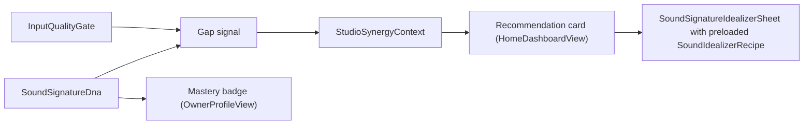

# Cross-Module Synergy for Vhunambi
## Translating Zania's Synergy Patterns into the Vhunambi Studio

> **Document ID:** `BANTU-SUITE-DOC-05`
> **Source:** `C:\Users\Ndugelo\Zania-Explore-v2.5\Zania-Explore\docs\CROSS_MODULE_SYNERGY_STRATEGY.md` (Parts 1, 3, 4, 5)
> **Target Platform:** Vhunambi Sovereign Audio Platform
> **Date:** 2026-11-03
> **Status:** Design proposal. Implementation tracked in `docs/phases/phase_36_bantu_linguistic_dsp_and_synergy/` (Track C and D).

> [!IMPORTANT]
> Any percentage uplift quoted by Zania (engagement, retention, completion) is **hypothetical** here. Vhunambi has no measurements for them. Do not present them as targets or results without instrumentation.

---

## 1. The core idea

Zania's strategy: modules should not be isolated pages. Each module emits a **measured signal** (`source_module`), and another module offers a **one-tap next action** (`target_module`). Vhunambi already measures a lot (Phase 35: `InputQualityGate`, `SoundSignatureDna`, `CreatorDna`) but surfaces little of it as actions.

---

## 2. Pattern 1 - Diagnostic Gap -> Fix Loop (`StudioSynergyContext`)

Zania Part 1 turns a failed assessment into a targeted lesson. Vhunambi equivalent: turn a **measured weakness** into a preloaded fix.

| Measured gap (source) | Threshold (proposal, tune on data) | One-tap action | Preloaded `SoundIdealizerRecipe` field |
| :--- | :--- | :--- | :--- |
| `stabilityScore` (pitch stability, `PitchContourProfile`) low | < 0.6 | "Steady my pitch" | raise `pitchScaleLock`, raise `vibratoAndSustainPolish` |
| `snrDb` (`InputQualityGate`) low | < 15 dB | "Clean my room noise" | reference cleanup / denoise strength |
| `reverbEdtMs` high | > ~300 ms | "Tame the echo" (cloud dereverb deferred per Phase 35) | box-cut + flag "needs cloud" |
| `keyConfidence` low | < 0.5 | "Pick my key" | opens key/scale chooser (user override) |
| `offsetFromGridMs` high | > ~40 ms | "Tighten my timing" | raise pocket-quantize amount |

Thresholds above are **starting proposals**, not validated values.

Design: a `StudioSynergyContext` (immutable) carries `{sourceModule, targetModule, gapKind, measuredValue, suggestedRecipe}`. `SoundSignatureIdealizerSheet` accepts an optional context and initialises its recipe from `suggestedRecipe`; the user can still edit or reset (non-destructive, Phase 35 REQ-SIG-IDEAL-11).

---

## 3. Pattern 2 - Global line-by-line lyric translation + phonetic sing-along

Zania Part 3 adds a global translation hook. Vhunambi surfaces it in the two lyric displays: `KineticReelsModal` and `LyricsTeleprompter` (track detail), and offers the same data in `LyricsReviewModal`.

Per lyric line the layer returns:
1. **Original line** (as written).
2. **Phonetic guide** with the penultimate syllable stress marked (e.g. `ha-**mba**-ni`), a convention to validate per language.
3. **Home-language meaning** in the viewer's chosen language.
4. **Cognate badges** where the cognate finder (peer-branch rules, doc 02 §5) finds matches.

> [!WARNING]
> v1 is **lexicon-based over a small curated glossary**. Lines or words with no entry show "meaning unavailable". No machine-fabricated translations. The shift/noun-class tables are a starter set requiring native-speaker validation.

---

## 4. Pattern 3 - Cross-module creator mastery achievements

Zania Part 4 defines a gamified super profile. Vhunambi maps it to `CreatorDna` and `OwnerProfileView`:

| Badge | Condition | Reward (proposal) | Money/credits impact |
| :--- | :--- | :--- | :--- |
| Polyglot Vocalist | Songs created in 3+ distinct `BantuLanguageBranch` values | Cosmetic profile badge + profile flair | None |
| Groove Architect | All 5 Phase 32 sketchpad channels used in a project | Cosmetic badge + sketchpad theme accent | None |
| Voice Sovereign | First `VHU-SIG` signature extracted (`SoundSignatureDna`) | Cosmetic badge on `StudioSoundPackSheet` and profile | None |

Rule: rewards are **cosmetic/profile perks only**. Any reward touching money, credits, discounts or payouts is **needs owner decision** and must not be built until the owner explicitly approves it.

---

## 5. Pattern 4 - Smart `source_module -> target_module` recommendation cards (`HomeDashboardView`)

Zania Part 5 describes a smart dashboard. Vhunambi adds a deck of at most 2-3 cards driven by real data:

| Card | source_module | target_module | Trigger |
| :--- | :--- | :--- | :--- |
| Voice Gap -> Idealizer | InputQualityGate / SoundSignatureDna | SoundSignatureIdealizerSheet | any gap in §2 |
| Signature -> Sketchpad | SoundSignatureDna | Phase 32 5-channel sketchpad (hum-to-sketchpad) | a signature exists but no sketchpad project uses it |
| Lyrics -> Cognate finder | LyricsReviewModal | Cognate & Rhyme Finder | lyrics saved in a Bantu language |

Cards must hide when there is no data (no placeholder recommendations) and be dismissible. The same deck (compact) may be shown in `OwnerProfileView` next to badges.

---

## 6. What NOT to copy from Zania

- **Its domain examples**: the rugby-physics lesson and career/jobs failure loop are education/career content, irrelevant to a music studio. Copy the *pattern*, not the examples.
- **The disconnection trap (`BLS-GAP-001`)**: Zania built `BantuSimilarity` but no UI called it. Every Vhunambi algorithm must ship with a visible entry point (Keys listed in the Phase 36 blueprint) and a test that the entry point calls it.
- **Unverified claims**: engagement/BLEU/accuracy numbers (all hypothetical or Zania-reported, unverified in Vhunambi).
- **A Venda pivot**: rejected; see docs 01, 02, 04 errata.
- **Static hardcoded data** (`BLS-GAP-004`): keep the glossary versioned and replaceable.
- **Monetary rewards without owner approval.**
