# 🎛️ VHUNAMBI — Phase 80+ Sovereign Studio Cockpit & RunPod Multi-Model Pipeline Master Tracker

> **Program ID:** `PROG-P80-P83-SOVEREIGN-STUDIO-ENGINE`  
> **Baseline Completed:** **`Phase 79`** (`MEM-P79-SOVEREIGN-MEDIA-UPLOAD-ENGINE` — `18` phases indexed, `0 OPEN` endpoints, `58` Connectome endpoints)  
> **Workflow Standard:** All-Gemini 4-Stage Engineering Loop (`Stage 1: Forensic Audit` ➔ `Stage 2/3: 5-Doc Spec Suite` ➔ `Stage 4: Two-Pass Execution & Verification` ➔ `SLEEP: Memory Consolidation`)  
> **Last Updated:** `2026-11-24`

---

## 1. Master Phase Lifecycle Dashboard

Every phase below follows the strict Vhunambi lifecycle (`Audit` ➔ `5-Doc Spec` ➔ `Pass 1 & Pass 2 Implementation` ➔ `Cloud/GPU Deploy` ➔ `Memory Consolidation`). Update checkboxes here as each gate closes.

| Phase | Title & Primary Layer | Stage 1 Audit (`docs/audits/`) | Stage 2/3 5-Doc Spec (`docs/phases/`) | Stage 4 Code & Tests | Cloud / RunPod Deploy | Memory (`SLEEP`) | Status |
| :--- | :--- | :---: | :---: | :---: | :---: | :---: | :---: |
| **`P79`** | **Sovereign Media Upload & Reuse Engine (`VhunambiMediaVault`) & Post Cockpit v2** *(Foundation Dependency)* | [x] | [x] | [x] | [x] | [x] | ✅ **DONE** |
| **`P80`** | **Studio Cockpit V6 Glass Overhaul, `vhunambi.com` Parity & `StudioGenerationContractV6` Payload** *(Flutter + Worker + Supabase)* | [x] | [x] | [x] | [ ] | [x] | 🚀 **DEPLOY READY** |
| **`P81`** | **RunPod Multi-Model Synthesis Router (`MiniMax Music 3.0` + `ACE-Step 1.5 XL`) & Multi-Take A&R Baking** *(RunPod L40S 48GB GPU + Worker Webhooks)* | [ ] | [ ] | [ ] | [ ] | [ ] | 📋 **QUEUED** |
| **`P82`** | **Studio Baking Post-Processing Chain (`BS-RoFormer` + Neural `Seed-VC` + `Matchering 2.0` Mastering)** *(RunPod GPU DSP + MMO v2)* | [ ] | [ ] | [ ] | [ ] | [ ] | 📋 **QUEUED** |
| **`P83`** | **Post-Generation Stem Repaint, Section Inpainting & Sovereign African LoRA Pack Activation** *(Track/Remix UI + `ACE-Step XL-Base`)* | [ ] | [ ] | [ ] | [ ] | [ ] | 📋 **CAPSTONE** |

---

## 2. Unified Architecture & Phase Dependency Flow

Executing `P80` ➔ `P81` ➔ `P82` ➔ `P83` in strict order ensures **zero throwaway UI, zero contract rewrites, and 100% additive full-stack wiring**:

```mermaid
flowchart TD
    P79["✅ Phase 79: VhunambiMediaVault\n• Local-first AppDocs staging + Hive vhunambi_uploads_v1\n• Supabase user_media_uploads + R2 sync queue\n• SafeAudioOrchestrator studio preview slot"]

    P80["🎯 Phase 80: Studio Cockpit V6 & Generation Contract V6\n• VhunambiGlassSurface + VhunambiGlassTabBar across Compose | Voice | Crate\n• Zero truncation + relocate pre-gen Stem Lock to post-gen (STU-01..04)\n• vhunambi.com parity: Prompt Assist, 4 Recreate Modes, 35+ Genres, 10s–360s\n  (<=300s sweet spot), Lyrics (AI / Own / Photo), Duet [Voice A]/[Voice B],\n  Batch 1–4 (batch_id + takes_json), Bake Tier\n• Lossless StudioGenerationContractV6 -> Worker -> Supabase generation_jobs"]

    P81["📋 Phase 81: RunPod Multi-Model Audio Engine (L40S 48GB / RTX 4090 / A6000)\n• Intelligent Router (/runpod-volume/hf_cache in fp16/bf16):\n  - studio_bake (vocal prompt/lyrics/duet) -> MiniMax Music 3.0 (+ UI attribution,\n    unique 64-bit seed per take, <=300s sweet spot / 360s hard cap, 32kHz WAV)\n  - isInstrumental == true -> ACE-Step 1.5 XL-SFT (avoids sglang-omni 400)\n  - fast_draft -> ACE-Step 1.5 XL-Turbo\n  - sovereign_custom / Reference Audio / LoRA -> ACE-Step 1.5 XL-Base / XL-SFT\n• Multi-Take A&R candidate scoring + 5–15 min long-bake webhook stages"]

    P82["📋 Phase 82: Vocal Cloning & Broadcast Mastering Chain\n• High-precision 32kHz -> 44.1/48kHz 24-bit upsampling for MiniMax outputs\n• BS-RoFormer / Mel-Band RoFormer clean lead-vocal stem isolation\n• Real neural Seed-VC zero-shot conversion (3-line VhunambiMediaVault WAV)\n• Matchering 2.0 SA genre reference mastering (-14 LUFS stream / -9 LUFS club)\n• MMO v2.0 60Hz measured telemetry + deferred completion push/inbox alert"]

    P83["📋 Phase 83: Post-Gen Section Repaint & Stem Inpainting\n• Relocated Lock | Inpaint | Resynth operating on real generated tracks\n• ACE-Step 1.5 XL-Base repaint / lego / complete bar-range regeneration\n• Sovereign African Style LoRA hot-swap pack calibration"]

    P79 -->|Reference Audio, Photo-to-Lyrics,\n3-Line Voice WAV| P80
    P80 -->|Lossless StudioGenerationContractV6\nJSON + takes_json + Duet Tags| P81
    P81 -->|Raw Multi-Take Stereo + Duet Vocals\n+ Long-Bake Stage Webhooks| P82
    P82 -->|Mastered Track + Clean 4 Stems\n+ MMO v2.0 Manifest| P83
```

---

## 3. Non-Negotiable 2026 Model, Hardware & Licensing Guardrails

Every spec, migration, and Dockerfile across Phases 80–83 MUST enforce these commercial licensing and serving boundaries:

| Model / Tool | Role in Vhunambi | License & Legal Rule | Mandatory Serving & Compliance Guardrail |
| :--- | :--- | :--- | :--- |
| **MiniMax Music 3.0** *(Open-Weights, `MiniMaxAI/MiniMax-Music3`, Aug 2026)* | Primary **Studio Bake** (`studio_bake`) full-song engine for **vocal** prompt/lyrics/duet tracks (`8B Qwen3 Global + 0.6B Local + 2.4B Flow + 123M Flow-VAE`). | Commercial allowed up to **\$20M USD revenue**; hosted API closed Aug 2026 — **self-host on RunPod `L40S 48GB` (or `RTX 4090` / `A6000` 24–48GB in `fp16`/`bf16`)**. | 1. **Visible `"MiniMax-Music3"` UI attribution** whenever `engineUsed == 'minimax_music_3'`. 2. **Unique random 64-bit `seed` per take** (`sglang-omni` defaults `seed = 0`, which makes multi-take batches identical!). 3. **Native `32 kHz` 16-bit WAV** (must upsample to `44.1/48 kHz` before Matchering 2.0), **`<= 300s` (`7,500` frames) quality sweet spot** (`360s` / `9,000` hard cap), and **never send `isInstrumental == true` or `referenceAudioUrl`** to `sglang-omni` `/v1/audio/speech` (route instrumentals to `ACE-Step 1.5 XL-SFT`). |
| **ACE-Step 1.5 XL** *(`xl-sft`, `xl-base`, `xl-turbo` + 4B Qwen3 Planner, Apr 2026)* | **Sovereign Custom** (`sovereign_custom`), **Fast Draft** (`fast_draft`), & **Instrumental** engine: Reference Audio (`remix`, `cover`, `reference`, `inspiration`), Vocal-to-BGM, Repaint/Lego/Extract, and African `.safetensors` LoRAs. | **100% MIT License** — zero commercial restrictions, zero revenue cap, zero attribution requirement. | Upgrade `tools/zr-studio-gpu/Dockerfile` & `model_utils.py` from legacy `ACE-Step-v1-3.5B` to `ACE-Step 1.5 XL` (`4B DiT + 4B Qwen3 Planner`) co-hosted on `L40S 48GB`. |
| **YuE2** *(Sep 2026)* | **DO NOT USE IN PRODUCTION** | **`CC BY-NC 4.0` (Strictly Non-Commercial)** — prohibits commercial SaaS/monetized outputs without a separate paid commercial license. | **BANNED** from `tools/zr-studio-gpu/` and `apps/vhunambi_api/` unless a signed commercial license is negotiated later. |
| **BS-RoFormer / Mel-Band RoFormer** | Clean vocal stem isolation prior to voice conversion (replaces bleed-prone `htdemucs` on vocal-clone paths). | **MIT / Apache-2.0** open weights (`audio-separator` / `bs_roformer`). | Run before Seed-VC whenever `clonedVoiceProfileId` or vocal replacement is active. |
| **Seed-VC** *(Plachtaa)* | Zero-shot singing voice conversion preserving F0 melody (RMVPE) + Bantu click/dental consonant transients. | **`GPL-3.0 (Server-Side Isolated)`** *(standard GPL-3.0 has no AGPL network clause; running strictly on the RunPod backend GPU worker without shipping binaries in the Flutter APK is commercially clean).* | Keep `Seed-VC` strictly isolated inside `tools/zr-studio-gpu/seed_vc_worker.py` (replace current NumPy gain/diff stub with neural Seed-VC weights); never bundle GPL code into `apps/vhunambi_client/`. |
| **Matchering 2.0 + Spotify Pedalboard** *(+ `pyloudnorm`)* | Reference-matched broadcast mastering against curated South African Amapiano / Afro-Fusion / Gospel / Maskandi masters + stem EQ/compression + `-14.0 LUFS` / `-9.0 LUFS` true-peak limiting. | **`GPL-3.0 (Server-Side Isolated)`** for **Matchering 2.0** & **Spotify Pedalboard**; **`MIT`** for **`pyloudnorm`**. | Execute `Matchering 2.0` & `Pedalboard` purely server-side on RunPod (`tools/zr-studio-gpu/stem_mastering_worker.py`) referencing royalty-free Vhunambi studio reference WAV profiles stored in R2. |

---

## 4. Pre-Verified Codebase Truths & Root Causes (Baseline Inspection)

Before running individual Stage 1 audits, the following **9 exact codebase traps** have been verified against the live `P79` HEAD (`1125003`):

1. **Client Drops Half the Studio State on Submit** ([generation_pipeline_providers.dart](file:///c:/Users/Ndugelo/VHUNAMBI/monorepo/apps/vhunambi_client/lib/features/studio/presentation/providers/generation_pipeline_providers.dart#L203-L219) & [lyrics_review_modal.dart](file:///c:/Users/Ndugelo/VHUNAMBI/monorepo/apps/vhunambi_client/lib/features/studio/presentation/widgets/lyrics_review_modal.dart#L1058-L1070)):
   - `submitAndStartGeneration` does **not** pass `durationSeconds` from `StudioFormState` (so `SubmitGenerationSchema` defaults to `90s`, while `StudioFormState` defaults to `30s`), `_approveDraft` in `LyricsReviewModal` doesn't even pass `prompt` explicitly, and client submission drops `vocalVoices` (`Solo`/`Duet`/`Choir`), `vocalGender`, `vocalMode`, `vocalEnergy`, `songStructure`, `era`, `dialectInflection`, `visibility`, `audioMode`, `batchCount`, and `engineTier`.
2. **Client HTTP Polling Hard-Stops After 90 Seconds (`maxAttempts = 60`)** ([http_generation_submission_service.dart](file:///c:/Users/Ndugelo/VHUNAMBI/monorepo/apps/vhunambi_client/lib/features/studio/data/services/http_generation_submission_service.dart#L131-L135)):
   - `pollGenerationProgress` runs `60 * 1500ms = 90s` and then **silently exits the `while` loop** without emitting a status or continuing to poll — freezing any 5–15 minute Studio Bake if the WebSocket reconnects!
3. **Prompt Compiler Truncates Rich User Prompts > 48 Characters** ([prompt_compiler.ts](file:///c:/Users/Ndugelo/VHUNAMBI/monorepo/apps/vhunambi_api/src/modules/synthesis/prompt_compiler.ts#L125-L126)):
   - `if (userPrompt && userPrompt.length <= 48) push(userPrompt);` silently discards any detailed user prompt or `"Improve with AI"` paragraph longer than 48 characters!
4. **Lyric Sanitizer Strips Duet & Instrumental Solo Directives** ([model_utils.py](file:///c:/Users/Ndugelo/VHUNAMBI/monorepo/tools/zr-studio-gpu/model_utils.py#L70-L115)):
   - `_ALLOWED_SECTION_RE` only allows `intro|verse|pre-chorus|chorus|bridge|outro|instrumental|hook` and strips `[Voice A]`, `[Voice B]`, `[Duet]`, `[Choir]`, and `[Guitar Solo]` tags that power `vhunambi.com` duet arrangements.
5. **Premature `"Studio Track Ready"` Notification & Hardcoded Webhook Owner** ([generation_routes.ts](file:///c:/Users/Ndugelo/VHUNAMBI/monorepo/apps/vhunambi_api/src/routes/generation_routes.ts#L135-L156) & [webhook_routes.ts](file:///c:/Users/Ndugelo/VHUNAMBI/monorepo/apps/vhunambi_api/src/routes/webhook_routes.ts#L155-L160)):
   - `POST /v1/generations` currently fires `"Studio Track Ready"` immediately while `status == 'queued'` (before the GPU even starts!), and `webhook_routes.ts` hardcodes `'creator_cern'` when persisting completed jobs (`upsertGenerationJobAsync(updatedJob, 'creator_cern', ...)`). Completion notifications MUST fire on job completion using the persisted `creator_id`!
6. **Active Polling 240s Fallback Hazard & Single-Take `generation_jobs` Schema** ([generation_routes.ts](file:///c:/Users/Ndugelo/VHUNAMBI/monorepo/apps/vhunambi_api/src/routes/generation_routes.ts#L283-L303), [20261110000001_phase62_hybrid_cloud_schema.sql](file:///c:/Users/Ndugelo/VHUNAMBI/monorepo/supabase/migrations/20261110000001_phase62_hybrid_cloud_schema.sql#L303-L323) & [model_utils.py](file:///c:/Users/Ndugelo/VHUNAMBI/monorepo/tools/zr-studio-gpu/model_utils.py#L327)):
   - `public.generation_jobs` lacks `batch_id` and `takes_json` for `1–4` multi-take bakes, `model_utils.py#L327` clamps `duration_sec` to `max(4, min(240, ...))`, and `generation_routes.ts` needs multi-stage statuses (`planning_lyrics`, `synthesizing`, `separating_stems`, `converting_vocals`, `mastering`, `ready`).
7. **Legacy ACE-Step v1 Checkpoint in GPU Worker** ([Dockerfile](file:///c:/Users/Ndugelo/VHUNAMBI/monorepo/tools/zr-studio-gpu/Dockerfile#L43) & [model_utils.py](file:///c:/Users/Ndugelo/VHUNAMBI/monorepo/tools/zr-studio-gpu/model_utils.py#L224)):
   - Currently loads `ACE-Step-v1-3.5B` with zero `ACE-Step 1.5 XL` (`4B DiT + 4B Qwen3`) and zero `MiniMax Music 3.0` model router.
8. **`seed_vc_worker.py` Is Currently a NumPy Gain/Diff Stub** ([seed_vc_worker.py](file:///c:/Users/Ndugelo/VHUNAMBI/monorepo/tools/zr-studio-gpu/seed_vc_worker.py#L164-L175)):
   - Performs `audio_in * gain_scale + 0.08 * diff` instead of neural Seed-VC diffusion voice conversion.
9. **Default Mastering Bypasses Genre Reference Profiles** ([handler.py](file:///c:/Users/Ndugelo/VHUNAMBI/monorepo/tools/zr-studio-gpu/handler.py#L290-L315)):
   - Uses `master_clean_stereo_gentle` (28Hz HPF + capped gain) with no Matchering 2.0 South African reference mastering.

---

## 5. Detailed Phase-by-Phase Execution Checklists

### 🎯 Phase 80: Studio Cockpit V6 Glass Overhaul, `vhunambi.com` Parity & `StudioGenerationContractV6`
- **Audit Deliverable:** [PHASE80_STUDIO_COCKPIT_V6_AND_PRODUCTION_CONTRACT_AUDIT.md](file:///c:/Users/Ndugelo/VHUNAMBI/monorepo/docs/audits/PHASE80_STUDIO_COCKPIT_V6_AND_PRODUCTION_CONTRACT_AUDIT.md) ✅
- **Spec Folder:** [`docs/phases/phase_80_studio_cockpit_v6_and_production_contract/`](file:///c:/Users/Ndugelo/VHUNAMBI/monorepo/docs/phases/phase_80_studio_cockpit_v6_and_production_contract/tasks.md) (`blueprint.md`, `requirements.md`, `design.md`, `tasks.md`, `memory.md` draft) ✅
- **Connectome Wake Hubs:** `ai_synthesis_gpu,audio_transport,mood_taxonomy,ui_surface_std,media_artwork,quota_economy`

#### A. UI/UX Glass Synergy & Defect Purge (`video_1.mp4` Hardware Audit)
- [x] **`STU-01` (P0) — Unified Glass Mode Tabs & Compact Header:** Replace flat solid-orange `Compose | Voice | Crate & MPC` tabs with `VhunambiGlassTabBar` (`EP-P78-GLASS-TAB-BAR`, preserving `studio_tab_compose`, `studio_tab_voice`, `studio_tab_crate_mpc` keys) and collapse the permanent `8/9 | Song DNA 83%` top chrome bar (`ProgressTrackerWidget`) into a contextual pill inside `Compose`.
- [x] **`STU-02` (P0) — Relocate Pre-Gen Quantum Stem Authority:** Remove premature `2D <-> 3D Quantum Stem Authority` (`CockpitQuantumEntanglementRack` 6-card `Lock | Inpaint | Resynth` clutter) from pre-generation `Compose` while keeping `CockpitQuantumEntanglementRack` intact for post-generation Track / Remix workflows (`P83`) and updating `phase56` test #1.
- [x] **`STU-03` (P0) — Zero Truncation & Clipping Across All 3 Studio Tabs:**
  - [x] Fix `Advanced Opti...` truncation in `AdvancedOptionsAccordion`.
  - [x] Fix `24 Regional Vol...` header truncation and left-clipped `Maskandi Acoustic Bard` card in `BantuVoiceDeck`.
  - [x] Fix `Crate | 8-Pad... | 5-Ch... | DAW...` sub-tab truncation (`VhunambiGlassTabBar`), `112 BPMStretch: 1.0x` spacing (`112 BPM · Stretch 1.0x`), and bottom-clipped `PAD 7` / `PAD 8` (`>= 44dp` hit targets + responsive 4x2 grid) in `InlineCrateMpcWorkbench` / `MpcSlicerDeck`.
- [x] **`STU-04` (P1) — Unified Voice Casting & Expressive Nuance:** Reconcile split `Compose` vs. `Voice` state into one coherent casting flow (`Solo | Duet | Choir`, `Male | Female | Mixed`, multi-select Curated AI Voices up to 6 + `Quick Duet: Female + Male`, `My Cloned Voices` via `VhunambiMediaVault` / `voice_clones`, plus collapsible Expressive Nuance drawer wired directly into prompt/LLM directives).
- [x] **`STD-UIUX-001` Sweep:** `0` stock `Icons.*` and `0` raw Unicode symbol/emoji literals across `apps/vhunambi_client/lib/features/studio/` (including `guided_lyrics_composer.dart` and `song_dna_node_tree_modal.dart`).

#### B. `vhunambi.com/create` Production Parity (`video_2.mp4` Benchmark)
- [x] **Prompt Assist Suite:** Prompt starter chips + `Inspire Me` + `Improve with AI` (`POST /v1/studio/improve-prompt` expanding short ideas into genre-authentic instrumentation & vocal phrasing).
- [x] **Reference Audio + 4 Recreate Modes (`EP-P79-MEDIA-UPLOAD-ENGINE`):** Pick audio (`MP3/WAV/M4A/FLAC/AAC/OGG`), record sound/tune, or select `From My Uploads`, paired with 4 explicit mode tiles (`remix`, `cover`, `reference`, `inspiration`) + `SafeAudioOrchestrator` preview playback.
- [x] **Expanded 35+ Authentic African & Global Genre Catalog:** Full South African, Pan-African, Americas, Global, and Asia catalog (Afrobeats, Afro Fusion, Afro Soul, Gospel, Highlife, Rumba, Soukous, Chimurenga, Isicathamiya, Mbube, Kuduro, Kizomba, Gengetone, Ethio-Jazz, Afro Drill, Private School Amapiano, Bacardi, Maskandi, Gqom, Kwaito, Malende, etc.) with Phosphor icons.
- [x] **Precision Musical Controls:** `Instrumental Only` toggle + `Song Length` slider (`10s` – `360s`, highlighting `<= 300s / 5:00` quality sweet spot).
- [x] **3-Mode Lyrics + Duet Script Review:** `AI writes lyrics` | `My own lyrics` | `From photo` (wired to Phase 79 `VhunambiMediaVault` image picker + `POST /v1/lyrics/from-photo`) + structured `[Voice A]` / `[Voice B]` / `[Choir]` / `[Guitar Solo]` review in `LyricsReviewModal`.
- [x] **Title, Batch Takes & Bake Tier Selector:** `AI picks title` vs. `I'll name it`, `Number of songs` (`1–4` takes), and 3-tier **Production Engine / Bake Tier** selector:
  - `Fast Draft` (`ace_step_xl_turbo`)
  - `Studio Bake` (`minimax_music_3` flagship for vocal songs + auto-fallback to `ace_step_xl_sft` when `isInstrumental == true` + `"MiniMax-Music3"` attribution metadata)
  - `Sovereign Custom` (`ace_step_xl_base` + Regional LoRA / Reference Audio / Seed-VC Voice Clone)
- [x] **Cinematic 4-Stage Baking Card & Past-Song Remix Shelf:** Live stage checklist (`Planning Lyrics` ➔ `Composing Arrangement` ➔ `Cloning & Polishing Vocals` ➔ `Broadcast Mastering`), expandable lyrics, multi-take switcher (`Take 1`..`Take 4`), safe background navigation notice, extended 15-minute client polling window, and searchable `Remix or reuse a past song` shelf below Compose.

#### C. Full-Stack `StudioGenerationContractV6` (`apps/vhunambi_api` + `supabase/`)
- [x] Upgrade `StudioFormState`, `HttpGenerationSubmissionService`, `generation_pipeline_providers.dart`, `SubmitGenerationSchema` (`generation_routes.ts`), `prompt_compiler.ts`, `job_types.ts`, and `runpod_adapter.ts` so **every single UI knob** serializes losslessly end-to-end.
- [x] Add additive Supabase migration on `public.generation_jobs` including **`batch_id TEXT`**, **`takes_json JSONB NOT NULL DEFAULT '[]'::jsonb`** (`[{ takeIndex, seed, engineUsed, audioUrl, durationSec, score, attribution }]`), `engine_tier TEXT`, `audio_mode TEXT`, `batch_count INTEGER`, `voice_cast_json JSONB`, `generation_spec_json JSONB`, and `attribution_tag TEXT` (with `((SELECT auth.jwt()) ->> 'creator_id') = creator_id` RLS policies) + 1:1 `EdgeIsolateDatabaseEngine` / `VhunambiDatabase` SWR parity.
- [x] Fix premature notification & `'creator_cern'` webhook bug: persist real `creatorId` on `generation_jobs`, do NOT emit `"Studio Track Ready"` at `queued` time, and fire `"Studio Track Ready"` with real `creatorId` only when synthesis transitions to `succeeded`!

---

### 📋 Phase 81: RunPod Multi-Model Audio Engine (`MiniMax Music 3.0` + `ACE-Step 1.5 XL`)
- **Audit Deliverable:** `docs/audits/PHASE81_RUNPOD_MULTIMODEL_AUDIO_ENGINE_AUDIT.md`
- **Spec Folder:** `docs/phases/phase_81_runpod_multimodel_audio_engine/`
- **Connectome Wake Hubs:** `ai_synthesis_gpu,audio_transport,mood_taxonomy,quota_economy,sync_outbox`

#### Master Checklist
- [ ] **Cost-Optimal Container & Network Volume Architecture (`tools/zr-studio-gpu/` on `L40S 48GB`):**
  - [ ] Target RunPod **`L40S 48GB`** (with `RTX 4090` / `A6000` compatibility) and upgrade `Dockerfile` + `/runpod-volume/hf_cache` bootstrap to host **`MiniMaxAI/MiniMax-Music3`** (`sglang-omni` / `bf16`) and **`ACE-Step 1.5 XL`** (`acestep-v15-xl-sft`, `acestep-v15-xl-base`, `acestep-v15-xl-turbo` + `4B Qwen3 Planner`) — strictly **zero `YuE2`**.
- [ ] **Intelligent Multi-Model Router (`model_router.py` / `ZRModelManager`) & MiniMax Guardrails:**
  - [ ] Route `engineTier == 'studio_bake'` **when `isInstrumental == false` and `referenceAudioUrl == null`** ➔ **MiniMax Music 3.0** (`<= 300s` sweet spot, `360s` hard cap) + stamp `attribution: 'MiniMax-Music3'` in `takes_json` & MMO manifest.
  - [ ] **Instrumental & Reference Audio Guard:** Route `isInstrumental == true` OR `referenceAudioUrl != null` (`remix` / `cover` / `reference` / `inspiration`) OR `engineTier == 'sovereign_custom'` ➔ **ACE-Step 1.5 XL-SFT / XL-Base** so `sglang-omni` `/v1/audio/speech` never rejects empty lyrics or reference-audio fields with HTTP `400`.
  - [ ] Route `engineTier == 'fast_draft'` ➔ **ACE-Step 1.5 XL-Turbo**.
  - [ ] **Per-Take Random 64-Bit `seed` Generation:** Override `sglang-omni`'s deterministic `seed = 0` default by generating a fresh cryptographic 64-bit integer `seed` for every take (`1..batchCount`) and recording `{ takeIndex, seed, engineUsed, audioUrl, score, attribution }` into `takes_json`.
- [ ] **Prompt & Duet Lyric Preservation:**
  - [ ] Remove the 48-char truncation cap for rich model prompts and preserve `[Voice A]`, `[Voice B]`, `[Choir]`, `[Guitar Solo]`, and `[Log Drum Drop]` structural tags per model tokenizer while keeping `_install_latin_language_guard` active.
  - [ ] Lift duration ceiling from `240s` to `360s` (`6 min`).
- [ ] **Multi-Take A&R Baking & Long-Bake Async Telemetry:**
  - [ ] Score multi-take candidates on vocal clarity, RMS dynamic contrast, BPM stability, and silence/artifact rejection, populating `takes_json` and promoting the top-scoring take to `master_mp3_url`.
  - [ ] Stream granular HMAC-signed RunPod webhooks (`planning_lyrics` ➔ `synthesizing` ➔ `separating_stems` ➔ `converting_vocals` ➔ `mastering` ➔ `completed`) to `POST /v1/webhooks/ace-step` + `GenerationSessionDO` WebSocket, tuning Worker stale-queue thresholds for 5–15 minute bakes.

---

### 📋 Phase 82: Studio Baking Post-Processing Chain (`BS-RoFormer` + Neural `Seed-VC` + `Matchering 2.0`)
- **Audit Deliverable:** `docs/audits/PHASE82_VOCAL_CLONING_AND_BROADCAST_MASTERING_AUDIT.md`
- **Spec Folder:** `docs/phases/phase_82_vocal_cloning_and_broadcast_mastering/`
- **Connectome Wake Hubs:** `ai_synthesis_gpu,audio_transport,media_artwork,mood_taxonomy`

#### Master Checklist
- [ ] **High-Precision `32 kHz` ➔ `44.1 / 48 kHz` Upsampling Stage:**
  - [ ] Detect `32 kHz` 16-bit stereo WAV outputs from `MiniMax Music 3.0` and upsample cleanly (`soxr` VHQ / polyphase sinc) to `44.1 kHz` (or `48 kHz`) 24-bit float/PCM before stem isolation and reference mastering.
- [ ] **Surgical Vocal Isolation (`BS-RoFormer` / `Mel-Band RoFormer`):**
  - [ ] Integrate `BS-RoFormer` / `Mel-Band RoFormer` on RunPod to cleanly separate lead vocals vs. backing harmonies/instrumentals without `htdemucs` phase bleed whenever vocal cloning or vocal polish is active, while retaining 4-stem (`vocals`, `drums`, `bass`, `melodic`) exports for the Track Stem Mixer.
- [ ] **Real Neural `Seed-VC` Zero-Shot Singing Voice Conversion (`seed_vc_worker.py` — `GPL-3.0` Server-Side Isolated):**
  - [ ] Replace the Phase 26 NumPy gain/diff placeholder with real neural **Seed-VC** flow-matching inference + RMVPE F0 pitch locking conditioned on the creator's 3-line recorded reference WAV from `VhunambiMediaVault` / `voice_clones`.
  - [ ] Preserve Tshivenda dental/velar plosives (`ṋ, ḓ, ṱ, ḽ`) and Nguni click transients (`c, q, x`), followed by server-side Pedalboard vocal de-essing (`6.5 kHz`) and subtle stereo room glue before stem re-summing.
- [ ] **Genre-Matched Broadcast Mastering (`Matchering 2.0` + Pedalboard + `pyloudnorm` — `GPL-3.0` Server-Side Isolated):**
  - [ ] Curate and store royalty-free Vhunambi studio reference WAV profiles in R2 (`amapiano_club_ref.wav`, `private_school_amapiano_ref.wav`, `afro_fusion_radio_ref.wav`, `gospel_choir_ref.wav`, `maskandi_acoustic_ref.wav`, `gqom_durban_ref.wav`).
  - [ ] Run **Matchering 2.0** spectral/RMS matching + `pyloudnorm` / Pedalboard true-peak ceiling (`-14.0 LUFS` streaming default or `-9.0 LUFS` club master at `-1.0 dBTP`), plus MMO v2.0 60Hz telemetry extraction and Track Detail `"Mastered · -14 LUFS"` / `"MiniMax-Music3"` provenance badges.

---

### 📋 Phase 83 (Capstone): Post-Generation Stem Repaint, Section Inpainting & African LoRA Activation
- **Audit Deliverable:** `docs/audits/PHASE83_POSTGEN_STEM_REPAINT_AND_LORA_STUDIO_AUDIT.md`
- **Spec Folder:** `docs/phases/phase_83_postgen_stem_repaint_and_lora_studio/`
- **Connectome Wake Hubs:** `ai_synthesis_gpu,audio_transport,ui_surface_std,media_artwork`

#### Master Checklist
- [ ] **Post-Generation Section Repaint & Stem Authority (`STU-02` Destination):**
  - [ ] Surface the relocated `Lock | Inpaint | Resynth` controls (`CockpitQuantumEntanglementRack` / Stem Repaint drawer) inside Post-Generation Track / Remix Studio (where a real song waveform and 4 stems already exist).
  - [ ] Wire bar/timestamp range selection (`startSec`..`endSec`) + lyric edits to `POST /v1/generations/:id/repaint` ➔ `ACE-Step 1.5 XL-Base` (`repaint` / `lego` / `complete` tasks).
- [ ] **Sovereign Regional LoRA Registry Verification:**
  - [ ] Audit, validate, and hot-swap real `ACE-Step 1.5 XL` `.safetensors` regional adapters in R2 (`amapiano_logdrum`, `private_school_amapiano`, `maskandi_picking`, `venda_malende`, `gqom_durban`, `afro_gospel_choir`).

---

## 6. Standard Per-Phase Execution Protocol

For **each** phase (`P80`, `P81`, `P82`, `P83`), we execute the exact 4-step cadence without skipping gates:

1. **Stage 1 — Forensic Audit (`/vhunambi-forensic-auditor` + `/vhunambi-memory`):**
   - Run `WAKE` (`CORTEX_INDEX.md` + `query_connectome.mjs`), inspect every target `.dart` / `.ts` / `.sql` / `.py` file with exact line numbers, and write `docs/audits/PHASE<N>_..._AUDIT.md` (**zero source edits**).
2. **Stage 2 & 3 — 5-Document Specification Suite (`/vhunambi-spec-architect`):**
   - Author `blueprint.md`, `requirements.md`, `design.md`, `tasks.md`, and `memory.md` (`"status": "draft"`, `"completed_at": null`) inside `docs/phases/phase_<N>_.../` (**zero source edits**) so `consolidate_memory.mjs` never treats an unexecuted spec as active.
3. **Stage 4 — Two-Pass Implementation & Verification (`/vhunambi-executioner`):**
   - Execute Pass 1 (Backend/Data/State) + Pass 2 (UI/GPU/Integration), verify `flutter analyze --no-pub` (`0` issues), `.\node_modules\.bin\tsc.cmd --noEmit && npm test` (avoiding Windows PowerShell `npx` hangs), `pytest` (for RunPod Python modules), `STD-UIUX-001` (`0` stock `Icons.*` / `0` raw emojis), and full Flutter regression suites.
4. **Deploy & Memory Consolidation (`SLEEP`):**
   - Apply Supabase migrations first (`0` security/performance advisor warnings, `((SELECT auth.jwt()) ->> 'creator_id') = creator_id`), deploy Cloudflare Worker / RunPod image, mark `memory.md` `"status": "completed"`, update checkboxes in **Section 1 & Section 5** of this Master Tracker, and run `node .agents/skills/vhunambi-memory/scripts/consolidate_memory.mjs`.
