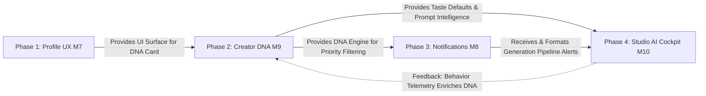

# Master Synthesis & Implementation Sequence: Systems M7 – M10

> **Scope:** Synthesis, correlation analysis, cumulative impact, and optimal execution roadmap for the 4 modernization blueprints (16 documents total).  
> **Target Subsystems:**
> 1. `docs/phases/profile-ux-enhancement` (Profile UX & Resilient Accessibility)
> 2. `docs/phases/notifications-modernization` (Notifications Center & Offline Persistence)
> 3. `docs/phases/creator-dna-adaptive-intelligence` (Creator DNA & Adaptive Intelligence)
> 4. `docs/phases/studio-ai-cockpit-v2` (Studio AI Cockpit v2)  
> **Status:** 🟢 ARCHITECTURAL MASTER PLAN  
> **Target Date:** 2026-10-14  

---

## 1. Executive Synthesis: The Unified Vision

Across all 16 specification documents, these 4 systems do not represent isolated feature upgrades. Together, they constitute the **Autonomous Creator Intelligence Loop** of Vhunambi.

Historically, Vhunambi was structured as a collection of capable, independent utilities: an audio generator, a basic profile, a simple popover alert modal, and a static onboarding screen.

The synthesis of these 4 blueprints transforms Vhunambi from a **transactional audio tool** into a **living cultural companion that learns, protects, and empowers the African creator**.

```mermaid
graph TD
    subgraph 1. SEED & IDENTITY [M9: Creator DNA]
        OB[5-Step Heritage Onboarding] -->|Seed Profile| DNA[(CreatorDnaProfile\nHive Box)]
        BE[Passive Behavior Telemetry] -->|recordEvent| DNA
    end

    subgraph 2. CREATIVE WORKBENCH [M10: Studio Cockpit v2]
        DNA -->|Auto-Fill Defaults & Atmosphere| STU[Studio Cockpit]
        STU -->|Session Ghost-Save| SESS[(Studio Session Box)]
        STU -->|Guided Lyrics & Bantu Switcher| GEN[Generation Pipeline FSM]
        STU -.->|Telemetry: Submit, Style, BPM| BE
    end

    subgraph 3. ALERT & DISPATCH [M8: Notifications Modernization]
        GEN -->|GenerationReady Alert| NOTIF[Notifications Center]
        DNA -->|Algorithmic Genre Sorting| NOTIF
        NOTIF -->|Deep Links| TRK[/track/:id]
    end

    subgraph 4. SHOWCASE & SOVEREIGNTY [M7: Profile UX Enhancement]
        DNA -->|DNA Card & Strength %| PROF[Artist & Owner Profile]
        TRK -->|Catalog & Discography| PROF
        PROF -->|Tip History & Royalties| CREDS[Creator Wallet]
    end
```

---

## 2. Cross-System Correlations & Architectural Invariants

Across all 16 documents, seven deep architectural correlations bind these systems together into a singular technical standard:

| Domain | Invariant Standard Across All 16 Docs | Architectural Rationale |
|---|---|---|
| **Persistence Engine** | Hand-rolled untyped Hive boxes (`Box? _box`) with zero `build_runner` or `@HiveType` annotations. | Eliminates code generation drift, ensures instant builds, and enables seamless headless in-memory test fallback (`Box? _box = null`). |
| **State Management** | Pure Riverpod 2.x (`StateNotifierProvider`, `Provider`, and family providers). | Predictable unidirectional data flow, simple dependency injection, and clean decoupling between UI widgets and domain logic. |
| **Shell Integrity** | Strict preservation of the canonical 5-tab `RootShell` (`main.dart`). | Never adds a 6th bottom nav tab. Notifications use top-bar/deep-link routes; DNA settings live in Profile; Studio preserves `IndexedStack`. |
| **Design Token Discipline** | 100% token adherence via `AppColors`, `AppTypography`, `AppRadius`, `AppSpacing`. Zero raw hex values. | Guarantees aesthetic harmony, seamless light/dark mode ("Morning Mist" / "Mountain Silhouette"), and high-contrast accessibility. |
| **Touch Ergonomics** | Universal 44×44px minimum interactive hit bounding boxes (Apple HIG / WCAG 2.1 AA). | Guarantees accessibility and effortless physical manipulation across real-world mobile devices. |
| **Test Baseline Preservation** | Every system introduces `FakeXxxService` stubs and strict test suites without regressing the 813+ baseline tests. | Prevents regressions in core audio, authentication, and navigation systems. |
| **Privacy & Sovereignty** | 100% on-device local computation for user taste profiles, draft recovery, and notification history. | User taste patterns and draft lyrics remain strictly sovereign on the user's device. |

---

## 3. Inter-System Dependencies: What Unlocks What

Understanding the relationships between systems reveals why executing them in an arbitrary order causes friction, mock duplication, or broken dependencies:



### Detailed Unlock Matrix

| System | What It Requires | What It Unlocks for Other Systems |
|---|---|---|
| **M7: Profile UX** | Existing `ArtistProfileEntity` and theme tokens. Zero dependencies on M8, M9, M10. | • Host surface for the **Creator DNA Card** (visual display of taste & strength).<br>• Home for **DNA Privacy & Reset Controls**.<br>• Resilient optimistic update & retry controllers reusable across other features. |
| **M9: Creator DNA** | Profile surface (M7) to display identity; Onboarding route to seed initial taste weights. | • `creatorDnaProvider`: The central intelligence provider across the entire client.<br>• DNA taste vectors for Studio pre-fills (M10).<br>• Algorithmic genre sorting for Notifications (M8).<br>• Behavioral event bus (`recordEvent`) to capture studio & playback telemetry. |
| **M8: Notifications** | `creatorDnaProvider` (M9) for algorithmic priority sorting. | • Accessible notification receiver ready to catch `GenerationPipeline` completion alerts from M10.<br>• Contextual deep linking back to `/track/:id` and `/studio`.<br>• Offline alert persistence in Hive. |
| **M10: Studio Cockpit** | `creatorDnaProvider` (M9) for prompt intelligence & defaults;<br>`NotificationsNotifier` (M8) to display alerts. | • **Closes the loop**: Dispatches `GenerationSubmitEvent`, `TrackPlayEvent`, and genre tweaks back into `CreatorDnaNotifier`.<br>• Solves session loss with ghost-save.<br>• Provides multi-lingual Bantu lyrics translation. |

---

## 4. The Correct Implementation Sequence & Execution Roadmap

To ensure every implementation phase is strictly **additive**—meaning no code is rewritten, no temporary throwaway mocks are built, and each phase immediately delivers visible user value—we follow this sequence:

```
┌────────────────────────────────────────────────────────────────────────┐
│ Phase 1: Profile UX Enhancement (M7) — ✅ COMPLETED                    │
│ ➔ Baseline UI surfaces, resilient error boundaries, accessibility     │
└──────────────────────────────────┬─────────────────────────────────────┘
                                   │
                                   ▼
┌────────────────────────────────────────────────────────────────────────┐
│ Phase 2: Creator DNA & Adaptive Intelligence (M9) — ✅ COMPLETED       │
│ ➔ 6-slide onboarding seed, on-device taste engine, profile DNA card     │
│ ➔ 911 tests passing, 0 regressions, 0 warnings/errors                  │
└──────────────────────────────────┬─────────────────────────────────────┘
                                   │
                                   ▼
┌────────────────────────────────────────────────────────────────────────┐
│ Phase 3: Notifications Modernization (M8) — ✅ COMPLETED               │
│ ➔ Category drawer, offline alerts, DNA-ranked algorithmic filtering    │
│ ➔ 950 tests passing (+39 new tests), 0 regressions, 0 warnings/errors  │
└──────────────────────────────────┬─────────────────────────────────────┘
                                   │
                                   ▼
┌────────────────────────────────────────────────────────────────────────┐
│ Phase 4: Studio AI Cockpit v2 (M10) — 🟡 NEXT UP                       │
│ ➔ Ghost session recovery, prompt intelligence, guided lyrics, telemetry│
└────────────────────────────────────────────────────────────────────────┘
```

### Phase 1: Profile UX Enhancement (`docs/phases/profile-ux-enhancement`) — ✅ COMPLETED
- **Status:** Complete (877 tests passing).
- **Primary Goal:** Stabilize the artist presentation layer, add retry engines, and prepare the UI canvas for DNA insights.
- **Deliverables:**
  - `profileOperationProvider` and optimistic update rollback.
  - WCAG 2.1 AA 44×44px hit bounds on all profile actions (tip, follow, edit).
  - ShimmerBox skeleton loading integration.
  - UI placeholder slot for the upcoming Creator DNA Card.

### Phase 2: Creator DNA & Adaptive Intelligence (`docs/phases/creator-dna-adaptive-intelligence`) — ✅ COMPLETED
- **Status:** Complete (911 tests passing, +34 new tests, 0 regressions).
- **Primary Goal:** Establish the on-device intelligence engine and seed it through enhanced onboarding.
- **Deliverables:**
  - 6-slide interactive onboarding flow capturing role, experience, genre heritage, language, and sound signature.
  - `CreatorDnaProfile` model and `AppConstants.creatorDnaBoxKey` Hive box with in-memory fallback.
  - `CreatorDnaNotifier` with dynamic scoring (`recordEvent()`, lifecycle transitions).
  - Real Creator DNA Card rendered live in `OwnerProfileView`.
  - Privacy controls (Local storage only, one-tap taste reset).
  - Pre-fill Studio suggestions via `dnaStudioDefaultsProvider`.
  - Client-side Explore ranking via `DnaExploreRanker`.
  - Contextual `DnaInsightCard` on Home Dashboard adhering to `strengthPercent > 0`.

### Phase 3: Notifications Modernization (`docs/phases/notifications-modernization`) — ✅ COMPLETED
- **Status:** Complete (950 tests passing, +39 new tests, 0 regressions).
- **Primary Goal:** Transform the notification popover into a resilient, category-driven notification center with offline persistence and kinetic tactility.
- **Deliverables:**
  - Dedicated `NotificationsView` route with 4 category filter tabs (Social, Studio Activity, System, Algorithmic).
  - Algorithmic notification sorter powered by `creatorDnaProvider` genre weights.
  - `NotificationRepository` with Hive persistence (`AppConstants.notificationsBoxKey`) and safe in-memory fallback.
  - Kinetic swipe-to-dismiss with 80px snap feedback and `SizeTransition` collapse.
  - Reusable `NotificationsHaptics` and `WobblingNotificationBell`.
  - Dual-surface coexistence: `NotificationsPopover` CTA `"View All Alerts in Center ➔"` pushing `NotificationsView`.

### Phase 4: Studio AI Cockpit v2 (`docs/phases/studio-ai-cockpit-v2`) — 🟡 NEXT UP
- **Primary Goal:** Elevate the music creation workbench into an intelligent, error-proof cockpit that feeds and is fed by the rest of the app.
- **Why Fourth (The Crown Jewel):** Studio requires DNA defaults (from Phase 2) to auto-fill BPM, mood, and genre; it requires the modernized notification center (from Phase 3) to receive generation progress; and its actions dispatch telemetry back into Phase 2, completing the loop.
- **Deliverables:**
  - Ghost session persistence (`AppConstants.studioSessionBoxKey`) with silent recovery.
  - Conversational Prompt Intelligence using DNA signals to eliminate blank-prompt paralysis.
  - Standardized Option Previews on complex acoustic settings.
  - Guided Section-by-Section Lyrics Composer.
  - Bantu Lyrics Language Switcher (isiZulu, Tshivenḓa, Sesotho, Xhosa, etc.).
  - Studio event telemetry dispatcher wired to `CreatorDnaNotifier.recordEvent()`.

---

## 5. What the App Achieves After Full Implementation

When all 4 blueprints are fully executed, the user experience undergoes a qualitative shift:

1. **Effortless Onboarding to First Track:**
   A new user spends 60 seconds in the 5-step onboarding answering simple musical questions. When they tap "Create", the Studio opens pre-configured with their heritage genre, regional tempo, and dialect—no blank screen, no confusion.
2. **Crash-Proof, Distraction-Proof Creation:**
   If a producer gets a phone call or navigates away mid-lyrics, their session is silently auto-saved in Hive. When they return, a non-intrusive recovery banner restores their prompt, sliders, and stanza drafts.
3. **Continuous Taste Evolution:**
   Every time the user accepts a drum suggestion, likes an Amapiano track in Explore, or adjusts a tempo slider, Vhunambi silently sharpens their taste model. The app becomes distinctly *theirs*.
4. **Transparent Identity & Ownership:**
   In their profile, the creator sees their "Creator DNA Strength" percentage grow, revealing their signature sound spectrum. They can inspect, edit, or reset this data at any time.
5. **Clear, Actionable Feedback:**
   When background cloud GPU generation finishes, an accessible, high-contrast notification appears, allowing one-tap preview, licensing, or discography publishing directly into their profile.

---

## 6. Shared Verification & Quality Gates

Each phase must pass the following standardized quality gate before moving to the next:

```bash
# 1. Static Analysis & Lint Check (Zero warnings)
flutter analyze

# 2. Complete Test Suite Run (Must maintain > 813 tests + new tests)
flutter test

# 3. Touch Target & Accessibility Verification
# Verify all interactive elements enforce 44x44px minimum bounding boxes

# 4. Token & Headless Persistence Verification
# Verify zero raw hex values and verify in-memory fallback works when Hive is uninitialized
```
