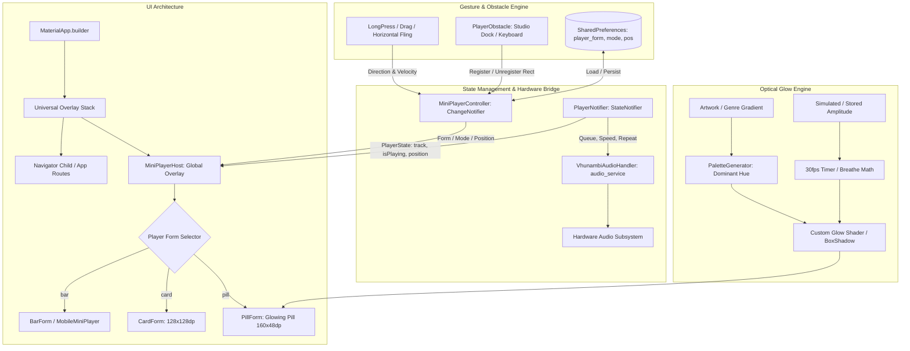
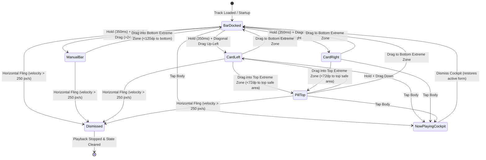

# Phase Spec: Adaptive Mini Player & Now Playing Cockpit (`blueprint.md`)

> **Platform:** African AI Music Synthesis & Commercial Licensing Platform (`VHUNAMBI`)  
> **Phase Codename:** Adaptive Mini Player & Now Playing Cockpit (Spec 3 / VH-014 through VH-017)  
> **Status:** 🟡 SPECIFICATION & HANDOFF  
> **Target Apps:** `apps/vhunambi_client` (Flutter/Dart — Windows, macOS, Android, iOS)  
> **Predecessor Blueprints:** [`docs/foundation_blueprints/02_PERSISTENT_PLAYER_SPEC.md`](file:///c:/Users/Ndugelo/VHUNAMBI/monorepo/docs/foundation_blueprints/02_PERSISTENT_PLAYER_SPEC.md), [`07_AUDIO_TRANSPORT_AND_PIPELINE_MODALS_SPEC.md`](file:///c:/Users/Ndugelo/VHUNAMBI/monorepo/docs/foundation_blueprints/07_AUDIO_TRANSPORT_AND_PIPELINE_MODALS_SPEC.md)  
> **Companion Specs:** [`.kiro/specs/adaptive-mini-player/`](file:///.kiro/specs/adaptive-mini-player/)

---

## 1. Executive Summary & Cultural Context

In the Vhunambi ecosystem, music playback is an uninterrupted background pulse that accompanies music generation, lyric composition in 25+ African indigenous languages, and beat licensing. Prior to this modernization, the mini player was statically pinned to the bottom of the screen, permanently consuming ~8% of screen vertical real estate and obscuring critical studio controls (such as the Crate Browser, MPC Chopper pads, and Stem Mixer sliders).

The **Adaptive Mini Player** transforms this rigid container into a fluid, context-aware floating interface with three morphing forms:
1. **Bar Form (Default Docked)**: Full-width docked player strip above navigation with complete playback transport.
2. **Card Form (128×128dp Square)**: Floating gesture-driven cover card with live progress and genre color accents.
3. **Pill Form (160×48dp Glowing Pill)**: Minimal floating pill anchored near the top bar, featuring a live 30fps amplitude reactive glow extracted from the song's cover art gradient.

Furthermore, this specification rectifies:
- **VH-014**: Adaptive mini player forms, auto-mode obstacle avoidance, and gesture controls.
- **VH-015**: Elimination of Flutter Material transparency bugs (yellow underlines on text).
- **VH-016**: Wiring of 12 previously dead controls in the full-screen Now Playing cockpit.
- **VH-017**: Layout defect resolution in Now Playing (overflowing action strips and missing safe-area padding).

---

## 2. System Topology & Data Flow Diagram



---

## 3. Viewport & Layout Wireframes

### 3.1 Mobile Viewport (< 768px)

```
┌────────────────────────────────────────────────────────┐
│ [Top Bar / Safe Area Top]                              │
│                                                        │
│ ┌──────────────────────┐                               │
│ │ (•) Pill Form 160x48 │ <-- Top Extreme Zone Anchor   │
│ └──────────────────────┘                               │
│                                                        │
│                                                        │
│                                                        │
│                        ┌──────────┐                    │
│                        │ CardForm │ <-- Snapped Margin │
│                        │ 128x128  │     (16dp to edge) │
│                        └──────────┘                    │
│                                                        │
│ ┌────────────────────────────────────────────────────┐ │
│ │ [BarForm / MobileMiniPlayer: 68dp]                 │ │ <-- Obstacle-avoiding (Auto)
│ └────────────────────────────────────────────────────┘ │
│ ┌────────────────────────────────────────────────────┐ │
│ │ [Bottom Navigation Bar: 64dp + Safe Area]          │ │
│ └────────────────────────────────────────────────────┘ │
└────────────────────────────────────────────────────────┘
```

### 3.2 Desktop Viewport (> 1024px)

```
┌─────────────────────────────────────────────────────────────────────────────────────────┐
│ [Desktop Top Bar: 68px]                                                 [Credits] [Me]  │
├─────────────────────────────────────────────────────────────────────────────────────────┤
│                                                                                         │
│   Main Workspace Viewport (Explore / Studio / Library / Market)                         │
│                                                                                         │
│                                                                                         │
├─────────────────────────────────────────────────────────────────────────────────────────┤
│ [DAW Desktop Transport Bar: 72px]   (⏮) (▶) (⏭)  [Volume ━━━━●]  [Speed 1.0x] [Queue]  │
└─────────────────────────────────────────────────────────────────────────────────────────┘
```

---

## 4. Component Hierarchy Tree

```
MaterialApp.builder
└── Stack
    ├── Route Subtree (Scaffold, CustomScrollView, IndexedStack)
    └── MiniPlayerHost (ConsumerStatefulWidget)
        └── Material (type: MaterialType.transparency)
            └── Stack
                ├── ExtremeZoneHighlight (while dragging)
                └── AnimatedPositioned (duration: 200ms, curve: Curves.easeOutCubic)
                    └── GestureDetector (onLongPressStart, onLongPressMoveUpdate, onLongPressEnd, onHorizontalDragEnd)
                        └── RepaintBoundary
                            └── AnimatedSwitcher (duration: 280ms, morph curve)
                                ├── BarForm (MobileMiniPlayer)
                                │   ├── 2dp Progress Line
                                │   ├── 44x44dp Artwork / Genre Gradient with Hero
                                │   ├── Metadata Column (Title, Artist, Genre Chip)
                                │   └── Control Strip (Previous, Play/Pause, Next)
                                ├── CardForm (128x128dp)
                                │   ├── Genre Gradient Background
                                │   ├── Centered Icon / Artwork
                                │   ├── Radial / Arc Progress Overlay
                                │   └── Tap-to-Expand Hit Area
                                └── PillForm (160x48dp)
                                    ├── Circular Cover Avatar (32x32dp)
                                    ├── Play/Pause Icon Button
                                    └── 30fps Reactive Cover Glow Shader
```

---

## 5. State Machine & Lifecycle Models

### 5.1 Player Form Morph State Machine



### 5.2 State Transition Trigger Matrix

| Source State | Event / Trigger | Target State | Side Effect |
|---|---|---|---|
| `BarDocked` | `LongPressStart` (350ms) | `BarDragging` | `HapticsService.mediumImpact()`, scale 1.03 |
| `BarDragging` | `DragDelta` angle < 20° | `ManualBar` | Follows finger Y, clamps within viewport |
| `BarDragging` | `DragDelta` diagonal ↖ / ↗ | `CardForm` | Haptic click, morphs to 128×128dp square |
| `CardForm` | Drag into Top 72dp Zone | `PillForm` | Haptic heavy impact, snaps to top pill |
| `Any Form` | Fling velocity > 250 px/s | `Dismissed` | Fling slide animation (180ms), stop audio, clear active track |
| `Any Form` | Tap on form body | `NowPlaying` | Open `ExpandedCockpitModal` via slide-up transition |
| `NowPlaying` | Dismiss modal | Active Form | Form visibility restored without playback interruption |

---

## 6. Design Token Bindings Table

| UI Element | Property | Token Binding | Value / Description |
|---|---|---|---|
| Mini Player Bar | Background | `AppColors.surfaceElevated` | Frosted `#141418` with opacity 0.85 |
| Mini Player Bar | Border | `AppColors.borderSubtle` | 1px border `#2D2D38` |
| Progress Line | Active Fill | `AppColors.brandPrimary` | Vibrant Orange `#F97316` |
| Progress Line | Background | `AppColors.borderSubtle` | `#2D2D38` |
| Card Form | Corner Radius | `AppRadius.cardBorder` | Rounded corners `12px` |
| Card Form | Shadow | Accent Shadow | `accent.withAlpha(0.4)`, blur `24px` |
| Pill Form | Dimensions | Geometry | `160dp × 48dp`, pill border `24px` |
| Pill Form | Glow Shader | Dynamic Color | Cover art dominant color + 30fps amplitude |
| Play/Pause Button | Background | `AppColors.brandPrimary` | Circular `#F97316` |
| Play/Pause Icon | Color | `AppColors.brandContrast` | Pure Black `#000000` |
| Touch Target | Hit Box | HIG / WCAG Mandate | Minimum `44×44px` on all controls |

---

## 7. Dock & Navigation Safe-Area Geometry

1. **Top Bar Interaction**:
   - Uses `VhunambiTopBarMetrics.totalHeight(context)`.
   - Top Extreme Zone: `topPadding + 72dp`. Pill Form positions inside this safe zone without colliding with top bar titles.
2. **Bottom Dock Interaction**:
   - Uses `VhunambiBottomDockMetrics.dockHeight(context)` (64dp nav + safe area bottom).
   - Bottom Extreme Zone: `screenHeight - dockHeight - 120dp`. Dragging inside this zone returns the player to `BarDocked` and resets `PlayerMode.auto`.
3. **Obstacle Avoidance**:
   - In `PlayerMode.auto`, if `PlayerObstacle` is registered (e.g. `content_studio_dock`), the bar floats `8dp` above the obstacle's top bound.
   - When no obstacle is present, it docks seamlessly above the bottom navigation bar.
