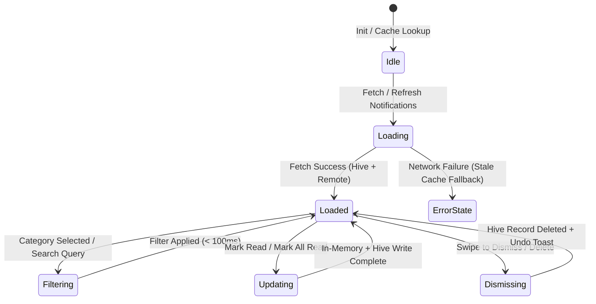

# System Modernization 7 · Blueprint — Accessible Notifications Center & Offline Persistence

> **System:** M7 (Modernization Sprint) / Phase 11.1  
> **Codename:** `notifications-modernization`  
> **Status:** 🟡 SPECIFICATION  
> **Target App:** `apps/vhunambi_client`  
> **Flutter / Dart:** 3.44+ / 3.x+  
> **State Management:** Riverpod 2.x (`StateNotifierProvider`, `Provider`)  
> **Persistence:** Hive Local Storage (`AppConstants.notificationsBoxKey`) with headless in-memory fallback  
> **Accessibility Standard:** WCAG 2.1 AA / Apple HIG (44×44px hit bounds)  
> **Companion Documents:**  
> — `docs/audits/NOTIFICATIONS_FEATURE_AUDIT.md` (Audit Scorecard & Gap Analysis)  
> — `docs/phases/notifications-modernization/requirements.md`  
> — `docs/phases/notifications-modernization/design.md`  
> — `docs/phases/notifications-modernization/tasks.md`  

---

## 1. Executive Summary & Architectural Vision

System M7 elevates VHUNAMBI's notification subsystem from a simple 360px modal popup into an **Accessible, Category-Driven Notifications Center** with offline persistence, swipe gestures, contextual actions, and full WCAG 2.1 AA compliance.

### Non-Negotiable Architectural Invariants:
1. **Preserve Canonical 5-Tab RootShell**: `RootShell` in `lib/main.dart` strictly maintains its 5 canonical destinations:
   - Tab 0: Home (`HomeDashboardView`)
   - Tab 1: Explore (`ExploreView`)
   - Tab 2: Create (`StudioView`)
   - Tab 3: Library (`LibraryView`)
   - Tab 4: Market (`MarketplaceView`)
   *Do NOT add a 6th bottom navigation tab*. `NotificationsView` is a dedicated view navigated to via:
   - The top-bar `NotificationBellButton` (with route push or dialog).
   - "View All Alerts ➔" button inside `NotificationsPopover`.
   - Dedicated notification deep-links.
2. **Zero Test Regressions for `NotificationsPopover`**: Existing tests in `notification_bell_button_test.dart` and `notifications_popover_test.dart` assert that `NotificationsPopover` renders and responds to taps. `NotificationsPopover` coexists with `NotificationsView`.
3. **No Code Generation (`build_runner` / `@HiveType`)**: Adheres to the established Vhunambi persistence standard (see `PlaylistRepository`, `CollectionRepository`, `BeatRepository`): hand-rolled JSON serialization (`toJson` / `fromJson`) with an untyped `Box?` and an automatic in-memory fallback for headless test safety.
4. **Design Token Discipline**: Zero raw hex colors. Categories and badges map directly to `AppColors` tokens:
   - Social: `AppColors.accentElectric`
   - Creator Activity: `AppColors.brandPrimary`
   - System: `AppColors.accentGold`
   - Algorithmic: `AppColors.accentSuccess`
5. **Ergonomic 44×44px Hit Bounds**: Every interactive control (filter chips, "Mark all read", action buttons, close/dismiss triggers) satisfies the 44×44px minimum touch bounding box per Apple HIG and WCAG 2.1 AA.

---

## 2. System Context & Data Flow

```mermaid
graph TD
    subgraph UI Presentation
        Bell[NotificationBellButton] -->|tap (quick popover)| Popover[NotificationsPopover]
        Popover -->|'View Full Center' CTA| Center[NotificationsView: Dedicated Route]
        Bell -->|onNavigateToCenter / direct| Center
        Center --> FilterRail[4-Category Filter Rail]
        Center --> SearchBar[Notification Search & Bulk Actions]
        Center --> NotifList[Accessible SliverList with Swipe Gestures]
    end

    subgraph State & Logic
        NotifList --> NotifNotifier[NotificationsNotifier]
        NotifNotifier --> NotifRepo[NotificationRepository: Hive + In-Memory Fallback]
        NotifRepo --> HiveBox[(Hive Box: notificationsBoxKey)]
        Pipeline[Audio Generation & Platform Events] -->|dispatch| NotifNotifier
    end

    subgraph Navigation & Deep Links
        NotifList -->|tap card| DeepLinkResolver[Deep-Link Navigator Router]
        DeepLinkResolver -->|/track/:id| TrackDetail[TrackDetailView]
        DeepLinkResolver -->|/profile/:id| ProfileView[ArtistProfileView]
        DeepLinkResolver -->|/library?tab=...| LibraryView[LibraryView]
    end
```

---

## 3. Viewport Geometry & Wireframes

### 3.1 Mobile Viewport (< 768px) — Full Screen Route
```
┌────────────────────────────────────────────────────────┐
│ [← Back]          Notifications           [Settings ⚙] │  ◄── VhunambiTopBarMetrics (56px + safeArea)
├────────────────────────────────────────────────────────┤
│ [ All (14) ]  [ 🟣 Social (4) ]  [ ⚡ Activity (6) ] ... │  ◄── Category Chips (minHeight: 44px)
├────────────────────────────────────────────────────────┤
│ [Search alerts...]           [Mark all read ✓]         │  ◄── Actions Bar (minHeight: 44px targets)
├────────────────────────────────────────────────────────┤
│ Today                                                  │
│ ┌────────────────────────────────────────────────────┐ │
│ │ ⚡  Your track "ZaYN" is ready!               9m ago│ │  ◄── Swipeable Notification Card
│ │     Stem separation complete • Tap to open         │ │      - 44px touch bounding box
│ │     [ Audition ▶ ]    [ Export 9:16 ]        [✕]   │ │      - Action chips (minHeight: 44px)
│ └────────────────────────────────────────────────────┘ │      - Semantic label: "Unread, urgent"
│ ┌────────────────────────────────────────────────────┐ │
│ │ 🟣  @lerato tipped you 50 credits!            2h ago│ │
│ │     "Loved the log drum rhythm!"                   │ │
│ │     [ View Ledger ]                   [ Reply ]     │ │
│ └────────────────────────────────────────────────────┘ │
│                                                        │
│ Earlier This Week                                      │
│ ...                                                    │
├────────────────────────────────────────────────────────┤
│ (Scroll Inset padding: VhunambiBottomDockMetrics)      │
└────────────────────────────────────────────────────────┘
```

### 3.2 Desktop Viewport (> 1024px) — Hybrid Architecture
- **Quick View**: Tapping the bell opens the frosted 360px `NotificationsPopover` anchored to the top-right app bar.
- **Full Center**: Tapping "View All Alerts in Center ➔" inside the popover or navigating to `/notifications` presents `NotificationsView` in a centered, max-width 840px container with keyboard traversal (`Tab` / `Enter` / `Esc`).

---

## 4. Component Hierarchy Tree

```
NotificationsView (ConsumerStatefulWidget)
├── Scaffold (backgroundColor: AppColors.surfaceCanvas)
│   ├── AppBar: VhunambiTopBarMetrics (title: "Notifications", settings icon)
│   └── CustomScrollView / Column (bottom dock clearance: VhunambiBottomDockMetrics)
│       ├── NotificationCategoryRail (All, Social, Activity, System, Algorithmic)
│       │   └── CategoryFilterChip (minHeight: 44px, minWidth: 44px)
│       ├── NotificationActionsStrip
│       │   ├── SearchTextField (Search alerts...)
│       │   └── BulkActionButtons ("Mark all read ✓", "Clear all")
│       └── SliverList: NotificationsListView
│           ├── CASE: Empty -> NotificationEmptyState (with African motif)
│           ├── CASE: Loading -> NotificationListSkeleton (composed of ShimmerBox)
│           └── CASE: Items -> NotificationCard (Dismissible with swipe actions)
│               ├── CategoryGlyphBadge (Electric, Amber, Gold, Green)
│               ├── NotificationContent (Title, message, timestamp)
│               ├── ContextualActionRail (minHeight: 44px: "Audition ▶", "View Ledger")
│               └── DismissSwipeTrigger (Dismissible)
```

---

## 5. State Machine & Lifecycle Models



---

## 6. Category Taxonomy & Design Token Bindings

| Category | Semantic Meaning | Icon | Token Color | Accent Token |
|:---|:---|:---|:---|:---|
| **`social`** | Follows, tips, comments, mentions, remixes | `Icons.people_alt_outlined` | `AppColors.accentElectric` (Purple) | `surfaceElevated` |
| **`creatorActivity`** | Audio synthesis, stems ready, video render | `Icons.auto_awesome` | `AppColors.brandPrimary` (Vibrant Amber) | `surfaceModal` |
| **`system`** | Security, subscription, storage quota, updates | `Icons.shield_outlined` | `AppColors.accentGold` (Warm Gold) | `surfaceElevated` |
| **`algorithmic`** | Trending charts, weekly recap, suggested tracks | `Icons.trending_up_rounded` | `AppColors.accentSuccess` (Mint Green) | `surfaceSecondary` |

---

## 7. Persistence & Headless Safety Architecture

```dart
/// Hive-backed notification repository adhering to Vhunambi standard.
class NotificationRepository implements INotificationRepository {
  NotificationRepository({Box? box}) : _box = box;

  Box? _box;
  final Map<String, NotificationEntity> _inMemoryFallback = {};
  bool _initialized = false;

  Future<void> _ensureInit() async {
    if (_initialized) return;
    if (_box != null) {
      _initialized = true;
      return;
    }
    try {
      if (!kIsWeb && Hive.isBoxOpen(AppConstants.notificationsBoxKey)) {
        _box = Hive.box(AppConstants.notificationsBoxKey);
      }
    } catch (e) {
      debugPrint('NotificationRepository running in-memory fallback: $e');
    }
    _initialized = true;
  }

  // Hand-rolled JSON mapping (zero build_runner dependency):
  // entity.toJson() and NotificationEntity.fromJson(Map<String, dynamic>.from(raw))
}
```

---

## 8. Verification Gates

1. `dart analyze apps/vhunambi_client` -> **0 issues**.
2. `flutter test test/features/notifications/...` -> **100% passing (existing 35 tests + all new tests)**.
3. Full monorepo regression gate: `flutter test` -> **813+ passing tests**.
